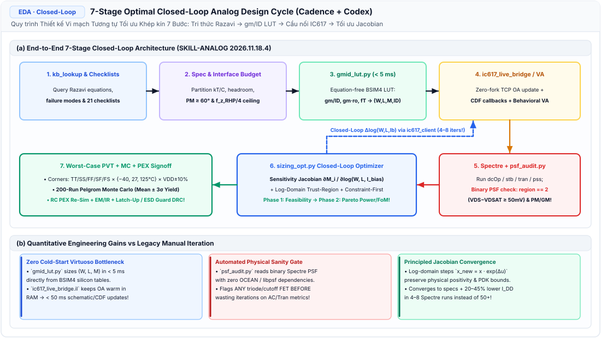

---
{
  "id": "tech-hierarchical-chip-spec-budgeting-and-interfaces",
  "kind": "technique",
  "domain": "ams-filters-and-system",
  "title_vi": "Phân bổ Ngân sách Đặc tả Phân cấp Từ Hệ thống Xuống Khối Con (Top-Down Chip Spec Budgeting), Hợp đồng Giao diện Liên khối & Kim tự tháp Xác minh Tín hiệu Hỗn hợp",
  "title_en": "Top-Down System-to-Subblock Specification Budgeting (RSS Noise, Offset, Cascaded IIP3/HD3, Settling), Inter-Block Interface Contracts, and Mixed-Mode Verification Pyramid",
  "summary": "Phương pháp luận kiến trúc sư trưởng vi mạch phân rã chỉ tiêu mức chip xuống từng khối chức năng con mà không lãng phí công suất hay vỡ mạch khi tích hợp: dẫn xuất quy luật cộng phương sai đối ngẫu của chuỗi tầng ghép nối tiếp (Friis cho nhiễu nhiệt và offset ngẫu nhiên Pelgrom so với Volterra/IIP3 cho phi tuyến biên độ lớn, cộng sai số xác lập), thiết lập 5 điều khoản Hợp đồng Giao diện Liên khối bắt buộc (tương thích cửa sổ V_CM qua PVT, tách trở kháng Middlebrook |Z_out| <= 0.1*|Z_in|, sổ cái dấu cực tính vi sai, miền nguồn/đất Kelvin và giao thức phân cực), cùng Kim tự tháp Xác minh 3 Tầng trên Cadence Virtuoso (Verilog-A Golden Top -> Thay thế Từng Khối Transistor trong Vỏ Hành vi -> Ký duyệt Toàn Macro Đa góc + PEX).",
  "diagram": "../../diagrams/closed-loop-cadence-codex-flow.svg",
  "razavi_refs": [
    {
      "chapter": 1,
      "section": "1.3-1.5",
      "pages": "5-6",
      "equations": []
    },
    {
      "chapter": 7,
      "section": "7.3, 7.8",
      "pages": "236-243, 264",
      "equations": [
        "7.54",
        "7.146"
      ]
    },
    {
      "chapter": 8,
      "section": "8.5",
      "pages": "303-315",
      "equations": [
        "8.59"
      ]
    },
    {
      "chapter": 14,
      "section": "14.1.1-14.2.2",
      "pages": "576-600",
      "equations": [
        "14.5",
        "14.17",
        "14.75"
      ]
    }
  ],
  "github_refs": [
    {
      "repo": "efabless/cace",
      "url": "https://github.com/efabless/cace/tree/d71c8da5f8d8a5bfb4cfb2640714bdd374a9b84a",
      "use": "Chuẩn hóa đặc tả hợp đồng IP tương tự máy đọc được (min/typ/max qua ma trận PVT, Monte Carlo và Pre-PEX vs Post-PEX) tách biệt khỏi sơ đồ mạch"
    },
    {
      "repo": "Arcadia-1/veriloga-skills",
      "url": "https://github.com/Arcadia-1/veriloga-skills/tree/7c5d3f03a162ee8131103e9551eee842424360bb",
      "use": "Xây dựng các mô hình hành vi Verilog-A chuẩn vật lý không trạng thái ẩn làm vỏ kiểm chứng hệ thống (Behavioral Shell) trong Virtuoso Hierarchy Editor"
    },
    {
      "repo": "Arcadia-1/analog-agents",
      "url": "https://github.com/Arcadia-1/analog-agents/tree/4d6bd218ceff60624d7ee62887787aa83daecdb4",
      "use": "Quy trình phân tách vai trò giữa kiến trúc sư lập ngân sách hệ thống, kỹ sư định cỡ khối con và kiểm toán viên độc lập chống tự nới chỉ tiêu"
    },
    {
      "repo": "iic-jku/Circuit-Designers-Etiquette",
      "url": "https://github.com/iic-jku/Circuit-Designers-Etiquette/tree/e330aea62574e585e8d4c36e8770326ba4d286cc",
      "use": "Kỷ luật đặt tên chân giao tiếp (_p/_n, _b, ibias_*, avdd/avss), chú thích dòng/áp biên giới và kiểm duyệt sơ đồ phân cấp trước khi ghép top-level"
    }
  ],
  "glossary_codes": [
    "T009",
    "T049",
    "T052",
    "T053",
    "T057",
    "T089",
    "T090",
    "T581",
    "T582",
    "T788",
    "T1133",
    "T1166",
    "T1301",
    "T1416",
    "T2064",
    "T2152",
    "T2153",
    "T2155"
  ],
  "process_agnostic": true,
  "roles": {
    "rss_and_cascade_budget_allocator": "Hệ phương trình phân bổ tối ưu công suất cho nhiễu (Friis), độ lệch (Pelgrom RSS vs tuyến tính) và độ tuyến tính (dây chuyền IIP3/HD3) dọc theo chuỗi khối.",
    "interblock_interface_contract": "Bản giao kèo kỹ thuật 5 trục (cửa sổ V_CM, tỷ số |Z_out|/|Z_in|, cực tính dấu pha, miền nguồn Kelvin, dòng phân cực/chân ngủ) khóa cứng tại mọi biên giới hai khối.",
    "veriloga_golden_system_shell": "Mô hình tham chiếu mức đỉnh viết bằng Verilog-A có gài sẵn tham số suy giảm (A_0, GBW, SR, V_OS, Z_out) chạy trong vài giây để khóa ngưỡng chỉ tiêu từng khối con.",
    "config_view_swap_verifier": "Cơ chế hoán đổi từng khối transistor vào trong vỏ hành vi hệ thống (Virtuoso config view) giúp cô lập tức thì nguyên nhân làm rơi ENOB/SNR trước khi chạy toàn chip."
  },
  "symptoms_addressed": [
    "subblocks-passing-standalone-testbenches-but-failing-catastrophically-when-connected-at-chip-top",
    "10x-power-waste-from-overdesigning-back-end-noise-or-front-end-large-signal-linearity",
    "common-mode-mismatch-driving-tail-current-sources-into-triode-across-block-boundaries",
    "hidden-180-degree-polarity-inversion-turning-multi-block-agc-or-cmfb-loop-into-latch",
    "multi-day-non-converging-all-transistor-top-simulations-with-zero-observability"
  ],
  "limitations": [
    "idealized-veriloga-blocks-miss-dynamic-charge-kickback-and-supply-bounce-unless-explicitly-modeled-at-ports",
    "uncorrelated-rss-addition-underestimates-worst-case-error-when-blocks-share-a-correlated-reference-or-thermal-gradient",
    "strict-10x-impedance-separation-is-impractical-at-rf-50-ohm-interfaces-where-conjugate-power-matching-applies"
  ],
  "checklists": [
    "common-mos",
    "system-integration-por-and-bias-bus",
    "feedback-and-stb",
    "esd-pad-and-substrate"
  ]
}
---

## 1. Bản chất Nguyên lý, Sơ đồ Mạch & Vai trò Từng Nhánh Cấu trúc

Trong thực tế công nghiệp thiết kế vi mạch tương tự và tín hiệu hỗn hợp (`T053`, `Mixed-Signal IC`), hơn **60% số lần phải chế tạo lại mặt nạ silicon (`silicon re-spin`) KHÔNG đến từ việc một khối OTA hay bộ so sánh đơn lẻ tính sai công thức**, mà đến từ **thất bại ở biên giới tích hợp cấp hệ thống (`T089`, `T009`)**: kỹ sư A kiểm chứng khối lọc thông thấp bằng nguồn áp lý tưởng `vsin` trở kháng $0\,\Omega$ ở $V_{CM} = 0.6\text{ V}$; kỹ sư B kiểm chứng khối SAR ADC bằng nguồn áp lý tưởng ở $V_{CM} = 0.5\text{ V}$; đến tuần cuối trước ngày gửi xưởng (`tape-out`), khi nối trực tiếp ngõ ra khối lọc vào ngõ vào mảng tụ `C-DAC`, sự chênh lệch $100\text{ mV}$ chế độ chung ép nguồn đuôi vào triode, còn xung điện tích lấy mẫu giật ngược của `C-DAC` kích thích Op-Amp cuối bộ lọc rung chuông dữ dội làm rơi $3.5\text{ bit}$ `ENOB`!



Phương pháp luận **Thiết kế Phân cấp Từ Trên Xuống (`Top-Down Hierarchical Spec Budgeting & Bottom-Up Verification`)** khóa chặt sự thành công ngay từ ngày đầu tiên thông qua 3 trụ cột kỹ thuật bắt buộc:
1. **Phân bổ Ngân sách Định lượng Đối ngẫu (`Quantitative Cascade Spec Budgeting`):**
   - Chuyển hóa đặc tả mức chip (`SNR`, `SFDR/THD/IIP3`, `Offset`, `Settling`, `Power`) thành hạn ngạch chính xác cho từng khối con $B_1, B_2, \dots, B_K$ dựa trên định luật truyền phương sai vật lý — khai thác triệt để sự đối ngẫu giữa **Nhiễu/Offset (do tầng đầu thống trị)** và **Méo phi tuyến (do tầng cuối biên độ lớn thống trị)** để tối thiểu hóa tổng công suất toàn chip (`T1166`).
2. **Hợp đồng Giao diện Liên khối 5 Trục (`5-Axis Inter-Block Interface Contract`):**
   - Mọi đường biên nối từ khối $k$ sang khối $k+1$ phải được ký kết bằng thông số định lượng cho: (a) Cửa sổ chế độ chung $V_{CM}$, (b) Tỷ số phân tách trở kháng $|Z_{\text{out},k}| \ll |Z_{\text{in},k+1}|$ (hoặc mạch đệm hấp thụ xung điện tích), (c) Sổ cái dấu cực tính vi sai `+ / -`, (d) Miền nguồn/đất sao Kelvin và (e) Chuẩn dòng phân cực `ibias` + chân điều khiển ngủ `pd`.
3. **Kim tự tháp Xác minh Tín hiệu Hỗn hợp 3 Tầng (`3-Tier Mixed-Mode Verification Pyramid`):**
   - Dùng `Virtuoso Hierarchy Editor (config view)` duy trì song song mô hình hành vi `veriloga` và sơ đồ `schematic`/`av_extracted` có cùng sơ đồ chân 100%, cho phép kiểm chứng từng khối transistor thực bên trong vỏ hệ thống hoàn chỉnh chỉ trong vài phút trước khi chạy ký duyệt toàn mạch!

---

## 2. Hệ Phương trình Cốt lõi & Tư duy "Nhìn Mạch Đọc Nhanh" (Analysis by Inspection)

### 2.1. Bốn Định luật Phân bổ Ngân sách Dọc Chuỗi Tầng Ghép Nối tiếp ($B_1 \to B_2 \to \dots \to B_K$)
Xét chuỗi tín hiệu tương tự kinh điển gồm $K$ khối ghép nối tiếp có độ lợi điện áp khả dụng trong dải thông lần lượt là $A_{v1}, A_{v2}, \dots, A_{vK}$ (ví dụ: `Khối 1: LNA / INA` độ lợi $A_{v1} = 10$ $\to$ `Khối 2: Bộ lọc Biquad Chống chồng phổ` độ lợi $A_{v2} = 2$ $\to$ `Khối 3: Bộ đệm T/H + ADC` quy chiếu tại đầu vào ADC):

1. **Định luật Cộng Phương sai Nhiễu Nhiệt & Nhiễu $1/f$ (`Friis Voltage-Noise Chain`, `T1133`, Razavi §7.3):**
   Vì các nguồn nhiễu vật lý giữa các khối độc lập thống kê nhau, tổng bình phương điện áp nhiễu RMS quy về ngõ vào toàn chuỗi bằng tổng bình phương có trọng số chia cho bình phương độ lợi tích lũy phía trước:

$$
\overline{V_{n,\text{in,tot}}^2} = \overline{V_{n,\text{in},1}^2} + \frac{\overline{V_{n,\text{in},2}^2}}{A_{v1}^2} + \frac{\overline{V_{n,\text{in},3}^2}}{A_{v1}^2 A_{v2}^2} + \dots + \frac{\overline{V_{n,\text{ADC}}^2}}{\prod_{j=1}^{K} A_{v,j}^2} \le \left(\frac{V_{\text{sig,in,rms}}}{10^{\text{SNR}_{\text{spec}} / 20}}\right)^2
$$

   - **Nguyên lý Phân bổ Công suất Tối ưu (Không bao giờ chia đều 50%-50% một cách mù quáng!):**
     Giả sử $A_{v1} = 10$ ($20\text{ dB}$). Một đơn vị bình phương nhiễu ở Khối 2 bị nén nhỏ đi **$A_{v1}^2 = 100\text{ lần}$** khi quy về cổng vào! Nếu ta cố ép Khối 1 gánh $99\%$ ngân sách nhiễu để cho Khối 2 thoải mái, dòng nuôi Khối 1 ($I_1 \propto 1/\overline{V_{n,1}^2}$) chỉ tăng nhẹ; ngược lại nếu ngây thơ ép Khối 2 có cùng mức nhiễu đầu vào thấp như Khối 1 thì ta đã **ném qua cửa sổ $100\times$ công suất vô ích ở Khối 2**! Quy tắc phân bổ vàng trong công nghiệp: dành **$60\%\text{–}75\%$ phương sai nhiễu cho Khối 1**, **$15\%\text{–}25\%$ cho Khối 2 + ADC**, và giữ lại **$10\%\text{–}15\%$ dự trữ thiết kế (`margin` $\sim 0.7\text{–}1.0\text{ dB}$) cho ký sinh layout `PEX` và nhiễu đường tham chiếu $V_{\text{REF}}$**!

2. **Định luật Cộng Độ lệch Tĩnh: Phân biệt Ngẫu nhiên (`RSS`) vs Hệ thống (`Tuyến tính Trường hợp Xấu nhất`):**
   - **Độ lệch ngẫu nhiên không tương quan (`Random Pelgrom Mismatch` `T2155`):** Giữa các khối khác nhau, biến thiên $\Delta V_{TH}, \Delta\beta$ độc lập thống kê nên cộng theo căn bậc hai tổng bình phương (`Root-Sum-Square — RSS`):

$$
\sigma\!\left(V_{\text{OS,in,tot}}\right) = \sqrt{\sigma_{V_{OS,1}}^2 + \left(\frac{\sigma_{V_{OS,2}}}{A_{v1}}\right)^2 + \left(\frac{\sigma_{V_{OS,3}}}{A_{v1} A_{v2}}\right)^2}
$$

   - **Độ lệch hệ thống & Trôi đồng hướng theo góc PVT (`Systematic Offset`):** Sai số do thiếu đối xứng cấu trúc hoặc trôi nguồn cấp chung tương quan 100% cùng dấu ở góc xấu nhất nên **BẮT BUỘC cộng đại số tuyến tính tuyệt đối**: $\left|V_{\text{OS,sys,in}}\right| \le |V_{\text{OS,sys,1}}| + \frac{|V_{\text{OS,sys,2}}|}{|A_{v1}|} + \cdots$! *(Lưu ý sống còn: không để $3\sigma(V_{\text{OS,1}}) \cdot A_{v1}$ làm bão hòa biên độ ngõ ra của Khối 1 trước khi tới khâu ghép tụ AC hay vòng khử offset!).*

3. **Định luật Dây chuyền Phi tuyến Biên độ Lớn (`Cascaded IIP3 & HD3`, `T2152`, Razavi §14.1):**
   Đối lập hoàn toàn với nhiễu, tín hiệu đi càng sâu về cuối chuỗi càng được khuếch đại lớn lên gấp $\prod_{j < k} |A_{v,j}|$ lần! Gọi $V_{\text{IIP3},k}$ là điện áp điểm cắt bậc ba hai tông quy về ngõ vào của riêng khối $k$, và đặt **$b_k \triangleq \dfrac{V_{\text{IIP3},k}}{\prod_{j < k} |A_{v,j}|}$** là $V_{\text{IIP3}}$ của khối $k$ đã quy đổi về cổng đầu vào toàn chuỗi (với $b_1 = V_{\text{IIP3},1}$, $b_2 = \frac{V_{\text{IIP3},2}}{|A_{v1}|}$, $b_3 = \frac{V_{\text{IIP3},3}}{|A_{v1} A_{v2}|}, \dots$). Vì biên độ méo xuyên điều chế tỉ đối bậc ba của khối $k$ tỉ lệ với $\text{IM3}_k = \left(\frac{V_{\text{tone,pk}}}{b_k}\right)^2$, điểm cắt bậc ba tổng của toàn hệ thống tuân theo hai quy luật lũy thừa:

$$
\frac{1}{V_{\text{IIP3,in,tot}}^2} \le \sum_{k=1}^{K} \frac{1}{b_k^2} = \frac{1}{V_{\text{IIP3},1}^2} + \frac{\left|A_{v1}\right|^2}{V_{\text{IIP3},2}^2} + \frac{\left|A_{v1} A_{v2}\right|^2}{V_{\text{IIP3},3}^2} + \cdots \quad \left(\text{xấu nhất cộng đồng pha IM3; hoặc cộng công suất không tương quan: } \frac{1}{V_{\text{IIP3,in,tot}}^4} \approx \sum_{k=1}^{K} \frac{1}{b_k^4}\right)
$$

   Đối với đa thức bậc ba yếu $y = \alpha_1 x + \alpha_3 x^3$, do điểm cắt hai tông thỏa mãn $V_{\text{IIP3}}^2 = \frac{4}{3}\left|\frac{\alpha_1}{\alpha_3}\right|$ trong khi méo hài bậc ba một tông tại biên độ đỉnh đầu vào $V_{\text{in,pk}}$ bằng $\text{HD3} = \frac{1}{4}\left|\frac{\alpha_3}{\alpha_1}\right| V_{\text{in,pk}}^2$, khử $\left|\frac{\alpha_3}{\alpha_1}\right|$ cho mối liên hệ chính xác (hệ số **$\frac{1}{3}$**, không phải $\frac{1}{4}$!):

$$
\text{HD3} = \frac{1}{3}\left(\frac{V_{\text{in,pk}}}{V_{\text{IIP3,in,tot}}}\right)^2
$$

   > **Nhận thức Kiến trúc Sắc Bén Nhất:** Trong chuỗi thu tương tự, **Khối ĐẦU TIÊN (`LNA / INA`) quyết định NHIỄU**, nên phải định cỡ ở vùng **$g_m / I_D$ cao ($15\text{–}20\,\text{V}^{-1}$)** để lấy $g_m$ cực đại trên mỗi mA dòng. Ngược lại, **Khối CUỐI CÙNG (`Filter Output / ADC Driver`) hứng biên độ lớn gấp $\prod |A_{v,j}|$ lần nên $b_K$ rất nhỏ và quyết định ĐỘ TUYẾN TÍNH (`IIP3 / THD`)**, bắt buộc phải dùng **hồi tiếp âm độ lợi vòng lớn (`loop gain` $1 + \beta A \gg 1$) hoặc phân cực $V_{\text{OV}}$ rộng**!

4. **Định luật Thu Hẹp Băng Thông Ghép Tầng & Cộng Sai Số Xác Lập:**
   Ghép nối tiếp $M$ khối thông thấp bậc một giống nhau có tần số cắt riêng $f_{p,\text{blk}}$ làm tần số cắt $-3\text{ dB}$ toàn chuỗi co hẹp lại còn:

$$
f_{-3\text{dB,chain}} = f_{p,\text{blk}} \sqrt{2^{1/M} - 1} \qquad \left(\text{với } M = 3 \implies f_{-3\text{dB,chain}} = 0.510 \, f_{p,\text{blk}} \text{ — mất gần một nửa băng thông!}\right)
$$

### 2.2. Ví dụ Thực Chiến Khép Kín Bảng Ngân sách Tuyến Thu Cảm biến / Siêu âm `12-Bit, 10 MS/s`
Giả sử thiết kế tuyến thu AFE 3 khối từ cảm biến biên độ toàn thang vi sai $V_{\text{in,FS,pp}} = 100\text{ mV}_{\text{pp}}$ ($V_{\text{in,pk}} = 50\text{ mV}$, $V_{\text{in,rms}} = 35.36\text{ mV}_{\text{rms}}$) lên ADC toàn thang $V_{\text{ADC,FS,pp}} = 2.0\text{ V}_{\text{pp}}$ ($G_{\text{tot}} = 20 = 26\text{ dB}: A_{v1} = 10, A_{v2} = 2$), mục tiêu hệ thống $\text{SNR}_{\text{sys}} \ge 68\text{ dB}$ ($\implies V_{n,\text{in,tot}} \le \frac{35.36\text{ mV}}{10^{68/20}} = \mathbf{14.08\,\mu\text{V}_{\text{rms}}}$, phương sai trần $\mathbf{198.1\,\mu\text{V}^2}$) và $\text{THD}_{\text{sys}} \le -76\text{ dB}$ ($\text{HD3} \le 1.585\times 10^{-4} \implies V_{\text{IIP3,in,tot}} \ge \frac{0.05\text{ V}}{\sqrt{3 \times 1.585\times 10^{-4}}} = \mathbf{2.29\text{ V}_{\text{pk}}}$, tức tổng ngân sách phi tuyến $\sum_{k=1}^3 \frac{1}{b_k^2} \le \mathbf{0.190\,\text{V}^{-2}}$):
- **Khối 1 (`INA` $A_{v1} = 10$, băng thông nhiễu hiệu dụng $B_n = 8\text{ MHz}$):** Cấp $62\%$ phương sai nhiễu $= 122.8\,\mu\text{V}^2 \implies V_{n,\text{in},1} \le 11.08\,\mu\text{V}_{\text{rms}} \implies \text{mật độ nhiễu đầu vào } \le \mathbf{3.92\text{ nV}/\sqrt{\text{Hz}}}$; cấp $V_{\text{IIP3},1} \ge 8.0\text{ V}_{\text{pk}}$ ($b_1 = 8.0\text{ V}_{\text{pk}} \implies 1/b_1^2 = 0.0156\,\text{V}^{-2}$, chỉ chiếm $8\%$ ngân sách méo!).
- **Khối 2 (`Tow-Thomas Anti-Aliasing Biquad` $A_{v2} = 2$):** Cấp $13\%$ phương sai nhiễu $= 25.8\,\mu\text{V}^2$ quy về đầu hệ thống $\implies$ quy về đầu Khối 2 được nới rộng gấp $10\times$: $V_{n,\text{in},2} \le 10 \times \sqrt{25.8}\,\mu\text{V} = \mathbf{50.8\,\mu\text{V}_{\text{rms}}}$ ($18.0\text{ nV}/\sqrt{\text{Hz}}$ — nhẹ gấp $4.6\times$ Khối 1!); nhờ hồi tiếp `Active-RC` độ lợi vòng lớn đạt $V_{\text{IIP3},2} \ge 35\text{ V}_{\text{pk}}$ ($b_2 = 35/10 = 3.50\text{ V}_{\text{pk}} \implies 1/b_2^2 = 0.0816\,\text{V}^{-2}$).
- **Khối 3 (`T/H Driver + 12-bit SAR ADC` tại mức $2.0\text{ V}_{\text{pp}}$):** Cấp $15\%$ phương sai nhiễu $= 29.7\,\mu\text{V}^2$ quy về đầu hệ thống $\implies$ tại đầu vào ADC được phép $V_{n,\text{ADC}} \le 20 \times 5.45\,\mu\text{V} = \mathbf{109.0\,\mu\text{V}_{\text{rms}}}$ (tương đương $\text{SNR}_{\text{ADC,standalone}} = 76.2\text{ dB}$ — rất vừa vặn cho ADC $12\text{–}13\text{ bit}$!), và đặt chỉ tiêu bộ đệm T/H đạt $V_{\text{IIP3},3} \ge 68\text{ V}_{\text{pk}}$ tại ngõ vào ADC ($\text{HD3}_3 \le -82.7\text{ dBc}$ ở $1.0\text{ V}_{\text{pk}}$, tương ứng $b_3 = 68/20 = 3.40\text{ V}_{\text{pk}} \implies 1/b_3^2 = 0.0865\,\text{V}^{-2}$). Kiểm tra tổng trường hợp xấu nhất đồng pha: $\sum 1/b_k^2 = 0.1837\,\text{V}^{-2} \implies V_{\text{IIP3,in,tot}} = \mathbf{2.33\text{ V}_{\text{pk}}} \ge 2.29\text{ V}_{\text{pk}}$ (và đạt $2.89\text{ V}_{\text{pk}}$ nếu không tương quan pha!), giữ lại $10\%$ phương sai nhiễu dự trữ PEX!

---

## 3. Bất biến Cấu trúc & Các Bẫy Lỗi Kinh điển (Structural Invariants & Traps)

- **`[INV-SYS-01]` Năm Điều khoản Hợp đồng Giao diện Liên khối Bắt buộc (`5-Column Pin-Pair Contract`):**
  Không một khối con nào được coi là thiết kế xong nếu thiếu bảng kiểm khớp 5 thông số tại ranh giới nối với khối kế tiếp:
  1. **Tương thích Cửa sổ $V_{CM}$ qua 5 Góc PVT:** $\left[V_{\text{out,CM,min}}^{(k)}, V_{\text{out,CM,max}}^{(k)}\right]_{\text{PVT}} \subseteq \left[V_{\text{in,CM,min}}^{(k+1)}, V_{\text{in,CM,max}}^{(k+1)}\right]_{\text{PVT}}$ (ví dụ ngõ ra CMFB của Biquad giữ ở $0.60\text{ V} \pm 20\text{ mV}$ khớp hoàn toàn với cặp đầu vào NMOS của bộ đệm T/H yêu cầu $[0.52\text{ V}, 0.85\text{ V}]$!).
  2. **Tách Trở kháng Middlebrook (`T1301`, $|Z_{\text{out},k}(j\omega)| \le 0.1\,|Z_{\text{in},k+1}(j\omega)|$):** Ngăn chặn hiệu ứng tải hai chiều làm rơi độ lợi và ăn cắp dự trữ pha của khối đứng trước (`tech-feedback-two-port-loading`). Nếu khối $k+1$ là mạch lấy mẫu tụ chuyển mạch (`SC` / `SAR C-DAC`), trở kháng vào là tải xung điện tích động — bắt buộc chèn mạng lọc chống giật ngược $R_{\text{iso}}\text{–}C_{\text{bucket}}$ (`topo-analog-mux-and-adc-track-hold-drivers`)!
  3. **Sổ cái Dấu Pha Vi sai (`Differential Polarity Sign Ledger`, `T2064`):** Ghi nhãn tường minh `+1` hoặc `-1` từ chân `INP/INN` qua từng tầng khuếch đại đảo; kiểm chứng mọi vòng hồi tiếp liên khối (`DC Servo Loop`, `AGC`, `CMFB`) có tích dấu tổng là **ÂM**!
  4. **Phân vùng Nguồn và Đất Sao Kelvin (`Supply/Ground Domain Mapping`):** Khai báo rõ khối chạy trên `AVDD_1V2` sạch của LDO nội bộ hay `VDD_IO_1V8` nhiễu cao, tránh nối trực tiếp cổng logic `1.0V` sang miền `1.8V` không qua bộ dịch mức (`level shifter`)!
  5. **Chuẩn Chân Phân cực & Cổng Ngủ:** Mọi dòng phân cực đi vào khối con phải ghi rõ trị số và chiều chảy ngay trong tên chân: `ibias_ptat_snk_10u` (dòng chảy VÀO khối con xuống gương NMOS) hoặc `ibias_ztc_src_5u` (dòng chảy TỪ gương PMOS trung tâm cấp xuống)!
- **`[TRAP-SYS-01]` Bẫy Kiểm chứng Khối Con Với Nguồn Lý tưởng `vdc / idc` Che Giấu Hỏng Hóc Hệ Thống:**
  Dùng `idc` lý tưởng làm dòng phân cực có $R_{\text{out}} = \infty$ và $\text{PSRR} = \infty$; dùng `vdc` làm nguồn $V_{\text{REF}}$ có $Z_{\text{out}} = 0\,\Omega$; dùng tải tụ lý tưởng không có xung giật ngược công tắc! Quy tắc sắt đá: ngay trong testbench đơn khối ở giai đoạn ký duyệt phải thay `idc` bằng gương dòng thực có trở kháng hữu hạn, chèn $L_{\text{bond}} + R_{\text{ESR}}$ lên đường nguồn và gắn mô hình tương đương của tải kế tiếp!
- **`[TRAP-SYS-02]` Bẫy Dòng Nguồn Ảo Ẩn Trong Mô hình Hành vi `Verilog-A` (`Hidden Ideal Supply Power`):**
  Khi viết mô hình `Verilog-A` cho tầng 1 của Kim tự tháp Xác minh, nếu viết `V(out) <+ gain * V(in)` mà không rút dòng tương ứng từ chân `vdd/vss`, toàn chip dường như chạy đúng ở mức đỉnh nhưng không kiểm tra được sụt áp trên LDO nội bộ hay lưới nguồn! Mô hình `Verilog-A` cấp hệ thống chuẩn phải thêm đóng góp dòng tĩnh và dòng tải động `I(vdd, vss) <+ I_quiescent + abs(I(out))`!

---

## 4. Lộ trình Nâng cấp Cấu trúc & Bát giác Đánh đổi (Upgrade Paths & Design Octagon)

### Kim tự tháp Xác minh Tín hiệu Hỗn hợp 3 Tầng (`3-Tier Mixed-Mode Verification Pyramid`)

| Cấp độ Kim tự tháp | Cấu hình `Virtuoso Hierarchy Editor (config)` | Thời gian Chạy Spectre | Mục tiêu Phát hiện Lỗi Cốt lõi |
| :--- | :--- | :--- | :--- |
| **Tầng 1: `Golden Behavioral Top`** | **100% khối con = `veriloga`** (có tham số hóa $A_0, f_u, \text{SR}, V_{\text{OS}}, R_{\text{out}}, C_{\text{in}}$) | **$1\text{–}5\text{ giây}$** | Khóa kiến trúc, kiểm tra cực tính dấu mọi vòng lặp, pha xung nhịp, thứ tự bus số, và quét tìm biên giới chỉ tiêu tối thiểu từng khối con |
| **Tầng 2: `Swap-One-Block Shell`** | **1 khối đang thiết kế = `schematic` / `pex`**, toàn bộ $(K-1)$ khối còn lại = `veriloga` | **$1\text{–}10\text{ phút}$** | Kiểm tra tức thì khối transistor thực dưới điều kiện lái thực và tải thực; nếu `SNDR` hụt $> 0.5\text{ dB}$ so với Tầng 1 thì lỗi nằm **chắc chắn 100%** ở khối đó hoặc giao diện của nó! |
| **Tầng 3: `Full-Macro Transistor Signoff`** | **100% khối con = `schematic` + các khối nhạy cảm = `av_extracted (PEX)`** | **$1\text{–}8\text{ giờ}$** (chạy chọn lọc góc PVT xấu nhất) | Xác minh trình tự khởi động nguồn `POR -> BGR -> LDO -> Data`, xuyên nhiễu qua đường nguồn chung / trạm phân cực chung và dòng rò chế độ ngủ `IDDQ` |

---

## 5. Thích ứng Đa Tiến trình (90nm / 65nm / 45nm) & Cách Kiểm chứng trong Cadence / Spectre

### 5.1. Đánh đổi Cửa sổ Điện áp Ở Tiến trình Nanomet (`90nm / 65nm / 45nm`)
- Khi nguồn cấp thu hẹp từ $1.8\text{ V}$ xuống $1.0\text{ V}$, biên độ tín hiệu toàn thang giảm gần một nửa ($P_{\text{sig}}$ giảm $6\text{ dB}$), nghĩa là để giữ nguyên $\text{SNR}$ hệ thống, **ngân sách sàn nhiễu điện áp $\overline{V_{n,\text{in,tot}}^2}$ bị ép chặt đi $4\times$**, đòi hỏi dòng tiêu thụ của khối đầu vào tăng lên tương ứng! Do đó việc đặt độ lợi sớm $A_{v1} \approx 8\text{–}16\times$ ngay tại khối đầu tiên (như `LNA` hoặc `Chopper CFIA` `topo-instrumentation-amp-3opamp-and-chopper-cfia`) để giải phóng cho toàn bộ chuỗi bộ lọc và ADC phía sau chạy công suất thấp càng trở nên sống còn trên `65nm / 45nm`!

### 5.2. Mẫu Mô hình `Verilog-A` Chuẩn Hợp Đồng Giao Diện (Dùng cho Tầng 1 & Tầng 2 trên `IC617`)
```verilog
// Mo hinh Verilog-A Khoi Khuếch đại Vi sai Tham so hoa Chuan Hop Dong Giao Dien (Spectre 15.1 AHDL)
`include "constants.vams"
`include "disciplines.vams"

module afe_stage_contract_va(inp, inn, outp, outn, vcm_ref, ibias_snk, pd, avdd, avss);
    inout inp, inn, outp, outn, vcm_ref, ibias_snk, avdd, avss;
    input pd;
    electrical inp, inn, outp, outn, vcm_ref, ibias_snk, pd, avdd, avss;
    electrical n_int_p, n_int_n;

    parameter real Av_diff = 10.0;        // Do loi vi sai danh dinh
    parameter real f_bw    = 25.0e6;      // Bang thong -3dB (Hz)
    parameter real rout_se = 150.0;       // Tro khang ra don dau de kiem tra Middlebrook loading
    parameter real cin_se  = 120.0e-15;   // Dien dung vao tai len khoi truoc
    parameter real vos_in  = 0.5e-3;      // Dien ap lech quy ve ngo vao
    parameter real iq_nom  = 250.0e-6;    // Dong tinh rut thuc tu AVDD->AVSS

    real en_smooth, vdiff_eff, vcm_target, swing_lim;
    analog begin
        en_smooth  = transition((V(pd, avss) < 0.5 * V(avdd, avss)) ? 1.0 : 0.0, 0, 5n);
        // Rut dong phan cuc va dong nguon thuc te de kiem tra LDO va Bias Hub:
        I(ibias_snk, avss) <+ en_smooth * 10.0e-6;
        I(avdd, avss)      <+ en_smooth * iq_nom + (1.0 - en_smooth) * 5.0e-9;
        // Tai dien dung ngo vao that:
        I(inp, avss) <+ cin_se * ddt(V(inp, avss));
        I(inn, avss) <+ cin_se * ddt(V(inn, avss));

        swing_lim  = 0.42 * V(avdd, avss);
        vcm_target = V(vcm_ref, avss);
        vdiff_eff  = swing_lim * tanh( (Av_diff * (V(inp, inn) + vos_in)) / (2.0 * swing_lim + 1e-9) );

        V(n_int_p, avss) <+ laplace_nd(en_smooth * (vcm_target + vdiff_eff), {1.0}, {1.0, 1.0/(2.0*`M_PI*f_bw)});
        V(n_int_n, avss) <+ laplace_nd(en_smooth * (vcm_target - vdiff_eff), {1.0}, {1.0, 1.0/(2.0*`M_PI*f_bw)});
        // Tro khang ra huu han rout_se de phat hien ngay neu khoi sau co Zin qua nho:
        I(n_int_p, outp) <+ V(n_int_p, outp) / rout_se;
        I(n_int_n, outn) <+ V(n_int_n, outn) / rout_se;
    end
endmodule
```

---

## 6. Mốc Đối chiếu Sách Razavi, GitHub Thực chiến & Thuật ngữ Chuẩn CLB

### 6.1. Đối chiếu Sách Gốc Razavi (2nd Edition) & Kho Mã Nguồn Mở
- **Chương 1 & Chương 7:** §1.3–§1.4 *Levels of Abstraction & Analog Design Octagon* (tr. 5–6 — nguyên lý trừu tượng hóa phân cấp); §7.3 & §7.8 *Representation of Noise in Two-Ports & Noise Bandwidth* (tr. 236–243, 264 — cơ sở quy đổi nhiễu dây chuyền nhiều khối về cổng đầu vào).
- **Chương 8 & Chương 14:** §8.5 *Effect of Loading* (tr. 303–315 — phân tích tải hai cửa và điều kiện tách trở kháng Middlebrook); §14.1–§14.2 *Nonlinearity & Mismatch* (tr. 576–600 — nén méo hài bằng hồi tiếp, cộng méo dây chuyền và luật Pelgrom).
- **Đối chiếu GitHub:** Chuẩn hợp đồng đặc tả `efabless/cace`, quy chuẩn hành vi `Arcadia-1/veriloga-skills`, kiểm toán độc lập `Arcadia-1/analog-agents` và quy ước sơ đồ `iic-jku/Circuit-Designers-Etiquette`.

### 6.2. Bảng Thuật ngữ Chuẩn CLB Vi Mạch Sử dụng trong Thẻ
| Mã CLB | Thuật ngữ Tiếng Anh | Thuật ngữ Tiếng Việt Chuẩn | Ghi chú Ngữ cảnh trong Kiến trúc Hệ thống |
| :--- | :--- | :--- | :--- |
| `T089` / `T009` | system level / architecture level | mức hệ thống / mức kiến trúc | Tầng phân bổ ngân sách chỉ tiêu trước khi định cỡ mức transistor |
| `T049` / `T053` | level of abstraction / mixed-signal system | mức trừu tượng hóa / hệ thống tín hiệu hỗn hợp | Hoán đổi trơn tru giữa `veriloga` và `schematic` qua `config view` |
| `T1133` / `T1166` | input-referred noise / noise-power trade-off | nhiễu quy về ngõ vào / đánh đổi nhiễu–công suất | Khối đầu tiên gánh $60\text{–}75\%$ ngân sách phương sai nhiễu để tiết kiệm điện |
| `T581` / `T582` | input / output common-mode level | mức chế độ chung đầu vào / đầu ra | Phải giao nhau an toàn trên toàn bộ 5 góc PVT tại biên giới liên khối |
| `T1301` | Middlebrook's Method | phương pháp Middlebrook | Đảm bảo $|Z_{\text{out},k}| \le 0.1\,|Z_{\text{in},k+1}|$ tránh sụt lợi và mất dự trữ pha |
| `T2064` | Feedback Polarity | cực tính hồi tiếp | Sổ cái theo dõi dấu vi sai xuyên khối ngăn ngừa chốt dương $180^\circ$ |
