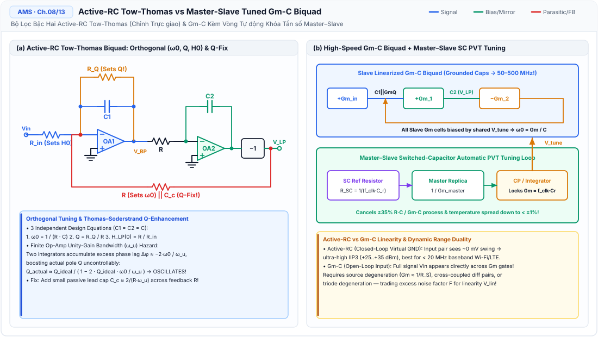

---
{
  "id": "topo-active-rc-sallen-key-and-tow-thomas-biquads",
  "kind": "topology",
  "domain": "ams-filters-and-system",
  "title_vi": "Bộ Lọc Tích cực Active-RC Liên tục Thời gian: Sallen-Key, Biquad Vi sai Tow-Thomas / Fleischer-Tow và Vọt Đỉnh Hệ số Phẩm chất Do Băng thông Hữu hạn",
  "title_en": "Continuous-Time Active-RC Anti-Aliasing & Baseband Filters: Finite-GBW Q-Enhancement, Sallen-Key Stopband Feedthrough, Differential Tow-Thomas Biquads, and Dynamic Range Scaling",
  "summary": "Nền tảng thiết kế bộ lọc thời gian liên tục tuyến tính cao cho chống chồng phổ ADC và thu phát băng gốc: dẫn xuất định luật băng thông đơn vị hữu hạn omega_u của Op-Amp gây vọt đỉnh hệ số phẩm chất 1/Q_eff = 1/Q - 2*omega_0/omega_u (có thể tự kích thành mạch dao động!) cùng kỹ thuật tụ bù sớm pha thụ động; giải phẫu tử huyệt truyền xuyên dải chắn tần số cao qua C1 của Sallen-Key; tổng hợp trực giao 3 thông số (omega_0, Q, H_0) trên Biquad vi sai hoàn toàn Tow-Thomas / Fleischer-Tow 2-OTA; và quy trình xếp thứ tự mắt lọc Butterworth/Chebyshev/Bessel kết hợp chuẩn hóa dải động chuẩn L-vô-cùng.",
  "diagram": "../../diagrams/tow-thomas-and-gmc-tuned-biquad.svg",
  "razavi_refs": [
    {
      "chapter": 7,
      "section": "7.8",
      "pages": "264",
      "equations": ["7.145", "7.146"]
    },
    {
      "chapter": 8,
      "section": "8.1-8.5",
      "pages": "274-315",
      "equations": ["8.15", "8.50"]
    },
    {
      "chapter": 9,
      "section": "9.6-9.7",
      "pages": "373-387",
      "equations": ["9.52"]
    },
    {
      "chapter": 10,
      "section": "10.2-10.3",
      "pages": "414-419",
      "equations": ["10.5", "10.12", "10.15"]
    },
    {
      "chapter": 13,
      "section": "13.1, 13.4",
      "pages": "539-542, 568-569",
      "equations": ["13.60"]
    },
    {
      "chapter": 14,
      "section": "14.1.3",
      "pages": "581-583",
      "equations": ["14.27"]
    }
  ],
  "github_refs": [
    {
      "repo": "iic-jku/analog-circuit-design",
      "url": "https://github.com/iic-jku/analog-circuit-design/tree/6075ea0ebcf08f5c7f6033a84e9dd3c91450f5e1",
      "use": "Thiết kế Op-Amp hai tầng vi sai hoàn toàn kèm CMFB, phân tích vòng kín Middlebrook và định cỡ băng thông GBW theo tải RC"
    },
    {
      "repo": "Arcadia-1/analog-design-bench",
      "url": "https://github.com/Arcadia-1/analog-design-bench/tree/972f7cd7c9",
      "use": "Cấu trúc bài kiểm chứng đa góc PVT cho bộ lọc Biquad vi sai hoàn toàn và đánh giá độ méo hài trong dải / suy hao ngoài dải"
    },
    {
      "repo": "efabless/sky130_pa_ip__instramp",
      "url": "https://github.com/efabless/sky130_pa_ip__instramp/tree/67a57bbfee",
      "use": "Thực hành bố trí mảng điện trở poly tỷ số chính xác và khuếch đại đóng vòng hồi tiếp điện trở trên tiến trình CMOS"
    }
  ],
  "glossary_codes": [
    "T042",
    "T057",
    "T063",
    "T523",
    "T786",
    "T800",
    "T803",
    "T812",
    "T861",
    "T1004",
    "T1031",
    "T1080",
    "T1089",
    "T1158",
    "T1169",
    "T1228",
    "T1328",
    "T1335",
    "T2150",
    "T2152",
    "T2176"
  ],
  "process_agnostic": true,
  "roles": {
    "active_rc_virtual_ground_integrator": "Bộ tích phân đảo Miller dùng Op-Amp độ lợi cao kẹp nút cộng dòng đứng yên tại đất ảo V_CM, buộc mọi điện áp tín hiệu lớn rơi trên điện trở poly và tụ kim loại tuyến tính để đạt IIP3 > +30 dBm.",
    "passive_phase_lead_capacitor_clead": "Tụ nhỏ C_lead = 1 / (omega_u * R) mắc song song điện trở đầu vào bộ tích phân (hoặc điện trở nhỏ nối tiếp tụ tích phân) tạo zero sớm pha khử chính xác độ trễ pha -omega/omega_u của Op-Amp.",
    "sallen_key_single_opamp_cell": "Mắt lọc bậc hai cực kỳ tiết kiệm công suất chỉ dùng 1 bộ đệm khuếch đại cho 2 cực phức, thích hợp làm mắt lọc chống chồng phổ bậc thấp Q <= 1.5 đi kèm mắt RC tiền lọc.",
    "differential_tow_thomas_two_ota_loop": "Vòng ghép hai bộ tích phân vi sai hoàn toàn (1 bộ tích phân có tổn hao R_Q + 1 bộ tích phân không tổn hao + tráo chéo dây vi sai thay thế tầng đảo dấu thứ ba) cho phép chỉnh độc lập omega_0, Q và độ lợi DC.",
    "fleischer_tow_feedforward_zero_path": "Nhánh tụ/trở truyền thẳng từ đầu vào vào nút đất ảo của bộ tích phân thứ hai trong vòng Tow-Thomas để tổng hợp thêm cặp zero phức trên trục ảo (lọc chắn dải Elliptic / Chebyshev Type-II / thông cao).",
    "linfinity_dynamic_range_scaler": "Phép biến đổi tỷ lệ nút nội (đổi thang tụ tích phân và trở nối vào nút đó) giữ nguyên hàm truyền tổng từ vào tới ra nhưng ép đỉnh biên độ tại mọi ngõ ra OTA bằng đúng 0 dB."
  },
  "symptoms_addressed": [
    "aliasing-of-out-of-band-blockers-and-wideband-noise-into-nyquist-adc",
    "severe-hd3-compression-of-open-loop-gm-c-filters-under-large-interferers",
    "unexpected-passband-peaking-or-oscillation-in-active-rc-filters-at-ss-corner",
    "sallen-key-filter-losing-high-frequency-stopband-attenuation-above-gbw",
    "premature-internal-stage-clipping-in-cascaded-high-order-chebyshev-filters"
  ],
  "limitations": [
    "requires-opamp-gbw-20x-to-40x-higher-than-q-times-f0-consuming-significant-power",
    "resistive-loading-demands-two-stage-or-class-ab-ota-output-stage",
    "raw-rc-time-constant-varies-plus-minus-30-percent-requiring-switched-cap-array-calibration"
  ],
  "checklists": [
    "common-mos",
    "feedback-and-stb",
    "cmfb",
    "continuous-time-filters",
    "layout-and-matching"
  ]
}
---

## 1. Bản chất Nguyên lý, Sơ đồ Mạch & Vai trò Từng Nhánh Cấu trúc

Mọi bộ biến đổi tương tự–số lấy mẫu rời rạc (`SAR`, `Pipeline`, `Switched-Capacitor` ở Chương 13) đều tuân theo định luật lấy mẫu Nyquist: bất kỳ nhiễu dải rộng hoặc tín hiệu gây nhiễu ngoài dải (`out-of-band blocker`) nằm tại các vùng tần số $k f_s \pm f_{\text{in}}$ đều bị **gấp phổ không thể đảo ngược** chui thẳng vào băng thông tín hiệu hữu ích *trước khi* bất kỳ bộ lọc số DSP nào kịp can thiệp! Không thể dùng một bộ lọc tụ chuyển mạch để chống chồng phổ cho chính nó ở cửa ngõ đầu tiên — cửa ngõ bảo vệ đó **bắt buộc phải là một bộ lọc thời gian liên tục (`Continuous-Time Anti-Aliasing Filter — AAF` hoặc `Baseband Channel-Select Filter`)**.

Khi tín hiệu thu nhận chứa các kênh lân cận mạnh hơn tín hiệu cần thu tới $+40\text{--}60\text{ dB}$ (trong máy thu không dây Wi-Fi/LTE/Bluetooth, radar FMCW, thu nhận siêu âm hay đo lường cảm biến công nghiệp), cấu trúc **Bộ lọc Tích cực Điện trở–Tụ điện (`Active-RC Filter`)** là nhà vô địch tuyệt đối về **độ tuyến tính tín hiệu lớn (`linearity` — `T523`, đạt $\text{SFDR} / \text{IM}_3 \sim -75\text{ đến }-95\text{ dBc}$, $\text{IIP}_3 > +25\text{--}35\text{ dBm}$)**. Bí quyết vật lý nằm ở nguyên lý **đất ảo hồi tiếp âm (`virtual ground` — Razavi §8.1, §14.1.3 `T1228`)**: hai cực cổng đầu vào vi sai của Op-Amp hầu như đứng im không nhúc nhích ($\Delta V_X \approx V_{\text{out}} / A(j\omega) \to 0$), còn toàn bộ điện áp dao động hàng Volt rơi hoàn toàn lên các **điện trở polysilicon và tụ kim loại MIM/MOM vốn cực kỳ tuyến tính**!



Ba cấu trúc trụ cột mà người kỹ sư thiết kế vi mạch phải nắm vững tường tận ranh giới sử dụng gồm:
1. **Bộ Tích phân RC Chủ động (Active-RC Lossless / Lossy Integrator — Viên gạch cơ sở):** Điện trở $R$ biến điện áp vào thành dòng điện $V_{in}/R$ đổ qua đất ảo nạp thẳng vào tụ hồi tiếp $C$ (kèm điện trở song song $R_Q$ nếu cần tạo cực có tổn hao).
2. **Mắt lọc Bậc Hai Sallen-Key (`Sallen-Key Single-Amplifier Biquad`):** Chỉ tốn **1 Op-Amp nối đệm theo áp** đi kèm hai điện trở $R_1, R_2$ và hai tụ $C_1$ (hồi tiếp dương từ ngõ ra về nút giữa!) và $C_2$ (nối đất tại cổng dương). Siêu tiết kiệm công suất tĩnh và nhiễu thấp cho mắt lọc chống chồng phổ bậc 2–3 hệ số phẩm chất nhỏ ($Q \le 1.5$), nhưng mang khuyết tật truyền xuyên tần số cao qua $C_1$.
3. **Mắt lọc Bậc Hai Vi sai Hoàn toàn Tow-Thomas & Fleischer-Tow (`2-OTA Fully-Differential Tow-Thomas Biquad`):** Chuẩn mực vàng của công nghiệp vi mạch băng gốc! Trong phiên bản đơn đầu cổ điển, vòng hai bộ tích phân đảo tạo ra hồi tiếp *dương* nên bắt buộc tốn thêm Op-Amp thứ ba chỉ để đảo dấu $-1$. Khi chuyển sang cấu trúc **vi sai hoàn toàn (`fully differential`)**, phép đảo dấu $-1$ được thực hiện **miễn phí $100\%$ công suất và không thêm một độ trễ pha nào chỉ bằng cách tráo chéo cặp dây hồi tiếp vi sai**! Kết quả là chỉ với **2 OTA vi sai** (kèm `CMFB` — `T800`), ta thu được đồng thời cả ngõ ra Thông thấp (`LPF` — `T861`) và Thông dải (`BPF` — `T1031`), còn nếu thêm nhánh truyền thẳng Fleischer-Tow thì hiện thực được mọi hàm truyền Bậc Hai tổng quát (Thông cao `T803`, Chắn dải Elliptic Notch, Cân bằng pha All-Pass)!

---

## 2. Hệ Phương trình Cốt lõi & Tư duy "Nhìn Mạch Đọc Nhanh" (Analysis by Inspection)

### 2.1. Định luật Sống Còn: Băng thông Hữu hạn $\omega_u$ Của Op-Amp Gây Vọt Đỉnh $Q$-Enhancement & Tự Dao động!
Đây là cái bẫy làm cháy hàng loạt bản thiết kế bộ lọc Active-RC đầu tay khi chuyển từ mô hình Op-Amp lý tưởng sang transistor thực! Xét một bộ tích phân đảo Active-RC ($R$ và $C$) dùng Op-Amp một cực trội có hàm truyền vòng hở $A(s) \approx \frac{\omega_u}{s}$ (với $\omega_u = 2\pi \cdot \text{GBW}$ là tần số lợi ích đơn vị của Op-Amp). Giải nút đất ảo chính xác:
$$
H_{\text{int}}(s) = \frac{V_{\text{out}}(s)}{V_{\text{in}}(s)} = \frac{-1}{s R C + \frac{1 + s R C}{A(s)}}
\approx \frac{-1}{s R C \left(1 + \frac{1}{\omega_u R C} + \frac{s}{\omega_u}\right)}
$$
Tại lân cận tần số đặc trưng của bộ lọc $\omega_0 = \frac{1}{R C}$ (với $\omega_u \gg \omega_0$), thay $s = j\omega$:
$$
H_{\text{int}}(j\omega) \approx \frac{-1}{j\omega R C \left(1 + \frac{\omega_0}{\omega_u}\right)} \cdot \frac{1}{1 + j\frac{\omega}{\omega_u}}
\implies \angle H_{\text{int}}(j\omega) \approx +90^\circ - \arctan\!\left(\frac{\omega}{\omega_u}\right) \approx +90^\circ - \frac{\omega}{\omega_u}\;(\text{rad})
$$
Mỗi bộ tích phân thực tế bị **trễ pha thừa một góc $\Delta\phi_1 = -\frac{\omega}{\omega_u}$** so với lý tưởng! Khi đóng hai bộ tích phân này thành một vòng cộng hưởng Biquad (như Tow-Thomas thiết kế ở hệ số phẩm chất danh định $Q$), tổng độ trễ pha quanh vòng tại $\omega_0$ tăng thêm $-2\frac{\omega_0}{\omega_u}$, ăn mòn trực tiếp hệ số tắt dần $\frac{1}{Q}$ theo phương trình kinh điển Thomas–Sedra:
$$
\frac{1}{Q_{\text{eff}}} \approx \frac{1}{Q} - \frac{2\,\omega_0}{\omega_u}
\quad \Longleftrightarrow \quad
Q_{\text{eff}} \approx \frac{Q}{1 - \frac{2\,Q\,\omega_0}{\omega_u}}, \qquad
\omega_{0,\text{eff}} \approx \omega_0 \left(1 - \frac{\omega_0}{\omega_u}\right)
$$
**Hãy nhìn kỹ tử huyệt trong mẫu số $1 - \frac{2 Q \omega_0}{\omega_u}$**:
- Ví dụ thiết kế mắt lọc Chebyshev bậc 4 có $f_0 = 10\text{ MHz}$ và $Q = 4$: nếu kỹ sư ngây thơ chọn Op-Amp có $\text{GBW} = 100\text{ MHz}$ (tưởng rằng gấp $10\times f_0$ đã là rộng rãi!), thì $\frac{2 Q \omega_0}{\omega_u} = \frac{2 \times 4 \times 10}{100} = 0.80 \implies$ hệ số phẩm chất thực tế vọt tăng gấp $5$ lần lên **$Q_{\text{eff}} = \frac{4}{1 - 0.8} = 20$** (nhô đỉnh $+14\text{ dB}$ biến dạng nát đáp ứng dải thông)! Tệ hơn nữa, khi sang góc chậm `SS, 125 °C` làm $\text{GBW}$ tụt xuống $75\text{ MHz} < 2 Q f_0 = 80\text{ MHz}$, mẫu số trở nên **âm ($Q_{\text{eff}} < 0$)** đẩy cặp cực nhảy sang nửa mặt phẳng phải — **bộ lọc tự phát dao động hình sin biên độ chạm nguồn**!
- **Quy tắc định cỡ & Bù sớm pha thụ động (`Passive Phase-Lead Compensation`)**: Nếu không bù, bắt buộc ép $\omega_u \ge (30\dots 40)\,Q\,\omega_0$ (để sai số $\Delta Q / Q < 5\%$). Để tiết kiệm $3\text{--}5\times$ dòng phân cực Op-Amp ở tần số cao, ta mắc một **tụ bù sớm pha nhỏ $C_{\text{lead}}$ song song với điện trở tích phân $R_2$** (hoặc mắc một điện trở nhỏ $R_z$ nối tiếp tụ tích phân $C$):
$$
C_{\text{lead}} = \frac{2}{\omega_u R_2} \quad (\text{bù trên 1 nhánh cho cả 2 OTA, hoặc } \frac{1}{\omega_u R} \text{ trên mỗi nhánh})
$$
Zero sớm pha $+\omega R_2 C_{\text{lead}} = +\frac{2\omega}{\omega_u}$ khử sạch số hạng $-\frac{2\omega_0}{\omega_u}$ ở bậc nhất! (Lưu ý vàng: để tích $\omega_u R_2 C_{\text{lead}} = \frac{g_{m1}}{C_c} R_2 C_{\text{lead}}$ giữ bằng $2$ bất biến qua mọi góc PVT, Op-Amp **bắt buộc được phân cực bằng mạch `Constant-Gm` theo cùng loại điện trở poly với $R_2$** sao cho $g_{m1} R_2 = \text{const}$ và tỷ số tụ $C_{\text{lead}} / C_c = \text{const}$!).

### 2.2. Hàm Truyền Sallen-Key & Tử huyệt Zero Truyền xuyên Dải chắn (`Stopband Feedthrough`)
Với mắt lọc thông thấp Sallen-Key độ lợi đơn vị ($K = 1$: đầu vào qua $R_1 \to$ nút $X \to R_2 \to$ cổng dương $Y$ nối tụ $C_2$ xuống đất; tụ $C_1$ nối từ nút $X$ ra thẳng $V_{\text{out}}$):
- **Khi Op-Amp lý tưởng ($Z_{\text{out,CL}} = 0$)**:
$$
H_{\text{SK}}(s) = \frac{1}{1 + s(R_1 + R_2)C_2 + s^2 R_1 R_2 C_1 C_2}
\implies \omega_0 = \frac{1}{\sqrt{R_1 R_2 C_1 C_2}}, \qquad Q = \frac{\sqrt{R_1 R_2 C_1 C_2}}{(R_1 + R_2) C_2}
$$
Nếu chọn $R_1 = R_2 = R$, để đạt hệ số phẩm chất $Q$ chỉ cần đặt tỷ số hai tụ $\frac{C_1}{C_2} = 4 Q^2$ (ví dụ Butterworth $Q = \frac{1}{\sqrt{2}} \implies C_1 = 2 C_2$ cực đẹp!).
- **Khi Op-Amp thực có trở kháng ra vòng hở $R_o$ và băng thông hữu hạn $\omega_u$**: Tại tần số dải chắn cao $\omega \gg \omega_u$ (nơi ta cần bộ lọc dập nhiễu ở $f_s$, $2 f_s$!), độ lợi Op-Amp rớt về $0$ làm ngõ ra Op-Amp giống như một điện trở hở $R_o$ nối đất (hoặc cảm kháng $Z_{\text{out,CL}}(j\omega) \approx \frac{j\omega}{\omega_u} R_o$ ở vùng giữa — xem `concept-source-follower-inductive-zout`). Lúc này hai tụ $C_1$ và $C_2$ coi như nối tắt ngắn mạch ở tần số cao: tín hiệu đầu vào **chảy thẳng qua $R_1 \to$ tụ $C_1 \to$ rơi trên $R_o$ ngay tại ngõ ra $V_{\text{out}}$**! Thay vì lăn dốc $-40\text{ dB/dec}$ xuống $-\infty\text{ dB}$, hàm truyền chững lại ở sàn truyền xuyên (`feedthrough` — `T1335`):
$$
\left|H_{\text{SK}}(j\omega \to \infty)\right| \approx \frac{R_o}{R_1 + R_o \left(1 + \frac{R_1}{R_2}\right)}
$$
Ví dụ $R_1 = R_2 = 10\text{ k}\Omega$ và tầng ra Op-Amp công suất nhỏ có $R_o = 2\text{ k}\Omega$: suy hao dải chắn bị khóa cứng ở trần tồi tệ $\frac{2}{10 + 4} = \frac{1}{7} \equiv \mathbf{-16.9\text{ dB}}$! Giải pháp bắt buộc khi dùng Sallen-Key: luôn đặt một mắt lọc thụ động $R_{\text{pre}} C_{\text{pre}}$ trước hoặc sau Sallen-Key (tại chân vào ADC), hoặc dùng cấu trúc hồi tiếp âm đảo đa đường (`Multiple-Feedback — MFB` / `Tow-Thomas`) nơi mọi tụ nối ra ngõ ra đều bị chặn bởi nút đất ảo đảo pha!

### 2.3. Tổng hợp Trực giao 3 Bước Của Biquad Vi sai Hoàn toàn Tow-Thomas & Fleischer-Tow
Xét Biquad vi sai hoàn toàn Tow-Thomas dùng 2 OTA (`OTA1` có tụ tích phân $C_1$, điện trở vào $R_{\text{in}}$, điện trở tắt dần song song $R_Q$, điện trở hồi tiếp vòng $R_3$; nối tiếp sang `OTA2` không tổn hao có điện trở $R_2$ và tụ $C_2$, rồi tráo dây vi sai hồi tiếp về $R_3$). Hàm truyền vi sai tại ngõ ra `OTA2` (Thông thấp) và `OTA1` (Thông dải) là:
$$
H_{\text{LP}}(s) = \frac{V_{\text{out},2}(s)}{V_{\text{in}}(s)} = \frac{\pm \frac{1}{R_{\text{in}} R_2 C_1 C_2}}{s^2 + \frac{1}{R_Q C_1} s + \frac{1}{R_2 R_3 C_1 C_2}}, \qquad
H_{\text{BP}}(s) = \frac{V_{\text{out},1}(s)}{V_{\text{in}}(s)} = \frac{- \frac{s}{R_{\text{in}} C_1}}{s^2 + \frac{1}{R_Q C_1} s + \frac{1}{R_2 R_3 C_1 C_2}}
$$
Chọn chuẩn hóa đối xứng cân bằng dải động nội bộ $R_2 = R_3 = R$ và $C_1 = C_2 = C$, ba chỉ tiêu đặc tả của mắt Biquad được **tách rời trực giao $100\%$ vào ba linh kiện riêng biệt**:
$$
\text{(1) Tần số cực: } \omega_0 = \frac{1}{R C}, \qquad
\text{(2) Hệ số phẩm chất: } Q = \frac{R_Q}{R}, \qquad
\text{(3) Độ lợi DC dải thông: } \left|H_0\right| = \frac{R}{R_{\text{in}}}
$$
- **Mở rộng Fleischer-Tow (Tạo Zero truyền đạt bất kỳ)**: Chỉ cần nối thêm cặp tụ truyền thẳng $C_{\text{ff}}$ từ $V_{\text{in}}$ sang nút đất ảo của `OTA2` (hoặc thêm điện trở $R_{\text{ff}}$), tử số xuất hiện đa thức bậc hai $s^2 C_{\text{ff}} + \dots$, cho phép tạo khía chắn dải sắc lẹm $\omega_z = \frac{1}{\sqrt{R_{\text{in}} R_2 C_1 C_{\text{ff}}}} > \omega_0$ (bộ lọc Elliptic / Cauer cắt dốc đứng với số bậc ít nhất!).

### 2.4. Lựa chọn Hàm Xấp xỉ, Xếp Thứ tự Mắt Biquad & Chuẩn hóa Dải động $L_\infty$ (kèm Ví dụ Thiết kế Bậc 4)
Khi tổng hợp bộ lọc bậc cao $N = 2 K$ bằng cách ghép nối tiếp $K$ mắt Biquad:
- **Chọn họ đa thức cực**: **Butterworth** (phẳng tối đa trong dải thông, $Q$ vừa phải, vọt lố bước nhảy vừa); **Chebyshev Loại I** (độ dốc chuyển tiếp dải chắn gắt nhất trên cùng số bậc $N$ nhờ cho phép gợn dải thông $0.1\text{--}0.5\text{ dB}$, đổi lại mắt cuối có $Q$ cao và méo trễ nhóm lớn ở mép dải); **Bessel–Thomson** (trễ nhóm $\tau_g(\omega) = -\frac{d\phi}{d\omega}$ phẳng tối đa, vọt lố miền thời gian $< 1\%$, bắt buộc khi cần bảo toàn hình dạng xung mắt số/y sinh!).
- **Quy tắc Vàng Xếp Thứ tự (`Low-Q First, High-Q Last`) & Cân bằng $L_\infty$**:
  - *Ví dụ Thiết kế Bộ lọc Chống chồng phổ Butterworth Bậc 4*, $f_{-3\text{dB}} = 2\text{ MHz}$ ($\omega_0 = 12.566 \times 10^6\text{ rad/s}$), độ lợi tổng $0\text{ dB}$, nhiễu trong dải $< 35\,\mu\text{V}_{\text{rms}}$ trên 65nm CMOS ($V_{DD} = 1.2\text{ V}$):
  - Tra bảng cực chuẩn hóa Butterworth bậc 4: gồm hai cặp cực phức cùng $\omega_0 = 2\pi \times 2\text{ MHz}$ nhưng có **$Q_1 = 0.5412$** và **$Q_2 = 1.3066$**.
  - **Bước 1 (Thứ tự ghép tầng)**: Đặt **Mắt 1 có $Q_1 = 0.5412$ đứng trước** (không hề nhô đỉnh $|H_1(j\omega)| \le 1$, dập phẳng ngay các nhiễu chặn lớn ngoài dải!) và đặt **Mắt 2 có $Q_2 = 1.3066$ đứng sau** (bản thân $H_2$ nhô đỉnh $+3.01\text{ dB}$ tại $f_0\sqrt{1 - \frac{1}{2 Q_2^2}} = 0.841\,f_0$, nhưng tích tổng $|H_1(j\omega) \cdot H_2(j\omega)|$ tại ngõ ra cuối bằng phẳng đơn điệu $\le 0\text{ dB}$!).
  - **Bước 2 (Định cỡ tụ theo trần nhiễu $Q \cdot kT/C$ và chuẩn hóa dải động $L_\infty$)**: Chọn tụ đơn vị trung tâm $C = 4\text{ pF}$ (giàn tụ MOM 5-bit để hiệu chuẩn PVT $\pm 35\%$), suy ra $R = \frac{1}{\omega_0 C} = \frac{1}{12.566\times 10^6 \times 4\text{ pF}} = 19.89\text{ k}\Omega \approx 20\text{ k}\Omega$. Phép đổi thang nút nội $V_{\text{OTA1}} \leftarrow \frac{1}{k} V_{\text{OTA1}}$ giữ nguyên bất biến cả $\omega_0$, $Q$ lẫn $H_{\text{LP}}(s)$ khi và chỉ khi đổi thang đồng bộ **cả 3 linh kiện gắn với nút ra `OTA1`**: $C_1 \leftarrow k C$, $R_Q \leftarrow \frac{Q}{k} R$ và $R_2 \leftarrow \frac{R}{k}$!
    - Tại **Mắt 1 ($Q_1 = 0.5412$)**: Trước khi đổi thang ($R_{\text{in},1} = R_2 = R_3 = 20\text{ k}\Omega$, $R_{Q,1} = Q_1 R = 10.82\text{ k}\Omega$), đỉnh biên độ thông dải tại `OTA1_1` chỉ đạt $\max_\omega |H_{\text{BP},1}(j\omega)| = Q_1 = 0.5412$ ($-5.33\text{ dB}$). Áp dụng **chuẩn hóa $L_\infty$** với $k_1 = Q_1 = 0.5412$: đặt $C_{1,\text{stage1}} = Q_1 C = 2.165\text{ pF}$, **$R_{Q,1} = R = 20\text{ k}\Omega$** và $R_{2,\text{stage1}} = R / Q_1 = 36.95\text{ k}\Omega$ $\implies \max_\omega |V_{\text{OTA1,1}}/V_{\text{in}}| \equiv 1.00$ ($0\text{ dB}$) và $\max_\omega |V_{\text{OTA2,1}}/V_{\text{in}}| \equiv 1.00$ với đúng $Q_1 = 0.5412$!
    - Tại **Mắt 2 ($Q_2 = 1.3066$, nhận tín hiệu đã qua $H_1(j\omega)$)**: Đỉnh biên độ dây chuyền chưa đổi thang tại `OTA1_2` bằng $\max_\omega |H_1(j\omega)\cdot H_{\text{BP},2}(j\omega)| = k_2 = 0.755$ ($-2.44\text{ dB}$; trong khi xét riêng mắt 2 độc lập là $Q_2 = 1.3066 \equiv +2.32\text{ dB}$). Chọn $k_2 = 0.755$ cho dây chuyền chuẩn $L_\infty$ toàn tuyến: $C_{1,\text{stage2}} = k_2 C = 3.02\text{ pF}$, $R_{Q,2} = (Q_2 / k_2) R = 34.61\text{ k}\Omega$, $R_{2,\text{stage2}} = R / k_2 = 26.49\text{ k}\Omega$ (hoặc nếu chuẩn hóa độc lập từng mắt $k_2 = Q_2$: $C_{1,\text{stage2}} = 5.226\text{ pF}, R_{Q,2} = 20\text{ k}\Omega, R_{2,\text{stage2}} = 15.31\text{ k}\Omega$) để ghim mọi ngõ ra OTA đúng $\le 0\text{ dB}$!
  - **Bước 3 (Ngân sách OTA)**: Tại Mắt 2 ($Q_2 = 1.31, f_0 = 2\text{ MHz}$), yêu cầu $\text{GBW}_{\text{OTA}} \ge 30 \times Q_2 \times f_0 \approx 79\text{ MHz}$ (hoặc chỉ cần $\text{GBW} = 35\text{ MHz}$ kèm tụ bù sớm pha $C_{\text{lead}} = \frac{2}{2\pi\times 35\text{M}\times 20\text{k}} \approx 455\text{ fF}$!).

---

## 3. Bất biến Cấu trúc & Các Bẫy Lỗi Kinh điển (Structural Invariants & Traps)

- **[INV-01] Bất biến Băng thông Vòng CMFB Phải Tương đương Băng thông Vi sai ($\text{GBW}_{\text{CMFB}} \ge 0.5\,\text{GBW}_{\text{DM}}$)**: Trong Biquad Tow-Thomas vi sai hoàn toàn, hai ngõ ra của mỗi OTA lái mạng điện trở nối sang tầng sau. Nếu vòng hồi tiếp chế độ chung (`CMFB` — `T800`) quá chậm hoặc dùng bộ dò điện trở không có tụ nối tắt cao tần $C_{\text{cm}}$, nhiễu đồng pha tần số cao tại $\omega_0$ không được kẹp đất sẽ biến đổi thành méo hài bậc chẵn `HD2` và gây tự kích chế độ chung!
- **[INV-02] Bất biến Đặt Giàn Tụ Chuyển mạch Hiệu chuẩn Ở Đúng Hướng Bản Đáy / Công tắc Đất Ảo**: Khi thay tụ cố định $C_1, C_2$ bằng mảng tụ nhị phân $C_{\text{min}} + \sum b_k 2^k C_u$ để hiệu chuẩn tần số PVT: **công tắc MOS đóng/cắt từng nhánh tụ bắt buộc đặt ở phía ngõ ra trở kháng thấp của Op-Amp (hoặc phía đất ảo đối với cấu trúc chuyên biệt, thường đặt ở phía ngõ ra kèm công tắc kéo nhánh tụ nhàn rỗi về `VCM`)**, tuyệt đối không đặt công tắc nhỏ điện trở phi tuyến lớn nối tiếp ở phía chịu dòng cao nếu $R_{\text{on,sw}}$ làm giảm $Q$ ($R_{\text{on,sw}} \ll \frac{1}{2 Q \omega_0 C_k}$)! Bản đáy nhiều ký sinh của tụ MIM/MOM luôn đấu về phía ngõ ra Op-Amp để tụ ký sinh xuống đế được Op-Amp gánh chứ không đổ vào nút đất ảo làm tụt hệ số hồi tiếp $\beta$!
- **[TRAP-01] Tưởng Rằng Giảm Điện trở $R$ (Giữ Nguyên $f_0 = \frac{1}{2\pi R C}$) Là Miễn Phí Để Hạ Nhiễu Nhiệt**: Đúng là hạ $R$ đi $4\times$ và tăng $C$ lên $4\times$ giữ nguyên $f_0$ đồng thời giảm một nửa biên độ nhiễu RMS ($\propto 1/\sqrt{C}$); nhưng đổi lại **dòng tín hiệu mà tầng ra của Op-Amp phải cung cấp cho các điện trở hồi tiếp $I_{\text{out,pk}} = \frac{V_{\text{swing}}}{R \parallel R_Q}$ tăng vọt gấp $4\times$**! Nếu tầng ra Class-A/AB của OTA không tăng dòng tĩnh tương ứng, OTA bị giới hạn tốc độ thay đổi (`slewing`) và sụt độ lợi vòng gây bùng nổ méo `HD3` ngay lập tức!
- **[TRAP-02] Đặt Độ Lợi Lớn Ngay Trên Mắt Sallen-Key ($K = 1 + R_B/R_A > 2$) Gây Mất Ổn định Độ Nhạy**: Trong cấu trúc Sallen-Key có khuếch đại $K > 1$, mẫu số của $Q$ có dạng $R_1 C_2 + R_2 C_2 + R_1 C_1 (1 - K)$: khi dùng $K \to 3$ (thiết kế đồng trị $R_1=R_2, C_1=C_2$) để tạo $Q$ cao, độ nhạy của $Q$ đối với sai lệch linh kiện phình ra tỷ lệ với $(3 Q - 1)$ — chỉ lệch $2\%$ tỷ số điện trở đã đẩy mắt lọc tự kích dao động! Luôn cố định $K = 1$ cho Sallen-Key và chuyển mọi mắt $Q > 1.5$ sang Tow-Thomas!
- **[TRAP-03] Quên Trích xuất Ký sinh Dây Nối Cho Các Tụ Bù Sớm Pha Nhỏ $C_{\text{lead}}$**: Giá trị tụ bù pha $C_{\text{lead}}$ thường rất nhỏ ($50\text{--}300\text{ fF}$). Nếu bù thừa quá mức sau layout (`over-compensation` làm $C_{\text{lead,post-PEX}} > \frac{2}{\omega_u R}$), hệ số phẩm chất $Q_{\text{eff}}$ bị đè bẹp thấp hơn thiết kế gây xệ mép dải thông (`passband droop`).

---

## 4. Lộ trình Nâng cấp Cấu trúc & Bát giác Đánh đổi (Upgrade Paths & Design Octagon)

| Trục đánh giá Design Octagon | Sallen-Key Bậc 2 ($K=1$) | Tow-Thomas / Fleischer-Tow Vi sai (Active-RC) | Bộ lọc $G_m\text{-}C$ Mở vòng (`topo-gm-c-filters...`) |
| :--- | :--- | :--- | :--- |
| Số lượng Op-Amp / OTA mỗi Biquad | **$1$ bộ đệm đơn/vi sai** | $2$ OTA vi sai hoàn toàn (cần tải điện trở) | $2\text{--}4$ bộ hỗ dẫn $G_m$ gọn nhẹ (chỉ tải tụ) |
| Dải tần số cắt tối ưu $f_0$ | $\text{DC} \to 10\text{ MHz}$ | $\text{kHz} \to 30\text{--}50\text{ MHz}$ | **$5\text{ MHz} \to 500\text{ MHz+}$** |
| Độ tuyến tính ($\text{IM}_3 / \text{SFDR}$) | Khá–Tốt (`-65..-78 dBc`) | **Đỉnh cao nhất (`-75..-95 dBc`)** | Thấp hơn (`-45..-65 dBc`, bị giới hạn bởi $V_{OV}$) |
| Suy hao dải chắn tần số rất cao | **Bị sàn truyền xuyên qua $C_1$** | Rất sâu và sạch (nhờ chắn đất ảo) | Tốt (trừ zero truyền thẳng qua $C_{GD}$) |
| Khả năng tinh chỉnh trực giao | Phụ thuộc chéo giữa $\omega_0$ và $Q$ | **Trực giao $100\%$ ($\omega_0, Q, H_0$ độc lập)** | Tinh chỉnh liên tục mượt mà bằng dòng phân cực |

1. **Từ Sallen-Key $\to$ Tow-Thomas Vi sai 2-OTA**: Khi bậc lọc $N \ge 4$ có mắt $Q > 1.5$, khi yêu cầu độ méo hài xuyên điều chế $\text{IM}_3 < -75\text{ dBc}$ trước ADC 12–16 bit, hoặc khi tần số lấy mẫu ADC gần băng thông Op-Amp làm Sallen-Key lọt nhiễu cao tần.
2. **Ghép Nối Hệ thống Chuẩn**: Đặt `topo-instrumentation-amp-3opamp-and-chopper-cfia` ở tầng tiền khuếch đại nhiễu thấp $\to$ nối qua bộ lọc chống chồng phổ `topo-active-rc-sallen-key-and-tow-thomas-biquads` (được hiệu chuẩn mã tụ nhị phân từ khối SAR RC Calibrator trong `topo-gm-c-filters-and-automatic-rc-gmc-tuning`) $\to$ qua mạng cách ly xung giật `topo-analog-mux-and-adc-track-hold-drivers` vào ADC!

---

## 5. Thích ứng Đa Tiến trình (90nm / 65nm / 45nm) & Cách Kiểm chứng trong Cadence / Spectre

Trên tiến trình 65nm và 45nm ($V_{DD} = 1.0\text{--}1.2\text{ V}$), độ lợi nội tại $g_m r_O \approx 10\text{--}18$ của một tầng đơn không đủ giữ đất ảo tuyến tính cho Active-RC (độ lợi vòng thấp tại $\omega_0$ làm đất ảo dao động vài chục mV, đánh thức phi tuyến bậc ba của cặp đầu vào OTA!). Do đó, OTA chuẩn mực bên trong mắt lọc Tow-Thomas nanomet luôn là **Op-Amp hai tầng bù Miller / Ahuja có tầng ra đẩy–kéo Class-AB** (`topo-two-stage-opamp` + `tech-slew-rate-and-class-ab-opamps`), đạt độ lợi DC $A_0 \ge 55\text{--}65\text{ dB}$ khi mang tải $R \parallel R_Q \approx 10\text{--}20\text{ k}\Omega$ mà vẫn cung cấp dòng đỉnh lớn hơn dòng tĩnh gấp $5\times$!

### Quy trình Kiểm chứng Chuẩn trong Cadence Virtuoso / Spectre 15.1
```
// Kiểm chứng toàn diện Bộ lọc Tow-Thomas Bậc 4: Đáp ứng AC, Trễ nhóm, Nhiễu, STB vòng OTA và IM3 Hai tông
parameters f_fc=2M V_tone=0.25 f_t1=1.7M f_t2=1.8M

// 1. Quét AC đo biên độ từng nút nội (kiểm toán L-infinity scaling), suy hao tại fs/2 và trễ nhóm
ac_flt  ac  start=1k  stop=200M  dec=50

// 2. Tích phân nhiễu nhiệt + 1/f đầu ra từ 100 Hz tới 2*f_fc
noise_flt (vout_p vout_n) noise start=100 stop=4M dec=30 iprobe=V_IN_DIFF

// 3. Đo độ ổn định vòng cục bộ từng OTA (dùng diffstbprobe tại cổng vào vi sai và vòng CMFB)
stb_ota1 stb start=10 stop=1G dec=25 probe=I_DIFFSTB_OTA1

// 4. Đo xuyên điều chế bậc ba (IM3 / IIP3) Hai Tông tại biên dải thông (2*f_t1 - f_t2 = 1.6 MHz)
qpss_im3 qpss funds=["tone1" "tone2"] maxharms=[7 7] errpreset=conservative
```
- **Bước 1 — Kiểm toán Bù Pha & Dịch Cực Ở Góc Xấu Nhất**: So sánh đường cong `db20(VF("/vout_p") - VF("/vout_n"))` tại góc `(SS, 125 °C, VDD_min)` với hàm truyền đa thức Butterworth/Chebyshev lý tưởng; xác nhận độ gợn/nhô đỉnh phát sinh do $\omega_u$ hữu hạn nhỏ hơn $< 0.25\text{ dB}$ và trễ nhóm `groupDelay(...)` khớp đặc tả.
- **Bước 2 — Kiểm toán Sàn Chắn Cao Tần Đến $10 f_s$**: Quan sát vùng $20\text{ MHz} \text{--} 200\text{ MHz}$ sau trích xuất ký sinh `PEX` để chắc chắn điện dung ghép chéo giữa dây vào và dây ra trên layout không tạo đường truyền xuyên dải chắn giống bệnh Sallen-Key!
- **Bước 3 — Kiểm chứng Hai Tông Trong Dải & Hai Tông Nhiễu Chặn Ngoài Dải**: Đưa hai sóng sin biên độ tổng bằng toàn thang ADC ($1.6\text{ V}_{\text{pp,diff}}$) tại $f_1 = 0.85 f_c, f_2 = 0.90 f_c$, đo vạch hài bậc ba rơi trong dải tại $2 f_1 - f_2 = 0.80 f_c$ và $2 f_2 - f_1 = 0.95 f_c$: xác nhận $\text{IM}_3 \le -78\text{ dBc}$.

---

## 6. Mốc Đối chiếu Sách Razavi & Thuật ngữ Chuẩn CLB

| Mục nội dung & Phương trình | Tham chiếu Razavi (2nd Ed.) & GitHub IP | Mã & Thuật ngữ Chuẩn CLB |
| :--- | :--- | :--- |
| Khái niệm băng thông nhiễu bậc cao Butterworth và giới hạn $kT/C$ | Chương 7, §7.8, PT (7.145)–(7.146), tr. 264–265 | `T803` bộ lọc thông cao; `T861` bộ lọc thông thấp; `T1031` bộ lọc thông dải; `T1080` nhiễu nhiệt điện trở; `T1089` nhiễu $kT/C$; `T1158` tần số cắt của bộ lọc; `T1169` băng thông nhiễu |
| Hồi tiếp âm nén tính phi tuyến, tính tải mạng hai cửa và trở kháng ra đóng vòng | Chương 8, §8.1–8.5 & Chương 14, §14.1.3, PT (14.27), tr. 274–315, 581–583 | `T042` Hồi tiếp; `T057` Tính phi tuyến; `T523` Tính tuyến tính; `T786` méo dạng; `T812` hồi tiếp âm; `T1228` giảm tính phi tuyến; `T1328` trở kháng ngõ ra vòng kín; `T1335` đường truyền xuyên trực tiếp; `T2150` méo hài; `T2152` HD2 / HD3 |
| Hệ bậc hai, hệ số tắt dần $\zeta = \frac{1}{2Q}$, dự trữ pha và vọt đỉnh tần số | Chương 10, §10.2–10.3, PT (10.5)–(10.15), tr. 414–419 | `T063` Dự trữ pha; `T1004` độ dịch pha; `T2176` hệ số tắt dần |
| OTA vi sai hoàn toàn kèm CMFB và bộ tích phân RC thời gian liên tục | Chương 9, §9.6–9.7, tr. 373–387 & Chương 13, §13.4, PT (13.60), tr. 568 | `T800` hồi tiếp chế độ chung; `iic-jku/analog-circuit-design` & `Arcadia-1/analog-design-bench` |
