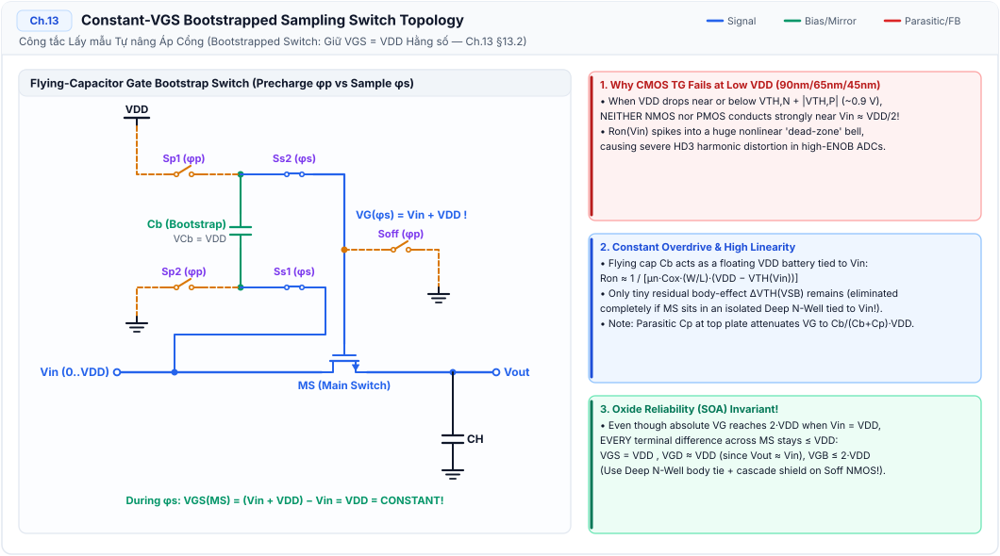

---
{
  "id": "topo-analog-mux-and-adc-track-hold-drivers",
  "kind": "topology",
  "domain": "ams-filters-and-system",
  "title_vi": "Bộ Dồn Kênh Tương tự Chữ T (T-Switch Analog Mux) Cách ly Cao và Bộ Đệm Lái Đầu vào Track-and-Hold Cho SAR / Pipeline ADC (Hấp thụ Giật Điện tích R_iso – C_bucket)",
  "title_en": "High-Isolation Low-Leakage T-Switch Analog Multiplexers, Channel Memory Suppression, and Charge-Kickback-Resilient SAR/Pipeline ADC Track-and-Hold Input Drivers",
  "summary": "Giải quyết hai điểm nghẽn thực chiến thường làm sập ENOB và xuyên âm ở giao diện vào của mọi hệ thống thu thập dữ liệu đa kênh: (1) Bộ dồn kênh tương tự công tắc chữ T (Series-Shunt-Series T-Switch AMUX) triệt tiêu truyền xuyên kênh tắt ở tần số cao > 80-95 dB, khóa dòng rò tắt I_off ở 125 °C về gần không và xóa hiện tượng nhớ điện tích xuyên kênh (settling memory ghosting) trên đường bus chung; (2) Thiết kế bộ đệm lái giàn tụ lấy mẫu SAR / Pipeline ADC hấp thụ xung giật điện tích động Delta_Q = C_DAC * Delta_V qua kho chứa điện tích R_iso - C_bucket mà không gây rung chuông trở kháng ra cảm kháng của Op-Amp!",
  "diagram": "../../diagrams/bootstrapped-switch.svg",
  "razavi_refs": [
    {
      "chapter": 6,
      "section": "6.3",
      "pages": "188-193",
      "equations": ["6.62", "6.66"]
    },
    {
      "chapter": 8,
      "section": "8.1, 8.2, 8.5",
      "pages": "274-291, 303-315",
      "equations": ["8.16"]
    },
    {
      "chapter": 9,
      "section": "9.9",
      "pages": "390-397",
      "equations": ["9.62"]
    },
    {
      "chapter": 10,
      "section": "10.3-10.4",
      "pages": "416-426",
      "equations": ["10.12"]
    },
    {
      "chapter": 13,
      "section": "13.1-13.2.4",
      "pages": "539-555",
      "equations": ["13.6", "13.14", "13.22", "13.25", "13.30"]
    },
    {
      "chapter": 14,
      "section": "14.1.5",
      "pages": "584-585",
      "equations": ["14.49"]
    }
  ],
  "github_refs": [
    {
      "repo": "Arcadia-1/sar-adc-skills",
      "url": "https://github.com/Arcadia-1/sar-adc-skills/tree/27de09a34ea3ec6feb2ee2797d32dc673d35d1ad",
      "use": "Đặc tính quá độ của công tắc lấy mẫu tự nâng áp cổng, dòng điện tích giật ngược từ giàn tụ CDAC và ngân sách xác lập đầu vào của SAR ADC"
    },
    {
      "repo": "iic-jku/analog-circuit-design",
      "url": "https://github.com/iic-jku/analog-circuit-design/tree/6075ea0ebcf08f5c7f6033a84e9dd3c91450f5e1",
      "use": "Phân tích trở kháng ra đóng vòng mang tính cảm kháng của Op-Amp và phương pháp ổn định khi lái tải điện dung lớn qua điện trở cách ly"
    },
    {
      "repo": "Arcadia-1/ADCToolbox",
      "url": "https://github.com/Arcadia-1/ADCToolbox/tree/372b714011db9c3f366bd0223d066e1fbde8dfb6",
      "use": "Đo kiểm suy giảm SFDR / THD ở tần số sát Nyquist và phát hiện xuyên âm giữa các kênh khi quét bộ dồn kênh trước ADC"
    }
  ],
  "glossary_codes": [
    "T042",
    "T057",
    "T063",
    "T074",
    "T087",
    "T523",
    "T687",
    "T750",
    "T786",
    "T965",
    "T1089",
    "T1328",
    "T1335",
    "T1337",
    "T947",
    "T2142",
    "T2143",
    "T2144",
    "T2150",
    "T2152"
  ],
  "process_agnostic": true,
  "roles": {
    "series_shunt_series_t_switch_cell": "Tổ hợp ba công tắc MOS chữ T trên mỗi kênh dồn (S_A nối tiếp phía vào, S_B nối tiếp phía bus ra, và S_sh kéo nút giữa xuống đất xoay chiều sạch V_CM khi kênh tắt) triệt tiêu đồng thời điện dung xuyên tắt và dòng rò nhiệt độ cao.",
    "bus_precharge_equalization_switch_seq": "Công tắc đặt lại ngắn hạn đóng trong khe thời gian chết Break-Before-Make để kéo đường bus chung C_bus về mức chuẩn V_CM trước khi mở kênh mới, xóa sạch ký ức điện áp của kênh trước.",
    "adc_driver_closed_loop_ota_or_ssf": "Bộ đệm khuếch đại băng rộng độ tuyến tính cao (Op-Amp hai tầng Class-AB hồi tiếp âm cho DC-50 MHz hoặc Super-Source-Follower / FVF cho > 100 MS/s) cung cấp dòng nạp lại tụ lấy mẫu trong cửa sổ thu nhận.",
    "charge_reservoir_bucket_capacitor_cbucket": "Tụ chứa điện tích lớn C_bucket = (10..20) * C_sample đặt ngay trước chân công tắc lấy mẫu của ADC để nuốt tức thời > 90% gói điện tích giật ngược ở cạnh đóng xung nhịp.",
    "loop_isolation_resistor_riso": "Điện trở cách ly nhỏ R_iso (15-100 Ohm) chèn giữa ngõ ra Op-Amp lái và tụ C_bucket: che chắn cực tải điện dung khổng lồ khỏi vòng hồi tiếp của Op-Amp, ngăn chặn triệt để dao động chuông cảm-dung."
  },
  "symptoms_addressed": [
    "high-frequency-blocker-feedthrough-across-off-state-multiplexer-switches",
    "125c-subthreshold-and-junction-off-leakage-corrupting-high-impedance-sensor-channels",
    "channel-to-channel-ghosting-crosstalk-when-scanning-multiplexed-inputs-into-sar-adc",
    "violent-ringing-and-20-db-thd-collapse-when-connecting-opamp-directly-to-switched-cdac"
  ],
  "limitations": [
    "t-switch-doubles-series-on-resistance-requiring-2x-wider-pass-transistors-for-same-ron",
    "riso-cbucket-network-forms-passive-rc-pole-that-limits-usable-nyquist-bandwidth-if-oversized",
    "open-loop-source-follower-buffers-introduce-dc-level-shift-and-gain-slightly-below-unity"
  ],
  "checklists": [
    "common-mos",
    "switched-capacitor",
    "comparator-and-sar-adc",
    "feedback-and-stb",
    "continuous-time-filters",
    "layout-and-matching"
  ]
}
---

## 1. Bản chất Nguyên lý, Sơ đồ Mạch & Vai trò Từng Nhánh Cấu trúc

Trong sơ đồ khối của hầu hết các hệ thống đo lường công nghiệp, ô tô, y sinh và điều khiển nguồn số, một bộ chuyển đổi `SAR ADC` hoặc `Pipeline ADC` tốc độ cao thường phục vụ chung cho $8, 16$ hoặc $32$ ngõ vào khác nhau (điện áp từng cell pin, dòng cảm biến, nhiệt độ chip, tín hiệu băng gốc IQ) thông qua một **Bộ dồn kênh tương tự (`Analog Multiplexer — AMUX`)** và một **Bộ đệm lái đầu vào lấy mẫu giữ (`ADC Track-and-Hold Input Driver`)**. Đây chính là "khúc giao thoa tử thần" nơi hàng loạt thiết kế vượt qua xuất sắc từng khối rời rạc (Op-Amp đạt $\text{THD} = -95\text{ dB}$ khi mang tải điện trở tĩnh, còn SAR ADC đạt $\text{ENOB} = 11.7\text{ bit}$ khi lái bằng nguồn áp lý tưởng `vsource` trở kháng $0\,\Omega$!), nhưng **ngay khi hàn nối trực tiếp ngõ ra Op-Amp vào chân vào SAR ADC trên silicon thì $\text{ENOB}$ sụp thảm hại xuống còn $7.5\text{ bit}$ kèm xuyên âm nặng giữa các kênh**!



Hai thủ phạm vật lý đứng đằng sau sự sụp đổ đó — và hai cấu trúc giải cứu tương ứng — gồm:

1. **Bộ Dồn Kênh Tương tự Công tắc Chữ T (`Series-Shunt-Series T-Switch Analog Multiplexer`):**
   - Nếu mỗi kênh của bộ dồn $N:1$ chỉ dùng một cổng truyền dẫn CMOS đơn lẻ (`topo-mos-and-cmos-sampling-switches`), khi kênh thứ $k$ đang ở trạng thái **TẮT (`OFF`)**, giữa cực nguồn và cực máng của công tắc tắt vẫn tồn tại điện dung chồng lấp và điện dung xuyên qua đế $C_{\text{off}} \approx 5\text{--}30\text{ fF}$ (`feedthrough` — `T1335`), cộng thêm dòng rò dưới ngưỡng và dòng rò tiếp giáp p–n tăng vọt theo hàm mũ ở $125\,^\circ\text{C}$. Với $15$ kênh đang tắt chụm chung vào một đường `MUX_BUS`, cả tín hiệu cao tần lẫn dòng rò từ $15$ kênh kia ùa vào làm nhiễu kênh duy nhất đang mở!
   - **Cấu trúc Công tắc Chữ T (`T-Switch`)** chia mỗi kênh thành hai công tắc nối tiếp $S_A$ (phía ngõ vào) và $S_B$ (phía đường bus chung), xen giữa là nút trung gian $V_{\text{mid}}$ gắn một **công tắc nối tắt xuống mức tham chiếu sạch $S_{\text{sh}}$ (`VCM` hoặc `AGND`) điều khiển ngược pha**:
     - Khi kênh **BẬT (`ON = 1`)**: $S_A$ và $S_B$ cùng đóng (dẫn tín hiệu đi thẳng), còn $S_{\text{sh}}$ mở hoàn toàn.
     - Khi kênh **TẮT (`ON = 0`)**: $S_A$ và $S_B$ cùng mở, đồng thời **$S_{\text{sh}}$ đóng chặt kéo nút giữa $V_{\text{mid}}$ ghim chết xuống đất xoay chiều `VCM`**! Mọi dòng điện dung xuyên qua $C_{\text{off},A}$ và mọi dòng rò qua $S_A$ đều bị $S_{\text{sh}}$ hút tuột xuống `VCM` trước khi kịp chạm tới $S_B$!
2. **Bộ Đệm Lái Đầu vào ADC Có Kho Chứa Điện tích Cách ly (`ADC Track-and-Hold Input Driver + R_iso – C_bucket Reservoir`):**
   - Khác hẳn tải tụ tĩnh nối cố định, ngõ vào của một bộ `SAR ADC` (`topo-sar-adc-charge-redistribution-architecture`) hay tầng đầu `MDAC` của `Pipeline ADC` là một **tải tụ chuyển mạch động cực kỳ hung hãn**: suốt pha chuyển đổi bit (`hold mode` — `T2144`), công tắc lấy mẫu đầu vào (`topo-bootstrapped-sampling-switch`) mở ra cách ly giàn tụ $C_{\text{DAC}}$; đúng khoảnh khắc bắt đầu pha thu nhận mới (`sampling mode` — `T2143`), công tắc đóng sập lại nối giàn tụ $C_{\text{DAC}}$ (đang mang điện áp dư của mẫu trước đó hoặc vừa đặt lại ở $V_{\text{CM}}$!) thẳng vào đầu ra bộ đệm lái, rút một **xung dòng điện tích tức thời hàng chục mili-ampe trong vài trăm picogiây**!
   - Nếu nối trực tiếp chân ra của một Op-Amp hồi tiếp âm vào công tắc lấy mẫu này, Op-Amp chưa kịp phản ứng (vì băng thông hữu hạn!) sẽ phơi bày trở kháng ra vòng kín mang tính cảm kháng $L_{\text{eq}}$ đấu thẳng với $C_{\text{DAC}}$, kích nổ dao động chuông tần số cao không kịp tắt trước sườn lấy mẫu kế tiếp! Chèn mạng đệm thụ động hai bậc thời gian **$R_{\text{iso}}\text{--}C_{\text{bucket}}$** ngay giữa Op-Amp và công tắc lấy mẫu giải quyết êm đẹp bài toán mà không cần đốt gấp $10\times$ công suất Op-Amp.

---

## 2. Hệ Phương trình Cốt lõi & Tư duy "Nhìn Mạch Đọc Nhanh" (Analysis by Inspection)

### 2.1. Định luật Cách ly Bậc Hai ($> 80\text{ dB}$) & Triệt Dòng Rò $125\,^\circ\text{C}$ của Công tắc Chữ T (`T-Switch`)
Xét một kênh đang tắt mang tín hiệu gây nhiễu tần số cao $V_{\text{in,off}}(j\omega)$ nhìn vào đường bus chung đang có trở kháng tương đương $Z_{\text{bus}} = R_{\text{src,on}} + R_{\text{on,ch}} \parallel \frac{1}{j\omega C_{\text{bus}}} \approx R_{\text{bus}}$:
- **Với 1 công tắc đơn tắt**: Hàm truyền rò xuyên trực tiếp (`direct feedthrough` — `T1337`) tăng $+20\text{ dB/dec}$ theo tần số:
$$
\left|\frac{V_{\text{bus}}}{V_{\text{in,off}}}\right|_{\text{1-sw}} \approx \omega \, C_{\text{off}} \, R_{\text{bus}}
$$
  Ví dụ với $C_{\text{off}} = 20\text{ fF}$, $R_{\text{bus}} = 500\,\Omega$ tại $f = 20\text{ MHz}$: một kênh tắt rò $\omega C_{\text{off}} R_{\text{bus}} = 1.257\times 10^{-3} \equiv \mathbf{-58.0\text{ dB}}$; nếu có $15$ kênh tắt đồng pha cùng rò thì cách ly sập xuống chỉ còn **$-34.5\text{ dB}$**!
- **Với Công tắc Chữ T (`T-Switch` có công tắc nối tắt $S_{\text{sh}}$ điện trở dẫn nhỏ $R_{\text{on,sh}}$)**: Nút giữa $V_{\text{mid}}$ bị chia áp bậc nhất còn $V_{\text{mid}} \approx j\omega C_{\text{off},A} R_{\text{on,sh}} V_{\text{in,off}}$, sau đó lại bị chia áp lần thứ hai qua $C_{\text{off},B}$ sang $R_{\text{bus}}$, biến độ rò thành **tích bậc hai siêu nhỏ** (`shielding` — `T965`):
$$
\left|\frac{V_{\text{bus}}}{V_{\text{in,off}}}\right|_{\text{T-sw}} \approx \omega^2 \, C_{\text{off},A} \, C_{\text{off},B} \, R_{\text{on,sh}} \, R_{\text{bus}}
$$
  Thay cùng thông số trên ($C_{\text{off},A} = C_{\text{off},B} = 20\text{ fF}$, $R_{\text{on,sh}} = 100\,\Omega$, $R_{\text{bus}} = 500\,\Omega$ tại $20\text{ MHz}$): độ cách ly nội tại lý thuyết nhảy vọt từ $-58.0\text{ dB}$ lên tới **$-130.0\text{ dB}$** (trên silicon thực tế đạt **$-85\text{ đến }-95\text{ dB}$** sau khi tính ký sinh ghép dây kim loại layout)!
- **Phép màu khử dòng rò DC ở $125\,^\circ\text{C}$**: Khi ghim chân nối tắt của $S_{\text{sh}}$ vào một bộ đệm mức đồng pha $V_{\text{guard}} \approx V_{\text{bus,DC}}$, điện thế nút giữa của mọi kênh tắt được giữ ở $V_{\text{mid}} \approx V_{\text{bus,DC}}$. Nhờ đó, hiệu điện thế cực máng–nguồn đặt ngang qua công tắc nối tiếp thứ hai $S_B$ tiến về **$V_{DS,B} = V_{\text{mid}} - V_{\text{bus}} \approx 0\text{ V}$**! Mà dòng rò dưới ngưỡng của MOSFET tỉ lệ với $\left(1 - e^{-V_{DS}/V_T}\right) \to 0$ khi $V_{DS} \to 0$, nên dòng rò kênh chảy vào `MUX_BUS` giảm đi hàng chục lần ngay cả ở $+125\,^\circ\text{C}$!

### 2.2. Ký ức Xuyên Kênh (`Channel-to-Channel Settling Memory Crosstalk`) & Công tắc San Bằng Bus
Giả sử bộ dồn kênh quét tuần tự ở tốc độ $f_{\text{scan}}$: ở khe thời gian trước, Kênh 1 mang điện áp sát đỉnh $+V_{\text{FS}}$ đã nạp đầy điện dung ký sinh tổng cộng của đường dây gom kênh $C_{\text{bus}}$ (gồm $N \times C_{DB,B} + C_{\text{wire}} + C_{\text{in,buf}}$) tới $+V_{\text{FS}}$. Sang khe kế tiếp, Kênh 1 ngắt và Kênh 2 (đang nối vào một cảm biến nhiệt trở kháng nguồn khá lớn $R_{\text{src},2} = 10\text{ k}\Omega$ ở điện áp $-V_{\text{FS}}$) đóng lại!
Ngay tức khắc, gói điện tích cũ còn lưu trên $C_{\text{bus}}$ tạo sai số bước nhảy khổng lồ $\Delta V_0 = 2 V_{\text{FS}}$, phải xả qua hằng số thời gian chậm $\tau_2 = (R_{\text{src},2} + R_{\text{on,mux}}) C_{\text{bus}}$. Nếu cửa sổ đợi chuyển kênh $t_{\text{mux}}$ không đủ lớn, sai số còn sót lại tạo ra **xuyên âm bóng ma từ Kênh 1 in hằn sang kết quả đo Kênh 2**:
$$
\text{XT}_{\text{mem}}(1 \to 2) = \frac{V_{\text{err}}(t_{\text{mux}})}{\Delta V_{12}} = \exp\!\left(-\frac{t_{\text{mux}}}{\left(R_{\text{src},2} + R_{\text{on,mux}}\right) C_{\text{bus}}}\right) \le \frac{1}{2^{N_{\text{bits}} + 1}}
$$
Để đạt sai số $< 0.5\text{ LSB}$ cho ADC $12\text{ bit}$ ($\ln(2^{13}) \approx 9.01$), bắt buộc đảm bảo $t_{\text{mux}} \ge 9.01\,(R_{\text{src},2} + R_{\text{on,mux}}) C_{\text{bus}}$, đồng thời kích hoạt một **xung xóa đường bus ngắn (`Bus Equalization Pulse` $S_{\text{eq}}$ kéo `V_bus -> VCM` trong khoảng hở `Break-Before-Make` $5\text{--}10\text{ ns}$)** để xả sạch điện tích phụ thuộc mã kênh trước trên các tụ tiếp giáp phi tuyến $C_{DB}(V)$, chặn đứng xuyên âm phi tuyến giữa các kênh!

### 2.3. Giải phẫu Hai Thang Thời gian của Mạng Lái ADC $R_{\text{iso}}\text{--}C_{\text{bucket}}$ (Chống Giật Ngược & Rung Chuông)
Xét một Op-Amp đệm lái (độ lợi DC $A_0$, băng thông đơn vị $\omega_u = 2\pi f_u$, trở kháng ra hở vòng vùng cao tần của tầng cuối $R_{o,\text{open}}$, hệ số hồi tiếp $\beta \le 1$). Theo Razavi §6.3 và §8.1–§8.2 (`concept-source-follower-inductive-zout`), trở kháng ra đóng vòng (`T1328`) của Op-Amp tăng theo tần số đúng như một **cuộn cảm nối tiếp điện trở nhỏ**:
$$
Z_{\text{out,CL}}(s) \approx \frac{R_{o,\text{open}}}{1 + A_0 \beta} \cdot \frac{1 + s / \omega_{p1}}{1 + s / (\beta \omega_u)}
\approx R_{o,\text{DC}} + s \, L_{\text{eq,OA}} \quad \text{với} \quad L_{\text{eq,OA}} = \frac{R_{o,\text{open}}}{\beta \, \omega_u}
$$
Khi công tắc lấy mẫu của ADC đóng vào giàn tụ $C_{\text{DAC}}$ (điện trở công tắc $R_{\text{sw}}$), nếu không có mạng cách ly, $L_{\text{eq,OA}}$ ghép trực tiếp với $C_{\text{DAC}}$ tạo thành mạch dao động $RLC$ có hệ số phẩm chất cao gây rung chuông dữ dội! Khi chèn **điện trở cách ly $R_{\text{iso}}$ ngoài vòng hồi tiếp** nối tiếp trước **tụ kho chứa $C_{\text{bucket}} = K_{\text{bkt}} C_{\text{DAC}}$** (điển hình chọn $K_{\text{bkt}} = 10\text{--}20$), quá trình thu nhận trong cửa sổ $t_{\text{acq}}$ diễn ra êm ái qua **hai thang thời gian tách biệt**:

1. **Pha 1 — Chia sẻ Điện tích Thụ động Tức thời ($t \sim 0.5\text{--}2\text{ ns}$)**: Ngay khi công tắc lấy mẫu đóng kết nối $C_{\text{DAC}}$ (đang ở $V_{\text{init}}$) vào $C_{\text{bucket}}$ (đang nạp sẵn ở điện áp mục tiêu $V_{\text{in}}$), $C_{\text{bucket}}$ đóng vai trò viên pin cục bộ trở kháng bằng không nhả ngay điện tích qua $R_{\text{sw}}$, kẹp biên độ sụt áp giật ngược ban đầu xuống chỉ còn một phần nhỏ:
$$
\Delta V_{\text{kick},0} = \frac{C_{\text{DAC}}}{C_{\text{bucket}} + C_{\text{DAC}}} \left(V_{\text{in}} - V_{\text{init}}\right) = \frac{V_{\text{in}} - V_{\text{init}}}{1 + K_{\text{bkt}}}
$$
   Với $K_{\text{bkt}} = 15$, hơn **$93.75\%$ gói điện tích giật ngược đã được $C_{\text{bucket}}$ san lấp ngay lập tức** trước cả khi Op-Amp kịp nhận biết! Hơn nữa, vì biên độ bước nhảy giảm đi $16\times$, Op-Amp **thoát hoàn toàn khỏi vùng giới hạn tốc độ thay đổi (`slewing`)**, chỉ còn làm việc thuần túy trong vùng xác lập tuyến tính độ méo siêu thấp!
2. **Pha 2 — Nạp Bù Hàm Mũ Có Tắt Dần Chuẩn Trong Cửa sổ $t_{\text{acq}}$**: Phần sai số nhỏ còn lại $\frac{\Delta V_{\text{step}}}{1 + K_{\text{bkt}}}$ được Op-Amp nạp đầy qua điện trở $R_{\text{iso}}$ với hằng số thời gian lọc $\tau_{\text{filt}} = R_{\text{iso}} \left(C_{\text{bucket}} + C_{\text{DAC}}\right)$. Để sai số cuối cửa sổ thu nhận $t_{\text{acq}}$ nhỏ hơn $\frac{1}{4}\text{ LSB}$ của bộ ADC $N$-bit:
$$
\frac{1}{1 + K_{\text{bkt}}} \exp\!\left(-\frac{t_{\text{acq}}}{\tau_{\text{eff}}}\right) \le \frac{1}{2^{N + 2}}
\implies \tau_{\text{eff}} \le \frac{t_{\text{acq}}}{(N + 2)\ln 2 - \ln\!\left(1 + K_{\text{bkt}}\right)}
$$
   Đồng thời để mạch $L_{\text{eq,OA}}\text{--}R_{\text{iso}}\text{--}(C_{\text{bucket}} + C_{\text{DAC}})$ tắt dần êm ái không rung chuông (**$\zeta \ge 1.0$** cho đáp ứng bậc hai đơn điệu tới hạn/quá tắt dần $0\%$ vọt lố; hoặc thực tế có thể chọn $\zeta \in [0.85, 1.0]$ để rút ngắn thời gian xác lập nếu chấp nhận độ vọt lố dưới tắt dần nhỏ $\le 0.63\%$ tại $\zeta = 0.85$), điện trở cách ly $R_{\text{iso}}$ và băng thông vòng kín $f_{\text{CL}} = \frac{\beta \omega_u}{2\pi}$ của Op-Amp phải thỏa mãn cặp điều kiện phối hợp:
$$
R_{\text{iso}} \ge 2\,\zeta\,\sqrt{\frac{L_{\text{eq,OA}}}{C_{\text{bucket}} + C_{\text{DAC}}}} = 2\,\zeta\,\sqrt{\frac{R_{o,\text{open}}}{\beta\,\omega_u \left(C_{\text{bucket}} + C_{\text{DAC}}\right)}}, \qquad
\beta\,\omega_u \ge \frac{4}{\tau_{\text{eff}}}
$$

### 2.4. Ví dụ Định cỡ Số học Thực tế (Lái SAR ADC 12-Bit, $10\text{ MS/s}$, $C_{\text{DAC}} = 2\text{ pF}$ mỗi nhánh)
- Thời gian thu nhận đầu vào $t_{\text{acq}} = 30\text{ ns}$ ($30\%$ chu kỳ $100\text{ ns}$), tần số Nyquist $f_{\text{Nyq}} = 5\text{ MHz}$.
- **Bước 1**: Chọn hệ số kho chứa $K_{\text{bkt}} = 15 \implies C_{\text{bucket}} = 15 \times 2\text{ pF} = 30\text{ pF}$ (tổng tải tụ trong pha bám $C_{\text{tot}} = 32\text{ pF}$). Số hằng số thời gian cần thiết còn lại: $(12 + 2)\ln 2 - \ln(16) = 9.704 - 2.773 = 6.93 \implies \tau_{\text{eff,max}} = \frac{30\text{ ns}}{6.93} = 4.33\text{ ns}$!
- **Bước 2**: Chọn $\tau_{\text{filt}} = R_{\text{iso}} C_{\text{tot}} = 3.2\text{ ns}$ (cắt nhiễu dải rộng của chính Op-Amp ở $f_{-3\text{dB,rc}} = \frac{1}{2\pi \times 3.2\text{n}} = 49.7\text{ MHz} \gg 5\text{ MHz}$ nên độ suy hao biên độ tại Nyquist chỉ $0.04\text{ dB}$!), suy ra **$R_{\text{iso}} = \frac{3.2\text{ ns}}{32\text{ pF}} = 100\,\Omega$**!
- **Bước 3**: Với tầng ra đẩy–kéo Class-AB có trở kháng ra cao tần khi tụ Miller nối tắt cổng–máng là $R_{o,\text{open}} \approx \frac{1}{g_{m,\text{out}}} = 40\,\Omega$ và chọn băng thông vòng kín $\frac{\beta\omega_u}{2\pi} = 200\text{ MHz}$ ($\beta\omega_u = 1.257 \times 10^9\text{ rad/s}$), cảm kháng ra tương đương là $L_{\text{eq,OA}} = \frac{40\,\Omega}{1.257\times 10^9\text{ rad/s}} = \mathbf{31.8\text{ nH}}$. Kiểm tra ngưỡng tắt dần tới hạn ($\zeta = 1.0$): $2 \times 1.0 \times \sqrt{\frac{31.8\text{ nH}}{32\text{ pF}}} = \mathbf{63.0\,\Omega} < R_{\text{iso}} = 100\,\Omega$ (ngưỡng $\zeta = 0.85$ là $53.6\,\Omega$; với $R_{\text{iso}} = 100\,\Omega$ mạch đạt $\zeta = 1.59 > 1.0$, thực sự quá tắt dần đơn điệu không vọt lố và đạt $\text{SNDR} = 73.2\text{ dB}$ ở $4.9\text{ MHz}$)!

---

## 3. Bất biến Cấu trúc & Các Bẫy Lỗi Kinh điển (Structural Invariants & Traps)

- **[INV-01] Bất biến Thời gian Chết Ngắt–Trước–Khi–Đóng (`Break-Before-Make — BBM`) Trong Bộ Dồn Kênh AMUX**: Khi chuyển từ Kênh $i$ sang Kênh $j$, bộ giải mã địa chỉ bắt buộc phải tắt hoàn toàn công tắc nối tiếp của Kênh $i$ trước ít nhất $t_{\text{BBM}} \ge 1\text{--}3\text{ ns}$ rồi mới bật Kênh $j$! Nếu hai kênh chồng lấn dù chỉ $200\text{ ps}$, hai nguồn cảm biến ngoài chip bị chập trực tiếp với nhau qua đường bus làm giật lệch áp tham chiếu của kênh bên cạnh!
- **[INV-02] Bất biến Điện trở Cách ly $R_{\text{iso}}$ Phải Nằm NGOÀI Vòng Hồi tiếp Âm Của Op-Amp Lái**: Nếu mắc nhầm dây lấy hồi tiếp của Op-Amp ra *phía sau* $R_{\text{iso}}$ (ngay trên đầu $C_{\text{bucket}}$) với ý định "khử sụt áp DC trên $R_{\text{iso}}$", cực lớn $R_{\text{iso}} C_{\text{bucket}}$ bị nuốt thẳng vào trong vòng hồi tiếp làm dự trữ pha Op-Amp tụt xuống $< 10^\circ$ và **Op-Amp dao động tự kích điên cuồng**! Vì đầu vào của SAR ADC là tụ điện thuần túy (dòng tĩnh DC trung bình hầu như bằng $0$), sụt áp DC qua $R_{\text{iso}} = 50\text{--}100\,\Omega$ bằng không — dây hồi tiếp âm của Op-Amp luôn lấy ngay tại chân ra Op-Amp *trước* $R_{\text{iso}}$ (hoặc nếu cần độ chính xác DC cao với dòng rò lớn thì dùng cấu trúc bù hai đường phản hồi `Dual-Feedback In-Loop Compensation` tách cao tần qua $C_f$ trước $R_{\text{iso}}$ và DC qua $R_f$ sau $R_{\text{iso}}$!).
- **[TRAP-01] Bẫy Đấu Tụ Nối Đất Làm $C_{\text{bucket}}$ Thay Vì Tụ Vi sai Giữa Hai Nhánh (`Differential vs. Grounded Bucket Cap`)**: Trên đường lái ADC vi sai hoàn toàn (`V_inp`, `V_inn`), nên chia $C_{\text{bucket}}$ thành **một tụ lớn mắc ngang trực tiếp giữa hai dây vi sai $C_{\text{bkt,diff}}$** (chiếm $80\%$ điện dung, diện tích giảm một nửa nhờ hiệu ứng nhân đôi điện dung vi sai $2 C_{\text{bkt,diff}}$ và tự khử mọi nhiễu đất chung!) kết hợp hai tụ nhỏ nối xuống `VCM` ($20\%$) để dập xung giật chế độ chung!
- **[TRAP-02] Tụ $C_{\text{bucket}}$ Quá Lớn Gây Trễ Pha & Suy giảm Đáp ứng Tần số Hoặc Quá Nhỏ Gây Hỏng THD**: Nhiều kỹ sư quen tay gắn bừa tụ gốm ngoài chip $1\text{ nF}$ nối tiếp $100\,\Omega$ ($f_{-3\text{dB}} = 1.59\text{ MHz}$) khi đang đo tín hiệu $4\text{ MHz}$, làm suy hao biên độ mất $-8.6\text{ dB}$; ngược lại gắn $C_{\text{bucket}} < 3\,C_{\text{DAC}}$ khiến sụt áp giật ngược ban đầu vượt quá $250\text{ mV}$ đẩy Op-Amp vào vùng `slewing` sinh méo hài bậc ba `HD3` phụ thuộc tần số lấy mẫu!
- **[TRAP-03] Dùng Cổng Truyền dẫn CMOS Thường Thay Cho Công tắc Bootstrap Trong T-Switch Ở Nguồn $\le 1.0\text{ V}$**: T-Switch đặt **hai** công tắc nối tiếp trên đường tín hiệu ($R_{\text{on,tot}} = R_{\text{on},A} + R_{\text{on},B}$). Ở $V_{DD} = 1.0\text{ V}$ góc `SS`, sự biến thiên $R_{\text{on}}(V_{\text{in}})$ nhân đôi sẽ tạo méo hài bậc ba rất nặng nếu tín hiệu biến thiên nhanh; cho các kênh động tốc độ cao ở áp thấp, cả $S_A$ và $S_B$ của T-Switch nên được điều khiển bởi mạch nâng áp cổng tự cử dùng chung (`shared gate-bootstrapper` — `T947`)!

---

## 4. Lộ trình Nâng cấp Cấu trúc & Bát giác Đánh đổi (Upgrade Paths & Design Octagon)

| Trục đánh giá Design Octagon | Cổng Truyền CMOS Đơn + Nối Thẳng Op-Amp | T-Switch AMUX + Op-Amp 2 Tầng + $R_{\text{iso}}\text{--}C_{\text{bucket}}$ | Bộ Đệm Mở Vòng Super-Source-Follower / FVF |
| :--- | :--- | :--- | :--- |
| Cách ly xuyên âm kênh tắt ($20\text{ MHz}$) | Kém (`-35..-50 dB`) | **Siêu cao (`-85..-95 dB`)** | Không áp dụng (dành cho 1 kênh chuyên biệt) |
| Tốc độ lấy mẫu ADC tối đa $f_s$ | Dễ rung chuông hỏng ngay ở $> 1\text{ MS/s}$ | Chuẩn vàng từ **$100\text{ kS/s} \to 50\text{ MS/s}$** | **Siêu tốc ($50\text{ MS/s} \to 1\text{ GS/s}$)** |
| Độ chính xác DC, Offset & Độ lợi | Cao nhưng hỏng động lực học | **Độ lợi chính xác $1.000$, méo $<-85\text{ dBc}$** | Lệch mức DC $V_{GS}$, độ lợi $\sim 0.97\text{--}0.99$ |
| Trở kháng ra tần số cao tại $f_s$ | Cảm kháng lớn gây cộng hưởng với $C_{\text{DAC}}$ | Được $C_{\text{bucket}}$ san phẳng & $R_{\text{iso}}$ giảm chấn | **Trở kháng ra thuần trở cực thấp $\sim \frac{1}{g_{m1} g_{m2} r_O}$** |
| Công suất tiêu thụ trên mỗi MHz | Thấp nhưng không hội tụ | Vừa phải (nhờ $C_{\text{bucket}}$ gánh $94\%$ xung đỉnh) | **Hiệu suất công suất cao nhất ở tần số $>100\text{ MHz}$** |

1. **Chuẩn mực dưới $50\text{ MS/s}$ (Đo lường chính xác DC + AC)**: Phối hợp **T-Switch AMUX + Bus Precharge** $\to$ **Op-Amp Class-AB đóng vòng** (hoặc dùng ngay tầng cuối của bộ lọc `topo-active-rc-sallen-key-and-tow-thomas-biquads` kiêm nhiệm bộ lái!) $\to$ mạng **$R_{\text{iso}}\text{--}C_{\text{bucket}}$** $\to$ `topo-bootstrapped-sampling-switch` của SAR ADC.
2. **Nâng cấp lên $> 100\text{ MS/s}$ (Cho Pipeline ADC `topo-flash-and-pipelined-mdac-rsd-adcs` hoặc RF-Sampling SAR)**: Thay Op-Amp hồi tiếp toàn cục bằng **Bộ đệm Theo nguồn Siêu cấp (`Super Source Follower` / `Flipped Voltage Follower` — `topo-regulated-cascode-super-source-follower`)** đẩy–kéo bù đối xứng NMOS+PMOS có vòng hồi tiếp cục bộ cực ngắn không rung chuông!

---

## 5. Thích ứng Đa Tiến trình (90nm / 65nm / 45nm) & Cách Kiểm chứng trong Cadence / Spectre

Trên công nghệ 65nm và 45nm, dòng rò dưới ngưỡng của transistor ngưỡng thấp (`LVT`) tăng gấp $20\text{--}50\times$ ở $125\,^\circ\text{C}$ so với `SVT`/`HVT`. Vì vậy trong bộ dồn kênh `T-Switch AMUX`, **tuyệt đối không dùng `LVT` cho $S_A$ và $S_B$** — hãy dùng `SVT` (kèm tự nâng áp cổng nếu $V_{DD} \le 1.0\text{ V}$) hoặc transistor I/O $1.8\text{ V}$ nếu quét cảm biến bên ngoài chip, và bọc vòng bảo vệ nối đất sạch (`guard ring`) quanh các vùng khuếch tán nối vào `MUX_BUS` để ngăn hạt tải nhiễu đế xâm nhập.

### Quy trình Kiểm chứng Chuẩn trong Cadence Virtuoso / Spectre 15.1
```
// 1. Đo Cách ly Xuyên âm Tần số Cao Của T-Switch AMUX (15 kênh tắt mang sóng 0 dBFS, 1 kênh bật nối tải)
ac_iso  ac  start=10k  stop=500M  dec=30
// Xác nhận: db20(VF("/v_mux_bus") / VF("/v_ch_off_agg")) <= -80 dB tại 20 MHz sau trích xuất PEX!

// 2. Mô phỏng Đồng bộ Hậu kiểm Xung Giật Ngược: [Op-Amp Driver + R_iso + C_bucket] <-> [Bootstrap + C_DAC]
// Kích thích sóng sin vi sai sát Nyquist f_in = (127/256) * 10 MHz = 4.9609375 MHz
tran_kick tran stop=26.6u errpreset=conservative maxstep=50p strobeperiod=100n strobedelay=29.9n
```
- **Bước 1 — Phóng to Cửa sổ Thu nhận $30\text{ ns}$ Kiểm tra Giật Ngược & Rung Chuông**: Trong kết quả `tran_kick`, chồng hai đường cong `V(v_opamp_out)` (trước $R_{\text{iso}}$) và `V(v_cdac_top)` (trên giàn tụ ADC): xác nhận sụt áp tức thời tại sườn đóng xung nhịp đúng bằng $\approx \frac{\Delta V}{1 + K_{\text{bkt}}}$, đường cong tiệm cận hàm mũ êm mượt không vọt lố dao động và khoảng cách giữa `V(v_cdac_top)` với đường mục tiêu tại `t = 29.9 ns` nhỏ hơn $< 0.25\text{ LSB}$!
- **Bước 2 — Chấm Điểm FFT Mạch lạc Trước và Sau Khi Có $R_{\text{iso}}\text{--}C_{\text{bucket}}$**: Đưa mảng $256$ mẫu `strobe` cuối pha thu nhận vào `ADCToolbox`: xác nhận mạng $R_{\text{iso}}\text{--}C_{\text{bucket}}$ giữ nguyên độ méo của chuỗi dưới $-84\text{ dBc}$ trên cả ba góc `SS`, `TT` và `FF`.
- **Bước 3 — Bài Thử Chuyển Kênh Quá Khích (`Worst-Case Full-Scale Toggle Memory Test`)**: Kênh 0 ghim cứng ở $+0.9\text{ V}$ qua $R_{\text{src}} = 5\text{ k}\Omega$, Kênh 1 ghim cứng ở $-0.9\text{ V}$ qua $R_{\text{src}} = 5\text{ k}\Omega$; đảo địa chỉ kênh mỗi chu kỳ ADC và xác nhận mẫu đo của Kênh 1 không bị kéo lệch quá $0.25\text{ LSB}$ so với khi giữ tĩnh ở Kênh 1!

---

## 6. Mốc Đối chiếu Sách Razavi & Thuật ngữ Chuẩn CLB

| Mục nội dung & Phương trình | Tham chiếu Razavi (2nd Ed.) & GitHub IP | Mã & Thuật ngữ Chuẩn CLB |
| :--- | :--- | :--- |
| Nguyên lý lấy mẫu giữ (Track-and-Hold), điện trở dẫn công tắc và phun điện tích | Chương 13, §13.1–13.2.4, PT (13.6)–(13.30), tr. 539–555 & Chương 14, §14.1.5 | `T057` Tính phi tuyến; `T074` Lấy mẫu; `T087` Mạch tụ chuyển mạch; `T523` Tính tuyến tính; `T750` sai số bám theo; `T786` méo dạng; `T1089` nhiễu $kT/C$; `T947` được bootstrap; `T2142` nhiễu lấy mẫu nhiệt $kT/C$; `T2143` chế độ lấy mẫu; `T2144` chế độ giữ mẫu |
| Trở kháng ra mang tính cảm kháng của bộ đệm/vòng kín và độ ổn định tải tụ | Chương 6, §6.3, PT (6.62)–(6.66); Chương 8, §8.1–8.2; Chương 10, §10.3–10.4 | `T042` Hồi tiếp; `T063` Dự trữ pha; `T1328` trở kháng ngõ ra vòng kín |
| Đường truyền xuyên trực tiếp qua tụ ký sinh công tắc tắt và che chắn tĩnh điện | Chương 8, §8.6 & Chương 19, §19.3, tr. 317–321, 760–764 | `T687` tỷ số tín hiệu trên nhiễu; `T965` tác dụng che chắn; `T1335` đường truyền xuyên trực tiếp; `T1337` truyền xuyên trực tiếp; `T2150` méo hài; `T2152` HD2 / HD3 |
| Thiết kế chuỗi lái đầu vào SAR ADC & kiểm chứng FFT mạch lạc | Chương 9, §9.9 & `Arcadia-1/sar-adc-skills` + `Arcadia-1/ADCToolbox` | Ngân sách slewing/settling trong cửa sổ thu nhận $t_{\text{acq}}$ |
