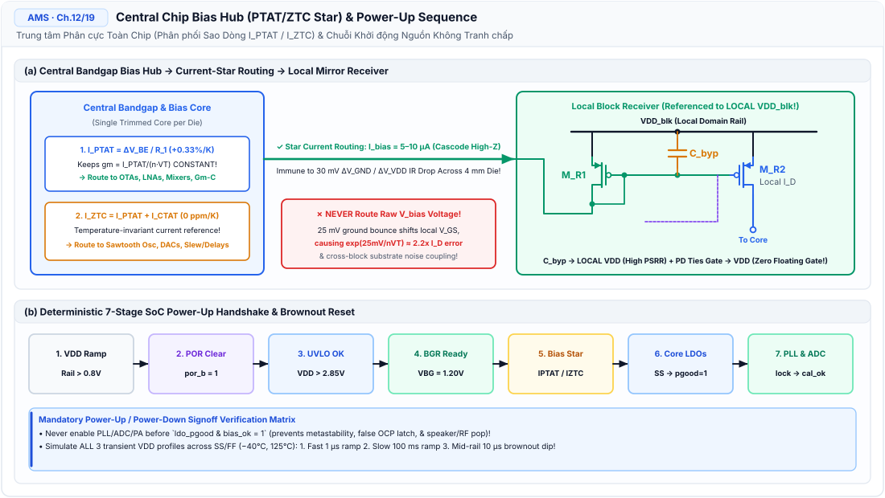

---
{
  "id": "topo-central-bias-hub-powerup-and-sleep-gating",
  "kind": "topology",
  "domain": "ams-filters-and-system",
  "title_vi": "Kiến trúc Trạm Phân cực Trung tâm Toàn Chip (I_PTAT & I_ZTC), Phân phối Dòng Sao Cascode, Ngắt Ngủ Không Rò (Sleep/PD) và Trình tự Khởi động Nguồn (POR -> UVLO -> BGR -> LDO -> Data)",
  "title_en": "Full-Chip Central Bias Hub Architecture (Dual I_PTAT & I_ZTC Generation), LVCCML Star Current Distribution, Supply-Referenced Local Decoupling, Sleep Gating, and Power-Up Sequencing",
  "summary": "Kiến trúc hạ tầng phân cực và quản lý trạng thái nguồn chuẩn công nghiệp biến các khối mạch rời rạc thành một con chip silicon thương mại tin cậy: tổng hợp đồng thời hai họ dòng chuẩn trung tâm I_PTAT (ổn định gm cho tầng khuếch đại) và I_ZTC = I_PTAT + I_CTAT (bù nhiệt bậc không cho dao động RC, định thời và DAC), phân phối hình sao bằng nguồn dòng cascode áp thấp LVCCML (tuyệt đối cấm kéo dây áp cổng V_GS xuyên đế nhiễu!), giải mã bẫy chết PSRR khi đấu sai chân tụ lọc C_byp cục bộ (PMOS bắt buộc nối VDD, cấm nối VSS!), quy tắc kẹp cứng công tắc ngủ pd/pd_b chống nút cổng lơ lửng gây rò dòng crowbar ở 125 °C, và máy trạng thái bắt tay khởi động nguồn đơn điệu từ POR -> UVLO -> BGR -> Bias Hub -> LDO -> PLL -> Data Path.",
  "diagram": "../../diagrams/central-ptat-ztc-bias-hub.svg",
  "razavi_refs": [
    {
      "chapter": 5,
      "section": "5.1-5.3",
      "pages": "137-158",
      "equations": [
        "5.5",
        "5.18"
      ]
    },
    {
      "chapter": 9,
      "section": "9.11",
      "pages": "400-402",
      "equations": [
        "9.84"
      ]
    },
    {
      "chapter": 12,
      "section": "12.1-12.5",
      "pages": "509-525",
      "equations": [
        "12.18",
        "12.26",
        "12.30"
      ]
    },
    {
      "chapter": 19,
      "section": "19.2.7, 19.3",
      "pages": "752-762",
      "equations": [
        "19.16"
      ]
    }
  ],
  "github_refs": [
    {
      "repo": "RTimothyEdwards/sky130_ef_ip__biasgen",
      "url": "https://github.com/RTimothyEdwards/sky130_ef_ip__biasgen/tree/9d1ceb5dbf2168599f9e55f1053c155cf05de829",
      "use": "Khối IP Trạm Phân phối Dòng Phân cực Trung tâm (Central Master Bias Generator) đã kiểm chứng silicon của Efabless xuất đa nhánh dòng nguồn/hút độc lập có chân bật/tắt ena"
    },
    {
      "repo": "efabless/sky130_ef_ip__power_on_reset",
      "url": "https://github.com/efabless/sky130_ef_ip__power_on_reset/tree/de7a9fd892ccb2a4f7c9e77c1ad66bd3f4821704",
      "use": "Phân hệ khởi động nguồn phân cấp (VREF + LDO + POR) kèm bài đo CACE quét tốc độ dốc nguồn VDD nhanh/chậm và sập nguồn brown-out"
    },
    {
      "repo": "johnkustin/bandgapReferenceCircuit",
      "url": "https://github.com/johnkustin/bandgapReferenceCircuit/tree/7f9bb8bf0318db0888ac9a0bc881b0f2f36ea06b",
      "use": "Đối chiếu số đo silicon thực tế với mô phỏng PEX/Monte Carlo cho lõi tham chiếu Bandgap, mạch mồi khởi động và gương dòng cascode tự phân cực"
    },
    {
      "repo": "iic-jku/Circuit-Designers-Etiquette",
      "url": "https://github.com/iic-jku/Circuit-Designers-Etiquette/tree/e330aea62574e585e8d4c36e8770326ba4d286cc",
      "use": "Quy chuẩn vàng về truyền dòng phân cực liên khối, đặt công tắc power-down chống nút treo và quy ước đặt tên mạng phân cực trên schematic"
    }
  ],
  "glossary_codes": [
    "T011",
    "T012",
    "T026",
    "T067",
    "T069",
    "T084",
    "T528",
    "T742",
    "T748",
    "T1568",
    "T1888",
    "T2074",
    "T2075",
    "T2122",
    "T2131",
    "T2185",
    "T2197",
    "T2199"
  ],
  "process_agnostic": true,
  "roles": {
    "dual_ptat_and_ztc_core": "Lõi tham chiếu vùng cấm trung tâm tổng hợp đồng thời dòng I_PTAT tỉ lệ nhiệt độ tuyệt đối (bù trôi hỗ dẫn gm) và dòng I_ZTC không phụ thuộc nhiệt độ (nuôi dao động RC, trễ chuẩn và DAC).",
    "lvccml_star_current_bus": "Dàn gương dòng cascode điện áp thấp (trở kháng ra hàng chục MOhm) chia nhiều nhánh dòng riêng biệt chạy hình sao tới từng khối con trên toàn mặt đế chip.",
    "local_supply_referenced_receiver": "Gương dòng diode cục bộ đặt bên trong từng khối chức năng nhận dòng chuẩn theo đất/nguồn Kelvin tại chỗ, gắn tụ lọc C_byp đúng cực nguồn tham chiếu bảo toàn PSRR.",
    "sleep_tieoff_and_powerup_fsm": "Hệ thống công tắc kéo cứng mọi nút cổng phân cực về VDD/VSS khi ngủ (triệt dòng rò crowbar) phối hợp chuỗi bắt tay tuần tự POR -> UVLO -> BGR -> Bias -> LDO -> PLL -> Data."
  },
  "symptoms_addressed": [
    "30-to-50-percent-bias-current-error-and-substrate-crosstalk-from-routing-vgs-voltages-across-chip",
    "catastrophic-0-db-high-frequency-psrr-caused-by-tying-pmos-mirror-bypass-capacitor-to-ground",
    "rc-oscillator-and-dac-full-scale-drifting-50-percent-over-temperature-when-fed-ptat-current",
    "hundreds-of-microamps-of-sleep-leakage-at-125c-from-floating-internal-bias-gates",
    "bandgap-dead-zone-lockup-and-ldo-overshoot-during-slow-or-brownout-supply-ramps"
  ],
  "limitations": [
    "star-current-distribution-consumes-one-dedicated-routing-wire-and-mirror-branch-current-per-remote-macro",
    "ztc-current-temperature-flatness-remains-limited-by-on-chip-sheet-resistor-tc-spread-unless-composite-resistors-and-trim-are-used",
    "large-local-rc-bias-noise-filters-increase-block-wakeup-settling-time-unless-fast-charge-bypass-switches-are-added"
  ],
  "checklists": [
    "common-mos",
    "system-integration-por-and-bias-bus",
    "bandgap-and-bias",
    "current-mirror",
    "esd-pad-and-substrate"
  ]
}
---

## 1. Bản chất Nguyên lý, Sơ đồ Mạch & Vai trò Từng Nhánh Cấu trúc

Trong các bài tập sách giáo khoa đơn lẻ, mỗi mạch khuếch đại thường được vẽ kèm một nguồn dòng lý tưởng $I_{\text{REF}}$ đặt ngay sát bên cạnh. Trên một con chip thực tế tích hợp hàng chục khối tương tự và số (`LDO`, `PLL`, `ADC`, `DAC`, `Filter`, `SerDes`), việc đặt 10 khối Bandgap riêng lẻ tại 10 góc chip sẽ tiêu tốn diện tích và dòng tĩnh gấp 10 lần, trong khi việc đặt 1 khối trung tâm nhưng phân phối sai cách lại biến hệ thống phân cực thành **đường cao tốc truyền nhiễu xuyên âm từ khối chuyển mạch sang khối nhạy cảm**! **Kiến trúc Trạm Phân cực Trung tâm, Ngắt Ngủ Không Rò & Khởi động Nguồn Tuần tự (`Central Bias Hub, Sleep Gating & Power-Up Architecture`)** là bộ khung xương sống kết nối mọi khối tương tự trên chip vận hành đồng bộ, sạch nhiễu và tiết kiệm năng lượng qua 4 phân hệ chuẩn hóa:



1. **Hạt nhân Tạo Dòng Chuẩn Kép (`Dual-Flavor Reference Current Core: I_PTAT & I_ZTC`):**
   - Khai thác trực tiếp lõi tham chiếu vùng cấm (`T011`, `topo-bandgap-reference-core` / `topo-low-voltage-sub1v-bandgap`) để xuất đồng thời **hai hương vị dòng chuẩn có bản chất nhiệt độ hoàn toàn khác nhau**:
     * **`I_PTAT` (`T2075`, Proportional To Absolute Temperature $\propto T$):** Cấp cho mọi tầng khuếch đại phụ thuộc hỗ dẫn $g_m$ (`OTA`, `LNA`, `CML`, `$G_m$-C`) để giữ băng thông $\text{GBW}$ và độ lợi ổn định khi nhiệt độ tăng từ $-40\,^\circ\text{C}$ lên $+125\,^\circ\text{C}$.
     * **`I_ZTC` (`Zero-Temperature-Coefficient Current`, $\frac{\partial I_{\text{ZTC}}}{\partial T} \approx 0$):** Tổng hợp từ phép cộng có trọng số $I_{\text{PTAT}} + I_{\text{CTAT}}$ (hoặc ép áp phẳng $V_{BG}$ lên điện trở tổ hợp bù hệ số nhiệt `zero-TCR composite resistor`) — bắt buộc dùng cho **bộ dao động tích thoát `RC`**, **mạch tạo trễ thời gian chết `dead-time`** và **nguồn dòng toàn thang của `Current-Steering DAC`**!
2. **Mạng Phân phối Dòng Hình Sao Dùng Gương Cascode Áp Thấp (`LVCCML Star Current Bus`):**
   - Trạm trung tâm **KHÔNG BAO GIỜ xuất dây điện áp cổng $V_{\text{bias}}$ đi xa**; nó chỉ xuất các nhánh nguồn dòng cascode độc lập trở kháng siêu cao (`T2122`, `topo-lvccml-wide-swing-mirror`) chạy riêng rẽ theo hình ngôi sao tới từng khối chức năng xa trên chip.
3. **Bộ Thu Gương Cục bộ Có Lọc Nhiễu Quy chiếu Đúng Đường Nguồn (`Supply-Referenced Local Receiver`):**
   - Bên trong mỗi khối nhận (`ADC`, `VCO`, `Filter`), nhánh dòng đến được biến đổi trở lại thành điện áp cổng cục bộ quy chiếu chính xác vào mặt đất/nguồn Kelvin tại chỗ (`T2197`), đi kèm mạng lọc thông thấp $R_{\text{LP}}\text{–}C_{\text{byp}}$ gắn **đúng giữa Cực Cổng và Cực Nguồn** để cắt sạch nhiễu nhiệt của khối trung tâm mà không phá hủy `PSRR`!
4. **Cơ chế Ngắt Ngủ Kẹp Cứng (`Zero-Leakage Sleep Gating`) & Bộ Điều phối Khởi động Nguồn (`Power-Up Sequencer`):**
   - Đảm bảo ở chế độ ngủ (`pd = 1`) toàn bộ dòng rò sụt xuống mức nanoampe không có bất kỳ nút cổng lơ lửng nào, và khi cấp nguồn trở lại, các khối thức dậy theo chuỗi khóa liên động tất định `POR -> UVLO -> BGR -> Bias Hub -> LDO -> Clock/PLL -> Data Path`.

---

## 2. Hệ Phương trình Cốt lõi & Tư duy "Nhìn Mạch Đọc Nhanh" (Analysis by Inspection)

### 2.1. Phương trình Tổng hợp Đồng thời Hai Dòng Chuẩn `I_PTAT` và `I_ZTC` (Có Bù Hệ số Nhiệt Điện trở!)
Từ lõi Bandgap (`law-ctat-ptat-temperature-cancellation`, Razavi §12.3–§12.5) có cặp BJT đế nối đất tỉ lệ diện tích $1 : n$ (thường $n = 8$ hoặc $24$):
1. **Nhánh Dòng Tỉ lệ Nhiệt độ Tuyệt đối (`I_PTAT`, §12.4 Phương trình 12.26):**

$$
I_{\text{PTAT}}(T) = \frac{\Delta V_{BE}(T)}{R_1(T)} = \frac{V_T \ln n}{R_1(T_0)\,\big[1 + \alpha_{R1}(T - T_0)\big]} = \frac{k T \ln n}{q \, R_1(T)}
$$

   Khi cấp $I_{\text{PTAT}}$ vào một cặp vi sai hoạt động ở vùng dưới ngưỡng hoặc nghịch đảo vừa ($g_m = \frac{I_D}{\zeta V_T}$), thừa số nhiệt thế $V_T = kT/q$ ở tử số và mẫu số **triệt tiêu nhau chính xác**: $g_m = \frac{\ln n}{\zeta R_1}$ — chỉ còn phụ thuộc nhẹ vào hệ số nhiệt của điện trở $R_1$! *(Từ $-40\,^\circ\text{C} = 233\text{ K}$ lên $+125\,^\circ\text{C} = 398\text{ K}$, bản thân $I_{\text{PTAT}}$ tăng mạnh $\frac{398}{233} = \mathbf{1.71\times}$, tức $+71\%$!).*

2. **Nhánh Dòng Bù Nhiệt Bậc Không (`I_ZTC = I_PTAT + I_CTAT` + Tổ hợp Hai Loại Điện trở Ngược Dấu `TC1`):**
   Nếu đem dòng $I_{\text{PTAT}}$ tăng $+71\%$ kia nuôi bộ dao động `RC` ($f_{\text{osc}} = \frac{I_{\text{bias}}}{C \Delta V_{\text{ref}}}$), tần số xung nhịp sẽ trôi vọt $+71\%$! Để tạo dòng $I_{\text{ZTC}}$ đứng yên theo nhiệt độ, trong kiến trúc dòng Banba (`topo-low-voltage-sub1v-bandgap`) ta sao chép nhánh dòng $I_{\text{PTAT}}$ cộng trực tiếp với dòng tỉ lệ nghịch nhiệt độ $I_{\text{CTAT}} = \frac{V_{BE1}(T)}{R_2(T)}$ (hoặc dùng Op-Amp ép điện áp phẳng $V_{BG}(T) \approx 1.20\text{ V}$ lên điện trở chuẩn $R_{\text{ZTC}}$):

$$
I_{\text{ZTC}}(T) = M_P \frac{V_T \ln n}{R_1(T)} + M_C \frac{V_{BE1}(T)}{R_2(T)} = \frac{V_{BG0}}{R_{\text{ZTC}}(T)}
$$

   - **Cạm bẫy tinh vi của Hệ số Nhiệt Điện trở (`Resistor Sheet TCR`, `T2131`, Razavi §18.7.2):**
     Trong mạch tạo **điện áp** Bandgap $V_{BG} = V_{BE} + \frac{R_2}{R_1} V_T \ln n$, vì $R_2 / R_1$ là **tỷ số** của hai điện trở cùng loại nên hệ số nhiệt $\alpha_R$ tự động giản ước sạch! Nhưng trong mạch tạo **dòng điện** $I_{\text{ZTC}} = \frac{V_{BG0}}{R_{\text{ZTC}}(T)}$, mẫu số là **giá trị điện trở tuyệt đối $R_{\text{ZTC}}(T)$**! Một thanh điện trở poly không silicide đơn lẻ thường có $\text{TC}_1 \approx -800\text{ đến }-1200\text{ ppm}/^\circ\text{C}$, gây trôi dòng $\sim 16\%$ trên dải $165\,^\circ\text{C}$!
   - **Giải pháp Vật lý Bù Khép Kín Trên Chip (`Zero-TCR Series Composite Resistor`):** Mắc **nối tiếp** một phần điện trở hệ số nhiệt ÂM (`high-sheet-rho P+ unsilicided poly` có $\alpha_n < 0$) với một phần điện trở hệ số nhiệt DƯƠNG (`N+ diffusion` hoặc `silicided poly` có $\alpha_p > 0$) theo đúng tỉ lệ nghịch đảo hệ số nhiệt:

$$
R_{\text{ZTC}}(T) = R_a(T_0)\big[1 + \alpha_p \Delta T\big] + R_b(T_0)\big[1 + \alpha_n \Delta T\big], \qquad \frac{R_a(T_0)}{R_b(T_0)} = -\frac{\alpha_n}{\alpha_p} \;\implies\; \left.\frac{\partial R_{\text{ZTC}}}{\partial T}\right|_{T_0} = 0!
$$

   Kết hợp mảng công tắc chỉnh số $4\text{–}5\text{ bit}$ (`trimming resistor ladder`) bù sai lệch góc tiến trình giữa hai lớp mặt nạ $R_a, R_b$, độ trôi của $I_{\text{ZTC}}$ đạt mức xuất sắc **$< 40\text{–}80\text{ ppm}/^\circ\text{C}$** xuyên suốt $[-40\,^\circ\text{C}, +125\,^\circ\text{C}]$!

### 2.2. Chứng minh Định lượng: Tại sao CẤM Kéo Dây Áp $V_{\text{bias}}$ Đi Xa & Phép Thắng Tuyệt đối Của Dòng Sao Cascode
Giả sử Trạm Phân cực đặt ở góc trái chip tạo điện áp cổng NMOS $V_{G0}$ (tương ứng dòng chuẩn $I_0$, hiệu suất hỗ dẫn $g_m / I_D = 15\,\text{V}^{-1}$) và một kỹ sư thiếu kinh nghiệm kéo thẳng một sợi dây kim loại $V_{G0}$ dài $1.2\text{ mm}$ sang nuôi transistor gương dòng của khối VCO ở góc phải chip, nơi mặt đất cục bộ bị nâng lên $\Delta V_{\text{GND}} = +18\text{ mV}$ do dòng tiêu thụ của các khối lân cận, cộng thêm gradient ngưỡng $\Delta V_{TH,\text{dist}} = 8\text{ mV}$:
1. **Thảm họa khi truyền bằng Điện áp (`Voltage-Mode Bias Routing`):**
   Điện áp hiệu dụng $V_{GS,\text{remote}} - V_{TH,\text{remote}} = (V_{G0} - \Delta V_{\text{GND}}) - (V_{TH0} + \Delta V_{TH,\text{dist}})$ bị hụt thẳng $26\text{ mV}$! Sai số dòng phân cực nổ tung theo hàm mũ / tuyến tính lớn:

$$
\left|\frac{\Delta I_{\text{remote}}}{I_0}\right|_{\text{voltage-bus}} \approx \left(\frac{g_m}{I_D}\right) \cdot \left(\left|\Delta V_{\text{GND}}\right| + \left|\Delta V_{TH,\text{dist}}\right|\right) = 15\,\text{V}^{-1} \times 0.026\text{ V} = \mathbf{39.0\%!}
$$

   Chưa kể sợi dây $V_{G0}$ dài $1.2\text{ mm}$ có trở kháng nguồn chỉ bằng $1/g_{m0} \approx 6\text{ k}\Omega$ đi ngang qua các đường bus số sẽ thu nhiễu điện dung và điều chế trực tiếp tần số VCO tạo vạch nhiễu giả (`spurs`) khổng lồ!
2. **Sự miễn nhiễm tuyệt đối khi truyền bằng Dòng điện Cascode Hình Sao (`Current-Mode Star Bus`):**
   Trạm trung tâm dùng nhánh gương dòng PMOS cascode áp thấp (`topo-lvccml-wide-swing-mirror`) có trở kháng ra $R_{\text{out,hub}} = g_{m,\text{cas}} r_{o,\text{cas}} r_{o,\text{mir}} \approx \mathbf{50\text{ M}\Omega}$ xuất dòng $I_0 = 10\,\mu\text{A}$ sang góc phải chip, đổ vào một transistor NMOS nối diode cục bộ được nối chân nguồn ngay tại `AGND_VCO`! Khi đất `AGND_VCO` dâng lên $\Delta V_{\text{GND}} = +18\text{ mV}$ (hay thậm chí $+100\text{ mV}$!), sai số dòng truyền sang chỉ bằng:

$$
\left|\frac{\Delta I_{\text{remote}}}{I_0}\right|_{\text{current-star}} = \frac{\left|\Delta V_{\text{GND}}\right|}{R_{\text{out,hub}} \cdot I_0} = \frac{0.018\text{ V}}{50\times 10^6\,\Omega \times 10\times 10^{-6}\text{ A}} = \mathbf{0.0036\%!} \quad \text{(Cải thiện hơn } 10.000\text{ lần!)}
$$

### 2.3. Giải Mã Bẫy Chết `PSRR = 0 dB`: Quy tắc Đấu Chân Tụ Lọc Phân cực Cục bộ $C_{\text{byp}}$ (`VDD` vs `VSS`!)
Tại khối nhận từ xa, để cắt bỏ nhiễu nhiệt và nhiễu nhấp nháy $1/f$ từ Trạm trung tâm truyền theo dòng $I_0$ (vốn bị nhân công suất lên $K^2$ lần nếu gương cục bộ khuếch đại tỷ lệ $1:K$, Razavi §7.5!), ta chèn một mắt lọc thông thấp $R_{\text{LP}}\text{–}C_{\text{byp}}$ giữa transistor nối diode nhận dòng $M_{\text{in}}$ và cực cổng $V_{G}$ của các nguồn dòng nuôi mạch $M_{\text{load}}$. **NHƯNG chân còn lại của tụ $C_{\text{byp}}$ phải nối đi đâu?**
- Xét một nguồn dòng **PMOS** $M_P$ có cực nguồn nối vào đường nguồn dương `AVDD` (mang nhiễu xoay chiều tần số cao $v_{dd}(s)$). Biến thiên dòng nhiễu cực máng của $M_P$ là $i_{d,P}(s) = g_{mP}\,v_{sg}(s) = g_{mP}\,\big[v_{dd}(s) - v_g(s)\big]$.
  1. **NẾU ĐẤU SAI $C_{\text{byp}}$ XUỐNG ĐẤT `AVSS`:** Ở tần số cao $\omega \gg \frac{1}{R_{\text{LP}} C_{\text{byp}}}$, tụ $C_{\text{byp}}$ nối tắt cực cổng xuống đất xoay chiều $\implies v_g(s) \to 0$! Ngay lập tức **$v_{sg}(s) = v_{dd}(s) - 0 = v_{dd}(s)$** — 100% gợn sóng nhiễu trên `AVDD` đặt trọn vẹn vào cổng–nguồn của $M_P$ và bơm dòng nhiễu khổng lồ $g_{mP} v_{dd}$ thẳng vào mạch tương tự, đánh sập `PSRR+` ở tần số cao về **$0\text{ dB}$** (`tech-opamp-psrr-plus-and-minus-analysis`)!
  2. **ĐẤU ĐÚNG $C_{\text{byp}}$ LÊN CHÍNH ĐƯỜNG NGUỒN CỰC NGUỒN `AVDD`:** Ở tần số cao, tụ $C_{\text{byp}}$ ghim chặt điện thế cổng dịch chuyển đồng pha 100% cùng cực nguồn ($v_g(s) = v_{dd}(s)$) $\implies$ **$v_{sg}(s) = v_{dd}(s) - v_{dd}(s) = 0$**! Dòng nguồn PMOS giữ tịnh tiến bất biến trước mọi gợn sóng nguồn tần số cao!
- **Định luật Bất biến Một Dòng Nhớ Đời:** **Tụ lọc trên cực cổng gương dòng LUÔN LUÔN nối về chính đường nguồn nuôi cực Nguồn (`Source`) của gương đó: Gương `PMOS` nối tụ lên `AVDD`; Gương `NMOS` nối tụ xuống `AVSS`!**

---

## 3. Bất biến Cấu trúc & Các Bẫy Lỗi Kinh điển (Structural Invariants & Traps)

- **`[INV-HUB-01]` Bất biến Kẹp Cứng Tuyệt đối Khi Ngủ (`Zero-Floating-Gate Sleep Tie-Off`):**
  Khi tín hiệu tắt nguồn `pd = 1` (`pd_b = 0`) tác động để đưa khối vào chế độ ngủ tiết kiệm pin (`IDDQ < 10–100 nA`):
  1. Nếu chỉ dùng một công tắc nối tiếp ngắt đường dòng chuẩn từ trung tâm tới mà không kéo cực cổng về nguồn, các nút cổng nội bộ $V_{G,N}, V_{G,P}, V_{B,\text{cas}}$ rơi vào trạng thái **lơ lửng trở kháng cao (`floating high-Z`)**! Ở góc tiến trình nhanh và nhiệt độ cao `(FF, 125 °C)`, dòng rò đi-ốt tiếp giáp ngược kéo các nút lơ lửng trôi lơ lửng về $0.4\text{–}0.6\text{ V}$, bật dẫn âm ỉ toàn bộ các nhánh gương dòng làm rò mất hàng trăm $\mu\text{A}$!
  2. **Quy trình kẹp cứng bắt buộc:** Đặt công tắc NMOS kéo thẳng `V_G_nmos -> AVSS` và `V_Bcas_nmos -> AVSS` (lái bởi `pd`); đặt công tắc PMOS kéo thẳng `V_G_pmos -> AVDD` và `V_Bcas_pmos -> AVDD` (lái bởi `pd_b`); đồng thời mở công tắc nối tiếp cắt dòng đầu vào để không chập dòng chuẩn xuống đất!
  3. **Cách ly ngõ ra số (`Digital Output Clamping`):** Mọi tín hiệu số đi ra từ khối tương tự đang tắt nguồn (như ngõ ra bộ so sánh hay bộ tạo xung nhịp) phải đi qua cổng `AND (out, pd_b)` hoặc `OR (out, pd)` được nuôi bởi nguồn vẫn sống để tránh làm dẫn xuyên (`crowbar shoot-through`) cổng đảo CMOS của khối logic số phía sau!
- **`[INV-HUB-02]` Bất biến Trình tự Khởi động Nguồn Khóa Liên Động 7 Bước (`Deterministic Power-Up Chain`):**
  Khi nguồn chính $V_{\text{BAT}} / V_{DD}$ dâng lên từ $0\text{ V}$, máy trạng thái khởi động phần cứng phải tuần tự đi qua đúng 7 mốc bắt tay mà không nhảy cóc:
  1. **`POR` (`Power-On Reset`):** Giữ cờ `por_b = 0` ép đặt lại toàn bộ thanh ghi số và khóa cổng công suất ngay từ $V_{DD} \approx 0.3\text{ V}$ (có nhánh diode xả tụ tức thì khi nguồn sụt `brown-out`!).
  2. **`UVLO` (`Under-Voltage Lockout` có trễ Schmitt):** Đợi $V_{DD} > V_{\text{ON}}$ mới cho phép bật khối tham chiếu (ngăn chập chờn bật/tắt khi nội trở pin yếu).
  3. **`BGR` (`Bandgap Core`):** Mạch mồi khởi động thoát điểm chết $I = 0$ (`tech-supply-independent-bias-and-startup`), đợi $V_{BG}$ ổn định $\pm 2\%$ mới bật cờ `bgr_rdy = 1` và ngắt sạch mạch mồi.
  4. **`Central Bias Hub`:** Mở các nhánh dòng sao `I_PTAT` & `I_ZTC`; bật công tắc đi tắt tạm thời (`fast-charge bypass switch`) nạp nhanh các tụ lọc $C_{\text{byp}}$ cục bộ trước khi chuyển sang chế độ lọc nhiễu $R_{\text{LP}} C_{\text{byp}}$!
  5. **`LDO Regulators` (`topo-cmos-ldo-regulator`):** Khởi động mềm (`soft-start`) nâng êm các đường nguồn sạch `AVDD_PLL`, `AVDD_ADC` không vọt lố, báo cờ `ldo_pg = 1` (`Power Good`).
  6. **`Clock / Crystal / PLL`:** Khóa tần số và pha xung nhịp hệ thống, bật cờ `pll_lock = 1`.
  7. **`Analog & Mixed-Signal Data Path`:** Mở khóa `pd_b = 1` cho tuyến AFE/ADC/DAC và chạy vòng tự hiệu chỉnh số (`auto-calibration`) trên nguồn sạch và xung nhịp đã khóa chuẩn!
- **`[TRAP-HUB-01]` Bẫy Đấu Chung Cực Máng Hai Nhánh Gương Dòng Cho Hai Khối Khác Nhau (`Shared Bias Net Kickback`):**
  Tuyệt đối cấm tiết kiệm dây bằng cách rút một đường dòng `ibias` rồi rẽ chữ T nuôi chung cả khối `StrongARM Comparator` chuyển mạch sườn gắt lẫn khối `VCO / LNA`! Xung giật ngược qua $C_{GD}$ ở khối chuyển mạch sẽ truyền ngược dọc đường dây phân cực sang điều chế khối nhạy cảm. Mỗi khối độc lập bắt buộc có **transistor cực máng riêng biệt** trên dàn gương của Trạm trung tâm!

---

## 4. Lộ trình Nâng cấp Cấu trúc & Bát giác Đánh đổi (Upgrade Paths & Design Octagon)

| Phương thức Phân phối Phân cực | Sai lệch Dòng do Sụt áp Đất $\Delta V_{\text{GND}}$ | Cách ly Xuyên âm Giữa Các Khối | Nhiễu & PSRR Tần số Cao | Đánh giá Áp dụng Thực tế |
| :--- | :--- | :--- | :--- | :--- |
| **Kéo dây áp cổng $V_{\text{bias}}$ toàn chip** | **Rất tệ ($20\%\text{–}50\%$ lỗi!)** | Bằng $0$ (mọi khối dội nhiễu chung 1 dây) | Hứng trọn nhiễu đế và nhiễu nguồn | **CẤM TUYỆT ĐỐI ngoài phạm vi cục bộ $< 30\,\mu\text{m}$!** |
| **Truyền dòng gương đơn cơ bản** | Khá ($1\%\text{–}3\%$ lỗi do $r_o$ hữu hạn) | Cao (mỗi khối 1 nhánh riêng) | Tốt nếu gắn đúng $C_{\text{byp}}$ về nguồn | Dùng được cho khối phụ trợ độ chính xác vừa ở nguồn rất thấp |
| **Truyền dòng sao `LVCCML Cascode` + Lọc cục bộ $R_{\text{LP}} C_{\text{byp}}$ + Trim số `I_ZTC`** | **Hoàn hảo ($< 0.05\%$ lỗi!)** | **Tuyệt đối ($> 80\text{ dB}$ cách ly)** | **Nén sạch nhiễu BGR & giữ `PSRR` cao** | **Chuẩn vàng công nghiệp cho mọi SoC / PMIC / RF / Data Converter** |

---

## 5. Thích ứng Đa Tiến trình (90nm / 65nm / 45nm) & Cách Kiểm chứng trong Cadence / Spectre

### 5.1. Quy tắc Định cỡ Gương Dòng Trạm Trung tâm Trên `90nm / 65nm / 45nm`
1. **Chọn Chiều dài Kênh Dài $L_{\text{hub}} \ge (4\text{–}8)\,L_{\min}$ và $V_{\text{OV}} \approx 200\text{–}280\text{ mV}$:**
   - Khác với đường tín hiệu cao tần cần $L_{\min}$, các transistor gương dòng trong Trạm trung tâm và bộ thu cục bộ chỉ làm việc ở DC nên bắt buộc dùng chiều dài kênh lớn (ví dụ $L = 0.5\text{–}1.0\,\mu\text{m}$ ngay cả trên công nghệ `65nm / 45nm`!) để đạt đồng thời 3 mục tiêu: (a) tăng $r_o$ giữ dòng phẳng theo áp, (b) đẩy diện tích $W \cdot L$ lớn nén sai lệch Pelgrom $\sigma(\Delta I/I) < 1\%$, và (c) triệt tiêu nhiễu nhấp nháy $1/f$ (`law-stage-and-mirror-noise-rules`)!
2. **Công tắc Nạp Nhanh Khi Thức Dậy (`Fast-Wakeup Bypass Switch`):**
   - Nếu mắt lọc nhiễu cục bộ đặt $R_{\text{LP}} = 500\text{ k}\Omega$ (dùng pseudo-resistor / MOS triode dài) và $C_{\text{byp}} = 4\text{ pF}$ ($f_c = 80\text{ kHz}$), hằng số thời gian khởi động mất $5 \tau = 10\,\mu\text{s}$ — quá chậm cho các hệ thống thu phát nhảy tần theo gói! Chỉ cần mắc song song với $R_{\text{LP}}$ một công tắc truyền dẫn nhỏ bật dẫn trong $100\text{ ns}$ đầu tiên sau sườn thức dậy `pd_b` (`wakeup_pulse`), tụ $C_{\text{byp}}$ được nạp đầy tức thì trong $< 80\text{ ns}$ rồi êm ái chuyển sang chế độ lọc nhiễu băng hẹp!

### 5.2. Phác đồ Kiểm chứng Toàn diện 4 Góc Cho `Bias Hub + Sleep + Brown-Out` trong Spectre
```spice
// Testbench Kiem chung Toan dien Tram Phan cuc Trung tam (I_PTAT/I_ZTC + PSRR C_byp + Sleep + Brown-out)
parameters vdd_nom=1.2 t_amb=27

// [Bai 1] Quet DC Nhiet do -40C .. +125C kiem tra do phang I_ZTC va do tuyen tinh I_PTAT:
dc_temp dc param=temp start=-40 stop=125 step=5
// Xac nhan: TC_eff(I_ztc_10u) < 80 ppm/C;  I_ptat_10u(125C) / I_ptat_10u(-40C) ~ 398.15 / 233.15 = 1.708

// [Bai 2] Do AC tu AVDD_local vao Dong Ngo ra Nguon PMOS Cuc bo (kiem tra cuc tinh C_byp):
ac_psrr ac start=100 stop=1G dec=20
// Bơm 1V AC len AVDD_local: bien do dong nhieu |i_out_ac / I_dc| o 10 MHz phai < -55 dB!

// [Bai 3] Kiem tra Che do Ngu (Sleep IDDQ) & Thuc day tai goc Ro Xau nhat (FF, VDD_max=1.32V, 125C):
// Quet xung pd: 0 -> 1 (ngu tai t=5u) -> 0 (thuc day tai t=15u)
// Kiem tra tai t=14u: I(AVDD_total) < 50 nA VA khong co nut cong nao nam lo lung trong [0.15V, 1.15V]!

// [Bai 4] Kich ban Sap nguon Chu V (Fast Brown-Out Dip) cho Chuoi POR -> UVLO -> BGR -> Bias Hub:
// v_supply: 0V ->(2ms)-> 1.2V ->(giu 1ms)-> tut xuong 0.45V trong 3us -> tang lai 1.2V!
tran_brownout tran stop=5m errpreset=conservative
// Xac nhan por_b lap tuc keo ve 0 V ngay trong suon tut 3us va khoi dong lai dung thu tu 100%!
```

---

## 6. Mốc Đối chiếu Sách Razavi, GitHub Thực chiến & Thuật ngữ Chuẩn CLB

### 6.1. Đối chiếu Sách Gốc Razavi (2nd Edition) & Kho Mã Nguồn Mở
- **Chương 5 & Chương 9:** §5.1–§5.3 *Current Mirrors & Low-Voltage Cascode* (tr. 137–158 — cơ sở gương dòng cascode áp thấp xuất dòng trở kháng cao); §9.11 *Power-Supply Rejection* (tr. 400–402 — cơ chế tụ nối đất ở cổng gương PMOS làm sụp đổ PSRR+ về $0\text{ dB}$!).
- **Chương 12 & Chương 19:** §12.1–§12.5 *Supply-Independent Biasing, Bandgap, PTAT & Constant-$G_m$* (tr. 509–525 — mạch mồi khởi động và tổng hợp dòng PTAT/CTAT); §19.2.7 & §19.3 *Substrate Noise & Packaging* (tr. 752–762 — nhiễu đế bán dẫn và quy tắc tách đất sao Kelvin).
- **Đối chiếu GitHub:** Trạm phân cực silicon `RTimothyEdwards/sky130_ef_ip__biasgen`, khối khởi động nguồn `efabless/sky130_ef_ip__power_on_reset`, dữ liệu đo chip `johnkustin/bandgapReferenceCircuit` và bộ quy tắc `iic-jku/Circuit-Designers-Etiquette`.

### 6.2. Bảng Thuật ngữ Chuẩn CLB Vi Mạch Sử dụng trong Thẻ
| Mã CLB | Thuật ngữ Tiếng Anh | Thuật ngữ Tiếng Việt Chuẩn | Ghi chú Ngữ cảnh trong Trạm Phân cực Toàn Chip |
| :--- | :--- | :--- | :--- |
| `T011` / `T012` | bandgap reference / biasing | mạch tham chiếu vùng cấm / phân cực | Nguồn gốc trung tâm sinh cả điện áp chuẩn $V_{BG}$ lẫn hai họ dòng chuẩn |
| `T2074` / `T2075` | PTAT current generation / PTAT current | tạo dòng PTAT / dòng tỉ lệ nhiệt độ tuyệt đối | Cấp riêng cho các khối khuếch đại hỗ dẫn $g_m$ để giữ ổn định $\text{GBW}$ theo nhiệt |
| `T2185` / `T2131` | ZTC point / resistor temperature coefficient | điểm hệ số nhiệt bằng không / hệ số nhiệt điện trở | Phối hợp PTAT + CTAT trên điện trở tổ hợp hai lớp ngược dấu `TC1` tạo $I_{\text{ZTC}}$ |
| `T2122` / `T1888` | low-voltage cascode current mirror | gương dòng cascode điện áp thấp | Truyền dòng hình sao xuyên chip miễn nhiễm sụt áp đất $\Delta V_{\text{GND}}$ |
| `T067` / `T528` | power supply rejection / supply noise | khử ảnh hưởng nguồn cấp / nhiễu nguồn cấp | Đòi hỏi tụ lọc $C_{\text{byp}}$ của gương PMOS bắt buộc mắc về `AVDD` (cấm mắc về `VSS`!) |
| `T2197` | Kelvin connection and star ground routing | đấu nối bốn dây Kelvin và đi đất hình sao | Bộ thu gương dòng cục bộ quy chiếu trực tiếp vào đất sạch tại chỗ của từng khối |
