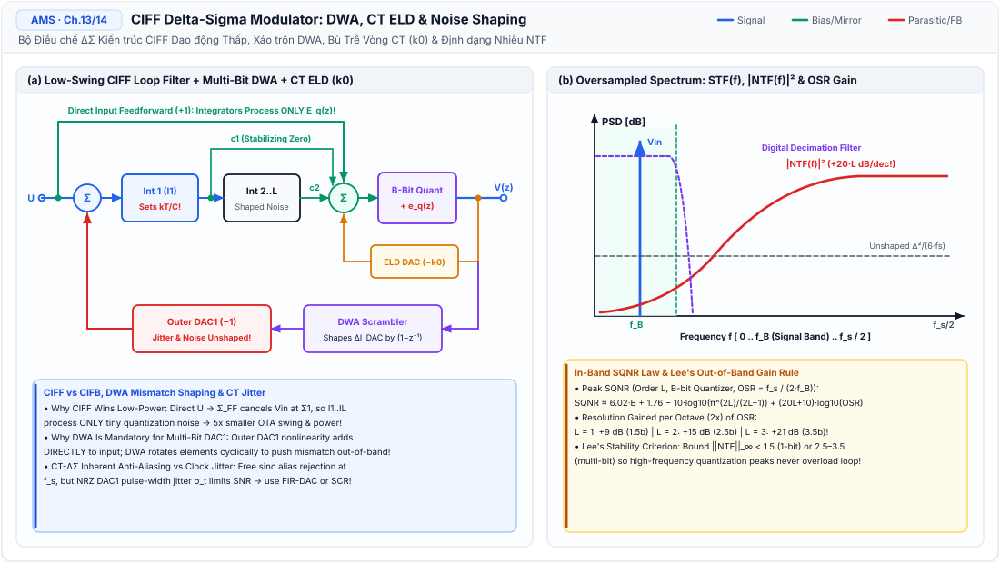

---
{
  "id": "topo-deltasigma-modulator-sc-and-ct-architectures",
  "kind": "topology",
  "domain": "ams-filters-and-system",
  "title_vi": "Kiến trúc Bộ Điều chế Delta-Sigma (ΔΣ ADC): Định dạng Nhiễu Schreier, Cấu trúc CIFB vs CIFF, Tụ Chuyển mạch (SC) vs Thời gian Liên tục (CT), Bù Trễ Vòng Dư ELD & Xoay vòng DWA",
  "title_en": "Oversampling Delta-Sigma (ΔΣ) Modulator Architectures: Schreier NTF Synthesis, CIFB vs CIFF, Switched-Capacitor vs Continuous-Time, ELD Compensation, and DWA",
  "summary": "Toàn tập thiết kế bộ chuyển đổi quá lấy mẫu định dạng nhiễu ΔΣ từ bậc 1 đến bậc cao theo phương pháp luận Richard Schreier: dẫn xuất độ lợi SQNR lý thuyết theo OSR và bậc L, quy tắc ổn định Lee ||H_inf|| < 1.5, đối chiếu giảm biên độ dao động nội của CIFF so với CIFB, phân tích sâu đối ngẫu SC-ΔΣ vs CT-ΔΣ (tự khử chồng phổ nội tại đối đầu nhạy jitter xung nhịp và nhánh phản hồi trực tiếp k_0 bù trễ vòng dư ELD), thuật toán trung bình trọng số dữ liệu DWA định dạng bậc 1 sai lệch DAC đa bit và bộ lọc rút mẫu số Sinc^(L+1).",
  "diagram": "../../diagrams/deltasigma-ciff-modulator.svg",
  "razavi_refs": [
    {
      "chapter": 7,
      "section": "7.8",
      "pages": "238-241",
      "equations": ["7.146"]
    },
    {
      "chapter": 10,
      "section": "10.8",
      "pages": "451-456",
      "equations": []
    },
    {
      "chapter": 13,
      "section": "13.3-13.5",
      "pages": "555-571",
      "equations": ["13.45", "13.46", "13.48"]
    },
    {
      "chapter": 14,
      "section": "14.2.1",
      "pages": "593-598",
      "equations": ["14.75"]
    }
  ],
  "github_refs": [
    {
      "repo": "ggventurini/python-deltasigma",
      "url": "https://github.com/ggventurini/python-deltasigma/tree/15f8466c5be527963225b881d29a3b4087641ba3",
      "use": "Bản Python chuẩn hóa bộ công cụ Schreier delsig: synthesizeNTF (quy tắc Lee H_inf), realizeNTF (CIFB/CIFF/CRFF), simulateDSM, scaleABCD và mapABCD sang mạch SC/CT"
    },
    {
      "repo": "r09g/iadc",
      "url": "https://github.com/r09g/iadc/tree/b8c2c4006a0091d6bbcb35d19028b0b4c1393bf4",
      "use": "Thiết kế silicon đầy đủ từ schematic tới GDSII/PEX của bộ chuyển đổi Incremental SC-ΔΣ ADC 12-bit (OSR=512) kèm xung nhịp hai pha không chồng lấp và lọc decimation"
    },
    {
      "repo": "iic-jku/iic-audiodac-v1",
      "url": "https://github.com/iic-jku/iic-audiodac-v1/tree/66ddda4d1ca46a3cccc34f606f75adea44b595f0",
      "use": "Ứng dụng đối ngẫu vòng định dạng nhiễu ΔΣ bậc cao và bộ nội suy số trong chip Audio DAC 16-bit đã chế tạo thực tế"
    },
    {
      "repo": "bmurmann/ADC-survey",
      "url": "https://github.com/bmurmann/ADC-survey/tree/00b4b855de5ce6bdf584a6aace354380022f1de4",
      "use": "Dữ liệu chuẩn ISSCC/VLSI định vị biên giới hiệu suất Schreier FoM_S (175-185 dB) của SC-ΔΣ và CT-ΔΣ từ dải kHz cảm biến đến hàng trăm MHz vô tuyến"
    }
  ],
  "glossary_codes": [
    "T007",
    "T035",
    "T047",
    "T051",
    "T074",
    "T087",
    "T687",
    "T1089",
    "T1597",
    "T1802",
    "T1950",
    "T2098",
    "T2142",
    "T2146",
    "T2147",
    "T2148"
  ],
  "process_agnostic": true,
  "roles": {
    "loop_filter_integrator_chain": "Chuỗi L bộ tích phân (tụ chuyển mạch SC hoặc Active-RC / Gm-C liên tục) cung cấp độ lợi vòng khổng lồ trong băng tần gốc f <= f_B để đẩy nhiễu lượng tử dồn lên tần số cao.",
    "coarse_internal_quantizer": "Bộ lượng tử thô tốc độ cao fs = 2 * OSR * f_B (1-bit dùng StrongARM đơn giản hoặc đa bit 3-5 bit dạng Flash/SAR rút gọn) đóng kín vòng hồi tiếp thời gian rời rạc.",
    "feedback_dac_and_dwa_rotator": "Bộ DAC hồi tiếp chính xác nối về đầu vào bộ lọc vòng; trong kiến trúc đa bit đi kèm bộ xoay con trỏ DWA đẩy sai lệch phần tử DAC ra khỏi dải tần tín hiệu.",
    "eld_direct_path_and_decimator": "Nhánh phản hồi trực tiếp k_0 quanh bộ lượng tử khử trễ vòng dư ELD trong CT-ΔΣ, theo sau bởi bộ lọc số thông thấp Sinc^(L+1) / Half-band cắt bỏ nhiễu ngoài dải và hạ tốc độ mẫu."
  },
  "symptoms_addressed": [
    "physical-matching-ceiling-preventing-nyquist-adcs-from-exceeding-14-to-16-bits-without-heavy-calibration",
    "brick-wall-analog-anti-aliasing-filter-area-and-distortion-burden-at-nyquist-rate",
    "large-integrator-voltage-swings-clipping-low-voltage-nanometer-otas-in-cifb-loops",
    "feedback-dac-element-mismatch-destroying-multibit-deltasigma-linearity"
  ],
  "limitations": [
    "high-order-single-bit-loops-suffer-irreversible-quantizer-overload-if-ntf-out-of-band-gain-exceeds-lees-bound",
    "continuous-time-deltasigma-snr-is-severely-degraded-by-sampling-and-dac-clock-phase-jitter",
    "excess-loop-delay-from-comparator-regeneration-shifts-ct-ntf-poles-toward-unit-circle-without-k0-tap",
    "multi-cycle-group-delay-of-decimation-filters-requires-incremental-reset-mode-for-multiplexed-sensors"
  ],
  "checklists": [
    "common-mos",
    "dac-and-deltasigma-adc",
    "switched-capacitor",
    "feedback-and-stb",
    "layout-and-matching"
  ]
}
---

## 1. Bản chất Nguyên lý, Sơ đồ Mạch & Vai trò Từng Nhánh Cấu trúc

Trong các kiến trúc ADC lấy mẫu ở tốc độ Nyquist (`SAR`, `Pipeline`, `Flash`), độ chính xác thô bị trói chặt vào độ khớp hình học tĩnh của linh kiện tương tự ($\sim 10\text{–}14\text{ bit}$ theo định luật Pelgrom `law-pelgrom-mismatch-and-sizing-duality`) và đòi hỏi bộ lọc chống chồng phổ tương tự (`Anti-Aliasing Filter — AAF`) có sườn cắt dốc đứng ngay trên biên $f_s / 2$. **Bộ chuyển đổi Tương tự–Số Điều chế Delta-Sigma (`T2098`, Oversampling & Noise-Shaping $\Delta\Sigma$ ADC)** lật ngược hoàn toàn cuộc chơi bằng cách đánh đổi **tốc độ xung nhịp rẻ tiền và mật độ cổng logic số của công nghệ CMOS nanomet** để đổi lấy **độ phân giải siêu cao $16\text{–}24\text{ bit}$** dựa trên hai trụ cột vật lý:
1. **Quá lấy mẫu (`Oversampling` với tỷ số $\text{OSR} = \dfrac{f_s}{2 f_B} \gg 1$):** Trải phẳng tổng công suất nhiễu lượng tử không đổi $\sigma_e^2 = \frac{\Delta^2}{12}$ lên một dải tần rộng gấp $\text{OSR}$ lần băng thông tín hiệu $f_B$, đồng thời đẩy các dải ảnh chồng phổ $f_s \pm f_B$ ra rất xa giúp bộ lọc AAF đầu vào chỉ cần mạch RC bậc 1 cực kỳ nhẹ nhàng (thậm chí được miễn phí nội tại trong `CT-ΔΣ`!).
2. **Định dạng phổ nhiễu bằng vòng hồi tiếp tích phân (`Noise Shaping`):** Đặt bộ lượng tử thô ($1\text{-bit}$ hoặc $3\text{–}4\text{ bit}$) nằm **bên trong một vòng hồi tiếp âm có bộ lọc vòng `Loop Filter` $L(z)$ độ lợi cực lớn tại tần số thấp** (`T1802`). Tín hiệu đầu vào đi qua hàm truyền tín hiệu $\text{STF}(z) \approx 1$ giữ nguyên biên độ, trong khi sai số lượng tử $E(z)$ bị chia cho $(1 + L(z))$, tạo hàm truyền nhiễu $\text{NTF}(z) = \frac{1}{1 + L(z)}$ có dạng bộ lọc thông cao bậc $L$ triệt tiêu nhiễu trong dải gốc $[0, f_B]$ và dồn toàn bộ năng lượng nhiễu lượng tử vọt lên vùng tần số cao quanh $f_s / 2$ — nơi bộ lọc số thông thấp (`Digital Decimation Filter`) gọt phẳng dễ dàng!



Một hệ thống $\Delta\Sigma$ ADC hoàn chỉnh gồm 4 phân hệ phối hợp chặt chẽ:
- **Bộ lọc vòng bậc $L$ (`Loop Filter` — thực thi dạng Tụ chuyển mạch `SC` hoặc Thời gian liên tục `CT`):** Tích lũy sai lệch giữa tín hiệu vào $X$ và tín hiệu hồi tiếp $Y$; trong đó **tầng tích phân đầu tiên** nằm ngoài mọi sự che chắn độ lợi nên một mình quyết định toàn bộ sàn nhiễu nhiệt, nhiễu $1/f$ và độ tuyến tính của cả chip!
- **Bộ lượng tử nội tốc độ cao (`Internal Quantizer`):** Chốt quyết định ở mỗi nhịp $f_s$ (`topo-dynamic-strongarm-and-miyahara-comparator` cho $1\text{-bit}$ không bao giờ có lỗi phi tuyến nội tại, hoặc mảng Flash/SAR nhỏ $3\text{–}5\text{ bit}$).
- **Bộ DAC hồi tiếp & Logic định dạng sai lệch `DWA` (`Feedback DAC + Data-Weighted Averaging`):** Tái tạo đại lượng tương tự trừ trực tiếp vào ngõ vào tầng 1; mọi lỗi phi tuyến của DAC này đi thẳng vào kết quả nên bắt buộc dùng $1\text{-bit}$ tự tuyến tính hoặc đa bit kèm thuật toán xoay vòng phần tử `DWA`!
- **Bộ lọc số khử nhiễu & giảm tốc độ mẫu (`Digital Decimator`):** Chuỗi bộ lọc răng lược tích phân $\text{Sinc}^{K}$ (`CIC`) ghép nối tiếp bộ lọc FIR nửa dải (`Half-Band`) cắt sạch ngọn núi nhiễu lượng tử ngoài dải và hạ tốc độ dữ liệu từ $f_s$ về tốc độ Nyquist $2 f_B$.

---

## 2. Hệ Phương trình Cốt lõi & Tư duy "Nhìn Mạch Đọc Nhanh" (Analysis by Inspection)

### 2.1. Phương trình Đỉnh `SQNR` Bậc `L`, Tối ưu Điểm Không NTF & Quy tắc Ổn định Lee (`Lee's Rule`)
Tuyến tính hóa bộ lượng tử đều $N_q\text{-bit}$ ($2^{N_q}$ mức mã, quy ước biên độ toàn thang không quá tải đỉnh–đỉnh $V_{\text{FS}} = 2^{N_q}\Delta$, biên độ đỉnh sóng sin $V_{\text{FS}}/2 = 2^{N_q - 1}\Delta$) thành nguồn nhiễu trắng cộng tính độc lập trên $[-\Delta/2, +\Delta/2]$ có mật độ phổ hai phía $S_e(f) = \frac{\Delta^2}{12 f_s}$ *(lưu ý: nếu quy ước $V_{\text{FS,step}} = (2^{N_q} - 1)\Delta$ tính giữa hai mức tái tạo ngoài cùng của DAC đa bit, số hạng $6.02\,N_q$ bên dưới thay bằng $20\log_{10}(2^{N_q} - 1)$)*:
1. **Hàm truyền nhiễu vi phân thuần túy $\text{NTF}(z) = (1 - z^{-1})^L$:**
   Thay $z = e^{j 2\pi f / f_s}$, biên độ hàm truyền nhiễu bằng $\left|\text{NTF}(e^{j 2\pi f / f_s})\right| = \left|2 \sin\!\left(\frac{\pi f}{f_s}\right)\right|^L$. Khi tỷ số quá lấy mẫu $\text{OSR} = \frac{f_s}{2 f_B} \gg \pi$, trong dải gốc $f \le f_B$ ta xấp xỉ $\sin(\pi f / f_s) \approx \frac{\pi f}{f_s}$. Tích phân công suất nhiễu lượng tử trong dải $[-f_B, +f_B]$:

$$
P_{q,\text{in-band}} = \int_{-f_B}^{+f_B} \frac{\Delta^2}{12 f_s} \left(\frac{2\pi f}{f_s}\right)^{2L} df = \frac{\Delta^2}{12} \cdot \frac{\pi^{2L}}{2L + 1} \cdot \frac{1}{\text{OSR}^{2L + 1}}
$$

   Đối chiếu với công suất sóng sin đầu vào toàn thang lý thuyết $P_{\text{sig,FS}} = \frac{(2^{N_q}\Delta / 2)^2}{2} = \frac{2^{2 N_q}\Delta^2}{8}$, ta thu được **Phương trình Nền tảng `SQNR` của Bộ Điều chế $\Delta\Sigma$ Bậc `L`**:

$$
\text{SQNR}_{\max}\text{ [dB]} = 6.02\,N_q + 1.76 - 10\log_{10}\!\left(\frac{\pi^{2L}}{2L + 1}\right) + (20L + 10)\log_{10}(\text{OSR})
$$

   - **Đọc nhanh tốc độ tăng độ phân giải theo từng Octave (`nhân đôi OSR`):**
     * Quá lấy mẫu không định dạng nhiễu ($L = 0$): chỉ tăng **$+3\text{ dB/octave}$** ($+0.5\text{ bit}$ mỗi lần nhân đôi $f_s$).
     * Bậc $L = 1$: tăng **$+9\text{ dB/octave}$** ($+1.5\text{ bit/oct}$).
     * Bậc $L = 2$: tăng **$+15\text{ dB/octave}$** ($+2.5\text{ bit/oct}$; tại $\text{OSR} = 64, N_q = 1 \implies \text{SQNR}_{\text{ideal}} \approx 7.78 - 5.17 + 50 \times 1.806 = \mathbf{92.9\text{ dB}}$ trước khi trừ giảm tải ổn định!).
     * Bậc $L = 3$: tăng **$+21\text{ dB/octave}$** ($+3.5\text{ bit/oct}$).
   - **Tối ưu hóa điểm không NTF (`Optimized Resonator Zeros`, `opt=1` trong Schreier `python-deltasigma`):** Thay vì gom toàn bộ $L$ điểm không của $\text{NTF}(z)$ nằm trùng tại DC ($z = 1$), chèn một nhánh hồi tiếp cục bộ $g_1$ tạo cặp điểm không phức liên hợp trên đường tròn đơn vị ngay tại $f_z = \frac{f_B}{\sqrt{3}}$ (cho $L = 2$) hoặc $\sqrt{3/5}\,f_B$ (cho $L = 3$) giúp khoét sâu đáy nhiễu đều khắp dải thông, tặng thêm **miễn phí $+3.5\text{ dB}$ ($L=2$), $+8.0\text{ dB}$ ($L=3$) và $+13\text{ dB}$ ($L=4$)**!

2. **Giới hạn Quá tải Bộ lượng tử & Quy tắc Bán thực nghiệm Lee (`Lee's Rule`, $\|H_\infty\| < 1.5$):**
   Hàm vi phân thuần túy $(1 - z^{-1})^L$ có độ lợi cực đại tại $f = f_s / 2$ ($z = -1$) bằng $\|\text{NTF}\|_\infty = 2^L$ ($= 4$ với $L=2$, $= 8$ với $L=3$!). Trong bộ điều chế $1\text{-bit}$ bậc $L \ge 3$, độ lợi ngoài dải $= 8$ phóng đại sai số lượng tử quay ngược lại làm tràn ngõ vào bộ so sánh, giảm độ lợi hiệu dụng $k_q$ của bộ lượng tử 1-bit và đẩy các cực vòng kín vọt ra ngoài đường tròn đơn vị (`tech-nyquist-stability-criterion`) gây dao động tự kích biên độ lớn không thể phục hồi!
   - **Quy tắc Thiết kế Schreier / Lee:** Để vòng $\Delta\Sigma$ **1-bit** bậc $L \ge 2$ ổn định bền vững với biên độ vào cực đại ổn định (`Maximum Stable Amplitude — MSA`) đạt $0.65\text{–}0.75\,V_{\text{REF}}$ ($\sim -3\text{ dBFS}$), bắt buộc đặt thêm đa thức mẫu số Butterworth/Chebyshev $D(z)$ vào $\text{NTF}(z) = \frac{(z - 1)^L}{D(z)}$ sao cho chuẩn vô cùng thỏa mãn:

$$
\|H_\infty\| \triangleq \max_{\omega \in [0, \pi]} \left|\text{NTF}\!\left(e^{j\omega}\right)\right| < 1.5 \quad \text{(cho 1-bit quantizer; mở rộng lên } 2.5\text{–}3.5 \text{ khi dùng } B \ge 3\text{-bit quantizer!)}
$$

### 2.2. Cấu trúc Vòng lọc `CIFB` vs `CIFF` & Phép Biến đổi Giảm Biên độ Tích phân
Hai họ cấu trúc hiện thực hóa ma trận trạng thái `ABCD` phổ biến nhất (`realizeNTF` trong `ggventurini/python-deltasigma`) mang đặc tính mạch điện trái ngược nhau:
1. **`CIFB` (`Cascade of Integrators with Distributed Feedback`):** Mỗi tầng tích phân nhận một nhánh DAC hồi tiếp riêng $a_i Y(z)$.
   - *Ưu điểm:* Hàm truyền tín hiệu $\text{STF}(z)$ tự động là mạch lọc thông thấp mịn không bao giờ bị nhô đỉnh ngoài dải.
   - *Nhược điểm nặng ở nguồn áp thấp:* Tầng tích phân 1 phải xử lý **trọn vẹn thành phần cơ bản của tín hiệu đầu vào lớn $X(z)$ cộng thêm nhiễu lượng tử**, đòi hỏi biên độ ra OTA rất rộng, tốc độ biến thiên `Slew Rate` lớn và tốn nhiều bộ tụ/nguồn dòng DAC hồi tiếp tải lên từng tầng.
2. **`CIFF` (`Cascade of Integrators with Feedforward` + Nhánh Truyền thẳng Đầu vào $b_1 = 1$):** Chỉ dùng **duy nhất 1 bộ DAC hồi tiếp** đưa về ngõ vào tầng tích phân số 1; ngõ ra của các tầng tích phân được cộng có trọng số $c_i$ tại bộ cộng trước bộ lượng tử, đồng thời **kéo một nhánh truyền thẳng trực tiếp từ $X_{\text{in}}$ với hệ số $b_1 = 1$ thẳng vào bộ cộng trước bộ lượng tử** (`Low-Distortion Silva-Steensgaard CIFF`)!
   - **Phép màu nhìn mạch đọc nhanh:** Vì $Y(z) = X(z) + \text{NTF}(z) E(z)$, hiệu tín hiệu đi vào đầu bộ tích phân số 1 là $X(z) - Y(z) = -\text{NTF}(z) E(z)$ — **hoàn toàn KHÔNG CHỨA một chút thành phần tín hiệu đầu vào $X(z)$ nào**! Toàn bộ chuỗi $L$ bộ tích phân chỉ phải xử lý duy nhất sai số lượng tử biên độ nhỏ! Nhờ đó biên độ dao động tại ngõ ra OTA thu hẹp $3\text{–}5\times$, méo hài phi tuyến của OTA bị triệt tiêu tận gốc (rất hợp với nguồn $0.9\text{–}1.2\text{ V}$ trên `65nm/45nm`), và nhánh $b_1 = 1$ đồng thời xóa bỏ hiện tượng nhô đỉnh $\text{STF}$ ngoài dải vốn là điểm yếu của CIFF cổ điển!

### 2.3. Đối ngẫu `SC-ΔΣ` vs `CT-ΔΣ`: Bất biến Xung, Nhạy Jitter Xung nhịp & Bù Trễ Vòng Dư `ELD`
1. **Ngân sách Nhiễu Nhiệt Tầng Đầu Tiên (`Stage-1 Thermal Noise Dominance`):**
   - Trong **`SC-ΔΣ`** dùng `topo-switched-capacitor-integrator-parasitic-insensitive` vi sai hai pha nạp-truyền (cả pha $\phi_1$ lẫn $\phi_2$ đều lấy mẫu nhiễu $kT/C_{s1}$ lên hai nhánh vi sai, cộng thêm nhiễu nhiệt OTA khi truyền điện tích!), công suất nhiễu nhiệt quy về ngõ vào vi sai được chia giảm nhờ hệ số $\text{OSR}$:

$$
\overline{V_{n,\text{in,SC}}^2} \approx \frac{4 k T \, (1 + \eta_{\text{OTA}})}{\text{OSR} \cdot C_{s1,\text{single}}} \qquad \left(\text{so với } \frac{2kT}{C_s} \text{ của Nyquist ADC} \implies \text{nhỏ hơn } \sim \frac{\text{OSR}}{2}\text{ lần cho cùng } C_{s1}!\right)
$$

   - Trong **`CT-ΔΣ`** dùng bộ tích phân `Active-RC` đầu vào vi sai (hai điện trở đầu vào $R_{\text{in}}$):

$$
\overline{V_{n,\text{in,CT}}^2} = 2 \times \left(4 k T R_{\text{in}}\right) \cdot f_B + \overline{V_{n,\text{DAC,in}}^2} + \overline{V_{n,\text{OTA1,in}}^2} = 8 k T R_{\text{in}} f_B \left(1 + \frac{R_{\text{in}}}{R_{\text{DAC,eq}}} + \dots\right)
$$

2. **Tự Chống Chồng Phổ Nội tại (`Intrinsic Anti-Aliasing`) của `CT-ΔΣ`:**
   Trong `CT-ΔΣ` cấu trúc phản hồi phân tán (`CIFB`, không kéo nhánh truyền thẳng trực tiếp từ cổng vào tắt qua bộ lọc vòng tới trước bộ lấy mẫu), khâu lấy mẫu rời rạc nằm ở **cuối chuỗi bộ lọc liên tục bậc $L$** chứ không nằm ở cổng vào! Một nhiễu giao thoa tại tần số ảnh $f_{\text{alias}} = f_s - f_0$ ($f_0 \le f_B \ll f_s$) đi qua hàm lọc liên tục rồi gấp phổ về $f_0$ bị nén theo tỷ số dạng $\text{sinc}^L$: $\left|\frac{\sin(\pi f_{\text{alias}}/f_s)}{\pi f_{\text{alias}} / f_s}\right|^L = \left|\frac{\sin(\pi f_0 / f_s)}{\pi (f_s - f_0) / f_s}\right|^L \approx \left(\frac{f_0}{f_s - f_0}\right)^L \approx \frac{1}{(2\,\text{OSR} - 1)^L}$ (ví dụ tại $L = 3, \text{OSR} = 16$ đạt $\approx -89.8\text{ dB}$ suy hao chống chồng phổ miễn phí; lưu ý nếu dùng nhánh truyền thẳng $b_1 = 1$ nối tắt trực tiếp tới bộ cộng trước bộ lượng tử trong `CIFF`, đường tắt này lấy mẫu trực tiếp nhiễu ở $f_s - f_0$ nên phải lọc RC thụ động hoặc dẫn tín hiệu vào qua tầng tích phân liên tục đầu tiên!).
3. **Tử huyệt Jitter Xung nhịp (`Clock Jitter`) & Bù Trễ Vòng Dư (`Excess Loop Delay — ELD`) của `CT-ΔΣ`:**
   - *Độ nhạy Jitter:* Trong `SC-ΔΣ`, dòng nạp tụ tắt hẳn về $0$ cuối pha nên xê dịch sườn xung nhịp $\Delta t_j$ hầu như vô hại. Trái lại trong `CT-ΔΣ` dùng xung dòng DAC không trở về không (`NRZ`), sai lệch sườn xung nhịp $\sigma_{t,j}$ làm thay đổi diện tích điện tích $\Delta Q_j = I_{\text{DAC}} \cdot \Delta D[n] \cdot \Delta t_j$ bơm vào nút đất ảo mỗi chu kỳ! Với DAC `NRZ`, trần $\text{SNR}$ do jitter bị khóa cứng tại:

$$
\text{SNR}_{\text{jitter,NRZ}} \approx 10\log_{10}\!\left(\frac{\text{OSR} \cdot (2^{N_q} - 1)^2}{8 \pi^2 f_B^2 \sigma_{t,j}^2 \cdot \overline{(\Delta D)^2_{\text{norm}}}}\right) \quad \left(\text{dùng đa bit } N_q = 4 \text{ giảm bước nhảy } \Delta D \text{ cứu ngay } +18\text{–}22\text{ dB jitter SNR!}\right)
$$

   - *Phép biến đổi Bất biến Xung (`Impulse-Invariant Transformation — IIT`) & Nhánh $k_0$ khử `ELD`:*
     Để `CT-ΔΣ` có cùng chính xác $\text{NTF}(z)$ với mẫu thiết kế `SC-ΔΣ`, đáp ứng xung lấy mẫu tại $t = n T_s$ của vòng mở liên tục phải khớp từng điểm: $\mathcal{Z}^{-1}\!\left\{L_{\text{DT}}(z)\right\} = \left.\mathcal{L}^{-1}\!\left\{L_{\text{CT}}(s) \cdot H_{\text{DAC}}(s) \cdot e^{-s \tau_d}\right\}\right|_{t = n T_s}$. Khi tồn tại trễ vòng dư $\tau_d = \alpha_d T_s$ ($0 < \alpha_d \le 1$, do thời gian chốt bộ so sánh + logic `DWA`), xung DAC bị đẩy sang chu kỳ kế tiếp làm xuất hiện cực phụ $z = 0$ (tăng bậc vòng lên $L+1$)! Ví dụ với $L = 1$, xung `NRZ` từ $[\tau_d, T_s + \tau_d]$ qua bộ tích phân $\frac{k_1}{s T_s}$ cho biến đổi $\mathcal{Z}$ là $k_1 \frac{(1 - \alpha_d) z^{-1} + \alpha_d z^{-2}}{1 - z^{-1}} \neq \frac{z^{-1}}{1 - z^{-1}}$! Bằng cách **thêm một nhánh DAC phản hồi trực tiếp hệ số $k_0$ vào ngay bộ cộng trước bộ lượng tử** (tạo số hạng $-k_0 z^{-1}$) và chỉnh $k_1 = 1, k_0 = \alpha_d$:

$$
k_1 \frac{(1 - \alpha_d) z^{-1} + \alpha_d z^{-2}}{1 - z^{-1}} + k_0 z^{-1} \;\xrightarrow{\;k_1 = 1,\; k_0 = \alpha_d\;}\; \frac{z^{-1}}{1 - z^{-1}} \quad \text{(Khôi phục 100% NTF gốc không lệch một cực nào!)}
$$

### 2.4. Định dạng Sai lệch Phần tử Động `DWA` (`Data-Weighted Averaging`) & Lọc Rút mẫu $\text{Sinc}^{L+1}$
1. **Nguyên lý Con trỏ Xoay vòng `DWA` cho DAC Đa bit:**
   Với DAC nhiệt kế $M = 2^{N_q}$ phần tử đơn vị, thay vì luôn chọn các phần tử đầu tiên $\{0, 1, \dots, D[n]-1\}$ (biến sai lệch tĩnh $\epsilon_m$ thành sóng hài méo trực tiếp!), `DWA` lưu con trỏ `ptr[n]` chỉ vào phần tử kế tiếp ngay sau phần tử vừa dùng ở chu kỳ trước:

$$
\text{Chọn các ô } \big\{\text{ptr}[n], \dots, (\text{ptr}[n] + D[n] - 1) \bmod M\big\}, \qquad \text{ptr}[n+1] = \big(\text{ptr}[n] + D[n]\big) \bmod M
$$

   Gọi $S(k) = \sum_{m=0}^{k-1} \epsilon_m$ là sai số tích lũy tuần hoàn ($S(M) = 0$): tổng sai số DAC bơm vào ở nhịp $n$ đúng bằng hiệu sai phân bậc một $E_{\text{DAC}}[n] = S(\text{ptr}[n+1]) - S(\text{ptr}[n])$, có biến đổi $\mathcal{Z}$ là **$E_{\text{DAC}}(z) = (1 - z^{-1}) S(z)$**! Toàn bộ sai lệch Pelgrom của mảng DAC hồi tiếp bị định dạng thông cao bậc $1$, triệt tiêu hoàn toàn ở DC và tăng $\text{SFDR}/\text{SNDR}$ thêm $15\text{–}25\text{ dB}$ chỉ bằng một bộ cộng modulo và thanh dịch thùng (`barrel shifter`) vài chục cổng logic!
2. **Tại sao Bộ lọc Rút mẫu Số đầu tiên Bắt buộc có Bậc $\text{Sinc}^{K}$ với $K = L + 1$?**
   Bộ lọc trung bình trượt răng lược tích phân (`Cascaded Integrator-Comb — CIC / Sinc^K`) không cần bộ nhân có hàm truyền $H_{\text{Sinc}}(z) = \left(\frac{1}{R}\frac{1 - z^{-R}}{1 - z^{-1}}\right)^K$. Vì nhiễu lượng tử của bộ điều chế tăng dốc ở tần số cao theo $f^{+L}$, để các búp phụ quanh các bội số tốc độ hạ mẫu $m \cdot (f_s / R)$ có điểm không bậc $K$ nén nhiễu gấp phổ đủ sâu dưới sàn nhiễu trong dải gốc, bậc lọc phải thỏa mãn **bất biến $K \ge L + 1$** (ví dụ $\Delta\Sigma$ bậc $2$ dùng lọc $\text{Sinc}^3$, $\Delta\Sigma$ bậc $3$ dùng lọc $\text{Sinc}^4$!).

---

## 3. Bất biến Cấu trúc & Các Bẫy Lỗi Kinh điển (Structural Invariants & Traps)

- **`[INV-DSM-01]` Bất biến Độ lợi DC Hữu hạn của OTA Tầng 1 (`Finite OTA Gain Leakage` $A_{0,1} \gtrsim \frac{\text{OSR}}{\pi}$):**
  Độ lợi DC hữu hạn $A_0$ của OTA biến bộ tích phân SC lý tưởng $\frac{z^{-1}}{1 - z^{-1}}$ thành bộ tích phân rò (`leaky integrator`) có cực dịch từ $z = 1$ vào $z \approx 1 - \frac{1}{A_0}$, làm các điểm không của $\text{NTF}$ không còn chạm đáy $0$ ở DC! Để tổn hao $\text{SQNR}$ do rò nhiễu nhỏ hơn $1\text{ dB}$, chỉ cần $A_{0,1} \ge \frac{2\,\text{OSR}}{\pi}$ (ví dụ $\text{OSR} = 64 \implies A_{0,1} \ge 41 \approx 32\text{ dB}$, thường chọn $50\text{–}60\text{ dB}$ để giữ tuyến tính — nhẹ nhàng hơn rất nhiều so với yêu cầu $80\text{ dB}$ của Pipelined ADC!).
- **`[INV-DSM-02]` Bất biến Phân bổ Công suất Không Đều Giữa Các Tầng Tích phân (`Aggressive Stage Scaling`):**
  Trong bộ điều chế bậc $3$ ($\text{OSR} = 64$), nhiễu nhiệt và offset của tầng tích phân số 2 khi quy về ngõ vào bị chia cho $|H_{\text{int1}}(f_B)|^2 \approx \left(\frac{2\,\text{OSR}}{\pi}\right)^2 \approx 1660\times$ ($32\text{ dB}$)! Do đó tụ lấy mẫu $C_{s1}$ và dòng nuôi $\text{OTA}_1$ chiếm $65\%\text{–}75\%$ ngân sách công suất toàn bộ mạch tương tự, trong khi $C_{s2}, C_{s3}$ và $\text{OTA}_2, \text{OTA}_3$ bắt buộc thu nhỏ xuống mức sàn công nghệ ($5\text{–}10\times$ nhỏ hơn tầng 1) để tiết kiệm công suất và giảm tải cho tầng trước!
- **`[TRAP-DSM-01]` Bẫy Sóng Hài Nhàn Rỗi (`Idle Tones`) Ở Đầu vào DC Với Bộ Điều chế Bậc 1 & Bậc 2:**
  Khi đặt điện áp DC cố định vào bộ điều chế bậc 1 (hoặc bậc 2 không dither), sai số lượng tử không còn là nhiễu trắng ngẫu nhiên mà khóa vào chu kỳ lặp hữu hạn tạo các vạch phổ gai nhọn (`idle tones`) lọt ngay vào băng thông âm thanh/cảm biến! Giải pháp: dùng bậc $L \ge 2\text{–}3$ đa bit, tiêm giả ngẫu nhiên `LFSR dither` biên độ nhỏ trước bộ lượng tử, hoặc trong đo lường cảm biến dùng chế độ **Incremental $\Delta\Sigma$** (`r09g/iadc`) có đặt lại (`reset`) cả bộ tích phân tương tự lẫn bộ lọc số sau mỗi $M$ chu kỳ!
- **`[TRAP-DSM-02]` Bẫy Biến thiên Hằng số Thời gian $R C$ $\pm 30\%$ Qua Góc Tiến trình Trong `CT-ΔΣ`:**
  Khác với `SC-ΔΣ` nơi hệ số vòng lọc chỉ phụ thuộc tỷ số hai tụ cùng loại $C_1 / C_2$ (chính xác $\pm 0.1\%$), hệ số tích phân của `CT-ΔΣ` bằng $\frac{1}{R C f_s}$ phụ thuộc tích tuyệt đối của điện trở poly và tụ MOM (lệch tới $\pm 30\%\text{–}35\%$ giữa góc nhanh `FF` và góc chậm `SS`!). Nếu $RC$ giảm $30\%$, hệ số độ lợi vòng tăng $1.43\times$ đẩy $\|\text{NTF}\|_\infty$ vượt trần Lee gây mất ổn định ngay lập tức! **Mọi mạch `CT-ΔΣ` thực tế bắt buộc trang bị mảng tụ đơn vị chuyển mạch số $4\text{–}5\text{ bit}$ trên từng bộ tích phân (`tunable capacitor bank`)** được hiệu chuẩn theo hằng số thời gian xung nhịp chuẩn (`topo-gm-c-filters-and-automatic-rc-gmc-tuning`)!
- **`[TRAP-DSM-03]` Bẫy Tự Ghép Chu kỳ Của `DWA` Khi Gặp Đầu vào DC (`DWA Tone Folding`):**
  Ở một số mức DC hữu tỉ đặc biệt (ví dụ $D = M/2$ hoặc $M/4$), con trỏ `DWA` lặp lại đúng một nhóm ô sau ít chu kỳ, tạo vạch phổ giả lọt vào dải gốc nếu $M$ nhỏ. Khắc phục gọn bằng cách thêm $1\text{ LSB}$ dither ngẫu nhiên có định dạng bậc một hoặc đảo chiều quét luân phiên (`Bidirectional / Rotated DWA`).

---

## 4. Lộ trình Nâng cấp Cấu trúc & Bát giác Đánh đổi (Upgrade Paths & Design Octagon)

| Đặc tính Kỹ thuật | Switched-Capacitor `SC-ΔΣ` | Continuous-Time `CT-ΔΣ` (`Active-RC` / `$G_m$-C`) | Multi-Stage Noise-Shaping `MASH (2-1 / 2-2)` |
| :--- | :--- | :--- | :--- |
| **Độ chính xác Hệ số Vòng lọc** | **Tuyệt hảo ($\pm 0.1\%$ nhờ tỷ số $C_1/C_2$)** | Lệch $\pm 30\%$ theo $RC$ $\implies$ **cần mảng tụ trim số** | Đòi hỏi khớp chặt hàm lọc tương tự tầng 1 với lọc số khử nhiễu! |
| **Băng thông Tín hiệu $f_B$ & Tốc độ $f_s$** | Cảm biến DC $\dots 5\text{ MHz}$ ($\text{GBW}_{\text{OTA}} \ge 5 f_s$) | **Rộng ($1\text{ MHz} \dots > 200\text{ MHz}$, $\text{GBW}_{\text{OTA}} \approx 1.5 f_s$)** | Rộng ở bậc cao ($L = 3\text{–}4$) mà không sợ mất ổn định vòng |
| **Khả năng Chống Chồng phổ (`AAF`)** | Cần mạch lọc AAF tương tự phía trước | **Tự khử chồng phổ nội tại $> 70\text{ dB}$ miễn phí!** | Phụ thuộc tầng đầu dùng `SC` hay `CT` |
| **Độ nhạy Jitter Xung nhịp (`Clock Jitter`)** | **Miễn nhiễm cao** (điện tích truyền hết trước sườn) | **Rất nhạy** (cần PLL nhiễu pha thấp + DAC đa bit / FIR) | Giống tính chất tầng 1 |
| **Ổn định Vòng lặp Bậc Cao ($L \ge 3$)** | Phải tuân thủ quy tắc Lee $\|H_\infty\| < 1.5$ | Cần thêm nhánh $k_0$ bù trễ vòng dư `ELD` | **Ổn định từ các vòng con bậc 1–2** *(khi giữ biên độ từng tầng dưới ngưỡng quá tải & khớp lọc số khử nhiễu)* |

- **Lộ trình lai ghép thế hệ mới:**
  - **Incremental $\Delta\Sigma$ ADC (`r09g/iadc`):** Gắn công tắc xóa điện tích trên mọi tụ tích phân sau đúng $N_{\text{cyc}}$ nhịp để thiết lập ánh xạ **1-đối-1 theo từng mẫu** không còn trễ bộ nhớ dài — lý tưởng để quét qua bộ dồn kênh nhiều cảm biến `topo-analog-mux-and-adc-track-hold-drivers`!
  - **Zoom ADC & Noise-Shaping SAR:** Kết hợp bước tìm kiếm thô nhanh của `topo-sar-adc-charge-redistribution-architecture` với vòng định dạng nhiễu tinh $\Delta\Sigma$, đạt kỷ lục Schreier $\text{FoM}_S > 182\text{ dB}$!

---

## 5. Thích ứng Đa Tiến trình (90nm / 65nm / 45nm) & Cách Kiểm chứng trong Cadence / Spectre

### 5.1. Quy trình Tổng hợp 4 Bước Từ `python-deltasigma` Xuống Schematic `IC617` (`CIFF 3rd-Order`)
1. **Tổng hợp `NTF` & Thực thi `CIFF`:** Chạy `ntf = synthesizeNTF(order=3, osr=64, opt=1, H_inf=1.5)` (cho 1-bit) hoặc `H_inf=2.8` (cho 4-bit + DWA), gọi `a, g, b, c = realizeNTF(ntf, form='CIFF')`, đặt `b = [1.0, 0.0, 0.0, 1.0]` (kích hoạt đường truyền thẳng giảm méo!), rồi chạy `abcd_s, umax = scaleABCD(abcd)` để chuẩn hóa biên độ đỉnh mọi nút tích phân về đúng $\pm 0.35\text{ V}$ trên nguồn `1.0V / 1.2V`!
2. **Định cỡ Tụ/Điện trở Tầng 1 từ Ngân sách $kT/C$ (SC) hoặc $8kTR_{\text{in}}f_B$ (CT):**
   - Ví dụ mục tiêu $\text{SNDR} = 92\text{ dB}$ ($\text{ENOB} = 15\text{ bit}$) với $V_{\text{REF}} = 1.0\text{ V}$ ($V_{\text{FS,rms}} = 0.707\text{ V} \implies V_{n,\text{tot,rms}} \le 17.7\,\mu\text{V}$), $\text{OSR} = 64$: dành $60\%$ công suất nhiễu cho tầng 1 ($V_{n,\text{th1}}^2 \le 1.88\times 10^{-10}\,\text{V}^2$). Với `SC-ΔΣ` ($\eta_{\text{OTA}} \approx 0.6$):
     $$C_{s1} \ge \frac{4 \times 4.14\times 10^{-21} \times 1.6}{64 \times 1.88\times 10^{-10}} \approx \mathbf{2.20\text{ pF}} \quad (\text{trong khi SAR Nyquist 15-bit sẽ phải tốn tụ } \sim 140\text{ pF gấp } 64\times!)$$
3. **Chọn Cấu trúc OTA Trên `65nm / 45nm`:** Nhờ cấu trúc `CIFF` giữ biên độ ra OTA nhỏ ($\pm 0.3\text{ V}$), có thể dùng `topo-folded-cascode-ota` hoặc **Inverter-Based / Ring-Amplifier OTA** tiết kiệm công suất tĩnh kèm `tech-switched-capacitor-cmfb` và kỹ thuật chặt pha (`chopping` `tech-chopper-stabilization-vs-autozeroing`) ở tầng 1 để đẩy góc nhiễu $1/f$ xuống dưới DC!

### 5.2. Phác đồ Mô phỏng Phổ Chuẩn Có Cửa sổ Hann (`Hann-Windowed Coherent FFT`) trong Spectre
Khác với ADC Nyquist không được dùng cửa sổ khi đã lấy mẫu mạch lạc, trong **$\Delta\Sigma$ ADC** nhiễu lượng tử ngoài dải lớn hơn sàn nhiễu trong dải tới **$80\text{–}100\text{ dB}$** và có thành phần trạng thái quá độ vòng lặp: **BẮT BUỘC dùng cửa sổ Hann ($w_{\text{Hann}}[n] = 0.5(1 - \cos(2\pi n / N_{\text{FFT}}))$) kết hợp chọn tần số nguyên tố lẻ nằm xa biên số 0 ($M_{\text{sig}}$ đủ lớn sao cho toàn bộ $3$ vạch phổ trải rộng của cửa sổ Hann nằm gọn trong $[3, N_{\text{in-band}}]$)**!
```spice
// Testbench Coherent + Hann-Window FFT cho 3rd-Order CIFF Delta-Sigma Modulator (OSR = 64)
parameters fb=20k osr=64 fs=(2*osr*fb) Nfft=8192 Msig=19 fin=(Msig*fs/Nfft)
// Luu y: N_inband = Nfft / (2*osr) = 8192 / 128 = 64 bins; Msig = 19 nam an toan giua dai!
// Bien do dau vao dat tai -3.5 dBFS (MSA an toan): Vin_diff_pk = 1.0 * 10^(-3.5/20) = 0.668 V

// Bo qua 256 chu ky xac lap trang thai tich phan dau tien, thu dung 8192 mau dau ra luong tu:
tran_dsm tran stop=((256 + Nfft)/fs) errpreset=conservative maxstep=(1/(32*fs)) \
    strobeperiod=(1/fs) strobedelay=((256/fs) + (0.95/fs)) save=selected

// Hau xu ly tren Python (ADCToolbox / python-deltasigma):
// 1. Nhan chuoi 8192 mau dout[n] voi cua so Hann (chu y Msig=19 chiem 3 bin: 18, 19, 20)
// 2. P_sig = sum(PSD[18:21]); P_noise_ib = sum(PSD[3:65]) - P_sig (bo DC bin 0..2)
// 3. SNDR_dB = 10 * log10(P_sig / P_noise_ib);  FoM_S = SNDR_dB + 10*log10(fb / P_total)
```

---

## 6. Mốc Đối chiếu Sách Razavi, GitHub Thực chiến & Thuật ngữ Chuẩn CLB

### 6.1. Đối chiếu Sách Gốc Razavi (2nd Edition) & Kho Mã Nguồn Mở
- **Chương 7 & Chương 10:** §7.8 *Noise Bandwidth* (tr. 238–241, Phương trình 7.146 — cơ sở tích phân nhiễu nhiệt $kT/C$ được chia giảm bởi $\text{OSR}$); §10.8 *Nyquist's Stability Criterion* (tr. 451–456 — phân tích ổn định có điều kiện khi độ lợi bộ lượng tử giảm do quá tải biên độ lớn).
- **Chương 13 & Chương 14:** §13.3–§13.5 *Switched-Capacitor Integrators & SC-CMFB* (tr. 555–571, Phương trình 13.45–13.48 — tế bào tích phân `SC` không nhạy tụ ký sinh trực tiếp cấu thành bộ lọc vòng `SC-ΔΣ`); §14.2.1 *Mismatch* (tr. 593–598 — gốc rễ sai lệch phần tử DAC được khử bởi `DWA`).
- **Đối chiếu GitHub:** Bộ công cụ `ggventurini/python-deltasigma` (Schreier `delsig`), thiết kế silicon `r09g/iadc` (Stanford 12-bit Incremental SC-$\Delta\Sigma$), `iic-jku/iic-audiodac-v1` (16-bit $\Delta\Sigma$ DAC) và khảo sát `bmurmann/ADC-survey`.

### 6.2. Bảng Thuật ngữ Chuẩn CLB Vi Mạch Sử dụng trong Thẻ
| Mã CLB | Thuật ngữ Tiếng Anh | Thuật ngữ Tiếng Việt Chuẩn | Ghi chú Ngữ cảnh trong Bộ Điều chế $\Delta\Sigma$ |
| :--- | :--- | :--- | :--- |
| `T2098` / `T1950` | high-precision A/D converter / ADC architectures | bộ chuyển đổi A/D độ chính xác cao / cấu trúc ADC | Phân khúc $14\text{–}24\text{ bit}$ vượt giới hạn khớp hình học tĩnh |
| `T2146` | switched-capacitor integrator | bộ tích phân tụ chuyển mạch | Khối cơ sở định hình điểm không NTF với hệ số tỉ số tụ chính xác $\pm 0.1\%$ |
| `T2142` / `T1089` | kT/C thermal sampling noise | nhiễu lấy mẫu nhiệt kT/C | Sàn nhiễu tầng 1 được nén theo $\text{OSR}$, quyết định kích thước $C_{s1}$ |
| `T047` | jitter | jitter (rung pha sườn xung nhịp) | Kẻ thù số 1 làm tăng sàn nhiễu trắng qua xung dòng DAC trong `CT-ΔΣ` |
| `T1597` | Nyquist’s stability criterion | tiêu chuẩn ổn định Nyquist | Giải thích cơ chế mất ổn định có điều kiện khi vi phạm quy tắc Lee $\|H_\infty\| < 1.5$ |
| `T2147` / `T2148` | non-overlapping clocks / SC-CMFB | xung nhịp hai pha không chồng lấp / SC-CMFB | Bắt buộc trong mọi bộ tích phân vi sai của `SC-ΔΣ` để chống rò điện tích |
