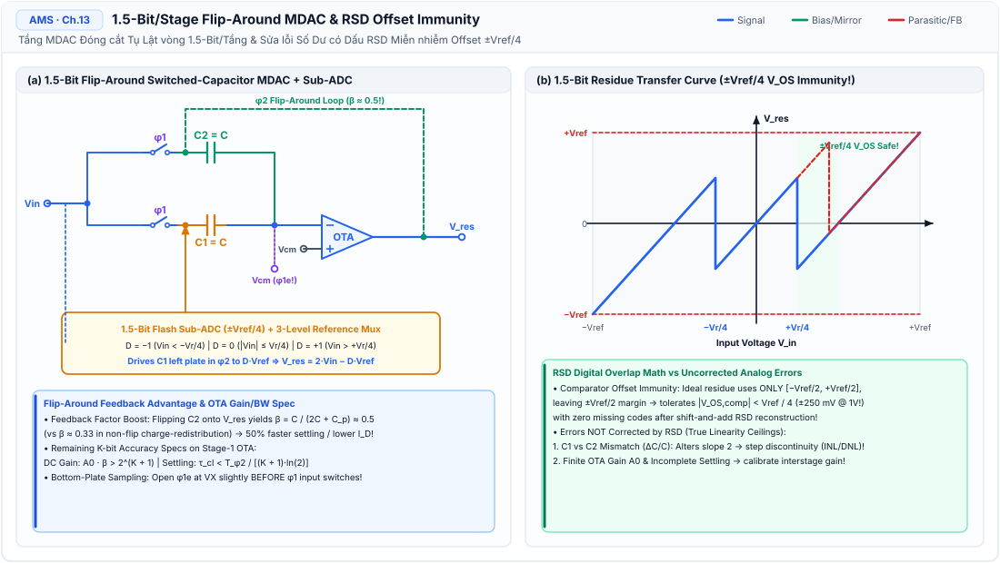

---
{
  "id": "topo-flash-and-pipelined-mdac-rsd-adcs",
  "kind": "topology",
  "domain": "ams-filters-and-system",
  "title_vi": "Bản đồ Kiến trúc ADC Murmann (FoM_W / FoM_S), Bộ Chuyển đổi Song song Flash ADC và Kiến trúc Đường ống Pipelined ADC (1.5-bit/stage Flip-Around MDAC & Sửa lỗi RSD)",
  "title_en": "Murmann ADC Architecture Map (Walden/Schreier FoM), Flash ADC Bubble Suppression, and Pipelined 1.5-bit/stage Flip-Around MDAC with Redundant Signed Digit (RSD) Correction",
  "summary": "Toàn cảnh chọn kiến trúc bộ chuyển đổi A/D theo hai hệ số phẩm chất Murmann (Walden FoM_W và Schreier FoM_S kèm giới hạn jitter khẩu độ), giải phẫu Flash ADC tốc độ GHz (uốn cong thang điện trở tham chiếu, giật ngược kickback, triệt lỗi bọt khí bubble/sparkle bằng NAND 3 ngõ vào / mã Gray / cây cộng Wallace), và dẫn xuất đầy đủ tầng MDAC lật tụ 1.5-bit/stage (V_out = 2*V_in - D*V_REF, hệ số hồi tiếp beta = 1/2, sửa lỗi số dư thừa RSD mở rộng dung sai offset bộ so sánh phụ lên +-V_REF/4, cùng bất biến độ lợi DC A_0 > 2^(N_rem + 2) và ngân sách xác lập nửa chu kỳ).",
  "diagram": "../../diagrams/pipelined-mdac-1p5bit-stage.svg",
  "razavi_refs": [
    {
      "chapter": 8,
      "section": "8.1-8.2",
      "pages": "258-267",
      "equations": ["8.3"]
    },
    {
      "chapter": 9,
      "section": "9.9-9.10",
      "pages": "393-400",
      "equations": ["9.62", "9.76"]
    },
    {
      "chapter": 13,
      "section": "13.3.2",
      "pages": "560-563",
      "equations": ["13.40", "13.42", "13.44"]
    },
    {
      "chapter": 14,
      "section": "14.1.4-14.2.1",
      "pages": "583-598",
      "equations": ["14.37", "14.75"]
    }
  ],
  "github_refs": [
    {
      "repo": "bmurmann/ADC-survey",
      "url": "https://github.com/bmurmann/ADC-survey/tree/00b4b855de5ce6bdf584a6aace354380022f1de4",
      "use": "Cơ sở dữ liệu chuẩn quốc tế ISSCC/VLSI (1997-2026) của GS. Boris Murmann định nghĩa biên giới hiệu suất Walden FoM_W, Schreier FoM_S và đường bao nhiễu pha khẩu độ cho SAR, ΔΣ, Pipeline và Flash ADC"
    },
    {
      "repo": "Arcadia-1/ADCToolbox",
      "url": "https://github.com/Arcadia-1/ADCToolbox/tree/372b714011db9c3f366bd0223d066e1fbde8dfb6",
      "use": "Đo kiểm phổ động SNDR/SFDR/ENOB, đường cong đặc tính dư INL/DNL và hiệu chuẩn trọng số gian tầng cho ADC đường ống"
    },
    {
      "repo": "Arcadia-1/sar-adc-skills",
      "url": "https://github.com/Arcadia-1/sar-adc-skills/tree/27de09a34ea3ec6feb2ee2797d32dc673d35d1ad",
      "use": "Quy trình xác minh lai từng khối (Verilog-A sang Transistor) và đo kiểm công tắc bootstrap đầu vào cùng bộ so sánh động dùng chung trong Pipelined / Pipelined-SAR ADC"
    }
  ],
  "glossary_codes": [
    "T007",
    "T014",
    "T035",
    "T047",
    "T052",
    "T065",
    "T074",
    "T620",
    "T1201",
    "T1413",
    "T1546",
    "T1563",
    "T1950",
    "T2135",
    "T2139",
    "T2145",
    "T2149"
  ],
  "process_agnostic": true,
  "roles": {
    "murmann_fom_architecture_selector": "Hệ tọa độ đánh giá năng lượng chuyển đổi (FoM_W, FoM_S) và trần jitter khẩu độ giúp khóa đúng họ ADC trước khi bắt đầu thiết kế mạch.",
    "flash_thermometer_and_bubble_suppressor": "Mảng 2^N - 1 bộ so sánh song song quyết định trong 1 nhịp duy nhất, đi kèm cổng triệt bọt khí NAND 3 ngõ vào và bộ mã hóa trung gian Gray chống gai lỗi nửa toàn thang.",
    "flip_around_1p5bit_mdac": "Tế bào tụ chuyển mạch lật tụ C_2 lên vòng hồi tiếp (beta = 1/2) thực hiện đồng thời lấy mẫu, trừ D*V_REF và nhân đôi chính xác điện áp dư V_res = 2*V_in - D*V_REF.",
    "rsd_digital_error_correction": "Bộ cộng dịch chồng bit số học (0.5 bit dư thừa mỗi tầng) xóa sạch hoàn toàn mọi sai số ngưỡng bộ so sánh phụ trong cửa sổ rộng +-V_REF/4."
  },
  "symptoms_addressed": [
    "wrong-adc-architecture-choice-violating-thermal-noise-or-aperture-jitter-fundamental-limits",
    "catastrophic-half-scale-sparkle-codes-from-thermometer-bubbles-in-high-speed-flash-adcs",
    "sub-millivolt-comparator-offset-requirements-stalling-multi-step-and-naive-1bit-pipelined-adcs",
    "serial-n-cycle-conversion-latency-bottleneck-of-single-channel-sar-above-several-hundred-msps"
  ],
  "limitations": [
    "flash-adc-area-power-and-input-capacitance-explode-exponentially-as-2-to-n-beyond-6-to-8-bits",
    "rsd-redundancy-fixes-sub-adc-comparator-offsets-but-cannot-fix-mdac-capacitor-mismatch-or-finite-opamp-gain",
    "first-stage-mdac-opamp-requires-simultaneously-high-dc-gain-and-sub-nanosecond-half-clock-settling",
    "pipeline-architecture-introduces-m-half-clock-cycles-of-data-latency-unsuitable-for-fast-async-feedback-loops"
  ],
  "checklists": [
    "common-mos",
    "dac-and-deltasigma-adc",
    "comparator-and-sar-adc",
    "switched-capacitor",
    "layout-and-matching"
  ]
}
---

## 1. Bản chất Nguyên lý, Sơ đồ Mạch & Vai trò Từng Nhánh Cấu trúc

Trước khi đặt bút vẽ bất kỳ một transistor nào cho bộ chuyển đổi tương tự–số (`T007`, `T1950`), quyết định kiến trúc ở cấp hệ thống giữa bốn họ chủ lực — **$\Delta\Sigma$ ADC**, **SAR ADC**, **Pipelined ADC** và **Flash ADC** — quyết định tới $90\%$ công suất tiêu thụ và khả năng hội tụ chỉ tiêu trên silicon. Trong khi `topo-sar-adc-charge-redistribution-architecture` phải thực hiện tuần tự $N$ chu kỳ thử bit cho 1 mẫu (bị nghẽn tốc độ đơn kênh khi $f_s$ vượt vài trăm $\text{MS/s}$), còn `topo-deltasigma-modulator-sc-and-ct-architectures` cần $\text{OSR} \ge 16\text{–}256$ nhịp cho một mẫu dải hẹp, hai kiến trúc tốc độ Nyquist song song hóa không gian và thời gian dưới đây giải quyết bài toán băng thông rộng hàng trăm $\text{MS/s}$ đến hàng chục $\text{GS/s}$:



1. **Bộ chuyển đổi Song song Toàn phần (`Flash ADC` — Độ trễ 1 nhịp duy nhất, $4\text{–}8\text{ bit}$, $1\text{–}20+\text{ GS/s}$):**
   - Đặt song song toàn bộ $2^N - 1$ bộ so sánh chốt tốc độ cao so sánh trực tiếp $V_{\text{in}}$ với $2^N - 1$ mức áp chia từ thang điện trở tham chiếu. Kết quả xuất ra dạng **mã nhiệt kế (`Thermometer Code`: `00...011...1`)**, đi qua tầng **triệt lỗi bọt khí (`Bubble / Sparkle Suppression`)** và bộ mã hóa **ROM Mã Gray / Cây cộng Wallace** để thành mã nhị phân $N\text{-bit}$ ngay trong 1 chu kỳ xung nhịp!
2. **Bộ chuyển đổi Đường ống (`Pipelined ADC` dùng `1.5-bit/stage Flip-Around MDAC` + Sửa lỗi số `RSD`, $10\text{–}16\text{ bit}$, $50\text{ MS/s} \dots 2\text{ GS/s}$):**
   - Chia nhỏ quá trình lượng tử hóa thành chuỗi $M$ tầng nối tiếp hoạt động xen kẽ hai pha đồng hồ không chồng lấp ($\phi_1, \phi_2$): khi tầng lẻ đang lấy mẫu thì tầng chẵn đang khuếch đại điện áp dư và ngược lại — nhờ đó **mỗi chu kỳ xung nhịp $1/f_s$ vẫn xuất ra trọn vẹn 1 mẫu kết quả mới (`throughput = 1 sample/clock`)**, trong khi tổng số bộ so sánh giảm từ hàm mũ $2^N$ xuống tuyến tính $2 M$!
   - Trái tim của mỗi tầng là khối **DAC Nhân Dư Tụ Chuyển Mạch Lật Tụ `1.5-bit/stage` (`Flip-Around Multiplying DAC — MDAC`, phát triển trực tiếp từ mạch nhân đôi chính xác `T2149` Razavi §13.3.2)**: dùng một `sub-ADC` siêu thô chỉ gồm **2 bộ so sánh** (ngưỡng $\pm V_{\text{REF}}/4$) tạo mã ba mức $D \in \{-1, 0, +1\}$, rồi dùng Op-Amp tụ chuyển mạch tính chính xác $V_{\text{res}} = 2 V_{\text{in}} - D \cdot V_{\text{REF}}$ chuyển cho tầng sau. Nhờ $0.5\text{ bit}$ dư thừa mỗi tầng trong thuật toán **Chữ số Có dấu Dư thừa (`Redundant Signed Digit — RSD`)**, bộ so sánh phụ được phép lệch ngưỡng tới **$\pm V_{\text{REF}}/4$ ($\pm 250\text{ mV}$!) mà không gây bất kỳ một sai số bit nào ở ngõ ra cuối cùng**!

---

## 2. Hệ Phương trình Cốt lõi & Tư duy "Nhìn Mạch Đọc Nhanh" (Analysis by Inspection)

### 2.1. Bản đồ Hiệu năng Murmann (`bmurmann/ADC-survey`): `FoM_W` vs `FoM_S` & Đường Bao Jitter Khẩu độ
Theo dữ liệu thống kê toàn bộ chip ISSCC & VLSI Symposium từ 1997 đến nay của GS. Boris Murmann, hiệu quả năng lượng của ADC chia làm **hai chế độ vật lý hoàn toàn khác nhau** tại ranh giới $\text{SNDR} \approx 60\text{–}65\text{ dB}$ ($\text{ENOB} \approx 10\text{ bit}$):
1. **Hệ số Phẩm chất Walden (`Walden FoM_W` — Chế độ giới hạn bởi điện dung tối thiểu công nghệ, $\text{ENOB} \le 10\text{ bit}$, càng nhỏ càng tốt):**
   Khi nhiễu nhiệt $kT/C$ chưa phải nút thắt, năng lượng chuyển đổi tỉ lệ với $2^{\text{ENOB}}$:

$$
\text{FoM}_W = \frac{P}{\,2^{\text{ENOB}} \cdot f_{s,\text{Nyq}}\,} \quad \text{[J / conversion-step]}, \qquad \text{ENOB} = \frac{\text{SNDR}_{\text{dB}} - 1.76}{6.02}
$$

   *(Đỉnh cao thế giới hiện nay của SAR ADC đạt $\text{FoM}_W \approx 1\text{–}10\text{ fJ/step}$; thiết kế chuẩn công nghiệp tốt nằm ở $15\text{–}80\text{ fJ/step}$. Lưu ý dùng $f_{s,\text{Nyq}} = 2\,\text{BW}$ cho cả ADC Nyquist lẫn ADC quá lấy mẫu!).*
2. **Hệ số Phẩm chất Schreier (`Schreier FoM_S` — Chế độ giới hạn bởi nhiễu nhiệt $kT/C$, $\text{ENOB} \ge 11\text{ bit}$, càng lớn càng tốt):**
   Khi bị giới hạn bởi nhiễu nhiệt $v_n^2 \propto kT/C$, để tăng thêm **$1\text{ bit}$ ($\text{+6.02 dB}$ SNR)** ta phải giảm phương sai nhiễu đi **$4$ lần** $\implies$ phải tăng tụ $C$ và dòng nuôi $I \propto C$ lên gấp **$4\times$** (chứ không phải $2\times$ như công thức Walden giả định!). Nếu vẫn dùng $\text{FoM}_W$, mọi ADC $16\text{-bit}$ đều bị phạt oan gấp $2^{6} = 64$ lần so với ADC $10\text{-bit}$! Công thức Schreier phản ánh bất biến vật lý $P \propto \text{BW} \cdot \text{SNR}$:

$$
\text{FoM}_S = \text{SNDR}_{\text{dB}} + 10\log_{10}\!\left(\frac{\text{BW}}{P}\right) \quad \text{[dB]}
$$

   *(Trần nhiệt động lực học thực tế trên CMOS hiện đại nằm quanh $\text{FoM}_S \approx 183\text{–}186\text{ dB}$; thiết kế công nghiệp xuất sắc đạt $170\text{–}178\text{ dB}$!).*
3. **Bức tường Jitter Khẩu độ Lấy mẫu (`Aperture Jitter Wall` — Độc lập hoàn toàn với Kiến trúc ADC!):**
   Tại khoảnh khắc công tắc lấy mẫu đầu vào ngắt sườn với độ rung pha ngẫu nhiên $\sigma_{t,j}$ (gồm jitter nguồn xung nhịp + nhiễu pha bộ đệm clock), sóng sin tần số $f_{\text{in}}$ có độ dốc lớn nhất $2\pi f_{\text{in}} A$ bị biến thành điện áp nhiễu lấy mẫu, khóa cứng trần $\text{SNR}$ tối đa:

$$
\text{SNR}_{\text{jitter,max}}\text{ [dB]} = -20\log_{10}\!\left(2\pi \, f_{\text{in}} \, \sigma_{t,j}\right)
$$

   > **Kiểm tra Khả thi Tức thì (Sanity Check):** Muốn thiết kế Pipelined ADC đạt $\text{SNDR} = 70\text{ dB}$ ($\sim 11.3\text{ ENOB}$) với tín hiệu đầu vào $f_{\text{in}} = 250\text{ MHz}$, tổng jitter lấy mẫu toàn hệ thống bắt buộc $\sigma_{t,j} < \frac{10^{-70/20}}{2\pi \times 2.5\times 10^8} \approx \mathbf{201\text{ fs}_{\text{rms}}}$! Nếu PLL cấp xung nhịp có jitter $1\text{ ps}_{\text{rms}}$, $\text{SNDR}$ sẽ sập cứng xuống $56\text{ dB}$ ($\sim 9\text{ bit}$) dù mạch ADC hoàn hảo tuyệt đối!

### 2.2. Giải phẫu `Flash ADC`: Độ Uốn Thang Điện trở, Nhiễu Giật Ngược & Triệt Lỗi Bọt Khí (`Bubble Error`)
1. **Sai số Uốn cong Thang Điện trở (`Resistor-Ladder Bowing`) & Dòng Giật Ngược (`Kickback`):**
   Thang gồm $2^N$ điện trở $R_u$ ($R_{\text{tot}} = 2^N R_u$) cấp ngưỡng cho $2^N - 1$ tầng tiền khuếch đại/so sánh. Nếu mỗi ngõ vào tham chiếu rút dòng tĩnh hoặc dòng trung bình nạp tụ chuyển mạch $I_{\text{in}}$ (hoặc dòng giật ngược `T014` khi chốt), sụt áp tích lũy cực đại xảy ra đúng ở giữa thang ($k = 2^{N-1}$):

$$
\Delta V_{\text{bow,mid}} = \frac{1}{8}\,2^N \, I_{\text{in}} \, R_{\text{tot}} < 0.25\,V_{\text{LSB}}
$$

   Để dập xung giật ngược tần số cao, bắt buộc đặt các tụ nối đất lớn tại các nút chia phần tư/phần tám của thang điện trở kèm tầng tiền khuếch đại cách ly có tải hồi phục nhanh!
2. **Cơ chế Phát sinh Lỗi Bọt khí (`Thermometer Bubble`) & Gai Lỗi Nửa Thang (`Sparkle Code`):**
   Lý tưởng, mã nhiệt kế chỉ có **duy nhất một ranh giới chuyển từ `1` sang `0`** (`...00001111...`). Ở tốc độ nhiều $\text{GS/s}$, lệch thời gian tới của tín hiệu so với xung nhịp giữa các bộ so sánh (`clock/signal skew`) hoặc trạng thái siêu ổn định (`metastability`) tạo ra "bọt số 0" bên trong chuỗi số 1: ví dụ tại mã $7$ (`00000111` $\to$ bọt thành `00001011`, xuất hiện **hai** biên chuyển `1->0` tại vị trí $2$ và vị trí $4$!).
   - *Thảm họa nếu dùng cổng `2-input XOR/AND` nối thẳng vào ROM Nhị phân:* Cả hai đường từ tuyến (`wordlines`) số $2$ (`010`) và số $4$ (`100`) cùng kích hoạt kéo xuống trên các đường bit của ROM (hoặc cộng dây `wired-OR` thành `110` = mã $6$, thậm chí ở biên giữa thang `01111111` và `10000000` bị `wired-AND` thành `00000000` — vọt sai số nửa toàn thang $V_{\text{FS}}/2$)!
   - **Ba Lớp Phòng vệ Chuẩn Công nghiệp:**
     1) **Cổng Triệt Bọt Bậc 1 (`3-Input NAND/AND Bubble Suppressor`):** Chỉ phát cờ biên chuyển khi thấy mẫu $3$ bit liên tiếp `1-0-0` ($w_k = T_{k-1} \cdot \overline{T_k} \cdot \overline{T_{k+1}}$), xóa sạch hoàn toàn mọi bọt đơn lẻ `...001011...`!
     2) **Mã hóa Trung gian Sang Mã Gray (`Thermometer-to-Gray Encoder`):** Vì hai mã Gray kề nhau chỉ khác nhau đúng $1$ bit, ngay cả khi một bộ so sánh vẫn đang lơ lửng giữa `0` và `1` tại thời điểm chốt, mã Gray chuyển về nhị phân chỉ lệch tối đa $\pm 1\text{ LSB}$ thay vì sinh gai `sparkle`!
     3) **Bộ Đếm Tổng Số Bit `1` Dùng Cây Cộng `Wallace Tree` (`Ones-Counter Adder`):** Cộng tổng đại số toàn bộ $2^N - 1$ bit nhiệt kế — hoàn toàn miễn nhiễm với thứ tự xáo trộn vị trí của mọi bọt khí!

### 2.3. Tầng `1.5-bit/stage Flip-Around MDAC` & Phép Màu Sửa Lỗi Dư thừa `RSD` ($\pm V_{\text{REF}}/4$)
Xét cấu trúc vi sai (biểu diễn đơn đầu quy về $V_{CM} = 0$, dải vào $[-V_{\text{REF}}, +V_{\text{REF}}]$) của tầng `1.5-bit/stage Flip-Around MDAC` (`topo-switched-capacitor-unity-and-multiplying-amps`, Razavi §13.3.2 Hình 13.23):
1. **Phương trình Truyền Điện tích Hai Pha & Lợi thế Hệ số Hồi tiếp $\beta_{\text{flip}} = \frac{1}{2}$:**
   Sử dụng chỉ **hai tụ điện bằng nhau $C_1 = C_2 = C$** (không tốn tụ hồi tiếp $C_F$ thứ ba!):
   - *Pha lấy mẫu ($\phi_1$):* Cả $C_1$ và $C_2$ cùng nạp $V_{\text{in}}$ thông qua lấy mẫu tấm đáy ngắt sớm (`T2135`): tổng điện tích lưu trên hai tấm đỉnh nối vào nút cổng đảo Op-Amp là $Q_{\text{in}}(\phi_1) = -(C_1 + C_2) V_{\text{in}} = -2 C V_{\text{in}}$. Ngay cuối $\phi_1$, `sub-ADC` gồm 2 bộ so sánh động kiểm tra nhanh $V_{\text{in}}$ với hai ngưỡng $-\frac{V_{\text{REF}}}{4}$ và $+\frac{V_{\text{REF}}}{4}$ để chốt mã ba mức $D \in \{-1, 0, +1\}$.
   - *Pha khuếch đại và giữ dư ($\phi_2$):* Tấm đáy của tụ $C_2$ **lật vòng sang nối thẳng vào ngõ ra Op-Amp $V_{\text{res}}$** (`flip-around`), trong khi tấm đáy tụ $C_1$ được chuyển vào điện áp DAC $D \cdot V_{\text{REF}} \in \{-V_{\text{REF}}, 0, +V_{\text{REF}}\}$! Bảo toàn điện tích tại đất ảo lý tưởng cho ngay:

$$
-C_1 \left(D \cdot V_{\text{REF}}\right) - C_2 V_{\text{res}} = -(C_1 + C_2) V_{\text{in}} \;\implies\; V_{\text{res}} = \left(1 + \frac{C_1}{C_2}\right) V_{\text{in}} - \left(\frac{C_1}{C_2}\right) D \cdot V_{\text{REF}} \;\xrightarrow{C_1 = C_2}\; 2 V_{\text{in}} - D \cdot V_{\text{REF}}
$$

   - **Tại sao `Flip-Around` nhanh và ít nhiễu gấp $1.5\times$ cấu trúc thường?**
     Nếu dùng một tụ hồi tiếp $C_F = C$ riêng luôn nằm cố định trên Op-Amp và nạp $2C$ ở đầu vào, hệ số hồi tiếp trong pha $\phi_2$ chỉ đạt $\beta_{\text{non-flip}} = \frac{C}{2C + C + C_{\text{op}}} < \frac{1}{3}$! Nhờ lật chính $C_2$ lên làm tụ hồi tiếp, hệ số hồi tiếp tăng vọt lên **$\beta_{\text{flip}} = \dfrac{C}{C + C + C_{\text{op}}} \approx \dfrac{1}{2}$** — tăng băng thông vòng kín $\beta \omega_u$ thêm $50\%$ và giảm hệ số nhân nhiễu nhiệt của Op-Amp từ $(1/\beta)^2 = 9$ xuống còn $4$!

2. **Chứng minh Hình học Thuật toán Sửa lỗi Chữ số Có dấu Dư thừa (`RSD` — Dung sai Offset $\pm V_{\text{REF}}/4$):**
   - Trong kiến trúc `1-bit/stage` ngây thơ (chỉ có 1 bộ so sánh tại $0\text{ V}$, $V_{\text{res}} = 2 V_{\text{in}} \mp V_{\text{REF}}$): chỉ cần bộ so sánh lệch ngưỡng $+5\text{ mV}$, với $V_{\text{in}} = +2\text{ mV}$ bộ so sánh chọn nhầm nhánh $+V_{\text{REF}}$ đẩy $V_{\text{res}} = 2(0.002) - (-1.0) = +1.004\text{ V} > +V_{\text{REF}}$, làm **tràn thang (`overrange`)** toàn bộ các tầng phía sau và gây mất mã vĩnh viễn!
   - Với `1.5-bit/stage RSD` ($3$ đoạn thẳng song song độ dốc $2$, nhảy bước tại $V_{\text{in}} = \pm V_{\text{REF}}/4$): tại đúng điểm chuyển ngưỡng danh định $V_{\text{in}} = +V_{\text{REF}}/4$, điện áp dư chỉ mới đạt $2(V_{\text{REF}}/4) - 0 = +V_{\text{REF}}/2$, nghĩa là **còn nguyên khoảng dự trữ từ $+V_{\text{REF}}/2$ tới $+V_{\text{REF}}$ ở phía trên**! Do đó, dù ngưỡng bộ so sánh bị trôi đi một lượng $\Delta V_{\text{OS}}$ bất kỳ thỏa mãn:

$$
\left|V_{\text{OS,sub-ADC}}\right| \le \frac{V_{\text{REF}}}{4} \quad \left(\text{ví dụ } \pm 250\text{ mV với } V_{\text{REF}} = 1.0\text{ V}!\right)
$$

   điện áp dư $V_{\text{res}}$ vẫn **nằm gọn 100% trong dải hợp lệ $[-V_{\text{REF}}, +V_{\text{REF}}]$** của tầng kế tiếp! Phần sai lệch do chọn nhánh sớm hay muộn được tầng sau đo bù chính xác và triệt tiêu hoàn toàn khi thanh ghi số thực hiện phép cộng chồng lấn $1\text{ bit}$ (`digital overlap addition`: mã $D \in \{-1,0,+1\}$ ánh xạ sang cặp 2 bit không dấu `{00, 01, 10}`, cộng lệch cột sang phải $1$ vị trí bit mỗi tầng)!

### 2.4. Ba Bất biến Chính xác Của Tầng `MDAC 1` Mà `RSD` KHÔNG THỂ Cứu!
Vì sai số của tầng `MDAC` đầu tiên đi thẳng vào toàn bộ $N_{\text{rem}} = N - 1$ bit phía sau mà không có tầng nào che chắn phía trước, Op-Amp và tụ của tầng 1 phải thỏa mãn 3 bất đẳng thức khắt khe:
1. **Độ lợi Vòng hở DC Tối thiểu của Op-Amp Tầng 1 ($A_{0,1}$):**
   Sai số độ lợi tĩnh vòng kín bằng $\epsilon_G = \frac{1}{\beta_{\text{flip}} A_{0,1}}$. Để bước nhảy lỗi tại ngưỡng chuyển mã $\pm V_{\text{REF}}/4$ nhỏ hơn $\frac{1}{2}\text{ LSB}$ của $N_{\text{rem}}$ bit còn lại:

$$
\frac{1}{\beta_{\text{flip}} \, A_{0,1}} < \frac{1}{2^{N_{\text{rem}} + 1}} \;\implies\; A_{0,1} > \frac{2^{N_{\text{rem}} + 1}}{\beta_{\text{flip}}} \approx 2^{N_{\text{rem}} + 2} = 2^{N + 1}
$$

   *(Ví dụ ADC $12\text{-bit}$ $\implies A_{0,1} > 2^{13} = 8192 \approx \mathbf{78.3\text{ dB}}$; cộng dự trữ góc PVT cần thiết kế ở TT đạt $84\text{–}90\text{ dB}$, bắt buộc dùng `topo-gain-boosted-cascode` hoặc Op-Amp 2 tầng tốc độ cao!).*
2. **Ngân sách Thời gian Xác lập Tuyến tính Trong Nửa Chu kỳ ($\phi_2$):**
   Sau khi trừ khoảng chết không chồng lấp $t_{\text{nonov}}$ và thời gian slewing $t_{\text{slew}}$ (`law-slewing-vs-linear-settling-time-budget`), phần thời gian xác lập hàm mũ còn lại $t_{\text{lin}} = \frac{T_s}{2} - t_{\text{nonov}} - t_{\text{slew}}$ phải nén sai số động xuống dưới $2^{-(N_{\text{rem}} + 1)}$:

$$
e^{-t_{\text{lin}} / \tau_{\text{CL}}} < \frac{1}{2^{N_{\text{rem}} + 1}} \;\implies\; f_{u,\text{OTA1}} = \frac{\text{GBW}}{\beta_{\text{flip}}} > \frac{(N_{\text{rem}} + 1)\,\ln 2}{2\pi \, \beta_{\text{flip}} \, t_{\text{lin}}}
$$

   *(Ví dụ $12\text{-bit}$, $f_s = 100\text{ MS/s} \implies T_s/2 = 5\text{ ns}$, $t_{\text{lin}} = 3.2\text{ ns}$, $\beta_{\text{flip}} = 0.45$: cần $(12 \ln 2) = 8.32$ hằng số thời gian $\implies \tau_{\text{CL}} < 385\text{ ps} \implies f_{u,\text{OTA1}} > \mathbf{918\text{ MHz}}$!).*
3. **Độ khớp Tụ $C_1$ và $C_2$:** Lệch tụ $\Delta C / C$ gây bước nhảy độ dốc gián đoạn $\Delta V_{\text{jump}} = \frac{1}{2}\left(\frac{\Delta C}{C}\right) V_{\text{REF}}$ tại $\pm V_{\text{REF}}/4$; ở $\ge 12\text{–}14\text{ bit}$ cần ghép tâm chung kỹ lưỡng kèm hiệu chuẩn số trọng số bit (`Arcadia-1/ADCToolbox`).

---

## 3. Bất biến Cấu trúc & Các Bẫy Lỗi Kinh điển (Structural Invariants & Traps)

- **`[INV-PIP-01]` Bất biến Đồng bộ Mốc Lấy mẫu Giữa `MDAC` và `Sub-ADC` Ở Tầng 1 (`Aperture Skew Mismatch`):**
  Ở đầu vào Pipelined ADC không có mạch giữ mẫu riêng (`SHA-less front-end` — xu hướng hiện đại để tiết kiệm $30\%$ công suất!), tín hiệu đầu vào liên tục tần số cao $f_{\text{in}}$ đi **song song** vào cả tụ $C_1, C_2$ của `MDAC` lẫn mảng tụ ngưỡng của `sub-ADC`! Nếu sườn ngắt lấy mẫu của `sub-ADC` lệch thời gian $\Delta t_{\text{skew}}$ so với sườn ngắt tấm đáy của `MDAC`, điện áp lệch động do trượt sườn bằng $\Delta V_{\text{skew}} = 2\pi f_{\text{in}} V_{\text{REF}} |\Delta t_{\text{skew}}|$ cộng thêm offset tĩnh của bộ so sánh phải nằm gọn trong ngân sách $\frac{V_{\text{REF}}}{4}$! Với $f_{\text{in}} = 200\text{ MHz}$, chỉ cần $\Delta t_{\text{skew}} = 100\text{ ps}$ đã nuốt mất $125\text{ mV}$ ($50\%$ cửa sổ RSD!) — bắt buộc khóa cả hai vào cùng một sườn ngắt sớm $\phi_{1e}$!
- **`[INV-PIP-02]` Bất biến Co Giãn Tụ Điện & Dòng Điện Dọc Chuỗi Đường Ống (`Pipeline Stage Scaling`):**
  Bởi mỗi tầng `1.5-bit` nhân đôi điện áp dư ($G = 2$), phương sai nhiễu nhiệt của tầng thứ $k$ khi quy ngược về ngõ vào ADC bị chia cho **$4^{k-1}$**! Do đó thu nhỏ điện dung và dòng nuôi của các tầng sau theo cấp số nhân $C_{k+1} = C_k / \gamma$ (với hệ số co tối ưu $\gamma \approx 1.8\text{–}2.0$ cho đến khi chạm sàn tụ khớp công nghệ ở tầng 5–6) giúp **cắt giảm hơn $55\%$ tổng công suất tiêu thụ** so với việc nhân bản y nguyên tầng 1!
- **`[TRAP-PIP-01]` Bẫy Quên Đổi Mã Đuôi Cuối Cùng Của Đường Ống (`2-bit Flash Backend`):**
  Tầng cuối cùng của Pipelined ADC không cần xuất điện áp dư nên dùng một khối **Flash ADC 2-bit chuẩn ($3$ bộ so sánh tại $-V_{\text{REF}}/2, 0, +V_{\text{REF}}/2$, mã `{00, 01, 10, 11}`)**! Ba bộ so sánh ở tầng cuối cùng này **KHÔNG còn tầng nào phía sau để sửa lỗi RSD nữa** — nhưng vì trọng số của chúng đã bị chia nhỏ đi $2^{N-2}$ lần, độ lệch $\pm 20\text{ mV}$ ở tầng cuối cũng chỉ tương đương $< 0.05\text{ LSB}$ quy về đầu vào!
- **`[TRAP-PIP-02]` Bẫy Hiệu ứng Bộ nhớ Công tắc Lật Tụ (`Flip-Around Switch Nonlinearity & Charge Injection`):**
  Trong `Flip-Around MDAC`, công tắc nối tấm đáy $C_2$ vào ngõ ra $V_{\text{res}}$ trong pha $\phi_2$ phải dẫn toàn bộ biên độ dao động lớn $\pm V_{\text{REF}}$! Nếu dùng công tắc NMOS đơn hoặc cổng truyền dẫn nhỏ có $R_{\text{on}}(V_{\text{res}})$ biến thiên mạnh, hằng số thời gian xác lập bị phụ thuộc biên độ gây méo hài `HD3` nặng ở tốc độ cao — bắt buộc dùng cổng truyền dẫn bổ sung kích thước đủ lớn hoặc công tắc nâng áp cổng `topo-bootstrapped-sampling-switch` cho cả nhánh lấy mẫu lẫn nhánh lật tụ!

---

## 4. Lộ trình Nâng cấp Cấu trúc & Bát giác Đánh đổi (Upgrade Paths & Design Octagon)

| Họ Kiến trúc ADC | Dải Độ phân giải (`ENOB`) | Dải Tốc độ Lấy mẫu $f_s$ | Độ trễ Dữ liệu (`Latency`) | Đỉnh Hiệu suất & Kiến trúc Lai Hiện đại |
| :--- | :--- | :--- | :--- | :--- |
| **$\Delta\Sigma$ ADC (`SC` / `CT`)** | **$14\text{–}24\text{ bit}$** | $\text{DC} \dots 200\text{ MS/s}$ (Băng thông $f_B \ll f_s$) | Cao (trễ nhóm bộ lọc FIR/CIC) | Chuẩn vàng cho âm thanh, đo lường cảm biến & thu vô tuyến dải trung (`FoM_S` tới $184\text{ dB}$) |
| **SAR ADC (`VCM-MCS`)** | $8\text{–}14\text{ bit}$ | $1\text{ kS/s} \dots 500\text{ MS/s}$ | **Thấp ($1\text{ chu kỳ } T_s$)** | Vô địch tiết kiệm năng lượng không Op-Amp (`FoM_W` $< 5\text{ fJ/step}$) |
| **Pipelined / Pipelined-SAR** | **$10\text{–}16\text{ bit}$** | **$50\text{ MS/s} \dots 5\text{ GS/s}$** | $M / 2$ chu kỳ ($4\text{–}7\,T_s$) | **Pipelined-SAR** (2 tầng SAR $6\text{-bit}$ nối qua 1 `Residue Amp` mở hoặc `Ring Amp`) thống trị trạm gốc 5G / Wi-Fi 7! |
| **Flash / Time-Interleaved SAR** | $4\text{–}8\text{ bit}$ | **$1\text{ GS/s} \dots > 64\text{ GS/s}$** | **Cực thấp ($1\,T_s$ cho Flash)** | Đầu thu SerDes PAM4 $112/224\text{ Gb/s}$, radar ô tô, máy hiện sóng số |

---

## 5. Thích ứng Đa Tiến trình (90nm / 65nm / 45nm) & Cách Kiểm chứng trong Cadence / Spectre

### 5.1. Thích ứng Tầng `MDAC` Trên Tiến trình Điện áp Thấp `65nm / 45nm`
1. **Giải bài toán Độ lợi $A_0 > 80\text{ dB}$ ở Nguồn `1.0V / 1.2V`:**
   - Ở `180nm`, `topo-gain-boosted-cascode` Telescopic dễ dàng cho $90\text{ dB}$ trong 1 tầng nhanh. Xuống `65nm / 45nm` ($V_{DD} = 1.0\text{ V}$), chồng 4–5 transistor cascode làm biên độ dư $\pm V_{\text{REF}}$ co lại chỉ còn $\pm 0.25\text{ V}$ (khiến tụ $C_s$ phải phình gấp $4\times$ để giữ nguyên $\text{SNR}$ trước nhiễu $kT/C$!).
   - Hai giải pháp hiện đại hiệu quả nhất: (a) Dùng **Op-Amp 2 tầng bù Cascode Ahuja** (`tech-miller-rhp-zero-nulling-and-cascode-comp`) mở biên độ ra $\pm 0.6\text{ V}_{\text{diff}}$, hoặc (b) Chuyển sang **Pipelined-SAR 2 tầng** ($6\text{-bit SAR}_1 \to \text{MDAC nhân } 16\times \to 7\text{-bit SAR}_2$): vì tầng đầu đã phân giải được $6\text{ bit}$ với $1\text{ bit}$ dư thừa, biên độ điện áp dư đi vào Op-Amp nhỏ đi **$32\times$** ($\pm 15\text{ mV}$!), và yêu cầu độ lợi DC của Op-Amp giảm nhẹ xuống chỉ còn $A_0 > 2^{7+2} = 512$ (**$54\text{ dB}$**)!

### 5.2. Kịch bản Kiểm chứng Đường cong Đặc tính Dư (`MDAC Residue Transfer Curve`) & `RSD` trong Spectre
```spice
// Testbench Kiem tra Duong cong Truyen Dien ap Du V_res(V_in) & Dung sai RSD +-V_REF/4
// cho Tang 1.5-bit Flip-Around Differential MDAC (V_REF_diff = 1.0 V, fs = 100 MHz)
parameters fs=100M Ts=(1/fs) vdd_val=1.2 vref_p=0.85 vref_n=0.35 vcm=0.60 vos_inject=0.18
// Tim co tinh bom offset khong lo +180 mV (< Vref_diff/4 = 250 mV) vao 1 bo so sanh phu!

// Quet cham dien ap dau vao vi sai Vin_diff tu -1.0 V den +1.0 V trong 200 chu ky xung nhip:
tran_mdac_curve tran stop=(204*Ts) errpreset=conservative maxstep=(Ts/100) \
    strobeperiod=Ts strobedelay=(0.96*Ts)

// Kiem tra 3 bat bien tren do thi V_res_diff theo V_in_diff tai cuoi pha phi2 (0.96*Ts):
// [1] Hai diem nhay nguong dich sang (-0.25V, +0.25V + 0.18V = +0.43V) nhung |V_res_diff| <= 1.000 V!
// [2] Do doc tung doan thang: | (dV_res / dV_in) - 2.0000 | < 1 / 2^12 = 2.4e-4
// [3] Cong chong bit RSD voi Ideal Backend: sai so ma ngo ra sau khi cong == 0 LSB!
```

---

## 6. Mốc Đối chiếu Sách Razavi, GitHub Thực chiến & Thuật ngữ Chuẩn CLB

### 6.1. Đối chiếu Sách Gốc Razavi (2nd Edition) & Kho Mã Nguồn Mở
- **Chương 13:** §13.3.2 *Switched-Capacitor Unity-Gain and Multiplying Amplifiers* (tr. 560–563, Phương trình 13.40–13.44, Hình 13.23 — dẫn xuất trực tiếp mạch nhân đôi lật tụ `multiply-by-two` và công thức sai số độ lợi hữu hạn Op-Amp chính là hạt nhân của tầng `1.5-bit Flip-Around MDAC`!).
- **Chương 8, Chương 9 & Chương 14:** §8.1–§8.2 (sai số độ lợi vòng kín $1/(\beta A_0)$); §9.9–§9.10 (phân bổ thời gian slewing và xác lập tuyến tính trong nửa chu kỳ đồng hồ); §14.1.4–§14.2.1 (tuyến tính tụ điện và định luật khớp Pelgrom).
- **Đối chiếu GitHub:** Kho `bmurmann/ADC-survey` (dữ liệu chuẩn toàn cầu $\text{FoM}_W$, $\text{FoM}_S$ và trần jitter khẩu độ) kết hợp `Arcadia-1/ADCToolbox` (hiệu chuẩn trọng số gian tầng cho ADC đường ống).

### 6.2. Bảng Thuật ngữ Chuẩn CLB Vi Mạch Sử dụng trong Thẻ
| Mã CLB | Thuật ngữ Tiếng Anh | Thuật ngữ Tiếng Việt Chuẩn | Ghi chú Ngữ cảnh trong Flash & Pipelined ADC |
| :--- | :--- | :--- | :--- |
| `T1950` / `T007` | ADC architectures / ADC | các cấu trúc bộ chuyển đổi tương tự–số | Phân vùng lựa chọn Flash, Pipeline, SAR, $\Delta\Sigma$ theo $\text{FoM}_W / \text{FoM}_S$ |
| `T2149` | multiply-by-two circuit | mạch nhân đôi điện áp chính xác | Nền tảng cấu trúc lật tụ $C_2$ tạo hệ số hồi tiếp $\beta = 1/2$ trong `MDAC` |
| `T1201` | feedback factor | hệ số hồi tiếp | Tăng từ $1/3$ lên $1/2$ khi dùng kiến trúc lật tụ `Flip-Around` |
| `T1413` / `T1546` | settling time / linear settling | thời gian xác lập / xác lập tuyến tính | Phải hội tụ dưới $0.5\text{ LSB}_{\text{rem}}$ ngay trong nửa chu kỳ giữ $\phi_2$ |
| `T620` | offset | độ lệch (offset) | Được thuật toán `RSD 1.5-bit` miễn nhiễm hoàn toàn trong phạm vi $\pm V_{\text{REF}}/4$ |
| `T047` | jitter | jitter (rung pha khẩu độ lấy mẫu) | Quyết định bức tường $\text{SNR}_{\max} = -20\log_{10}(2\pi f_{\text{in}} \sigma_{t,j})$ ở tần số cao |
