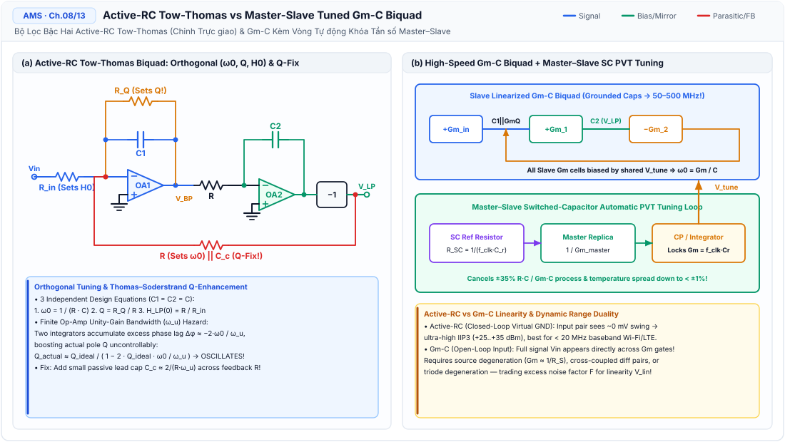

---
{
  "id": "topo-gm-c-filters-and-automatic-rc-gmc-tuning",
  "kind": "topology",
  "domain": "ams-filters-and-system",
  "title_vi": "Bộ Lọc Hỗ dẫn – Tụ điện (Gm-C) Tần số Cao, Cuộn cảm Chủ động Gyrator và Vòng Tự Động Hiệu chỉnh Tần số Cắt Trên Chip (Master–Slave & SAR RC Tuning)",
  "title_en": "High-Frequency Linearized Gm-C Integrators, Biquads & Gyrators, and Automatic On-Chip PVT Time-Constant Tuning Architectures",
  "summary": "Vượt qua bức tường băng thông - công suất của Active-RC ở dải MHz - trăm MHz bằng kiến trúc bộ lọc mở vòng Gm-C và cuộn cảm tích cực Gyrator mô phỏng thang lọc LC hai đầu (Orchard's zero-sensitivity theorem): tổng hợp bốn kỹ thuật tuyến tính hóa bộ hỗ dẫn Gm (suy biến nguồn tách đuôi, MOS vùng triode Krummenacher, cặp vi sai lệch chéo Multi-Tanh và cổng đảo Nauta), phân tích vọt đỉnh Q do độ dịch pha thừa Delta_phi cùng kỹ thuật zero bù nối tiếp, và hai động cơ tự hiệu chỉnh hằng số thời gian PVT (+-35%) chuẩn công nghiệp gồm Vòng Khóa Hỗ dẫn Master-Slave (tụ chuyển mạch / PLL) và Máy trạng thái SAR Hiệu chuẩn Mảng Tụ Nhị phân cho Active-RC.",
  "diagram": "../../diagrams/tow-thomas-and-gmc-tuned-biquad.svg",
  "razavi_refs": [
    {
      "chapter": 4,
      "section": "4.4",
      "pages": "126-131",
      "equations": ["4.49", "4.52"]
    },
    {
      "chapter": 6,
      "section": "6.2, 6.5",
      "pages": "178-184, 195-200",
      "equations": ["6.25", "6.80"]
    },
    {
      "chapter": 12,
      "section": "12.5",
      "pages": "524-525",
      "equations": ["12.52", "12.54"]
    },
    {
      "chapter": 13,
      "section": "13.4",
      "pages": "568-571",
      "equations": ["13.61", "13.62"]
    },
    {
      "chapter": 14,
      "section": "14.1.2-14.1.4",
      "pages": "578-585",
      "equations": ["14.17", "14.37"]
    },
    {
      "chapter": 16,
      "section": "16.1-16.2",
      "pages": "651-668",
      "equations": ["16.16"]
    }
  ],
  "github_refs": [
    {
      "repo": "Arcadia-1/analog-design-bench",
      "url": "https://github.com/Arcadia-1/analog-design-bench/tree/972f7cd7c9",
      "use": "Bài chuẩn thiết kế và kiểm chứng đa góc PVT cho bộ lọc Biquad OTA-C / Gm-C vi sai hoàn toàn (sky130-fully-differential-ota-c-biquad-pvt)"
    },
    {
      "repo": "iic-jku/analog-circuit-design",
      "url": "https://github.com/iic-jku/analog-circuit-design/tree/6075ea0ebcf08f5c7f6033a84e9dd3c91450f5e1",
      "use": "Thiết kế bộ khuếch đại hỗ dẫn OTA một tầng tốc độ cao, suy biến cực nguồn tuyến tính hóa và vòng CMFB dải rộng"
    },
    {
      "repo": "RTimothyEdwards/sky130_ef_ip__biasgen",
      "url": "https://github.com/RTimothyEdwards/sky130_ef_ip__biasgen/tree/9d1ceb5dbf",
      "use": "Tạo và phân phối dòng điều khiển hỗ dẫn đồng bộ trên chip giữa khối tham chiếu Master và các khối chức năng Slave"
    }
  ],
  "glossary_codes": [
    "T057",
    "T064",
    "T069",
    "T087",
    "T523",
    "T607",
    "T800",
    "T861",
    "T1004",
    "T1009",
    "T1031",
    "T1089",
    "T1158",
    "T1325",
    "T2146",
    "T2150",
    "T2152",
    "T2166",
    "T2186",
    "T2187"
  ],
  "process_agnostic": true,
  "roles": {
    "open_loop_linearized_transconductor_gm": "Khối hỗ dẫn tuyến tính hóa biến đổi trực tiếp điện áp vào vi sai V_in thành dòng điện ra I_out = G_m * V_in đổ thẳng vào tụ tích phân mà không cần đóng vòng hồi tiếp âm bao quanh.",
    "active_gyrator_synthetic_inductor": "Hai bộ hỗ dẫn mắc đối lưng ngược dấu (+G_m1 thuận, -G_m2 hồi tiếp) kẹp tụ điện C_L ở cổng sau để phản chiếu về cổng trước một cuộn cảm tích hợp thuần cảm L_eq = C_L / (G_m1 * G_m2).",
    "triode_mos_krummenacher_degeneration": "Cặp transistor MOS hoạt động sâu trong vùng triode mắc nối giữa hai cực nguồn cặp vi sai, vừa mở rộng gấp 4-6 lần dải điện áp tuyến tính V_lin vừa cho phép điều chỉnh liên tục G_m bằng điện áp cổng.",
    "series_excess_phase_nulling_resistor_rz": "Điện trở nhỏ (hoặc MOSFET vùng triode) mắc nối tiếp với tụ tích phân tạo một zero nửa mặt phẳng trái bù khử chính xác độ trễ pha nội tại của bộ hỗ dẫn ở tần số trăm MHz.",
    "master_slave_gmc_tuning_loop": "Khối tham chiếu Master (VCO Gm-C khóa vào PLL thạch anh hoặc vòng Constant-Gm dùng tụ chuyển mạch C_ref * f_CLK) sinh ra dòng/áp phân cực chuẩn cấp đồng bộ sang toàn bộ bộ lọc Slave.",
    "digital_sar_rc_calibration_engine": "Động cơ hiệu chuẩn khởi động dùng xung nhịp thạch anh đo tích R_rep * C_bank qua bộ so sánh và thanh ghi SAR để chốt mã tụ nhị phân tune<B-1:0> rồi ngủ hoàn toàn (0 W công suất tĩnh, 0 spur xung nhịp)."
  },
  "symptoms_addressed": [
    "excessive-ota-power-consumption-of-active-rc-filters-above-30-mhz",
    "35-percent-pvt-cutoff-frequency-drift-of-untuned-on-chip-rc-and-gmc-filters",
    "unavailability-of-high-q-spiral-inductors-for-megahertz-ladder-filters-on-cmos",
    "severe-q-peaking-and-self-oscillation-of-high-frequency-gyrators-from-ota-phase-lag"
  ],
  "limitations": [
    "open-loop-input-nodes-suffer-lower-iip3-linearity-than-virtual-ground-active-rc",
    "linearization-degeneration-multiplies-input-referred-thermal-noise-by-excess-factor-eta",
    "parasitic-junction-and-gate-capacitances-add-directly-to-integrating-capacitors",
    "continuous-master-slave-tuning-can-leak-reference-clock-spurs-onto-bias-lines"
  ],
  "checklists": [
    "common-mos",
    "differential-pair",
    "cmfb",
    "oscillator-and-pll",
    "continuous-time-filters",
    "layout-and-matching"
  ]
}
---

## 1. Bản chất Nguyên lý, Sơ đồ Mạch & Vai trò Từng Nhánh Cấu trúc

Trong thẻ `topo-active-rc-sallen-key-and-tow-thomas-biquads`, ta đã chứng minh rằng để một mắt lọc Active-RC hoạt động không méo hệ số phẩm chất tại tần số cắt $f_0$, mỗi Op-Amp bên trong nó bắt buộc phải đạt băng thông đơn vị $\text{GBW} \ge (25\dots 40)\,Q\,f_0$ đồng thời có tầng ra đủ khỏe để lái tải điện trở. Khi tần số cắt $f_0$ nâng lên vùng **$20\text{--}300\text{ MHz}$** (như kênh đọc ổ cứng từ, thu phát băng rộng Wi-Fi 6/7, radar ô tô, bộ cân bằng cáp đồng hay lọc vòng liên tục của CT-$\Delta\Sigma$ tốc độ GHz), yêu cầu $\text{GBW} \sim 2\text{--}10\text{ GHz}$ đóng vòng ổn định trở nên bất khả thi hoặc ngốn hàng chục mili-watt công suất trên mỗi mắt lọc!

**Bộ lọc Hỗ dẫn – Tụ điện (`Transconductance-C` hay `$G_m\text{-}C$ Filter`)** tháo gỡ nút thắt tốc độ đó bằng một bước ngoặt triết lý: **loại bỏ hoàn toàn vòng hồi tiếp âm điện trở quanh Op-Amp**, vận hành bộ khuếch đại hỗ dẫn (`OTA` — `T1325`) ở chế độ **mở vòng (`open-loop`)** đổ dòng trực tiếp $I_{\text{out}} = G_m V_{\text{in}}$ vào tụ tích phân nối đất $C$! Vì chính tần số lợi ích đơn vị của bộ tích phân $\omega_0 = \frac{G_m}{C}$ nay **trở thành tần số cắt hữu ích của bộ lọc** (thay vì phải thấp hơn $\text{GBW}$ $30$ lần!), các cực ký sinh duy nhất còn lại chỉ nằm tại các nút nội trở kháng thấp $\sim \frac{g_{m,\text{cas}}}{C_X}$ cỡ nhiều $\text{GHz}$, cho phép bộ lọc $G_m\text{-}C$ vươn nhẹ nhàng lên hàng trăm $\text{MHz}$ với một phần nhỏ công suất!



Song hành cùng cấu trúc lõi $G_m\text{-}C$, bài toán sống còn thứ hai của **mọi** bộ lọc thời gian liên tục trên vi mạch CMOS (cả Active-RC lẫn $G_m\text{-}C$) là **độ phân tán hằng số thời gian khổng lồ qua các góc quy trình – điện áp – nhiệt độ (`PVT` — `T069`)**: trên cùng một dây chuyền foundry, $R_{\text{poly}}$ trôi $\pm 20\%$ và $C_{\text{MOM/MIM}}$ trôi $\pm 15\%$ độc lập nhau khiến tích $R \cdot C$ biến thiên tới **$\pm 35\%$**, còn tỷ số $G_m / C$ nếu không khóa chuẩn còn trôi tới **$\pm 40\%$**! Do đó, một bộ lọc liên tục thời gian trên chip chưa bao giờ hoàn chỉnh nếu thiếu **Hệ thống Tự Hiệu chỉnh Tần số Tự động (`Automatic On-Chip Frequency Tuning`)** neo cứng hằng số thời gian của chip vào tần số dao động thạch anh chuẩn $f_{\text{CLK}}$!

---

## 2. Hệ Phương trình Cốt lõi & Tư duy "Nhìn Mạch Đọc Nhanh" (Analysis by Inspection)

### 2.1. Bộ Tích phân $G_m\text{-}C$, Cuộn cảm Chủ động Gyrator & Biquad Chuẩn tắc
1. **Bộ tích phân thực tế có điện trở ra hữu hạn $R_o$ và độ dịch pha thừa $\Delta\phi(\omega)$**:
   Một tế bào $G_m$ thực có trở kháng ra $R_o$ nối song song tụ tích phân $C$ và một cực nội tần số rất cao $\omega_{p,\text{int}}$ (cộng zero nửa mặt phẳng phải $\omega_{z,\text{RHP}} = G_m / C_{GD}$):
$$
H_{\text{int}}(s) = \frac{G_m R_o}{1 + s R_o C} \cdot \frac{1 - s / \omega_{z,\text{RHP}}}{1 + s / \omega_{p,\text{int}}}
\implies H_{\text{int}}(j\omega_0) \approx \frac{G_m}{j\omega_0 C} \, e^{j\left(\frac{1}{A_0} - \Delta\phi_{\text{lag}}(\omega_0)\right)}
$$
   trong đó $A_0 = G_m R_o$ là độ lợi DC hữu hạn của bộ tích phân (gây **sớm pha nhẹ** $+\frac{1}{A_0}\text{ rad}$ tức làm giảm $Q$), còn $\Delta\phi_{\text{lag}}(\omega_0) = \frac{\omega_0}{\omega_{p,\text{int}}} + \frac{\omega_0}{\omega_{z,\text{RHP}}}$ là **độ trễ pha thừa**!
2. **Cuộn cảm Chủ động Gyrator (`Gyrator-C Synthetic Inductor`) & Thang lọc LC Bậc Cao (`Doubly-Terminated LC Ladder`)**:
   Ghép hai bộ hỗ dẫn ngược dấu: $G_{m1}$ nhận $V_1$ đổ dòng dương vào tụ $C_L$ tại nút $V_2$ ($V_2 = \frac{G_{m1}}{s C_L} V_1$), còn $-G_{m2}$ nhận $V_2$ hút dòng $I_1 = G_{m2} V_2 = \frac{G_{m1} G_{m2}}{s C_L} V_1$ tại nút đầu vào $V_1$! Tỷ số trở kháng nhìn vào nút $V_1$ chính là một **cuộn cảm tích hợp không lõi từ**:
$$
Z_{\text{in}}(s) = \frac{V_1(s)}{I_1(s)} = s \left(\frac{C_L}{G_{m1} G_{m2}}\right) \equiv s\,L_{\text{eq}}, \qquad L_{\text{eq}} = \frac{C_L}{G_{m1} G_{m2}}
$$
   Nếu cần **cuộn cảm nổi hai đầu (`floating inductor`)** cho bộ lọc thông thấp thang LC bậc lẻ (ví dụ bậc 5 Elliptic), chỉ cần dùng hai bộ hỗ dẫn có ngõ ra vi sai đối xứng kẹp hai đầu! Ưu việt vĩ đại của việc mô phỏng thang LC hai đầu phối hợp trở kháng bằng Gyrator là **Định lý Orchard**: tại các tần số truyền công suất cực đại trong dải thông, đạo hàm bậc nhất của biên độ hàm truyền theo sai lệch từng phần tử $L_k, C_k$ bằng **$0$ tuyệt đối** ($\frac{\partial |H(j\omega)|}{\partial G_{m,k}} = 0$), giúp độ gợn dải thông bền vững hơn hẳn ghép chuỗi Biquad!
3. **Phương trình $Q$-Enhancement Do Pha Thừa $\Delta\phi_{\text{lag}}$ & Kỹ thuật Zero Bù Nối tiếp $R_z$**:
   Xét khung cộng hưởng song song tạo bởi cuộn cảm Gyrator $L_{\text{eq}}$, tụ cộng hưởng $C_1$ và bộ hỗ dẫn tạo tổn hao đặt phẩm chất $G_{m,Q}$ (cho $Q = \frac{\sqrt{G_{m1} G_{m2}}}{G_{m,Q}}\sqrt{\frac{C_1}{C_L}}$): khi mỗi tế bào $G_{m1}, G_{m2}$ mang độ lợi DC $A_0$ và trễ pha thừa $\Delta\phi_{\text{lag}}$ tại $\omega_0$, hệ số phẩm chất hiệu dụng biến thành:
$$
\frac{1}{Q_{\text{eff}}} \approx \frac{1}{Q} + \frac{2}{A_0} - 2\,\Delta\phi_{\text{lag}}(\omega_0)
$$
   Chỉ cần $\Delta\phi_{\text{lag}}(\omega_0) = 1.8^\circ \equiv 0.0314\text{ rad}$ trên một mắt lọc $Q = 10$, số hạng $2 \Delta\phi_{\text{lag}} = 0.0628$ nhỏ hơn $\frac{1}{Q} = 0.10$ không bao nhiêu, đẩy $Q_{\text{eff}}$ vọt từ $10$ lên **$26.9$** (hoặc tự dao động nếu $Q = 16$)! **Cách khắc phục cực kỳ thanh lịch**: mắc nối tiếp với mỗi tụ tích phân $C$ một điện trở nhỏ $R_z$ (thực hiện bằng một MOSFET vùng triode $M_z$ điều khiển cổng đồng bộ theo dòng phân cực của $G_m$!) sao cho zero sớm pha $\omega_z = \frac{1}{R_z C}$ tạo góc bù $+\omega_0 R_z C = \Delta\phi_{\text{lag}}(\omega_0)$, khóa chặt pha tích phân ở đúng $-90.0^\circ$!

### 2.2. Bốn Kỹ thuật Tuyến tính Hóa Bộ Hỗ dẫn $G_m$ & Cái Giá Phạt Nhiễu (`Linearity vs. Noise Penalty` `T607`)
Cặp vi sai MOS cơ bản (Razavi §14.1.2, Phương trình 14.17) có $\text{HD}_3 \approx \frac{1}{32}\left(\frac{\hat{v}_{\text{id}}}{V_{OV}}\right)^2$, nghĩa là ở $V_{OV} = 150\text{ mV}$, muốn $\text{HD}_3 \le -50\text{ dBc}$ thì biên độ đỉnh vào bị trói cứng ở $\hat{v}_{\text{id}} \le 27\text{ mV}$! Để mở rộng biên độ vào lên $300\text{--}800\text{ mV}_{\text{pp,diff}}$, bốn cấu trúc tuyến tính hóa kinh điển được sử dụng:

1. **Suy biến Cực nguồn Tách Đuôi (`Split-Tail Source Degeneration` — Hình 4.35b Razavi)**: Đặt điện trở $R_S$ nối ngang giữa hai cực nguồn của $M_1, M_2$ và tách nguồn dòng đuôi thành hai nửa $I_{SS}/2$ ở hai bên (nhờ vậy ở cân bằng **không có dòng DC nào chảy qua $R_S$**, tiết kiệm trọn vẹn khoảng dự trữ điện áp $I_{SS} R_S$!). Gọi hệ số suy biến $N_{\text{deg}} = \frac{1}{2} g_{m1} R_S$:
$$
G_{m,\text{eff}} = \frac{g_{m1}}{1 + g_{m1} R_S / 2} \approx \frac{2}{R_S} \quad (\text{khi } N_{\text{deg}} \gg 1), \qquad
\text{HD}_3 \approx \frac{1}{32\,V_{OV}^2 \left(1 + N_{\text{deg}}\right)^2}\,\hat{v}_{\text{id}}^2
$$
   *Cái giá về nhiễu*: Điện trở $R_S$ sinh nhiễu nhiệt $4 k T R_S$ và hai nguồn dòng đuôi $M_{\text{tail1,2}}$ nay **không còn là nút đồng pha chung nữa** mà bơm thẳng nhiễu dòng vi sai vào ngõ ra qua cầu chia dòng! Tổng mật độ phổ nhiễu nhiệt quy về ngõ vào phình to:
$$
\overline{V_{n,\text{in}}^2} = 4 k T R_S + \frac{8 k T \gamma}{g_{m1}} + 2 \left(4 k T \gamma g_{m,\text{tail}}\right) \left(\frac{R_S}{2}\right)^2
$$
2. **Suy biến Bằng MOSFET Vùng Triode Có Bù Cổng (`Krummenacher / Triode-MOS Degeneration`)**: Thay $R_S$ cố định bằng hai MOSFET $M_{R1}, M_{R2}$ hoạt động sâu trong vùng triode mắc chéo cực cổng với $V_{\text{in}+}, V_{\text{in}-}$: khi $V_{\text{in}}$ tăng làm $g_{m1,2}$ bắt đầu rơi xuống ở biên dải, điện áp cổng của $M_{R1,R2}$ tăng mở rộng kênh dẫn hạ thấp $R_{\text{DS,triode}}$ bù lại đúng độ cong bậc ba, đồng thời cho phép **điều chỉnh liên tục $G_{m,\text{eff}}$ bằng điện áp điều khiển cổng $V_{\text{tune}}$**!
3. **Cặp Vi sai Bất đối xứng Ghép chéo (`Multi-Tanh Doublet`)**: Mắc song song hai cặp vi sai lệch diện tích tỷ số $1 : K$ (điển hình $K = 4$, dịch đỉnh đạo hàm $g_m(V_{\text{id}})$ sang hai phía đối xứng quanh $0\text{ V}$) rồi cộng dòng lại để đạo hàm bậc hai $\frac{\partial^2 G_m}{\partial V_{\text{id}}^2}\big|_0 = 0$, đạt đỉnh $G_m$ phẳng rộng mà không tốn sụt áp suy biến.
4. **Bộ Hỗ dẫn Cổng Đảo Nauta (`Nauta Six-Inverter Transconductor`)**: Chỉ dùng 6 cổng đảo CMOS nối từ nguồn xuống đất (không có bất kỳ nút nội nào trên đường tín hiệu!), trong đó 4 cổng đảo phụ tạo vòng CMFB kiêm điện trở âm khử chính xác điện trở ra $r_O$ để đạt độ lợi DC vô cùng lớn ở tần số tới hàng $\text{GHz}$!

### 2.3. Hai Kiến trúc Tự Động Hiệu chỉnh Hằng số Thời gian PVT Trên Chip (`Master–Slave` vs. `SAR RC Calibrator`)

#### Kiến trúc A — Vòng Khóa Hằng số Thời gian Liên tục Master–Slave Cho Bộ lọc $G_m\text{-}C$
Để khóa tỷ số $\frac{G_m}{C}$ của toàn bộ bộ lọc vào tần số xung thạch anh $f_{\text{REF}}$ với sai số $< \pm 1.5\%$:
- **Phương án A1 (Khóa Điện trở Tụ Chuyển mạch — Razavi §12.5 Hình 12.21 + §13.4)**: Trong khối Master, một tế bào chuẩn $G_{m,\text{master}}$ (cấu trúc và mật độ dòng giống hệt tế bào trong bộ lọc Slave theo tỷ số nguyên) được đóng vòng cân bằng với một điện trở tụ chuyển mạch $R_{\text{eq}} = \frac{1}{C_{\text{ref}} f_{\text{REF}}}$ qua bộ tích phân lọc nhiễu:
$$
G_{m,\text{master}} = \frac{1}{R_{\text{eq}}} = C_{\text{ref}} \, f_{\text{REF}}
\implies f_{0,\text{slave}} = \frac{G_{m,\text{slave}}}{2\pi C_{\text{int}}} = \frac{M}{2\pi} \left(\frac{C_{\text{ref}}}{C_{\text{int}}}\right) f_{\text{REF}}
$$
  Toàn bộ độ trôi $\mu, C_{ox}, V_{TH}, T$ và biến thiên độ dày điện môi tụ **tự triệt tiêu sạch sẽ** trong tỷ số hai tụ đồng dạng $\frac{C_{\text{ref}}}{C_{\text{int}}}$!
- **Phương án A2 (Khóa PLL / VCO Master)**: Ghép hai tế bào $G_{m,\text{master}}/C_{\text{master}}$ thành một bộ dao động cầu/gyrator Master VCO (`T2166`) đưa vào vòng khóa pha `PLL` (`T064`) so sánh với $f_{\text{REF}}$. Khi PLL khóa xác lập ở $f_{\text{VCO}} = N \cdot f_{\text{REF}}$, điện áp/dòng điều khiển sau bộ lọc vòng sâu được phản chiếu sang nuôi bộ lọc Slave (nhờ cùng cấu trúc tế bào, ngay cả điện dung ký sinh lối vào/ra và ảnh hưởng pha thừa cũng được bù đồng bộ!).

#### Kiến trúc B — Máy Trạng thái SAR Hiệu chuẩn Mảng Tụ Nhị phân Một Lần Lúc Khởi động (`Start-Up SAR RC Calibrator` — Chuẩn Công nghiệp Cho Active-RC)
Với bộ lọc Active-RC tuyến tính cao, ta **không thể điều chỉnh điện trở liên tục bằng MOSFET** (sẽ phá hỏng $\text{IIP}_3$!), cũng không muốn bất kỳ xung nhịp hiệu chỉnh nào chạy nền gây nhiễu giả (`spurs`) khi đang thu phát. Giải pháp hoàn hảo là dùng **mảng tụ chuyển mạch nhị phân $B$-bit** ($B = 5\text{--}6\text{ bit}$) cho mọi tụ trong bộ lọc Tow-Thomas:
$$
C_{\text{total}}(D) = C_{\text{fixed}} + \sum_{k=0}^{B-1} d_k \, 2^k C_{\text{unit}}, \qquad D \in \left[0, 2^B - 1\right]
$$
- **Quy trình đo thời gian thực trong $30\,\mu\text{s}$ lúc bật chip**:
  1. Nguồn dòng $I_{\text{cal}} = \frac{V_{\text{REF}}}{R_{\text{rep}}}$ (với $R_{\text{rep}}$ là bản sao ghép đồng dạng của điện trở bộ lọc) bắt đầu nạp từ $0\text{ V}$ vào mảng tụ bản sao $C_{\text{rep}}(D)$ đúng từ sườn lên thứ $0$ đến sườn lên thứ $N_{\text{cnt}}$ của thạch anh $f_{\text{CLK}}$ (khoảng thời gian đo chính xác tuyệt đối $T_{\text{meas}} = \frac{N_{\text{cnt}}}{f_{\text{CLK}}}$).
  2. Tại cuối cửa sổ $T_{\text{meas}}$, điện áp trên tụ đạt $V_C(T_{\text{meas}}) = \frac{V_{\text{REF}}}{R_{\text{rep}} C_{\text{rep}}(D)} T_{\text{meas}}$, được bộ so sánh chốt so sánh trực tiếp với chính $V_{\text{REF}}$ ($V_{\text{REF}}$ triệt tiêu hoàn toàn hai vế!):
     - Nếu $V_C > V_{\text{REF}} \Longleftrightarrow R_{\text{rep}} C_{\text{rep}}(D) < T_{\text{meas}}$: hằng số thời gian đang quá nhỏ $\implies$ SAR giữ bit thử $= 1$ để tăng tụ!
     - Nếu $V_C < V_{\text{REF}} \Longleftrightarrow R_{\text{rep}} C_{\text{rep}}(D) > T_{\text{meas}}$: hằng số thời gian đang quá lớn $\implies$ SAR hạ bit thử $= 0$!
  3. Sau đúng $B$ chu kỳ thử nhị phân (ví dụ $B = 5\text{ bit} \implies 5$ lần đo tốn $< 25\,\mu\text{s}$), thanh ghi chốt cứng mã tối ưu `tune<4:0>` gửi tới toàn bộ các mảng tụ của bộ lọc Tow-Thomas, rồi **tắt nguồn hoàn toàn khối hiệu chuẩn về $0\text{ A}$**!
- **Ví dụ Định cỡ Dải Mảng Tụ 5-Bit (Phủ $\pm 35\%$ PVT Với Bước Nhảy $< 2.5\%$)**:
  Giả sử tích chưa hiệu chỉnh $R \cdot C_{\text{nom}}$ biến thiên trong $[0.65, 1.35]$ quanh danh định. Chọn $C_{\text{fixed}} = 0.62\,C_{\text{nom}}$ và tổng mảng 31 đơn vị $31\,C_{\text{unit}} = 0.98\,C_{\text{nom}}$ ($C_{\text{unit}} = 0.0316\,C_{\text{nom}}$) để $C_{\text{total}}(D)$ quét từ $0.62\,C_{\text{nom}}$ (đủ kéo góc chậm nhất $1.35 \times 0.62 = 0.837 < 1.0$, dư biên an toàn $16\%$!) lên tới $1.60\,C_{\text{nom}}$ (đủ kéo góc nhanh nhất $0.65 \times 1.60 = 1.04 > 1.0$, dư biên!). Sai số lượng tử hóa xấu nhất $\frac{C_{\text{unit}} / 2}{C_{\text{fixed}}} = \frac{0.0158}{0.62} \approx \pm 2.5\%$ (hạ xuống $\pm 1.2\%$ nếu dùng 6-bit!).

---

## 3. Bất biến Cấu trúc & Các Bẫy Lỗi Kinh điển (Structural Invariants & Traps)

- **[INV-01] Bất biến Đồng dạng Môi trường Ký sinh Giữa Khối Master và Khối Slave (`Identical Unit-Cell Replication`)**: Trong bộ lọc $G_m\text{-}C$ tần số cao (tụ tích phân nhỏ chỉ $0.3\text{--}1.5\text{ pF}$), điện dung cổng $C_{GS}$, điện dung tiếp giáp $C_{DB}$ và điện dung dây kim loại chiếm tới $15\%\text{--}30\%$ tổng điện dung nút tích phân! Nếu khối Master dùng một tụ lớn đơn lẻ $10\text{ pF}$ ở tần số thấp trong khi Slave dùng tụ nhỏ $0.5\text{ pF}$, tỷ lệ tụ ký sinh lệch nhau sẽ làm tần số Slave trượt mất $15\%$ dù vòng khóa Master báo khóa hoàn hảo! Master bắt buộc được ghép từ **chính các ô tế bào đơn vị (`unit Gm cell + unit C cell`) giống hệt 100% hình học layout của Slave**.
- **[INV-02] Bất biến Lọc Sạch Gợn Tham chiếu Trên Đường Phân cực Chung Của Master–Slave**: Nếu điện áp/dòng điều khiển từ vòng Master (vốn hoạt động ở nhịp $f_{\text{REF}}$) rò gợn sóng $\Delta V_{\text{rip}}$ ở tần số $f_{\text{REF}}$ sang cực cổng nguồn dòng nuôi các tế bào $G_m$ của bộ lọc Slave, sự điều biến tham số $G_m(t) = G_{m0}[1 + \epsilon\cos(\omega_{\text{REF}} t)]$ nhân trực tiếp với tín hiệu đang đi qua bộ lọc tạo ra **hai vạch biên tần trộn giả $f_{\text{sig}} \pm f_{\text{REF}}$**! Bắt buộc đặt mắt lọc thông thấp RC bậc 2 có tần số cắt $\ll f_{\text{REF}}/100$ ngay trên đường truyền dòng phân cực từ Master sang Slave!
- **[TRAP-01] Bỏ Quên Độ Nhạy Nhiệt Độ Của $R \cdot C$ Sau Khi Đã Ngắt Máy Hiệu chuẩn Khởi động SAR**: Nếu hiệu chuẩn SAR chỉ chạy một lần lúc bật nguồn ở $-20\,^\circ\text{C}$, sau đó chip nóng lên $+105\,^\circ\text{C}$ ($\Delta T = 125\,^\circ\text{C}$) và dùng điện trở poly thường có $\text{TCR} = -1200\text{ ppm/}^\circ\text{C}$, tần số cắt vẫn trôi mất $15\%$ khi đang chạy! Phải kết hợp **điện trở ghép bù nhiệt Zero-TCR** (như đã thiết kế ở `topo-relaxation-rc-sawtooth-and-crystal-oscillators`) hoặc chạy lại hiệu chuẩn nền trong khe thời gian nghỉ giữa các gói tin (`TDD idle slot`)!
- **[TRAP-02] Đặt Công tắc Mảng Tụ Nhị phân Không Đúng Chỗ Làm Hỏng $Q$ Và Phun Nhiễu Đế**: Trong mảng tụ nhị phân của bộ lọc $G_m\text{-}C$, công tắc đóng/mở nhánh tụ $2^k C_u$ phải đặt ở **phía nối đất xoay chiều (`VCM / GND`)** với kích thước công tắc tỷ lệ thuận $2^k W_u$ sao cho hằng số thời gian ký sinh $R_{\text{on},k} \cdot (2^k C_u) = R_{\text{on},u} C_u \ll \frac{1}{20\,Q\,\omega_0}$ đồng nhất cho mọi bit; đối với các nhánh tụ đang ngắt (`bit = 0`), không được để bản cực lơ lửng mà nên kẹp nhẹ qua điện trở cao vào `VCM` để tránh diode tiếp giáp của công tắc tự chỉnh lưu tín hiệu lớn!
- **[TRAP-03] Quên Đóng Góp Nhiễu Của Mạch Hồi tiếp Chế độ Chung (`CMFB`) Nhiều Ngõ Vào Trong $G_m\text{-}C$**: Vì các tế bào $G_m$ nối chung vào một nút tụ tích phân, thông thường người ta dùng chung 1 mạch dò và điều khiển `CMFB` trên mỗi nút tích phân để tiết kiệm công suất; phải kiểm tra phổ nhiễu đồng pha của `CMFB` không bị bất đối xứng tải biến đổi sang vi sai và vòng `CMFB` không bị giảm dự trữ pha khi mã tụ `tune<B-1:0>` quét từ cực tiểu lên cực đại ($2.5\times$ biến thiên tải điện dung!).

---

## 4. Lộ trình Nâng cấp Cấu trúc & Bát giác Đánh đổi (Upgrade Paths & Design Octagon)

| Trục đánh giá Design Octagon | Cặp Vi sai $G_m\text{-}C$ Cơ bản | $G_m\text{-}C$ Suy biến Triode / Krummenacher | Active-RC Tow-Thomas + SAR Cap-Bank |
| :--- | :--- | :--- | :--- |
| Tần số cắt cực đại khả thi $f_0$ | **Rất cao ($100\text{--}800\text{ MHz}$)** | Cao ($20\text{--}250\text{ MHz}$) | Trung bình ($\le 30\text{--}50\text{ MHz}$) |
| Dải biên độ vào tuyến tính ($\text{HD}_3 = -50\text{ dBc}$) | Hẹp ($\sim 40\text{--}60\text{ mV}_{\text{pp}}$) | Khá rộng ($300\text{--}700\text{ mV}_{\text{pp}}$) | **Toàn thang ($1.2\text{--}2.0\text{ V}_{\text{pp}}$ ở $-80\text{ dBc}$)** |
| Hệ số phạt nhiễu nhiệt dư ($\eta_{\text{noise}}$) | Thấp nhất ($\eta \approx 1.3\text{--}1.8$) | Cao hơn ($\eta \approx 2.5\text{--}5.0$ do suy biến) | Trung bình (nhiễu $4kTR$ + OTA đầu vào) |
| Phương thức hiệu chỉnh tần số PVT | Liên tục mượt mà qua $I_{\text{bias}}$ | Liên tục qua áp cổng $V_{\text{tune}}$ của MOS triode | Rời rạc từng nấc theo mảng tụ số `tune<B-1:0>` |
| Nguy cơ rò nhiễu xung nhịp hiệu chỉnh | Cần lọc kỹ đường $I_{\text{bias}}$ từ Master | Cần lọc đường $V_{\text{tune}}$ từ Master | **$0$ tuyệt đối** (tắt hẳn khối SAR sau khi chốt mã!) |

1. **Khi nào chọn $G_m\text{-}C$ + Master–Slave Continuous Tuning**: Kênh băng siêu rộng ($f_0 > 30\text{ MHz}$), bộ lọc tiền xử lý xung đĩa cứng/quang, bộ lọc thông dải IF dùng cuộn cảm chủ động Gyrator-C và vòng lọc trong bộ điều chế $\Delta\Sigma$ liên tục tốc độ GHz.
2. **Khi nào chọn Active-RC (`topo-active-rc-sallen-key-and-tow-thomas-biquads`) + Start-Up SAR RC Calibrator**: Máy thu không dây đa chuẩn hiện đại và chuỗi thu thập dữ liệu cảm biến/âm thanh chính xác cao ($f_0 \le 25\text{ MHz}$) đòi hỏi đồng thời dải động rộng $> 75\text{ dB}$ và không có bất kỳ spur hiệu chỉnh nào.

---

## 5. Thích ứng Đa Tiến trình (90nm / 65nm / 45nm) & Cách Kiểm chứng trong Cadence / Spectre

Ở tiến trình 65nm và 45nm ($V_{DD} = 1.0\text{ V}$):
- Độ lợi DC nội tại thấp của một transistor đơn ($g_m r_O \approx 10\text{--}15$) giới hạn hệ số phẩm chất cực đại của mắt $G_m\text{-}C$ không cascode chỉ còn $Q_{\max} = \frac{1}{2} G_m R_o \approx 5\text{--}7$! Để tổng hợp các mắt lọc sắc nét ($Q = 8\text{--}15$) mà không tốn khoảng dự trữ chồng cascode dọc, có thể dùng **tải cascode gập điện áp thấp** hoặc gắn một **cặp ghép chéo âm dẫn nhỏ $-\Delta g_m$** tại nút ra để nâng $R_{o,\text{eff}} = \frac{R_o}{1 - \Delta g_m R_o}$ lên $5\text{--}10\times$ (phải giữ $\Delta g_m R_o \le 0.80$ ở mọi góc PVT để tuyệt đối không nhảy sang vùng điện trở âm chốt cứng!).

### Quy trình Kiểm chứng Chuẩn trong Cadence Virtuoso / Spectre 15.1
```
// 1. Đo riêng Tế bào Hỗ dẫn Gm (Tuyến tính DC G_m(Vid), Độ lợi DC A_0 và Pha tích phân tại f_0)
dc_gm   dc   dev=V_ID_SWEEP  start=-0.5  stop=0.5  step=5m
// Trong psf_audit / OCEAN: Gm_curve = deriv(I(V_SHORT_OUT_DIFF)) -> Kiểm tra vùng phẳng +-1%

ac_int  ac   start=1M  stop=2G  dec=40
// Kiểm tra góc pha tích phân ngay tại f_0 = 50 MHz: phase(VF("/vint_p") - VF("/vint_n")) == -90.0 +- 0.25 deg!

// 2. Mô phỏng Quá độ Toàn trình Động cơ Hiệu chuẩn SAR 5-Bit + Kiểm tra AC Sau Khóa Mã ở Góc SS & FF
tran_cal tran stop=35u errpreset=moderate
// Đọc mã chốt cuối cùng D_opt = bus_val(V(tune<4:0>), t=34u), sau đó nạp D_opt vào AC + Noise + QPSS!
```
- **Bước 1 — Vẽ Đường Cong Đạo hàm $G_m(V_{\text{id}})$ Bằng Quét `.dc`**: Ngắn mạch ngõ ra vi sai của tế bào $G_m$ vào nguồn áp cố định `VCM`, quét $V_{\text{id}}$ từ `-0.5 V` tới `+0.5 V` và lấy đạo hàm dòng ngõ ra `deriv(I_out)`: xác nhận đỉnh $G_m$ bằng phẳng không có hố lõm hay gù đôi vượt quá $\pm 1.5\%$ trên toàn biên độ tín hiệu mục tiêu.
- **Bước 2 — Tinh chỉnh Điện trở Bù Pha $R_z$ Sau Trích xuất `PEX`**: Chạy `.ac` trên cấu hình bộ tích phân sau layout, điều chỉnh bề rộng/áp cổng của MOSFET bù pha $M_z$ nối tiếp tụ tích phân sao cho pha tại $f_0$ neo đúng $-90.0^\circ$ trên cả góc `SS`, `TT` và `FF` trước khi đóng vòng Gyrator/Biquad!
- **Bước 3 — Kiểm toán Hồi quy 2 Bước Hiệu chuẩn PVT**: Chạy mô phỏng ở hai góc cực đoan nhất `(R_max, C_max, SS, 125 °C, VDD_min)` và `(R_min, C_min, FF, -40 °C, VDD_max)`: chứng minh vòng Master–Slave (hoặc máy trạng thái SAR) tự động kéo tần số cắt $f_{-3\text{dB}}$ từ sai số thô $\pm 36\%$ thu gọn về nằm gọn trong dải **$\pm 1.8\%$** quanh mục tiêu!

---

## 6. Mốc Đối chiếu Sách Razavi & Thuật ngữ Chuẩn CLB

| Mục nội dung & Phương trình | Tham chiếu Razavi (2nd Ed.) & GitHub IP | Mã & Thuật ngữ Chuẩn CLB |
| :--- | :--- | :--- |
| Cặp vi sai suy biến cực nguồn tách đuôi và mở rộng dải tuyến tính | Chương 4, §4.4, PT (4.49)–(4.52), tr. 126–131 & Chương 14, §14.1.2–14.1.4 | `T057` Tính phi tuyến; `T523` Tính tuyến tính; `T607` đánh đổi độ lợi tín hiệu nhỏ lấy độ tuyến tính; `T1325` hỗ dẫn truyền thuận; `T2150` méo hài; `T2152` HD2 / HD3 |
| Zero nửa mặt phẳng phải qua $C_{GD}$ và cực phụ nút nội cascode | Chương 6, §6.2 & §6.5, PT (6.25), (6.80), tr. 178–200 | `T861` bộ lọc thông thấp; `T1004` độ dịch pha; `T1031` bộ lọc thông dải; `T1158` tần số cắt của bộ lọc |
| Khóa hỗ dẫn Constant-$G_m$ bằng điện trở tụ chuyển mạch và vòng khóa pha PLL | Chương 12, §12.5, PT (12.52)–(12.54); Chương 13, §13.4; Chương 16, §16.1–16.2 | `T064` vòng khóa pha; `T069` Biến thiên PVT; `T087` Mạch tụ chuyển mạch; `T800` hồi tiếp chế độ chung; `T2146` bộ tích phân tụ chuyển mạch; `T2166` bộ dao động điều khiển bằng điện áp; `T2186` các góc quy trình chế tạo; `T2187` hiệu suất hỗ dẫn $g_m/I_D$ |
| Nhiễu nhiệt tích phân $kT/C$ và benchmark Biquad OTA-C vi sai hoàn toàn | Chương 7, §7.8 & `Arcadia-1/analog-design-bench` (`ota-c-biquad-pvt`) | `T1009` nhiễu nhiệt; `T1089` nhiễu $kT/C$; kiểm chứng đa góc PVT tự động |
