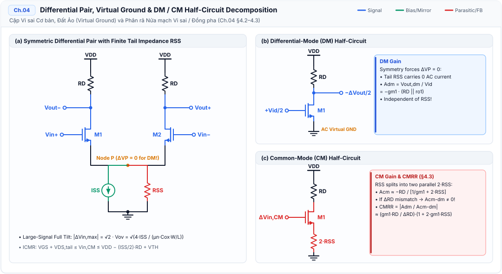

---
{
  "id": "topo-high-speed-lvds-cml-ctle-and-cdr-basics",
  "kind": "topology",
  "domain": "ams-filters-and-system",
  "title_vi": "Giao diện Truyền dẫn Tốc độ Cao (Wireline SerDes I/O): Tầng Lái Dòng CML & LVDS (100 Ohm), Bộ Cân bằng Tuyến tính Liên tục CTLE và Vòng Khôi phục Xung nhịp–Dữ liệu CDR",
  "title_en": "High-Speed Wireline I/O Fundamentals: Current-Mode Logic (CML), LVDS 100-Ohm Driver, Continuous-Time Linear Equalizer (CTLE), and Clock-and-Data Recovery (CDR)",
  "summary": "Nền tảng thiết kế thu phát hữu tuyến tốc độ cao nhiều Gb/s: đối chiếu bộ đệm lái dòng CML kết cuối nguồn 50 Ohm (triệt nảy đất dI/dt và nâng băng thông bằng cuộn cảm shunt peaking) với chuẩn cầu H đảo dòng LVDS (3.5 mA trên tải vi sai 100 Ohm kèm CMFB 1.2 V và bất biến suy hao phản xạ S11/S22 < -10 dB), dẫn xuất hàm truyền cực–zero của bộ cân bằng suy biến nguồn R_S || C_S (CTLE) bù suy hao kênh truyền ISI, và giải phẫu vòng khôi phục xung nhịp CDR (so sánh pha tuyến tính Hogge PD đối đầu nhị phân Alexander Bang-Bang PD cùng bộ ba chỉ tiêu Jitter Transfer, Jitter Generation và Jitter Tolerance).",
  "diagram": "../../diagrams/diff-pair-half-circuit.svg",
  "razavi_refs": [
    {
      "chapter": 4,
      "section": "4.1-4.3",
      "pages": "100-121",
      "equations": ["4.9", "4.15"]
    },
    {
      "chapter": 6,
      "section": "6.2-6.3",
      "pages": "180-193",
      "equations": ["6.43"]
    },
    {
      "chapter": 16,
      "section": "16.1-16.3",
      "pages": "651-683",
      "equations": ["16.21", "16.27", "16.32"]
    },
    {
      "chapter": 19,
      "section": "19.3-19.4",
      "pages": "760-772",
      "equations": ["19.19", "19.22"]
    }
  ],
  "github_refs": [
    {
      "repo": "iic-jku/radio-frequency-integrated-circuits",
      "url": "https://github.com/iic-jku/radio-frequency-integrated-circuits/tree/0799d7eaf9933e9384acda411a82b2a5d4693702",
      "use": "Phân tích phối hợp trở kháng tham số tán xạ S11/S22, mạng cuộn cảm trên chip và ngân sách nhiễu pha VCO/PLL trong giao diện tốc độ cao"
    },
    {
      "repo": "Arcadia-1/veriloga-skills",
      "url": "https://github.com/Arcadia-1/veriloga-skills/tree/7c5d3f03a162ee8131103e9551eee842424360bb",
      "use": "Mô hình hóa hành vi bộ tách pha (@cross với dung sai ttol), VCO không trạng thái ẩn (idtmod) và nguồn PRBS kiểm chứng biểu đồ mắt / JTOL của CDR"
    },
    {
      "repo": "Arcadia-1/analog-design-bench",
      "url": "https://github.com/Arcadia-1/analog-design-bench/tree/972f7cd7c95381134387b250edf18f3bd23bdd25",
      "use": "Khuôn mẫu bài đo kiểm đa góc PVT cho các tầng khuếch đại vi sai băng rộng, bộ tạo nhịp và mạch hồi tiếp chế độ chung"
    }
  ],
  "glossary_codes": [
    "T020",
    "T028",
    "T040",
    "T041",
    "T047",
    "T064",
    "T081",
    "T514",
    "T540",
    "T661",
    "T800",
    "T1175",
    "T2166",
    "T2170",
    "T2172",
    "T2174",
    "T2176",
    "T2198"
  ],
  "process_agnostic": true,
  "roles": {
    "cml_and_lvds_tx_driver": "Tầng phát lái dòng hằng định qua đường truyền vi sai phối hợp trở kháng Z_diff = 100 Ohm, triệt tiêu sóng phản xạ hai đầu và khử nhiễu nảy nguồn L*di/dt.",
    "source_degenerated_ctle": "Tầng khuếch đại vi sai suy biến nguồn bằng mạng song song R_S || C_S tạo zero nâng biên độ tần số cao để mở lại biểu đồ mắt bị đóng sập bởi suy hao kênh truyền.",
    "hogge_or_alexander_cdr_pd": "Bộ tách pha chuyên dụng cho chuỗi dữ liệu ngẫu nhiên NRZ (thiếu cạnh chuyển tiếp định kỳ), đo sai lệch thời gian giữa sườn dữ liệu và sườn xung nhịp VCO.",
    "overdamped_cdr_pll_core": "Bộ lọc vòng quá tắt dần (zeta >> 1) và VCO khóa xung nhịp lấy mẫu chính xác vào chính giữa mắt dữ liệu mà không gây nhô đỉnh truyền jitter."
  },
  "symptoms_addressed": [
    "rail-to-rail-cmos-io-ringing-and-ground-bounce-collapse-above-a-few-hundred-mbps",
    "double-reflection-isi-from-pad-capacitance-violating-s11-s22-return-loss",
    "closed-receiver-eye-diagram-caused-by-pcb-skin-effect-and-dielectric-channel-loss",
    "standard-pll-pfd-losing-lock-on-random-nrz-data-streams-with-missing-transitions"
  ],
  "limitations": [
    "cml-and-lvds-consume-continuous-static-tail-current-even-during-idle-constant-bit-runs",
    "ctle-high-frequency-peaking-amplifies-front-end-thermal-noise-and-crosstalk-along-with-signal",
    "hogge-linear-pd-exhibits-data-dependent-ripple-and-static-phase-skew-from-latch-clk-to-q-delay",
    "alexander-bang-bang-pd-introduces-nonlinear-hunting-limit-cycle-jitter-and-slew-rate-slope-overload"
  ],
  "checklists": [
    "common-mos",
    "system-integration-por-and-bias-bus",
    "differential-pair",
    "oscillator-and-pll",
    "esd-pad-and-substrate"
  ]
}
---

## 1. Bản chất Nguyên lý, Sơ đồ Mạch & Vai trò Từng Nhánh Cấu trúc

Khi tốc độ truyền dữ liệu nối tiếp giữa các chip (`ADC/DAC JESD204B/C`, cảm biến ảnh `MIPI`, liên kết `LVDS`, `PCIe`, `USB`, `Ethernet SerDes`) vượt qua ngưỡng $200\text{–}500\text{ Mb/s}$, cổng đệm số CMOS vung toàn thang từ $0\text{ V}$ lên $V_{DD}$ sụp đổ đồng loạt vì ba rào cản vật lý: (1) dòng nạp xả xung nhọn $I_{\text{peak}}$ chạy qua điện cảm dây hàn vỏ chip $L_{\text{bond}} \approx 1\text{–}3\text{ nH}$ sinh nhiễu nảy đất khổng lồ $V_{\text{bounce}} = L_{\text{bond}}\frac{di}{dt}$ (`T2198`), (2) thời gian trễ đường truyền trên mạch in FR4 vượt quá thời gian sườn lên của bit biến dây dẫn thành **đường truyền sóng phân bố trở kháng đặc tính $Z_0 = 50\,\Omega$ đơn đầu ($Z_{\text{diff}} = 100\,\Omega$ vi sai)** gây phản xạ dội ngược liên hồi nếu hở tải, và (3) hiệu ứng bề mặt kim loại (`skin effect` $\propto \sqrt{f}$) cùng tổn hao điện môi ($\propto f$) làm tù sườn xung gây **nhiễu xuyên ký tự (`Inter-Symbol Interference — ISI`)** đóng kín mắt dữ liệu!



Một tuyến liên kết hữu tuyến tốc độ cao (`High-Speed Wireline Transceiver`) hóa giải trọn vẹn ba rào cản trên bằng 4 khối mạch tương tự–hỗn hợp cốt lõi:
1. **Bộ Phát Lái Dòng Kết cuối Trở kháng (`CML` & `LVDS Transmitter Driver`, `T540`):**
   - Bơm một dòng tĩnh không đổi ($I_{\text{tail}} = \text{const} \implies \frac{dI_{DD}}{dt} \approx 0$!) đảo chiều qua cặp dây vi sai kết cuối chuẩn $100\,\Omega$ với biên độ nhỏ vi sai chỉ $350\text{–}800\text{ mV}_{\text{pp,diff}}$: vừa triệt tiêu nhiễu nảy nguồn, vừa khử nhiễu chế độ chung (`T661`, `CMRR`), vừa tăng tốc độ chuyển mạch lên hàng chục $\text{Gb/s}$.
2. **Mạng Phối hợp Trở kháng & Khử Phản xạ Vòng Đệm (`On-Chip Termination & Return-Loss Network`):**
   - Đặt điện trở kết cuối chính xác $50\,\Omega$ đơn đầu (hoặc $100\,\Omega$ vi sai) ngay trên chip tại cả đầu thu lẫn đầu phát (kèm cuộn cảm bù chữ T `T-coil` hoặc cuộn cảm nâng sườn `shunt peaking` nếu tốc độ rất cao) để giữ hệ số phản xạ công suất $S_{11}, S_{22} < -10\text{ dB}$ xuyên suốt băng thông Nyquist $f_N = R_b / 2$.
3. **Bộ Cân bằng Tuyến tính Thời gian Liên tục (`T041`, `Continuous-Time Linear Equalizer — CTLE`):**
   - Đặt ngay đầu thu dùng cặp vi sai suy biến cực nguồn bằng mạng song song $R_S \parallel C_S$ (`T028`, `T081`): làm suy giảm thành phần tần số thấp và nâng vọt độ lợi quanh tần số Nyquist $f_N$, tạo hàm truyền nghịch đảo bù đắp độ dốc suy hao của cáp/mạch in để mở toang biểu đồ mắt (`eye diagram`) trước khi chốt bit!
4. **Khối Khôi phục Xung nhịp và Dữ liệu (`T020`, `Clock-and-Data Recovery — CDR`):**
   - Vì tuyến nối tiếp tốc độ cao không truyền kèm đường xung nhịp riêng (để tránh lệch pha `skew` giữa dây clock và dây data), mạch `CDR` trích xuất trực tiếp tần số và pha xung nhịp từ chính các sườn chuyển mức ngẫu nhiên của dòng dữ liệu `NRZ` bằng **Bộ tách pha Hogge (tuyến tính)** hoặc **Alexander (nhị phân Bang-Bang)**, điều khiển vòng khóa pha `PLL` đặt sườn lấy mẫu rơi chính xác vào tâm mắt dữ liệu!

---

## 2. Hệ Phương trình Cốt lõi & Tư duy "Nhìn Mạch Đọc Nhanh" (Analysis by Inspection)

### 2.1. Đối chiếu Tầng Phát `CML` vs Cầu Đảo Dòng `LVDS` & Bất biến Suy hao Phản xạ `S11 / S22`
1. **Logic Chế độ Dòng (`Current-Mode Logic — CML`, tham chiếu $V_{DD}$):**
   Dùng cặp vi sai NMOS $M_1\text{–}M_2$ (`topo-basic-differential-pair`, Razavi §4.1) lái trọn dòng đuôi $I_{SS}$ giữa hai điện trở tải kéo lên $V_{DD}$ có giá trị $R_D = Z_0 = 50\,\Omega$:
   - **Trường hợp nối DC hai đầu (`Doubly-Terminated CML`):** Đầu thu cũng có hai điện trở kết cuối $50\,\Omega$ kéo lên $V_{DD,\text{RX}}$. Nhìn từ mỗi cực máng bộ phát, điện trở $R_D = 50\,\Omega$ nội tại mắc **song song** với đường truyền $Z_0 = 50\,\Omega$, cho tổng tải $25\,\Omega$! Để đạt biên độ đơn đầu $\Delta V_{\text{se}} = 250\text{ mV}$ ($\Delta V_{\text{diff,pp}} = 2 \times 250\text{ mV} = 500\text{ mV}$), dòng đuôi cần $I_{SS} = \frac{250\text{ mV}}{25\,\Omega} = \mathbf{10\text{ mA}}$! Đổi lại, $R_D = 50\,\Omega$ ở đầu phát đóng vai trò **kết cuối ngược hoàn hảo (`back-termination`)**, hấp thụ sạch mọi sóng phản xạ từ giắc cắm và đầu thu!
   - **Điều kiện chuyển mạch hoàn toàn & Tối ưu Băng thông `Shunt Peaking`:**
     Để lái $> 98\%$ dòng $I_{SS}$ sang một nhánh mà không đẩy cặp đầu vào lún vào vùng triode, biên độ kích cổng vào cần $\Delta V_{\text{in,diff}} \ge \sqrt{2}\,V_{\text{OV1,2}} \approx 300\text{–}400\text{ mV}$. Nếu thêm một cuộn cảm nhỏ $L_D$ nối tiếp với $R_D$ (`inductive shunt peaking`), cực-zero của tải $Z_L(s) = \frac{R_D + s L_D}{1 + s R_D C_L + s^2 L_D C_L}$ mở rộng băng thông $-3\text{ dB}$ thêm **$+60\%$ (khi $L_D = 0.41 R_D^2 C_L$ giữ trễ nhóm phẳng tối đa — `maximally flat delay`)** hoặc tới **$+85\%$ (khi $L_D = 0.71 R_D^2 C_L$)** mà không tốn thêm 1 microampe công suất nào!

2. **Chuẩn Truyền Vi sai Áp Thấp `LVDS` (`TIA/EIA-644` / `IEEE 1596.3` — Cầu H Đảo Chiều Dòng $3.5\text{ mA}$):**
   Khác với CML kéo dòng một chiều về $V_{DD}$, bộ phát `LVDS` dùng **cầu chữ H gồm 4 công tắc MOS (2 PMOS trên, 2 NMOS dưới)** kẹp giữa nguồn dòng đỉnh $I_{\text{LVDS}} = \mathbf{3.5\text{ mA}}$ và nguồn dòng đáy $3.5\text{ mA}$:
   - Khi phát bit `1`: công tắc chéo `P_A` và `N_B` dẫn $\implies$ dòng $3.5\text{ mA}$ chảy ra dây `OUT+`, đi xuyên qua điện trở kết cuối vi sai **$R_{\text{term,diff}} = 100\,\Omega$** ở đầu thu rồi quay về theo dây `OUT-` xuống đất bộ phát! Khi phát bit `0`: `P_B` và `N_A` dẫn đảo ngược chiều dòng qua $100\,\Omega$!
   - **Hiệu suất dòng gấp đôi CML:** Chỉ với **$I_{\text{LVDS}} = 3.5\text{ mA}$**, điện áp trên tải đầu thu đạt $V_{\text{se,swing}} = 3.5\text{ mA} \times 100\,\Omega = \mathbf{350\text{ mV}}$ và biên độ vi sai đỉnh–đỉnh đạt **$2 \times 350\text{ mV} = \mathbf{700\text{ mV}_{\text{pp,diff}}}$**! Vì tải $100\,\Omega$ ở đầu thu là thả nổi giữa hai dây (`floating differential resistor`), bộ phát `LVDS` **BẮT BUỘC phải có vòng hồi tiếp chế độ chung (`T800`, `CMFB`)** dùng cặp điện trở lớn $R_{\text{CM}} \gg 100\,\Omega$ cảm nhận $V_{\text{CM,out}} = \frac{V_{\text{OUT+}} + V_{\text{OUT-}}}{2}$ so sánh với $V_{\text{REF,LVDS}} = \mathbf{1.20\text{ V}}$ để khóa chặt mức đồng pha ở $1.2\text{ V}$!

3. **Bất biến Suy hao Phản xạ `Return Loss` ($S_{11}, S_{22} < -10\text{ dB}$) & Giới hạn Tụ Chân Hàn $C_{\text{pad}}$:**
   Tại đầu thu hoặc đầu phát có trở kháng đơn đầu $R_T = 50\,\Omega$ mắc song song với tổng điện dung bàn hàn + mạch bảo vệ tĩnh điện ESD $C_{\text{pad}}$ (`tech-esd-protection-padring-and-package-parasitics`), trở kháng vào bằng $Z_{\text{in}}(j\omega) = \frac{R_T}{1 + j\omega R_T C_{\text{pad}}}$. Hệ số phản xạ đối chiếu chuẩn $Z_0 = R_T = 50\,\Omega$ rút gọn cực kỳ thanh thoát:

$$
\left|\Gamma(j\omega)\right| = \left|\frac{Z_{\text{in}}(j\omega) - Z_0}{Z_{\text{in}}(j\omega) + Z_0}\right| = \frac{\omega Z_0 C_{\text{pad}}}{\sqrt{4 + \left(\omega Z_0 C_{\text{pad}}\right)^2}} \le 10^{-10/20} = 0.3162 \quad \left(\text{cho } S_{11} \le -10\text{ dB}\right)
$$

   Giải bất phương trình tại tần số Nyquist $f_N = \frac{R_b}{2}$ (nơi năng lượng phổ dữ liệu tập trung mạnh nhất) cho công thức giới hạn cứng của tụ chân hàn:

$$
\omega_N Z_0 C_{\text{pad}} \le \frac{2 \times 0.3162}{\sqrt{1 - 0.1}} = 0.667 \;\implies\; C_{\text{pad,max}} \le \frac{0.667}{2\pi \, (R_b / 2) \, Z_0} \approx \frac{1}{4.71 \, R_b \, Z_0}
$$

   *(Ví dụ ở tốc độ $R_b = 10\text{ Gb/s}$, $Z_0 = 50\,\Omega$: tổng điện dung chân chip + ESD bắt buộc $C_{\text{pad}} \le \mathbf{425\text{ fF}}$! Nếu vượt mức này ở $28\text{ Gb/s}$, bắt buộc quấn mạng cuộn cảm ghép hỗ cảm chữ T `bridged T-coil` để hấp thụ $C_{\text{pad}}$ thành đường truyền nhân tạo!).*

### 2.2. Bộ Cân bằng Tuyến tính Liên tục `CTLE`: Hàm Truyền Cực–Zero Suy biến $R_S \parallel C_S$
Xét tầng khuếch đại vi sai tách nguồn dòng đuôi thành hai nửa $I_{SS}/2$, nối hai cực nguồn của $M_1, M_2$ qua điện trở suy biến $R_S$ mắc song song với tụ nâng đỉnh $C_S$ (`topo-diff-pair-with-degeneration-and-triode-loads` + Razavi §6.2 Phương trình 6.43). Trong nửa mạch vi sai tương đương, trở kháng nối từ cực nguồn xuống đất AC đúng bằng $\frac{R_S}{2} \parallel (2 C_S) = \frac{R_S / 2}{1 + s R_S C_S}$! Phối hợp với tải cực máng $R_D \parallel C_L$, hàm truyền chính xác của `CTLE` là:

$$
A_{\text{CTLE}}(s) = -\left(\frac{g_m R_D}{1 + \dfrac{g_m R_S}{2}}\right) \cdot \frac{1 + s R_S C_S}{\left(1 + \dfrac{s R_S C_S}{1 + g_m R_S / 2}\right)\left(1 + s R_D C_L\right)}
$$

**Bốn tham số thiết kế đọc thẳng từ mắt thường:**
1. **Độ lợi tần số thấp (`DC Gain`):** $|A_{\text{DC}}| = \dfrac{g_m R_D}{1 + g_m R_S / 2}$ (bị nén xuống có chủ đích để giữ nguyên biên độ bit dài gồm toàn số `1` hoặc toàn số `0` liên tiếp!).
2. **Tần số điểm không nâng biên (`Peaking Zero`):** $\omega_z = \dfrac{1}{R_S C_S}$ — đặt trùng với tần số gãy suy hao $-3\text{ dB}$ của kênh truyền PCB!
3. **Tần số cực thứ nhất và cực tải:** $\omega_{p1} = \left(1 + \frac{g_m R_S}{2}\right)\omega_z$ và $\omega_{p2} = \frac{1}{R_D C_L}$ — đặt vây quanh tần số Nyquist $\omega_N = \pi R_b$ để cắt nhiễu ngoài dải!
4. **Biên độ nâng đỉnh cực đại (`Peaking Boost Ratio`):** Chỉ khi hai cực tách xa đủ rộng ($\omega_{p2} \gg \omega_{p1}$, thực tế cần $\omega_{p2} \ge (3\text{–}5)\,\omega_{p1}$ để hình thành vùng bình nguyên cao tần $|A_{\text{peak}}| \approx g_m R_D$), tỷ số nâng đỉnh tiệm cận mới tiến gần:

$$
\text{Boost}_{\max,\text{asymp}}\text{ [dB]} = 20\log_{10}\!\left(1 + \frac{g_m R_S}{2}\right) \qquad \left(\text{chỉ đạt gần giới hạn này khi } \omega_{p2} \gg \omega_{p1}!\right)
$$

   *(Cảnh báo cực gần nhau: nếu $\omega_{p2} = \omega_{p1}$ với $1 + g_m R_S / 2 = 4$ — giá trị tiệm cận $12.04\text{ dB}$ — đánh giá trực tiếp hàm truyền ở trên chỉ cho nâng đỉnh cực đại **$6.30\text{ dB}$**, hụt gần $6\text{ dB}$ so với tiệm cận! Khi thiết kế $\omega_{p2}$ gần $\omega_{p1}$, bắt buộc tính đỉnh chính xác từ $|A_{\text{CTLE}}(j\omega)|/|A_{\text{DC}}|$. Thông thường mỗi tầng `CTLE` cung cấp $6\text{–}12\text{ dB}$ nâng đỉnh bằng mảng biến dung $C_S$ và điện trở $R_S$ điều chỉnh số; nếu kênh truyền suy hao $> 20\text{ dB}$, ghép 2 tầng `CTLE` hoặc kết hợp với bộ cân bằng phản hồi quyết định phi tuyến `DFE` không khuếch đại nhiễu nhiệt!).*

### 2.3. Vòng Khôi phục Xung nhịp `CDR`: Tại sao PFD Thường Thất Bại, `Hogge` vs `Alexander PD` & Bộ Ba Jitter
1. **Tại sao không dùng được PFD Ba Trạng thái của PLL Tổng hợp Tần số?**
   Chuỗi dữ liệu ngẫu nhiên không trở về không (`NRZ`) có mật độ phổ công suất $S_{\text{NRZ}}(f) = V_0^2 T_b \,\text{sinc}^2(\pi f T_b)$ có **điểm không bằng $0$ đúng tại tần số xung nhịp $f = 1/T_b = R_b$**! Hơn nữa, dữ liệu ngẫu nhiên thường xuyên có các chuỗi dài `11111` không có cạnh chuyển mức: nếu đưa vào `topo-pfd-deadzone-and-charge-pump-nonidealities`, PFD thấy sườn `CLK` mà không thấy sườn `DATA` sẽ hiểu nhầm là tần số `DATA` bằng 0 và kéo tụt điện áp điều khiển VCO sập khóa ngay lập tức! Mọi bộ tách pha `CDR` **bắt buộc phải chuyển sang trạng thái Giữ Nguyên (`Hold / Tri-state`) bất cứ khi nào hai bit liên tiếp giống nhau ($D_n = D_{n+1}$)**!

2. **Bộ Tách Pha Tuyến tính `Hogge PD` vs Bộ Tách Pha Nhị phân `Alexander (Bang-Bang) PD`:**
   - **`Hogge Linear PD`:** Gồm hai chốt `D-FF` nối tiếp: `FF1` chốt $D_{\text{in}}$ tại sườn lên `CLK` ra $Q_1$, `FF2` chốt tiếp $Q_1$ tại sườn xuống `CLK` ra $Q_2$.
     * Xung tỷ lệ `Prop` $= D_{\text{in}} \oplus Q_1$: chỉ xuất hiện khi có cạnh dữ liệu, độ rộng biến thiên tuyến tính từ $0$ đến $T_{\text{CK}}$ (bằng đúng $T_{\text{CK}}/2$ khi khóa ở giữa mắt!).
     * Xung tham chiếu cố định `Ref` $= Q_1 \oplus Q_2$: xuất hiện ngay sau đó với độ rộng **luôn cố định bằng đúng nửa chu kỳ $T_{\text{CK}}/2$**!
     * Hiệu diện tích điện tích `Prop - Ref` tỉ lệ tuyến tính tuyệt đối với sai lệch pha $\Delta\phi$ không có vùng chết (`T2172`)! *(Cạm bẫy vật lý: trễ truyền $t_{\text{CK}\to Q1}$ của `FF1` cộng thêm vào độ rộng `Prop` gây **độ lệch pha tĩnh `static phase skew`** ở tốc độ cao!)*.
   - **`Alexander Binary (Bang-Bang) PD` (Chuẩn mực thống trị ở nhiều $\text{Gb/s}$):** Dùng 4 flip-flop lấy mẫu dữ liệu tại **3 thời điểm trên mỗi chu kỳ bit**: bit trước $D_n$ (sườn lên thứ $n$), sườn chuyển giao $E_n$ (sườn xuống giữa $n$ và $n+1$), và bit sau $D_{n+1}$ (sườn lên thứ $n+1$):
     * Nếu $D_n = D_{n+1}$ (không có chuyển bit): $\text{EARLY} = 0, \text{LATE} = 0$ (giữ nguyên điện tích bộ lọc vòng!).
     * Nếu $D_n \neq D_{n+1}$ và $E_n = D_n$: sườn xuống `CLK` đến sớm trước khi dữ liệu kịp lật $\implies$ **$\text{EARLY} = 1$ (xung nhịp sớm $\to$ làm chậm VCO!)**.
     * Nếu $D_n \neq D_{n+1}$ và $E_n = D_{n+1}$: dữ liệu đã lật xong trước khi sườn xuống `CLK` tới $\implies$ **$\text{LATE} = 1$ (xung nhịp trễ $\to$ tăng tốc VCO!)**.
     * *Ưu điểm tuyệt đối:* Bản thân chốt lấy mẫu cạnh $E_n$ đồng dạng hình học 100% với chốt lấy mẫu dữ liệu $D_n$, nên nó **tự động đặt xung nhịp vào đúng điểm cân bằng thời gian thiết lập/giữ (`setup-and-hold center`) với sai số pha tĩnh bằng $0$** ở hàng chục $\text{Gb/s}$! Đổi lại hàm đặc tính là hàm dấu bậc thang $\text{sgn}(\Delta\phi)$ phi tuyến gây dao động săn đuổi biên độ nhỏ (`limit-cycle hunting jitter`).

3. **Bộ Ba Đặc tả Jitter Chuẩn Hóa Của `CDR` (`The CDR Jitter Triad`):**
   - **Hàm truyền Jitter (`Jitter Transfer` $J_{\text{tran}}(s) = \frac{\Phi_{\text{out}}(s)}{\Phi_{\text{in}}(s)}$):** Bộ lọc thông thấp băng thông $\omega_{-3\text{dB}}$. Trong vòng khóa pha loại II bậc hai lý tưởng (`topo-charge-pump-type2-pll`, bỏ qua cực phụ $C_2$ khi $C_1 \gg C_2$), $J_{\text{tran}}(s) = \frac{2\zeta\omega_n s + \omega_n^2}{s^2 + 2\zeta\omega_n s + \omega_n^2}$ có điểm không ổn định hóa $\omega_z = \frac{1}{R_P C_1} = \frac{\omega_n}{2\zeta}$ bắt buộc gây **nhô đỉnh biên độ (`Jitter Peaking`)**:
     $$\text{Jitter Peaking} = 10\log_{10}\!\left(\frac{8\zeta^4}{8\zeta^4 - 4\zeta^2 - 1 + \sqrt{1 + 8\zeta^2}}\right) \approx 20\log_{10}\!\left(1 + \frac{1}{4 \zeta^2}\right) \approx \frac{8.686}{4 \zeta^2}\text{ [dB]} \quad (\text{khi } \zeta \gg 1)$$
     Tính chính xác theo mô hình bậc hai: $\zeta = 2 \implies 0.40\text{ dB}$, $\zeta = 3 \implies 0.195\text{ dB}$, và $\zeta = 5 \implies 0.076\text{ dB}$. Tuy nhiên, trong bộ lọc vòng bậc ba thực tế có tụ gợn $C_2$, cực thứ ba nằm gần $\omega_{p3} \approx \frac{1 + C_1/C_2}{2\zeta}\,\omega_n$ so với tần số cắt vòng $\omega_c \approx 2\zeta\,\omega_n$: nếu chọn sai $C_1/C_2 = 50$ hoặc $100$ ở $\zeta = 4.4$, cực $\omega_{p3}$ rơi sát xuống vùng cắt khiến nhô đỉnh bậc ba vọt lên tới **$2.735\text{ dB}$** (với $C_1/C_2 = 50$) và **$0.668\text{ dB}$** (với $C_1/C_2 = 100$)! Do đó, để chuỗi $20\text{–}50$ trạm lặp nối tiếp đạt `Jitter Peaking` **$\le 0.1\text{ dB}$**, bắt buộc chọn $\zeta \ge 4.4$ (thực tế $\zeta \ge 4.5\text{–}5.0$) ĐỒNG THỜI ép tỷ số tụ **$C_1 / C_2 \gg 4\zeta^2$** (ví dụ **$C_1 / C_2 \ge 10\zeta^2$** hoặc tối ưu trực tiếp bộ lọc bậc ba) VÀ kiểm chứng trực tiếp đỉnh nhô trên **hàm truyền jitter đóng vòng bậc ba đầy đủ** ($\max_\omega |J_{\text{tran,3rd}}(j\omega)| \le 0.1\text{ dB}$), tuyệt đối không chỉ dựa vào công thức bậc hai (trong khi $\zeta \approx 2\text{–}3$ chỉ đáp ứng các chuẩn nới lỏng $\le 0.2\text{–}0.4\text{ dB}$)!
   - **Tự sinh Jitter (`Jitter Generation`):** Tổng jitter RMS của xung nhịp khôi phục khi cấp dữ liệu đầu vào sạch hoàn hảo (băng thông vòng rộng giúp nén nhiễu pha VCO nhưng lại đón nhiều nhiễu kênh vào hơn!).
   - **Khả năng Chịu đựng Jitter (`Jitter Tolerance — JTOL` $J_{\text{tol}}(\omega_m)$):** Biên độ điều chế pha hình sin cực đại $\Phi_{\text{in,pk}}(\omega_m)$ chồng lên dữ liệu ở tần số điều chế $\omega_m$ mà bộ thu vẫn đạt tỷ lệ lỗi bit $\text{BER} < 10^{-12}$ (tức sai số pha bám còn dư $|\Phi_{\text{err}}| = |\Phi_{\text{in}}(1 - J_{\text{tran}}(j\omega_m))| < 0.5\text{ UI} - \Phi_{\text{margin}}$):
     $$J_{\text{tol}}(\omega_m) = \frac{0.5\text{ UI} - \Phi_{\text{margin}}}{\left|1 - J_{\text{tran}}(j\omega_m)\right|}$$
     Ở tần số điều chế thấp $\omega_m \ll \omega_{-3\text{dB}}$, $|1 - J_{\text{tran}}| \ll 1$ nên `CDR` dễ dàng bám theo biên độ lắc lư khổng lồ **$5\text{–}10\text{ UI}$**; còn ở tần số cao $\omega_m \gg \omega_{-3\text{dB}}$, VCO đứng yên không bám kịp ($J_{\text{tran}} \to 0$) nên mặt nạ `JTOL` nằm ngang sát giới hạn độ mở mắt ngang thực tế ($0.25\text{–}0.35\text{ UI}$)!

---

## 3. Bất biến Cấu trúc & Các Bẫy Lỗi Kinh điển (Structural Invariants & Traps)

- **`[INV-SER-01]` Bất biến Mật độ Chuyển Cạnh Dữ liệu (`Transition Density` $\alpha_T$) Làm Trôi Băng Thông Vòng `CDR`:**
  Độ lợi hiệu dụng của bộ tách pha `Hogge / Alexander` tỉ lệ trực tiếp với xác suất chuyển trạng thái giữa hai bit kề nhau $\alpha_T \in [0, 1]$ ($K_{\text{PD,eff}} = \alpha_T K_{\text{PD,max}}$, với dữ liệu ngẫu nhiên PRBS $\alpha_T = 0.5$, mã 8b/10b $\alpha_T \approx 0.6$). Khi chuỗi dữ liệu thưa cạnh ($\alpha_T$ tụt xuống $0.15$), băng thông vòng $\omega_n$ và hệ số tắt dần $\zeta \propto \sqrt{\alpha_T}$ cùng sụt giảm làm **tăng vọt `Jitter Peaking`**! Phải kiểm chứng ổn định và nhô đỉnh jitter trên toàn dải $\alpha_T \in [0.15, 1.0]$!
- **`[INV-SER-02]` Bất biến Khóa Tần số Khởi tạo Bằng Vòng Phụ Tham chiếu (`Dual-Loop Reference Acquisition`):**
  Bộ tách pha `Hogge` và `Alexander` **CHỈ đo được sai lệch pha khi tần số VCO đã nằm rất sát tốc độ bit ($\Delta f / R_b < 0.1\%\text{–}1\%$)** — chúng không phải là bộ tách tần số rộng! Mọi khối `CDR` thực tế bắt buộc dùng kiến trúc hai vòng (`Dual-Loop`): lúc khởi động khóa VCO vào thạch anh chuẩn ngoài qua PFD thường (`topo-pfd-deadzone-and-charge-pump-nonidealities`), khi cờ báo khóa tần số bật lên mới chuyển êm công tắc sang vòng bám pha dữ liệu `Alexander/Hogge`!
- **`[TRAP-SER-01]` Bẫy Quá Cân Bằng (`CTLE Over-Equalization`) Gây Nhiễu Vọt Lố Đóng Mắt Ngược:**
  Nếu cài đặt mức nâng đỉnh `Boost` của `CTLE` lớn hơn độ suy hao thực tế của đường dây ngắn (`short-reach trace`), một cạnh chuyển đơn lẻ sẽ vọt lố biên độ lớn tạo méo tiền/hậu xung và khuếch đại nhiễu trắng tần số cao thêm $12\text{ dB}$, làm thu hẹp biên độ mở dọc của mắt! Luôn thiết kế `CTLE` có mảng $R_S, C_S$ lập trình $3\text{–}4\text{ bit}$ kèm chế độ đi tắt `0 dB bypass`.
- **`[TRAP-SER-02]` Bẫy Trôi Tần số `VCO` Do Rò Dòng Bơm Điện tích Khi Gặp Chuỗi Bit Đồng Nhất Dài (`CID Drift`):**
  Khi đường truyền gửi $72$ bit `0` liên tiếp (`Consecutive Identical Digits — CID` trong chuẩn SONET), bộ tách pha nghỉ hoàn toàn trong $72\,T_b$. Nếu hai nhánh nguồn dòng `UP/DN` của Charge Pump có dòng rò lệch nhau $I_{\text{leak}}$ trên tụ lọc vòng $C_1$, pha VCO sẽ trượt bậc hai $\Delta\phi_{\text{drift}}(t) = \frac{1}{2} K_{\text{VCO}} \frac{I_{\text{leak}}}{C_1} t^2$ trượt khỏi tâm mắt!

---

## 4. Lộ trình Nâng cấp Cấu trúc & Bát giác Đánh đổi (Upgrade Paths & Design Octagon)

| Khối Chức năng Wireline | Cấu trúc Cơ sở ($< 5\text{ Gb/s}$) | Nâng cấp Tốc độ Trung ($5\text{–}28\text{ Gb/s}$) | Nâng cấp Siêu Tốc ($56\text{–}224\text{ Gb/s}$) |
| :--- | :--- | :--- | :--- |
| **Tầng Phát (`TX Driver`)** | Cầu `LVDS` $3.5\text{ mA}$ ($100\,\Omega$, tiêu thụ thấp) | `CML` ghép tầng có cân bằng trước `TX FFE` (2–3 tap dòng phân đoạn) | `SST` (`Source-Series Terminated` điện áp chế độ trở kháng chuẩn) + điều chế `PAM4` |
| **Cân bằng Đầu thu (`RX EQ`)** | Không cần hoặc 1 tầng `CTLE` cố định | 2 tầng `CTLE` tinh chỉnh số + `1-tap/2-tap DFE` khử hậu xung không tăng nhiễu | Đầu thu số hóa hoàn toàn `ADC-Based DSP` (`Time-Interleaved SAR` + `FFE/DFE` số) |
| **Khôi phục Nhịp (`CDR`)** | `Hogge PD` toàn tốc độ (`Full-Rate Clock`) | `Half-Rate / Quarter-Rate Alexander PD` (dùng VCO cầu phương 4 pha `topo-quadrature-vco-and-varactor-tuning` giảm nửa tần số VCO!) | `Baud-Rate Mueller-Müller PD` trích pha trực tiếp từ các mẫu ADC không cần mẫu sườn giữa! |

---

## 5. Thích ứng Đa Tiến trình (90nm / 65nm / 45nm) & Cách Kiểm chứng trong Cadence / Spectre

### 5.1. Quy tắc Định cỡ `CML`, `LVDS` và `CTLE` trên `90nm / 65nm / 45nm`
1. **Hiệu chỉnh Điện trở Kết cuối `50 Ohm` Qua Góc Tiến trình (`4-bit Poly Resistor Calibration`):**
   - Điện trở poly không silicide (`rppolywo`) biến thiên $\pm 20\%$ giữa góc `SS` và `FF` — đủ làm sập `Return Loss S11` vượt quá $-10\text{ dB}$! Thiết kế chuẩn đặt cố định $R_{\text{fixed}} \approx 65\,\Omega$ mắc song song với mảng $4\text{ bit}$ nhánh điện trở chuyển mạch NMOS vùng triode sâu, so sánh tự động với điện trở chuẩn chính xác $1\%$ ngoài chip (`ZQ calibration pin`) lúc khởi động.
2. **Định cỡ `CTLE` Theo Mật độ Dòng Đỉnh $f_T$ (`Peak-$f_T$ Biasing`, $g_m/I_D \approx 8\text{–}10\,\text{V}^{-1}$):**
   - Khác với khuếch đại cảm biến ưu tiên $g_m/I_D$ cao, cặp vi sai của `CML` và `CTLE` được phân cực ở mật độ dòng cho tần số cắt nội tại $f_T$ cao ($V_{\text{OV}} \approx 180\text{–}220\text{ mV}$, chiều dài kênh ngắn $L = 1.0\text{–}1.2\,L_{\min}$), chia ngón chẵn dùng chung cực máng để giảm tối đa $C_{DB}$ tải lên nút ra!

### 5.2. Kịch bản Kiểm chứng `Return Loss (sp)`, Hàm Truyền `CTLE (ac)` & Biểu đồ Mắt (`Eye Diagram`) trong Spectre
```spice
// Testbench Kiem chung 3 Buoc cho Dau thu 5-Gb/s Wireline (100-Ohm Term + CTLE + Eye Diagram)
parameters Rb=5G UI=(1/Rb) f_nyq=(Rb/2) vdd_val=1.0 c_pad_esd=320f l_bond=1.2n

// [Buoc 1] Phan tich Tham so Tan xa S-Parameter (sp) kiem tra Return Loss vi sai S11 < -10 dB:
// Su dung port vi sai port_rx (r=100 type=prbs data_rate=Rb ...) noi qua L_bond + C_pad_esd vao RX:
sp_rl sp ports=[port_rx] start=10M stop=10G dec=25
// Xac nhan: max_{f <= 2.5 GHz}( db20(S(1,1)) ) <= -10.0 dB tren ca 5 goc PVT!

// [Buoc 2] Quet AC do do nang dinh Peaking cua CTLE (muc tieu +8.5 dB tai f_nyq = 2.5 GHz):
ac_ctle ac start=1M stop=20G dec=30
// Boost_dB = db20(VF("/vout_diff"))_at_2p5GHz - db20(VF("/vout_diff"))_at_10MHz

// [Buoc 3] Mo phong Qua do PRBS-9 qua Kenh Suy hao -9dB @ 2.5GHz de do Do Mo Mat (Eye Height/Width):
tran_eye tran stop=(520*UI) errpreset=conservative maxstep=(UI/40)
// Gấp sóng V(vout_diff) modulo (2*UI) tu t = 20*UI..520*UI:
// Xac nhan Eye_Height >= 180 mV_diff va Horizontal_Eye_Opening >= 0.62 * UI!
```

---

## 6. Mốc Đối chiếu Sách Razavi, GitHub Thực chiến & Thuật ngữ Chuẩn CLB

### 6.1. Đối chiếu Sách Gốc Razavi (2nd Edition) & Kho Mã Nguồn Mở
- **Chương 4 & Chương 6:** §4.1–§4.3 *Differential Pair & Degeneration* (tr. 100–121 — đặc tính chuyển mạch toàn phần $\Delta V_{\text{in}} = \sqrt{2} V_{\text{OV}}$ của `CML` và khử nhiễu đồng pha); §6.2–§6.3 *CS Stage with Source Degeneration & Source Follower* (tr. 180–193, Phương trình 6.43 — chứng minh trực tiếp điểm không $\omega_z = \frac{1}{R_S C_S}$ và cực $\omega_{p1} = \frac{1 + g_m R_S}{R_S C_S}$ cấu thành bộ cân bằng `CTLE`!).
- **Chương 16 & Chương 19:** §16.1–§16.3 *Phase-Locked Loops* (tr. 651–683 — động lực học vòng khóa pha loại II, nhô đỉnh hàm truyền do điểm không $\omega_z$ trong `CDR`); §19.3–§19.4 *Substrate Coupling & Packaging* (tr. 760–772, Phương trình 19.19, 19.22 — điện cảm dây hàn $L_{\text{bond}}$ gây nảy đất và phản xạ đường truyền).
- **Đối chiếu GitHub:** Giáo trình `iic-jku/radio-frequency-integrated-circuits` và quy chuẩn mô hình hóa hành vi xung nhịp `Arcadia-1/veriloga-skills` + `Arcadia-1/analog-design-bench`.

### 6.2. Bảng Thuật ngữ Chuẩn CLB Vi Mạch Sử dụng trong Thẻ
| Mã CLB | Thuật ngữ Tiếng Anh | Thuật ngữ Tiếng Việt Chuẩn | Ghi chú Ngữ cảnh trong Giao diện Tốc độ Cao |
| :--- | :--- | :--- | :--- |
| `T540` / `T1175` | termination / input termination | kết cuối / điều kiện kết cuối ngõ vào | Phối hợp chuẩn $50\,\Omega$ đơn đầu / $100\,\Omega$ vi sai giữ $S_{11}, S_{22} < -10\text{ dB}$ |
| `T2198` | bondwire inductance and ground bounce | điện cảm dây hàn chân vỏ và nảy đất $L\,di/dt$ | Triệt tiêu tận gốc khi chuyển từ cổng đảo CMOS sang lái dòng tĩnh `CML/LVDS` |
| `T040` / `T041` | equalization / equalizer | cân bằng / bộ cân bằng (`CTLE`) | Bù suy hao kênh truyền tần số cao, khử nhiễu xuyên ký tự `ISI` mở biểu đồ mắt |
| `T028` / `T081` | degenerated diff pair / source degeneration | cặp vi sai có suy biến / suy biến nguồn | Mạng $R_S \parallel C_S$ ở cực nguồn sinh điểm không nâng đỉnh tại $\omega_z = 1/(R_S C_S)$ |
| `T020` / `T2170` | clock recovery / phase detector | khôi phục xung nhịp (`CDR`) / bộ tách pha | Dùng `Hogge PD` hoặc `Alexander Bang-Bang PD` bám dữ liệu `NRZ` thiếu cạnh chuyển |
| `T2176` | damping factor, zeta | hệ số tắt dần | Chọn quá tắt dần sâu $\zeta \ge 4.4\text{–}5$ trong `CDR` để ép nhô đỉnh truyền jitter $\le 0.1\text{ dB}$ |
