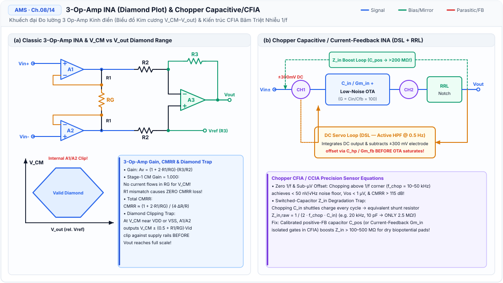

---
{
  "id": "topo-instrumentation-amp-3opamp-and-chopper-cfia",
  "kind": "topology",
  "domain": "ams-filters-and-system",
  "title_vi": "Bộ Khuếch đại Đo lường 3-Op-Amp Cổ điển và Kiến trúc Băm Hồi tiếp Tụ / Cân bằng Dòng (3-Op-Amp INA & Chopper CFIA / CBIA)",
  "title_en": "3-Op-Amp Instrumentation Amplifier and Capacitive-Feedback / Current-Balancing Chopper Instrumentation Amplifiers (DSL, Rin Boost & RRL)",
  "summary": "Từ bộ khuếch đại đo lường 3-Op-Amp kinh điển A_v = (1 + 2*R1/RG)*(R3/R2) (cách ly trở kháng vào GOhm, giới hạn CMRR do sai lệch cặp trở tầng trừ và bẫy xén nút nội biểu đồ kim cương V_CM - V_out ở nguồn thấp) tiến hóa lên hai kiến trúc cảm biến microvolt hiện đại: Bộ khuếch đại băm cân bằng dòng (CBIA) tách rời miền đồng pha vào/ra và Bộ khuếch đại băm hồi tiếp điện dung (Chopper CFIA) đạt độ lệch < 1 uV, góc nhiễu 1/f < 10 mHz, tích hợp trọn bộ ba vòng phụ trợ sống còn gồm Vòng Servo DC (DSL khử +-300 mV phân cực điện cực), Vòng Hồi tiếp Dương Nâng Trở kháng Vào (> 500 MOhm) và Vòng Khử Gợn Băm (RRL).",
  "diagram": "../../diagrams/three-opamp-and-chopper-cfia.svg",
  "razavi_refs": [
    {
      "chapter": 4,
      "section": "4.2.3-4.3",
      "pages": "116-123",
      "equations": ["4.34", "4.38", "4.44"]
    },
    {
      "chapter": 7,
      "section": "7.2-7.6",
      "pages": "228-262",
      "equations": ["7.41", "7.53", "7.129"]
    },
    {
      "chapter": 8,
      "section": "8.1, 8.2.1, 8.5, 8.6",
      "pages": "274-291, 303-330",
      "equations": ["8.15", "8.88"]
    },
    {
      "chapter": 14,
      "section": "14.2.1-14.2.4",
      "pages": "593-604",
      "equations": ["14.75", "14.88", "14.96"]
    }
  ],
  "github_refs": [
    {
      "repo": "efabless/sky130_pa_ip__instramp",
      "url": "https://github.com/efabless/sky130_pa_ip__instramp/tree/67a57bbfee",
      "use": "Thiết kế cấp transistor và tài liệu bài giảng gốc của GS. Phil Allen cho Bộ khuếch đại đo lường độ lợi khả trình CMOS (Instrumentation Amplifier / PGA) kèm hợp đồng đo kiểm CACE"
    },
    {
      "repo": "iic-jku/analog-circuit-design",
      "url": "https://github.com/iic-jku/analog-circuit-design/tree/6075ea0ebcf08f5c7f6033a84e9dd3c91450f5e1",
      "use": "Quy trình định cỡ nhiễu nhiệt / 1/f cặp đầu vào PMOS theo gm/ID, phân tích hồi tiếp hai cửa và khử đồng pha CMRR"
    },
    {
      "repo": "KenKundert/flicker-noise",
      "url": "https://github.com/KenKundert/flicker-noise/tree/b7da03b36dfe4190c27133507e70c3decb619eaf",
      "use": "Kiểm chứng phổ nhiễu nhấp nháy 1/f chịu điều biến băm chu kỳ bằng cặp phân tích SpectreRF pss + pnoise"
    }
  ],
  "glossary_codes": [
    "T042",
    "T087",
    "T392",
    "T572",
    "T620",
    "T655",
    "T661",
    "T788",
    "T803",
    "T812",
    "T1009",
    "T1080",
    "T1137",
    "T1178",
    "T1184",
    "T1257",
    "T2153",
    "T2155",
    "T2157",
    "T2194"
  ],
  "process_agnostic": true,
  "roles": {
    "non_inverting_cross_coupled_input_stage_a1_a2": "Hai Op-Amp đầu vào không đảo A1, A2 nối chung điện trở đặt độ lợi R_G ở nhánh âm: đón tín hiệu bằng cực cổng MOS trở kháng GOhm, nhân tín hiệu vi sai lên (1 + 2*R1/RG) lần nhưng giữ nguyên tín hiệu đồng pha ở hệ số truyền bằng 1.",
    "four_resistor_subtractor_stage_a3": "Tầng khuếch đại trừ 4 điện trở R2-R3 dùng Op-Amp A3 loại bỏ thành phần đồng pha V_CM đi qua từ tầng 1 và chuyển đổi tín hiệu vi sai sang đơn đầu (hoặc vi sai đối xứng).",
    "capacitive_chopper_bridge_cin_cfb": "Mạng tụ tỷ số chính xác C_in / C_fb đặt sau cầu băm đầu vào CH_in trong kiến trúc CFIA: thiết lập độ lợi đóng vòng C_in / C_fb không sinh nhiễu nhiệt điện trở, đồng thời băm lý tưởng đẩy V_OS và nhiễu 1/f của các tầng khuếch đại nằm giữa cầu băm vào và cầu băm ra lên hài lẻ f_chop (mọi nhiễu 1/f xuất hiện trước CH_in vẫn xuyên qua cả hai cầu băm quay về băng gốc, còn công tắc thực để lại độ lệch dư và gập nhiễu do sai lệch công tắc cùng phun điện tích).",
    "dc_servo_loop_dsl_integrator": "Vòng tích phân hằng số thời gian siêu lớn nối hồi tiếp âm từ ngõ ra quay về tụ trung hòa C_hp tại đầu vào, tạo cực thông cao 0.1-0.5 Hz triệt tiêu tới +-300 mV điện áp phân cực DC của điện cực sinh học.",
    "positive_feedback_impedance_booster_cpf": "Nhánh tụ nhỏ C_pf hồi tiếp dương cùng pha từ ngõ ra về trước cầu băm đầu vào để cấp bù gói điện tích nạp/xả cho C_in, nâng trở kháng vào hiệu dụng từ vài MOhm vọt lên hàng trăm MOhm - GOhm.",
    "ripple_reduction_loop_rrl": "Mạch cảm biến xoay chiều và giải điều chế đồng bộ sóng gợn tại f_chop để bơm dòng triệt tiêu trực tiếp V_OS của tầng đầu mà không cần bộ lọc thông thấp cồng kềnh."
  },
  "symptoms_addressed": [
    "single-opamp-subtractor-loading-high-impedance-wheatstone-bridge-or-electrodes",
    "resistor-mismatch-destroying-cmrr-in-low-gain-difference-amplifiers",
    "millivolt-cmos-offset-and-megahertz-1-over-f-noise-swamping-microvolt-biosignals",
    "large-dc-electrode-polarization-offset-saturating-high-gain-afe-front-end",
    "switched-input-capacitance-degrading-chopper-amplifier-input-impedance"
  ],
  "limitations": [
    "3-opamp-ina-diamond-plot-clips-internal-nodes-when-vcm-approaches-supply-rails",
    "gain-setting-resistor-rg-contributes-direct-input-referred-thermal-noise-4ktrg",
    "positive-feedback-rin-boost-loop-oscillates-if-capacitor-mismatch-pushes-loop-gain-over-unity",
    "dsl-pseudo-resistor-nonlinearity-causes-slow-overload-recovery-after-defibrillation-or-motion-artifact"
  ],
  "checklists": [
    "common-mos",
    "differential-pair",
    "feedback-and-stb",
    "spectre-pss-pnoise",
    "continuous-time-filters",
    "layout-and-matching"
  ]
}
---

## 1. Bản chất Nguyên lý, Sơ đồ Mạch & Vai trò Từng Nhánh Cấu trúc

Khi thu nhận một tín hiệu vi sai biên độ siêu nhỏ (từ vài $\mu\text{V}$ của điện tâm đồ `ECG` / điện não đồ `EEG`, vài trăm $\mu\text{V}$ của cảm biến dòng shunt phía cao áp, cho tới vài $\text{mV}$ của cầu cảm biến áp suất Wheatstone) cưỡi trên một điện áp nhiễu chế độ chung khổng lồ (`common-mode noise` — `T572`, chẳng hạn nhiễu lưới điện $50/60\text{ Hz}$ hàng Volt trên cơ thể người hoặc mức DC nửa nguồn trôi dạt), một mạch khuếch đại trừ 1-Op-Amp dùng 4 điện trở $R_1\text{--}R_4$ thất bại ngay từ vạch xuất phát vì ba khuyết tật cấu trúc: (1) điện trở vào hữu hạn $R_1$ gây tải nặng làm sụt áp và mất cân bằng cầu cảm biến; (2) trở kháng nhìn vào hai chân $V_{in+}$ và $V_{in-}$ bất đối xứng nhau làm biến đổi nhiễu đồng pha thành nhiễu vi sai ngay trên trở kháng nguồn; và (3) muốn thay đổi độ lợi phải chỉnh đồng thời nhiều điện trở khớp nhau nếu không tỷ số khử đồng pha (`CMRR` — `T661`) sụp đổ tức khắc!



Ngành vi mạch chính xác giải quyết bài toán giao diện cảm biến (`Analog Front-End — AFE`) qua ba thế hệ kiến trúc kế tiếp nhau:

1. **Bộ Khuếch đại Đo lường 3-Op-Amp Cổ điển (`Classic 3-Op-Amp Instrumentation Amplifier — INA`, như khối IP của GS. Phil Allen `efabless/sky130_pa_ip__instramp`):**
   - **Tầng 1 (Đệm Khuếch đại Vi sai – Đẳng thế Đồng pha)**: Hai Op-Amp $A_1, A_2$ đón $V_{in+}$ và $V_{in-}$ trực tiếp vào hai cực cổng MOS không đảo (trở kháng vào $> 10^{12}\,\Omega$, đối xứng hoàn hảo!). Hai đầu đảo được nối với nhau qua **một điện trở đặt độ lợi duy nhất $R_G$**, và nối hồi tiếp ra hai ngõ ra trung gian $V_{o1}, V_{o2}$ qua cặp điện trở $R_1$. Khi có tín hiệu đồng pha thuần túy $V_{in+} = V_{in-} = V_{CM}$, hai đầu của $R_G$ cùng bị đất ảo ghim ở $V_{CM}$ nên **dòng điện chảy qua $R_G$ bằng $0$ tuyệt đối**! Nhờ đó $V_{o1} = V_{o2} = V_{CM}$, tức độ lợi đồng pha của Tầng 1 bằng đúng **$A_{\text{CM},1} \equiv 1$ hoàn toàn độc lập với sai lệch của $R_1$ và $R_G$**!
   - **Tầng 2 (Bộ Trừ Khử Đồng pha)**: Op-Amp thứ ba $A_3$ cùng hai cặp điện trở khớp đồng tâm chung $R_2, R_3$ lấy hiệu $V_{o1} - V_{o2}$ để triệt tiêu $V_{CM}$ và xuất điện áp ngõ ra tham chiếu mức chuẩn $V_{\text{REF}}$.
2. **Bộ Khuếch đại Đo lường Cân bằng Dòng / Hồi tiếp Dòng Gián tiếp (`Current-Balancing / Indirect Current-Feedback IA — CBIA`):**
   - Khắc phục nhược điểm tốn 3 Op-Amp công suất cao và bẫy xén biên độ kim cương của 3-Op-Amp INA ở nguồn thấp $\le 1.2\text{ V}$: bộ hỗ dẫn đầu vào $G_{m,\text{in}}$ biến hiệu điện áp cảm biến $V_{in+} - V_{in-}$ thành dòng vi sai; một bộ hỗ dẫn hồi tiếp giống hệt $G_{m,\text{fb}}$ đo phần chia điện áp ngõ ra và bơm dòng ngược chiều cân bằng tại đúng nút tổng dòng trở kháng cao trước tầng khuếch đại ra. Nhờ so sánh trong miền dòng điện, **dải đồng pha đầu vào $V_{CM,\text{in}}$ (ví dụ chạm đất $0\text{ V}$) hoàn toàn độc lập với mức đồng pha đầu ra $V_{CM,\text{out}} = V_{DD}/2$**!
3. **Bộ Khuếch đại Đo lường Băm Hồi tiếp Điện dung (`Capacitive-Feedback Chopper IA — CFIA`):**
   - Kiến trúc thống trị tuyệt đối các vi mạch cảm biến y sinh (`ECG/EEG/EMG`), giao diện cầu MEMS và cảm biến từ thông hiện đại cần điện áp lệch quy về ngõ vào (`T788`) **$< 1\,\mu\text{V}$**, tần số góc nhiễu nhấp nháy $1/f$ **$< 10\text{ mHz}$** và công suất chỉ vài $\mu\text{W}$: đặt cầu băm đầu vào `CH_in` *trước* mạng hồi tiếp tỷ số tụ $C_{\text{in}} / C_{\text{fb}}$ (không tốn dòng tĩnh qua điện trở hồi tiếp và không có nhiễu nhiệt $4 k T R_G$!), đi kèm ba vòng điều khiển chuyên biệt: **Vòng Servo DC (`DSL`)**, **Vòng Nâng Trở kháng Vào (`Impedance-Boosting Loop`)** và **Vòng Triệt Gợn Băm (`Ripple Reduction Loop — RRL`)**.

---

## 2. Hệ Phương trình Cốt lõi & Tư duy "Nhìn Mạch Đọc Nhanh" (Analysis by Inspection)

### 2.1. Độ lợi, Trần CMRR Do Lệch Điện trở & Biểu đồ Kim cương ($V_{CM}$ vs. $V_{\text{out}}$ Diamond Plot) của 3-Op-Amp INA
Tại Tầng 1 của 3-Op-Amp INA, điện áp rơi trực tiếp trên điện trở $R_G$ bằng đúng hiệu vi sai đầu vào $V_{\text{id}} = V_{in+} - V_{in-}$, sinh dòng $I_G = \frac{V_{\text{id}}}{R_G}$ chảy xuyên qua cả hai điện trở $R_1$ trên và dưới. Do đó điện áp tại hai nút trung gian $V_{o1}, V_{o2}$ là:
$$
V_{o1} = V_{CM} + \left(\frac{1}{2} + \frac{R_1}{R_G}\right) V_{\text{id}}, \qquad
V_{o2} = V_{CM} - \left(\frac{1}{2} + \frac{R_1}{R_G}\right) V_{\text{id}}
\implies V_{o1} - V_{o2} = \left(1 + \frac{2 R_1}{R_G}\right) V_{\text{id}}
$$
Qua tầng trừ $A_3$ có tham chiếu $V_{\text{REF}}$:
$$
V_{\text{out}} = V_{\text{REF}} + \left(1 + \frac{2 R_1}{R_G}\right)\frac{R_3}{R_2}\left(V_{in+} - V_{in-}\right) \implies A_{\text{DM}} = G_1 \cdot G_2 = \left(1 + \frac{2 R_1}{R_G}\right)\frac{R_3}{R_2}
$$
- **Định luật Nhân Bội CMRR Nhờ Độ lợi Tầng 1**: Giả sử hai cặp điện trở tầng trừ $A_3$ ($G_2 = R_3 / R_2$) có sai số tỷ số ghép tương đối tổng cộng là $\delta_R = \frac{\Delta(R_3/R_2)}{R_3/R_2}$ (ví dụ $|\delta_R| = 0.1\% = 10^{-3}$). Tầng trừ tạo độ lợi đồng pha rò $|A_{\text{CM},2}| = \frac{G_2 |\delta_R|}{1 + G_2}$; vì Tầng 1 truyền $V_{CM}$ với hệ số $A_{\text{CM},1} = 1$ nhưng khuếch đại vi sai lên $A_{\text{DM}} = G_1 G_2$, thừa số $G_2$ ở tử và mẫu giản ước sạch để cho trần $\text{CMRR}$ giới hạn bởi lệch trở:
$$
\text{CMRR}_{\text{total}} \approx \left( \frac{1}{\text{CMRR}_{A1,A2,\text{mismatch}}} + \frac{\left|\delta_R\right|}{G_1 \left(1 + G_2\right)} \right)^{-1}
\implies \text{CMRR}_{\text{res}} = \frac{G_1 \left(1 + G_2\right)}{\left|\delta_R\right|}
$$
Với $|\delta_R| = 0.1\%$: tại $G_1 = 1, G_2 = 1$ ta đạt $\text{CMRR}_{\text{res}} = 2 / 10^{-3} \equiv \mathbf{66.0\text{ dB}}$; khi đặt $G_1 = 100, G_2 = 1$ thì $\text{CMRR}_{\text{res}} = 200 / 10^{-3} \equiv \mathbf{106.0\text{ dB}}$! *(Lưu ý bản chất vật lý: nếu dồn độ lợi về tầng sau $G_1 = 1, G_2 = 100$, riêng sai lệch điện trở tĩnh cho $\text{CMRR}_{\text{res}} = 101 / 10^{-3} \equiv \mathbf{100.1\text{ dB}}$ — thấp hơn $6\text{ dB}$; tuy nhiên trong thiết kế thực tế người ta **luôn ưu tiên đặt độ lợi lớn ở $G_1$ thay vì $G_2$** vì 3 lý do sống còn: (1) đổi độ lợi khả trình chỉ bằng **duy nhất 1 điện trở nổi $R_G$** mà không chạm vào tứ giác điện trở khớp đồng tâm $R_2\text{--}R_3$, (2) độ lợi $G_1 = 100$ chia nhỏ toàn bộ điện áp lệch $V_{OS3}$, nhiễu $1/f$ + nhiễu nhiệt của $A_3$ & $R_2$, cùng giới hạn $\text{CMRR}_{A3}$ hữu hạn của bản thân Op-Amp $A_3$ đi **$100\times$ ($40\text{ dB}$)** khi quy về đầu vào, và (3) giữ hệ số hồi tiếp của $A_3$ ở $\beta_3 = \frac{1}{1+G_2} = 0.5$ thay vì $\frac{1}{101}$ để không làm sập băng thông vòng kín lẫn $\text{CMRR}$ tần số cao của tầng trừ!).*
- **Phương trình Vùng Làm việc Hình Kim cương (`Diamond Plot Constraint`)**: Gọi $[V_{\text{min},1}, V_{\text{max},1}]$ là biên độ ra không xén của $A_1, A_2$. Thay $V_{\text{id}} = \frac{V_{\text{out}} - V_{\text{REF}}}{G_1 G_2}$ vào biểu thức $V_{o1}, V_{o2}$, điều kiện cả hai nút nội không bị xén đỉnh hay xén đáy tạo thành **4 đường biên chéo khép kín hình thoi (kim cương)** trên mặt phẳng $(V_{CM}, V_{\text{out}})$:
$$
V_{\text{min},1} \le V_{CM} \pm \frac{V_{\text{out}} - V_{\text{REF}}}{2\,G_2} \le V_{\text{max},1}
$$
**Cảnh báo chết người ở nguồn thấp**: Khi $V_{CM}$ tiến sát $V_{\text{max},1}$ (hoặc $V_{\text{min},1}$), hai cạnh hình thoi chụm lại làm **biên độ ngõ ra hợp lệ $|V_{\text{out}} - V_{\text{REF}}|_{\max} \to 0$**! Nghĩa là dù nhìn ở chân $V_{\text{out}}$ điện áp vẫn nằm ngay giữa $V_{DD}/2$, một trong hai nút nội $V_{o1}$ hoặc $V_{o2}$ bên trong đã chạm trần bão hòa làm độ lợi vi sai tụt về $0$ và méo phi tuyến nổ tung!

### 2.2. Hệ Phương trình Nhiễu & Ba Vòng Phụ trợ của Chopper CFIA (`DSL + Rin Boost + RRL`)
Trong bộ khuếch đại băm hồi tiếp tụ (`CFIA`), tín hiệu vi sai đầu vào $V_{\text{id}}$ đi qua cầu băm đầu vào `CH_in` (tần số $f_{\text{chop}}$) rồi qua cặp tụ đầu vào $C_{\text{in}}$ đi tới nút đất ảo của lõi OTA băm `G_m1`–`CH_out`–`G_m2`, đóng vòng bởi cặp tụ hồi tiếp $C_{\text{fb}}$ đặt trong miền đã giải điều chế (hoặc trước cầu giải điều chế ngoài):
- **Độ lợi đóng vòng và Nhiễu quy về ngõ vào**: Độ lợi băng giữa bằng tỷ số hai tụ kim loại $A_{\text{CL}} = \frac{C_{\text{in}}}{C_{\text{fb}}}$ (điển hình $C_{\text{in}} = 10\text{ pF}, C_{\text{fb}} = 100\text{ fF} \implies A_{\text{CL}} = 100 \equiv 40\text{ dB}$). Do mạng tụ chia điện dung làm suy giảm biên độ tại cổng OTA đi hệ số $\frac{C_{\text{in}}}{C_{\text{in}} + C_{\text{fb}} + C_{\text{par}}}$, mật độ phổ nhiễu nhiệt quy về ngõ vào toàn mạch là:
$$
\overline{V_{n,\text{in}}^2}(f) = \left(\frac{C_{\text{in}} + C_{\text{fb}} + C_{gs,1}}{C_{\text{in}}}\right)^2 \cdot \frac{8 k T \gamma}{g_{m1}} \left(1 + \frac{g_{m,\text{load}}}{g_{m1}}\right)
$$
(Về lý tưởng, kỹ thuật băm `tech-chopper-stabilization-vs-autozeroing` chỉ điều biến $V_{OS}$ và nhiễu $1/f$ của **các tầng khuếch đại nằm giữa cầu băm đầu vào `CH_in` và cầu băm đầu ra `CH_out`** lên các hài lẻ của $f_{\text{chop}}$; mọi nhiễu $1/f$ hiện diện *trước* cầu băm đầu vào sẽ bị điều biến hai lần đi xuyên qua cả hai cầu băm quay trở lại băng gốc, đồng thời công tắc CMOS thực tế vẫn sinh ra độ lệch dư và gập nhiễu băng cao do sai lệch công tắc và phun điện tích chuyển mạch.)
- **Vòng 1 — DC Servo Loop (`DSL`) Chặn Phân cực Điện cực $\pm V_{\text{eo,max}}$**: Một bộ tích phân Miller hằng số thời gian cực lớn $\tau_{\text{DSL}} = R_{\text{pseudo}} C_{\text{int}}$ (hoặc tích phân tụ chuyển mạch duty-cycled) lấy mẫu $V_{\text{out}}$, điều biến lên $f_{\text{chop}}$ và lái vào cặp tụ nhỏ $C_{\text{hp}}$ nối tại nút đất ảo đầu vào. Khi $V_{\text{out}}$ của bộ tích phân DSL quét hết biên độ nguồn $\pm V_{\text{DSL,max}}$ (ví dụ $\pm 1.0\text{ V}$), lượng điện áp DC đầu vào tối đa mà nó triệt tiêu được và tần số cắt thông cao (`high-pass filter` — `T803`) tạo ra là:
$$
\left|V_{\text{eo,max}}\right| = \frac{C_{\text{hp}}}{C_{\text{in}}} V_{\text{DSL,max}}, \qquad
f_{\text{HPF}} = \frac{A_{\text{CL}}}{2\pi \tau_{\text{DSL}}} \cdot \frac{C_{\text{hp}}}{C_{\text{in}}} = \frac{C_{\text{hp}}}{C_{\text{fb}}} \cdot \frac{1}{2\pi R_{\text{pseudo}} C_{\text{int}}}
$$
*Ví dụ số*: Với $C_{\text{in}} = 10\text{ pF}$, $C_{\text{fb}} = 100\text{ fF}$ ($A_{\text{CL}} = 100$), chọn $C_{\text{hp}} = 3\text{ pF}$ và $V_{\text{DSL,max}} = 1.0\text{ V} \implies$ mạch chặn đứng được tới **$\pm 300\text{ mV}$ điện áp lệch điện cực DC** mà không làm bão hòa ngõ ra (nếu không có DSL, chỉ $15\text{ mV} \times 100 = 1.5\text{ V}$ đã kẹp chết bộ khuếch đại!) và đặt $f_{\text{HPF}} = 0.5\text{ Hz}$ để giữ trọn sóng `ST-segment` của ECG!
- **Vòng 2 — Nâng Trở kháng Vào Bằng Hồi tiếp Dương Điện dung (`Positive-Feedback Rin Boosting`)**: Mỗi nửa chu kỳ băm $1/(2 f_{\text{chop}})$, cặp tụ đầu vào $C_{\text{in}}$ bị đảo cực nên rút một gói điện tích từ nguồn cảm biến, tương đương một điện trở rò chuyển mạch nối song song đầu vào (`switched-capacitor resistor`):
$$
R_{\text{in},0} = \frac{1}{2\,f_{\text{chop}}\,C_{\text{in}}}
$$
Với $f_{\text{chop}} = 20\text{ kHz}$ và $C_{\text{in}} = 10\text{ pF}$, $R_{\text{in},0}$ tụt xuống chỉ còn **$2.5\text{ M}\Omega$**! Nếu hai điện cực khô trên da lệch trở kháng nguồn $\Delta R_{\text{src}} = 50\text{ k}\Omega$, sự phân áp qua $2.5\text{ M}\Omega$ làm sập $\text{CMRR}$ hệ thống xuống còn $34\text{ dB}$! Bằng cách dẫn ngõ ra vi sai $V_{\text{out}} = A_{\text{CL}} V_{\text{in}}$ qua cầu băm đồng bộ `CH_pf` nối cặp tụ hồi tiếp dương $C_{\text{pf}}$ quay ngược về *trước* cầu băm đầu vào, gói điện tích cần nạp cho $C_{\text{in}}$ mỗi nửa chu kỳ được chính ngõ ra bơm trả lại:
$$
I_{\text{in,net}} = 2 f_{\text{chop}} \Big[ C_{\text{in}} V_{\text{in}} - C_{\text{pf}} \left(A_{\text{CL}} - 1\right) V_{\text{in}} \Big]
\implies R_{\text{in,boost}} = \frac{R_{\text{in},0}}{1 - \frac{C_{\text{pf}}}{C_{\text{in}}}\left(A_{\text{CL}} - 1\right)}
$$
Thiết kế tỷ số $\beta_{\text{pf}} A_{\text{CL}} \approx 0.95\text{--}0.98$ (tức $C_{\text{pf}} \approx 0.96 \frac{C_{\text{in}}}{A_{\text{CL}}-1} \approx 97\text{ fF}$) đẩy trở kháng vào vọt tăng $25\text{--}50\times$ lên tới **$60\text{--}125\text{ M}\Omega$** (hoặc $> 1\text{ G}\Omega$ khi có tinh chỉnh số tụ $C_{\text{pf}}$)!
- **Vòng 3 — Khử Sóng Gợn Băm Liên tục (`Ripple Reduction Loop — RRL`)**: Điện áp lệch đầu vào $V_{OS1}$ của `G_m1` bị cầu `CH_out` đẩy lên $f_{\text{chop}}$ tạo sóng gợn tam giác ở ngõ ra có biên độ đỉnh–đỉnh $V_{\text{rip,pp}} = \frac{g_{m1} V_{OS1}}{2 f_{\text{chop}} C_m}$ (với $V_{OS1} = 5\text{ mV}, g_{m1} = 40\,\mu\text{S}, f_{\text{chop}} = 20\text{ kHz}, C_m = 20\text{ pF} \implies V_{\text{rip,pp}} = 250\text{ mV}_{\text{pp}}$!). Tụ cảm biến nhỏ $C_s$ tại ngõ ra lấy dòng đạo hàm của sóng gợn này, đưa qua cầu giải điều chế phụ đồng bộ `CH_rrl` tích phân trên $C_{\text{rrl}}$ điều khiển bộ hỗ dẫn bù $G_{m,\text{rrl}}$ triệt tiêu thẳng dòng lệch của `G_m1`, dập tắt sóng gợn xuống dưới $< 100\,\mu\text{V}$ và tạo khía hẹp tại $f_{\text{chop}}$ mà không làm giảm băng thông tín hiệu!

---

## 3. Bất biến Cấu trúc & Các Bẫy Lỗi Kinh điển (Structural Invariants & Traps)

- **[INV-01] Bất biến Kiểm tra Hộp Biên Độ Kim cương ($V_{CM}$ vs. $V_{\text{out}}$) Cho 3-Op-Amp INA**: Mọi thiết kế 3-Op-Amp INA bắt buộc phải kiểm chứng bất đẳng thức $V_{\min,1} + \frac{|V_{\text{id,max}}|}{2}(1 + 2R_1/R_G) \le V_{CM} \le V_{\max,1} - \frac{|V_{\text{id,max}}|}{2}(1 + 2R_1/R_G)$. Ở nguồn đơn $1.2\text{--}1.8\text{ V}$ khi cảm biến nối đất ($V_{CM} \approx 0\text{ V}$), **3-Op-Amp INA bị xén chết ngay tại $V_{o2} < 0\text{ V}$** — trường hợp này bắt buộc đổi sang **CBIA cặp đầu vào PMOS** hoặc dịch mức cảm biến!
- **[INV-02] Bất biến Dự trữ An toàn Dưới Đơn vị Của Vòng Nâng Trở kháng Dương ($\beta_{\text{pf}} A_{\text{CL}} \le 0.96$ Trên Mọi Góc Lệch Tụ)**: Vì $C_{\text{pf}}$ là vòng hồi tiếp dương (`T1184`), nếu sai lệch quá trình/ký sinh dây dẫn làm $\frac{C_{\text{pf,eff}}}{C_{\text{in}}}(A_{\text{CL}} - 1) \ge 1$, điện trở vào trở thành **điện trở âm** và ngõ vào tự kích dao động ngay khi nối vào cảm biến trở kháng cao! Bắt buộc dùng cùng một đơn vị tụ cơ sở `unit MOM/MIM cell` cho cả $C_{\text{in}}, C_{\text{fb}}, C_{\text{pf}}$ đặt chung ma trận đồng tâm và trích xuất điện dung chéo `PEX (C+CC)` để khóa trần $\le 0.96$ ở biên $3\sigma$.
- **[INV-03] Bất biến Đặt Tụ Lọc Chặn Gai Xung Trước Hoặc Giữa Hai Cầu Băm (`Band-Limiting Spike Guard`)**: Gai xung phun điện tích tại sườn xung `CH_in` có độ rộng $\tau_{\text{spike}} \sim R_{\text{on}} C_{\text{par}} \ll T_{\text{chop}}/2$. Nếu băng thông của tầng `G_m1` quá hẹp hoặc đặt cầu giải điều chế sai pha trước khi gai xung tắt hẳn, phần diện tích gai xung bị giải điều chế thành **độ lệch dư tỷ lệ thuận với $f_{\text{chop}}$**: $V_{OS,\text{res}} \propto 2 f_{\text{chop}} \Delta Q_{\text{inj}} R_{\text{src}}$. Phải dùng công tắc CMOS bù kích thước tối thiểu, xung hai pha đối xứng tuyệt đối và giữ $f_{\text{chop}}$ vừa đủ trên góc $1/f$ của cặp đầu vào PMOS ($10\text{--}40\text{ kHz}$).
- **[TRAP-01] Bẫy Phi tuyến Của Giả Điện trở MOS (`Pseudo-Resistor` $R_{\text{pseudo}} > 100\text{ G}\Omega$) Trong Vòng DSL Khi Quá Tải**: Các transistor PMOS nối diode ngược dùng làm giả điện trở tera-ohm cho cực $0.5\text{ Hz}$ có dòng điện tăng theo hàm mũ khi hiệu áp hai đầu vượt quá $\pm 150\text{ mV}$, làm $f_{\text{HPF}}$ dịch chuyển làm méo sóng tần số thấp hoặc bị kẹp lệch sau xung chuyển động lớn (`motion artifact`); phải ghép nối tiếp nhiều phần tử giả điện trở đối xứng BJT-like của Tajalli/Harrison kèm công tắc `fast-reset` kéo nhanh tụ DSL về cân bằng khi phát hiện bão hòa!
- **[TRAP-02] Nhiễu Nhiệt Của Nhánh Bù `DSL` và `RRL` Bơm Trực tiếp Vào Nút Nhạy Cảm Nhất**: Bộ hỗ dẫn bù dòng $G_{m,\text{dsl}}$ và $G_{m,\text{rrl}}$ đổ dòng trực tiếp vào nút ra của tầng đầu tiên `G_m1`! Để nhiễu nhiệt của chúng quy về ngõ vào $\frac{g_{m,\text{aux}}}{g_{m1}^2}$ không phá hỏng sàn nhiễu của `G_m1`, bắt buộc thiết kế **$g_{m,\text{dsl}}, g_{m,\text{rrl}} \le (0.05 \dots 0.10)\,g_{m1}$** bằng cách phân cực ở vùng nghịch đảo mạnh (overdrive $V_{OV}$ lớn, dòng nhỏ, kênh dài $L \ge 4\,\mu\text{m}$ — ứng dụng chuẩn mực của nguyên lý đối ngẫu Pelgrom/Noise `T2154`!).
- **[TRAP-03] Chạy `.ac` và `.noise` Tuyến tính Dừng Tĩnh Trên Mạch Chopper CFIA**: Trong phân tích `.ac` / `.noise` thường, cầu băm đứng yên ở một pha cố định nên trình mô phỏng báo cáo sai hoàn toàn: không thấy sự biến mất của nhiễu $1/f$, không thấy sụt $R_{\text{in},0} = \frac{1}{2 f_{\text{chop}} C_{\text{in}}}$ và không thấy hiệu quả của `RRL`! Bắt buộc dùng bộ phân tích tuần hoàn `pss` + `pac` + `pnoise` + `pstb` của SpectreRF!

---

## 4. Lộ trình Nâng cấp Cấu trúc & Bát giác Đánh đổi (Upgrade Paths & Design Octagon)

| Trục đánh giá Design Octagon | 3-Op-Amp INA Cổ điển | Current-Balancing IA (CBIA) | Capacitive-Feedback Chopper IA (CFIA) |
| :--- | :--- | :--- | :--- |
| Điện áp lệch $V_{OS}$ & Góc $1/f$ | $0.5\text{--}5\text{ mV}$; $f_c \sim 10\text{--}500\text{ kHz}$ | $< 5\,\mu\text{V}$ (nếu bọc Chopper); $f_c < 1\text{ Hz}$ | **$< 0.5\text{--}2\,\mu\text{V}$; $f_c < 10\text{ mHz}$** |
| Trở kháng vào trong dải tín hiệu | **Siêu cao ($> 10\text{ G}\Omega$ tự nhiên)** | Rất cao ($> 1\text{ G}\Omega$ nếu băm sau hoặc bù) | $2\text{--}5\text{ M}\Omega$ thô $\to$ **$> 100\text{ M}\Omega\text{--}1\text{ G}\Omega$ nhờ $C_{\text{pf}}$** |
| Miền đồng pha vào $V_{CM,\text{in}}$ ở $V_{DD}$ thấp | Bị bó chặt bởi **Diamond Plot** | **Rất rộng** (tách rời $V_{CM,\text{in}}$ khỏi $V_{CM,\text{out}}$) | Rộng + chịu được **$\pm 300\text{ mV}$ lệch DC điện cực** nhờ DSL |
| Hệ số Hiệu quả Nhiễu (`NEF`) | Trung bình ($8\text{--}15$, tốn 3 Op-Amp + $R_G$) | Tốt ($3.5\text{--}6.0$) | **Xuất sắc ($1.8\text{--}2.9$, sát giới hạn vật lý MOS)** |
| Độ phẳng đáp ứng từ $0.000\text{ Hz}$ (DC thuần) | Khuếch đại thẳng DC $0\text{ Hz}$ | Khuếch đại thẳng DC $0\text{ Hz}$ | Bị chặn DC nếu bật DSL (hoặc bỏ DSL dùng lấy mẫu đặt lại cho đo DC) |

1. **Khi nào chọn 3-Op-Amp INA (`efabless/sky130_pa_ip__instramp`)**: Khi nguồn cấp dồi dào ($1.8\text{--}3.3\text{ V}$), cần đo tín hiệu băng rộng từ DC tuyệt đối tới hàng MHz với trở kháng vào G$\Omega$ tự nhiên không có bất kỳ xung nhịp chuyển mạch nào.
2. **Khi nào nâng cấp lên Chopper CBIA**: Đo cảm biến cầu áp suất/nhiệt độ DC chính xác microvolt ở nguồn cấp thấp $\le 1.2\text{ V}$ hoặc cảm biến dòng điện có $V_{CM}$ nằm sát biên nguồn đất/dương.
3. **Khi nào nâng cấp lên Chopper CFIA + DSL + Rin Boost + RRL**: Mọi giao diện điện sinh học năng lượng cực thấp (`ECG/EEG/Neural Recording`) và cảm biến điện dung vi cơ MEMS nối trực tiếp vào bộ lọc `topo-active-rc-sallen-key-and-tow-thomas-biquads` hoặc bộ chuyển đổi `topo-deltasigma-modulator-sc-and-ct-architectures`.

---

## 5. Thích ứng Đa Tiến trình (90nm / 65nm / 45nm) & Cách Kiểm chứng trong Cadence / Spectre

Ở tiến trình 65nm/45nm, transistor lõi có dòng rò cổng xuyên hầm (`gate tunneling leakage` $I_G$) đáng kể có thể chảy vào nút đất ảo chỉ nối tụ của CFIA hoặc làm lệch giả điện trở tera-ohm của vòng DSL! Quy tắc bắt buộc trên công nghệ sâu dưới micron: **dùng transistor I/O oxit dày (`1.8V / 2.5V thick-oxide MOSFET` chạy ở áp thấp $1.0\text{--}1.2\text{ V}$) cho cặp vi sai đầu vào `G_m1`, các công tắc cầu băm `CH_in` và phần tử giả điện trở `R_pseudo`** — giải pháp này xóa sạch hoàn toàn dòng rò cổng xuống dưới mức femto-ampe đồng thời hạ thêm hệ số nhiễu nhấp nháy $K_f$ nhờ oxit dày sạch bẫy giao diện!

### Quy trình Kiểm chứng Chuẩn trong Cadence Virtuoso / Spectre 15.1
```
// Kiểm chứng toàn diện Chopper CFIA (Đáp ứng thông dải DSL, Trở kháng vào Z_in và Nhiễu băng gốc)
// Quỹ đạo tuần hoàn tại tần số băm f_chop = 20 kHz
pss_cfia  pss  fund=20k  harms=30  errpreset=conservative  tstab=20m

// 1. Đo hàm truyền tín hiệu từ 0.05 Hz qua góc cắt DSL (0.5 Hz) tới dải thông (sideband=0 -> 0)
pac_gain  pac  sweeptype=absolute  start=0.05  stop=10k  dec=20  maxsideband=15

// 2. Đo phổ nhiễu quy về ngõ vào thực tế sau khi đã băm khử 1/f (kiểm chứng góc 1/f < 10 mHz!)
pnoise_in (vout_p vout_n) pnoise sweeptype=absolute start=0.01 stop=1k dec=15 \
    maxsideband=25 iprobe=V_DIFF_IN

// 3. Kiểm tra độ ổn định vòng hồi tiếp dương nâng trở kháng + vòng RRL
pstb_loop pstb start=0.1 stop=9.9k dec=20 probe=IPROBE_MAIN
```
- **Bước 1 — Vẽ Bản đồ Kim cương 2D cho 3-Op-Amp INA**: Quét tham số lồng nhau `V_CM` (từ `0` đến `VDD`, bước `50 mV`) và `V_id` trong `.dc`, đánh dấu đường đồng mức nơi độ lợi vi phân `deriv(V(vout))` sụt quá $1\%$ để xác nhận vùng tuyến tính thực tế.
- **Bước 2 — Đo Trở kháng Vào Hiệu dụng $Z_{\text{in}}(f)$ Của Chopper CFIA Bằng `pac`**: Đặt nguồn dòng thử xoay chiều `I_AC = 1 nA` vào đầu vào vi sai trước `CH_in`, đọc biên độ điện áp đồng bộ ở `sideband=0` từ kết quả `pac`: $Z_{\text{in}}(f) = |V_{\text{in}}(f)| / I_{\text{AC}}$, xác nhận $Z_{\text{in}}(50\text{ Hz}) > 100\text{ M}\Omega$ khi bật $C_{\text{pf}}$ và kiểm tra ở góc lệch tụ Monte Carlo không xuất hiện phần thực âm!
- **Bước 3 — Kiểm chứng Khử Lệch $V_{OS}$, Khử Điện cực $\pm 300\text{ mV}$ và Sóng Gợn Băm**: Chèn nguồn lệch cố ý `V_OS_test = 10 mV` nối tiếp cổng `G_m1` và nguồn DC điện cực `V_EO = +300 mV` ở đầu vào: kiểm tra trong nghiệm xác lập `pss`, biên độ gợn tại $20\text{ kHz}$ ở ngõ ra bị `RRL` dập xuống $< 0.2\text{ mV}_{\text{pp}}$ và độ lệch DC quy về ngõ vào dư $< 2\,\mu\text{V}$!

---

## 6. Mốc Đối chiếu Sách Razavi & Thuật ngữ Chuẩn CLB

| Mục nội dung & Phương trình | Tham chiếu Razavi (2nd Ed.) & GitHub IP | Mã & Thuật ngữ Chuẩn CLB |
| :--- | :--- | :--- |
| Đáp ứng chế độ chung và tỷ số khử đồng pha CMRR do bất đối xứng tải | Chương 4, §4.2.3–4.3, PT (4.34)–(4.44), tr. 116–123 | `T572` nhiễu chế độ chung; `T655` sai lệch kích thước và điện áp ngưỡng; `T661` tỷ số khử chế độ chung (CMRR) |
| Quy đổi nhiễu nhiệt và nhiễu nhấp nháy $1/f$ về ngõ vào cặp vi sai | Chương 7, §7.2–7.6, PT (7.41), (7.53), (7.129), tr. 228–262 | `T392` Nhiễu nhấp nháy; `T1009` nhiễu nhiệt; `T1080` nhiễu nhiệt điện trở; `T1137` điện áp nhiễu quy về ngõ vào; `T1178` nhiễu nhấp nháy quy về ngõ vào |
| Hồi tiếp điện áp–điện áp nâng trở kháng vào và phối hợp vòng âm/dương | Chương 8, §8.1, §8.2.1, §8.5 & §8.6, PT (8.15), (8.88), tr. 274–330 | `T042` Hồi tiếp; `T812` hồi tiếp âm; `T1184` hồi tiếp dương; `T1257` hồi tiếp điện áp–điện áp |
| Định luật Pelgrom, tự động khử lệch và biến thiên CMRR theo $V_{CM}$ | Chương 14, §14.2.1–14.2.4, PT (14.75), (14.88), (14.96), tr. 593–604 | `T087` Mạch tụ chuyển mạch; `T620` độ lệch; `T788` điện áp lệch quy về ngõ vào; `T803` bộ lọc thông cao; `T2153` định luật Pelgrom; `T2155` điện áp lệch không ngẫu nhiên; `T2157` tự động khử lệch không; `T2194` bố trí đồng tâm chung |
| Thiết kế PGA / Instrumentation Amp CMOS thực tế & mô hình nhiễu $1/f$ chu kỳ | `efabless/sky130_pa_ip__instramp` (Prof. Phil Allen) & `KenKundert/flicker-noise` | Kiến trúc khuếch đại đo lường khả trình & kiểm định `pss + pnoise` |
