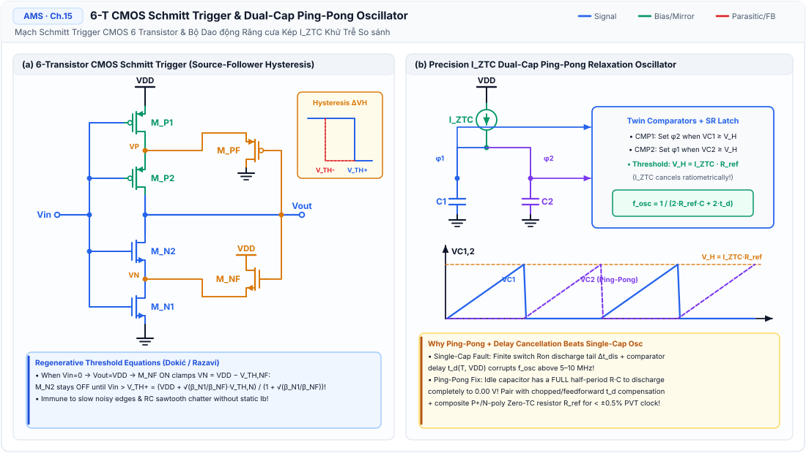

---
{
  "id": "topo-relaxation-rc-sawtooth-and-crystal-oscillators",
  "kind": "topology",
  "domain": "ams-filters-and-system",
  "title_vi": "Bộ Dao động Tích thoát RC Răng cưa (Sawtooth PWM Ramp) Khử Trễ Bộ So sánh và Dao động Thạch anh Pierce (Relaxation RC & Pierce Crystal Oscillators)",
  "title_en": "Precision CMOS RC Relaxation / Sawtooth PWM Ramp Oscillators with Delay Cancellation and Pierce Crystal Oscillators",
  "summary": "Thiết kế trọn vẹn hai nguồn tạo nhịp nền tảng của vi mạch PMIC, cảm biến và SoC: (1) Bộ dao động tích thoát RC và tạo sườn răng cưa PWM f_osc = I_ZTC / (C * Delta_V_H) đồng bộ dòng không đổi nhiệt I_ZTC với điện trở ghép bù TCR bằng không, giải quyết tận gốc sai số trôi tần số do trễ truyền bộ so sánh t_d bằng kiến trúc hai tụ luân phiên (Dual-Cap Ping-Pong) và bù ngưỡng động; (2) Bộ dao động tinh thể thạch anh Pierce (mô hình Butterworth-Van Dyke, hỗ dẫn tới hạn g_m,crit, điện trở âm -R_neg >= 3..5 ESR và kéo tần số bằng tụ tải C_L).",
  "diagram": "../../diagrams/schmitt-and-rc-sawtooth-osc.svg",
  "razavi_refs": [
    {
      "chapter": 12,
      "section": "12.4-12.5",
      "pages": "523-525",
      "equations": ["12.51", "12.52", "12.54"]
    },
    {
      "chapter": 15,
      "section": "15.1-15.3.4",
      "pages": "607-630",
      "equations": ["15.1", "15.2", "15.19", "15.26"]
    },
    {
      "chapter": 18,
      "section": "18.7.2",
      "pages": "721-727",
      "equations": ["18.1", "18.2"]
    },
    {
      "chapter": 19,
      "section": "19.2.6",
      "pages": "746-753",
      "equations": ["19.10", "19.12"]
    }
  ],
  "github_refs": [
    {
      "repo": "Arcadia-1/analog-design-bench",
      "url": "https://github.com/Arcadia-1/analog-design-bench/tree/972f7cd7c9",
      "use": "Bài chuẩn kiểm chứng đa góc PVT cho bộ dao động tích thoát công suất thấp 2 MHz (sky130-low-power-oscillator-2mhz-pvt), đối chiếu trực tiếp với IP silicon RTimothyEdwards/sky130_ef_ip__rc_osc_500k (343f4481b2)"
    },
    {
      "repo": "westonb/open-pmic",
      "url": "https://github.com/westonb/open-pmic/tree/2ec3130e71",
      "use": "Kiến trúc khối tạo xung nhịp kiêm sườn dốc răng cưa bù độ dốc (oscillator + slope compensation ramp) trong bộ biến đổi nguồn chuyển mạch Buck"
    },
    {
      "repo": "RTimothyEdwards/sky130_ef_ip__biasgen",
      "url": "https://github.com/RTimothyEdwards/sky130_ef_ip__biasgen/tree/9d1ceb5dbf",
      "use": "Tạo dòng phân cực chuẩn ổn định nhiệt kết hợp khối dao động tích thoát RC 500 kHz có chân điều khiển tắt mở (sky130_ef_ip__rc_osc_500k)"
    },
    {
      "repo": "iic-jku/analog-circuit-design",
      "url": "https://github.com/iic-jku/analog-circuit-design/tree/6075ea0ebcf08f5c7f6033a84e9dd3c91450f5e1",
      "use": "Phân tích trở kháng âm một cửa, điều kiện khởi động dao động và đánh giá nhiễu pha / jitter của mạch tạo nhịp tương tự"
    }
  ],
  "glossary_codes": [
    "T069",
    "T476",
    "T620",
    "T951",
    "T1004",
    "T1009",
    "T1184",
    "T2147",
    "T2160",
    "T2161",
    "T2164",
    "T2169",
    "T2185",
    "T2186",
    "T2187"
  ],
  "process_agnostic": true,
  "roles": {
    "ztc_charging_current_source": "Nguồn dòng chuẩn bù nhiệt độ bậc nhất I_ZTC = V_REF / R_ZTC (kết hợp điện trở ghép nối tiếp TCR dương và TCR âm) nạp tuyến tính tụ định thời C để tạo sườn dốc hằng định dV/dt.",
    "ratiometric_threshold_reference": "Mạng phân áp tỷ số từ cùng điện áp V_REF tạo ngưỡng cao V_H = k * V_REF (và V_L), giúp triệt tiêu hoàn toàn độ biến thiên của V_REF khỏi phương trình tần số f_osc = 1 / (k * R_ZTC * C).",
    "ping_pong_dual_capacitor_core": "Hai nhánh tụ định thời C_A, C_B hoạt động luân phiên nạp-xả điều khiển bởi chốt SR: trong khi C_A đang nạp tạo chu kỳ hiện tại thì C_B đã xả sạch chờ sẵn ở 0 V, xóa bỏ hoàn toàn thời gian chết xả tụ t_rst.",
    "comparator_delay_cancellation_loop": "Mạch băm đảo công tắc tham chiếu hoặc hạ ngưỡng bù động tỷ lệ với trễ bộ so sánh t_d, ngăn lượng trôi t_d(PVT) cộng dồn vào chu kỳ dao động ở tần số MHz.",
    "pierce_inverter_crystal_core": "Tầng khuếch đại đảo CMOS (hỗ dẫn g_m) phân cực tự động ở vùng tuyến tính qua điện trở lớn R_F, kết hợp hai tụ nối đất C_1, C_2 biến đổi pha 180 độ thành điện trở âm -R_neg nuôi tinh thể thạch anh."
  },
  "symptoms_addressed": [
    "ring-oscillator-50-percent-frequency-drift-over-supply-and-temperature",
    "pmic-pwm-modulator-needing-synchronized-clock-and-linear-sawtooth-ramp",
    "comparator-propagation-delay-causing-rc-oscillator-temperature-and-vdd-error",
    "crystal-oscillator-startup-failure-at-ss-corner-or-overdrive-gm-collapse"
  ],
  "limitations": [
    "on-chip-rc-product-requires-trim-bits-for-better-than-1-percent-accuracy",
    "relaxation-oscillator-phase-noise-is-inferior-to-lc-and-crystal-oscillators",
    "pierce-crystal-requires-off-chip-quartz-package-and-hundreds-of-microseconds-startup"
  ],
  "checklists": [
    "common-mos",
    "oscillator-and-pll",
    "bandgap-and-bias",
    "spectre-pss-pnoise",
    "continuous-time-filters",
    "layout-and-matching"
  ]
}
---

## 1. Bản chất Nguyên lý, Sơ đồ Mạch & Vai trò Từng Nhánh Cấu trúc

Trong Chương 15 sách Razavi (`topo-ring-oscillator` và `topo-lc-cross-coupled-and-colpitts`), người đọc làm quen với hai thái cực của mạch dao động (`T951`): **dao động vòng (Ring Oscillator — `T2161`)** cực gọn nhưng tần số $f_{\text{ring}} = \frac{1}{2 N t_d}$ trôi dạt tới $\pm 35\%\text{--}50\%$ theo $V_{DD}$ và nhiệt độ, trong khi **dao động cộng hưởng LC (`LC Tank`)** chiếm diện tích cuộn cảm khổng lồ và chỉ khả thi ở dải tần số GHz. Thế nhưng trong hơn $90\%$ vi mạch thực tế ngoài đời — từ chip quản lý nguồn PMIC (Buck/Boost/Charge-Pump chạy ở $500\text{ kHz} \text{--} 5\text{ MHz}$), vi điều khiển cảm biến không dùng thạch anh ngoài (`crystal-less IoT/AFE`) cho tới đồng hồ thời gian thực `RTC 32.768 kHz` và nguồn tham chiếu cho PLL — toàn bộ nhịp tim hệ thống lại dựa trên hai kiến trúc hoàn toàn khác mà Chương 15 chưa đi sâu: **Bộ dao động tích thoát RC / Răng cưa (`RC Relaxation & Sawtooth Ramp Oscillator`)** và **Bộ dao động tinh thể thạch anh Pierce (`Pierce Crystal Oscillator — XO`)**.



### 1.1. Hai Kiến trúc Bộ Dao động Tích thoát RC & Tạo Sườn Răng cưa PWM
1. **Kiến trúc 1 Tụ Nạp Tuyến tính – Xả Nhanh (Single-Cap Sawtooth PWM Ramp Generator — Chuẩn mực trong PMIC):**
   - Một nguồn dòng chuẩn cascode $I_{\text{ZTC}}$ nạp thẳng vào tụ định thời $C$ (bản đáy nối `GND`), tạo ra **đường dốc điện áp răng cưa tăng tuyến tính hoàn hảo theo thời gian**: $V_{\text{ramp}}(t) = V_L + \frac{I_{\text{ZTC}}}{C} t$.
   - Khi $V_{\text{ramp}}(t)$ cắt qua ngưỡng trên $V_H$ tại đầu vào bộ so sánh tốc độ cao, chốt một xung đơn ổn (`one-shot` hoặc chốt SR hai ngưỡng $V_H, V_L$ như trong `westonb/open-pmic`) bật công tắc NMOS kéo mạnh $M_{\text{rst}}$ phóng điện tụ $C$ quay trở về đáy $V_L$.
   - **Giá trị kép vô giá cho PMIC**: Mạch xuất đồng thời **xung nhịp vuông hẹp `CLK`** (kích mở chu kỳ chuyển mạch và làm xung xóa vòng điều khiển) VÀ **sóng răng cưa tuyến tính `V_RAMP`** (đưa thẳng vào bộ điều biến độ rộng xung PWM hoặc cộng bù độ dốc `Slope Compensation` chống dao động dưới hài ở $D > 0.5$!).
2. **Kiến trúc Hai Tụ Luân Phiên "Bóng bàn" (Dual-Capacitor Ping-Pong Relaxation Oscillator — Chuẩn chính xác cao cho Xung nhịp Hệ thống):**
   - Gồm hai nhánh đối xứng hoàn toàn: nguồn dòng gương $I_A = I_B = I_{\text{ZTC}}$ nạp hai tụ đồng dạng $C_A = C_B = C$, hai bộ so sánh cùng nối ngưỡng chuẩn $V_{\text{REF}}$ lái trực tiếp hai ngõ vào `S` và `R` của một chốt `SR Latch` (`Q` và `QB`).
   - Khi `Q = 1, QB = 0`: công tắc xả $M_{\text{rst},A}$ mở ra để $I_A$ nạp tuyến tính $C_A$ từ $0\text{ V}$ lên $V_{\text{REF}}$, **cùng lúc đó** `Q = 1` đóng chặt công tắc $M_{\text{rst},B}$ giữ $C_B$ nằm xả sạch tuyệt đối ở $0\text{ V}$ suốt cả nửa chu kỳ! Ngay khi $V_{CA}$ chạm $V_{\text{REF}}$ lật `SR Latch` sang `Q = 0, QB = 1`, vai trò lập tức đổi chiều: $C_B$ bắt đầu nạp ngay tức khắc từ đúng $0.000\text{ V}$ mà **không tốn một picogiây thời gian chết xả tụ ($t_{\text{rst}} \equiv 0$)**, đồng thời ngõ ra `Q` tự động có **chu kỳ nhiệm vụ vuông cân đối $50.0\%$** (như hiện thực trong IP silicon `RTimothyEdwards/sky130_ef_ip__rc_osc_500k`)!

### 1.2. Kiến trúc Bộ Dao động Tinh thể Thạch anh Pierce (`Pierce Crystal Oscillator`)
Khi hệ thống đòi hỏi độ chính xác tần số cấp phần triệu ($\pm 10\text{--}50\text{ ppm}$ cho giao thức USB/BLE/Ethernet hoặc đồng hồ thời gian thực), không bất kỳ cặp $R \cdot C$ trên chip nào đạt nổi vì biến thiên cơ học và lão hóa; ta bắt buộc kết nối ra ngoài chip tới một **tinh thể áp điện thạch anh (`Crystal` — `T476`)**. Cấu trúc **Pierce** thắng thế tuyệt đối trên CMOS vì chỉ cần **2 chân pin** (không cần cuộn cảm tách sóng hay biến áp trung tâm) với hai tụ tải $C_1, C_2$ nối thẳng xuống đất trên chip: một cổng đảo CMOS (hoặc NMOS đơn cực nguồn nối đất nuôi bằng nguồn dòng PMOS siêu nhỏ) đóng vai trò phần tử hỗ dẫn tích cực $-g_m$, được tự phân cực DC tại điểm giữa đặc tuyến $V_G = V_D$ nhờ điện trở hồi tiếp giá trị cực lớn $R_F \sim 5\text{--}50\text{ M}\Omega$ (hoặc transistor MOS phân cực yếu giả điện trở).

---

## 2. Hệ Phương trình Cốt lõi & Tư duy "Nhìn Mạch Đọc Nhanh" (Analysis by Inspection)

### 2.1. Định luật Khử Tham chiếu Tỷ số (Ratiometric $V_{\text{REF}}$ Cancellation) & Ghép Điện trở Zero-TCR
Trong bộ dao động tích thoát RC, giả sử cả dòng nạp $I_{\text{ZTC}}$ lẫn biên độ cửa sổ ngưỡng $\Delta V_H = V_H - V_L$ đều được sinh ra từ **cùng một điện áp chuẩn $V_{\text{REF}}$** (không nhất thiết phải là Bandgap phức tạp — thậm chí có thể là một điện áp tự phân cực bất kỳ miễn là băng thông đáp ứng nguồn đủ nhanh!):
$$
I_{\text{ZTC}} = \frac{V_{\text{REF}}}{R_{\text{ZTC}}}, \qquad \Delta V_H = k \cdot V_{\text{REF}}
\implies T_{\text{phase}} = \frac{C \cdot \Delta V_H}{I_{\text{ZTC}}} = k \cdot R_{\text{ZTC}} \cdot C \quad \text{(thời gian nạp 1 pha)}
$$
Suy ra tần số dao động lý tưởng khi bỏ qua độ trễ ($t_d = 0$, phân biệt rõ kiến trúc 1 tụ răng cưa vs Ping-Pong 2 pha có chu kỳ đầu ra $T_{0,\text{PP}} = 2 T_{\text{phase}}$):
$$
f_{\text{osc},0,\text{1-cap}} = \frac{1}{T_{\text{phase}}} = \frac{1}{k \cdot R_{\text{ZTC}} \cdot C}, \qquad
f_{\text{osc},0,\text{PP}} = \frac{1}{2\,T_{\text{phase}}} = \frac{1}{2\,k \cdot R_{\text{ZTC}} \cdot C}
$$
**Hai hệ quả vật lý vàng**:
1. **Triệt tiêu $100\%$ giá trị $V_{\text{REF}}$ ở tần số thấp**: Dù $V_{\text{REF}}$ có lệch $\pm 10\%$ giữa các lô chip hay trôi theo nhiệt độ, dòng nạp $I_{\text{ZTC}}$ và đích đến $\Delta V_H$ cùng co giãn tỷ lệ thuận như nhau nên thời gian chạm đích $T_0$ đứng yên bất biến!
2. **Tổng hợp Điện trở Ghép Hệ số Nhiệt Bằng Không (`Zero-TCR Composite Resistor` — Razavi §18.7.2 & §19.2.6)**: Vì tụ kim loại MIM/MOM có hệ số nhiệt cực nhỏ ($\text{TCC} \approx +15\text{--}30\text{ ppm/}^\circ\text{C}$), toàn bộ độ trôi nhiệt của $T_0$ nằm ở điện trở $R_{\text{ZTC}}$. Trên hầu hết các PDK CMOS công nghiệp (180nm/90nm/65nm), ta có sẵn hai loại điện trở poly không silicide có **hệ số nhiệt bậc nhất ngược dấu nhau**: chẳng hạn P+ poly có $\alpha_{R1} > 0$ (ví dụ $+180\text{ ppm/}^\circ\text{C}$) hoặc N-well/diff dương ghép nối tiếp với điện trở High-R poly pha tạp cao có $\alpha_{R2} < 0$ (ví dụ $-450\text{ ppm/}^\circ\text{C}$). Mắc nối tiếp $R_{\text{ZTC}}(T) = R_1(T_0)[1 + \alpha_{R1}\Delta T] + R_2(T_0)[1 + \alpha_{R2}\Delta T]$, điều kiện đạo hàm bậc nhất $\frac{d(R_{\text{ZTC}} C)}{dT} = 0$ cho tỷ lệ chia điện trở chuẩn xác:
$$
\frac{R_1(T_0)}{R_1(T_0) + R_2(T_0)} = \frac{-\alpha_{R2} - \text{TCC}}{\alpha_{R1} - \alpha_{R2}}
$$
Chỉ với phép nối tiếp thụ động này cộng một mảng tụ tinh chỉnh nhị phân 5–6 bit tại một điểm nhiệt độ phòng (`one-point room-temp trim`), hằng số thời gian $R_{\text{ZTC}} C$ đạt độ ổn định $< \pm 0.3\%\text{--}0.8\%$ từ $-40\,^\circ\text{C}$ tới $+125\,^\circ\text{C}$!

### 2.2. Bài toán Tử huyệt: Sai số Trôi Tần số Do Trễ Truyền Bộ So sánh $t_d$ & Các Kiến trúc Khử $t_d$
Trên thực tế, ngay thời điểm $V_C(t)$ chạm ngưỡng $V_H$, bộ so sánh và chốt logic không lật tức thì mà cần một khoảng **thời gian trễ lan truyền $t_d(V_{DD}, T)$** (cỡ $5\text{--}50\text{ ns}$ đối với bộ so sánh công suất thấp vài $\mu\text{A}$!). Trong suốt khoảng trễ $t_d$ này, nguồn dòng $I_{\text{ZTC}}$ vẫn tiếp tục nạp làm $V_C$ **vọt lố lên thêm $\Delta V_{\text{ov}} = \frac{I_{\text{ZTC}}}{C} t_d$**!
- Trong mạch Ping-Pong hai pha (chu kỳ lý tưởng $T_{0,\text{PP}} = 2 k R_{\text{ZTC}} C = 1/f_{\text{osc},0,\text{PP}}$, mỗi nửa chu kỳ chịu một lần trễ $t_d + t_{\text{latch}}$):
$$
T_{\text{actual}} = 2\left(k R_{\text{ZTC}} C + t_d\right) = T_{0,\text{PP}} + 2 t_d \implies f_{\text{actual}} = \frac{f_{\text{osc},0,\text{PP}}}{1 + 2 f_{\text{osc},0,\text{PP}}\, t_d} \approx f_{\text{osc},0,\text{PP}}\left(1 - 2 f_{\text{osc},0,\text{PP}}\, t_d\right)
$$
**Ví dụ cảnh tỉnh**: Thiết kế bộ dao động Ping-Pong $f_{\text{osc},0,\text{PP}} = 4\text{ MHz}$ ($T_{\text{phase}} = T_{0,\text{PP}}/2 = 125\text{ ns}$) dùng bộ so sánh công suất nhỏ có $t_d = 18\text{ ns}$ ở $27\,^\circ\text{C}$ ($f_{\text{actual}} = 3.50\text{ MHz}$) nhưng tăng lên $t_d = 31\text{ ns}$ ở $125\,^\circ\text{C}, V_{DD,\min}$ ($f_{\text{actual}} = 3.21\text{ MHz}$): riêng sự trôi của $t_d$ làm tần số sụt mất **$-8.33\%$**, phá nát hoàn toàn công sức bù nhiệt Zero-TCR của điện trở!
- **Ba Kỹ thuật Khử Trễ $t_d$ Thực chiến**:
  1. **Tích phân Trung bình Khóa Tụ Chuyển mạch (`Switched-Capacitor Averaging Loop` — Tokunaga / Paidimarri)**: Bỏ hẳn bộ so sánh ngưỡng tức thời; dùng chính xung nhịp đầu ra $f_{\text{osc}}$ đóng ngắt tụ $C_{\text{sw}}$ tạo điện trở tương đương $R_{\text{eq}} = \frac{1}{C_{\text{sw}} f_{\text{osc}}}$, so sánh áp rơi trên $R_{\text{eq}}$ với áp rơi trên $R_{\text{ZTC}}$ qua một bộ tích phân OTA chậm có băm Chopper để điều khiển VCO vòng! Khi khóa xác lập, $f_{\text{osc}} = \frac{1}{R_{\text{ZTC}} C_{\text{sw}}}$ miễn nhiễm $100\%$ với trễ bộ so sánh lẫn offset!
  2. **Hạ Ngưỡng Động Bù Trước (`Feedforward Threshold Lowering`, $\Delta V_{\text{comp}} = -I_{\text{ZTC}} R_{\text{rep}}$)**: Chèn một điện trở nhỏ $R_{\text{lead}}$ nối tiếp với tụ định thời $C$! Điện áp đưa vào bộ so sánh lúc đang nạp là $V_{\text{sense}}(t) = V_C(t) + I_{\text{ZTC}} R_{\text{lead}}$, giúp bộ so sánh **nhìn thấy ngưỡng sớm hơn một khoảng thời gian đúng bằng $\tau_{\text{lead}} = R_{\text{lead}} C$**! Nếu chọn $R_{\text{lead}} C \approx t_d$ (với $R_{\text{lead}}$ làm bằng transistor triode phân cực theo cùng hằng số trễ của bộ so sánh!), điểm cắt thực tế trên tụ $V_C$ hạ cánh trúng phóc $V_H$ tại cuối khoảng $t_d$, khử bậc nhất sai số $t_d$!
  3. **Băm Đảo Ngưỡng (`Chopper-Stabilized Ping-Pong Comparator`)**: Tráo đổi đầu vào của một bộ so sánh duy nhất giữa hai nhánh $C_A, C_B$ mỗi nửa chu kỳ để bất kỳ điện áp lệch tĩnh $V_{OS}$ nào của bộ so sánh cộng thêm $+\Delta T$ ở nửa chu kỳ chẵn sẽ tự trừ đi $-\Delta T$ ở nửa chu kỳ lẻ, chỉ còn sai số bậc hai tỷ lệ $(V_{OS}/V_{\text{REF}})^2$!

### 2.3. Mô hình Butterworth–Van Dyke (BVD) & Hỗ dẫn Tới hạn $g_{m,\text{crit}}$ của Dao động Thạch anh Pierce
Tinh thể thạch anh được mô hình hóa chính xác quanh mode cơ bản bởi nhánh cơ học nối tiếp (**cảm kháng động $L_m$ khổng lồ hàng Henry**, **điện dung động $C_m$ cực nhỏ cỡ $1\text{--}20\text{ fF}$**, và **điện trở tổn hao nối tiếp $R_m = \text{ESR}$**) mắc song song với điện dung vỏ–điện cực tĩnh $C_0 \approx 1\text{--}5\text{ pF}$. Tần số cộng hưởng nối tiếp $\omega_s = \frac{1}{\sqrt{L_m C_m}}$ cách tần số cộng hưởng song song $\omega_p = \omega_s\sqrt{1 + \frac{C_m}{C_0}}$ một khe rất hẹp.

Tách riêng mạng 3 phần tử không tổn hao gồm bộ hỗ dẫn đảo $-g_m$ (cổng đảo CMOS) nối với hai tụ chân đất $C_1, C_2$ và tụ vỏ $C_0$ nằm ngang giữa cổng–máng (theo phương pháp phân tích trở kháng một cửa kinh điển của Vittoz, `negative-resistance oscillator` — `T2164`): trở kháng tương đương $Z_c(j\omega) = R_{\text{neg}}(\omega) + j X_c(\omega)$ nhìn từ hai đầu nhánh cơ học $(L_m, C_m, \text{ESR})$ ra mạch CMOS là:
$$
R_{\text{neg}}(\omega) = \frac{-g_m C_1 C_2}{\omega^2 \left(C_1 C_2 + C_0 C_1 + C_0 C_2\right)^2 + g_m^2 C_0^2}, \qquad
C_{L,\text{eff}}(\omega) \approx \frac{C_1 C_2}{C_1 + C_2} + C_0 \quad (\text{khi } g_m \text{ vừa phải})
$$
Từ biểu thức $R_{\text{neg}}(\omega)$ rút ra **3 định luật sống còn của thiết kế Pierce XO**:
1. **Hỗ dẫn Khởi động Tối thiểu ($g_{m,\text{crit}}$)**: Ở vùng dòng phân cực nhỏ ($g_m C_0 \ll \omega(C_1 C_2 + C_0(C_1+C_2))$), để bù đắp tổn hao tinh thể $|-R_{\text{neg}}| > \text{ESR}$, hỗ dẫn của cổng đảo phải vượt qua ngưỡng tới hạn (thường chọn $C_1 = C_2 = C_g$, đặt $C_L = C_g/2$):
$$
g_{m,\text{crit}} \approx \omega_s^2 \, \text{ESR} \, \frac{\left(C_1 C_2 + C_0 C_1 + C_0 C_2\right)^2}{C_1 C_2} = 4\,\omega_s^2 \, \text{ESR} \, \left(C_L + C_0\right)^2 \quad (\text{khi } C_1 = C_2 = 2 C_L)
$$
2. **Bẫy Quá Hỗ dẫn ($g_m$ Quá Lớn Cũng Tắt Dao động!) & Điểm Cực đại Điện trở Âm $g_{m,\text{opt}}$**: Nhìn vào mẫu số của $R_{\text{neg}}(\omega)$: khi tăng $g_m \to \infty$, số hạng $g_m^2 C_0^2$ ở mẫu số tăng bậc hai thắng tử số bậc nhất khiến **$|-R_{\text{neg}}| \to 0$** (vì cổng đảo quá mạnh nối tắt xoay chiều qua $C_0$)! Đạo hàm $\frac{\partial |R_{\text{neg}}|}{\partial g_m} = 0$ xác định điểm tối ưu vàng và giá trị âm trở cực đại tuyệt đối mà mạch có thể sinh ra:
$$
g_{m,\text{opt}} = \omega_s \left(C_1 + C_2 + \frac{C_1 C_2}{C_0}\right), \qquad
\left|-R_{\text{neg}}\right|_{\max} = \frac{C_1 C_2}{2\,\omega_s C_0 \left(C_1 C_2 + C_0 C_1 + C_0 C_2\right)} = \frac{1}{2\,\omega_s C_0 \left(1 + C_0 / C_L\right)}
$$
Quy tắc ký duyệt công nghiệp bắt buộc: tại mọi góc PVT, chọn điểm làm việc sao cho **$\left|-R_{\text{neg}}\right| \ge (3 \dots 5) \cdot \text{ESR}_{\max}$** (tương đương $g_m \approx (3\dots 5)\,g_{m,\text{crit}}$ nhưng tuyệt đối nhỏ hơn $g_{m,\text{opt}}$!).
3. **Phương trình Kéo Tần số Bằng Mảng Tụ Tải (`Load Capacitance Frequency Pulling`)**: Tinh thể dao động ở tần số làm nhánh cơ học có cảm kháng bù đúng dung kháng $C_0 + C_L$:
$$
f_{\text{osc}} = f_s \left(1 + \frac{C_m}{2\left(C_0 + C_L\right)}\right), \qquad C_L = \frac{C_1 C_2}{C_1 + C_2} + C_{\text{pad+pkg}}
$$
Nhờ đặt mảng tụ biến đổi số 5–7 bit song song $C_1, C_2$ trên chip, ta tinh chỉnh chính xác tần số sóng mang trong dải $\pm 50\text{--}150\text{ ppm}$ mà không cần bất kỳ tụ gốm rời nào trên bo mạch PCB!

### 2.4. Ví dụ Định cỡ Số học Thực tế (Pierce XO 32.768 kHz vs 24 MHz trên 65nm CMOS)
- **Thạch anh 24 MHz RF**: $\omega_s = 1.508 \times 10^8\text{ rad/s}$, $\text{ESR}_{\max} = 50\,\Omega$, $C_0 = 2\text{ pF}$, yêu cầu $C_L = 8\text{ pF}$ ($C_1 = C_2 = 16\text{ pF}$).
  - Tính $g_{m,\text{crit}} = 4 \times (1.508\times 10^8)^2 \times 50 \times (10\text{ pF})^2 = 0.455\text{ mS}$; kiểm tra $\left|-R_{\text{neg}}\right|_{\max} = \frac{1}{2 \times 1.508\times 10^8 \times 2\text{p} \times 1.25} = 1326\,\Omega \gg 5\,\text{ESR} = 250\,\Omega$ (dư địa dồi dào!). Chọn $g_m = 4\,g_{m,\text{crit}} \approx 1.85\text{ mS}$; ở vùng dưới ngưỡng/nghịch đảo vừa $g_m/I_D = 18\text{ V}^{-1}$, dòng tĩnh lõi chỉ tốn **$I_D \approx 103\,\mu\text{A}$** (hoặc $\sim 55\,\mu\text{A}$ nếu dùng cổng đảo CMOS tái sử dụng dòng $g_{m,\text{tot}} = g_{mN} + g_{mP}$)!
- **Thạch anh Âm thoa 32.768 kHz RTC**: $\omega_s = 2.059 \times 10^5\text{ rad/s}$, $\text{ESR}_{\max} = 70\text{ k}\Omega$, $C_0 = 1.2\text{ pF}$, $C_L = 6\text{ pF}$.
  - Tính $g_{m,\text{crit}} = 4 \times (2.059\times 10^5)^2 \times 70\times 10^3 \times (7.2\text{ pF})^2 = 0.615\,\mu\text{S}$! Đặt $g_m = 2.5\,\mu\text{S}$ ở vùng dưới ngưỡng sâu ($g_m/I_D = 25\text{ V}^{-1}$) chỉ tiêu tốn đúng **$100\text{ nA}$** dòng pin!

---

## 3. Bất biến Cấu trúc & Các Bẫy Lỗi Kinh điển (Structural Invariants & Traps)

- **[INV-01] Bất biến Cân bằng Khởi động Có Điều khiển Của Chốt Ping-Pong (`Deterministic Startup Break`)**: Trong bộ dao động tích thoát hai tụ luân phiên `Ping-Pong`, nếu lúc mới bật nguồn cả hai tụ $C_A, C_B$ cùng tăng vượt ngưỡng $V_{\text{REF}}$ đồng thời làm cả hai bộ so sánh cùng xuất `S = 1, R = 1` vào chốt `SR NOR Latch`, cả hai ngõ ra `Q = QB = 0` sẽ nhả cả hai công tắc xả khiến cả $C_A$ lẫn $C_B$ kẹt cứng trên $V_{DD}$ và **mạch chết đứng vĩnh viễn**! Bắt buộc dùng chốt ưu tiên đặt lại khi khởi động (`ena_b` ép `Q = 1, QB = 0` nạp sẵn trạng thái ban đầu bất đối xứng: $C_A = 0\text{ V}$, $C_B$ đang xả) và khóa chéo ngăn `S = R = 1`.
- **[INV-02] Bất biến Điện trở Phân cực $R_F \gg \frac{1}{\omega_s C_0}$ Trong Mạch Pierce XO**: Điện trở hồi tiếp DC $R_F$ nối giữa cổng và máng của bộ khuếch đại Pierce bắt buộc lớn hơn nhiều dung kháng của $C_0$ tại tần số dao động ($R_F \ge 10 / (\omega_s C_0)$): ở $24\text{ MHz}$ chỉ cần $R_F \ge 50\text{ k}\Omega$, nhưng ở **$32.768\text{ kHz}$** dung kháng $1/(\omega_s C_0) \approx 4\text{ M}\Omega$ đòi hỏi **$R_F \ge 40\text{--}100\text{ M}\Omega$** (bắt buộc thực hiện bằng transistor MOS phân cực tắt/giả điện trở chứ không thể dùng poly thường!). Nếu chọn nhầm $R_F = 1\text{ M}\Omega$ cho thạch anh $32\text{ kHz}$, chính $R_F$ nuốt sạch điện trở âm làm mạch không bao giờ khởi động!
- **[INV-03] Bất biến Giới hạn Công suất Kích thích Tinh thể (`Drive Level Control / AGC`)**: Tinh thể âm thoa $32.768\text{ kHz}$ vỡ cơ học hoặc già hóa tần số rất nhanh nếu công suất tiêu tán cơ học $P_{\text{drive}} = \frac{1}{2} I_{\text{xtal,pk}}^2 \cdot \text{ESR}$ vượt quá $0.5\text{--}1.0\,\mu\text{W}$! Phải có vòng điều khiển biên độ tự động (`AGC`) hạ dòng phân cực lõi ngay sau khi biên độ đỉnh đạt $200\text{--}400\text{ mV}_{\text{pp}}$ thay vì để cổng đảo vỗ biên rail-to-rail.
- **[TRAP-01] Bẫy Chạy Mô phỏng Quá độ `.tran` Thạch anh $Q = 50{,}000$ Theo Cách Ngây thơ**: Hằng số thời gian tăng trưởng biên độ của tinh thể thạch anh là $\tau_{\text{start}} = \frac{2 L_m}{|-R_{\text{neg}}| - \text{ESR}} \sim 0.5\text{--}5\text{ ms}$ (tức hàng chục nghìn chu kỳ sóng mang!). Nếu chạy `.tran` mặc định với thuật toán tích phân `gear2only`, suy hao số (`numerical damping`) của bộ giải sẽ bóp chết dao động ngay từ trong trứng nước; còn chạy `traponly` hàng chục nghìn chu kỳ thì mất hàng giờ! **Giải pháp chuẩn trên Spectre 15.1**: (1) Thiết kế và ký duyệt điều kiện khởi động nhanh trong **0.2 giây** bằng phép đo AC một cửa tìm trực tiếp $\text{Re}\{Z_c(j\omega_s)\} = R_{\text{neg}}$ qua 45 góc PVT; (2) Khi cần kiểm tra biên độ xác lập và nhiễu pha, nạp dòng khởi tạo đầu `ic` nhỏ vào cuộn cảm động $I(L_m, t=0) = I_{\text{init}}$ (hoặc hạ tạm $L_m \to L_m/100, C_m \to 100\,C_m$ giữ nguyên $\omega_s$ và $\text{ESR}$ để test vòng `AGC` nhanh gấp $100\times$!).
- **[TRAP-02] Nhiễu Nhấp nháy $1/f$ Của Nguồn Dòng $I_{\text{ZTC}}$ Biến Đổi Trực tiếp Thành Jitter Tích lũy $1/f^3$ Trong Dao động RC**: Mọi biến thiên chậm của dòng nạp $\delta I(t)$ và ngưỡng bộ so sánh $\delta V_{OS}(t)$ đều điều biến thẳng chu kỳ $T_{\text{osc}}$; bắt buộc chọn chiều dài kênh lớn $L \ge 1\text{--}2\,\mu\text{m}$ cho các gương dòng PMOS cấp $I_{\text{ZTC}}$ và dùng cấu trúc băm hoặc đối xứng vi sai cho bộ so sánh ngưỡng.
- **[TRAP-03] Điện dung Tiếp giáp Phi tuyến Của Công tắc Xả $M_{\text{rst}}$ Làm Lệch Tụ Định thời Ở $125\,^\circ\text{C}$**: Công tắc NMOS xả tụ $M_{\text{rst}}$ nối trực tiếp vào đỉnh tụ $C$: nếu chọn $W_{\text{rst}}$ quá khổng lồ, cả điện dung tiếp giáp $C_{DB,\text{rst}}(V)$ lẫn dòng rò tắt $I_{\text{off}}(125\,^\circ\text{C})$ ở góc `FF 125 °C` sẽ hút bớt dòng nạp $I_{\text{ZTC}}$ làm tụt tần số nghiêm trọng ở nhiệt độ cao!

---

## 4. Lộ trình Nâng cấp Cấu trúc & Bát giác Đánh đổi (Upgrade Paths & Design Octagon)

| Trục đánh giá Design Octagon | Ring Oscillator (`topo-ring-oscillator`) | RC Sawtooth / Ping-Pong (Trim + Zero-TCR) | Pierce Crystal Oscillator (XO) |
| :--- | :--- | :--- | :--- |
| Độ chính xác tần số qua PVT | Kém ($\pm 25\%\text{--}50\%$) | Tốt ($\pm 0.5\%\text{--}2.0\%$ hoàn toàn trên chip) | **Tuyệt đối ($\pm 10\text{--}50\text{ ppm}$)** |
| Nhiễu pha tại độ lệch $10\text{ kHz}$ | Kém (`-75..-90 dBc/Hz`) | Trung bình (`-95..-110 dBc/Hz`) | **Siêu sạch (`-135..-155 dBc/Hz`)** |
| Thời gian khởi động (`Startup`) | Tức thời ($< 5\text{ ns}$) | Rất nhanh ($1\text{--}3$ chu kỳ $\sim 1\,\mu\text{s}$) | Rất chậm ($0.3\text{--}5\text{ ms}$ cho MHz; $\sim 0.5\text{ s}$ cho $32\text{ kHz}$) |
| Linh kiện ngoài chip & Chân Pin | $0$ linh kiện ngoài | **$0$ linh kiện ngoài** ($100\%$ CMOS chuẩn) | Cần $1$ thạch anh ngoài + $1\text{--}2$ chân `XI/XO` |
| Dạng sóng tuyến tính phụ trợ | Chỉ có xung vuông/sin méo | **Có sẵn đường dốc răng cưa tuyến tính `V_RAMP`** | Sóng sin tinh khiết biên độ nhỏ |

1. **Từ Ring Oscillator $\to$ RC Ping-Pong + Zero-TCR + Delay Cancellation**: Khi vi mạch không được phép gắn thạch anh ngoài (chip PMIC độc lập, cảm biến cấy ghép, bộ định thời Watchdog, giao tiếp UART/LIN nội bộ) nhưng yêu cầu sai số xung nhịp $< \pm 1\%\text{--}2\%$.
2. **Phối hợp RC Sawtooth với Hệ thống Quản lý Nguồn Chuyển mạch**: Cấp trực tiếp cặp tín hiệu `CLK` + `V_RAMP` từ thẻ này sang khối điều chế PWM và bù độ dốc của `topo-dcdc-ramp-sensefet-dcr-and-zcd-blocks` và `tech-dcdc-cmc-subharmonic-slope-comp-and-cot`, nuôi bằng nhánh dòng `I_ZTC` từ trạm trung tâm `topo-central-bias-hub-powerup-and-sleep-gating`.
3. **Phối hợp Pierce XO làm Tham chiếu Vàng Toàn Chip**: Dùng Pierce XO làm xung chuẩn $f_{\text{REF}}$ khóa tần số cho `topo-charge-pump-type2-pll` và làm thước đo thời gian chuẩn cho động cơ hiệu chuẩn hằng số thời gian bộ lọc trong `topo-gm-c-filters-and-automatic-rc-gmc-tuning`!

---

## 5. Thích ứng Đa Tiến trình (90nm / 65nm / 45nm) & Cách Kiểm chứng trong Cadence / Spectre

Trên tiến trình 65nm/45nm, điện áp nguồn lõi thấp ($1.0\text{ V}$) hạn chế biên độ đường dốc răng cưa xuống $\Delta V_H \approx 0.4\text{--}0.55\text{ V}$ (ví dụ quét từ $V_L = 0.15\text{ V}$ lên $V_H = 0.65\text{ V}$ để nguồn dòng PMOS phía trên vẫn giữ đủ $V_{SD,\text{sat}} \ge 250\text{ mV}$). Với Pierce XO kết nối ra chân I/O ngoài chip, thường đặt cổng đảo Pierce trên miền thiết bị I/O dày oxit (`1.8V / 2.5V IO FET` được cấp từ LDO sạch) hoặc bảo vệ kỹ qua mạng ESD điện dung thấp (`tech-esd-protection-padring-and-package-parasitics`) để điện dung ESD không đội $C_1, C_2$ vượt quá ngân sách kéo tần số.

### Quy trình Kiểm chứng Chuẩn trong Cadence Virtuoso / Spectre 15.1
```
// 1. Kiểm chứng RC Ping-Pong / Sawtooth bằng SpectreRF PSS + PNoise (chế độ jitter)
pss_rc  pss  fund=2M  harms=40  errpreset=conservative  tstab=25u  oscic=lin
pnoise_rc (clk_out 0) pnoise sweeptype=relative relharmnum=1 start=10 stop=1M \
    dec=15 maxsideband=30 noisetype=timedomain

// 2. Đo trực tiếp Điện trở Âm -R_neg(f) và Dung kháng C_L,eff của mạch Pierce XO trong 0.1 giây
// Ngắt nhánh cơ học (Lm, Cm, ESR), giữ nguyên C0, C1, C2, RF và cổng đảo CMOS phân cực tự động:
I_PROBE (xo xi) isource dc=0 mag=1
ac_neg  ac  start=23.9M  stop=24.1M  lin=200
// Trong Calculator/psf_audit: R_neg = real(V(xo, xi))  --> Bắt buộc <= -4 * ESR_max trên mọi góc PVT!
```
- **Bước 1 — Ma trận Quét Nhiệt độ & Nguồn cho RC Oscillator**: Quét góc `(SS, TT, FF) x (-40 °C .. +125 °C, bước 20 °C) x (VDD_nom +- 10%)`; vẽ họ đường cong sai số tần số sau khi chốt mã trim tại `(TT, 27 °C, VDD_nom)` để xác nhận độ uốn bậc hai của cặp điện trở bù TCR và hiệu quả khử trễ $t_d$.
- **Bước 2 — Kiểm chứng Khởi động Tự nhiên & Jitter Chu kỳ (`Period Jitter` $\sigma_{T}$)**: Chạy `.tran` bật chân `ena` từ `0 -> VDD` với `method=traponly`, đo thời gian từ sườn `ena` đến chu kỳ thứ 3 ổn định tần số $< 1\%$ và tích phân phổ `pnoise` ra jitter RMS chu kỳ.
- **Bước 3 — Kiểm toán Biên Âm trở Pierce XO & Công suất Tinh thể**: Xác nhận $\left|\text{Re}\{Z_c(j\omega_s)\}\right| \ge 4\,\text{ESR}_{\max}$ ở góc yếu nhất `SS, 125 °C, VDD_min`, kiểm tra đường cong kéo tần số theo mã giàn tụ `cap_trim<5:0>` và tính công suất tiêu tán thực tế trên điện trở động `R_m` ở xác lập $< P_{\text{drive,max}}$.

---

## 6. Mốc Đối chiếu Sách Razavi & Thuật ngữ Chuẩn CLB

| Mục nội dung & Phương trình | Tham chiếu Razavi (2nd Ed.) & GitHub IP | Mã & Thuật ngữ Chuẩn CLB |
| :--- | :--- | :--- |
| Tiêu chuẩn Barkhausen, khởi động dao động và quan điểm điện trở âm một cửa | Chương 15, §15.1–15.3.4, PT (15.1)–(15.26), tr. 607–630 | `T951` mạch dao động; `T1004` độ dịch pha; `T1184` hồi tiếp dương; `T2160` tiêu chuẩn dao động Barkhausen; `T2161` bộ dao động vòng; `T2164` bộ dao động điện trở âm một cửa |
| Tạo dòng chuẩn theo điện trở, điểm bù nhiệt ZTC và thay thế bằng tụ chuyển mạch | Chương 12, §12.4–12.5, PT (12.51)–(12.54), tr. 523–525 & §17.3.7 | `T069` Biến thiên PVT; `T2147` xung nhịp hai pha không chồng lấp; `T2185` điểm phân cực có hệ số nhiệt bằng không (ZTC); `T2186` các góc quy trình chế tạo; `T2187` hiệu suất hỗ dẫn $g_m/I_D$ |
| Hệ số nhiệt điện trở tích hợp (TCR) và ghép điện trở/tụ trên layout CMOS | Chương 18, §18.7.2, PT (18.1)–(18.2) & Chương 19, §19.2.6, tr. 721–753 | `T476` Tinh thể; `T620` độ lệch; `T1009` nhiễu nhiệt; `T2169` nhiễu pha |
| Sơ đồ khối thực tế RC Osc 500 kHz / 2 MHz & Sawtooth Ramp cho Buck PMIC | `Arcadia-1/analog-design-bench`, `westonb/open-pmic`, `sky130_ef_ip__rc_osc_500k` | Thiết kế dao động tích thoát có chân kích hoạt `ena` và sườn bù độ dốc PWM |
