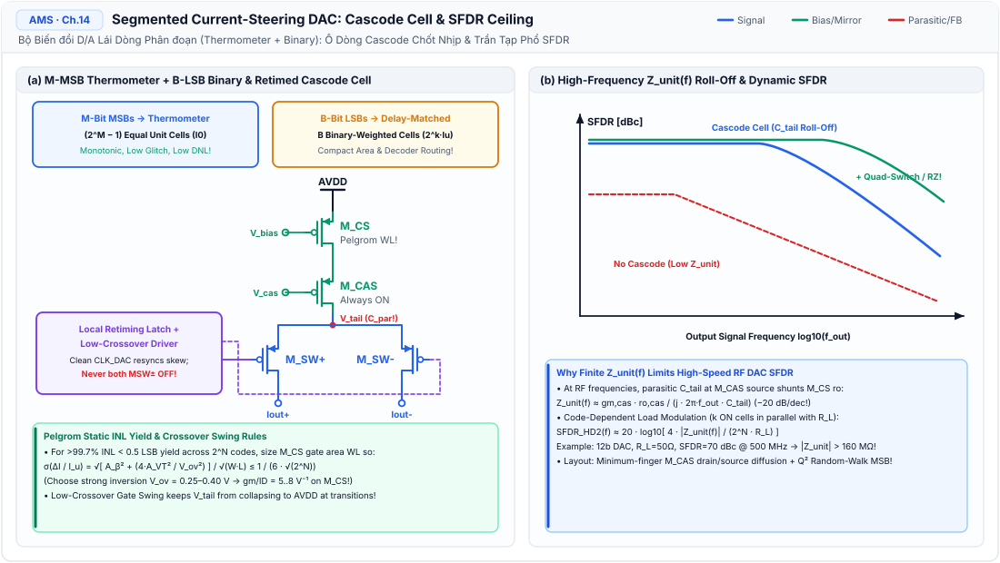

---
{
  "id": "topo-resistor-string-r2r-and-current-steering-dacs",
  "kind": "topology",
  "domain": "ams-filters-and-system",
  "title_vi": "Tổng hợp Bộ Chuyển đổi Số–Tương tự CMOS: Thang Điện trở Kelvin, Mạng R-2R và DAC Lái Dòng Phân đoạn Tốc độ Cao (Segmented Current-Steering DAC)",
  "title_en": "CMOS Digital-to-Analog Converters: Monotonic Kelvin Resistor-String, R-2R Ladder, and High-Speed Segmented Current-Steering DAC",
  "summary": "Hệ thống hóa trọn vẹn ba họ kiến trúc DAC CMOS công nghiệp: (1) Thang điện trở chia áp Kelvin đơn điệu tuyệt đối (giải mã cây nhị phân vs ma trận 2D X-Y giảm số công tắc mũ hai), (2) Mạng thang R-2R chế độ áp/dòng kèm bất biến nhân nhị phân bề rộng công tắc W_k cân bằng áp rơi, và (3) DAC lái dòng phân đoạn Nhị phân + Nhiệt kế tốc độ GHz — dẫn xuất định cỡ diện tích nguồn dòng Pelgrom cho hiệu suất >99.7% INL < 0.5 LSB, suy giảm trở kháng ra Z_unit(f) quyết định trần SFDR và chốt đồng bộ lại xung nhịp giao cắt lệch khử gai nhiễu chuyển mã (mid-scale glitch impulse).",
  "diagram": "../../diagrams/current-steering-segmented-dac.svg",
  "razavi_refs": [
    {
      "chapter": 5,
      "section": "5.2",
      "pages": "139-146",
      "equations": ["5.15", "5.18"]
    },
    {
      "chapter": 13,
      "section": "13.1-13.2.3",
      "pages": "539-553",
      "equations": ["13.2", "13.18", "13.25"]
    },
    {
      "chapter": 14,
      "section": "14.1-14.2.1",
      "pages": "576-598",
      "equations": ["14.75", "14.87"]
    },
    {
      "chapter": 19,
      "section": "19.2.2, 19.2.6",
      "pages": "739-743, 746-753",
      "equations": ["19.10"]
    }
  ],
  "github_refs": [
    {
      "repo": "iic-jku/iic-audiodac-v1",
      "url": "https://github.com/iic-jku/iic-audiodac-v1/tree/66ddda4d1ca46a3cccc34f606f75adea44b595f0",
      "use": "Kiến trúc DAC silicon-proven mã nguồn mở của JKU Linz minh họa phân chia miền số–tương tự, tầng xuất dòng/áp vi sai và quy trình đồng mô phỏng mixed-signal"
    },
    {
      "repo": "Arcadia-1/analog-design-bench",
      "url": "https://github.com/Arcadia-1/analog-design-bench/tree/972f7cd7c95381134387b250edf18f3bd23bdd25",
      "use": "Cấu trúc bài đo kiểm đa góc PVT và thống kê INL/DNL/SFDR cho mạch chuyển đổi DAC điện trở chuyển mạch và nguồn dòng trên Spectre"
    },
    {
      "repo": "Arcadia-1/ADCToolbox",
      "url": "https://github.com/Arcadia-1/ADCToolbox/tree/372b714011db9c3f366bd0223d066e1fbde8dfb6",
      "use": "Trích xuất phổ SFDR/THD/SNDR lấy mẫu mạch lạc không rò phổ cho kiểm định động lực học Nyquist DAC"
    }
  ],
  "glossary_codes": [
    "T026",
    "T052",
    "T057",
    "T088",
    "T499",
    "T649",
    "T686",
    "T694",
    "T742",
    "T2006",
    "T2122",
    "T2136",
    "T2150",
    "T2152",
    "T2153",
    "T2154",
    "T2194"
  ],
  "process_agnostic": true,
  "roles": {
    "kelvin_resistor_string_and_xy_mux": "Chuỗi 2^N điện trở đơn vị nối tiếp tạo thang áp chia đều tự động đơn điệu 100%, kết hợp bộ giải mã ma trận hàng–cột X-Y rút gọn số công tắc truyền dẫn nối tiếp.",
    "r2r_ladder_and_scaled_switches": "Mạng đệ quy chỉ gồm hai giá trị điện trở R và 2R chia đôi dòng nhị phân tại mỗi mắt lưới, đi kèm dãy công tắc MOS định cỡ bề rộng nhị phân W_k = 2^k * W_0 giữ đẳng thế nút.",
    "segmented_cascode_current_array": "Ma trận nguồn dòng cascode kết hợp B bit thấp nhị phân và M bit cao mã nhiệt kế (2^M - 1 ô đồng nhất) tối ưu đồng thời diện tích, DNL, glitch và trở kháng ra cao tần.",
    "local_low_crossover_retiming_latch": "Chốt đồng bộ lại xung nhịp đặt sát ngay từng cặp công tắc lái dòng với biên độ quét nhỏ và điểm giao cắt lệch chống tắt đồng thời nút đuôi."
  },
  "symptoms_addressed": [
    "non-monotonic-missing-level-jumps-in-closed-loop-trim-and-control-dacs",
    "exponential-resistor-spread-2-to-n-destroying-area-and-matching-above-8-bits",
    "huge-midscale-glitch-impulse-and-dnl-spike-at-011111-to-100000-transition",
    "nyquist-sfdr-collapse-from-code-dependent-output-impedance-modulation"
  ],
  "limitations": [
    "resistor-string-rc-settling-delay-and-2-to-n-resistor-count-limit-resolution-to-8-10-bits",
    "r2r-ladder-is-acutely-sensitive-to-msb-resistor-mismatch-and-switch-ron-tracking",
    "thermometer-segmentation-improves-dnl-and-glitch-but-cannot-reduce-static-pelgrom-inl-variance",
    "current-steering-dac-demands-large-overdrive-headroom-and-2d-common-centroid-routing"
  ],
  "checklists": [
    "common-mos",
    "dac-and-deltasigma-adc",
    "current-mirror",
    "layout-and-matching"
  ]
}
---

## 1. Bản chất Nguyên lý, Sơ đồ Mạch & Vai trò Từng Nhánh Cấu trúc

Trong mọi hệ thống vi mạch tín hiệu hỗn hợp hiện đại — từ vòng chỉnh lưu ngưỡng số hóa nội bộ (`trim DAC`), bộ tạo sóng điều khiển mềm (`soft-start DAC` trong PMIC), luồng âm thanh độ trung thực cao đến bộ phát vô tuyến băng rộng hàng $\text{GS/s}$ — **bộ chuyển đổi số–tương tự (`T694`, Digital-to-Analog Converter — DAC)** thực hiện phép tái tạo tuyến tính đại lượng vật lý tương tự $Y_{\text{out}}$ (điện áp hoặc dòng điện) từ từ mã nhị phân $N\text{-bit}$ $D = \sum_{k=0}^{N-1} b_k 2^k \in \{0, 1, \dots, 2^N - 1\}$. Tùy theo đại lượng vật lý được chia nhỏ (chia điện áp, chia mạng điện trở đệ quy hay lái dòng điện nguồn hằng), công nghiệp vi mạch CMOS hội tụ về **3 họ cấu trúc nền tảng** có vùng lãnh thổ ứng dụng tách biệt rõ rệt:



1. **DAC Thang Điện trở Chia áp Kelvin (`Kelvin Divider / Resistor-String DAC`):**
   - Gồm $2^N$ điện trở đơn vị đồng nhất $R_u$ mắc nối tiếp trực tiếp giữa $V_{\text{REF+}}$ và $V_{\text{REF-}}$ (thường là $\text{GND}$), tạo ra $2^N$ nút điện áp bậc thang tăng dần nghiêm ngặt $V_k = \frac{k}{2^N} V_{\text{REF}}$.
   - Một mạng công tắc truyền dẫn CMOS (`T2138`, `topo-mos-and-cmos-sampling-switches`) chọn đúng một nút thứ $D$ đưa ra ngõ vào trở kháng vô cùng lớn của bộ đệm Op-Amp. Vì điện thế dọc theo chuỗi điện trở thụ động luôn tăng dần bất chấp sai số chế tạo $R_u > 0$, cấu trúc này **đảm bảo tính đơn điệu tuyệt đối 100% theo định luật vật lý (`inherently monotonic`, $\text{DNL} > -1\text{ LSB}$ tại mọi góc PVT)** — khiến nó trở thành lựa chọn bắt buộc cho các vòng điều khiển hồi tiếp âm không bao giờ được phép đảo dấu đạo hàm!
2. **DAC Mạng Thang Điện trở `R-2R` (`Voltage-Mode & Current-Mode R-2R Ladder DAC`):**
   - Khắc phục nhược điểm bùng nổ $2^N$ phần tử của thang Kelvin bằng tính chất tự đồng dạng đệ quy của mạng hai giá trị điện trở duy nhất **$R$ và $2R$** (tổng cộng chỉ tốn $2N$ hoặc $3N$ thanh điện trở đơn vị cho bất kỳ số bit $N$ nào!).
   - Ở **chế độ dòng (`Current-Mode R-2R`)**, mỗi chân nhánh dọc $2R$ được chuyển mạch giữa đất thật ($\text{GND}$) và đất ảo ($\text{Virtual GND}$ ở ngõ vào đảo của Op-Amp hồi tiếp $R_F$). Ở **chế độ áp (`Voltage-Mode R-2R`)**, các chân nhánh $2R$ được lái trực tiếp tới $V_{\text{REF}}$ (nếu $b_k = 1$) hoặc $\text{GND}$ (nếu $b_k = 0$), xuất điện áp Thévenin tại đỉnh thang với trở kháng ra hằng định đúng bằng $R$ độc lập hoàn toàn với mã số $D$!
3. **DAC Lái Dòng Phân đoạn Tốc độ Cao (`Segmented Binary + Thermometer Current-Steering DAC`):**
   - Loại bỏ hoàn toàn Op-Amp đệm ngõ ra và mạng RC chậm chạp: hàng trăm nguồn dòng cascode chính xác cao (`T742`, `topo-cascode-current-mirror`) bơm thẳng dòng vào điện trở kết cuối kép $R_L = 50\,\Omega$ ở tốc độ từ $100\text{ MS/s}$ tới $> 10\text{ GS/s}$!
   - Thay vì bật/tắt nguồn dòng (gây sập điện áp nút nội và phục hồi chậm), dòng tĩnh $I_k$ của mỗi ô **luôn chảy liên tục 100% thời gian** và chỉ được **bẻ lái vi sai (`current steering`)** giữa hai ngõ ra $I_{\text{out}}^+$ và $I_{\text{out}}^-$ qua cặp công tắc vi sai tốc độ cao kèm **chốt đồng bộ lại xung nhịp cục bộ (`local retiming latch`)**. Bằng cách tách $N = B + M$ bit thành $B$ bit thấp trọng số nhị phân (`Binary LSBs`) và $M$ bit cao giải mã nhiệt kế (`Thermometer MSBs` gồm $2^M - 1$ ô nguồn dòng đồng nhất trọng số $2^B I_u$), kiến trúc này đạt điểm cân bằng hoàn mỹ giữa độ tuyến tính tĩnh ($\text{INL}/\text{DNL}$), xung nhiễu chuyển mã (`T686`, `glitch impulse`) và dải động không nhiễu giả cao tần ($\text{SFDR}$).

---

## 2. Hệ Phương trình Cốt lõi & Tư duy "Nhìn Mạch Đọc Nhanh" (Analysis by Inspection)

### 2.1. Thang Điện trở Kelvin: Giải mã Cây Nhị phân vs Ma trận `X-Y` & Hằng số Thời gian Đỉnh Giữa Thang
Xét chuỗi $2^N$ điện trở đơn vị $R_u$ (tổng điện trở chuỗi $R_{\text{tot}} = 2^N R_u$, dòng tĩnh chuỗi $I_{\text{str}} = V_{\text{REF}} / R_{\text{tot}}$):
1. **Trở kháng Thévenin phụ thuộc mã & Cực RC xấu nhất ở Giữa Thang (`Mid-Scale`):**
   Nhìn vào nút chia thứ $k$, nhánh dưới ($k R_u$) mắc song song với nhánh trên ($(2^N - k) R_u$). Điện trở tương đương đạt cực đại đúng tại mã giữa $k = 2^{N-1}$:

$$
R_{\text{tap}}(k) = R_{\text{tot}} \frac{k}{2^N}\left(1 - \frac{k}{2^N}\right) \;\implies\; R_{\text{tap,\max}}\!\left(k = 2^{N-1}\right) = \frac{R_{\text{tot}}}{4} = 2^{N-2} R_u
$$

2. **Đột phá Giải mã Ma trận Hàng–Cột 2D (`X-Y Matrix Decoder`) so với Cây Nhị phân (`Binary Tree`):**
   - Nếu dùng cây giải mã nhị phân $N$ tầng truyền thống: cần $2^{N+1} - 2$ công tắc MOS, và đường tín hiệu phải đi nối tiếp qua **$N$ công tắc** kèm điện dung khuếch tán nút cây khổng lồ, tạo hằng số thời gian $\tau_{\text{tree}} \approx R_{\text{tap,\max}} C_{\text{tree}} + N R_{\text{on}} C_L$.
   - Khi gấp chuỗi $2^N$ điện trở thành lưới vuông $2^{N/2} \times 2^{N/2}$ theo kiểu đường cày zíc-zắc (`boustrophedon serpentine` để hai hàng kề nhau không bị đứt bước nhảy áp!), bộ giải mã hàng chọn 1 hàng và bộ giải mã cột chọn 1 cột: số công tắc truyền dẫn nối tiếp trên đường tín hiệu rút xuống **chỉ còn đúng $2$ công tắc** bất kể $N = 8$ hay $N = 10$, đồng thời giảm mạnh tải điện dung nút!
3. **Phương sai $\text{INL}$ của Thang Điện trở (Cầu ngẫu nhiên Brownian Bridge):**
   Vì đầu dưới ghim cứng tại $0\text{ V}$ và đầu trên ghim cứng tại $V_{\text{REF}}$, sai lệch điện trở $\sigma(\Delta R_u) / R_u$ không cộng dồn tự do ở cuối thang mà bị ghim ở hai biên, tạo độ lệch chuẩn $\text{INL}$ cực đại tại giữa thang:

$$
\sigma_{\text{INL}}(k) = \sqrt{\frac{k(2^N - k)}{2^N}} \cdot \frac{\sigma(\Delta R_u)}{R_u} \text{ [LSB]} \;\implies\; \sigma_{\text{INL,\max}}\!\left(k = 2^{N-1}\right) = \frac{1}{2}\,2^{N/2}\,\frac{\sigma(\Delta R_u)}{R_u} \text{ [LSB]}
$$

### 2.2. Mạng Thang `R-2R`: Quy nạp Thévenin & Định luật Bắt buộc Nhân Nhị phân Bề rộng Công tắc $W_k$
Trong mạng thang `R-2R` $N\text{-bit}$, nhìn từ nút mắt lưới thứ $0$ về bên trái có một điện trở kết cuối $2R_{\text{term}} = 2R$ song song với nhánh $2R$ của bit $b_0$, cho trở kháng hợp nhất $2R \parallel 2R = R$. Cộng nối tiếp với điện trở dọc xương sống $R$, trở kháng nhìn từ nút kế tiếp lại đúng bằng $R + R = 2R$! Bằng quy nạp toán học từ `LSB` lên `MSB`:
- **Trong `Voltage-Mode R-2R`:** Mỗi nguồn bit $b_k V_{\text{REF}}$ tại chân nhánh $2R$ thứ $k$ bị chia đôi biên độ mỗi khi đi qua một mắt lưới lên đỉnh ngõ ra, đồng thời trở kháng ra nhìn từ đỉnh thang **luôn hằng định bằng $R$ tại mọi mã**:

$$
V_{\text{out}} = V_{\text{REF}} \sum_{k=0}^{N-1} b_k \, 2^{-(N - k)}, \qquad R_{\text{out,Thévenin}} \equiv R \quad (\forall D \in [0, 2^N - 1])
$$

- **Phương trình Sống Còn Định cỡ Công tắc MOS cho `Current-Mode` và `Voltage-Mode R-2R`:**
  Trong mạch CMOS thực tế, công tắc MOS ở chân nhánh $2R$ thứ $k$ có điện trở dẫn hữu hạn $R_{\text{on},k} = \frac{1}{\mu C_{ox} (W_k / L) (V_{GS} - V_{TH})}$.
  - Nếu ngây thơ dùng cùng một kích thước công tắc $W_k = W_0$ cho mọi nhánh, tổng trở nhánh trở thành $(2R + R_{\text{on},0})$ trong khi điện trở xương sống vẫn chỉ là $R$ $\implies$ điều kiện chia đôi $2R \parallel 2R = R$ bị phá vỡ hoàn toàn! Tệ hơn, trong `Current-Mode R-2R`, nhánh MSB mang dòng lớn gấp $2^{N-1}$ lần nhánh LSB ($I_{N-1} = \frac{V_{\text{REF}}}{2R}$), nên độ sụt áp lỗi $I_k R_{\text{on},0}$ trên nhánh MSB lớn gấp hàng trăm lần nhánh LSB, phá nát bước nhảy $\text{DNL}_{\text{MSB}}$!
  - **Nghiệm Cân bằng Chuẩn Công nghiệp:** Định cỡ bề rộng công tắc **nhân đôi theo trọng số nhị phân** $W_k = 2^k W_0 \implies R_{\text{on},k} = \frac{R_{\text{on,MSB}}}{2^{-(N-1-k)}}$ đối với một số bit cao để mọi nhánh có **cùng một độ sụt áp không đổi $\Delta V_{\text{sw}} = I_k R_{\text{on},k} = \text{const}$**, HOẶC (tối ưu hơn cả cho độ chính xác $> 10\text{ bit}$) đặt điện trở dẫn của công tắc nhánh MSB bằng $R_{\text{on}}$ và **chèn một công tắc MOS luôn bật có bề rộng gấp đôi ($R_{\text{on}}/2$) mắc nối tiếp với mỗi điện trở xương sống $R$**! Khi đó cặp $(R + R_{\text{on}}/2)$ và $(2R + R_{\text{on}})$ duy trì tỷ lệ chính xác tuyệt đối **$1 : 2$ qua mọi biến thiên góc tiến trình PVT và nhiệt độ**!

### 2.3. DAC Lái Dòng Phân đoạn (`Segmented Current-Steering DAC`): Định cỡ Pelgrom, Phân đoạn `B + M` & Trần `SFDR` Cao tần
Xét DAC lái dòng vi sai $N\text{-bit}$ tổng dòng toàn thang $I_{\text{FS}} = (2^N - 1) I_u \approx 2^N I_u$, đổ vào hai tải $R_L$ tạo điện áp vi sai $V_{\text{out,diff}} = (I_{\text{out}}^+ - I_{\text{out}}^-) R_L = (2D - (2^N - 1)) I_u R_L$:

1. **Định cỡ Diện tích Nguồn dòng Đơn vị $(W \cdot L)_u$ Theo Luật Pelgrom (`T2153`, Razavi §14.2.1 Eq. 14.75):**
   Với $2^N$ ô nguồn dòng đơn vị độc lập có độ lệch chuẩn tương đối $\sigma_u = \frac{\sigma(\Delta I_u)}{I_u}$, sai số tích phân $\text{INL}$ cực đại trên toàn dải $2^N$ mã của một con chip tuân theo phân bố cực trị quá trình ngẫu nhiên. Để đạt **tỷ lệ thu hoạch sản xuất (`Yield`) $\ge 99.7\%$ số chip trên wafer thỏa mãn $|\text{INL}_{\max}| < 0.5\text{ LSB}$** (hệ số thống kê ngưỡng $C_{\text{inv}} \approx 3.10\text{–}3.28$, thường lấy chuẩn bảo toàn $C_{\text{inv}} = 3.25$):

$$
\frac{\sigma(\Delta I_u)}{I_u} \le \frac{1}{2 \, C_{\text{inv}} \, \sqrt{2^N}}, \qquad \left(\frac{\sigma(\Delta I_u)}{I_u}\right)^2 = \frac{A_{\beta}^2}{(W L)_u} + \left(\frac{g_m}{I_D}\right)_u^2 \frac{A_{VTH}^2}{(W L)_u} \approx \frac{A_{\beta}^2 + \dfrac{4 A_{VTH}^2}{V_{\text{OV},u}^2}}{(W L)_u}
$$

   > **Ví dụ Thiết kế Số Định lượng ($12\text{-bit}$ DAC, $I_{\text{FS}} = 20\text{ mA} \implies I_u = 4.88\,\mu\text{A}$ trên công nghệ `90nm/65nm` có $A_{VTH} = 4.0\text{ mV}\cdot\mu\text{m}$, $A_{\beta} = 1.0\%\cdot\mu\text{m}$):**
   > - Yêu cầu độ khớp từng ô đơn vị: $\frac{\sigma(\Delta I_u)}{I_u} \le \frac{1}{2 \times 3.25 \times \sqrt{4096}} = \frac{1}{416} = \mathbf{0.240\%}$.
   > - Chọn phân cực nghịch đảo mạnh sâu `T2154` với $V_{\text{OV},u} = 0.35\text{ V}$ ($\frac{g_m}{I_D} \approx 5.7\,\text{V}^{-1}$): tử số Pelgrom bằng $(0.010)^2 + \frac{4 \times (0.004)^2}{0.35^2} = 1.0\times 10^{-4} + 5.22\times 10^{-4} = 6.22\times 10^{-4}\,\mu\text{m}^2$.
   > - Diện tích tối thiểu của **mỗi ô nguồn dòng đơn vị**: $(W L)_u \ge \frac{6.22\times 10^{-4}}{(0.00240)^2} \approx \mathbf{108\,\mu\text{m}^2}$! (Tổng diện tích hoạt động mảng nguồn dòng $4096 \times 108\,\mu\text{m}^2 \approx 0.44\text{ mm}^2$ — nếu lỡ chọn $V_{\text{OV},u} = 0.15\text{ V}$ thì diện tích nổ tung gấp $5\times$ lên $2.2\text{ mm}^2$!).

2. **Tại sao Phân đoạn `M` Bit Nhiệt kế + `B` Bit Nhị phân (`N = M + B`) Là Bắt buộc?**
   - Phân đoạn nhiệt kế **KHÔNG thay đổi $\sigma_{\text{INL}}$** (vì tổng cộng tất cả $2^N - 1$ ô tại toàn thang và nửa số ô tại giữa thang vẫn y hệt nhau!).
   - Tuy nhiên, đối với bước nhảy vi phân $\text{DNL}$ và diện tích xung nhiễu `glitch`: ở DAC nhị phân thuần túy ($M = 0$), tại bước chuyển `011...1 -> 100...0` có $2^{N-1} - 1$ ô tắt đồng thời với $2^{N-1}$ ô bật $\implies \sigma_{\text{DNL,mid}} = \sqrt{2^N - 1}\,\sigma_u = 64 \times 0.24\% = \mathbf{0.154\text{ LSB}}$ ($\pm 3\sigma = \pm 0.46\text{ LSB}$ sát mép mất đơn điệu, và $100\%$ dòng $I_{\text{FS}}$ đảo chiều gây gai `glitch` khổng lồ!).
   - Khi mã hóa nhiệt kế $M = 6$ bit cao ($63$ ô đồng nhất trọng số $64\,I_u$) và giữ $B = 6$ bit thấp nhị phân: tại mọi bước tăng 1 mã, nhiều nhất chỉ có $63$ ô LSB tắt và $1$ ô nhiệt kế mới bật thêm $\implies \sigma_{\text{DNL,\max}} = \sqrt{2^{B+1} - 1}\,\sigma_u = \sqrt{127} \times 0.24\% = \mathbf{0.027\text{ LSB}}$ (**giảm $5.7\times$ sai số DNL** và **giảm $64\times$ năng lượng gai `glitch`** chỉ với bộ giải mã $6\text{-to-}63$ siêu gọn!).

3. **Sự Suy giảm Trở kháng Ra Phức $Z_{\text{unit}}(f)$ Ở Tần số Cao & Định luật Trần `SFDR`:**
   Gọi $Z_{\text{unit}}(f)$ là trở kháng ra nhìn ngược vào mỗi ô nguồn dòng đang bật. Khi tín hiệu số điều chế $D(t)$ biến thiên hình sin, số lượng ô nối vào nhánh dương $D(t)$ và nhánh âm $\overline{D}(t) = N_{\text{tot}} - D(t)$ thay đổi liên tục làm tổng dẫn nút ra biến thiên theo tín hiệu! Trong cấu hình **vi sai toàn phần**, hài bậc hai `HD2` bị triệt tiêu nhờ đối xứng (trừ khi lệch pha dây nối), để lại hài bậc ba `HD3` (`T2152`) giới hạn dải động không nhiễu giả:

$$
\text{HD2}_{\text{SE}}(f) \approx \frac{N_{\text{tot}} R_L}{4\,\left|Z_{\text{unit}}(f)\right|}, \qquad \text{HD3}_{\text{diff}}(f) \approx \left(\frac{N_{\text{tot}} R_L}{4\,\left|Z_{\text{unit}}(f)\right|}\right)^2 \quad \text{hoặc khi có lệch đối xứng } \Delta\phi:\quad \text{SFDR}_{\text{pract}}(f) \approx 20\log_{10}\!\left(\frac{4\,\left|Z_{\text{unit}}(f)\right|}{N_{\text{tot}} R_L}\right)
$$

   - **Cơ chế sập `SFDR` ở tần số cao:** Ở DC, nguồn dòng cascode cho $R_{\text{unit,0}} \approx g_{m,\text{cas}} r_{o,\text{cas}} r_{o,\text{cs}}$ hàng trăm $\text{M}\Omega$. Nhưng diện tích Pelgrom khổng lồ $(W L)_u = 108\,\mu\text{m}^2$ của transistor nguồn dòng chính $M_{\text{cs}}$ tạo ra tụ ký sinh cực máng $C_X$ rất lớn! Cực nội $f_{p,X} = \frac{1}{2\pi r_{o,\text{cs}} C_X}$ thường nằm ngay ở vài trăm $\text{kHz}$ đến vài $\text{MHz}$, khiến $|Z_{\text{unit}}(f)| \approx \frac{g_{m,\text{cas}} r_{o,\text{cas}}}{2\pi f C_X}$ lăn dốc $-20\text{ dB/dec}$! Tại $f_{\text{out}} = 200\text{ MHz}$, $|Z_{\text{unit}}|$ chỉ còn vài chục $\text{k}\Omega$, kéo sập `SFDR` từ $80\text{ dB}$ xuống còn $48\text{ dB}$ nếu không đặt thêm **tầng cascode che chắn luôn bật (`always-on bleeding cascode`)** phía trên công tắc!

---

## 3. Bất biến Cấu trúc & Các Bẫy Lỗi Kinh điển (Structural Invariants & Traps)

- **`[INV-DAC-01]` Bất biến Điểm Giao cắt Lệch (`Low/High Crossover`) Trong Chốt Đồng bộ Cạnh Cổng Lái Dòng:**
  Hai công tắc bẻ lái dòng vi sai $M_{\text{SW}+}, M_{\text{SW}-}$ **TUYỆT ĐỐI KHÔNG BAO GIỜ ĐƯỢC TẮT ĐỒNG THỜI**!
  - Nếu dùng mạng nguồn dòng **PMOS** bơm dòng từ $V_{DD}$ xuống tải $50\,\Omega$ nối đất (cấu trúc chuẩn công nghiệp vì xuất trực tiếp áp dương $0 \dots +0.5\text{ V}$ trên tải đất): công tắc PMOS dẫn khi cổng ở mức THẤP. Do đó tín hiệu lái cổng vi sai bắt buộc có **điểm giao cắt THẤP (`low crossover point`)** — công tắc PMOS đang tắt đi lên chậm hơn công tắc PMOS đang bật đi xuống, đảm bảo cả hai cùng dẫn nhẹ trong vài $\text{ps}$ chuyển giao và giữ nút đuôi chung $V_{\text{tail}}$ đứng yên!
  - Ngược lại nếu dùng mạng nguồn dòng **NMOS** hút dòng từ tải nối $V_{DD}$: công tắc NMOS dẫn khi cổng ở mức CAO $\implies$ điểm giao cắt bắt buộc phải **CAO (`high crossover point`)**! Đặt nhầm cổng đảo CMOS đối xứng $50\%$ làm cả hai công tắc tắt thoáng qua, nút đuôi vọt áp đẩy nguồn dòng vào triode và phóng xung điện tích $C_{\text{tail}}\Delta V_{\text{tail}}$ khổng lồ ra tải!
- **`[INV-DAC-02]` Bất biến Sụt áp Mặt đất / Đường nguồn Dọc Mảng Nguồn dòng (`IR-Drop Gradient` < $0.1\text{ LSB}$):**
  Với $I_{\text{FS}} = 20\text{ mA}$ rải trên chiều ngang mảng $500\,\mu\text{m}$, chỉ cần điện trở lưới kim loại nguồn nuôi cực nguồn của các transistor nguồn dòng có sụt áp $\Delta V_{\text{IR}} = 1.5\text{ mV}$ từ biên vào tâm mảng (với $g_m/I_D = 6\,\text{V}^{-1}$) đã gây sai lệch dòng hệ thống $\frac{\Delta I}{I} = 6 \times 0.0015 = 0.9\%$ — tương đương **sai số cong vòm $\text{INL} > 4.5\text{ LSB}$ ở $12\text{-bit}$** bất chấp diện tích Pelgrom lớn cỡ nào (`tech-interconnect-rc-electromigration-and-ir-drop`)! Bắt buộc dùng mặt phẳng kim loại dày tầng trên cùng cấp nguồn dạng cây đối xứng H-tree đồng đẳng thế tới từng nhóm ô.
- **`[TRAP-DAC-01]` Bẫy Ngộ nhận "Tăng Số Bit Nhiệt kế Sẽ Cải thiện `INL`":**
  Rất nhiều kỹ sư thấy mô phỏng Monte Carlo bị rớt chỉ tiêu `INL > 1.2 LSB` liền hì hục đổi phân đoạn từ `4T + 8B` sang `8T + 4B` (làm phình bộ giải mã ma trận gấp $16$ lần!) rồi sững sờ khi thấy phân bố `INL` đứng nguyên không giảm lấy $0.01\text{ LSB}$! Phân đoạn nhiệt kế chỉ cứu **DNL** và **Glitch**; muốn giảm **INL ngẫu nhiên**, con đường vật lý duy nhất là tăng diện tích $(W \cdot L)_u$, tăng $V_{\text{OV},u}$ giảm $g_m/I_D$, hoặc thêm hiệu chỉnh số (`calibration DAC`).
- **`[TRAP-DAC-02]` Bẫy Ràng buộc Đồng thời Thời gian Tới Của Xung Nhịp và Dữ liệu (`Timing Skew` $\Delta t_k$):**
  Ở tần số tín hiệu ra $f_{\text{out}} = 250\text{ MHz}$, độ lệch thời gian chuyển mạch giữa các ô nhiệt kế $\sigma_{\Delta t}$ gây sai số pha phụ thuộc mã tương đương nhiễu/méo hài công suất tăng theo $(2\pi f_{\text{out}} \sigma_{\Delta t})^2$. Để đạt $\text{SFDR} > 70\text{ dB}$ tại $250\text{ MHz}$, độ lệch thời gian chốt giữa mọi ô dòng trên toàn mảng phải nhỏ hơn **$< 0.8\text{ ps}$** — bắt buộc đặt chốt `D-latch` đồng bộ cuối cùng ngay bên trong từng ô dòng và phân phối xung nhịp `CLK_DAC` bằng mạng cây chữ H (`H-tree`) đối xứng tải!

---

## 4. Lộ trình Nâng cấp Cấu trúc & Bát giác Đánh đổi (Upgrade Paths & Design Octagon)

| Tiêu chí Đánh đổi | Kelvin Resistor-String DAC | R-2R Ladder DAC (Scaled Switches) | Segmented Current-Steering DAC (`M` Therm + `B` Bin) |
| :--- | :--- | :--- | :--- |
| **Độ phân giải Tĩnh Thực tế** | $6\text{–}10\text{ bit}$ (đơn điệu 100% bẩm sinh) | $8\text{–}12\text{ bit}$ ($14\text{–}16\text{ bit}$ nếu laser/e-fuse trim) | $10\text{–}14\text{ bit}$ thuần vật lý ($16\text{ bit}$ kèm hiệu chỉnh dòng/DEM) |
| **Tốc độ Cập nhật $f_s$** | Thấp–Vừa ($< 1\text{–}20\text{ MS/s}$, giới hạn RC giữa thang) | Vừa ($5\text{–}50\text{ MS/s}$, giới hạn xác lập Op-Amp/nút thang) | **Siêu cao ($100\text{ MS/s} \dots > 10\text{ GS/s}$)** lái thẳng tải $50\,\Omega$ |
| **Số lượng Phần tử Thụ động/Nguồn** | $2^N$ điện trở + ma trận công tắc `X-Y` | Chỉ $2N$ phần tử điện trở ($R, 2R$) gọn diện tích | $2^M - 1$ ô nhiệt kế + $B$ nhánh nhị phân (cộng mảng chia dòng LSB) |
| **Năng lượng Gai `Glitch` & `SFDR`** | Nhỏ (chuyển tiếp 1 bậc $V_{\text{LSB}}$) | Lớn tại `MSB` nếu lệch trễ công tắc | **Cực thấp & `SFDR` $65\text{–}85\text{ dBc}$** nhờ chốt giao cắt lệch + cascode chắn |
| **Ứng dụng Điển hình** | DAC chỉnh ngưỡng nội bộ, tham chiếu đặt mềm PMIC/AFE | DAC đa dụng diện tích nhỏ trên vi điều khiển / cảm biến | Phát sóng vô tuyến SDR/5G, cáp quang, tạo sóng AWG, DAC hồi tiếp CT-$\Delta\Sigma$ |

- **Các lộ trình nâng cấp chéo trong đồ thị tri thức:**
  1. Khi cần độ phân giải cực cao **$16\text{–}24\text{ bit}$ ở dải tần âm thanh / cảm biến chính xác** mà không muốn diện tích Pelgrom hàng $\text{mm}^2$: chuyển sang **Oversampled $\Delta\Sigma$ DAC** kèm thuật toán tráo phần tử động **DWA** (`topo-deltasigma-modulator-sc-and-ct-architectures` & `iic-jku/iic-audiodac-v1`)!
  2. Khi $Z_{\text{unit}}(f)$ của nguồn dòng cascode đơn bị sụt ở dải $\text{GHz}$ làm rớt `SFDR`: nâng cấp ô đơn vị bằng **Cascode Kép Che Chắn Tầng Đỉnh (`Always-On Bleeding Cascode` đặt phía trên công tắc lái dòng)** kết hợp chuỗi quy hoạch tâm chung bốn góc **`Q^2 Random Walk Switching Sequence`** (`tech-common-centroid-sti-wpe-layout`) để triệt đồng thời cả gradient tuyến tính lẫn gradient bậc hai parabol trên mặt đế silicon!

---

## 5. Thích ứng Đa Tiến trình (90nm / 65nm / 45nm) & Cách Kiểm chứng trong Cadence / Spectre

### 5.1. Quy trình Thiết kế DAC Phân đoạn `12-bit (6T + 6B)` trên Công nghệ `90nm / 65nm / 45nm`
1. **Tách Điện áp Cung cấp Hoặc Dùng Linh kiện Dày Oxit Cho Nguồn Dòng (`Dual-Oxide Partitioning`):**
   - Trên `65nm / 45nm`, nguồn lõi $1.0\text{ V}$ quá chật để xếp chồng: Nguồn dòng chính ($V_{\text{OV}} \approx 0.35\text{ V}$) + Cascode nguồn dòng ($0.15\text{ V}$) + Công tắc lái dòng ($0.15\text{ V}$) + Biên độ ra trên tải $50\,\Omega$ ($0.25\text{–}0.40\text{ V}$). Giải pháp công nghiệp chuẩn: dùng nguồn $1.8\text{ V} / 2.5\text{ V}$ cho phần xuất dòng ra tải hoặc đặt nguồn dòng chính ở $V_{DD,\text{analog}} = 1.2\text{–}1.8\text{ V}$, trong khi khối giải mã nhiệt kế + chốt đồng bộ lại chạy bằng transistor lõi `1.0V` siêu nhanh để đạt cạnh chuyển $< 15\text{ ps}$!
2. **Tách Biệt Mảng Nguồn Dòng Tinh và Khung Công Tắc Số (`Separate Analog Matrix & Switch/Latch Array`):**
   - Đặt toàn bộ $4096$ ô nguồn dòng đơn vị thành một ma trận tương tự thuần khiết nối đất chung sạch (`common-centroid + 2 dummy rings`), rồi kéo các dây dòng cascode ra một dải riêng đặt công tắc chuyển mạch và chốt `D-latch` có bọc vòng bảo vệ cách ly đế sâu (`Deep N-Well`, `tech-substrate-noise-coupling-and-shielding`) để xung nhịp số không bao giờ tiêm nhiễu vào cực cổng nguồn dòng!

### 5.2. Kịch bản Kiểm chứng `INL/DNL`, `Z_unit(f)` và `Coherent SFDR` trong Cadence Spectre
```spice
// Testbench Kiem chung O Nguon Dong Cascode + Chot Giao Cat Thap & SFDR Coherent cho PMOS DAC
parameters fs=500M Nfft=128 Mbin=59 fout=(Mbin*fs/Nfft) vdd_ana=1.8 vdd_dig=1.0 rl_val=50

// 1. Do tro khang ra phuc Z_unit(f) cua 1 o nguon dong dang bat (yeu cau |Z_unit(250MHz)| > 200 kOhm):
// Gan vsource v_probe (dc=0.25 ac=1.0) tai ngo ra Iout_p cua 1 cell, chay AC tu 1kHz -> 2GHz:
ac_zout ac start=1k stop=2G dec=20
// Z_unit_mag = 1.0 / mag(I(v_probe))

// 2. Kiem tra Glitch Impulse tai buoc nhay giua thang 2047 -> 2048 -> 2047:
// Quan sat V(v_tail_msb) cua o nhiet ke: bien thien dinh-dinh phai < 60 mV, M_cs giu region == 2!

// 3. Mo phong Coherent FFT toan bo 12-bit Segmented DAC o tan so sat Nyquist (fout = 230.46875 MHz):
tran_sfdr tran stop=((8 + Nfft)/fs) errpreset=conservative maxstep=(1/(64*fs)) \
    strobeperiod=(1/fs) strobedelay=((8/fs) + (0.85/fs))
// Xuat Vdiff_out = V(outp) - V(outn) -> tinh 128-pt FFT do SFDR (dBc), HD2, HD3!
```

---

## 6. Mốc Đối chiếu Sách Razavi, GitHub Thực chiến & Thuật ngữ Chuẩn CLB

### 6.1. Đối chiếu Sách Gốc Razavi (2nd Edition) & Kho Mã Nguồn Mở
- **Chương 5 & Chương 13:** §5.2 *Cascode Current Mirrors* (tr. 139–146 — gương dòng cascode điện áp thấp `topo-lvccml-wide-swing-mirror` nuôi mảng nguồn dòng DAC); §13.1–§13.2.3 *MOSFETS as Switches & Charge Injection* (tr. 539–554 — công tắc truyền dẫn trong thang Kelvin/R-2R và cơ chế xuyên xung nhịp `C_GD` trong công tắc lái dòng).
- **Chương 14 & Chương 19:** §14.2.1 *Pelgrom's Law & Current Mirror Mismatch* (tr. 593–598, Phương trình 14.75 — công thức vàng định cỡ $(W L)_u$ ở $V_{\text{OV}}$ lớn cho mảng nguồn dòng DAC); §19.2.2 & §19.2.6 *Symmetry & Resistors* (tr. 739–743, 746–753 — ghép tâm chung mảng điện trở/nguồn dòng).
- **Đối chiếu GitHub:** Kho `iic-jku/iic-audiodac-v1` (JKU Linz) và các bài kiểm chuẩn DAC trong `Arcadia-1/analog-design-bench` + `Arcadia-1/ADCToolbox` cung cấp quy trình chuẩn đối chiếu mô phỏng mixed-signal và đo phổ `SFDR/SNDR`.

### 6.2. Bảng Thuật ngữ Chuẩn CLB Vi Mạch Sử dụng trong Thẻ
| Mã CLB | Thuật ngữ Tiếng Anh | Thuật ngữ Tiếng Việt Chuẩn | Ghi chú Ngữ cảnh trong Thiết kế DAC |
| :--- | :--- | :--- | :--- |
| `T694` / `T2006` | digital-to-analog (D/A) converters | bộ chuyển đổi số–tương tự | Chuyển từ mã số $D$ sang áp/dòng tương tự chuẩn xác |
| `T649` | resistor mismatch | sai lệch điện trở | Quyết định $\text{INL}$ của thang Kelvin và bước nhảy `MSB` của thang R-2R |
| `T742` / `T2122` | cascode current source / LV cascode | nguồn dòng cascode / điện áp thấp | Giữ trở kháng ra $|Z_{\text{unit}}(f)|$ cao bảo vệ trần `SFDR` |
| `T686` | glitches | các xung nhiễu ngắn (glitch) | Gai xung diện tích lớn tại điểm chuyển mã do lệch thời điểm bật/tắt |
| `T2153` / `T2154` | Pelgrom's law / sizing duality | định luật Pelgrom / đối ngẫu định cỡ | Nguồn dòng DAC bắt buộc chạy $V_{\text{OV}}$ lớn và diện tích $(WL)_u$ đủ rộng |
| `T2152` | fractional harmonic distortion, HD2 / HD3 | méo hài bậc hai / bậc ba tỉ đối | Bị giới hạn ở tần số cao bởi điều chế trở kháng tải theo mã số |
| `T2194` | interdigitated and common-centroid layout | bố trí cài răng lược và đồng tâm chung | Triệt tiêu độ dốc nhiệt độ, ứng suất cơ học và sai lệch tiến trình xuyên mảng |
