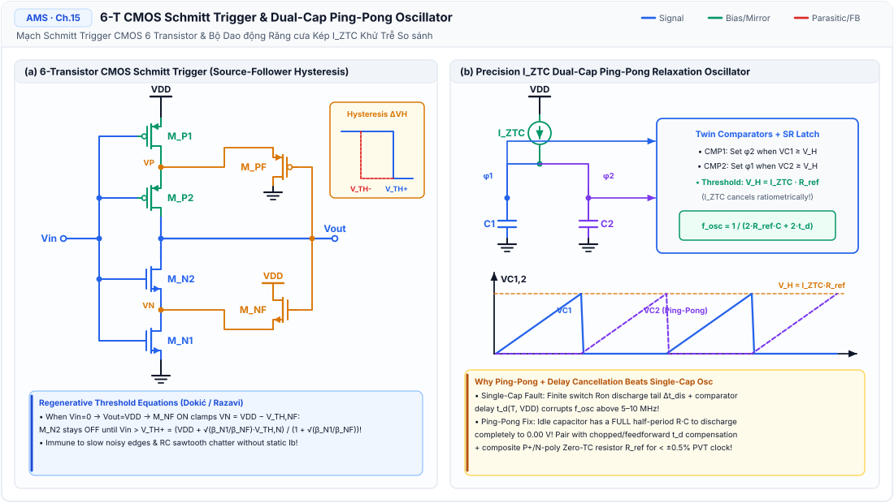

---
{
  "id": "topo-schmitt-trigger-and-hysteresis-comparators",
  "kind": "topology",
  "domain": "ams-filters-and-system",
  "title_vi": "Mạch Schmitt Trigger CMOS 6-Transistor và Bộ So sánh Có Trễ Tái sinh Hồi tiếp Dòng / Điện trở (Schmitt Trigger & Hysteresis Comparators)",
  "title_en": "6-Transistor CMOS Schmitt Trigger and Resistive / Internal Current-Feedback Regenerative Hysteresis Comparators",
  "summary": "Hệ thống hóa trọn vẹn ba kiến trúc tạo cửa sổ trễ hai ngưỡng độc lập (V_TH+ và V_TH-) chống rung nhiễu sườn chậm (noise chatter) cho giao diện cảm biến, giám sát nguồn UVLO/POR, bảo vệ quá nhiệt và bộ dao động tích thoát: mạch Schmitt Trigger CMOS 6-transistor Dokic định cỡ bằng tỷ số (W/L)_NF/(W/L)_N1 tự khử hiệu ứng thân bậc nhất, bộ so sánh Op-Amp hồi tiếp dương điện trở ngoài và bộ so sánh vi sai hồi tiếp dòng ghép chéo nội tại tốc độ cao (alpha = (W/L)_5/(W/L)_3 > 1) không giật ngược ngõ vào.",
  "diagram": "../../diagrams/schmitt-and-rc-sawtooth-osc.svg",
  "razavi_refs": [
    {
      "chapter": 4,
      "section": "4.1-4.2",
      "pages": "100-117",
      "equations": ["4.7", "4.10", "4.15"]
    },
    {
      "chapter": 8,
      "section": "8.1",
      "pages": "274-282",
      "equations": ["8.1", "8.2"]
    },
    {
      "chapter": 14,
      "section": "14.2.1",
      "pages": "593-598",
      "equations": ["14.75", "14.78"]
    },
    {
      "chapter": 15,
      "section": "15.1-15.3.2",
      "pages": "607-623",
      "equations": ["15.1", "15.19"]
    }
  ],
  "github_refs": [
    {
      "repo": "iic-jku/analog-circuit-design",
      "url": "https://github.com/iic-jku/analog-circuit-design/tree/6075ea0ebcf08f5c7f6033a84e9dd3c91450f5e1",
      "use": "Phân tích cặp vi sai tải chủ động, điều kiện vòng hồi tiếp dương tái sinh gm*R > 1 và quy trình định cỡ theo gm/ID độc lập công nghệ"
    },
    {
      "repo": "efabless/sky130_ef_ip__power_on_reset",
      "url": "https://github.com/efabless/sky130_ef_ip__power_on_reset/tree/de7a9fd892",
      "use": "Ứng dụng thực tế mạch Schmitt Trigger CMOS 6T và bộ so sánh có trễ trong khối giám sát nguồn khởi động POR / Brownout trên silicon"
    },
    {
      "repo": "Arcadia-1/analog-design-bench",
      "url": "https://github.com/Arcadia-1/analog-design-bench/tree/972f7cd7c9",
      "use": "Khuôn mẫu testbench quét DC hai chiều (forward/backward sweep) và quá độ đa góc PVT xác minh cửa sổ trễ V_TH+, V_TH-"
    }
  ],
  "glossary_codes": [
    "T042",
    "T069",
    "T111",
    "T245",
    "T270",
    "T283",
    "T527",
    "T534",
    "T569",
    "T620",
    "T688",
    "T788",
    "T1009",
    "T1184",
    "T1201",
    "T2153",
    "T2155",
    "T2163",
    "T2186",
    "T2187"
  ],
  "process_agnostic": true,
  "roles": {
    "stacked_inverter_core_mn1_mn2_mp1_mp2": "Cặp nhánh kéo xuống NMOS xếp chồng (M_N1 đáy, M_N2 trên) và kéo lên PMOS xếp chồng (M_P1 đỉnh, M_P2 dưới) tạo hai nút nội X, Y cho phép điều biến ngưỡng mở của transistor phía trong.",
    "source_follower_feedback_mnf_mpf": "Cặp transistor hồi tiếp dương M_NF và M_PF lấy tín hiệu từ ngõ ra đảo để ghim điện thế nút nội X lên VDD - V_TH,NF (khi Vout cao) hoặc kéo nút Y xuống |V_TH,PF| (khi Vout thấp), tách đôi ngưỡng lật lên và lật xuống.",
    "resistive_positive_feedback_network_r1_r2": "Mạng phân áp điện trở R1 - R2 nối từ ngõ ra về đầu vào dương của Op-Amp / Comparator dịch chuyển điện thế ngưỡng tham chiếu tức thời ngay khi ngõ ra đảo dấu.",
    "internal_cross_coupled_pmos_load_m5_m6": "Cặp tải PMOS ghép chéo M5-M6 đặt song song cặp diode M3-M4 với hệ số nhân kích thước alpha = (W/L)_5,6 / (W/L)_3,4 > 1, tạo trễ tái sinh nội bộ tốc độ cao mà không chạm vào nút đầu vào.",
    "output_cmos_rail_buffer": "Chuỗi hai cổng đảo chuẩn ở ngõ ra khôi phục sườn chuyển mạch sắc nét rail-to-rail và cô lập nút nội khỏi điện dung tải lớn bên ngoài."
  },
  "symptoms_addressed": [
    "multiple-output-glitch-chatter-on-slow-noisy-sensor-or-rc-edges",
    "supply-bounce-oscillation-around-uvlo-and-thermal-shutdown-trip-points",
    "crowbar-short-circuit-current-in-standard-cmos-inverters-driven-by-analog-ramps",
    "input-kickback-disturbance-from-external-hysteresis-resistors-on-high-z-nodes"
  ],
  "limitations": [
    "dokic-6t-schmitt-thresholds-track-vdd-and-process-vth-corners-broadly",
    "static-shoot-through-current-still-flows-just-before-regeneration-point",
    "internal-current-feedback-hysteresis-depends-on-tail-current-and-pelgrom-mismatch",
    "excessive-alpha-ratio-causes-permanent-dc-latchup-if-overdriven-margin-exceeded"
  ],
  "checklists": [
    "common-mos",
    "differential-pair",
    "comparator-and-sar-adc",
    "continuous-time-filters",
    "layout-and-matching"
  ]
}
---

## 1. Bản chất Nguyên lý, Sơ đồ Mạch & Vai trò Từng Nhánh Cấu trúc

Khi một bộ so sánh không trễ có độ lợi lớn (hoặc một cổng đảo CMOS tiêu chuẩn) giám sát một tín hiệu biến thiên chậm như đường dốc bật nguồn $V_{DD}(t)$ dài hàng chục mili-giây của khối `POR/UVLO`, điện áp cảm biến nhiệt độ BJT/NTC, đầu ra cầu đo áp suất hay sóng tam giác trên tụ định thời RC, một thảm họa vật lý tất yếu xảy ra ngay tại lân cận điểm cắt ngưỡng $V_{in}(t) \approx V_{\text{trip}}$: **hiện tượng rung lật liên hồi do nhiễu (`noise chatter / multiple triggering`)**. Gọi $\sigma_{v_n}$ là điện áp nhiễu tổng hiệu dụng chồng lên tín hiệu (bao gồm nhiễu nhiệt nội tại `T1009`, nhiễu nhấp nháy $1/f$ và nhiễu nguồn/đế `T527`) và $\left|\frac{dV_{in}}{dt}\right|$ là tốc độ sườn tín hiệu hữu ích. Khoảng thời gian mà tín hiệu lưu lại trong vùng bất định nhiễu $\pm 3\sigma_{v_n}$ quanh ngưỡng so sánh là:
$$
t_{\text{dwell}} = \frac{6\,\sigma_{v_n}}{\left| dV_{in} / dt \right|}
$$
Ví dụ thực tế: với cảm biến hoặc sườn bật nguồn chậm $\left|dV_{in}/dt\right| = 1\text{ V/ms} = 1\text{ mV/}\mu\text{s}$ và nhiễu hiệu dụng tổng $\sigma_{v_n} = 0.5\text{ mV}_{\text{rms}}$, thời gian nán lại vùng nhiễu lên tới $t_{\text{dwell}} = 3\,\mu\text{s}$, dài gấp **hàng nghìn lần** độ trễ truyền của bộ so sánh CMOS ($t_{pd} \approx 1\text{--}5\text{ ns}$)! Hậu quả là ngõ ra bộ so sánh băm ra hàng chục xung giả liên tiếp, làm bộ đếm logic nhận sai sự kiện, kích tắt/mở MOSFET công suất loạn xạ và bơm ngược nhiễu nguồn qua tụ ký sinh càng làm dao động tự duy trì.



Giải pháp cấu trúc triệt để là bổ sung một **vòng hồi tiếp dương có kiểm soát (`controlled positive feedback` — `T1184`)** có độ lợi vòng lớn hơn đơn vị tại thời điểm chuyển trạng thái để tách ngưỡng đơn lẻ thành **hai ngưỡng lật bất đối xứng theo chiều tiến trình lịch sử (`hysteresis window`)**: khi $V_{in}$ đi từ thấp lên cao, mạch giữ nguyên trạng thái cho đến khi chạm **ngưỡng lật trên $V_{TH+}$**; ngay khoảnh khắc vượt $V_{TH+}$, hồi tiếp dương tự động hạ ngưỡng tham chiếu tụt xuống **ngưỡng lật dưới $V_{TH-}$**, tạo vùng an toàn miễn nhiễm nhiễu $\Delta V_H = V_{TH+} - V_{TH-} \ge (6\text{--}10)\,\sigma_{v_n}$. Trong thiết kế vi mạch CMOS công nghiệp, ba họ cấu trúc chủ lực đảm nhiệm ba phân khúc hoàn toàn khác nhau:

1. **Mạch Schmitt Trigger CMOS 6-Transistor Kinh điển (Cấu trúc Dokic / Filanovsky — Không tiêu thụ dòng tĩnh DC):**
   - Dùng cho chân vào số I/O (`PAD receiver`), tạo dạng xung sau RC trễ của `POR`, khử dội phím và dao động RC siêu tiết kiệm năng lượng.
   - Thay vì dùng 1 NMOS và 1 PMOS như cổng đảo thường, nhánh kéo xuống gồm hai NMOS mắc nối tiếp $M_{N1}$ (cực nguồn nối `GND`) và $M_{N2}$ (nằm trên nút nội $X$, cực máng nối $V_{out}$), cùng cực cổng nối chung vào $V_{in}$. Một transistor NMOS hồi tiếp ngang $M_{NF}$ có cực máng nối $V_{DD}$, cực nguồn nối vào nút nội $X$ và cực cổng được lái trực tiếp bởi $V_{out}$!
   - Hoàn toàn đối ngẫu ở nửa trên: hai PMOS xếp chồng $M_{P1}$ (cực nguồn nối $V_{DD}$) và $M_{P2}$ (dưới nút nội $Y$, cực máng nối $V_{out}$) đi kèm transistor PMOS hồi tiếp ngang $M_{PF}$ nối từ nút $Y$ xuống `GND` có cực cổng lái bởi $V_{out}$. Theo sau $V_{out}$ thường có thêm một cổng đảo đệm chuẩn để đảo lại pha không đảo nếu cần và tạo sườn vuông sắc cạnh.
2. **Bộ So sánh Khuếch đại Thuật toán Dùng Hồi tiếp Dương Điện trở Ngoài (External Resistive Positive-Feedback Comparator):**
   - Dùng khi cần đặt hai ngưỡng $V_{TH+}, V_{TH-}$ chính xác cao ($\pm 0.5\%\text{--}1\%$) khóa cứng theo điện áp tham chiếu vùng cấm $V_{BG}$ (như mạch giám sát sụt nguồn `UVLO` chính xác hoặc bộ giới hạn cửa sổ điện áp pin).
   - Đặt cầu điện trở $R_1, R_2$ nối từ ngõ ra CMOS rail-to-rail của bộ so sánh quay về đầu vào không đảo $V_+$, trong khi tín hiệu cần đo $V_{in}$ đưa vào đầu vào đảo $V_-$ (hoặc ngược lại cho cấu hình không đảo).
3. **Bộ So sánh Vi sai Hồi tiếp Dòng Tái sinh Nội bộ (Internal Current-Feedback Regenerative Hysteresis Comparator — Cấu trúc Allstot / Gregorio):**
   - Chuẩn vàng tốc độ cao, diện tích nhỏ và **không cần bất kỳ điện trở lớn nào** cho chip PMIC/AFE hiện đại: cặp vi sai đầu vào NMOS $M_1\text{--}M_2$ (nguồn dòng đuôi $I_{SS}$) lái vào tải chủ động gồm **cặp PMOS nối diode $M_3\text{--}M_4$ ghép song song với cặp PMOS chéo cổng $M_5\text{--}M_6$**!
   - Khi thiết kế tỷ số kích thước $\alpha = \frac{(W/L)_{5,6}}{(W/L)_{3,4}} > 1$ (điển hình $\alpha = 1.2\text{--}2.5$), cặp ghép chéo $M_5\text{--}M_6$ tạo ra dẫn nạp vi sai âm vượt thắng dẫn nạp dương của cặp diode $M_3\text{--}M_4$, khóa mạch vào hai trạng thái ổn định với cửa sổ trễ $\Delta V_H$ xác định thuần túy bởi tỷ số hình học $\alpha$ và điểm phân cực $g_m/I_D$ của cặp đầu vào, đồng thời **cách ly hoàn toàn hai cực cổng đầu vào khỏi sườn nhảy ngõ ra**!

---

## 2. Hệ Phương trình Cốt lõi & Tư duy "Nhìn Mạch Đọc Nhanh" (Analysis by Inspection)

### 2.1. Dẫn xuất Chính xác Ngưỡng $V_{TH+}, V_{TH-}$ và Sự Tự Khử Hiệu ứng Thân trong Mạch Schmitt 6T CMOS
Xét quá trình $V_{in}$ quét tăng dần từ $0\text{ V}$ lên $V_{DD}$: ban đầu $M_{N1}, M_{N2}$ đều tắt và $M_{P1}, M_{P2}$ dẫn mạnh ghim $V_{out} = V_{DD}$. Vì cực cổng và cực máng của transistor hồi tiếp $M_{NF}$ đều đang ở $V_{DD}$, $M_{NF}$ hoạt động như một bộ đệm theo nguồn (`source follower`) kéo điện thế nút nội $X$ vọt lên tới $V_X = V_{DD} - V_{TH,NF}(V_X)$, giữ cho transistor phía trên $M_{N2}$ bị phân cực ngược cổng–nguồn ($V_{GS,N2} = V_{in} - V_X < 0$) nên khóa chặt!

Khi $V_{in}$ vượt quá $V_{TH,N1}$ (lưu ý $M_{N1}$ có cực nguồn nối đất nên $V_{SB,N1} = 0 \implies V_{TH,N1} = V_{TH0,N}$!), $M_{N1}$ bắt đầu dẫn dòng kéo nút $X$ tụt thấp dần chống lại dòng nạp của $M_{NF}$. Quá trình tái sinh sập xuống bắt đầu **đúng tại khoảnh khắc $V_{in} = V_{TH+}$ khi $M_{N2}$ vừa chớm mở ngưỡng dẫn** ($V_{GS,N2} = V_{TH+} - V_X = V_{TH,N2}(V_X)$, dòng qua $M_{N2}$ vẫn bằng $0$). Tại điểm biên giới hạn này:
1. Điện thế nút nội $X$ tại điểm chớm mở của $M_{N2}$ bằng $V_X = V_{TH+} - V_{TH,N2}(V_X)$, và toàn bộ dòng cực máng của $M_{N1}$ cân bằng đúng với dòng nạp của transistor hồi tiếp $M_{NF}$ ($I_{D,N1} = I_{D,NF}$):
   - Đối với $M_{NF}$: $V_{D,NF} = V_{DD}$ và $V_{G,NF} = V_{out} = V_{DD}$, tức $V_{GD,NF} = 0 \implies$ **$M_{NF}$ chắc chắn 100% nằm trong vùng bão hòa** với $V_{GS,NF} = V_{DD} - V_X$!
   - Thế $V_X = V_{TH+} - V_{TH,N2}(V_X)$ vào $V_{GS,NF} - V_{TH,NF}(V_X)$, một phép màu vật lý xuất hiện: vì **cả $M_{N2}$ lẫn $M_{NF}$ đều có chung cực nguồn nối tại nút $X$ và chung cực thân nối `GND`** ($V_{SB,N2} \equiv V_{SB,NF} = V_X$), nên hai điện áp ngưỡng đã chịu hiệu ứng thân $\gamma$ của chúng **bằng nhau hệt và triệt tiêu nhau hoàn toàn**:
$$
V_{GS,NF} - V_{TH,NF}(V_X) = \Big[V_{DD} - \big(V_{TH+} - V_{TH,N2}(V_X)\big)\Big] - V_{TH,NF}(V_X) = V_{DD} - V_{TH+}
$$
   - Đối với $M_{N1}$: tại sát ngưỡng mở của $M_{N2}$, hiệu $V_{GS,N1} - V_{DS,N1} = V_{TH+} - V_X = V_{TH,N2}(V_X) > V_{TH0,N}$ (do $V_X > 0$ làm $V_{TH,N2}(V_X) > V_{TH0,N}$), nghĩa là $V_{DS,N1} = V_{TH+} - V_{TH,N2}(V_X) < V_{TH+} - V_{TH0,N}$ nhẹ chỉ bằng độ lệch hiệu ứng thân $\Delta V_{TH,\gamma}$, nên $M_{N1}$ nằm ngay sát biên bão hòa – triode! Áp dụng xấp xỉ dòng bão hòa chuẩn của Dokic ($I_{D,N1} = I_{D,NF}$) với hệ số tỷ số kích thước hồi tiếp $r_N = \frac{(W/L)_{NF}}{(W/L)_{N1}}$:
$$
\frac{1}{2}\mu_n C_{ox}\left(\frac{W}{L}\right)_{N1}\left(V_{TH+} - V_{TH0,N}\right)^2 = \frac{1}{2}\mu_n C_{ox}\left(\frac{W}{L}\right)_{NF}\left(V_{DD} - V_{TH+}\right)^2
$$
Lấy căn bậc hai hai vế và giải tường minh theo $V_{TH+}$ (và hoàn toàn đối ngẫu cho sườn giảm chạm $V_{TH-}$ trên nhánh PMOS với $r_P = \frac{(W/L)_{PF}}{(W/L)_{P1}}$):
$$
V_{TH+} = \frac{V_{TH0,N} + \sqrt{r_N}\,V_{DD}}{1 + \sqrt{r_N}}, \qquad
V_{TH-} = \frac{V_{DD} - \left|V_{TH0,P}\right|}{1 + \sqrt{r_P}}, \qquad
r_N = \frac{(W/L)_{NF}}{(W/L)_{N1}}, \quad r_P = \frac{(W/L)_{PF}}{(W/L)_{P1}}
$$
**Tư duy nhìn mạch đọc nhanh cực kỳ trực quan**:
- Nếu gỡ bỏ transistor hồi tiếp ($r_N \to 0, r_P \to 0$), công thức thu về $V_{TH+} \to V_{TH0,N}$ và $V_{TH-} \to V_{DD} - |V_{TH0,P}|$ (nhưng ở đây cần nhánh PMOS tắt sau nên thực tế tiệm cận ngưỡng chuyển cổng đảo chồng). Khi tăng $(W/L)_{NF}$ mạnh dần lên ($r_N$ tăng), nút $X$ bị níu chặt lên gần $V_{DD}$ hơn, đẩy $V_{TH+}$ tiến dần về phía $V_{DD}$! Ngược lại khi tăng $(W/L)_{PF}$ ($r_P$ tăng), nút $Y$ bị níu chặt xuống gần `GND` hơn, kéo $V_{TH-}$ lùi sâu về phía $0\text{ V}$!
- **Độc lập chéo hoàn toàn**: Tỷ số $r_N$ **chỉ điều khiển ngưỡng trên $V_{TH+}$**, còn tỷ số $r_P$ **chỉ điều khiển ngưỡng dưới $V_{TH-}$**! Nhờ tính trực giao này, kỹ sư có thể đặt cửa sổ trễ đối xứng quanh $V_{DD}/2$ hoặc lệch hẳn sang một phía tùy ý!

### 2.2. Bộ So sánh Hồi tiếp Dương Điện trở Ngoài (Op-Amp Resistive Hysteresis)
Xét bộ so sánh có ngõ ra đảo dấu trọn dải giữa $V_{OL} = 0\text{ V}$ và $V_{OH} = V_{DD}$ (hoặc kẹp chuẩn $V_{OH,\text{clamp}}$), tín hiệu $V_{in}$ đưa vào đầu đảo $V_-$, còn đầu không đảo $V_+$ nối tới điểm giữa cầu phân áp $R_1$ (nối tới tham chiếu $V_{REF}$) và $R_2$ (nối hồi tiếp từ $V_{out}$, với $R_2 > R_1$). Áp dụng xếp chồng tuyến tính tại nút $V_+$:
$$
V_+(V_{out}) = V_{REF}\frac{R_2}{R_1 + R_2} + V_{out}\frac{R_1}{R_1 + R_2}
$$
Thay hai mức bão hòa $V_{out} \in \{0, V_{DD}\}$, ta thu ngay hai ngưỡng lật sắc nét và độ rộng trễ $\Delta V_H$:
$$
V_{TH+} = V_{REF}\frac{R_2}{R_1 + R_2} + V_{DD}\frac{R_1}{R_1 + R_2}, \qquad
V_{TH-} = V_{REF}\frac{R_2}{R_1 + R_2}, \qquad
\Delta V_H = V_{TH+} - V_{TH-} = V_{DD}\frac{R_1}{R_1 + R_2}
$$
Nếu muốn **cả hai ngưỡng $V_{TH+}$ và $V_{TH-}$ đều độc lập hoàn toàn với nhiễu/trôi $V_{DD}$** (yêu cầu bắt buộc trong mạch giám sát `UVLO` và dao động RC chính xác cao!), thay vì lấy điện áp $V_{out}$ trực tiếp từ thanh nguồn $V_{DD}$, ta dùng công tắc chuyển mạch một nguồn dòng chuẩn $I_{H}$ chảy vào/ra điện trở $R_1$ nối từ $V_{REF}$: khi đó $\Delta V_H = I_H R_1$ chỉ phụ thuộc tỷ số điện trở nếu $I_H = V_{BG}/R_0 \implies \Delta V_H = V_{BG}(R_1/R_0)$!

### 2.3. Bộ So sánh Vi sai Tái sinh Hồi tiếp Dòng Nội tại (Cross-Coupled Active Load $\alpha > 1$)
Xét cặp vi sai NMOS $M_1\text{--}M_2$ được phân cực bởi nguồn dòng đuôi $I_{SS}$. Tại hai nút máng $V_{o-}, V_{o+}$, tải PMOS gồm cặp nối diode $M_3\text{--}M_4$ và cặp ghép chéo cổng $M_5\text{--}M_6$ có cùng chiều dài kênh $L_P$ và tỷ số bề rộng $\alpha = \frac{(W/L)_{5,6}}{(W/L)_{3,4}} > 1$.
- **Điều kiện tồn tại trễ ($\alpha > 1$)**: Quanh điểm cân bằng vi sai nhỏ, dẫn nạp nhìn lên tải tại mỗi nút là $G_{\text{load,diff}} = g_{m3,4} - g_{m5,6} = g_{m3,4}(1 - \alpha)$ (bỏ qua $r_O$). Khi $\alpha < 1$, mạch chỉ là một bộ khuếch đại tiền xử lý độ lợi dương được nâng lên bội số $\frac{1}{1 - \alpha}$ (không có trễ). Khi $\alpha > 1$, dẫn nạp tải trở nên **âm**, tạo độ lợi vòng hồi tiếp dương $T_+ = \frac{g_{m5,6}}{g_{m3,4}} = \alpha > 1$ khóa cứng mạch vào một trong hai trạng thái bền!
- **Tính chính xác điểm lật $V_{TH+}, V_{TH-}$**: Giả sử ban đầu $V_{in+} \ll V_{in-}$ nên toàn bộ $I_{SS}$ đổ sang $M_2$ ($i_1 = 0, i_2 = I_{SS}$): $M_4$ dẫn dòng $I_{SS}$ kéo $V_{o+}$ xuống thấp, qua cổng chéo mở $M_5$ sẵn sàng cấp dòng tối đa $\alpha \cdot i_4 = \alpha \cdot i_2$ bên nhánh trái, trong khi $M_3$ và $M_6$ đang tắt ($V_{o-} = V_{DD}$). Khi tăng $V_{in+}$ lên vượt qua $V_{in-}$, dòng $i_1$ tăng lên còn $i_2 = I_{SS} - i_1$ giảm xuống. Nút $V_{o-}$ vẫn bị giữ trên cao chừng nào dòng hút xuống $i_1$ còn nhỏ hơn khả năng cấp dòng gương của $M_5$ ($\alpha \cdot i_2$). Khoảnh khắc tái sinh lật trạng thái xảy ra chính xác khi **dòng nhánh trái vừa cân bằng dòng gương chéo**:
$$
i_1 = \alpha \, i_2 \quad \text{kết hợp} \quad i_1 + i_2 = I_{SS} \implies i_1 = \frac{\alpha}{\alpha + 1} I_{SS}, \qquad i_2 = \frac{1}{\alpha + 1} I_{SS}
$$
Thế cặp dòng bất đối xứng này vào đặc tuyến cặp vi sai $M_1\text{--}M_2$ cho hai chế độ phân cực:
1. **Chế độ Nghịch đảo Mạnh (Luật bình phương)**: $V_{TH+} = V_{GS1}(i_1) - V_{GS2}(i_2) = \sqrt{\frac{2 I_{SS}}{\mu_n C_{ox}(W/L)_{1,2}}} \cdot \frac{\sqrt{\alpha} - 1}{\sqrt{\alpha + 1}}$, suy ra cửa sổ trễ tổng $\Delta V_H = 2 V_{TH+}$:
$$
\Delta V_{H,\text{strong}} = 2\,V_{OV,\text{bal}} \frac{\sqrt{\alpha} - 1}{\sqrt{\alpha + 1}}, \qquad V_{OV,\text{bal}} = \sqrt{\frac{I_{SS}}{\mu_n C_{ox}(W/L)_{1,2}}} = \frac{2}{(g_m / I_D)_{\text{bal}}}
$$
2. **Chế độ Nghịch đảo Yếu / Dưới ngưỡng (`T270`, công suất nano-watt cho UVLO/POR luôn bật)**: Vì $i_D = I_0 \exp\!\left(\frac{V_{GS}}{\zeta V_T}\right)$, tỷ số dòng $i_1 / i_2 = \alpha$ cho nghiệm đóng đẹp tuyệt mỹ:
$$
V_{TH+,\text{sub}} = -V_{TH-,\text{sub}} = \zeta V_T \ln(\alpha) \implies \Delta V_{H,\text{sub}} = 2 \zeta V_T \ln(\alpha)
$$

### 2.4. Ví dụ Định cỡ Số học Thực tế (90nm CMOS, $V_{DD} = 1.2\text{ V}$)
- **Bài toán A (Schmitt 6T cho chân nhận xung cảm biến chậm)**: Với $V_{DD} = 1.2\text{ V}$, $V_{TH0,N} = 0.38\text{ V}$, $|V_{TH0,P}| = 0.40\text{ V}$, yêu cầu $V_{TH+} = 0.80\text{ V}$ và $V_{TH-} = 0.40\text{ V}$ ($\Delta V_H = 400\text{ mV}$).
  - Từ công thức: $\sqrt{r_N} = \frac{V_{TH+} - V_{TH0,N}}{V_{DD} - V_{TH+}} = \frac{0.80 - 0.38}{1.20 - 0.80} = \frac{0.42}{0.40} = 1.05 \implies r_N = 1.10$. Chọn $L = 180\text{ nm}$ (dài gấp đôi $L_{\min}$ để giảm lệch ngưỡng), đặt $(W/L)_{N1} = 2\,\mu\text{m}/0.18\,\mu\text{m}$, $(W/L)_{N2} = 4\,\mu\text{m}/0.18\,\mu\text{m}$ (to gấp đôi $M_{N1}$ để giảm sụt áp nối tiếp), suy ra $(W/L)_{NF} = 2.2\,\mu\text{m}/0.18\,\mu\text{m}$.
  - Tương tự nhánh PMOS: $\sqrt{r_P} = \frac{V_{DD} - |V_{TH0,P}| - V_{TH-}}{V_{TH-}} = \frac{1.20 - 0.40 - 0.40}{0.40} = 1.00 \implies r_P = 1.00$. Chọn $(W/L)_{P1} = (W/L)_{PF} = 4\,\mu\text{m}/0.18\,\mu\text{m}$, $(W/L)_{P2} = 8\,\mu\text{m}/0.18\,\mu\text{m}$.
- **Bài toán B (Comparator hồi tiếp dòng nội bộ cho khối giám sát UVLO $\Delta V_H = 50\text{ mV}$)**: Phân cực cặp đầu vào ở vùng nghịch đảo yếu/vừa $(g_m/I_D)_{\text{bal}} = 20\text{ V}^{-1}$ với $I_{SS} = 2\,\mu\text{A}$, $\zeta V_T \approx 1.35 \times 25.9\text{ mV} = 35\text{ mV}$. Để đạt $\Delta V_H = 50\text{ mV}$: $\ln(\alpha) = \frac{50}{2 \times 35} = 0.714 \implies \alpha = e^{0.714} \approx 2.04 \approx 2.0$! Chọn bội số nguyên đơn vị $M_{3,4}$ gồm `2 unit fingers` và $M_{5,6}$ gồm `4 unit fingers` ghép đồng tâm chung — khớp tỷ số hình học chuẩn xác tuyệt đối không tốn một Ohm điện trở nào!

---

## 3. Bất biến Cấu trúc & Các Bẫy Lỗi Kinh điển (Structural Invariants & Traps)

- **[INV-01] Bất biến Độ rộng Cửa sổ Trễ Vượt Trần Nhiễu Đỉnh–Đỉnh ($\Delta V_H \ge 8\,\sigma_{v_n,\text{tot}} + 2\Delta V_{\text{ripple}}$)**: Độ rộng trễ ở góc quy trình hẹp nhất (thường là `FF, 125 °C, VDD_min` đối với Schmitt 6T hoặc góc dòng đuôi nhỏ nhất đối với hồi tiếp dòng) bắt buộc phải lớn hơn tổng nhiễu RMS nhân $8$ (tương đương xác suất lật giả $< 10^{-15}$) cộng biên độ gợn chuyển mạch ghép xuyên từ nguồn/đế.
- **[INV-02] Bất biến Giới hạn Tỷ số Ghép chéo ($1 < \alpha \le \alpha_{\max}$) Tránh Khóa Chết Trạng thái (Permanent Latch-Up)**: Trong bộ so sánh hồi tiếp dòng nội bộ, nếu chọn $\alpha$ quá lớn (ví dụ $\alpha > 4\text{--}5$) ở vùng nghịch đảo mạnh khiến $V_{TH+}$ yêu cầu vượt quá dải tuyến tính $\sqrt{2}\,V_{OV,\text{bal}}$ của cặp vi sai: ngay cả khi lái toàn bộ $100\%$ dòng đuôi $I_{SS}$ sang $M_1$ ($i_2 = 0$ lý tưởng), nếu có dòng rò hoặc nguồn dòng phụ giữ $i_2 > 0$, mạch có thể bị kẹt vĩnh viễn ở một trạng thái không bao giờ lật ngược lại được! Thông lệ thiết kế an toàn giữ $\alpha \in [1.25, 2.5]$.
- **[INV-03] Bất biến Đấu Chung Cực Thân (Shared Bulk Invariant) Giữa $M_{N2}$ và $M_{NF}$**: Sự triệt tiêu gọn ghẽ của hiệu ứng thân $\gamma$ trong phương trình Dokic $V_{TH+}$ chỉ đúng khi $M_{N2}$ và $M_{NF}$ có cùng điện áp phân cực thân và cùng loại ngưỡng (`SVT`/`HVT`). Nếu đặt $M_{NF}$ vào giếng cô lập nối nguồn riêng làm $V_{TH,NF} < V_{TH,N2}(V_X)$, ngưỡng lật sẽ bị lệch mạnh và phụ thuộc phi tuyến vào hệ số $\gamma$.
- **[TRAP-01] Quét DC Một Chiều Trong Spectre Làm "Tàng Hình" Cửa Sổ Trễ Hysteresis**: Sai lầm phổ biến bậc nhất khi mô phỏng Schmitt Trigger trên Cadence! Một lệnh `dc dev=Vin start=0 stop=VDD` chỉ đi theo sườn lên nên **chỉ nhìn thấy duy nhất điểm $V_{TH+}$**, hoàn toàn bỏ lọt $V_{TH-}$ (hoặc tệ hơn, tại lân cận điểm nhảy hồi tiếp dương, bộ giải Newton–Raphson tĩnh của `.dc` bị mất hội tụ Jacobian báo lỗi `Zero diagonal / Non-convergence`!). Quy trình bắt buộc phải dùng **quét tam giác hai chiều chậm trong miền thời gian `.tran`** (sườn lên $0 \to V_{DD}$ rồi sườn xuống $V_{DD} \to 0$ đủ chậm để $t_{\text{ramp}} \gg 1000\,t_{pd}$) nhằm trích xuất đồng thời cả $V_{TH+}$ và $V_{TH-}$ mà không bao giờ lỗi hội tụ!
- **[TRAP-02] Xung Giật Ngược Qua Điện Trở Hồi Tiếp Dương Làm Méo Điểm Cắt Cảm Biến Trở Kháng Cao**: Trong bộ so sánh hồi tiếp dương dùng điện trở $R_1\text{--}R_2$, nếu nối mạng này vào nhánh tín hiệu có trở kháng nguồn lớn $R_{\text{sensor}}$ (ví dụ cầu nhiệt trở $100\text{ k}\Omega$ hoặc cầu phân áp UVLO dòng nano-ampe $R_{div} = 5\text{ M}\Omega$), dòng điện chảy qua $R_1 + R_2$ thay đổi đột ngột khi $V_{out}$ đảo trạng thái sẽ kéo lệch chính điện áp nguồn cảm biến! Bắt buộc đặt tín hiệu trở kháng cao vào cổng MOS cô lập hoàn toàn ($V_-$) và chỉ đặt mạng hồi tiếp dương ở nhánh tham chiếu trở kháng thấp, hoặc dùng kiến trúc hồi tiếp dòng nội bộ Allstot.
- **[TRAP-03] Dòng Xuyên Thẳng Tĩnh (Static Crowbar Current) Của Schmitt 6T Trên Sườn Quá Chậm**: Mặc dù Schmitt 6T loại bỏ hoàn toàn rung nhiễu đầu ra, trong suốt khoảng thời gian $V_{in}$ bò chậm từ $V_{TH0,N}$ đến sát $V_{TH+}$, cả $M_{N1}$ lẫn $M_{NF}$ đều đồng thời dẫn dòng tĩnh trực tiếp từ $V_{DD}$ qua $M_{NF} \to X \to M_{N1}$ xuống `GND` (có thể tốn $20\text{--}100\,\mu\text{A}$ ở tiến trình nanomet!). Đối với mạch `POR/UVLO` ngân sách tổng $< 200\text{ nA}$, bắt buộc dùng transistor kênh rất dài ($L = 2\text{--}10\,\mu\text{m}$) cho $M_{N1}, M_{NF}, M_{P1}, M_{PF}$ hoặc dùng Schmitt dòng hạn chế (`current-starved Schmitt trigger`)!
- **[TRAP-04] Sai Lệch Ngẫu nhiên Pelgrom Nuốt Chửng Cửa Sổ Trễ Nhỏ**: Nếu thiết kế $\Delta V_H = 15\text{ mV}$ nhưng dùng transistor kích thước tối thiểu có độ lệch chuẩn điện áp lệch $\sigma(V_{OS}) = 8\text{ mV}$, ở biên $3\sigma = 24\text{ mV}$ trung tâm cửa sổ trễ bị dịch văng hoàn toàn khỏi mức ngưỡng mục tiêu (hoặc bất đối xứng giữa $\alpha_{\text{left}}$ và $\alpha_{\text{right}}$ làm méo $\Delta V_H$!). Cặp đầu vào $M_{1,2}$ và bốn tải $M_{3\text{--}6}$ phải được định cỡ diện tích $W \cdot L$ thỏa mãn $3\sigma(V_{OS}) \le 0.2\,\Delta V_H$.

---

## 4. Lộ trình Nâng cấp Cấu trúc & Bát giác Đánh đổi (Upgrade Paths & Design Octagon)

Trên Bát giác Thiết kế Tương tự (`concept-analog-design-octagon`), ba họ mạch có trễ phân chia rõ rệt không gian đánh đổi giữa **Độ chính xác ngưỡng tuyệt đối**, **Công suất tĩnh**, **Tốc độ phản hồi** và **Cách ly ngõ vào**:

| Trục đánh giá Design Octagon | Schmitt Trigger CMOS 6T (Dokic) | Op-Amp + Hồi tiếp Điện trở $R_1, R_2$ | Comparator Hồi tiếp Dòng Nội bộ ($\alpha > 1$) |
| :--- | :--- | :--- | :--- |
| Dòng tiêu thụ tĩnh ở hai biên logic | **$0\text{ A}$** (chỉ rò $I_{\text{off}}$; tốn dòng crowbar khi lướt sườn) | Tốn $I_{Q,\text{OTA}} + \frac{V_{DD}}{R_1 + R_2}$ liên tục | Chỉ tốn $I_{SS}$ nhỏ ($0.1\text{--}10\,\mu\text{A}$), không tốn dòng trở |
| Độ chính xác ngưỡng qua góc PVT | Thấp ($\pm 15\%\text{--}25\%$, bám theo $V_{DD}$ và $V_{TH}$) | **Rất cao ($\pm 0.5\%\text{--}1.5\%$)** khi neo vào $V_{BG}$ | Trung bình–Khá ($\pm 5\%\text{--}10\%$, cực gọn theo $\zeta V_T \ln\alpha$) |
| Tốc độ lật quá độ ($t_{pd}$) | Cực nhanh ($0.1\text{--}1\text{ ns}$ cho I/O số) | Chậm–Trung bình ($20\text{ ns--}2\,\mu\text{s}$ tùy $I_Q$) | Nhanh ($2\text{--}25\text{ ns}$) nhờ nút nội biên độ nhỏ |
| Cách ly giật ngược ngõ vào | Tốt (chỉ có $C_{GD}/C_{GS}$ cổng MOS) | Kém trên nhánh gắn $R_1, R_2$ (gây tải dòng) | **Xuất sắc** (cổng $M_{1,2}$ tách rời nút tái sinh) |
| Diện tích mặt bằng silicon | Siêu nhỏ ($6$ MOSFET) | Lớn (tốn dải điện trở poly hàng trăm $\text{k}\Omega$) | Rất gọn ($8\text{--}10$ MOSFET, không cần điện trở) |

1. **Từ Cổng đảo thường $\to$ Schmitt 6T CMOS**: Bắt buộc nâng cấp tại mọi chân nhận xung ngoài chip (`PAD`), mạch khử nhiễu RC (`deglitch filter`) và đầu ra tụ trễ khởi động `topo-pmic-protections-por-uvlo-softstart-ocp-tsd` để xóa sổ dòng ngắn mạch và xung giả.
2. **Từ Schmitt 6T $\to$ Comparator Hồi tiếp Dòng Nội bộ ($\alpha > 1$)**: Khi ngưỡng lật không được phép trôi theo $V_{DD}$ (ví dụ giám sát `UVLO` so sánh $\beta V_{DD}$ với $V_{BG}$ của `topo-bandgap-reference-core` hoặc bảo vệ quá nhiệt `TSD`), chuyển sang cặp vi sai so sánh với $V_{BG}$ tích hợp tải chéo PMOS $\alpha = 1.5\text{--}2.0$.
3. **Từ Hồi tiếp Dòng Nội bộ $\to$ Bộ So sánh Hai Ngưỡng Cửa sổ Độc lập cho Dao động RC**: Khi cần độ trôi tần số $< \pm 1\%$ theo nhiệt độ và nguồn cấp trong `topo-relaxation-rc-sawtooth-and-crystal-oscillators`, tách khâu tạo ngưỡng ra thành cầu phân áp điện trở chuẩn ratiometric đi kèm bộ so sánh vi sai tốc độ cao không trễ có bù trễ truyền $t_d$.

---

## 5. Thích ứng Đa Tiến trình (90nm / 65nm / 45nm) & Cách Kiểm chứng trong Cadence / Spectre

Khi thu nhỏ tiến trình xuống 65nm và 45nm với $V_{DD} = 1.0\text{ V}$:
- Trong mạch **Schmitt 6T Dokic**, tỷ số $V_{TH0} / V_{DD} \approx 0.40$ khá lớn khiến khoảng cách giữa $V_{TH0,N}$ và $V_{DD} - |V_{TH0,P}|$ thu hẹp lại; nên dùng linh kiện ngưỡng chuẩn (`SVT`) kết hợp chiều dài kênh $L \ge 2\text{--}4\,L_{\min}$ để giảm hiệu ứng hạ rào thế cực máng (`DIBL` — nếu $L = L_{\min}$, DIBL làm $M_{N2}$ rò dòng sớm trước khi $V_X$ kịp sụt, làm co hẹp cửa sổ $\Delta V_H$ tới $30\%$ so với công thức tay!).
- Trong **Comparator Hồi tiếp Dòng Nội bộ**, tránh xếp chồng cascode trên tải ghép chéo $M_3\text{--}M_6$; sau nút máng $V_{o+}$ chỉ cần nối trực tiếp sang tầng khuếch đại nguồn chung PMOS/NMOS thứ hai (`two-stage open-loop comparator`) rồi qua hai cổng đảo CMOS chuẩn để xuất mức logic sạch.

### Quy trình Kiểm chứng Chuẩn trong Cadence Virtuoso / Spectre 15.1
```
// Testbench quét tam giác hai chiều + nhiễu chồng lấn kiểm chứng cửa sổ trễ Schmitt / Hysteresis Comparator
parameters VDD_val=1.2 T_ramp=200u V_noise_pk=5m f_noise=20M

V_SUP (vdd 0) vsource dc=VDD_val
// Sóng tam giác quét lên (0 -> 100u) rồi quét xuống (100u -> 200u) chồng nhiễu cao tần kiểm tra chống rung
V_IN  (vin_clean 0) vsource type=pwl wave=[0 0  100u VDD_val  200u 0]
V_N   (vin vin_clean) vsource type=sine ampl=V_noise_pk freq=f_noise

// Chạy quá độ chính xác cao và Monte Carlo 200 mẫu kiểm tra độ lệch V_TH+, V_TH-
tran_hyst tran stop=T_ramp errpreset=conservative maxstep=5n
mc_hyst montecarlo variations=all numruns=200 seed=12345 {
    tran_mc tran stop=T_ramp errpreset=moderate maxstep=10n
}
```
- **Bước 1 — Đo chính xác $V_{TH+}, V_{TH-}$ và $\Delta V_H$ qua 45 góc PVT**: Dùng hàm `cross(V(vout) - VDD/2, 1)` trên nửa đầu `[0, 100u]` để lấy thời điểm lật lên $t_+ \implies V_{TH+} = V(\text{vin\_clean})(t_+)$, và `cross(V(vout) - VDD/2, -1)` trên nửa sau `[100u, 200u]` để lấy $t_- \implies V_{TH-} = V(\text{vin\_clean})(t_-)$.
- **Bước 2 — Bài thử Chống rung Nhiễu Sườn Chậm (`Chatter Immunity Stress Test`)**: Chồng nguồn nhiễu sin hoặc `tranNoise` biên độ đỉnh–đỉnh bằng $50\%$ cửa sổ $\Delta V_H$ lên sườn dốc chậm; đếm tổng số sườn chuyển trạng thái của `V(vout)` trong trọn một chu kỳ tam giác: bắt buộc chỉ có **đúng 1 sườn lên và 1 sườn xuống** (số xung thừa $= 0$ tuyệt đối!).
- **Bước 3 — Kiểm toán Thống kê Monte Carlo Mismatch**: Xác nhận ở phân vị $\mu - 3\sigma$, độ rộng cửa sổ trễ cực tiểu $\Delta V_{H,\min}$ vẫn luôn dương lớn hơn trần nhiễu đặc tả và không có mẫu nào bị kẹt trạng thái (`missing transition`).

---

## 6. Mốc Đối chiếu Sách Razavi & Thuật ngữ Chuẩn CLB

| Mục nội dung & Phương trình | Tham chiếu Razavi (2nd Ed.) & GitHub IP | Mã & Thuật ngữ Chuẩn CLB |
| :--- | :--- | :--- |
| Đặc tuyến truyền đạt lớn của cặp vi sai và dòng bão hòa biên | Chương 4, §4.1–4.2, PT (4.7)–(4.15), tr. 100–117 | `T111` Điện áp ngưỡng; `T245` Điện áp ngưỡng tại $V_{SB}=0$; `T2187` hiệu suất hỗ dẫn $g_m/I_D$ |
| Cặp vi sai hoạt động vùng dưới ngưỡng ($\Delta V_{in}$ theo $\zeta V_T \ln\alpha$) | Chương 2, §2.3, PT (2.33)–(2.39) & Chương 4 | `T270` Sự dẫn dưới ngưỡng; `T283` Độ hỗ dẫn trong vùng dưới ngưỡng |
| Lý thuyết vòng hồi tiếp dương tái sinh ($T_+ > 1$) và cặp tải ghép chéo | Chương 8, §8.1 & Chương 15, §15.1–15.3.2, PT (15.19), tr. 607–623 | `T042` Hồi tiếp; `T534` Vòng hồi tiếp; `T1184` hồi tiếp dương; `T1201` hệ số hồi tiếp; `T2163` cặp transistor ghép chéo |
| Nhiễu quy về ngõ vào, sai lệch ngưỡng Pelgrom $\Delta V_{TH}$ và PVT | Chương 7, §7.2 & Chương 14, §14.2.1, PT (14.75), tr. 593–598 | `T069` Biến thiên PVT; `T527` Nhiễu; `T569` khả năng chống nhiễu môi trường; `T620` độ lệch; `T688` sai lệch điện áp ngưỡng; `T788` điện áp lệch quy về ngõ vào; `T2153` định luật Pelgrom; `T2155` điện áp lệch không ngẫu nhiên; `T2186` các góc quy trình chế tạo |
| Thực thi Schmitt 6T cho POR & Testbench quét hai chiều | `efabless/sky130_ef_ip__power_on_reset` & `Arcadia-1/analog-design-bench` | Khối giám sát nguồn khởi động & đặc tính hóa đa góc tự động |
