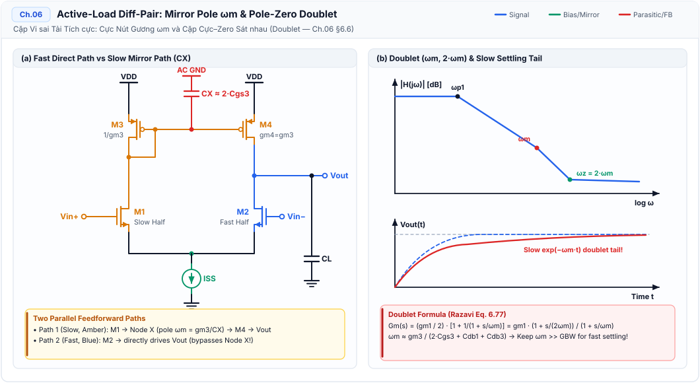

---
{
  "id": "concept-diffpair-mirror-pole-doublet",
  "kind": "concept",
  "domain": "dynamics-noise-feedback",
  "title_vi": "Đáp ứng Tần số Cặp Vi sai, Cực Gương Dòng và Cặp Cực–Zero Gần Trùng (Differential Pair Frequency Response, Mirror Pole & Doublet)",
  "title_en": "Differential-Pair High-Frequency Response, Current-Mirror Pole, and Pole-Zero Doublet",
  "summary": "Phân tích đáp ứng tần số vi sai và chế độ chung của cặp vi sai tải thụ động so với cặp vi sai tải gương dòng chủ động (5T-OTA): chứng minh vì sao hai đường truyền nhanh–chậm bất đối xứng qua nút gương dòng sinh ra cặp cực–zero gần trùng (doublet) tại wm và 2*wm làm suy giảm dự trữ pha và kéo dài thời gian xác lập.",
  "diagram": "../../diagrams/diffpair-mirror-pole-doublet.svg",
  "razavi_refs": [
    {
      "chapter": 6,
      "section": "6.6",
      "pages": "198-203",
      "equations": ["6.87", "6.88", "6.89", "6.90", "6.91", "6.93", "6.94", "6.95", "6.96"]
    },
    {
      "chapter": 10,
      "section": "10.4-10.5",
      "pages": "420-431",
      "equations": ["10.21", "10.23"]
    }
  ],
  "glossary_codes": ["T022", "T026", "T586", "T755", "T764", "T794", "T848", "T967", "T973", "T1707", "T1708"],
  "process_agnostic": true,
  "roles": {
    "differential_input_pair": "Cặp vi sai M1-M2 tách kích thích vi sai thành hai dòng tín hiệu ngược dấu bằng nhau chạy trên hai nhánh",
    "fast_direct_path": "Nhánh truyền trực tiếp từ M2 thẳng ra nút ngõ ra đơn đầu Vout chỉ chịu duy nhất một cực trội ngõ ra wp1",
    "slow_mirror_path": "Nhánh truyền gián tiếp từ M1 qua transistor nối diode M3 sang M4 chịu thêm trễ tại nút cổng gương E (mirror pole wm ~ gmP/CE)",
    "tail_parasitic_cap_cp": "Điện dung ký sinh CP mắc song song nguồn dòng đuôi làm suy biến CMRR nghiêm trọng ở tần số cao ngay cả khi mạch cân xứng"
  },
  "symptoms_addressed": [
    "5t-ota-unexpected-phase-margin-loss",
    "slow-settling-tail-from-pole-zero-doublet",
    "high-frequency-cmrr-degradation",
    "single-ended-conversion-bandwidth-penalty"
  ],
  "limitations": [
    "active-mirror-inherently-creates-asymmetric-signal-paths",
    "pmos-mirror-devices-have-lower-ft-worsening-mirror-pole",
    "tail-node-capacitance-breaks-ac-cm-rejection"
  ],
  "checklists": ["common-mos", "differential-pair", "current-mirror"]
}
---

## 1. Bản chất Nguyên lý, Sơ đồ Mạch & Vai trò Từng Nhánh Cấu trúc

Khi chuyển từ mạch khuếch đại đơn đầu sang **cặp vi sai (`topo-basic-differential-pair`)**, đáp ứng tần số tách thành hai bức tranh hoàn toàn khác nhau tùy thuộc vào cách lấy tín hiệu ngõ ra (Razavi Chương 6, §6.6):
- Nếu lấy **ngõ ra vi sai hoàn toàn (fully-differential output)** trên hai tải đối xứng, nút cực nguồn chung là đất ảo xoay chiều nên mỗi nửa mạch vi sai (differential half-circuit) hành xử hệt như một tầng nguồn chung chuẩn mực, **hoàn toàn không có cực gương dòng**.
- Ngược lại, trong **OTA năm transistor (`topo-five-transistor-ota`)** dùng gương dòng chủ động $M_3\text{–}M_4$ để gom hai nhánh dòng vi sai về một ngõ ra đơn đầu (differential-to-single-ended conversion), tín hiệu bắt buộc phải đi qua **hai con đường song song có tốc độ khác nhau**, tạo ra hiện tượng kinh điển: **cực gương (mirror pole)** đi kèm một điểm không ở gấp đôi tần số cực đó, hình thành **cặp cực–zero gần trùng (pole-zero doublet)**.

Bốn thành phần quyết định động học tần số cao của cấu trúc vi sai gồm:
1. **Nửa mạch vi sai tải đối xứng (§6.6.1, Hình 6.36–6.39):** Với tín hiệu vi sai thuần túy, nút đuôi $P$ đứng yên ở $0\text{ V}$ xoay chiều, điện dung nguồn dòng đuôi $C_P$ bị "tàng hình" hoàn toàn. Đối với tải PMOS nguồn dòng được phân cực bởi điện áp cố định $V_G$, hai dòng xoay chiều ngược dấu qua $C_{GD3}$ và $C_{GD4}$ tự triệt tiêu nhau tại nút cổng chung $G$ (dù thực tế vẫn luôn gắn tụ lọc xoay chiều tại $G$).
2. **Mạng đuôi $R_{SS} \parallel C_P$ dưới kích thích Chế độ Chung (Common-Mode Excitation):** Khi nhiễu đồng pha đi vào cả hai cổng $M_1, M_2$, nút đuôi $P$ dao động cùng pha; ở tần số cao, tụ ký sinh $C_P$ (gồm $C_{DB,\text{tail}} + C_{SB1} + C_{SB2}$) **ngắn mạch nguồn dòng đuôi xuống đất**, làm tăng vọt độ lợi chế độ chung $A_{CM}(j\omega)$ và đánh sập tỉ số nén đồng pha CMRR!
3. **Đường truyền Nhanh (Fast Path: $V_{in} \to M_2 \to V_{out}$):** Nửa tín hiệu vi sai bên nhánh $M_2$ đổ trực tiếp dòng cực máng ra nút ngõ ra $V_{out}$, chỉ đi qua đúng **1 cực trội ngõ ra** $\omega_{p1}$.
4. **Đường truyền Chậm qua Gương dòng (Slow Path: $V_{in} \to M_1 \to M_3 \to M_4 \to V_{out}$):** Nửa tín hiệu bên nhánh $M_1$ phải nạp xả tổng điện dung $C_E$ tại nút nối diode $E$ (gồm $C_{GS3} + C_{GS4} + C_{DB3} + C_{DB1} + \text{Miller}(C_{GD1}, C_{GD4})$) thông qua điện trở $1/g_{m3}$ trước khi biến thành dòng cực máng $M_4$ cộng vào $V_{out}$.

---

## 2. Hệ Phương trình Cốt lõi & Tư duy "Nhìn Mạch Đọc Nhanh" (Analysis by Inspection)

### 2.1. Suy giảm CMRR Tần số Cao do Điện dung Đuôi $C_P$ (§6.6.1, Phương trình 6.87–6.89)
Với cặp vi sai tải điện trở $R_D$, nguồn dòng đuôi có điện trở $r_{O3}$ song song điện dung ký sinh $C_P$, trở kháng đuôi phức là $Z_{\text{tail}}(s) = \frac{r_{O3}}{1 + s r_{O3} C_P}$. Độ lợi chế độ chung (khi có bất đối xứng tải hoặc xét biên độ đồng pha ngõ ra) tăng mạnh theo một zero tần số thấp $s_{z,\text{CM}} = -\frac{1}{r_{O3} C_P}$:

$$
A_{CM}(s) = -\frac{R_D}{2 Z_{\text{tail}}(s) + \dfrac{1}{g_m}} = -\frac{g_m R_D (1 + s r_{O3} C_P)}{1 + 2 g_m r_{O3} + s r_{O3} C_P}
$$

Do độ lợi vi sai $A_{DM}$ giữ phẳng đến tận cực ngõ ra $\frac{1}{R_D C_L}$, tỉ số khử đồng pha **CMRR bắt đầu rơi $-20\text{ dB/dec}$ ngay từ tần số rất thấp $\omega_{z,\text{CM}} = \frac{1}{r_{O3} C_P}$** (Hình 6.37):

$$
\text{CMRR}(s) = \left|\frac{A_{DM}(s)}{A_{CM}(s)}\right| \approx \frac{1 + 2 g_m r_{O3}}{1 + s r_{O3} C_P} \quad (\text{trước cực } \frac{2g_m}{C_P} \text{ và } \frac{1}{R_D C_L})
$$

### 2.2. Giải tích Chính xác & Phân tách Hai Đường Nhanh–Chậm của Cực Gương (§6.6.2)
Thay cặp $M_1\text{–}M_2$ bằng tương đương Thevenin giữa hai cực máng ($V_X = g_{mN} r_{ON} V_{in}$, $R_X = 2 r_{ON}$) nối vào gương dòng PMOS $M_3\text{–}M_4$ (hỗ dẫn $g_{mP}$, điện trở ra $r_{OP}$, tổng tụ nút gương $C_E$, tụ tải $C_L$, giả thiết $1/g_{mP} \ll r_{OP}$), Razavi dẫn xuất hàm truyền bậc hai đầy đủ (Phương trình 6.91):

$$
\frac{V_{out}}{V_{in}}(s) = \frac{g_{mN} r_{ON} r_{OP} (2 g_{mP} + C_E s)}{2 r_{OP} r_{ON} C_E C_L s^2 + \left[ (2 r_{ON} + r_{OP}) C_E + r_{OP}(1 + 2 g_{mP} r_{ON}) C_L \right] s + 2 g_{mP}(r_{ON} + r_{OP})}
$$

Khi cực gương cao hơn nhiều so với cực ngõ ra ($\omega_{p2} \gg \omega_{p1}$) và $2 g_{mP} r_{ON} \gg 1$, hai cực và một điểm không đọc ra ngay lập tức (Phương trình 6.93–6.96):

$$
\omega_{p1} \approx \frac{1}{(r_{ON} \parallel r_{OP}) C_L}, \qquad \omega_{p2} = \omega_m \approx \frac{g_{mP}}{C_E}, \qquad \omega_z = 2\,\omega_{p2} \approx \frac{2 g_{mP}}{C_E}
$$

trong đó tổng điện dung tại nút cổng gương $E$ tối thiểu đã chứa **hai tụ cổng–nguồn** của cặp PMOS ($C_E \approx 2 C_{GS3,4} + C_{DB1} + C_{DB3} + C_{GD4,\text{Miller}}$, nên $\omega_m < \frac{g_{mP}}{2 C_{GS,P}} = \frac{1}{2} \omega_{T,P}$!).

**Tư duy "Nhìn Mạch Đọc Nhanh" bằng Cộng Hai Đường Song Song (Phương trình 6.95–6.96):**
Không cần lập tương đương Thevenin phức tạp, chỉ cần cộng trực tiếp dòng ngắn mạch từ hai nửa:
- Đường nhanh ($M_2$) cho hàm truyền $\dfrac{A_0 / 2}{1 + s/\omega_{p1}}$.
- Đường chậm ($M_1 \to M_3 \to M_4$) bị lọc qua cực gương $\omega_m = \omega_{p2}$ nên cho $\dfrac{A_0 / 2}{(1 + s/\omega_{p1})(1 + s/\omega_{p2})}$.

Cộng hai nhánh lại:

$$
\frac{V_{out}}{V_{in}}(s) = \frac{A_0 / 2}{1 + s/\omega_{p1}} \left( 1 + \frac{1}{1 + s/\omega_{p2}} \right) = \frac{A_0}{1 + s/\omega_{p1}} \cdot \underbrace{\frac{1 + \dfrac{s}{2\omega_{p2}}}{1 + \dfrac{s}{\omega_{p2}}}}_{\text{Cặp Cực–Zero (Octave Doublet)}}
$$

**Ý nghĩa vật lý tuyệt đẹp của zero tại $2\omega_{p2}$:** Ở tần số rất cao $\omega \gg \omega_{p2}$, tụ $C_E$ ngắn mạch hoàn toàn cổng gương $M_3\text{–}M_4$ xuống $V_{DD}$, làm nhánh chậm "chết hẳn" (ngừng cấp dòng AC); nhưng **nhánh nhanh qua $M_2$ vẫn tiếp tục bơm một nửa dòng tín hiệu** ($\frac{1}{2} g_{mN} V_{in}$) ra tải! Sự tụt dòng truyền dẫn từ $100\%$ xuống $50\%$ (tức giảm đúng $6\text{ dB}$ = 1 octave) chính là chữ ký toán học của một cực tại $\omega_{m}$ đi kèm một LHP zero tại $2\omega_{m}$!

---

## 3. Bất biến Cấu trúc & Các Bẫy Lỗi Kinh điển (Structural Invariants & Traps)

- **[INV-MIRR-01] Bất biến Cặp Doublet Cách Nhau 1 Octave trong 5T-OTA:** Mọi mạch chuyển đổi vi sai sang đơn đầu bằng gương dòng tỷ lệ $1:1$ đều sinh ra một cực tại $\omega_m$ và một LHP zero tại $2\omega_m$. Góc trễ pha cực đại do riêng cặp doublet $(\omega_m, 2\omega_m)$ gây ra xảy ra tại trung bình nhân $\omega = \sqrt{2}\,\omega_m$ và bằng:

$$
\Delta \phi_{\max,\text{doublet}} = -\arctan(\sqrt{2}) + \arctan\left(\frac{\sqrt{2}}{2}\right) = -54{,}74^\circ + 35{,}26^\circ = -19{,}47^\circ
$$

Nếu băng thông độ lợi đơn vị vòng kín cắt ngay vùng $\sqrt{2}\,\omega_m$, mạch mất đứt gần **$20^\circ$ dự trữ pha**!
- **[TRAP-MIRR-01] Thảm họa "Đuôi Xác lập Chậm" (Slow-Settling Tail) do Doublet trong Miền Thời gian (Chương 10, Bài tập 10.19):** Trên đồ thị Bode biên độ, một cặp cực–zero gần nhau trông có vẻ "vô hại" (chỉ gợn nhẹ vài dB), nhưng khi đóng vòng hồi tiếp độ lợi đơn vị (ví dụ trong mạch tụ chuyển mạch ADC/SC, `topo-switched-capacitor-amplifiers-integrators`), điểm không vòng hở đẩy cực vòng kín vào nằm kẹt ngay sát giữa $\omega_m$ và $2\omega_m$. Đáp ứng bước nhảy xuất hiện một số hạng mũ suy giảm chậm $k \cdot e^{-t/\tau_{\text{doublet}}}$ có biên độ nhỏ vài phần trăm nhưng hằng số thời gian dài gấp nhiều lần hằng số thời gian chính — làm mạch trượt chỉ tiêu xác lập chính xác $0{,}1\%$ hoặc $0{,}01\%$!
- **[TRAP-MIRR-02] Bẫy Gương Dòng PMOS Định Cỡ $L$ Quá Dài để Lấy Độ lợi / Giảm Nhiễu:** Theo quy tắc nhiễu (`law-stage-and-mirror-noise-rules`) và mismatch (`law-pelgrom-mismatch-and-sizing-duality`), gương dòng tải PMOS cần $V_{OV}$ lớn và chiều dài kênh $L_P$ dài. Nhưng vì PMOS vốn có độ linh động $\mu_p \approx \frac{1}{3}\text{–}\frac{1}{2}\,\mu_n$, nếu kéo $L_P$ quá dài ($L_P > 4\text{–}6\,L_{\min}$), điện dung $2 C_{GS,P} \propto W_P L_P$ phình to trong khi $g_{mP}$ nhỏ, kéo cực gương $\omega_m = g_{mP}/C_E$ tụt thẳng vào trong băng thông vòng kín!
- **[TRAP-MIRR-03] Bẫy Mạch Vi Sai Hoàn Toàn Nhưng Vẫn Bị Cực Gương (Ví dụ 6.17, Hình 6.42):** Không phải cứ ngõ ra vi sai hoàn toàn là không có cực gương! Nếu dùng gương dòng chủ động $M_3\text{–}M_5$ và $M_4\text{–}M_6$ để "gập" dòng tín hiệu sang nhánh tải khác (current-mirror folding thay vì common-gate cascode folding), toàn bộ đường tín hiệu đều đi qua nút diode gương dòng và hứng trọn cực gương $\omega_m \approx g_{m3}/C_X$ mà không hề có đường nhanh cứu vãn!

---

## 4. Lộ trình Nâng cấp Cấu trúc & Bát giác Đánh đổi (Upgrade Paths & Design Octagon)

| Vấn đề gặp phải ở Cặp Vi sai Tải Gương (5T-OTA) | Cấu trúc nâng cấp đích (Canonical Node) | Giải pháp triệt để | Đánh đổi trên Bát giác Thiết kế |
|---|---|---|---|
| Bị cực gương $\omega_m$ + doublet $(\omega_m, 2\omega_m)$ làm chậm xác lập và hỏng đối xứng | `topo-telescopic-cascode-opamp` hoặc `topo-folded-cascode-ota` (dạng vi sai hoàn toàn — Fully Differential) | Loại bỏ hoàn toàn gương dòng chuyển đổi đơn đầu khỏi đường tín hiệu; cả hai nhánh hoàn toàn đối xứng không có cực gương! | Phải thêm mạch hồi tiếp chế độ chung `tech-common-mode-feedback-cmfb` để ổn định mức áp DC ngõ ra |
| Vẫn bắt buộc xuất ngõ ra đơn đầu nhưng muốn đẩy cực phụ lên cao hơn 5T-OTA và tăng độ lợi | `topo-folded-cascode-ota` (bản ngõ ra đơn đầu dùng gương cascode điện áp thấp LVCCML, Hình 9.21b) | Nút gập dùng tầng cổng chung nhanh hơn nút diode gương, và có thể đặt cặp đầu vào PMOS để gương dòng dưới đáy dùng NMOS có $f_T$ cao gấp 2–3 lần PMOS! | Tăng gấp đôi dòng phân cực, tốn thêm khoảng dự trữ điện áp cho tầng cascode |
| Suy giảm CMRR tần số cao do tụ ký sinh nguồn dòng đuôi $C_P$ | Nguồn dòng đuôi Cascode kết hợp bố trí Layout chia ngón nhỏ gọn giảm $C_{DB,\text{tail}}$ (`tech-common-centroid-sti-wpe-layout`) | Nâng trở kháng đuôi tần số thấp và giảm tối đa diện tích khuếch tán cực máng của transistor đuôi tại nút $P$ | Tốn $2\,V_{DS,\min}$ tại nhánh đuôi, thu hẹp giới hạn dưới của dải ICMR |

---

## 5. Thích ứng Đa Tiến trình (90nm / 65nm / 45nm) & Cách Kiểm chứng trong Cadence / Spectre

### 5.1. Thích ứng Công nghệ Nanomet (90nm $\to$ 65nm $\to$ 45nm)
- **Mẹo Đảo Cực Tính Đầu Vào (PMOS Input + NMOS Mirror) ở 90nm/65nm/45nm:** Trong các tiến trình sâu dưới micromet (trừ các node có strained-Si cân bằng hoàn toàn), NMOS vẫn có $f_T$ cao hơn PMOS đáng kể ở cùng mật độ dòng. Nếu thiết kế OTA đơn đầu (hoặc tầng 1 của Op-Amp hai tầng đơn đầu) cần đẩy cực gương $\omega_m$ ra xa nhất khỏi $\text{GBW}$ đồng thời giảm nhiễu nhấp nháy $1/f$, hãy chọn **cặp vi sai đầu vào PMOS** và **gương dòng chủ động NMOS** dưới đất: lúc đó $\omega_m \approx \frac{g_{mN}}{2 C_{GS,N} + C_{\text{par}}}$ cao gấp $2\text{–}3$ lần so với gương PMOS, đồng thời cực nguồn chung của cặp đầu vào PMOS có thể đặt trong giếng N-well riêng nối thân–nguồn để cắt bỏ $C_{SB}$ khỏi tụ đuôi $C_P$!
- **Kiểm soát tụ Miller ẩn trong $C_E$:** Khi nhánh phải ($M_4$) mang độ lợi lớn ở tần số thấp, tụ cổng–máng $C_{GD4}$ nối từ nút gương $E$ sang nút ngõ ra $V_{out}$ chịu sự nhân điện dung Miller $(1 - A_{v,E\to\text{out}}) C_{GD4}$ ở tần số thấp trước khi cực ngõ ra cắt!

### 5.2. Quy trình Kiểm chứng trong Cadence Virtuoso / Spectre
1. **Phát hiện Doublet bằng Đồ thị Đạo hàm Pha & Phân tích `pz`:**
   - Chạy `pz` từ nguồn áp vi sai `vcvs`/`balun` tới $V_{out}$: đọc trực tiếp cặp nghiệm cực `pole` gần $-\frac{g_{mP}}{2\pi C_E}$ và điểm không `zero` gần gấp đôi tần số đó.
   - Trên đường quét `ac` hoặc `stb`, vẽ góc pha `phase(loopGain)`: cặp doublet tạo ra một "bụng võng pha" (phase dip) khoảng $-15^\circ \text{ đến } -20^\circ$ rồi hồi phục lại!
2. **Bắt lỗi Đuôi Xác lập Chậm (Slow-Settling Tail) bằng `tran` Độ phân giải Cao:**
   - Đóng vòng hồi tiếp đơn vị, cấp xung bậc thang nhỏ ($\Delta V_{in} = 20\text{ mV}$), bật `errpreset=conservative` trong Spectre để nhiễu số học không che khuất sai số $0{,}01\%$.
   - Dùng hàm Calculator vẽ sai số chuẩn hóa theo thang logarit: `db20(abs(V(out) - V_final) / V_step)`. Hệ 1 cực thuần túy sẽ cho một đường thẳng tắp cắm xuống theo thời gian $t$; nếu đường logarit **gãy khúc thành hai độ dốc** (đoạn đầu dốc đứng rồi đoạn sau thoải dài mãi không chịu lọt qua vạch $-60\text{ dB}$ hay $-80\text{ dB}$), đó chính là bằng chứng trực tiếp của doublet cực gương!
3. **Đo CMRR theo tần số (`xf` hoặc hai phép quét `ac` DM/CM):** Quét `ac` chế độ chung và vi sai từ `1 kHz` tới `10 GHz` (với sai lệch thực tế hoặc Monte Carlo mismatch bật lên!) để xác định điểm gãy $f_{z,\text{CM}} = \frac{1}{2\pi r_{O,\text{tail}} C_P}$.

### 5.3. Ví dụ Định lượng Đuôi Xác lập Chậm Do Doublet Cực Gương
Giả sử một 5T-OTA đóng vòng đệm độ lợi đơn vị ($\beta = 1$) có băng thông vòng kín $f_{\text{cl}} = 100\text{ MHz}$ ($\tau_{\text{main}} = \frac{1}{2\pi \cdot 100\text{ MHz}} \approx 1{,}59\text{ ns}$), nhưng gương dòng tải PMOS có $L_P = 0{,}5\,\mu\text{m}$ tạo cực gương thấp tại $f_m = 80\text{ MHz}$ và điểm không tại $2 f_m = 160\text{ MHz}$:
- Nếu chỉ tính theo 1 cực chính $\tau_{\text{main}} = 1{,}59\text{ ns}$, thời gian xác lập tới độ chính xác $0{,}01\%$ ($9{,}21\,\tau_{\text{main}}$) lẽ ra chỉ mất **$14{,}6\text{ ns}$**.
- Tuy nhiên, cặp doublet $(f_m, 2 f_m)$ bị vòng kín kéo thành một cực vòng kín phụ nằm gần $f_{\text{doublet}} \approx 120\text{ MHz}$ (hoặc nếu doublet nằm thấp tại $f_m = 15\text{ MHz}$ với độ lệch $\Delta \omega / \omega_m$, hằng số thời gian phụ dài tới $\tau_d = \frac{1}{2\pi \cdot 15\text{ MHz}} = 10{,}6\text{ ns}$!). Chỉ cần biên độ dư lượng của doublet chiếm $3\%$ bước nhảy, để phần đuôi $0{,}03 \cdot e^{-t / 10{,}6\text{ ns}}$ suy giảm xuống dưới $0{,}01\%$ ($10^{-4}$) phải chờ tới $10{,}6\text{ ns} \times \ln(300) \approx \mathbf{60{,}5\text{ ns}}$ — **làm chậm thời gian xác lập thực tế gấp hơn $4$ lần**!

---

## 6. Mốc Đối chiếu Sách Razavi & Thuật ngữ Chuẩn CLB

### 6.1. Đối chiếu Sách Gốc Razavi (2nd Edition)
- **Chương 6:** §6.6 *Differential Pair* — §6.6.1 *Differential Pair with Passive Loads* (tr. 198–201, Phương trình 6.87–6.89, Hình 6.36–6.39), §6.6.2 *Differential Pair with Active Load* (tr. 201–203, Phương trình 6.90–6.97, Hình 6.40–6.42, Ví dụ 6.17).
- **Chương 10:** §10.4 *Basic Frequency Compensation* (tr. 424–426, phân tích ảnh hưởng cực gương trong Op-Amp một tầng) và Bài tập 10.19 (tr. 458, phân tích định lượng hằng số thời gian xác lập chậm do doublet).
- **Chú giải Hiệu đính Học thuật CLB (`NG06` & `NG10`):**
  - **`NG06-04` (tr. 198):** Ở đầu §6.6.1, bản in gốc tiếng Anh ký hiệu kích thích hai cổng là $+V_{in2}/2$ và $-V_{in2}/2$ (dư chỉ số `2` không giải thích) rồi viết hàm truyền $V_{out}/V_{in}$; hiểu thống nhất kích thích vi sai là $\pm V_{in}/2$.
  - **`NG06-05` (tr. 199):** Phương trình (6.88)–(6.89) dùng hỗ dẫn trung bình $g_m = (g_{m1}+g_{m2})/2$ của cặp vi sai, nhưng đoạn văn ngay sau và nhãn Hình 6.37 lại viết nhầm chỉ số thành $g_{m3}$ trong biểu thức $(1 + 2 g_{m3} r_{O3})/(r_{O3} C_P) \approx 2 g_{m3}/C_P$ (trong khi $M_3$ ở Hình 6.36 là nguồn dòng đuôi, hỗ dẫn nhân với $r_{O3}$ phải là $g_m$ của cặp vi sai $M_1\text{–}M_2$!).
  - **`NG10-08` (tr. 458, Bài tập 10.19d):** Khi viết biểu thức sai số thời gian do doublet lệch nhau ít, sách in hàm mũ $\exp(-\omega_{p2} t)$ nhưng lại gọi hằng số thời gian là $1/\omega_z$ (hai đại lượng xấp xỉ nhau khi $\omega_z \approx \omega_{p2}$, nhưng hằng số thời gian đúng của chính số hạng mũ đó là $1/\omega_{p2}$).

### 6.2. Bảng Thuật ngữ Chuẩn CLB Vi Mạch Sử dụng trong Thẻ
| Mã CLB | Thuật ngữ Tiếng Anh | Thuật ngữ Tiếng Việt Chuẩn | Ghi chú Ngữ cảnh |
|---|---|---|---|
| `T586` | differential pair | cặp vi sai | Khối khuếch đại vi sai cơ sở |
| `T755` | five-transistor OTA | OTA năm transistor | Cặp vi sai dùng gương dòng tích cực |
| `T764` | differential pair with active current mirror | cặp vi sai dùng gương dòng tích cực | Tạo chuyển đổi vi sai sang đơn đầu |
| `T794` | capacitance shunting the tail current source | điện dung mắc song song với nguồn dòng đuôi | Nguyên nhân làm sụt CMRR ở tần số cao |
| `T967` | differential half circuit | nửa mạch vi sai | Chỉ áp dụng khi kích thích vi sai đối xứng |
| `T973` | mirror pole | cực gương | Cực phụ $\omega_m \approx g_{mP}/C_E$ tại nút cổng gương |
| `T1707` | doublet problem | vấn đề cặp cực–zero gần trùng | Kéo dài thời gian xác lập tinh (fine settling) |
| `T1708` | doublet | cặp cực–zero gần trùng | Cặp $(\omega_m, 2\omega_m)$ hoặc cặp triệt tiêu lệch PVT |
