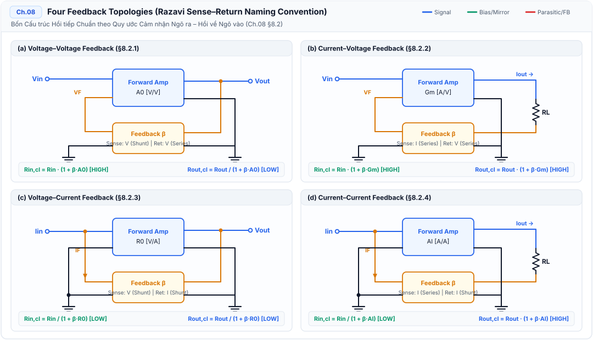

---
{
  "id": "concept-feedback-four-topologies",
  "kind": "concept",
  "domain": "dynamics-noise-feedback",
  "title_vi": "Bản chất Hồi tiếp Âm và Ma trận Nhận diện Bốn Cấu hình Cảm nhận – Hồi trả (Four Feedback Topologies: VV, CV, VC, CC)",
  "title_en": "Negative-Feedback Fundamentals, SNR Invariance, and Sense-Return Topology Identification (VV, CV, VC, CC)",
  "summary": "Hệ thống hóa 4 đặc tính cốt lõi của hồi tiếp âm (giảm độ nhạy theo 1 + beta*A0, mở rộng băng thông, nén tính phi tuyến, và bất biến tỷ số SNR với mạng hồi tiếp lý tưởng) cùng quy tắc bất bại nhận diện cơ chế Cảm nhận (Song song = Áp, Nối tiếp = Dòng) và Hồi trả cho cả 4 cấu hình VV, CV, VC, CC.",
  "diagram": "../../diagrams/feedback-four-topologies.svg",
  "razavi_refs": [
    {
      "chapter": 8,
      "section": "8.1-8.3",
      "pages": "274-299",
      "equations": ["8.2", "8.5", "8.6", "8.14", "8.17", "8.21", "8.28", "8.36", "8.38", "8.41", "8.44", "8.48", "8.50", "8.56"]
    }
  ],
  "glossary_codes": ["T042", "T051", "T076", "T077", "T1201", "T1206", "T1212", "T1214", "T1245", "T1246", "T1247", "T1257", "T1267", "T1274", "T1280", "T1282"],
  "process_agnostic": true,
  "roles": {
    "forward_amplifier_a": "Bộ khuếch đại truyền thuận (Áp Av, Hỗ dẫn Gm, Hỗ trở RT, hoặc Dòng AI) cung cấp độ lợi vòng hở lớn nhưng nhạy với biến thiên PVT",
    "sense_mechanism_output": "Cơ chế thu nhận đại lượng ngõ ra: mắc song song (shunt) để đo điện áp, hoặc mắc nối tiếp (series) vào đường dòng để đo dòng điện",
    "feedback_network_beta": "Mạng hồi tiếp thụ động chính xác (tỉ số điện trở hoặc tỉ số tụ điện trên chip) quyết định độ lợi vòng kín 1/beta khi beta*A0 >> 1",
    "return_subtractor_input": "Cơ chế trừ tín hiệu hồi trả tại ngõ vào: mắc nối tiếp để trừ điện áp (tăng Rin), hoặc mắc song song tại một nút để trừ dòng điện (giảm Rin)"
  },
  "symptoms_addressed": [
    "open-loop-gain-variation-across-pvt",
    "nonlinear-gain-compression-and-harmonic-distortion",
    "narrow-open-loop-3db-bandwidth",
    "uncontrolled-port-input-or-output-impedance",
    "misidentifying-feedback-sense-and-return-types"
  ],
  "limitations": [
    "negative-feedback-never-improves-input-referred-noise-and-passive-feedback-resistors-add-noise",
    "trades-away-open-loop-gain-for-precision-and-bandwidth",
    "multipole-loops-risk-phase-reversal-and-oscillation"
  ],
  "checklists": ["common-mos", "feedback-and-stb"]
}
---

## 1. Bản chất Nguyên lý, Sơ đồ Mạch & Vai trò Từng Nhánh Cấu trúc

Phát minh về **hồi tiếp âm (`T812`, negative feedback)** của Harold Black (1927) là trụ cột cho phép chế tạo các vi mạch tương tự đạt độ chính xác phần nghìn ($0{,}01\%\text{–}0{,}1\%$) từ những transistor MOSFET vốn có $g_m$, $r_O$ và $V_{TH}$ trôi dạt hàng chục phần trăm theo quy trình chế tạo, điện áp và nhiệt độ (PVT). Ý tưởng nền tảng (Razavi Chương 8, §8.1–§8.3) là dùng một mạng thụ động có tỉ số hình học cực kỳ chính xác trên mặt phẳng silicon (tỉ số hai tụ điện $C_1/C_2$ hoặc hai điện trở cùng loại $R_1/R_2$) để **cảm nhận (`T076`, sense)** đại lượng đầu ra, nhân với **hệ số hồi tiếp (`T1201`, feedback factor)** $\beta$, rồi **hồi trả (`T1269`, return)** ngược dấu về so sánh với đại lượng đầu vào nhằm triệt tiêu sai lệch $X_e = X_{in} - \beta Y_{out} \to 0$.

Để không bao giờ nhận diện nhầm cấu trúc hồi tiếp trên mạch transistor thực tế (nơi không hề vẽ sẵn hộp dấu trừ lý tưởng!), Razavi xây dựng quy tắc vật lý tuyệt đối dựa trên hai cổng (§8.1.2–§8.1.3):
1. **Bốn loại bộ khuếch đại hạt nhân (§8.1.2, Hình 8.13):**
   - **Bộ khuếch đại điện áp (Voltage Amplifier, $A_v = V_{out}/V_{in}$, không thứ nguyên):** Lý tưởng cần $R_{in} = \infty, R_{out} = 0$.
   - **Bộ khuếch đại hỗ dẫn (`T1238`, Transconductance Amplifier, $G_m = I_{out}/V_{in}$, đơn vị $\text{A/V} = \text{S}$):** Lý tưởng cần $R_{in} = \infty, R_{out} = \infty$.
   - **Bộ khuếch đại hỗ trở (`T1237`, Transimpedance Amplifier, $R_T = V_{out}/I_{in}$, đơn vị $\text{V/A} = \Omega$):** Lý tưởng cần $R_{in} = 0, R_{out} = 0$.
   - **Bộ khuếch đại dòng điện (Current Amplifier, $A_I = I_{out}/I_{in}$, không thứ nguyên):** Lý tưởng cần $R_{in} = 0, R_{out} = \infty$.
2. **Nhận diện Cơ chế Cảm nhận tại Ngõ ra (Output Sensing):**
   - Mạng hồi tiếp nối trực tiếp vào **cùng nút điện áp ngõ ra** (mắc song song — **shunt** với tải) $\implies$ **Cảm nhận Điện áp (Voltage Sensing)** $\implies$ hồi tiếp âm cố giữ $V_{out}$ không đổi nên **hạ thấp $R_{out}$ đi $(1 + \beta A_0)$ lần**!
   - Mạng hồi tiếp cắt vào đường đi của dòng tải (ví dụ lấy tín hiệu từ cực nguồn của transistor ngõ ra đang bơm dòng vào tải, mắc nối tiếp — **series** với tải) $\implies$ **Cảm nhận Dòng điện (Current Sensing)** $\implies$ hồi tiếp âm cố giữ $I_{out}$ không đổi nên **nâng cao $R_{out}$ lên $(1 + \beta A_0)$ lần**!
3. **Nhận diện Cơ chế Hồi trả & Trừ tại Ngõ vào (Input Return / Comparison):**
   - Nguồn tín hiệu vào $V_{in}$ và điện áp hồi tiếp $V_F$ đặt lên **hai cực khác nhau** của phần tử đầu vào (ví dụ $V_{in}$ vào cổng $+$, $V_F$ vào cổng $-$ của cặp vi sai; hoặc $V_{in}$ vào cực cổng và $V_F$ vào cực nguồn của cùng một MOSFET!) để hiệu điện áp điều khiển là $V_{in} - V_F$ (mắc nối tiếp — **series**) $\implies$ **Hồi trả Điện áp (Voltage Return)** $\implies$ **nâng cao $R_{in}$ lên $(1 + \beta A_0)$ lần**!
   - Nguồn tín hiệu vào $I_{in}$ và dòng hồi tiếp $I_F$ chụm vào **cùng một nút mạch duy nhất** (ví dụ cùng đổ vào cực cổng tầng CS hoặc cực âm đất ảo của Op-Amp, mắc song song — **shunt**) để KCL thực hiện phép trừ dòng $I_e = I_{in} - I_F$ $\implies$ **Hồi trả Dòng điện (Current Return)** $\implies$ **hạ thấp $R_{in}$ đi $(1 + \beta A_0)$ lần**!

---

## 2. Hệ Phương trình Cốt lõi & Tư duy "Nhìn Mạch Đọc Nhanh" (Analysis by Inspection)

### 2.1. Bốn Định luật Vàng của Hệ thống Hồi tiếp Âm Lý tưởng (§8.1.1 & §8.3)
Với độ lợi vòng hở (`T1214`) $A_0$, hệ số hồi tiếp $\beta$, **độ lợi vòng (`T051`, loop gain)** $L = \beta A_0$, và **hệ số giảm độ nhạy (`NG08-01`, desensitization factor)** $(1 + \beta A_0)$:
1. **Giảm độ nhạy độ lợi (`T1206`, Phương trình 8.5–8.6):**

$$
A_{\text{closed}} = \frac{Y}{X} = \frac{A_0}{1 + \beta A_0} = \frac{1}{\beta}\left(1 - \frac{1}{1 + \beta A_0}\right) \approx \frac{1}{\beta}, \qquad \frac{\Delta A_{\text{closed}} / A_{\text{closed}}}{\Delta A_0 / A_0} = \frac{1}{1 + \beta A_0}
$$

Sai số tỉ đối độ lợi tĩnh $\epsilon_{\text{gain}} = \dfrac{1}{1 + \beta A_0} \approx \dfrac{1}{\beta A_0}$! (Ví dụ cần sai số độ lợi $< 0{,}1\%$, bắt buộc $\beta A_0 \ge 1000 \iff 60\text{ dB}$!).
2. **Mở rộng băng thông một cực & Bảo toàn GBW (Phương trình 8.19–8.21):** Nếu $A(s) = \dfrac{A_0}{1 + s/\omega_0}$:

$$
A_{\text{closed}}(s) = \frac{\dfrac{A_0}{1 + \beta A_0}}{1 + \dfrac{s}{(1 + \beta A_0)\omega_0}} \implies \omega_{-3\text{dB,closed}} = (1 + \beta A_0)\,\omega_0
$$

Độ lợi giảm $(1 + \beta A_0)$ lần bao nhiêu thì băng thông $-3\text{ dB}$ mở rộng bấy nhiêu lần!
3. **Nén tính phi tuyến biên độ (Phương trình 8.22–8.28):** Nếu hai vùng làm việc có độ lợi vi phân vòng hở chênh nhau từ $A_1$ xuống $A_2$, sự biến thiên độ lợi vòng kín bị nén nhỏ đi $(1 + \beta A_2)$ lần:

$$
\frac{A_{\text{closed,1}}}{A_{\text{closed,2}}} = \frac{A_1}{A_2} \cdot \frac{1 + \beta A_2}{1 + \beta A_1} \approx 1 + \frac{A_1 - A_2}{A_2 (1 + \beta A_1)} \to 1 \quad (\text{khi } \beta A_1, \beta A_2 \gg 1)
$$

4. **Định luật Bất biến Nhiễu Quy về Ngõ vào dưới Hồi tiếp (§8.3, Phương trình 8.54–8.56):** Với nguồn nhiễu nội tại $V_{n,in}$ đặt ở ngõ vào bộ khuếch đại chính và mạng hồi tiếp $\beta$ không nhiễu:

$$
V_{\text{out}} = \frac{A_0}{1 + \beta A_0} V_{in} + \frac{A_0}{1 + \beta A_0} V_{n,in} \implies \left.V_{n,\text{in,closed}}\right|_{\beta\text{ noiseless}} = \frac{V_{n,\text{out,closed}}}{A_{\text{closed}}} \equiv V_{n,in}
$$

**Kết luận cực kỳ quan trọng:** Hồi tiếp âm giảm nhiễu ngõ ra và giảm tín hiệu ngõ ra theo **cùng một thừa số $(1 + \beta A_0)$**, nên **KHÔNG BAO GIỜ cải thiện được nhiễu quy về ngõ vào hay tỷ số SNR**! Tệ hơn nữa, trong thực tế mạng hồi tiếp dùng điện trở $R_1, R_2$ luôn bơm thêm nhiễu nhiệt $4kT(R_1 \parallel R_2)$ làm **xấu đi** nhiễu quy về ngõ vào!

### 2.2. Bảng Tra Nhanh Bốn Cấu hình Hồi tiếp Chuẩn (§8.2.1–§8.2.4)
*(Lưu ý qui ước đặt tên của Razavi: chữ đầu là đại lượng **Sense ở ngõ ra**, chữ thứ hai là đại lượng **Return ở ngõ vào**; trong khi tên gọi Series/Shunt truyền thống lại đọc từ **Ngõ vào trước – Ngõ ra sau**! Xem Chú thích 6–12 Chương 8):*

| Tên Razavi (Out–In) | Tên Nối mạch (In–Out) | Khối Chính $A$ & Thứ nguyên $\beta$ | Độ lợi Vòng kín ($L \gg 1$) | Trở kháng Vào $R_{in,\text{cl}}$ | Trở kháng Ra $R_{out,\text{cl}}$ |
|---|---|---|---|---|---|
| **Voltage–Voltage (`T1257`)** | Series–Shunt (`T1258`) | $A_v$ [V/V], $\beta$ [V/V] | $A_{v,\text{cl}} = \dfrac{A_v}{1 + \beta A_v} \approx \dfrac{1}{\beta}$ | $R_{in}(1 + \beta A_v)$ *(Tăng)* | $\dfrac{R_{out}}{1 + \beta A_v}$ *(Giảm)* |
| **Current–Voltage (`T1267`)** | Series–Series (`T1270`) | $G_m$ [A/V], $\beta = R_M$ [V/A] | $G_{m,\text{cl}} = \dfrac{G_m}{1 + R_M G_m} \approx \dfrac{1}{R_M}$ | $R_{in}(1 + R_M G_m)$ *(Tăng)* | $R_{out}(1 + R_M G_m)$ *(Tăng)* |
| **Voltage–Current (`T1274`)** | Shunt–Shunt (`T1277`) | $R_T$ [V/A], $\beta = G_F$ [A/V] | $R_{T,\text{cl}} = \dfrac{R_T}{1 + G_F R_T} \approx \dfrac{1}{G_F}$ | $\dfrac{R_{in}}{1 + G_F R_T}$ *(Giảm)* | $\dfrac{R_{out}}{1 + G_F R_T}$ *(Giảm)* |
| **Current–Current (`T1280`)** | Shunt–Series (`T1281`) | $A_I$ [A/A], $\beta$ [A/A] | $A_{I,\text{cl}} = \dfrac{A_I}{1 + \beta A_I} \approx \dfrac{1}{\beta}$ | $\dfrac{R_{in}}{1 + \beta A_I}$ *(Giảm)* | $R_{out}(1 + \beta A_I)$ *(Tăng)* |

**Mẹo Kiểm tra Cực tính Hồi tiếp Âm trong 5 Giây (Polarity Walk-Around Test):**
Giả sử nhích đại lượng đầu vào lên ($+$), đi dọc theo đường tín hiệu chính tới điểm cảm nhận ngõ ra, rồi đi dọc theo mạng hồi tiếp quay về điểm trừ ở ngõ vào:
- Nếu hồi trả vào **hai cực khác nhau** (ví dụ cổng và nguồn của cùng 1 MOSFET, hoặc hai cổng cặp vi sai): tín hiệu hồi về phải **CÙNG DẤU ($+$)** với tín hiệu vào để hiệu $V_{GS} = V_G - V_S$ hoặc $V_{id} = V_+ - V_-$ bị giảm đi!
- Nếu hồi trả vào **cùng một nút duy nhất** (trừ dòng hoặc cộng áp qua hai điện trở vào cùng một cổng): tín hiệu hồi về phải **NGƯỢC DẤU ($-$)** với tín hiệu vào để kéo nút đó ngược lại!

### 2.3. Bốn Sơ đồ Mạch Transistor Đại diện Điển hình trong Sách Razavi (§8.2.1–§8.2.4)
Để rèn phản xạ nhìn mạch transistor thực tế nhận ra ngay cấu hình hồi tiếp không cần sơ đồ khối:
1. **Ví dụ VV (Series–Shunt, Hình 8.23):** Cặp vi sai $M_1\text{–}M_2$ lái tầng CS PMOS $M_5$; cầu phân áp $R_1\text{–}R_2$ nối song song tại cực máng $M_5$ (cảm nhận áp $V_{\text{out}}$) và đưa điểm giữa về cực cổng $M_2$ (trừ áp nối tiếp qua cặp cổng $M_1\text{–}M_2$). Độ lợi vòng kín tiến về $1 + \frac{R_2}{R_1}$, $R_{\text{in}} \to \infty$, $R_{\text{out}}$ giảm đi $(1 + \beta A_0)$ lần.
2. **Ví dụ CV (Series–Series, Hình 8.32):** Tầng đầu nhận áp tại cực cổng nhưng dòng tải $I_{\text{out}}$ chảy qua transistor ngõ ra có điện trở cảm nhận $R_M$ nối ở cực nguồn xuống đất; điện áp rơi $I_{\text{out}} R_M$ được đưa về trừ nối tiếp với $V_{\text{in}}$. Cả $R_{\text{in}}$ lẫn $R_{\text{out}}$ đều tăng vọt lên $(1 + R_M G_m)$ lần, biến toàn mạch thành nguồn dòng điều khiển bằng áp cực kỳ lý tưởng $I_{\text{out}} \approx V_{\text{in}} / R_M$!
3. **Ví dụ VC (Shunt–Shunt TIA, Hình 8.35–8.37):** Nguồn dòng cảm biến $I_{\text{in}}$ (như photodiode) đổ vào cực cổng $M_1$, điện trở $R_F$ nối từ nút điện áp ngõ ra quay thẳng về chính cực cổng $M_1$ đó. Cả $R_{\text{in}}$ và $R_{\text{out}}$ đều bị nén nhỏ đi $(1 + L)$ lần, cho điện áp ra $V_{\text{out}} \approx -I_{\text{in}} R_F$.
4. **Ví dụ CC (Shunt–Series, Hình 8.40–8.42):** Nguồn dòng $I_{\text{in}}$ đổ vào nút cổng/nguồn trở kháng thấp, còn dòng ngõ ra $I_{\text{out}}$ được cảm nhận tại cực nguồn transistor ngõ ra rồi chia dòng qua cầu điện trở trả ngược dòng tỷ lệ $\beta I_{\text{out}}$ về nút đầu vào, cho bộ khuếch đại dòng chính xác $I_{\text{out}} / I_{\text{in}} \approx 1 + \frac{R_1}{R_2}$!

---

## 3. Bất biến Cấu trúc & Các Bẫy Lỗi Kinh điển (Structural Invariants & Traps)

- **[INV-FB-01] Quy luật Đối xứng Trở kháng Cổng theo Kiểu Đấu Nối:** Không bao giờ cần học thuộc lòng 8 công thức $R_{in}, R_{out}$! Chỉ cần nhớ đúng 2 từ: **Nối tiếp (Series) $\implies$ Nhân $(1 + L)$** (làm trở kháng lớn hơn để đo dòng tốt hơn hoặc không tải nguồn áp); **Song song (Shunt) $\implies$ Chia $(1 + L)$** (làm trở kháng nhỏ hơn để hút trọn dòng vào hoặc ghim cứng điện áp ra)!
- **[TRAP-FB-01] Nhầm lẫn Chiều Gọi Tên Cấu hình giữa Sách Razavi và Sách Gray & Meyer:** Trong Razavi Chương 8, "Current–Voltage Feedback" (§8.2.2) có nghĩa là **Sense Current ở ngõ ra, Return Voltage ở ngõ vào** (tức bộ khuếch đại hỗ dẫn $G_m$, ví dụ CS suy biến nguồn lấy dòng ra ở máng!). Trong một số sách khác gọi theo thứ tự In–Out thì "Current–Voltage" lại bị hiểu ngược! Để tránh nhầm 100%, trong thiết kế thực chiến hãy luôn kèm tên đấu nối vật lý `(In–Out)`: **Series–Shunt (VV)**, **Series–Series (CV)**, **Shunt–Shunt (VC/TIA)**, **Shunt–Series (CC)**.
- **[TRAP-FB-02] Bẫy Mạch Chia Tụ $C_1, C_2$ Không Có Phân cực DC Cho Nút Giữa (Chú thích 2, tr. 276 & §9.1):** Nhiều người thấy hồi tiếp bằng tỉ số tụ $\beta = \frac{C_1}{C_1 + C_2}$ không tiêu thụ dòng DC và không sinh nhiễu nhiệt $4kTR$ nên thay thẳng hai điện trở bằng hai tụ điện nối vào cực cổng MOSFET. **Lỗi chí mạng!** Nút chung giữa $C_1, C_2$ và cực cổng MOSFET trở thành nút nổi DC hoàn toàn (floating node): điện tích kẹt lúc chế tạo và dòng rò sẽ đẩy cổng MOSFET chạm nguồn cấp làm mạch tê liệt! Luôn phải có công tắc đặt lại (reset switch trong mạch SC, `topo-switched-capacitor-amplifiers-integrators`) hoặc giả điện trở siêu lớn (pseudo-resistor) ghim mức DC!
- **[TRAP-FB-03] Lầm Tưởng Cực Dấu $-$ / $+$ Trên Sơ đồ Op-Amp Là Cố Định Bất Chấp Tầng Phụ Phía Sau:** Khi gắn thêm một tầng nguồn chung đảo pha (ví dụ transistor công suất PMOS trong mạch ổn áp LDO `topo-cmos-ldo-regulator` hoặc tầng đệm đảo pha) nằm bên trong vòng hồi tiếp phía sau Op-Amp, tầng phụ đã đảo pha thêm $180^\circ$! Lúc đó điện áp hồi tiếp từ ngõ ra cuối cùng **phải nối về cực DƯƠNG ($+$)** của Op-Amp đầu vào thì toàn vòng mới là hồi tiếp âm!

---

## 4. Lộ trình Nâng cấp Cấu trúc & Bát giác Đánh đổi (Upgrade Paths & Design Octagon)

| Khi phép phân tích / cấu trúc lý tưởng chưa đủ | Chuyển sang Thẻ Tri thức chuyên sâu (Canonical Node) | Giải quyết vấn đề gì | Cái giá / Điều kiện kèm theo |
|---|---|---|---|
| Mạng hồi tiếp dùng điện trở $R_1, R_2$ hoặc $R_F$ tải trực tiếp lên ngõ vào và ngõ ra bộ khuếch đại | `tech-feedback-two-port-loading` | Quy tắc mở vòng giữ nguyên tải hai cửa cho cả 4 cấu hình VV, CV, VC, CC | Cần xác định đúng mô hình hai cửa ($g, z, y, h$) trước khi cắt vòng |
| Mạch có đường truyền thẳng hai chiều qua $R_F$ hoặc $C_{GD}$, nhiều vòng lồng nhau, cần kiểm tra bằng máy tính | `tech-bode-blackman-middlebrook-stb` | Giải chính xác bằng Bode / Blackman / Middlebrook và chạy `stb` với `iprobe` / `diffstbprobe` trong Spectre | Phân biệt chặt tỉ số hồi trả $T$ với độ lợi vòng lý tưởng $\beta A_0$ |
| Bộ khuếch đại nhiều tầng đóng vòng hồi tiếp bị vọt lố hoặc tự dao động | `law-multipole-phase-margin` & `tech-miller-pole-splitting` | Thiết lập điều kiện dự trữ pha $\text{PM} \ge 60^\circ$ và tách cực bù tần số | Phải giảm băng thông vòng hở cực trội để đổi lấy sự ổn định vòng kín |
| Hồi tiếp bằng điện trở tốn dòng tĩnh lớn và thu hẹp biên độ ra | `topo-switched-capacitor-amplifiers-integrators` | Dùng mạng tụ chuyển mạch cho độ chính xác tỉ số tụ $< 0{,}1\%$ và không tải DC lên tầng ra | Cần xung nhịp hai pha không chồng lấn và chịu nhiễu lấy mẫu $kT/C$ |

---

## 5. Thích ứng Đa Tiến trình (90nm / 65nm / 45nm) & Cách Kiểm chứng trong Cadence / Spectre

### 5.1. Thích ứng Công nghệ Nanomet (90nm $\to$ 65nm $\to$ 45nm)
- **Khủng hoảng Sai số Độ lợi Tĩnh do $g_m r_O$ Thấp:** Ở tiến trình $0{,}5\,\mu\text{m}$, một tầng cascode đơn dễ dàng đạt $A_0 \sim (30)^2 = 900\text{ V/V}$ ($59\text{ dB}$). Khi sang **65nm / 45nm**, $g_m r_O$ của transistor kênh ngắn tụt xuống $8\text{–}12$, khiến một OTA 5T chỉ còn $A_0 \sim 10$ và ngay cả Folded-Cascode cũng chỉ đạt $A_0 \sim 60\text{–}150$ ($35\text{–}43\text{ dB}$)! Với $\beta = 0{,}5$ (khuếch đại nhân 2), $\beta A_0 = 50$ gây ra sai số độ lợi tĩnh lên tới $\frac{1}{1 + 50} \approx 2\%$ (chỉ tương đương chưa nổi 6 bit ENOB!) và hiệu quả nén méo hài $HD_3$ giảm thê thảm. Do đó ở 65nm/45nm, chỉ tiêu sai số tĩnh $\epsilon_{\text{gain}}$ và độ tuyến tính vòng kín $HD_3$ mới là yếu tố ép buộc người thiết kế phải nâng cấp lên `topo-two-stage-opamp` có cascode tầng 1 hoặc `topo-gain-boosted-cascode`!

### 5.2. Quy trình Kiểm chứng trong Cadence Virtuoso / Spectre
1. **Kiểm tra Sai số Độ lợi & Tuyến tính Vòng kín bằng Quét `dc` Đạo hàm:**
   - Đóng vòng hồi tiếp hoàn chỉnh, quét `dc` điện áp vào $V_{in}$ trên toàn dải hoạt động.
   - Dùng hàm đạo hàm `deriv(V(out))` trong ViVA Calculator: đường cong đạo hàm chính là độ lợi vi phân vòng kín $A_{\text{closed}}(V_{in})$! Độ lệch của đỉnh đường cong so với $1/\beta$ cho biết chính xác sai số độ lợi hữu hạn $\frac{1}{1+\beta A_0}$, còn độ võng xuống ở hai rìa dải ra chỉ đích danh điểm mà các transistor tầng ra chớm rơi vào vùng triode làm sập $\beta A_0$!
2. **Kiểm chứng Bất biến Nhiễu Vòng Hở vs. Vòng Kín (`noise`):**
   - Tắt nhiễu của hai điện trở hồi tiếp lý tưởng (`isnoisy=no` trên $R_1, R_2$), chạy `noise`: bạn sẽ thấy nhiễu quy về ngõ vào `in` của mạch vòng kín khớp trùng khít với nhiễu quy về ngõ vào của riêng Op-Amp vòng hở. Sau đó bật lại `isnoisy=yes` trên $R_1, R_2$ để định lượng ngay phần nhiễu phụ trội $4kT(R_1 \parallel R_2)$ do mạng hồi tiếp cộng thêm!

---

## 6. Mốc Đối chiếu Sách Razavi & Thuật ngữ Chuẩn CLB

### 6.1. Đối chiếu Sách Gốc Razavi (2nd Edition)
- **Chương 8:** *Feedback* — §8.1 *General Considerations* (tr. 274–286, Phương trình 8.1–8.30, Hình 8.1–8.20), §8.2 *Feedback Topologies* (tr. 286–298, Phương trình 8.31–8.53, Hình 8.21–8.42), §8.3 *Effect of Feedback on Noise* (tr. 298–299, Phương trình 8.54–8.56, Hình 8.43–8.44).
- **Chú giải Hiệu đính Học thuật CLB (`NG08`):**
  - **`NG08-01` (tr. 282):** Ngay sau Phương trình (8.28), lời văn nguồn gọi $(1 + \beta A_2)$ là *"loop gain"* (độ lợi vòng). Theo đúng định nghĩa chuẩn ở tr. 276 và `T051`, **độ lợi vòng là $\beta A_2$**, còn **$(1 + \beta A_2)$ là hệ số giảm độ nhạy (desensitization factor / return difference)**.
  - **`NG08-02` (tr. 292, Chú thích chân trang 10):** Khi giải thích mạch Current–Voltage Feedback ở Hình 8.30–8.32 (khối $G_m$ nhận áp xuất dòng), chú thích chân trang trong bản in gốc viết nhầm tên khối thành *"transimpedance amplifier"*; theo đúng phân loại Hình 8.13, khối $G_m$ đó là **bộ khuếch đại hỗ dẫn (`T1238`, transconductance amplifier)**.
  - **Quy ước dịch thuật CLB cho `sense` (`T076`, `T077`):** Trong ngữ cảnh cấu trúc hồi tiếp Chương 8, giữ phân biệt giữa `sense` (*cảm nhận / thu nhận tín hiệu*) và `sampling` (*lấy mẫu rời rạc thời gian*, Chương 13) để không nhầm mạch hồi tiếp liên tục thời gian với mạch lấy mẫu giữ!

### 6.2. Bảng Thuật ngữ Chuẩn CLB Vi Mạch Sử dụng trong Thẻ
| Mã CLB | Thuật ngữ Tiếng Anh | Thuật ngữ Tiếng Việt Chuẩn | Ghi chú Ngữ cảnh |
|---|---|---|---|
| `T042` | feedback | hồi tiếp | Mặc định hiểu là hồi tiếp âm trong khuếch đại tuyến tính |
| `T051` | loop gain | độ lợi vòng | $\beta A_0$, phân biệt với độ lợi vòng hở $A_0$ (`T1214`) và vòng kín (`T1212`) |
| `T1201` | feedback factor | hệ số hồi tiếp | Tỉ số truyền của mạng hồi tiếp $\beta$ (có thể mang thứ nguyên $\Omega$ hoặc $\text{S}$) |
| `T1206` | gain desensitization | giảm độ nhạy của độ lợi | Nén biến thiên $\Delta A / A$ đi $(1 + \beta A_0)$ lần |
| `T077` | sense and return | cảm nhận và hồi về | Cơ chế đọc ngõ ra và trả tín hiệu về ngõ vào |
| `T1257` | voltage-voltage feedback | hồi tiếp điện áp–điện áp | Cảm nhận áp ngõ ra, hồi trả áp nối tiếp ngõ vào (Series–Shunt) |
| `T1267` | current-voltage feedback | hồi tiếp dòng điện–điện áp | Cảm nhận dòng ngõ ra, hồi trả áp nối tiếp ngõ vào (Series–Series) |
| `T1274` | voltage-current feedback | hồi tiếp điện áp–dòng điện | Cảm nhận áp ngõ ra, hồi trả dòng song song ngõ vào (Shunt–Shunt) |
| `T1280` | current-current feedback | hồi tiếp dòng điện–dòng điện | Cảm nhận dòng ngõ ra, hồi trả dòng song song ngõ vào (Shunt–Series) |
