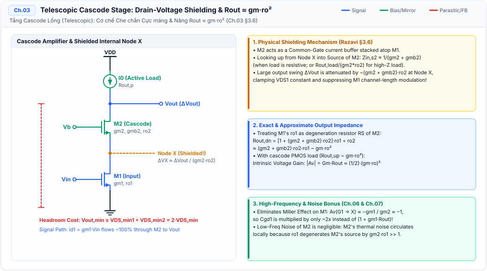

---
{
  "id": "concept-high-freq-cs-cg-cascode",
  "kind": "concept",
  "domain": "dynamics-noise-feedback",
  "title_vi": "Đáp ứng Tần số Cao của Tầng Nguồn Chung, Cổng Chung và Cascode (High-Frequency Response of CS, CG & Cascode Stages)",
  "title_en": "High-Frequency Poles and Zeros of Common-Source, Common-Gate, and Cascode Stages",
  "summary": "Đối chiếu động học tần số cao của ba tầng khuếch đại hạt nhân: vì sao tầng cổng chung (CG) miễn nhiễm với nhân tụ Miller và tầng cascode triệt tiêu suy giảm băng thông ngõ vào nhờ nút che chắn trở kháng thấp 1/(gm2+gmb2) đẩy cực nội lên gần fT.",
  "diagram": "../../diagrams/cascode-shielding.svg",
  "razavi_refs": [
    {
      "chapter": 6,
      "section": "6.2, 6.4, 6.5",
      "pages": "180-187, 193-198",
      "equations": ["6.35", "6.68", "6.69", "6.73", "6.78", "6.79", "6.80", "6.81", "6.85", "6.86"]
    }
  ],
  "glossary_codes": ["T021", "T023", "T499", "T503", "T844", "T846", "T847", "T879", "T912", "T913"],
  "process_agnostic": true,
  "roles": {
    "cs_transconductor": "Transistor đầu vào M1 biến đổi điện áp cổng thành dòng tín hiệu gm1*Vin nhưng chịu tụ cầu nối Cgd1",
    "cg_current_buffer": "Transistor cổng chung M2 có cực cổng nối đất xoay chiều, cô lập hoàn toàn nút nguồn (nút X) khỏi dao động điện áp lớn tại nút máng",
    "cascode_internal_node_x": "Nút nội giữa máng M1 và nguồn M2 có trở kháng nhìn lên ~1/(gm2+gmb2), ghim hệ số nhân Miller của Cgd1 xuống xấp xỉ 2",
    "high_z_output_node": "Nút ngõ ra cực máng M2 mang trở kháng rất lớn Rout ~ gm2*ro2*ro1 song song tải, tạo thành cực ngõ ra quyết định độ lợi tần số cao"
  },
  "symptoms_addressed": [
    "severe-miller-input-capacitance-loading",
    "low-input-pole-with-high-source-resistance",
    "poor-reverse-isolation-gate-to-drain"
  ],
  "limitations": [
    "cg-low-input-impedance-attenuates-voltage-sources",
    "cg-input-impedance-rises-sharply-when-drain-load-is-high-ro",
    "cascode-internal-node-pole-adds-phase-shift-in-feedback-loops",
    "cascode-stack-reduces-output-voltage-swing"
  ],
  "checklists": ["common-mos", "single-stage"]
}
---

## 1. Bản chất Nguyên lý, Sơ đồ Mạch & Vai trò Từng Nhánh Cấu trúc

Khi ghép nối các tầng khuếch đại ở tần số cao, một tầng nguồn chung (`topo-cs-current-source-and-active-load`) đơn độc gặp mâu thuẫn cốt tử: muốn có độ lợi lớn $g_{m1} R_D$, điện áp tại cực máng phải dao động mạnh ngược pha với cực cổng, khiến tụ $C_{GD1}$ bị nhân Miller lên $(1 + g_{m1} R_D)$ lần và đè sập cực ngõ vào ngay khi trở kháng nguồn $R_S$ không bằng 0. Để phá vỡ thế bế tắc này, kỹ thuật mạch tương tự sử dụng sự cô lập của **tầng cổng chung (common-gate stage, CG)** và ghép nó chồng lên tầng nguồn chung tạo thành **tầng cascode (cascode stage)**.

Sự phân công vai trò động học trong cấu trúc ghép CS–CG (Cascode) diễn ra trên 3 nút chính:
1. **Nút Ngõ vào (Cực cổng $M_1$, điều khiển bởi $R_S$):** Nhận điện áp tín hiệu. Nhờ cực máng $M_1$ bị ghim thế bởi cực nguồn của $M_2$, biên độ độ lợi từ cổng đến máng của riêng $M_1$ chỉ còn $A_{v1} \approx -\frac{g_{m1}}{g_{m2} + g_{mb2}}$ (thường xấp xỉ $-1$ nếu hai transistor cùng cỡ), nên điện dung Miller chỉ còn $\approx 2 C_{GD1}$ thay vì hàng chục lần $C_{GD1}$!
2. **Nút Nội Cascode $X$ (Máng $M_1$ nối Nguồn $M_2$):** Đây là nút chuyển tiếp dòng điện tín hiệu (current-mode handoff). Tất cả các điện dung ký sinh quy tụ về $X$ gồm $C_X = C_{DB1} + C_{SB2} + C_{GS2} + C_{GD1,\text{Miller-out}}$ đều nhìn thấy trở kháng cực thấp $\frac{1}{g_{m2} + g_{mb2}}$ nhìn lên cực nguồn $M_2$, tạo ra một cực phụ nằm ở vùng tần số rất cao (cỡ một phần của tần số chuyển tiếp $f_{T2}$).
3. **Nút Ngõ ra (Cực máng $M_2$):** Cực cổng của $M_2$ được nối tới điện áp phân cực cố định $V_b$ (đất xoay chiều lý tưởng nếu không có trở kháng nối tiếp lớn tại cổng), nên $C_{GD2}$ nối thẳng xuống đất xoay chiều mà **không bị nhân Miller**, kết hợp với $C_{DB2} + C_L$ và điện trở tải tạo nên cực ngõ ra.

---

## 2. Hệ Phương trình Cốt lõi & Tư duy "Nhìn Mạch Đọc Nhanh" (Analysis by Inspection)

### 2.1. Tầng Nguồn Chung (CS): Giới hạn bởi Tương tác Vào–Ra (§6.2)
Nhắc lại từ nghiệm bậc hai chính xác (`law-miller-theorem-and-rhp-zero`, Phương trình 6.35), hằng số thời gian cực trội của tầng CS mang tải $R_D$ là:

$$
\tau_{p1,\text{CS}} = R_S C_{GS1} + R_S (1 + g_{m1} R_D) C_{GD1} + R_D (C_{GD1} + C_{DB1} + C_L)
$$

Khi cả $R_S$ (trở kháng ra tầng trước) và $g_{m1} R_D$ đều lớn, số hạng giữa $R_S g_{m1} R_D C_{GD1}$ phình to gấp hàng chục lần hai số hạng còn lại, biến $C_{GD1}$ thành nút cổ chai tốc độ số một.

### 2.2. Tầng Cổng Chung (CG): Cô lập Miller nhưng Nhạy với $r_O$ khi Tải Lớn (§6.4)
- **Trường hợp lý tưởng bỏ qua điều chế chiều dài kênh ($\lambda = 0$, $r_O \to \infty$, Hình 6.31):** Nút vào (nguồn, tổng tụ $C_S = C_{GS} + C_{SB}$) và nút ra (máng, tổng tụ $C_D = C_{GD} + C_{DB} + C_L$) tách rời hoàn toàn thành **2 cực độc lập không tương tác** (Phương trình 6.68):

$$
\frac{V_{out}}{V_{in}}(s) = \frac{(g_m + g_{mb}) R_D}{1 + (g_m + g_{mb}) R_S} \cdot \frac{1}{\left(1 + \dfrac{C_S}{g_m + g_{mb} + R_S^{-1}} s\right)(1 + R_D C_D s)}
$$

Cực ngõ vào nằm ở $\omega_{p,\text{in}} = \frac{g_m + g_{mb} + R_S^{-1}}{C_{GS} + C_{SB}} > \frac{g_m}{C_{GS}} \approx \omega_T$ — tức vượt lên vùng tần số chuyển tiếp nội tại của linh kiện!

- **Trường hợp thực tế $r_O < \infty$ và tải cực máng lớn ($Z_L$ hoặc nguồn dòng, Phương trình 6.69–6.73):** Điện trở kênh $r_O$ nối chéo giữa nguồn và máng phá vỡ sự cô lập tuyệt đối! Trở kháng nhìn vào cực nguồn khi cực máng mang tải phức $Z_L(s) = R_D \parallel \frac{1}{s C_L}$ là:

$$
Z_{in,\text{CG}}(s) = \frac{r_O + Z_L(s)}{1 + (g_m + g_{mb}) r_O}
$$

Với tầng CG mang tải nguồn dòng lý tưởng ($R_D \to \infty$, $Z_L = \frac{1}{s C_L}$), hàm truyền chính xác từ nguồn có $R_S$ và tụ vào $C_{in}$ là (Phương trình 6.73):

$$
\frac{V_{out}}{V_{in}}(s) = \frac{1 + (g_m + g_{mb}) r_O}{r_O C_L C_{in} R_S s^2 + \left[ r_O C_L + C_{in} R_S + \big(1 + (g_m + g_{mb}) r_O\big) C_L R_S \right] s + 1}
$$

Chú ý số hạng $(1 + g_m r_O) C_L R_S$: khi tải máng là trở kháng cực lớn, $r_O$ phản chiếu điện dung tải $C_L$ ở cực máng ngược về cực nguồn (chia cho $1+g_m r_O$ đối với trở kháng tương đương nhân $(1+g_m r_O) R_S$ trong hằng số thời gian khi so với $r_O C_L$!). Ngoài ra, nếu cực cổng CG có điện trở nối tiếp ký sinh $R_G \neq 0$, trở kháng nhìn vào cực nguồn xuất hiện thành phần cảm kháng ở tần số cao tương tự mạch bám nguồn (Phương trình 6.74–6.78).

### 2.3. Tầng Cascode: Ba Cực Nút & Sự Biến đổi $Z_{out}(s)$ theo Tần số (§6.5)
Xét tầng cascode gồm transistor đầu vào $M_1$ và transistor cascode cổng chung $M_2$ (Hình 6.34, bỏ qua tương tác bậc cao của $r_{O1}, r_{O2}$ khi tải $R_D$ vừa phải, Phương trình 6.79–6.81):
1. **Cực tại nút cổng ngõ vào $A$:** Độ lợi từ cổng $M_1$ đến nút nội $X$ là $A_{v,AX} \approx -\frac{g_{m1}}{g_{m2} + g_{mb2}}$, nên:

$$
\omega_{p,A} \approx \frac{1}{R_S \left[ C_{GS1} + \left(1 + \dfrac{g_{m1}}{g_{m2} + g_{mb2}}\right) C_{GD1} \right]}
$$

2. **Cực tại nút nội $X$ (Máng $M_1$ / Nguồn $M_2$):** Tổng điện dung tại nút $X$ là $C_X = C_{DB1} + C_{SB2} + C_{GS2} + \left(1 + \frac{g_{m2} + g_{mb2}}{g_{m1}}\right) C_{GD1}$ (lưu ý `NG06-10`: Hình 6.34 gốc in nhầm nhãn $C_{GD2}$ tại $X$, thực chất phải là $C_{GS2}$!), cho tần số cực nội:

$$
\omega_{p,X} \approx \frac{g_{m2} + g_{mb2}}{C_X}
$$

3. **Cực tại nút ngõ ra $out$:**

$$
\omega_{p,\text{out}} \approx \frac{1}{(R_D \parallel R_{out,\text{cas}}) (C_{DB2} + C_{GD2} + C_L)}
$$

**Phân tích chính xác khi Cascode dùng làm OTA có $R_D \to \infty$ (Phương trình 6.82–6.86):**
Dòng tín hiệu từ $M_1$ bị chia dòng tại nút $X$ giữa trở kháng nhìn lên cực nguồn $M_2$ ($\approx \frac{1}{g_{m2}+g_{mb2}}$) và tụ ký sinh $C_X$ xuống đất, nên hỗ dẫn truyền thẳng hiệu dụng từ cổng $M_1$ ra dòng ngắn mạch cực máng $M_2$ có cực tại $\omega_{p,X}$:

$$
G_m(s) = \frac{I_{out,\text{sc}}}{V_{in}}(s) \approx \frac{g_{m1}}{1 + \dfrac{s C_X}{g_{m2} + g_{mb2}}}
$$

Đồng thời, trở kháng ngõ ra nhìn vào cực máng $M_2$ suy biến bởi tổng trở phức $Z_X(s) = r_{O1} \parallel \frac{1}{s C_X}$ tại cực nguồn là (Phương trình 6.86):

$$
Z_{out}(s) = \left[1 + (g_{m2} + g_{mb2}) r_{O2}\right] \left(r_{O1} \parallel \frac{1}{s C_X}\right) + r_{O2}
$$

Khi $s$ tăng cao làm $\frac{1}{\omega C_X} \ll r_{O1}$, sự nâng trở kháng cascode sụp đổ dần từ $\approx g_{m2} r_{O2} r_{O1}$ xuống còn $r_{O2}$!

---

## 3. Bất biến Cấu trúc & Các Bẫy Lỗi Kinh điển (Structural Invariants & Traps)

- **[INV-CASC-01] Bất biến Giảm Hệ số Nhân Miller xuống Hằng số Nhỏ:** Trong mọi tầng cascode thiết kế đúng ($M_1$ và $M_2$ đều bão hòa, tải máng $M_2$ không đẩy $Z_{in,M2}$ vượt quá $r_{O1}$), nếu $M_1$ và $M_2$ có hỗ dẫn tương đương nhau ($g_{m1} \approx g_{m2}$) thì hệ số nhân Miller của $C_{GD1}$ bị khóa quanh giá trị $\approx 2$ bất kể độ lợi DC tổng của tầng lớn tới $40\text{ dB}$ hay $80\text{ dB}$.
- **[TRAP-CASC-01] Tưởng Rằng Tầng CG Luôn Có $R_{in} = 1/(g_m + g_{mb})$ Ở Mọi Tải:** Nếu cực máng của transistor cascode $M_2$ mang tải nguồn dòng cascode trở kháng siêu cao $R_L \sim g_m r_O^2$ ở tần số thấp, trở kháng nhìn vào cực nguồn $M_2$ tăng vọt lên:

$$
R_{in,M2}(0) = \frac{r_{O2} + R_L}{1 + (g_{m2} + g_{mb2}) r_{O2}} \approx r_{O1}\text{–cỡ vài chục } \text{k}\Omega!
$$

Lúc đó ở **tần số rất thấp**, độ lợi tại nút nội $X$ không phải $-1$ mà có thể đạt $-\frac{1}{2} g_{m1} r_{O1}$! Tuy nhiên, ngay khi tần số vượt qua cực trội ngõ ra rất thấp $\omega_{p,\text{out}} = \frac{1}{R_{out} C_L}$, tụ tải $C_L$ lập tức ngắn mạch xoay chiều cực máng $M_2$, kéo $Z_{in,M2}$ tụt nhanh về đúng $\frac{1}{g_{m2} + g_{mb2}}$, nên ở toàn bộ vùng tần số trung và cao gần băng thông độ lợi đơn vị, tính chất chống Miller của cascode vẫn phát huy trọn vẹn!
- **[TRAP-CASC-02] Bẫy Làm Quá Rộng Transistor Cascode $M_2$ Gây Sụt Dự trữ Pha:** Tăng chiều rộng $W_2$ quá lớn với hy vọng tăng $g_{m2}$ để đẩy cực phụ $\omega_{p,X} = \frac{g_{m2}+g_{mb2}}{C_{DB1} + C_{SB2} + C_{GS2}}$ lên cao sẽ phản tác dụng khi $C_{GS2} + C_{SB2} \gg C_{DB1}$: lúc đó cả tử số lẫn mẫu số cùng tăng theo $W_2$ (hoặc ở mật độ dòng thấp đi vào cận ngưỡng thì $C_{GS2}$ tăng nhanh hơn $g_{m2}$!), trong khi lại cộng thêm $C_{DB2} + C_{GD2}$ làm nặng tải ngõ ra.
- **[TRAP-CASC-03] Quên Tụ Khử Nhiễu (Bypass Capacitor) hoặc Để Điện trở Lớn trên Cực cổng Cascode $V_b$:** Nếu mạng phân cực tạo $V_b$ cho cực cổng $M_2$ có trở kháng ra lớn $R_G$ mà không có tụ bypass ở tần số cao, $C_{GD2}$ sẽ tạo vòng hồi tiếp làm xuất hiện cực-zero phụ và thành phần cảm kháng nhìn vào cực nguồn $M_2$ (Phương trình 6.77–6.78), gây vọt lố (peaking) hoặc dao động ký sinh!

---

## 4. Lộ trình Nâng cấp Cấu trúc & Bát giác Đánh đổi (Upgrade Paths & Design Octagon)

| Điểm nghẽn của cấu trúc hiện tại | Nâng cấp sang cấu trúc đích (Canonical Node) | Lý do chuyển đổi | Cái giá trên Bát giác Đánh đổi |
|---|---|---|---|
| Tầng CS đơn bị sập băng thông do Miller $C_{GD1}$ và thiếu $R_{out}$ | `topo-cascode-stage` / `topo-telescopic-cascode-opamp` | Triệt hiệu ứng Miller ngõ vào và nhân $R_{out}$ lên $(g_m r_O)$ lần mà không tăng dòng tĩnh $I_D$ | Chồng 4–5 transistor nối tiếp giữa $V_{DD}$ và đất làm thu hẹp biên độ ra và hẹp ICMR |
| Tầng Cascode xếp chồng (Telescopic) quá chật headroom ở $V_{DD} \le 1{,}0\text{ V}$ hoặc cần nối hồi tiếp đơn vị $V_{in}=V_{out}$ | `topo-folded-cascode-ota` | Tách nhánh dòng DC của $M_1$ và $M_2$ bằng cách gập sang transistor đối cực (NMOS $\to$ PMOS hoặc ngược lại) | Tốn gấp ~2 lần dòng phân cực, nhiễu nhiệt tăng do nguồn dòng gập, và cực nút gập $\omega_{p,\text{fold}}$ thấp hơn nếu cascode là PMOS ($f_{T,P} < f_{T,N}$) |
| Cần đẩy thêm độ lợi DC vượt qua $(g_m r_O)^2$ ở 65nm/45nm mà vẫn giữ tốc độ 1 tầng của Cascode | `topo-gain-boosted-cascode` | Gắn bộ khuếch đại phụ điều chỉnh cổng $M_2$ nhân $R_{out}$ thêm $(1 + A_{\text{aux}})$ lần | Xuất hiện cặp cực–zero gần trùng (doublet) đòi hỏi ràng buộc chặt dải tần $\omega_{b1} < \omega_{u,\text{aux}} < \omega_{p2,\text{main}}$ |

---

## 5. Thích ứng Đa Tiến trình (90nm / 65nm / 45nm) & Cách Kiểm chứng trong Cadence / Spectre

### 5.1. Thích ứng Công nghệ Nanomet (90nm $\to$ 65nm $\to$ 45nm)
- **Tối ưu chiều dài kênh $L_2$ của transistor cascode $M_2$:** Trong các Op-Amp tốc độ cao đóng vòng hồi tiếp (`topo-telescopic-cascode-opamp`, `topo-folded-cascode-ota`), cực không trội thứ nhất chính là cực nút nội cascode $\omega_{p,X} \approx \frac{g_{m2}+g_{mb2}}{C_X}$. Do $C_{GS2} \propto W_2 L_2$, chọn $L_2$ quá dài (ví dụ $4 L_{\min}$) sẽ làm giảm mạnh $f_{T2} \propto 1/L_2^2$ (hoặc $1/L_2$ trong vùng bão hòa vận tốc), kéo $\omega_{p,X}$ tụt xuống gần $\text{GBW}$ và phá hỏng dự trữ pha! Quy tắc thực chiến ở 90nm/65nm/45nm: giữ $L_2 \approx 1{,}2\text{–}2\,L_{\min}$ cho nhánh tín hiệu cascode để đảm bảo $\omega_{p,X} > 3 \times \text{GBW}$, còn các nguồn dòng tải tĩnh không mang cực nút gập thì dùng $L$ dài hơn ($2\text{–}4\,L_{\min}$) để giữ $r_O$ và giảm nhiễu.
- **Tối ưu Layout chung vùng khuếch tán Máng–Nguồn (Shared Active Diffusion):** Nếu $M_1$ và $M_2$ cùng loại hạt tải (cùng NMOS trong Telescopic Cascode) và có cùng chiều rộng ngón $W_f$ cùng số ngón `nf`, có thể gộp vùng máng $M_1$ và nguồn $M_2$ trên layout không cần hàng contact kim loại ở nút $X$ (nếu quy tắc DRC cho phép) hoặc chia sẻ vùng active tối thiểu để cắt giảm một nửa $C_{DB1} + C_{SB2}$, đẩy trực tiếp $\omega_{p,X}$ lên cao!

### 5.2. Quy trình Kiểm chứng trong Cadence Virtuoso / Spectre
1. **Đo tỷ lệ chia dòng tần số cao tại nút nội $X$:**
   - Chạy `ac` với ngõ ra tải đúng $C_L$ thực tế. Vẽ đồng thời tỉ số biên độ điện áp nút nội $|V(X)/V(in)|$ theo tần số: kiểm tra xem ở vùng tần số gần $f_u$ (băng thông độ lợi đơn vị), $|V(X)/V(in)|$ có giảm về mức nhỏ ($\le 1\text{–}2$) để xác nhận cơ chế che chắn Miller hoạt động đúng hay không.
2. **Định vị chính xác cực phụ nút nội $\omega_{p,X}$:**
   - Quan sát pha của dòng ngắn mạch ngõ ra (hoặc pha của hàm truyền vòng `loopGain` trong phân tích `stb` của Cadence): tần số mà góc pha vượt qua $-135^\circ$ (sau khi cực trội ngõ ra đã gây $-90^\circ$) chính là tần số hiệu dụng của $\omega_{p,X}$ (cộng với các cực phụ khác). Đối chiếu với công thức tay $f_{p,X} = \frac{g_{m2} + g_{mb2}}{2\pi (C_{DB1} + C_{SB2} + C_{GS2} + 2 C_{GD1})}$ từ bảng DC OP.

---

## 6. Mốc Đối chiếu Sách Razavi & Thuật ngữ Chuẩn CLB

### 6.1. Đối chiếu Sách Gốc Razavi (2nd Edition)
- **Chương 6:** §6.2 *Common-Source Stage* (tr. 180–187), §6.4 *Common-Gate Stage* (tr. 193–195, Phương trình 6.68–6.78, Hình 6.31–6.33), §6.5 *Cascode Stage* (tr. 196–198, Phương trình 6.79–6.86, Hình 6.34–6.35).
- **Chú giải Hiệu đính Học thuật CLB (`NG06`):**
  - **`NG06-09` (tr. 215, Bài tập 6.11):** Khi xét hệ số nhân điện dung $C_{GD1}$ trong tầng cascode, đoạn đầu bài tập ghi $g_{m1}/(g_{m2}+g_{mb2})$ (chỉ phần tăng thêm), còn đoạn cuối ghi đúng hệ số nhân tổng thể là $1 + \frac{g_{m1}}{g_{m2}+g_{mb2}}$ (vì $A_{v,AX} = -\frac{g_{m1}}{g_{m2}+g_{mb2}}$, nên $(1 - A_{v,AX}) = 1 + \frac{g_{m1}}{g_{m2}+g_{mb2}}$).
  - **`NG06-10` (tr. 196, Hình 6.34):** Trong sơ đồ tương đương tần số cao của tầng cascode ở Hình 6.34 bản gốc, tụ điện nối giữa cực cổng cố định của $M_2$ và nút nội $X$ (cực nguồn $M_2$) bị in nhầm nhãn là $C_{GD2}$; theo đúng cấu trúc vật lý và phần lời văn ngay bên dưới, tụ này chính là **$C_{GS2}$** (còn $C_{GD2}$ nằm ở nút ngõ ra cực máng $M_2$).

### 6.2. Bảng Thuật ngữ Chuẩn CLB Vi Mạch Sử dụng trong Thẻ
| Mã CLB | Thuật ngữ Tiếng Anh | Thuật ngữ Tiếng Việt Chuẩn | Ghi chú Ngữ cảnh |
|---|---|---|---|
| `T021` | common-gate stage (CG) | tầng cổng chung | Không chịu nhân tụ Miller giữa vào–ra |
| `T023` | common-source stage (CS) | tầng nguồn chung | Tầng tạo hỗ dẫn đầu vào của cascode |
| `T499` | cascode stage | tầng cascode | Ghép nối tiếp tầng CS (dưới) và tầng CG (trên) |
| `T503` | cascode device | transistor cascode | Transistor cổng chung $M_2$ làm nhiệm vụ che chắn |
| `T844` | high-frequency response | đáp ứng tần số cao | Xét đầy đủ các tụ nội tại và tải |
| `T912` | "input" pole | cực ngõ vào | Cực liên kết với điện trở nguồn $R_S$ và điện dung cổng |
| `T913` | output pole | cực ngõ ra | Cực liên kết với nút cực máng trở kháng cao |
