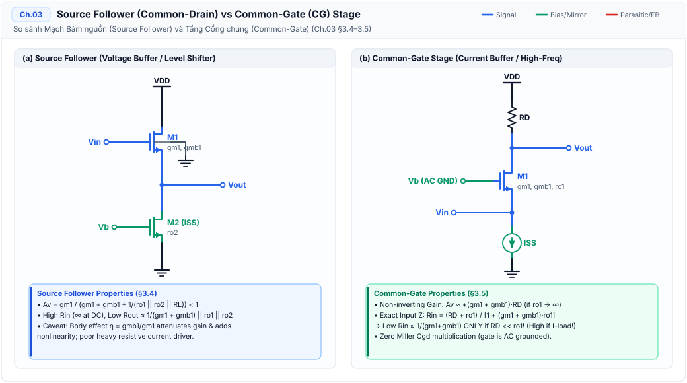

---
{
  "id": "concept-source-follower-inductive-zout",
  "kind": "concept",
  "domain": "dynamics-noise-feedback",
  "title_vi": "Trở kháng Ngõ ra Mang Tính Cảm kháng và Hiện tượng Vọt lố / Rung của Tầng Theo Nguồn (Source Follower Inductive Output Impedance & Ringing)",
  "title_en": "Source Follower High-Frequency Response, Inductive Output Impedance, and Capacitive-Load Ringing",
  "summary": "Giải thích vì sao một tầng theo nguồn (source follower) chỉ chứa MOSFET và tụ điện lại biểu hiện trở kháng ngõ ra mang tính cảm kháng khi trở kháng nguồn điều khiển RS > 1/gm, kèm nguy cơ điện trở âm tại ngõ vào gây rung dao động (ringing/peaking) khi lái tải điện dung CL.",
  "diagram": "../../diagrams/source-follower-and-cg.svg",
  "razavi_refs": [
    {
      "chapter": 6,
      "section": "6.3",
      "pages": "188-193",
      "equations": ["6.51", "6.53", "6.54", "6.60", "6.63", "6.64", "6.66", "6.67"]
    }
  ],
  "glossary_codes": ["T082", "T355", "T838", "T854", "T865", "T953", "T959", "T960"],
  "process_agnostic": true,
  "roles": {
    "high_z_driver_rs": "Trở kháng ngõ ra RS > 1/gm của tầng khuếch đại đứng trước — nguyên nhân làm chậm sự đáp ứng của điện áp cổng khi ngõ ra biến thiên nhanh",
    "gate_source_cap_cgs": "Tụ nối tiếp cổng–nguồn Cgs truyền thẳng tín hiệu tần số cao tạo LHP zero -gm/Cgs nhưng đồng thời nối tắt cổng–nguồn ở tần số rất cao",
    "equivalent_active_inductor": "Cuộn cảm tương đương Leq = (Cgs/gm)*(RS - 1/gm) cộng hưởng với tụ tải CL gây cực phức liên hợp và rung bước nhảy",
    "input_negative_resistance": "Thành phần phần thực âm -gm/(Cgs*CL*w^2) nhìn vào cực cổng khi tải cực nguồn thuần dung CL, tiềm ẩn nguy cơ tự dao động với cuộn cảm dây nối cổng"
  },
  "symptoms_addressed": [
    "buffer-step-response-ringing",
    "ac-peaking-in-source-follower",
    "parasitic-oscillation-with-bondwire-inductance",
    "degraded-buffer-high-frequency-isolation"
  ],
  "limitations": [
    "source-follower-cannot-isolate-cl-when-rs-is-large",
    "body-effect-reduces-low-frequency-gain-unless-separate-well-used",
    "poor-large-signal-sinking-capability-limited-by-bias-current"
  ],
  "checklists": ["common-mos", "single-stage", "feedback-and-stb"]
}
---

## 1. Bản chất Nguyên lý, Sơ đồ Mạch & Vai trò Từng Nhánh Cấu trúc

Trong thiết kế mạch tương tự, **tầng theo nguồn (source follower — còn gọi mạch bám nguồn / tầng cực máng chung, `topo-source-follower`)** thường được chèn vào sau một tầng khuếch đại độ lợi cao có trở kháng ra lớn $R_S$ nhằm "đệm" điện áp và lái tải điện dung lớn $C_L$. Ở tần số thấp, ý tưởng này hoàn toàn hợp lý vì trở kháng ra của tầng theo nguồn chỉ xấp xỉ $\frac{1}{g_m + g_{mb}} \ll R_S$. Tuy nhiên, ở tần số cao (Razavi Chương 6, §6.3), chính sự kết hợp giữa **$R_S$ lớn ở cực cổng** và **tụ tải $C_L$ ở cực nguồn** lại biến tầng theo nguồn thành một **mạch cộng hưởng RLC bậc hai** gây vọt lố biên độ (frequency peaking) và rung tắt dần (ringing) nghiêm trọng trên miền thời gian!

Cơ chế vật lý trực quan diễn ra qua 4 thành phần tương tác:
1. **Điện trở nguồn điều khiển $R_S$ (Output Resistance of Preceding Stage):** Khi tầng theo nguồn dùng làm bộ đệm hạ trở kháng, điều kiện thiết kế tự nhiên luôn là $R_S > \frac{1}{g_m}$ (thậm chí $R_S \gg \frac{1}{g_m}$ nếu đứng sau tầng CS tải nguồn dòng hoặc tầng cascode!).
2. **Tụ cổng–nguồn $C_{GS}$ (Gate-Source Coupling Capacitor):**
   - Ở tần số thấp ($\omega \to 0$): $C_{GS}$ hở mạch, khi bơm dòng thử vào cực nguồn, cực cổng giữ nguyên điện áp $0\text{ V}$ (qua $R_S$), nên MOSFET phản kháng mạnh bằng dòng hỗ dẫn $g_m V_{gs}$, giữ trở kháng ra thấp $Z_{out}(0) = \frac{1}{g_m}$ (hoặc $\frac{1}{g_m + g_{mb}}$ khi xét hiệu ứng thân).
   - Ở tần số rất cao ($\omega \to \infty$): Dung kháng $\frac{1}{\omega C_{GS}} \to 0$ **nối tắt xoay chiều cực cổng vào cực nguồn** ($V_{gs} \to 0$)! Nguồn dòng hỗ dẫn $g_m V_{gs}$ bị tê liệt hoàn toàn, và dòng thử từ ngõ ra chảy thẳng qua $C_{GS}$ về điện trở $R_S$, khiến trở kháng ra vọt lên $Z_{out}(\infty) = R_S$!
3. **Hành vi Cuộn cảm Chủ động (Active Inductor Behavior):** Một trở kháng tăng dần theo tần số từ giá trị thấp $\frac{1}{g_m}$ lên giá trị cao $R_S$ mang góc pha dương ($0^\circ < \angle Z_{out}(j\omega) < +90^\circ$) — tức **mang bản chất cảm kháng** dù trên chip hoàn toàn không có một vòng dây cuộn cảm vật lý nào!
4. **Tụ tải $C_L$ (cộng $C_{SB}$ tại cực nguồn) và Tụ $C_{GD}$ (nối đất xoay chiều tại cực máng $V_{DD}$):** Tụ $C_L$ mắc song song trực tiếp với "cuộn cảm chủ động" $L_{eq}$ tạo thành khung cộng hưởng LC làm xuất hiện cặp cực phức liên hợp, còn $C_{GD}$ nối từ cổng lên $V_{DD}$ tạo tụ nối đất ngay sau $R_S$.

---

## 2. Hệ Phương trình Cốt lõi & Tư duy "Nhìn Mạch Đọc Nhanh" (Analysis by Inspection)

### 2.1. Hàm Truyền Bậc Hai Chính xác & Điện dung Ngõ vào Hiệu dụng (§6.3)
Viết KCL cho tầng theo nguồn có điện trở nguồn $R_S$, xét đầy đủ $C_{GS}, C_{GD}, C_L$ và hiệu ứng thân $g_{mb}$ (với $C_L$ đã gộp cả $C_{SB}$, Phương trình 6.48–6.51):

$$
\frac{V_{out}}{V_{in}}(s) = \frac{g_m + C_{GS} s}{R_S (C_{GS} C_L + C_{GS} C_{GD} + C_{GD} C_L) s^2 + \left[ (g_m + g_{mb}) R_S C_{GD} + C_L + C_{GS}(1 + g_{mb} R_S) \right] s + g_m + g_{mb}}
$$

Các tính chất đọc nhanh từ biểu thức chính xác này:
- **Điểm không nửa mặt phẳng trái (LHP Zero):** Tử số luôn có một LHP zero tại:

$$
s_z = -\frac{g_m}{C_{GS}} \approx -\omega_T
$$

do đường truyền thẳng cùng pha qua $C_{GS}$ cộng hưởng thuận chiều (chứ không ngược chiều như tầng CS!) với dòng $g_m V_{gs}$.
- **Điện dung ngõ vào hiệu dụng ở dải tần thấp–trung bình (Phương trình 6.53–6.54):** Khác với tầng CS nhân to $C_{GD}$, tầng theo nguồn giữ $C_{GD}$ nguyên vẹn (vì cực máng nối AC ground $V_{DD}$) và **chia nhỏ phần đóng góp của $C_{GS}$** nhờ điện áp nguồn bám theo điện áp cổng với hệ số $A_{v0} = \frac{g_m}{g_m + g_{mb}}$:

$$
C_{in,\text{SF}} = C_{GD} + (1 - A_{v0}) C_{GS} = C_{GD} + \frac{g_{mb}}{g_m + g_{mb}} C_{GS}
$$

Tuy nhiên, ngay khi tần số tăng làm tụ tải $C_L$ kéo sụt biên độ và làm trễ pha tại cực nguồn, $V_{out}$ không còn bám kịp $V_X$ nữa nên $C_{in}$ mất hiệu ứng tự triệt tiêu (bootstrapping)!

### 2.2. Điện trở Ngõ vào Âm (Negative Input Resistance — Phương trình 6.58–6.60)
Tính dẫn nạp nhìn trực tiếp vào cực cổng (không tính $C_{GD}$) khi cực nguồn nối tải $C_L$:

$$
Y_{in}(s) = \frac{s C_{GS} (g_{mb} + s C_L)}{g_m + g_{mb} + s (C_{GS} + C_L)} \implies Z_{in}(j\omega)\Big|_{g_{mb}=0} = \frac{1}{j\omega C_{GS}} + \frac{1}{j\omega C_L} - \frac{g_m}{C_{GS} C_L \omega^2}
$$

Số hạng thứ ba $-\dfrac{g_m}{C_{GS} C_L \omega^2}$ là một **điện trở âm nối tiếp phụ thuộc tần số**! Nếu phía cực cổng có cuộn cảm ký sinh (ví dụ cuộn cảm dây hàn chân chip $L_{\text{bond}}$ hoặc đường dây dài), điện trở âm này có thể bù trừ điện trở tổn hao dương và kích phát **dao động ký sinh tần số vô tuyến (parasitic RF oscillation)**!

### 2.3. Trở kháng Ngõ ra Cảm kháng & Mạng Tương đương Thụ động $R_1, R_2, L_{eq}$ (Phương trình 6.63–6.67)
Bỏ qua $g_{mb}$ và $C_{GD}$ để thấy rõ lõi vật lý (Hình 6.28–6.29), trở kháng nhìn vào cực nguồn là:

$$
Z_{out}(s) = \frac{R_S C_{GS} s + 1}{g_m + C_{GS} s}
$$

Khi hoạt động làm bộ đệm hạ trở kháng ($R_S > \frac{1}{g_m}$), $|Z_{out}(j\omega)|$ có cực tại $\omega_p = \frac{g_m}{C_{GS}}$ và zero nằm thấp hơn tại $\omega_z = \frac{1}{R_S C_{GS}} < \omega_p$, nên $|Z_{out}|$ tăng đơn điệu từ $\frac{1}{g_m}$ (ở DC) lên $R_S$ (ở $\omega \to \infty$). Tách $R_2 = \frac{1}{g_m}$ mắc nối tiếp ra khỏi $Z_{out}(s)$ (Phương trình 6.65–6.67):

$$
Z_{out}(s) = \underbrace{\frac{1}{g_m}}_{R_2} + \left( \underbrace{\left(R_S - \frac{1}{g_m}\right)}_{R_1} \;\parallel\; s \underbrace{\frac{C_{GS}}{g_m}\left(R_S - \frac{1}{g_m}\right)}_{L_{eq}} \right)
$$

Đây là kết quả kinh điển của Razavi (Hình 6.29): với mọi $R_S > \frac{1}{g_m}$, ngõ ra của tầng theo nguồn tương đương chính xác một điện trở nhỏ $R_2 = \frac{1}{g_m}$ nối tiếp với nhánh song song $(R_1 \parallel s L_{eq})$, trong đó độ tự cảm tương đương là:

$$
L_{eq} = \frac{C_{GS}}{g_m}\left(R_S - \frac{1}{g_m}\right) \approx \frac{1}{\omega_T}\left(R_S - \frac{1}{g_m}\right)
$$

---

## 3. Bất biến Cấu trúc & Các Bẫy Lỗi Kinh điển (Structural Invariants & Traps)

- **[INV-SF-01] Bất biến Phân Vùng Cảm kháng / Dung kháng theo Tỉ số $R_S \cdot g_m$:**
  - Nếu $R_S > \frac{1}{g_m}$: $L_{eq} > 0$, $Z_{out}(j\omega)$ mang tính **cảm kháng** ($\angle Z_{out} > 0$).
  - Nếu $R_S = \frac{1}{g_m}$: Cực và zero triệt tiêu nhau hoàn toàn, $Z_{out}(s) \equiv \frac{1}{g_m}$ phẳng tuyệt đối trên mọi tần số!
  - Nếu $R_S < \frac{1}{g_m}$: $Z_{out}(j\omega)$ giảm theo tần số và mang tính **dung kháng** ($\angle Z_{out} < 0$).
- **[TRAP-SF-01] Bẫy Cực Phức & Rung Đáp ứng Bước Nhảy (Step Ringing) Khi Lái $C_L$:** Đặt tụ tải $C_L$ vào ngõ ra của tầng theo nguồn khi $R_S \gg \frac{1}{g_m}$ tạo mạch RLC bậc hai có hệ số tắt dần (damping ratio) $\zeta$:

$$
\omega_n \approx \sqrt{\frac{g_m}{R_S C_{GS} C_L}}, \qquad \zeta \approx \frac{1}{2} \frac{C_L + C_{GS}(1 + g_{mb} R_S) + g_m R_S C_{GD}}{\sqrt{g_m R_S C_{GS} C_L}}
$$

Khi $R_S$ lớn, $C_{GD}$ nhỏ và $C_L$ nằm cùng bậc độ lớn với $g_m R_S C_{GS}$, hệ số tắt dần $\zeta$ rơi xuống **nhỏ hơn $0{,}5$ ($\zeta < \frac{1}{\sqrt{2}}$)**, tạo đỉnh cộng hưởng nhọn trên miền tần số và chuỗi dao động tắt dần (ringing) kéo dài thời gian xác lập (settling time)!
- **[TRAP-SF-02] Cố Dùng Source Follower Để Cô Lập Tụ Tải Trong Bù Tần số Op-Amp mà Quên Headroom & Rung:** Khi chèn tầng theo nguồn làm bộ đệm liên tầng hoặc chèn nối tiếp tụ bù Miller (`tech-miller-rhp-zero-nulling-and-cascode-comp`, §10.7 Hình 10.41b), ngoài việc mất toàn bộ khoảng điện áp rơi $V_{GS} + V_{DS,\min,\text{bias}}$ chặn biên độ ra phía dưới, trở kháng ra $R_S$ cực cao của tầng khuếch đại thứ nhất kết hợp $C_{GS,\text{SF}}$ rất dễ sinh cặp cực phức tần số cao nếu dòng phân cực tầng theo nguồn quá nhỏ!
- **[TRAP-SF-03] Ký sinh Cảm kháng Ngược trên Cực Nguồn Cascode khi Cổng Cascode có $R_G$ Lớn:** Một transistor cascode $M_2$ nhìn từ cực nguồn chính là cấu trúc giống hệt ngõ ra của một tầng theo nguồn có cực cổng mang điện trở phân cực $R_G$! Nếu không đặt tụ lọc xoay chiều xuống đất tại cực cổng $M_2$ khi $R_G > 1/g_{m2}$, trở kháng nhìn vào cực nguồn cascode cũng biến thành cảm kháng, làm hỏng cực nội cascode!

---

## 4. Lộ trình Nâng cấp Cấu trúc & Bát giác Đánh đổi (Upgrade Paths & Design Octagon)

| Mục tiêu xử lý hoặc khai thác cảm kháng SF | Giải pháp / Cấu trúc đích (Canonical Node) | Cơ chế tác động | Cái giá trên Bát giác Đánh đổi |
|---|---|---|---|
| Dập tắt hiện tượng rung (ringing) của bộ đệm theo nguồn lái $C_L$ | Tăng $I_D$ giảm $1/g_m$ kết hợp chèn điện trở dập (damping resistor) nhỏ nối tiếp tải hoặc giảm $R_S$ tầng trước | Nâng hệ số tắt dần $\zeta \ge 0{,}707$ trên mặt phẳng phức | Tốn thêm công suất tiêu tán tĩnh hoặc chịu suy hao biên độ trên điện trở nối tiếp |
| Triệt điện trở âm ngõ vào $-\frac{g_m}{C_{GS}C_L\omega^2}$ khi nối ra pad/bondwire | Chèn điện trở cổng nhỏ $R_{G,\text{stop}} \approx 50\text{–}200\,\Omega$ sát cực cổng $M_1$ | Cộng điện trở dương bù phần thực âm tại dải tần GHz | Tăng nhẹ nhiễu nhiệt $4kT R_{G,\text{stop}}$ ở ngõ vào (`law-mos-thermal-and-flicker-noise`) |
| **Khai thác chủ động** tính cảm kháng để mở rộng băng thông tầng CS (Ví dụ 6.14, Hình 6.30) | Tải Cuộn cảm Chủ động (Active Inductor Load: diode MOS có điện trở $R_S$ nối tiếp cực cổng) | $L_{eq}$ tạo zero cộng hưởng bù một phần tụ tải $C_L$, nâng băng thông tầng khuếch đại tốc độ cao | Mất cả một điện áp $V_{GS2}$ khoảng dự trữ nguồn cấp (headroom) và tăng nhiễu nhiệt từ tải MOS |
| Cần đệm lái tải nặng biên độ sát hai đường nguồn mà không mất $V_{GS}$ | Tầng ra đẩy–kéo lớp AB đóng vòng hồi tiếp (`tech-slew-rate-and-class-ab-opamps`, `topo-two-stage-opamp`) | Hạ $R_{out,\text{closed}} = \frac{R_{out}}{1 + \beta A_0}$ bằng vòng hồi tiếp âm đồng thời giữ biên độ $V_{DD} - 2 V_{DS,\min}$ | Đòi hỏi bù tần số chặt chẽ để đảm bảo dự trữ pha (`tech-miller-pole-splitting`) |

---

## 5. Thích ứng Đa Tiến trình (90nm / 65nm / 45nm) & Cách Kiểm chứng trong Cadence / Spectre

### 5.1. Thích ứng Công nghệ Nanomet (90nm $\to$ 65nm $\to$ 45nm)
- **Tần số cộng hưởng dịch lên vùng GHz nhưng Q-factor sắc hơn:** Ở **90nm / 65nm / 45nm**, $f_T = \frac{g_m}{2\pi C_{GS}}$ vọt lên hàng chục đến trên trăm GHz, làm $L_{eq} \approx \frac{R_S}{\omega_T}$ nhỏ đi, đẩy tần số rung lên dải vài GHz. Tuy nhiên, ở tần số nhiều GHz đó, cuộn cảm dây nối/đường kim loại trên chip bắt đầu tương tác mạnh với điện trở âm ngõ vào $-\frac{g_m}{C_{GS} C_L \omega^2}$, khiến các bộ đệm analog/RF tốc độ cao trong 65nm/45nm cực kỳ dễ tự dao động nếu không kiểm tra phần thực $\text{Re}\{Z_{in}(j\omega)\}$!
- **Nối Thân–Nguồn (Body-to-Source Tie) trên Tiến trình Triple-Well / Deep N-Well:** Với PMOS source follower (trong N-well riêng) hoặc NMOS source follower đặt trong **Deep N-Well (DNW)** của công nghệ 90nm/65nm/45nm, nối cực thân (bulk) vào cực nguồn loại bỏ hoàn toàn $g_{mb}$ và $C_{SB}$, đưa độ lợi DC tiến sát $1{,}0$; nhưng hãy cảnh giác:1) tụ ký sinh đáy giếng P-well đối với DNW ($C_{\text{well-DNW}}$) khá lớn và cộng thẳng vào $C_L$ ở ngõ ra, 2) mất $g_{mb}$ làm **giảm số hạng giảm chấn** $C_{GS} g_{mb} R_S$ ở mẫu số Phương trình (6.51), khiến mạch càng dễ vọt lố hơn nếu không kiểm tra đáp ứng xung!

### 5.2. Quy trình Kiểm chứng trong Cadence Virtuoso / Spectre
1. **Đo đường đặc tính $Z_{out}(f)$ và góc pha $\angle Z_{out}(f)$:**
   - Ngắt tụ tải $C_L$ (giữ mạch phân cực DC bằng nguồn dòng chuẩn), đặt nguồn dòng thử `isource` (`mag=1`, `dc=0`) tại cực nguồn $V_{out}$, giữ nguyên $R_S$ thực tế ở cực cổng.
   - Chạy `ac dec 50 1M 100G`. Vẽ `db20(mag(V(out)))` và `phase(V(out))`: xác nhận khi $R_S > 1/g_m$, biên độ $|Z_{out}|$ leo dốc $+20\text{ dB/dec}$ và góc pha dương (tiến gần $+90^\circ$ khi $R_S \gg 1/g_m$).
2. **Kiểm tra Điện trở Âm Ngõ vào (`sp` hoặc `ac`):**
   - Gắn lại $C_L$, bơm nguồn áp AC `mag=1` trực tiếp vào cực cổng và vẽ phần thực trở kháng vào `real(1 / I(Vtest:p))` từ `100 MHz` đến `50 GHz`. Nếu phần thực âm sâu hàng trăm $\Omega$ tại dải tần cộng hưởng của mạng dây dẫn đứng trước, bắt buộc chèn điện trở dập $R_G$ nối tiếp cổng!
3. **Kiểm tra Xung Bước Nhảy Tín hiệu Nhỏ và Lớn (`tran`):**
   - Bơm xung vuông biên độ nhỏ ($\Delta V = 10\text{ mV}$, `tr=tf=10ps`) kiểm tra phần trăm vọt lố (overshoot $< 5\text{–}10\%$), sau đó bơm xung biên độ lớn ($\Delta V = 300\text{ mV}$) theo cả sườn lên và sườn xuống để bắt lỗi tắt transistor hoặc hạn chế dòng xả của nguồn dòng đuôi $I_{\text{bias}}$!

---

## 6. Mốc Đối chiếu Sách Razavi & Thuật ngữ Chuẩn CLB

### 6.1. Đối chiếu Sách Gốc Razavi (2nd Edition)
- **Chương 6:** §6.3 *Source Followers* (tr. 188–193, Phương trình 6.48–6.67, Hình 6.22–6.30, Ví dụ 6.11–6.14).
- **Chú giải Hiệu đính Học thuật CLB (`NG06`):**
  - **`NG06-03` (tr. 193):** Ngay sau Phương trình (6.67) $L = \frac{C_{GS}}{g_m}\left(R_S - \frac{1}{g_m}\right)$, bản in tiếng Anh viết nhầm *"Note that $C_{GS}/g_m$ is approximately equal to $\omega_T = 2\pi f_T$"* — hai vế bị nghịch đảo thứ nguyên (s so với rad/s)! Công thức vật lý chuẩn xác (như chính sách viết đúng lại ở tr. 197) là **$\dfrac{C_{GS}}{g_m} \approx \dfrac{1}{\omega_T} = \dfrac{1}{2\pi f_T}$**, tức $\omega_T = 2\pi f_T \approx \dfrac{g_m}{C_{GS}}$. Ngoài ra trong Ví dụ 6.14 (tr. 193), sách in $R_1 = R_S = 1/g_{m2}$ do lỗi dấu `=` thay cho dấu trừ `−`; giá trị đúng theo (6.66) là **$R_1 = R_S - \dfrac{1}{g_{m2}}$**.

### 6.2. Bảng Thuật ngữ Chuẩn CLB Vi Mạch Sử dụng trong Thẻ
| Mã CLB | Thuật ngữ Tiếng Anh | Thuật ngữ Tiếng Việt Chuẩn | Ghi chú Ngữ cảnh |
|---|---|---|---|
| `T082` | source follower | tầng theo nguồn / mạch bám nguồn | Cực nguồn bám theo biến thiên cực cổng; không dịch là nguồn cấp |
| `T355` | body transconductance ($g_{mb}$) | độ hỗ dẫn thân $g_{mb}$ | Xuất hiện khi $V_{SB}$ biến thiên theo ngõ ra |
| `T854` | poles | các cực | Cặp cực phức liên hợp gây vọt lố khi $\zeta < 0{,}707$ |
| `T865` | zeros | các điểm không | Tầng theo nguồn có LHP zero tại $-g_m/C_{GS}$ |
| `T953` | instability | mất ổn định | Do điện trở âm ngõ vào ghép với cảm kháng nguồn |
| `T959` | series resistance | điện trở mắc nối tiếp | $R_2 = 1/g_m$ trong mô hình tương đương $Z_{out}$ |
| `T960` | bandwidth enhancement | mở rộng băng thông | Ứng dụng tải cuộn cảm chủ động trong Ví dụ 6.14 |
