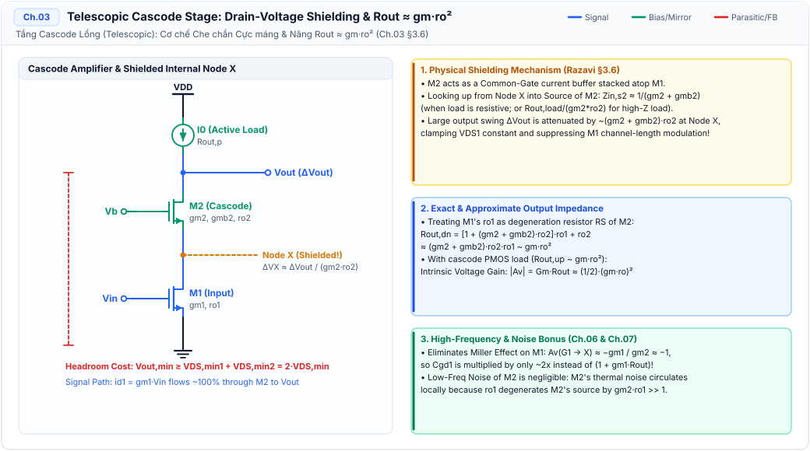

---
{
  "id": "law-cascode-and-cg-high-frequency-poles",
  "kind": "law",
  "domain": "dynamics-noise-feedback",
  "title_vi": "Định luật Cực Tần số Cao của Tầng Cổng Chung & Cascode — Khử Nhân Miller và Suy giảm Zout(s)",
  "title_en": "High-Frequency Pole Laws of Common-Gate and Cascode Stages: Miller Suppression, rO Reflection & Zout(s) Rolloff",
  "summary": "Hệ thống định luật động học tần số cao cho tầng cổng chung (CG) và tầng cascode (Mục 6.4-6.5): phân định ranh giới giữa hai cực tách rời khi rO -> inf (PT 6.68) với hiện tượng nhân điện dung tải (1 + gm*rO)*CL phản xạ ngược về cực nguồn khi tải máng lớn (PT 6.69, 6.73), ảnh hưởng nối tiếp của điện trở cổng RG (PT 6.78), định luật ghim hệ số Miller của Cgd1 xuống ~2 trong cascode (PT 6.79-6.85) và sự sụt giảm sớm của trở kháng ra Zout(s) tại 1/(rO1*CX) (PT 6.86).",
  "diagram": "../../diagrams/cascode-shielding.svg",
  "razavi_refs": [
    {
      "chapter": 6,
      "section": "6.4-6.5",
      "pages": "193-198",
      "equations": ["6.68", "6.69", "6.73", "6.76", "6.78", "6.79", "6.80", "6.81", "6.85", "6.86"]
    }
  ],
  "glossary_codes": ["T021", "T044", "T499", "T503", "T521", "T852", "T874", "T879"],
  "process_agnostic": true,
  "roles": {
    "cg_source_input_port": "Cửa ngõ vào cực nguồn của tầng cổng chung có trở kháng thấp ~1/(gm+gmb) khi tải máng nhỏ, nhưng chịu phản xạ tải (1+gm*rO)*CL khi tải máng là nguồn dòng.",
    "cg_ac_grounded_gate": "Cực cổng nối đất xoay chiều đóng vai trò màn chắn tĩnh điện cắt đứt tụ cầu nối Cgd giữa ngõ vào và ngõ ra (nhạy với điện trở nối tiếp cổng RG).",
    "cascode_input_transconductor_M1": "Transistor nguồn chung đáy biến đổi Vin thành dòng tín hiệu với độ lợi áp cực máng bị khóa ở -gm1/(gm2+gmb2) ~ -1, triệt tiêu sự nhân Miller quá mức.",
    "cascode_shield_device_M2": "Transistor cascode cổng chung phía trên tiếp nhận dòng tại nút nội X (cực phụ ~fT/2) và đẩy dòng lên tải trở kháng cao tại nút ra Y.",
    "internal_parasitic_cap_CX": "Tổng điện dung nút nội X vừa quyết định cực không trội wp,X = (gm2+gmb2)/CX trong hàm truyền Gm(s), vừa làm Zout(s) suy giảm sớm từ tần số 1/(rO1*CX)."
  },
  "symptoms_addressed": [
    "severe-bandwidth-collapse-from-miller-multiplication-of-cgd",
    "unexpected-input-pole-drop-in-cg-stage-driving-active-current-source-load",
    "high-frequency-output-impedance-loss-in-cascode-current-sources-and-dacs",
    "phase-margin-erosion-from-cascode-internal-nondominant-pole"
  ],
  "limitations": [
    "cg-stage-does-not-isolate-output-capacitance-when-drain-impedance-is-high-and-ro-is-finite",
    "series-gate-resistance-rg-in-cg-or-cascode-degrades-pole-and-can-induce-peaking",
    "cascode-zout-begins-rolling-off-gm-ro-times-earlier-than-internal-current-pole"
  ],
  "checklists": ["common-mos", "single-stage"]
}
---

## 1. Bản chất Nguyên lý, Sơ đồ Mạch & Vai trò Từng Nhánh Cấu trúc

Mọi bộ khuếch đại vi mạch thực tế đều bị giới hạn bởi **băng thông hữu hạn (`T044`, *finite bandwidth*; `T521`, *bandwidth*)**. Trong tầng nguồn chung đơn lẻ, thủ phạm số một bóp nghẹt băng thông khi trở kháng nguồn $R_S$ lớn là **hiệu ứng Miller (`T874`, *Miller effect*)**: theo **định lý Miller (`T852`, *Miller's theorem*)**, tụ chồng lấp cổng–máng $C_{GD1}$ nối giữa hai nút khuếch đại ngược pha lớn bị chịu **sự nhân điện dung Miller (`T879`, *Miller multiplication*)** thành $(1 + |A_v|)C_{GD1}$. Để triệt tiêu cơ chế phản hồi điện dung này mà không đánh mất độ lợi điện áp cao, Razavi (Chương 6, §6.4–6.5, trang 193–198) thiết lập hai quy luật cấu trúc nối tiếp nhau: động học của **tầng cổng chung (`T021`, *common-gate stage, CG*)** và động học của **tầng cascode (`T499`, *cascode stage*)** dùng **transistor cascode (`T503`, *cascode device*)**.



Bức tranh vật lý cốt lõi trải dài trên ba hiện tượng mà người thiết kế tuyệt đối không được nhầm lẫn:
1. **Sự thật hai mặt của tầng Cổng Chung (`T021` — Mục 6.4, Hình 6.31–6.33):** Vì cực cổng được nối đất xoay chiều, ba tụ ký sinh của MOSFET tách hẳn về hai phía xuống đất ($C_{GS} + C_{SB}$ ở nút nguồn, $C_{GD} + C_{DB}$ ở nút máng) — **không hề tồn tại tụ cầu nối Miller giữa vào và ra**. *Tuy nhiên*, sự cô lập một chiều giữa nút vào và nút ra chỉ đúng khi $r_O \to \infty$ (hoặc tải máng $R_D \ll r_O$). Ngay khi tầng CG mang tải nguồn dòng lớn ($R_D \to \infty$) trên tiến trình kênh ngắn có $r_O$ hữu hạn, điện trở kênh $r_O$ phản chiếu tụ tải $C_L$ ngược về cực nguồn dưới dạng **nhân điện dung $(1 + g_m r_O)C_L$**!
2. **Định luật Kẹp Miller bằng Tỉ số Hỗ dẫn trong Tầng Cascode (`T499` — Mục 6.5, Hình 6.34):** Khi xếp chồng transistor cascode $M_2$ (cổng chung) lên trên transistor đầu vào $M_1$ (nguồn chung), nút nội $X$ (máng $M_1$ / nguồn $M_2$) trình diện trở kháng cực nhỏ $\approx \frac{1}{g_{m2} + g_{mb2}}$. Độ lợi áp trên bản thân $M_1$ bị ghim cứng ở $A_{v,1} = -\frac{g_{m1}}{g_{m2} + g_{mb2}}$ (thường $\approx -1$), khóa chết điện dung Miller ở cổng $M_1$ xuống chỉ còn $\approx 2C_{GD1}$ bất chấp tải ở ngõ ra $M_2$ lớn tới hàng mega-ohm!
3. **Nghịch lý Tần số Suy giảm Sớm của $Z_{out}(s)$ trong Nguồn Dòng Cascode (Hình 6.35):** Khi dùng cascode làm bộ khuếch đại hỗ dẫn hoặc nguồn dòng DAC/RF, dòng tín hiệu truyền qua nút nội $X$ giữ băng thông rất rộng tới tận cực nội $\omega_{p,X} \approx \frac{g_{m2}+g_{mb2}}{C_X} \sim \frac{\omega_T}{2}$; thế nhưng **trở kháng ngõ ra $Z_{out}(j\omega)$ lại bắt đầu sụt giảm $-20\text{ dB/dec}$ từ tần số thấp hơn thế gấp $g_{m1} r_{O1}$ lần**, ngay tại $\omega_{p,Zout} = \frac{1}{r_{O1} C_X}$!

---

## 2. Hệ Phương trình Cốt lõi & Tư duy "Nhìn Mạch Đọc Nhanh" (Analysis by Inspection)

### 2.1. Định luật Cực Tầng Cổng Chung: Từ Lý tưởng $\lambda = 0$ đến Phản xạ $r_O$ & Điện trở Cổng $R_G$ (Phương trình 6.68, 6.69, 6.73, 6.76, 6.78)

1. **Khi bỏ qua điều biến chiều dài kênh ($\lambda = 0 \implies r_O \to \infty$, Hình 6.31):** Nút nguồn (tổng tụ $C_S = C_{GS} + C_{SB}$) nhìn thấy trở kháng song song $R_S \parallel \frac{1}{g_m + g_{mb}}$, còn nút máng (tổng tụ $C_D = C_{GD} + C_{DB} + C_L$) nhìn thấy $R_D$ độc lập hoàn toàn. Hàm truyền tách sạch thành hai cực thực không tương tác (Phương trình 6.68):

$$
\frac{V_{out}}{V_{in}}(s) = \frac{\left(g_m + g_{mb}\right) R_D}{1 + \left(g_m + g_{mb}\right) R_S} \cdot \frac{1}{\left(1 + \dfrac{C_S}{g_m + g_{mb} + R_S^{-1}}\,s\right)\left(1 + R_D C_D s\right)}
$$

Cực ngõ vào nằm tại $\omega_{p,\text{in}} = \frac{g_m + g_{mb} + R_S^{-1}}{C_{GS} + C_{SB}} > \frac{g_m}{C_{GS}} \approx \omega_T$ (lưu ý ghi chú hiệu đính `NG06-03` về định nghĩa đúng $\omega_T = 2\pi f_T \approx g_m / C_{GS}$), cao hơn rất nhiều so với cực ngõ vào của tầng CS có cùng $R_S$.

2. **Khi $r_O < \infty$ và Tải Cực Máng Lớn (Hình 6.32, Ví dụ 6.15 — Phương trình 6.69 & 6.73):** Với $\lambda \neq 0$, tổng trở nhìn vào cực nguồn của $M_1$ phụ thuộc trực tiếp vào tổng trở tải phức tại cực máng $Z_L(s) = R_D \parallel \frac{1}{C_D s}$ theo phép chia trở kháng cổng chung (Phương trình 6.69):

$$
Z_{in,\text{CG}}(s) = \frac{r_O + Z_L(s)}{1 + \left(g_m + g_{mb}\right) r_O} \approx \frac{Z_L(s)}{\left(g_m + g_{mb}\right) r_O} + \frac{1}{g_m + g_{mb}}
$$

Hãy xét trường hợp cực hạn thực tế khi tầng CG mang **tải nguồn dòng lý tưởng** ($R_D \to \infty \implies Z_L(s) = \frac{1}{C_L s}$) và ngõ vào có trở kháng nguồn $R_S$ cùng tụ $C_{in}$ (Ví dụ 6.15, trang 194–195, bỏ qua $\gamma$ trước rồi thay $g_m \to g_m + g_{mb}$). Giải hệ phương trình nút chính xác cho Phương trình (6.73):

$$
\frac{V_{out}}{V_{in}}(s) = \frac{1 + \left(g_m + g_{mb}\right) r_O}{r_O C_L C_{in} R_S s^2 + \Big[r_O C_L + C_{in} R_S + \big(1 + \left(g_m + g_{mb}\right) r_O\big) C_L R_S\Big] s + 1}
$$

**Trực giác vật lý đắt giá từ mẫu số Phương trình (6.73):** Tại tần số thấp khi $Z_L(s) = \frac{1}{C_L s} \gg r_O$, công thức $Z_{in,\text{CG}}(s) \approx \frac{1}{\left[1 + (g_m + g_{mb})r_O\right] C_L s}$ cho thấy **chia nhỏ dung kháng đi $(1 + g_m r_O)$ lần chính là nhân lớn điện dung $C_L$ lên $(1 + g_m r_O)$ lần nhìn từ cực nguồn**! Khi nhân với điện trở nguồn $R_S$, nó sinh ra hằng số thời gian khổng lồ $(1 + g_m r_O) R_S C_L$ — hệt như hiệu ứng nhân Miller trong tầng CS dù mạch không hề có tụ nối cổng–máng!

3. **Ảnh hưởng của Điện trở Cổng Nối tiếp $R_G$ (Ví dụ 6.16, trang 195 — Phương trình 6.76 & 6.78):** Nếu cực cổng tầng CG không nối đất lý tưởng mà đi qua điện trở đường dây/polysilicon $R_G$ ($\lambda = \gamma = 0$, chỉ xét $C_{GS}$), dòng nạp xả qua $C_{GS}$ phải chảy xuyên qua tổng $(R_G + R_S)$. Viết KVL vòng ngõ vào theo $V_{out}$ thu được Phương trình (6.76) và tần số cực (Phương trình 6.78):

$$
V_{in} - \left(C_{GS} s + g_m\right)\frac{V_{out}}{g_m R_D} R_S + \frac{V_{out}}{g_m R_D}\cdot 0 - C_{GS} s \frac{V_{out}}{g_m R_D} R_G = 0 \quad\Longrightarrow\quad \omega_{p,\text{CG},R_G} = \frac{1 + g_m R_S}{\left(R_G + R_S\right) C_{GS}}
$$

*(Lưu ý đối chiếu công thức in gốc (6.76) trang 195: viết gọn KVL từ $V_{out} = g_m R_D V_1$ cho $\frac{V_{out}}{V_{in}} = \frac{g_m R_D}{(R_G + R_S)C_{GS} s + 1 + g_m R_S}$, chứng minh $R_G$ cộng trực tiếp với $R_S$ ở mẫu số làm hạ thấp cực ngõ vào!).*

### 2.2. Định luật Ba Cực & Hàm truyền Tải Vô hạn của Tầng Cascode (Phương trình 6.79, 6.80, 6.81, 6.85)
Xét tầng cascode Hình 6.34 gồm $M_1$ (cổng nhận $V_{in}$ qua $R_S$) và $M_2$ (cổng nối $V_b$ cố định, máng nối tải $R_D$ vừa phải sao cho $R_D \ll R_{out,\text{cas}}$):
1. **Cực tại nút cổng ngõ vào $A$ (Phương trình 6.79):** Ở vùng tần số thấp hơn cực nội $\omega_{p,X}$, trở kháng nhìn lên cực nguồn $M_2$ là $\frac{1}{g_{m2} + g_{mb2}}$, nên độ lợi điện áp từ cổng $M_1$ tới máng $M_1$ (nút $X$) chỉ bằng $A_{v,AX} = -\frac{g_{m1}}{g_{m2} + g_{mb2}}$. Áp dụng phép xấp xỉ Miller cho $C_{GD1}$:

$$
\omega_{p,A} = \frac{1}{R_S\left[C_{GS1} + \left(1 + \frac{g_{m1}}{g_{m2} + g_{mb2}}\right) C_{GD1}\right]}
$$

Khi $M_1$ và $M_2$ có hỗ dẫn xấp xỉ nhau, hệ số nhân của $C_{GD1}$ bị khóa ở **$\le 2$** (xem thêm `NG06-09` ở Mục 6.1)!
2. **Cực nội tại nút cascode $X$ (Phương trình 6.80):** Gom toàn bộ điện dung tại nút $X$ gồm thành phần Miller phía ra của $C_{GD1}$ là $\left(1 + \frac{g_{m2}+g_{mb2}}{g_{m1}}\right)C_{GD1} \approx 2C_{GD1}$, tụ tiếp giáp máng $C_{DB1}$, tụ nguồn–đế $C_{SB2}$ và tụ cổng–nguồn $C_{GS2}$ (chú ý lỗi nhãn in `NG06-10` trên Hình 6.34!):

$$
\omega_{p,X} = \frac{g_{m2} + g_{mb2}}{2 C_{GD1} + C_{DB1} + C_{SB2} + C_{GS2}} = \frac{g_{m2} + g_{mb2}}{C_X} \approx \frac{\omega_{T2}}{2}
$$

3. **Cực tại nút ngõ ra $Y$ (Phương trình 6.81):** Vì cổng $M_2$ nối đất xoay chiều, $C_{GD2}$ không bị nhân Miller mà chỉ cộng thẳng vào tải:

$$
\omega_{p,Y} = \frac{1}{R_D\left(C_{DB2} + C_L + C_{GD2}\right)}
$$

4. **Chứng minh chặt chẽ khi Tải là Nguồn dòng Lý tưởng ($R_D \to \infty$, Hình 6.35 — Phương trình 6.85):** Một câu hỏi sâu sắc đặt ra: *Nếu $R_D \to \infty$ (như trong Telescopic/Folded-Cascode OTA), liệu $r_{O2}$ hữu hạn có phản xạ $C_L$ về nút $X$ làm hỏng cực $\omega_{p,X}$ giống như tầng CG ở (6.73) hay không?* Ở miền tần số cao quan tâm quanh $\text{GBW}$ và $\omega_{p,X}$ (nơi dung kháng tải $\frac{1}{C_Y \omega} \ll r_{O2}$, với $C_Y = C_{DB2} + C_L + C_{GD2}$), tụ $C_Y$ tự động giữ tổng trở tải cực máng $M_2$ nhỏ hơn $r_{O2}$ rất nhiều! Do đó $M_2$ hoạt động như bộ đệm dòng một chiều chia dòng giữa $\frac{1}{g_{m2}}$ và $\frac{1}{C_X s}$, cho hàm truyền ở tần số vừa và cao (Phương trình 6.85, với $g_{m2}$ đại diện cho $g_{m2} + g_{mb2}$):

$$
\frac{V_{out}}{V_{in}}(s) = -\frac{g_{m1} g_{m2}}{C_Y C_X s} \cdot \frac{1}{\dfrac{g_{m2}}{C_X} + s} = -\frac{g_{m1}}{C_Y s \left(1 + \dfrac{s}{g_{m2} / C_X}\right)}
$$

Phương trình (6.85) chứng minh: ngay cả trong OTA độ lợi cao, cực thứ hai không trội tại nút cascode vẫn nằm vững chắc tại **$\omega_{p,X} = \frac{g_{m2} + g_{mb2}}{C_X}$** trong khi cực trội ngõ ra nằm ở $\omega_{p,Y} = \frac{1}{R_{out,\text{cas}} C_Y}$!

### 2.3. Định luật Suy giảm Tần số Cao của Trở kháng Ra $Z_{out}(s)$ (Phương trình 6.86)
Khi xét cascode đóng vai trò một nguồn dòng tần số cao (bỏ qua $C_{GD1}$ và tách riêng tụ ngõ ra $C_Y$ bên ngoài), nút cực nguồn của $M_2$ bị suy biến bởi tổng trở song song phức $Z_X(s) = r_{O1} \parallel \frac{1}{C_X s} = \frac{r_{O1}}{1 + r_{O1} C_X s}$. Thay $R_S \to Z_X(s)$ vào công thức trở kháng ra cascode (Phương trình 6.86, tổng quát với $g_{mb2}$):

$$
Z_{out}(s) = \left[1 + \left(g_{m2} + g_{mb2}\right) r_{O2}\right] Z_X(s) + r_{O2} = \frac{\left[1 + \left(g_{m2} + g_{mb2}\right) r_{O2}\right] r_{O1} + r_{O2} + r_{O1} r_{O2} C_X s}{1 + r_{O1} C_X s}
$$

Biểu thức (6.86) hé lộ quy luật cực kỳ quan trọng:
- **Ở DC ($s = 0$):** $Z_{out}(0) \approx (g_{m2} + g_{mb2}) r_{O2} r_{O1}$.
- **Cực suy giảm sớm của $Z_{out}(s)$:** Ngay tại tần số rất thấp **$\omega_{p,Zout} = \dfrac{1}{r_{O1} C_X}$**, tụ $C_X$ bắt đầu nối tắt $r_{O1}$ xuống đất, làm $Z_{out}(j\omega)$ rơi với độ dốc $-20\text{ dB/dec}$ theo $Z_{out}(j\omega) \approx \frac{g_{m2} r_{O2}}{j\omega C_X}$ (tương đương một tụ điện hiệu dụng $C_{\text{eff}} = \frac{C_X}{g_{m2} r_{O2}}$ cực nhỏ nhìn từ máng $M_2$, song song với $C_{DB2} + C_{GD2}$!).
- **Điểm không dừng ngang:** Tới tận $\omega_{z,Zout} \approx \frac{(g_{m2} + g_{mb2})}{C_X} = \omega_{p,X}$, nút nguồn $M_2$ bị nối đất xoay chiều hoàn toàn qua $C_X$ và phần thực của $Z_{out}$ sụp hẳn từ $g_m r_O^2$ xuống chỉ còn đúng $r_{O2}$!

**Ví dụ số minh họa (tiến trình 65nm, $I_D = 500\,\mu\text{A}$):** Cho tầng cascode có $R_S = 1\text{ k}\Omega$, $g_{m1} = g_{m2} = 6\text{ mS}$, $g_{mb2} = 1\text{ mS}$, $r_{O1} = r_{O2} = 8\text{ k}\Omega$, $C_{GS1} = C_{GS2} = 40\text{ fF}$, $C_{GD1} = C_{GD2} = 12\text{ fF}$, $C_{DB1} = C_{SB2} = C_{DB2} = 15\text{ fF}$, và tụ tải $C_L = 500\text{ fF}$.
- Nếu dùng **CS đơn độc** tải nguồn dòng $R_{\text{load}} = 8\text{ k}\Omega$ ($|A_v| = 6\text{ mS}\times 4\text{ k}\Omega = 24$): tụ vào Miller bằng $40 + (1 + 24)\times 12 = 340\text{ fF} \implies f_{p,\text{in,CS}} = \frac{1}{2\pi \times 1\text{ k}\Omega \times 340\text{ fF}} = \mathbf{468\text{ MHz}}$!
- Khi nâng lên **Cascode**: hệ số nhân $C_{GD1}$ chỉ còn $1 + \frac{6}{6+1} = 1{,}86$, tụ vào giảm xuống $40 + 1{,}86\times 12 = 62{,}3\text{ fF} \implies f_{p,A} = \mathbf{2{,}55\text{ GHz}}$ (tăng gấp $5{,}4\times$!); tổng tụ nút nội $C_X \approx 2(12) + 15 + 15 + 40 = 94\text{ fF} \implies f_{p,X} = \frac{7\text{ mS}}{2\pi \times 94\text{ fF}} = \mathbf{11{,}85\text{ GHz}}$; trong khi $Z_{out}(0) \approx 7\text{ mS}\times 64\text{ M}\Omega^2 = 456\text{ k}\Omega$ bắt đầu sụt giảm ngay từ $f_{p,Zout} = \frac{1}{2\pi \times 8\text{ k}\Omega \times 94\text{ fF}} = \mathbf{211{,}6\text{ MHz}}$!

---

## 3. Bất biến Cấu trúc & Các Bẫy Lỗi Kinh điển (Structural Invariants & Traps)

- **`[INV-CASCG-01]` Bất biến Khóa Miller Bằng Tỉ số Hỗ dẫn:** Trong mọi tầng cascode mà cực máng $M_2$ chưa bị tụ tải giữ chặt hơn $r_{O2}$ ở tần số cực thấp (hoặc khi tải $R_D$ vừa phải), điện dung Miller nhìn vào cổng $M_1$ bằng $\left(1 + \frac{g_{m1}}{g_{m2} + g_{mb2}}\right) C_{GD1}$. Nếu vô tình thiết kế $M_2$ quá nhỏ hoặc chạy ở dòng gập bị đói ($I_{\text{cas}} \ll I_{D1}$ trong Folded-Cascode làm $g_{m2} \ll g_{m1}$!), hệ số nhân Miller $\left(1 + \frac{g_{m1}}{g_{m2}}\right)$ lập tức phình to trở lại lên $5\text{–}10$ lần, đồng thời đẩy cực nội $\omega_{p,X}$ tụt dốc thảm hại!
- **`[TRAP-CASCG-01]` Bẫy Phá Vỡ Ghép Phối Hợp $50\,\Omega$ Ở Tầng LNA Cổng Chung Khi Tải Lớn:** Trong bộ khuếch đại tạp âm thấp băng rộng dùng tầng CG (mong muốn $R_{in} = \frac{1}{g_m + g_{mb}} = 50\,\Omega$), nếu ở tiến trình kênh ngắn ($g_m r_O \approx 8$) bạn đặt tải cực máng là nguồn dòng chủ động hoặc cuộn cảm $Q$ cao có trở kháng $Z_L \approx 2\,r_O$, Phương trình (6.69) chỉ ra $Z_{in} = \frac{r_O + 2r_O}{1 + 8} = \frac{3}{9} r_O = \frac{8}{3}\cdot\frac{1}{g_m} \approx \mathbf{133\,\Omega}$ — làm lệch hoàn toàn hệ số phản xạ $S_{11}$ khỏi mức $-10\text{ dB}$!
- **`[TRAP-CASCG-02]` Bẫy Không Gắn Tụ Lọc Xoay Chiều (`C_bypass`) Tại Cực Cổng Cascode $V_b$:** Toàn bộ chứng minh khử Miller và Phương trình (6.78)–(6.81) đều dựa trên giả thiết cực cổng $M_2$ là **đất xoay chiều cứng ($R_{G2} \approx 0$)**. Trên silicon thực tế, thiên áp $V_b$ thường được dẫn từ một gương dòng khoảng cách xa có trở kháng hàng chục kilô-ohm ($R_{G2} \gg \frac{1}{g_{m2}}$). Nếu quên đặt tụ decoupling tại chỗ cho nút $V_b$, dòng qua $C_{GS2}$ và $C_{GD2}$ làm cổng $M_2$ nảy áp mạnh, biến $M_2$ thành một mạch bám nguồn cảm kháng có thể gây **dao động ký sinh tần số GHz** ngay tại nút nội $X$!
- **`[TRAP-CASCG-03]` Bẫy Nhầm Cực Của $G_m(s)$ Với Cực Của $Z_{out}(s)$ Trong Mạch DAC Dòng Lái:** Trong bộ biến đổi số–tương tự lái dòng (Current-Steering DAC), méo động học SFDR ở tần số Nyquist phụ thuộc vào việc tổng trở ra của mỗi ô nguồn dòng phải rất lớn so với tải $50\,\Omega$. Nhiều người nhìn $\omega_{p,X} \approx 10\text{ GHz}$ tưởng cascode giữ nguyên trở kháng cao tới GHz — thực tế theo Phương trình (6.86), ngay trên $\omega_{p,Zout} = \frac{1}{r_{O1} C_X}$ (chỉ vài chục đến vài trăm MHz!), $Z_{out}(j\omega)$ đã suy biến thành dung kháng thuần!

---

## 4. Lộ trình Nâng cấp Cấu trúc & Bát giác Đánh đổi (Upgrade Paths & Design Octagon)

| Nút thắt Tần số Cao của CG / Cascode | Cấu trúc Nâng cấp Chính tắc (Canonical Node) | Cơ chế Vật lý Vượt Ngưỡng | Đánh đổi trên Bát giác Thiết kế |
| :--- | :--- | :--- | :--- |
| Tụ ký sinh nút nội $C_X$ làm giảm $\omega_{p,X}$ và làm sụt sớm $Z_{out}(j\omega)$ ở tần số RF / mmWave | Ghép **Cuộn cảm Bù Nút Nội** (*Series/Shunt Inductive Peaking* giữa máng $M_1$ và nguồn $M_2$) hoặc dùng Layout **Shared-Diffusion** $M_1\text{–}M_2$ | Cộng hưởng triệt tiêu $C_X$ tại băng tần làm việc, hoặc cắt bỏ tới $50\%$ diện tích vùng khuếch tán tiếp giáp $C_{DB1} + C_{SB2}$ khi gộp chung cực máng $M_1$ với cực nguồn $M_2$! | Khi gộp khuếch tán (dual-gate cascode), không thể tách thân $M_2$ riêng để khử hiệu ứng thân |
| Trong Folded-Cascode NMOS-in, transistor cascode là PMOS có $f_T$ thấp làm cực nút gập $\omega_{p,X}$ đè lên $\text{GBW}$ | `topo-folded-cascode-ota` bản **PMOS-in $\to$ NMOS Cascode** hoặc `topo-telescopic-cascode-opamp` | Chuyển transistor cổng chung tại nút nội sang **NMOS** có độ linh động $\mu_n \approx 2{,}5\text{–}3\,\mu_p$, đẩy $\omega_{p,X}$ tăng vọt gấp $2{,}5$ lần! | Bản PMOS-in có $g_{m1}$ đầu vào thấp hơn tại cùng dòng tĩnh nếu không tăng bề rộng $W_{1,2}$ |
| Cần tăng $Z_{out}$ ở tần số thấp–trung bình vượt xa $g_m r_O^2$ mà không chồng tầng cascode thứ ba | `topo-gain-boosted-cascode` / `topo-regulated-cascode-super-source-follower` | Bộ khuếch đại phụ $A_{\text{aux}}$ nhân $g_{m2}$ hiệu dụng lên $(A_{\text{aux}} + 1)$ lần cho tới tần số băng thông vòng phụ | Không cải thiện được $Z_{out}(j\omega)$ ở vùng tần số vượt quá băng thông độ lợi đơn vị của $A_{\text{aux}}$ |

---

## 5. Thích ứng Đa Tiến trình (90nm / 65nm / 45nm) & Cách Kiểm chứng trong Cadence / Spectre

### 5.1. Chiến lược Định cỡ Tối ưu Băng thông – Dự trữ Pha trên 90nm / 65nm / 45nm
Ở tiến trình nanomet nơi $f_T$ đỉnh đạt $100\text{–}250\text{ GHz}$ nhưng $g_m r_O$ thấp, việc phân bổ chiều dài kênh $L$ và mật độ dòng cho hai tầng của ngăn xếp cascode quyết định trực tiếp vị trí cực nội $\omega_{p,X}$ so với băng thông vòng kín:
1. **Giữ $L_2$ của transistor cascode $M_2$ ngắn vừa phải ($1{,}5\text{–}2{,}5\,L_{\min}$):** Vì tần số chuyển tiếp nội tại tỉ lệ nghịch bình phương chiều dài kênh ($\omega_{T2} \approx \frac{g_{m2}}{C_{GS2}} \propto \frac{V_{OV2}}{L_2^2}$ ở kênh dài hoặc $\propto \frac{v_{\text{sat}}}{L_2}$ ở kênh ngắn), kéo dài $L_2$ quá mức làm $C_{GS2} \propto W_2 L_2$ tăng vọt và hạ gục $\omega_{p,X}$! Hãy dồn chiều dài kênh lớn hơn cho transistor nguồn dòng tải hoặc giữ $L_1 \approx (2\text{–}4)L_{\min}$, còn $L_2$ giữ gọn để đạt $\omega_{p,X} \ge (3\text{–}5)\,\text{GBW}$.
2. **Tối ưu Layout Nút Nội $X$ & Điện trở Cổng $R_G$:** Chia nhiều ngón cổng song song (`nf` chẵn) và nối cực cổng ở cả hai đầu (*double-sided gate contact*) cho cả $M_1$ lẫn $M_2$ để hạ $R_G$ xuống vài ohm — ngăn chặn hoàn toàn sự sụt cực theo Phương trình (6.78) và hiện tượng tự cảm ký sinh nhìn vào cực nguồn $M_2$! Nếu $M_1$ và $M_2$ cùng loại, cùng bề rộng $W$ và dùng chung giếng, có thể xếp hai cổng sát nhau chia sẻ vùng khuếch tán trung gian (không đặt via kim loại ở nút $X$) để triệt giảm tối đa $C_{DB1} + C_{SB2}$.

| Phần tử trong Tầng Cascode / CG | Vùng $g_m/I_D$ khuyến nghị | Dự trữ áp $V_{DS,\min}$ | Chiều dài kênh $L$ | Tác động Động học Tần số Cao |
| :--- | :--- | :--- | :--- | :--- |
| **Transistor CS đáy ($M_1$)** | $15\text{–}20\text{ V}^{-1}$ | $90\text{–}120\text{ mV}$ | $(2\text{–}4)L_{\min}$ | Tối đa hóa $g_{m1}$ cho $\text{GBW} = g_{m1}/C_L$; $C_{GD1}$ đã được $M_2$ che chắn. |
| **Transistor CG / Cascode ($M_2$)** | $12\text{–}16\text{ V}^{-1}$ | $100\text{–}140\text{ mV}$ | $(1{,}5\text{–}2{,}5)L_{\min}$ | Giữ $C_{GS2}$ nhỏ và $g_{m2} \ge g_{m1}$ để kẹp Miller $\le 2C_{GD1}$ và đẩy $\omega_{p,X} \gg \text{GBW}$. |
| **Mạng thiên áp cổng cascode $V_b$** | Tụ lọc $C_{\text{byp}} \ge 10\,(C_{GS2} + C_{GD2})$ | — | Dây kim loại rộng, ngắn | Đảm bảo $Z_{\text{gate},2}(j\omega) \ll \frac{1}{g_{m2}}$ trên toàn băng tần tới $\omega_{p,X}$. |

### 5.2. Quy trình Kiểm chứng Chuẩn trong Cadence Virtuoso / Spectre
1. **So sánh Điện dung Ngõ vào Hiệu dụng $C_{in,\text{eff}}(f)$ giữa CS và Cascode (`ac`):** Đặt nguồn áp AC `vin = 1` trực tiếp (hoặc qua $R_S$) vào cổng $M_1$, đo phần ảo của dẫn nạp ngõ vào `imag(IF("/M1/G") / VF("/vin_gate")) / (2*pi*xval(...))` ở tần số trung bình để xác nhận $C_{in,\text{cascode}} \approx C_{GS1} + 2 C_{GD1}$ thay vì $C_{GS1} + (1 + |A_v|)C_{GD1}$!
2. **Tách riêng đo $G_m(jf)$ và $Z_{out}(jf)$ để kiểm chứng Phương trình (6.85) & (6.86):**
   - Nối tắt xoay chiều ngõ ra qua nguồn áp $0\text{ V}$ tới mức phân cực DC để đọc dòng ngắn mạch $I_{out,\text{sc}}(jf)$: điểm rơi $-3\text{ dB}$ của $|G_m(jf)|$ xác định chính xác cực nội $f_{p,X} = \frac{g_{m2}+g_{mb2}}{2\pi C_X}$.
   - Ngắt kích thích vào, bơm dòng AC `iac = 1` tại cực máng $M_2$ (chưa gắn $C_L$ lớn) để vẽ $|Z_{out}(jf)|$ và xác nhận điểm gãy sớm $f_{p,Zout} = \frac{1}{2\pi r_{O1} C_X}$!

```text
; Mẫu biểu thức ADE / Spectre kiểm chứng Định luật Cực Tần số Cao CG & Cascode:
Cin_Eff_F        = imag(IF("/M1/G") / VF("/net_gate1")) / (2*3.14159 * xval(VF("/net_gate1")))
Miller_Factor    = 1.0 + (pv("M1" "gm") / (pv("M2" "gm") + pv("M2" "gmb"))) ; Xap xi ~ 1.8 - 2.0
CX_Total_Est     = 2*abs(pv("M1" "cgd")) + abs(pv("M1" "cdd")) + abs(pv("M2" "css")) + abs(pv("M2" "cgs"))
fp_X_Calc_Hz     = (pv("M2" "gm") + pv("M2" "gmb")) / (2*3.14159 * CX_Total_Est)
fp_Zout_Calc_Hz  = pv("M1" "gds") / (2*3.14159 * CX_Total_Est)            ; Doi chieu PT (6.86)
Gm_HighFreq_Mag  = mag(IF("/Vshort_out/PLUS") / VF("/vin"))               ; Kiem chung truc tiep PT (6.85)
```

---

## 6. Mốc Đối chiếu Sách Razavi & Thuật ngữ Chuẩn CLB

### 6.1. Đối chiếu Sách Gốc Razavi (2nd Edition) & Chú giải Học thuật CLB
| Mục / Trang (Razavi 2nd Ed.) | Phương trình & Hình đối chiếu | Nội dung cốt lõi & Ghi chú Hiệu đính CLB (`NG`) |
| :--- | :--- | :--- |
| **§6.4**, tr. 193–195 (PDF 21–23) | PT (6.68), (6.69), (6.73), (6.76), (6.78); Hình 6.31–6.33; Ví dụ 6.15–6.16 | Đáp ứng tần số cao tầng cổng chung: hai cực độc lập khi $\lambda=0$ (PT 6.68), biến đổi tổng trở đầu vào khi $\lambda \neq 0$ (PT 6.69), phản xạ nhân điện dung tải $(1+g_m r_O)C_L R_S$ khi tải là nguồn dòng (PT 6.73), và dịch cực do điện trở cổng nối tiếp $R_G$ (PT 6.76, 6.78). **Lưu ý `NG06-03` (tr. 193 vs tr. 197):** ở cuối §6.3 ngay sát đầu §6.4 (tr. 193), bản in gốc viết nhầm chiều nghịch đảo $C_{GS}/g_m \approx \omega_T = 2\pi f_T$, trong khi ở §6.5 tr. 197 viết đúng thứ nguyên $2\pi f_T \approx g_m / C_{GS}$! |
| **§6.5**, tr. 196–198 (PDF 24–26) | PT (6.79), (6.80), (6.81), (6.85), (6.86); Hình 6.34–6.35; Bài tập 6.11 (tr. 215) | Đáp ứng tần số cao tầng cascode: kẹp Miller tại nút cổng $\omega_{p,A}$ (PT 6.79), cực nút nội $\omega_{p,X} \approx \omega_T/2$ (PT 6.80), cực ngõ ra $\omega_{p,Y}$ (PT 6.81), hàm truyền khi tải nguồn dòng lý tưởng (PT 6.85) và sự suy giảm tần số cao của $Z_{out}(s)$ (PT 6.86). **Lưu ý `NG06-10` (tr. 196, Hình 6.34):** hình vẽ gốc in nhầm nhãn tụ nối từ cực cổng $M_2$ xuống nút nội $X$ là "$C_{GD2}$", trong khi lời văn và PT (6.80) xác định đúng đó là **$C_{GS2}$**! **Lưu ý `NG06-09` (tr. 215, Bài tập 6.11):** đầu đoạn bài tập viết hệ số nhân $C_{GD1}$ là $g_{m1}/(g_{m2}+g_{mb2})$ còn cuối đoạn viết đầy đủ là $1 + g_{m1}/(g_{m2}+g_{mb2})$. |

### 6.2. Bảng Thuật ngữ Chuẩn CLB Vi Mạch Sử dụng trong Thẻ
| Mã CLB | Thuật ngữ Tiếng Anh | Thuật ngữ Tiếng Việt Chuẩn | Ghi chú Ngữ cảnh |
| :--- | :--- | :--- | :--- |
| `T021` | common-gate stage, CG | tầng cổng chung | Cấu trúc không có tụ cầu nối Miller, nhưng vẫn phản xạ tải qua $r_O$ khi $R_D$ lớn |
| `T499` / `T503` | cascode stage / cascode device | Tầng cascode / Transistor cascode | Ghép nối tiếp CS–CG để đồng thời đạt độ lợi cao và kẹp hệ số nhân Miller xuống $\sim 2$ |
| `T852` | Miller's theorem | định lý Miller | Quy tắc tách nhánh trở kháng nối cầu giữa hai nút biết tỉ số điện áp |
| `T874` / `T879` | Miller effect / Miller multiplication | hiệu ứng Miller / sự nhân điện dung Miller | Cơ chế phóng đại điện dung cầu nối cổng–máng theo $(1 - A_{XY})$ |
| `T521` / `T044` | bandwidth / finite bandwidth | Băng thông / Băng thông hữu hạn | Dải tần số hoạt động bị giới hạn bởi cực trội ngõ ra hoặc cực ngõ vào / nút nội |
