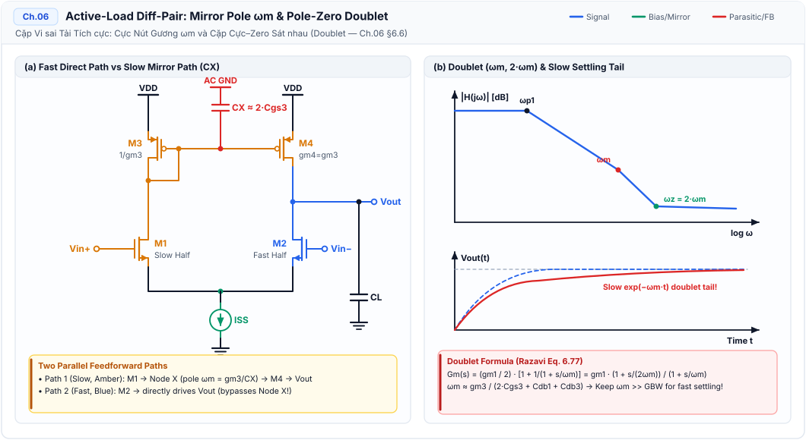

---
{
  "id": "law-diff-pair-frequency-response-cmrr-rolloff",
  "kind": "law",
  "domain": "dynamics-noise-feedback",
  "title_vi": "Định luật Đáp ứng Tần số Cặp Vi sai & Suy giảm CMRR(jw) do Điện dung Đuôi Ctail (Differential-Pair Frequency Response & CMRR Rolloff)",
  "title_en": "Differential-Pair High-Frequency Dynamics, Parasitic Tail-Capacitance CMRR Rolloff, and Mirror-Load Doublet",
  "summary": "Thiết lập định luật phân kỳ động học giữa chế độ vi sai (DM) và chế độ chung (CM) của cặp vi sai (Mục 6.6.1-6.6.2): giải thích vì sao điện dung ký sinh nút đuôi CP (Ctail = CDB,tail + CGD,tail + 2*CSB1,2) tàng hình với tín hiệu DM nhưng tạo điểm không tần số thấp 1/(RSS*CP) trong ACM(s) khiến CMRR(jw) rơi -20 dB/dec từ rất sớm (PT 6.87-6.89), đánh đổi gay gắt giữa dự trữ điện áp nguồn đuôi và CMRR cao tần, kèm hàm truyền đầy đủ của tải gương dòng tích cực (PT 6.90-6.97).",
  "diagram": "../../diagrams/diffpair-mirror-pole-doublet.svg",
  "razavi_refs": [
    {
      "chapter": 6,
      "section": "6.6.1-6.6.2",
      "pages": "198-203",
      "equations": ["6.87", "6.88", "6.89", "6.90", "6.91", "6.94", "6.96", "6.97"]
    }
  ],
  "glossary_codes": ["T022", "T576", "T586", "T593", "T623", "T661", "T967", "T973"],
  "process_agnostic": true,
  "roles": {
    "symmetric_diff_pair_M1_M2": "Cặp vi sai đầu vào biến đổi kích thích vi sai quanh nút đuôi đất ảo, giữ bậc cực của hàm truyền vi sai bằng đúng bậc cực của một nửa mạch.",
    "tail_current_source_and_CP": "Nguồn dòng đuôi trở kháng rO3 (RSS) mắc song song điện dung ký sinh tổng CP tại nút P, thủ phạm ngắn mạch trở kháng đuôi ở tần số cao dưới kích thích CM.",
    "passive_or_cs_diff_loads": "Tải đối xứng (điện trở RD hoặc nguồn dòng PMOS có cổng G tự triệt tiêu dòng qua CGD3,4) tạo cực trội vi sai mà không sinh cực gương.",
    "active_mirror_node_E": "Nút cổng nối diode E mang tổng tụ CE trong cặp vi sai tải gương dòng tích cực, sinh ra cực gương wm = gmP/CE và điểm không 2*wm."
  },
  "symptoms_addressed": [
    "severe-cmrr-degradation-well-below-differential-bandwidth",
    "high-frequency-power-supply-and-substrate-noise-to-differential-conversion",
    "headroom-versus-high-frequency-cmrr-sizing-conflict-in-tail-current-source",
    "excess-phase-lag-from-current-mirror-load-or-mirror-folded-stage"
  ],
  "limitations": [
    "wide-tail-transistor-for-low-vdsat-inevitably-inflates-tail-capacitance-cp",
    "even-small-device-mismatch-converts-high-frequency-tail-bounce-into-differential-error",
    "current-mirror-folding-suffers-mirror-pole-without-fast-path-zero-rescue"
  ],
  "checklists": ["common-mos", "differential-pair"]
}
---

## 1. Bản chất Nguyên lý, Sơ đồ Mạch & Vai trò Từng Nhánh Cấu trúc

Ở tần số thấp (DC), một **cặp vi sai (`T586`, *differential pair*)** được nuôi bởi **nguồn dòng đuôi (`T593`, *tail current source*)** có trở kháng lớn $R_{SS}$ tự hào đạt **khả năng khử chế độ chung (`T576`, *common-mode rejection*)** lên tới $70\text{–}100\text{ dB}$. Thế nhưng trên các vi mạch thực tế (bộ thu đầu cuối AFE, bộ khuếch đại vi sai tốc độ cao, đầu vào ADC), các kỹ sư thường xuyên sững sờ khi thấy **tỷ số khử chế độ chung (`T661`, *common-mode rejection ratio — CMRR*)** bắt đầu lao dốc $-20\text{ dB/dec}$ ngay từ vài trăm kilô-hertz hoặc vài megahertz — **thấp hơn băng thông tín hiệu vi sai từ $10$ đến $100$ lần**! Razavi (Chương 6, §6.6.1–6.6.2, trang 198–203) giải mã hiện tượng này bằng cách mổ xẻ sự phân ly động học giữa **nửa mạch vi sai (`T967`, *differential half circuit*)** và mạch tương đương **chế độ chung (`T022`, *common-mode, CM*)**.



Bốn cơ chế vật lý chi phối đáp ứng tần số của họ mạch vi sai bao gồm:

1. **Tính bất biến bậc cực của Cặp Vi sai Đối xứng Hoàn toàn (`T623`, *fully-symmetric differential pair* — Hình 6.36a–b & 6.39):** Dưới kích thích vi sai thuần túy ($+V_{in}/2$ và $-V_{in}/2$, xem chú giải ký hiệu `NG06-04`), nút đuôi $P$ đứng yên tại đất xoay chiều ($v_P = 0$) nên toàn bộ mạng trở kháng đuôi $R_{SS} \parallel C_P$ biến mất khỏi mô hình tín hiệu nhỏ. Đồng thời, vì cả hai nhánh nhân với **cùng một hàm truyền nửa mạch**, tổng số cực của $V_{out,\text{diff}}/V_{in,\text{diff}}$ bằng đúng số cực của **một nhánh đơn CS** (chứ không phải tổng số cực của hai nhánh!). Hơn nữa, với tải nguồn dòng PMOS đối xứng (Hình 6.39a–b), hai dòng xoay chiều ngược dấu qua $C_{GD3}$ và $C_{GD4}$ tự triệt tiêu nhau tại nút cổng chung $G$, biến $G$ thành đất ảo xoay chiều (dù thực tế vẫn luôn gắn tụ bypass tại $G$).
2. **Sự sụp đổ trở kháng đuôi dưới kích thích Chế độ Chung (`T022`) do Điện dung Đuôi $C_P$ ($C_{\text{tail}}$ — Hình 6.36c–6.38):** Tại nút đuôi chung $P$ hội tụ bốn thành phần điện dung ký sinh đáng kể: tụ tiếp giáp máng–đế $C_{DB3}$ và tụ cổng–máng $C_{GD3}$ của transistor đuôi $M_3$, cộng với hai tụ nguồn–đế $C_{SB1} + C_{SB2}$ của cặp đầu vào ($C_P = C_{\text{tail}} = C_{DB3} + C_{GD3} + C_{SB1} + C_{SB2}$). Khi nhiễu đồng pha đi vào cổng (hoặc nhiễu nguồn cấp $V_{DD}$ / đế tác động ở Hình 6.38), nút $P$ dao động cùng pha; ngay khi tần số vượt qua $\omega_{z,\text{CM}} = \frac{1}{R_{SS} C_P}$, dung kháng $\frac{1}{\omega C_P}$ **ngắn mạch điện trở nguồn dòng đuôi $R_{SS}$ xuống đất**, làm tăng vọt chuyển đổi CM sang DM mỗi khi có sai lệch nhỏ $\Delta g_m$ hoặc $\Delta R_D$!
3. **Thế lưỡng nan Dự trữ Điện áp – CMRR Cao tần ở Điện áp Thấp (Trang 199–200):** Để giảm điện áp bão hòa $V_{DS3,\min}$ của nguồn dòng đuôi $M_3$ trên nguồn cấp thấp $1{,}0\text{ V}$, người thiết kế buộc phải tăng mạnh bề rộng $W_3$ (và cả $L_3$ nếu muốn giữ $r_{O3}$ lớn). Diện tích cực máng $M_3$ phình to kéo $C_{DB3} + C_{GD3}$ tăng vọt, đẩy điểm gãy suy giảm CMRR tụt sâu xuống tần số thấp!
4. **Sự phá vỡ đối xứng đường truyền trong Tải Gương Dòng Tích cực & Gập bằng Gương Dòng (§6.6.2, Hình 6.40–6.42):** Khi gom hai nhánh dòng vi sai về một ngõ ra đơn đầu qua gương dòng PMOS $M_3\text{–}M_4$, sự chênh lệch tốc độ giữa đường trực tiếp và đường qua nút diode $E$ sinh ra **cực gương (`T973`, *mirror pole*)** $\omega_m = g_{mP}/C_E$ kèm điểm không LHP tại $2\omega_m$; ngược lại nếu dùng gương dòng để bẻ gập tín hiệu vi sai hoàn toàn (Ví dụ 6.17 Hình 6.42), toàn bộ tín hiệu phải chui qua cực gương mà không có đường nhanh giải cứu!

---

## 2. Hệ Phương trình Cốt lõi & Tư duy "Nhìn Mạch Đọc Nhanh" (Analysis by Inspection)

### 2.1. Định luật Suy giảm Sớm $\text{CMRR}(j\omega)$ do Điện dung Nút Đuôi $C_P$ (Phương trình 6.87, 6.88, 6.89)
Xét cặp vi sai tải điện trở $R_D$ (song song tụ tải $C_L$ tại mỗi ngõ ra) được phân cực bởi transistor nguồn dòng đuôi $M_3$ có điện trở ra $r_{O3} = R_{SS}$ song song tổng điện dung nút đuôi $C_P = C_{\text{tail}}$ (Hình 6.36a–c, bỏ qua $C_{GD1,2}$ để làm nổi bật cơ chế cốt lõi). Khi cặp đầu vào có sai lệch hỗ dẫn nhỏ $\Delta g_m = g_{m1} - g_{m2}$ quanh giá trị trung bình $g_m = \frac{g_{m1} + g_{m2}}{2}$, thay $R_{SS} \to Z_{\text{tail}}(s) = r_{O3} \parallel \frac{1}{C_P s} = \frac{r_{O3}}{1 + r_{O3} C_P s}$ và $R_D \to R_D \parallel \frac{1}{C_L s}$ vào công thức chuyển đổi CM sang DM của Chương 4 (Phương trình 4.52–4.53), ta thu được chính xác Phương trình (6.87):

$$
A_{v,\text{CM-DM}}(s) = -\frac{\Delta g_m\left(R_D \parallel \dfrac{1}{C_L s}\right)}{\left(g_{m1} + g_{m2}\right)\left(r_{O3} \parallel \dfrac{1}{C_P s}\right) + 1} = -\frac{\Delta g_m R_D}{1 + 2 g_m r_{O3}} \cdot \frac{1 + r_{O3} C_P s}{\left(1 + \dfrac{r_{O3} C_P}{1 + 2 g_m r_{O3}}\,s\right)\left(1 + R_D C_L s\right)}
$$

Trong khi đó, hàm truyền chế độ vi sai từ nửa mạch Hình 6.36(b) là $A_{v,\text{DM}}(s) = -\frac{g_m R_D}{1 + R_D C_L s}$. Lấy tỉ số độ lớn $\text{CMRR}(s) = \left|\frac{A_{v,\text{DM}}(s)}{A_{v,\text{CM-DM}}(s)}\right|$, thừa số cực tải ngõ ra $(1 + R_D C_L s)$ tự động triệt tiêu giữa tử và mẫu, dẫn thẳng tới Phương trình (6.88) và (6.89):

$$
\text{CMRR}(s) \approx \frac{g_m}{|\Delta g_m|}\left[1 + 2 g_m\left(r_{O3} \parallel \frac{1}{C_P s}\right)\right] = \frac{g_m}{|\Delta g_m|} \cdot \frac{r_{O3} C_P s + 1 + 2 g_m r_{O3}}{r_{O3} C_P s + 1}
$$

*(Lưu ý đối chiếu học thuật `NG06-05`: trong PT 6.88–6.89 Razavi viết $g_m = (g_{m1}+g_{m2})/2$ của cặp đầu vào, nhưng ở câu bình luận ngay sau đó và trên trục hoành Hình 6.37 sách in nhầm chỉ số thành "$2 g_{m3} / C_P$"; về mặt vật lý điện dẫn nhìn lên hai cực nguồn của cặp đầu vào là $2 g_{m1,2}$, nên tần số zero của CMRR phải tính theo **$g_m = g_{m1,2}$** của cặp đầu vào chứ không phải $g_{m3}$ của nguồn đuôi!).*

Đồ thị tiệm cận Bode của $\text{CMRR}(j\omega)$ theo Phương trình (6.89) trải qua 3 miền tần số rõ rệt (Hình 6.37):
1. **Miền phẳng DC ($\omega < \omega_{p,\text{CMRR}}$):** $\text{CMRR}(0) \approx \frac{g_m}{|\Delta g_m|}(1 + 2 g_m r_{O3}) \approx \frac{2 g_m^2 r_{O3}}{|\Delta g_m|}$ (rất cao nhờ $2 g_m r_{O3} \gg 1$).
2. **Điểm gãy suy giảm sớm ($\omega_{p,\text{CMRR}} = \omega_{z,\text{CM}} = \frac{1}{r_{O3} C_P}$):** Vì $r_{O3}$ rất lớn (hàng chục kilô-ohm đến mega-ohm khi dùng đuôi cascode!), cực của $\text{CMRR}(s)$ xuất hiện ở tần số cực thấp! Vượt qua $\frac{1}{r_{O3} C_P}$, $\text{CMRR}(j\omega)$ **rơi tự do với độ dốc $-20\text{ dB/dec}$**: $\text{CMRR}(j\omega) \approx \frac{2 g_m^2}{|\Delta g_m|\,\omega C_P}$ (lưu ý ở miền dốc này, giá trị $r_{O3}$ biến mất hoàn toàn — tăng $r_{O3}$ bằng đuôi cascode chỉ nâng nền DC chứ KHÔNG HỀ cải thiện CMRR ở miền tần số trung bình–cao nếu $C_P$ không giảm!).
3. **Miền chạm đáy tần số cao ($\omega > \omega_{z,\text{CMRR}} = \frac{1 + 2 g_m r_{O3}}{r_{O3} C_P} \approx \frac{2 g_m}{C_P}$):** Tụ $C_P$ đã nối đất cứng hoàn toàn nút đuôi $P$ (biến hai nhánh thành hai tầng CS độc lập không còn chung nguồn dòng đuôi!), $\text{CMRR}$ rơi kịch sàn xuống chỉ còn khả năng khớp tĩnh của hai transistor: $\text{CMRR}(\infty) = \frac{g_m}{|\Delta g_m|}$ (ví dụ lệch $2\% \implies \text{CMRR}$ chỉ còn $34\text{ dB}$!).

### 2.2. Giải tích Thévenin Tải Gương Dòng Tích cực & Mạch Gập Gương Dòng (Phương trình 6.90, 6.91, 6.94, 6.96, 6.97)
1. **Tải gương dòng tích cực 5T-OTA (§6.6.2, Hình 6.40–6.41, trang 201–203):** Thay cặp NMOS $M_1\text{–}M_2$ cùng nguồn $V_{in}$ bằng tương đương Thévenin nhìn từ hai cực máng ($V_X = g_{mN} r_{ON} V_{in}$ nối tiếp điện trở cầu $R_X = 2 r_{ON}$) nối giữa nút ngõ ra $V_{out}$ và nút cổng gương $E$ (nơi $M_3$ có dẫn nạp $g_{mP} + C_E s$, giả thiết $1/g_{mP} \ll r_{OP}$). Phép phân áp dòng cho ngay điện thế tín hiệu nhỏ tại nút gương $E$ theo Phương trình (6.90):

$$
V_E = \left(V_{out} - V_X\right)\frac{\dfrac{1}{C_E s + g_{mP}}}{\dfrac{1}{C_E s + g_{mP}} + R_X} = \frac{V_{out} - g_{mN} r_{ON} V_{in}}{1 + 2 r_{ON}\left(g_{mP} + C_E s\right)}
$$

Viết KCL tại nút ngõ ra $-g_{m4} V_E - I_X = V_{out}(C_L s + r_{OP}^{-1})$ (với $I_X = \frac{V_{out} - V_X - V_E}{2 r_{ON}}$) dẫn tới hàm truyền chính xác bậc hai (Phương trình 6.91):

$$
\frac{V_{out}}{V_{in}}(s) = \frac{g_{mN} r_{ON} r_{OP}\left(2 g_{mP} + C_E s\right)}{2 r_{OP} r_{ON} C_E C_L s^2 + \Big[\left(2 r_{ON} + r_{OP}\right)C_E + r_{OP}\left(1 + 2 g_{mP} r_{ON}\right)C_L\Big] s + 2 g_{mP}\left(r_{ON} + r_{OP}\right)}
$$

Áp dụng phép tách cực trội ($\omega_{p1} \ll \omega_{p2}$, $2 g_{mP} r_{ON} \gg 1$) thu được cực ngõ ra $\omega_{p1} \approx \frac{1}{(r_{ON}\parallel r_{OP})C_L}$, **cực gương (`T973`)** $\omega_{p2} \approx \frac{g_{mP}}{C_E}$ (Phương trình 6.94), và biểu diễn gộp hai đường nhanh–chậm (Phương trình 6.96, với $A_0$ ký hiệu nửa độ lợi mỗi nhánh):

$$
\frac{V_{out}}{V_{in}}(s) = \frac{A_0\left(2 + \dfrac{s}{\omega_{p2}}\right)}{\left(1 + \dfrac{s}{\omega_{p1}}\right)\left(1 + \dfrac{s}{\omega_{p2}}\right)} \implies \omega_z = 2\omega_{p2} = \frac{2 g_{mP}}{C_E}
$$

2. **Đối chiếu với Bộ Khuếch đại Vi sai Gập bằng Gương Dòng (Ví dụ 6.17, Hình 6.42 — Phương trình 6.97):** Trong Hình 6.42, cặp đầu vào NMOS $M_1, M_2$ bơm dòng lên hai gương dòng PMOS $M_3\text{–}M_5$ và $M_4\text{–}M_6$ để xuất ra tải vi sai đối xứng $R_D \parallel C_L$. Áp dụng mạch nửa Hình 6.42(b), toàn bộ tín hiệu phải đi nối tiếp qua nút diode gương $X$ (cực $\omega_{p,X} \approx \frac{g_{m3}}{C_X}$ cộng thêm nhân Miller của $C_{GD1}$) rồi mới sang tầng CS $M_5$ có hàm truyền (Phương trình 6.97):

$$
\frac{V_{out1}}{V_X}(s) = -g_{m5} R_D \frac{1}{1 + R_D C_L s}
$$

Vì không có đường truyền nhanh song song, cấu trúc Hình 6.42 **không hề có LHP zero $2\omega_m$**, nên chịu thêm toàn bộ độ trễ pha $-45^\circ$ tới $-90^\circ$ của cực gương PMOS!

**Ví dụ số định lượng sự sụp đổ $\text{CMRR}(jf)$:** Xét cặp vi sai đầu vào của bộ khuếch đại đo lường có $I_{SS} = 400\,\mu\text{A}$, $g_{m1,2} = 4\text{ mS}$, sai lệch ngẫu nhiên $|\Delta g_m / g_m| = 1\%$, tải đối xứng tạo băng thông vi sai $f_{-3\text{dB,DM}} = 100\text{ MHz}$. Để tiết kiệm dự trữ điện áp ở nguồn $1{,}1\text{ V}$, nguồn dòng đuôi cascode được thiết kế to có $R_{SS} = 500\text{ k}\Omega$ nhưng tổng điện dung nút đuôi lên tới $C_P = 200\text{ fF}$.
- Ở DC: $\text{CMRR}(0) \approx 100 \times (1 + 2 \times 4\text{ mS} \times 500\text{ k}\Omega) = 400\,100 \implies \mathbf{112{,}0\text{ dB}}$ (rất ấn tượng!).
- Thế nhưng tần số gãy suy giảm CMRR nằm ngay tại $f_{p,\text{CMRR}} = \frac{1}{2\pi \times 500\text{ k}\Omega \times 200\text{ fF}} = \mathbf{1{,}59\text{ MHz}}$ (thấp hơn băng thông vi sai $63$ lần!).
- Tại $f = 50\text{ MHz}$ (gấp $31{,}4$ lần $f_{p,\text{CMRR}}$): $\text{CMRR}(50\text{ MHz}) \approx 100 \times \frac{2 \times 4\text{ mS}}{2\pi \times 50\text{ MHz} \times 200\text{ fF}} = 12\,732 \implies \mathbf{82{,}1\text{ dB}}$ (đã mất đứt **$30\text{ dB}$** so với DC ngay ở nửa băng thông vi sai!), và tại $f = 500\text{ MHz}$ sụt mất **$50\text{ dB}$** xuống còn **$62{,}1\text{ dB}$** (hoặc chỉ còn **$48{,}1\text{ dB}$** nếu lệch nhánh $5\%$)!

---

## 3. Bất biến Cấu trúc & Các Bẫy Lỗi Kinh điển (Structural Invariants & Traps)

- **`[INV-DPHF-01]` Bất biến Trần CMRR Cao Tần Độc lập với $R_{SS}$ ($\omega \gg \frac{1}{R_{SS} C_P}$):** Trong miền suy giảm $\frac{1}{R_{SS} C_P} \ll \omega \ll \frac{2g_m}{C_P}$, công thức (6.89) rút gọn thành $\text{CMRR}(j\omega) \approx \left(\frac{g_m}{|\Delta g_m|}\right)\frac{2 g_m}{\omega C_P}$. Mọi nỗ lực dùng gương dòng đuôi Cascode hay Regulated Cascode để tăng $R_{SS}$ từ $50\text{ k}\Omega$ lên $50\text{ M}\Omega$ đều **vô tác dụng hoàn toàn** ở miền tần số cao này — thậm chí còn làm **tệ hơn** nếu transistor cascode đuôi làm tăng thêm tụ ký sinh $C_P$ tại nút đuôi!
- **`[TRAP-DPHF-01]` Bẫy Nối Thân $M_1, M_2$ Vào Chính Nút Đuôi $P$ Làm Phình To $C_P$ Bởi Tụ Giếng–Đế ($C_{\text{well-sub}}$):** Để khử hiệu ứng thân ($\gamma = 0$) và tránh lệch ngưỡng $\Delta g_{mb}$, nhiều người thiết kế đặt cặp PMOS đầu vào (hoặc NMOS trong Deep N-Well) trong một giếng chung và **nối cực giếng vào nút nguồn chung $P$**! Hậu quả thảm khốc ở tần số cao: diện tích giếng N-Well bao quanh toàn bộ cặp vi sai đầu vào có điện dung tiếp giáp với đế p-substrate cực lớn ($C_{\text{well-sub}} \approx 100\text{–}500\text{ fF}$), cộng thẳng vào $C_P$ và **kéo tụt CMRR cao tần mất $12\text{–}20\text{ dB}$** (đồng thời bơm thẳng nhiễu đế số vào nút đuôi $P$)! Nếu ưu tiên CMRR cao tần và chống nhiễu đế, hãy nối giếng lên đường nguồn sạch (hoặc tách hai giếng riêng nếu chấp nhận diện tích, hoặc che chắn bằng nguồn dòng cascode nhỏ ở nút đuôi)!
- **`[TRAP-DPHF-02]` Bẫy Nhiễu Nguồn Cấp & Xung Nhịp Chuyển đổi Thành Vi sai Qua $C_P$ (Hình 6.38):** Ngay cả khi đầu vào vi sai hoàn toàn sạch nhiễu đồng pha, gợn nhiễu tần số cao trên đường nguồn/đất đi qua $C_{GD,\text{tail}} + C_{DB,\text{tail}}$ vào nút đuôi $P$ tạo dao động đồng pha tần số cao; gặp sai lệch $\Delta C_{GD1,2}, \Delta g_{m1,2}$ hoặc $\Delta C_L$, nhiễu này lập tức chuyển hóa thành nhiễu vi sai không thể lọc bỏ ở các tầng sau!
- **`[TRAP-DPHF-03]` Bẫy Đánh Đồng "Gập Dòng Bằng Gương" Với "Cascode Gập" (Ví dụ 6.17 vs §9.2.4):** Trong Hình 6.42 (Current-Mirror OTA / Mirror Folding), dòng gập qua cặp diode–transistor PMOS nên chịu cực gương chậm $\frac{g_{mP}}{2 C_{GS,P} + \dots}$ và nhân nhiễu theo hệ số gương; trong khi `topo-folded-cascode-ota` gập dòng qua một transistor cổng chung duy nhất (không có nút nối diode $2 C_{GS}$), đạt cực nút gập nhanh gấp hơn hai lần!

---

## 4. Lộ trình Nâng cấp Cấu trúc & Bát giác Đánh đổi (Upgrade Paths & Design Octagon)

| Điểm nghẽn Động học Cặp Vi sai | Giải pháp / Cấu trúc Nâng cấp Chính tắc | Cơ chế Vật lý Khắc phục | Đánh đổi trên Bát giác Thiết kế |
| :--- | :--- | :--- | :--- |
| $C_P$ lớn từ transistor nguồn dòng đuôi kích thước to làm sụp $\text{CMRR}(j\omega)$ sớm | **Cascode Nhỏ Chắn Đỉnh Nguồn Đuôi** (*Small-W Cascode Tail Shield* dùng `topo-lvccml-wide-swing-mirror`) | Đặt transistor định dòng $M_{\text{tail,bot}}$ rất to ở dưới để giữ khớp dòng, nhưng chồng lên trên một transistor cascode $M_{\text{tail,cas}}$ có $L = 1{,}5\,L_{\min}$ và $W$ vừa đủ nhỏ để giảm $3\text{–}5\times$ tụ $C_{DB,\text{tail}} + C_{GD,\text{tail}}$ tại nút $P$! | Tốn thêm $1\,V_{DS,\min} \approx 90\text{–}110\text{ mV}$ ở đáy ICMR |
| Sai lệch ngẫu nhiên $\Delta g_m$ và $\Delta C$ làm nền sàn CMRR cao tần $\frac{g_m}{\Delta g_m}$ quá thấp | Ghép Layout **Tâm Đối xứng 2D** (`tech-common-centroid-sti-wpe-layout`) + Hiệu chuẩn Tụ/Dòng hoặc Khử Offset Động (`tech-dynamic-offset-cancellation-az-cds`) | Giảm $|\Delta g_m / g_m|$ từ $2\%$ xuống $< 0{,}2\%$, nâng toàn bộ đường cong $\text{CMRR}(j\omega)$ lên thẳng $+20\text{ dB}$ trên mọi tần số! | Tăng nhẹ chiều dài dây nối chéo kim loại tại cổng và máng |
| Cực gương $\omega_m$ và doublet $(\omega_m, 2\omega_m)$ của tải gương dòng tích cực làm hỏng thời gian xác lập | Chuyển sang **Ngõ ra Vi sai Hoàn toàn** (`topo-telescopic-cascode-opamp`, `topo-folded-cascode-ota`) | Cắt bỏ hoàn toàn nút nối diode chuyển đổi đơn đầu, khôi phục tính đối xứng tuyệt đối của hai nhánh nhanh | Cần mạch CMFB (`topo-fully-differential-cmfb-topologies-comparison`) và hệ sau nhận tín hiệu vi sai |

---

## 5. Thích ứng Đa Tiến trình (90nm / 65nm / 45nm) & Cách Kiểm chứng trong Cadence / Spectre

### 5.1. Quy tắc Định cỡ & Bố trí Vật lý Giảm Thiểu $C_{\text{tail}}$ ($C_P$) trên 90nm / 65nm / 45nm
1. **Tối ưu Tích $g_m / C_P$ Tại Nút Đuôi:** Theo Phương trình (6.89), tại tần số cao $\text{CMRR}(j\omega) \propto \frac{g_{m1,2}}{\omega C_P} \cdot \frac{g_{m1,2}}{|\Delta g_m|}$. Đặt cặp đầu vào $M_1, M_2$ ở vùng nghịch đảo vừa–yếu ($g_m/I_D \approx 16\text{–}20\text{ V}^{-1}$) giúp tăng $g_{m1,2}$, nhưng tránh kéo $W_{1,2}$ quá khổng lồ đến mức $2 C_{SB1,2}$ áp đảo $C_P$.
2. **Kỹ thuật Gấp Ngón Chẵn (`nf` chẵn) Cắt Giảm $50\%$ Tụ Tiếp giáp Vào Nút Đuôi $P$:**
   - Với transistor nguồn dòng đuôi $M_3$: dùng số ngón cổng **chẵn** (`nf = 4, 8, 12...`) và gán các vùng khuếch tán **bên trong** (không có tường STI bao biên nên tụ sườn *sidewall junction capacitance* $C_{jsw}$ bằng $0$!) làm **cực máng nối vào nút $P$**, còn các vùng biên ngoài cùng làm cực nguồn nối đất/$V_{DD}$! Thủ thuật layout chuẩn này cắt giảm $40\text{–}55\%$ điện dung $C_{DB3}$ mà không tốn thêm bất kỳ công suất hay dự trữ điện áp nào!
   - Tương tự với cặp $M_1, M_2$: bố trí sao cho vùng khuếch tán chung ở tâm giữa $M_1$ và $M_2$ là cực nguồn nối nút $P$, giảm diện tích khuếch tán và chu vi STI của nút đuôi.

| Hạt nhân cấu trúc | Vùng $g_m/I_D$ mục tiêu | Dự trữ $V_{DS,\min}$ | Chiều dài kênh $L$ | Kỹ thuật Giảm $C_P$ / Đẩy Cao $\omega_m$ |
| :--- | :--- | :--- | :--- | :--- |
| **Cặp vi sai $M_1, M_2$** | $16\text{–}20\text{ V}^{-1}$ | $85\text{–}110\text{ mV}$ | $(2\text{–}4)L_{\min}$ | Chung khuếch tán cực nguồn tại nút $P$; ghép 2D common-centroid giảm $\Delta g_m$. |
| **Nguồn dòng đuôi đơn $M_3$** | $9\text{–}13\text{ V}^{-1}$ | $130\text{–}170\text{ mV}$ | $(3\text{–}6)L_{\min}$ | Không chọn $L_3$ quá dài nếu đơn tầng; đặt cực máng ở dải khuếch tán trong (`nf` chẵn). |
| **Cascode chắn đuôi $M_{\text{tail,cas}}$** | $14\text{–}17\text{ V}^{-1}$ | $90\text{–}115\text{ mV}$ | $(1{,}5\text{–}2)L_{\min}$ | Che chắn tụ lớn của transistor định dòng đáy khỏi nút đuôi $P$ khi đủ headroom. |
| **Gương tải tích cực $M_3, M_4$** | $7\text{–}10\text{ V}^{-1}$ | $180\text{–}220\text{ mV}$ | $(3\text{–}5)L_{\min}$ | Giữ $C_E$ nhỏ để $\omega_m = g_{mP}/C_E \ge 3\,\text{GBW}$, tránh bẫy doublet xác lập chậm. |

### 5.2. Quy trình Kiểm chứng $\text{CMRR}(jf)$ Thực tế trong Cadence Virtuoso / Spectre
**Cảnh báo mô phỏng kinh điển:** Nếu bạn chạy phân tích `ac` danh định (nominal schematic) trên một cặp vi sai tải đối xứng hoàn hảo ($\Delta g_m = 0, \Delta R_D = 0$), Spectre sẽ vẽ $A_{\text{CM-DM}}(jf) = -\infty\text{ dB}$ ($\text{CMRR} = 300\text{ dB}$ do nhiễu số học dấu phẩy động!) và **che giấu hoàn toàn sự sụp đổ CMRR do $C_P$**! Bắt buộc phải kiểm chứng theo một trong hai cách chuẩn công nghiệp sau:
1. **Chạy `ac` trên mẫu Monte Carlo Mismatch ($N = 200$ runs, đọc phân vị $3\sigma$ / 99th percentile của $|A_{\text{CM-DM}}(jf)|$):** Cho thấy đường bao thực tế của $\text{CMRR}(jf)$ trên silicon sản xuất hàng loạt, đặc biệt sau trích xuất ký sinh layout (`PEX` chứa cả lệch tụ dây $\Delta C$!).
2. **Tiêm độ lệch chuẩn hóa tất định ($\Delta W / W = 1\%$ hoặc nguồn lệch $\Delta V_{OS} = 2\text{ mV}$) trong Schematic Testbench:** Kiểm chứng nhanh và trực quan ngay lập tức điểm gãy tần số thấp $f_{p,\text{CMRR}} = \frac{1}{2\pi R_{SS} C_P}$ và điểm dừng tần số cao $f_{z,\text{CMRR}} = \frac{2g_m}{2\pi C_P}$ đối chiếu Phương trình (6.89)!

```text
; Mẫu biểu thức ADE / Spectre kiểm chứng Định luật Suy giảm CMRR(jf) & Cực Gương:
CP_Tail_Total    = abs(pv("Mtail" "cdd")) + abs(pv("Mtail" "cgd")) + abs(pv("M1" "css")) + abs(pv("M2" "css"))
RSS_Tail         = 1.0 / pv("Mtail" "gds")
fp_CMRR_Calc_Hz  = 1.0 / (2*3.14159 * RSS_Tail * CP_Tail_Total)           ; Diem gay roi -20 dB/dec (PT 6.89)
fz_CMRR_Calc_Hz  = (pv("M1" "gm") + pv("M2" "gm")) / (2*3.14159 * CP_Tail_Total)
Av_DM_Mag        = mag(VF("/vout_p" ?result "ac_dm") - VF("/vout_n" ?result "ac_dm"))
Av_CM2DM_Mag     = mag(VF("/vout_p" ?result "ac_cm") - VF("/vout_n" ?result "ac_cm")) ; Tren MC hoac 1% mismatch
CMRR_vs_Freq_dB  = dB20(Av_DM_Mag / Av_CM2DM_Mag)                         ; Kiem chung truc tiep Hinh 6.37
```

---

## 6. Mốc Đối chiếu Sách Razavi & Thuật ngữ Chuẩn CLB

### 6.1. Đối chiếu Sách Gốc Razavi (2nd Edition) & Chú giải Học thuật CLB
| Mục / Trang (Razavi 2nd Ed.) | Phương trình & Hình đối chiếu | Nội dung cốt lõi & Ghi chú Hiệu đính CLB (`NG`) |
| :--- | :--- | :--- |
| **§6.6.1**, tr. 198–201 (PDF 26–29) | PT (6.87), (6.88), (6.89); Hình 6.36–6.39 | Đáp ứng tần số cặp vi sai tải thụ động và tải nguồn dòng đối xứng: bậc cực vi sai bằng bậc cực nửa mạch, nút cổng chung tải nguồn dòng $G$ là đất ảo vi sai (Hình 6.39b), hàm truyền chuyển đổi CM sang DM dưới tụ đuôi $C_P$ (PT 6.87) và quy luật suy giảm $\text{CMRR}(s)$ (PT 6.88–6.89, Hình 6.37–6.38). **Lưu ý `NG06-04` (tr. 198):** đầu §6.6.1 bản in gốc viết hai kích thích nhánh là $+V_{in2}/2$ và $-V_{in2}/2$ (dư chỉ số $2$) trước khi dùng $V_{out}/V_{in}$. **Lưu ý `NG06-05` (tr. 199):** trong PT (6.88)–(6.89) sách định nghĩa đúng $g_m = (g_{m1}+g_{m2})/2$, nhưng ngay câu sau và trên Hình 6.37 lại đổi ký hiệu không giải thích sang $g_{m3}$ cho zero $2g_{m3}/C_P$ (vật lý đúng là $2g_{m1,2}/C_P$)! |
| **§6.6.2**, tr. 201–203 (PDF 29–31) | PT (6.90), (6.91), (6.94), (6.96), (6.97); Hình 6.40–6.42; Ví dụ 6.17 | Đáp ứng tần số cặp vi sai tải gương dòng tích cực: thế nút gương $V_E$ từ tương đương Thévenin (PT 6.90), hàm truyền bậc hai đầy đủ (PT 6.91), cực gương $\omega_{p2} \approx g_{mP}/C_E$ (PT 6.94), tổng hai đường nhanh–chậm sinh LHP zero $2\omega_{p2}$ (PT 6.96), và cặp vi sai gập bằng gương dòng không có đường nhanh giải cứu (Ví dụ 6.17 Hình 6.42, PT 6.97). |

### 6.2. Bảng Thuật ngữ Chuẩn CLB Vi Mạch Sử dụng trong Thẻ
| Mã CLB | Thuật ngữ Tiếng Anh | Thuật ngữ Tiếng Việt Chuẩn | Ghi chú Ngữ cảnh |
| :--- | :--- | :--- | :--- |
| `T586` / `T623` | differential pair / fully-symmetric differential pair | cặp vi sai / cặp vi sai đối xứng hoàn toàn | Hai nhánh khớp hình học và tải hoàn toàn, cho phép tách biệt sạch chế độ DM và CM |
| `T967` | differential half circuit | nửa mạch vi sai | Mô hình tương đương một nhánh với nút đuôi nối đất xoay chiều cho kích thích vi sai |
| `T022` | common-mode, CM | Chế độ chung | Thành phần tín hiệu hoặc nhiễu đồng pha trên cả hai đầu vào làm nút đuôi $P$ dao động |
| `T593` | tail current source | nguồn dòng đuôi | Nguồn dòng phân cực đặt ở nhánh đuôi (không nhầm với nguồn dòng tải phía trên) |
| `T576` / `T661` | common-mode rejection / CMRR | khả năng khử chế độ chung / tỷ số khử chế độ chung (CMRR) | Suy giảm mạnh ở tần số cao ngay từ điểm gãy $\omega = 1/(R_{SS} C_P)$ |
| `T973` | mirror pole | cực gương | Cực phụ $\omega_m \approx g_{mP}/C_E$ tại nút cổng nối diode của gương dòng tích cực |
