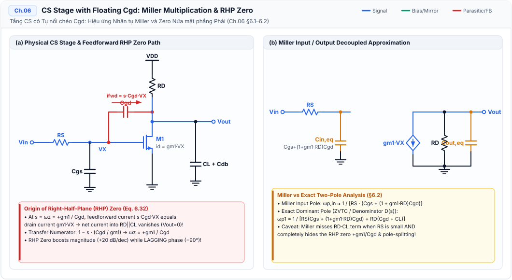

---
{
  "id": "law-miller-theorem-and-rhp-zero",
  "kind": "law",
  "domain": "dynamics-noise-feedback",
  "title_vi": "Định lý Miller, Nghiệm Hai Cực Chính xác và Zero Nửa Mặt phẳng Phải của Tầng Nguồn Chung (Miller Theorem & Feedforward RHP Zero)",
  "title_en": "Miller's Theorem, Exact Two-Pole CS Transfer Function, and Feedforward RHP Zero",
  "summary": "Giải thích bản chất phép xấp xỉ Miller tách tụ nối chéo thành hai tụ nối đất, đối chiếu với nghiệm bậc hai chính xác của tầng nguồn chung để chỉ ra giới hạn gán cực theo nút và nguồn gốc vật lý của zero nửa mặt phẳng phải (+gm/Cgd).",
  "diagram": "../../diagrams/miller-effect-rhp-zero.svg",
  "razavi_refs": [
    {
      "chapter": 6,
      "section": "6.1-6.2",
      "pages": "173-187",
      "equations": ["6.2", "6.3", "6.9", "6.19", "6.21", "6.22", "6.30", "6.35", "6.40", "6.43", "6.47"]
    }
  ],
  "glossary_codes": ["T023", "T838", "T852", "T853", "T854", "T865", "T874", "T879", "T894", "T921", "T1702"],
  "process_agnostic": true,
  "roles": {
    "floating_bridge_cap": "Tụ điện cổng–máng Cgd nối trực tiếp giữa nút ngõ vào trở kháng cao và nút ngõ ra có độ lợi đảo pha lớn",
    "miller_input_shunt": "Điện dung tương đương nhìn từ ngõ vào Ceq,in = (1 - Av)Cgd làm suy giảm mạnh băng thông khi trở kháng nguồn Rs hữu hạn",
    "feedforward_bypass_path": "Đường truyền thẳng dòng điện tần số cao s*Cgd*Vx chạy ngược pha với dòng hỗ dẫn gm*Vx tạo ra RHP zero tại +gm/Cgd",
    "output_load_branch": "Điện trở tải RD (hoặc ro1 || ro2) kết hợp Cdb, CL và phần phản chiếu Cgd quyết định vị trí cực không trội hoặc cực trội"
  },
  "symptoms_addressed": [
    "unexpected-cs-bandwidth-collapse",
    "missing-rhp-zero-in-hand-calculation",
    "wrong-output-pole-from-naive-miller",
    "excess-phase-lag-at-high-frequency"
  ],
  "limitations": [
    "miller-approximation-uses-dc-gain-only",
    "fails-to-predict-feedforward-zero",
    "overestimates-second-pole-when-rs-and-rd-interact",
    "cannot-substitute-port-impedance-independently-of-sensing-port"
  ],
  "checklists": ["common-mos", "single-stage", "feedback-and-stb"]
}
---

## 1. Bản chất Nguyên lý, Sơ đồ Mạch & Vai trò Từng Nhánh Cấu trúc

Trong thiết kế mạch tương tự (analog design), tốc độ hoạt động luôn đánh đổi trực tiếp với độ lợi điện áp (voltage gain), công suất tiêu tán (power dissipation) và nhiễu (noise). Ở tần số thấp, cực cổng của transistor hiệu ứng trường MOS (MOSFET) gần như hở mạch; nhưng khi tần số tăng lên, các điện dung nội tại — đặc biệt là điện dung cổng–máng $C_{GD}$ nằm vắt ngang giữa ngõ vào $X$ và ngõ ra $Y$ của tầng nguồn chung (common-source stage, CS) — buộc hai nút mạch tương tác chặt chẽ với nhau.

Cấu trúc động học của tầng CS được điều khiển bởi 4 thành phần cốt lõi:
1. **Nguồn kích thích có trở kháng trong hữu hạn ($V_{in}, R_S$):** Lưu ý của Razavi (Chú thích chân trang 2, tr. 181): $R_S$ hiếm khi là điện trở cố ý gắn thêm mà chính là **trở kháng ngõ ra $R_{out,\text{prev}}$ của tầng khuếch đại đứng trước**. Nếu $R_S = 0$ (nguồn áp lý tưởng), điện thế nút cổng $V_X$ bị khóa cứng vào $V_{in}$ nên tụ ở ngõ vào không thể tạo cực!
2. **Nhánh truyền dẫn chính của transistor ($g_m V_X$):** Tạo dòng điện cực máng tỉ lệ với điện áp cổng–nguồn, sinh ra độ lợi đảo pha âm $A_v = V_Y / V_X = -g_m R'_D$ ở tần số thấp (với $R'_D = R_D \parallel r_O$).
3. **Nhánh cầu nối nổi ($C_{GD}$ — Floating Feedback/Feedforward Bridge):** Đóng hai vai trò vật lý đối lập theo dải tần:
   - *Ở tần số trung bình:* Khi $V_X$ tăng thêm $+\Delta V$, nút máng $V_{out}$ sụt xuống $-A_0 \Delta V$ (với $A_0 = g_m R'_D > 0$). Độ chênh điện áp hai đầu tụ $C_{GD}$ tăng vọt thành $(1 + A_0)\Delta V$, buộc nguồn kích thích phải bơm dòng lớn gấp $(1 + A_0)$ lần so với một tụ nối đất thông thường. Đây là **sự nhân điện dung Miller (Miller multiplication)**.
   - *Ở tần số rất cao:* Dung kháng $1/(s C_{GD})$ giảm nhỏ, tạo thành **đường truyền thẳng (feedforward path)** bơm trực tiếp dòng $s C_{GD} V_X$ từ cổng sang máng mà không qua cơ chế đảo pha của kênh dẫn, sinh ra **zero ở nửa mặt phẳng phải (right-half-plane zero, RHP zero)**.
4. **Mạng tụ nối đất tại hai nút ($C_{GS}$ tại nút $X$; $C_L' = C_{DB} + C_L$ tại nút $Y$):** Lưu trữ điện tích cục bộ đối với đất xoay chiều, kết hợp với $C_{GD}$ tạo thành hệ phương trình vi phân bậc hai có đúng **2 cực độc lập** (vì 3 tụ $C_{GS}, C_{GD}, C_L'$ không tạo vòng kín chỉ gồm tụ điện).

---

## 2. Hệ Phương trình Cốt lõi & Tư duy "Nhìn Mạch Đọc Nhanh" (Analysis by Inspection)

### 2.1. Định lý Miller (Miller's Theorem) và Phép xấp xỉ Miller
Xét trở kháng $Z$ nối giữa hai nút $X$ và $Y$ có tỉ số điện áp đã biết $A_v(s) = V_Y / V_X$. Để tách $Z$ thành hai nhánh nối đất $Z_1$ (tại $X$) và $Z_2$ (tại $Y$) giữ nguyên dòng điện rút ra khỏi $X$ và bơm vào $Y$ (Phương trình 6.2–6.3):

$$
Z_1 = \frac{Z}{1 - \dfrac{V_Y}{V_X}} = \frac{Z}{1 - A_v}, \qquad Z_2 = \frac{Z}{1 - \dfrac{V_X}{V_Y}} = \frac{Z}{1 - \dfrac{1}{A_v}}
$$

Áp dụng cho tụ $C_F = C_{GD}$ trong tầng CS đảo pha có độ lợi tần số thấp $A_v \approx -g_m R'_D$ (**phép xấp xỉ Miller — Miller's approximation**):

$$
C_{in,\text{eq}} = C_{GS} + (1 + g_m R'_D) C_{GD}, \qquad C_{out,\text{eq}} = C_L' + \left(1 + \frac{1}{g_m R'_D}\right) C_{GD} \approx C_L' + C_{GD}
$$

Nếu áp dụng máy móc quy tắc **liên hệ các cực với các nút mạch (association of poles with nodes, §6.1.2)** $\omega_{p,j} = (R_j C_j)^{-1}$, ta thu được ước lượng hai cực rời nhau (Phương trình 6.21–6.22):

$$
\omega_{in,\text{Miller}} = \frac{1}{R_S \left[ C_{GS} + (1 + g_m R'_D) C_{GD} \right]}, \qquad \omega_{out,\text{Miller}} = \frac{1}{R'_D \left( C_{DB} + C_L + C_{GD} \right)}
$$

### 2.2. Nghiệm Hai Cực Chính xác (Exact Direct Analysis) & Phép Xấp xỉ Cực Trội
Viết KCL trực tiếp tại nút cổng $X$ và nút máng $out$ (Phương trình 6.26–6.30, thay $R_D \to R'_D = R_D \parallel r_O$ và $C_{DB} \to C_L' = C_{DB} + C_L$):

$$
\frac{V_X - V_{in}}{R_S} + s C_{GS} V_X + s C_{GD}(V_X - V_{out}) = 0
$$

$$
(V_{out} - V_X) s C_{GD} + g_m V_X + \frac{V_{out}}{R'_D} + s C_L' V_{out} = 0
$$

Khử $V_X$, hàm truyền chính xác bậc hai của tầng nguồn chung là (Phương trình 6.30):

$$
\frac{V_{out}}{V_{in}}(s) = \frac{-(g_m - s C_{GD}) R'_D}{R_S R'_D \xi \, s^2 + \left[ R_S (1 + g_m R'_D) C_{GD} + R_S C_{GS} + R'_D (C_{GD} + C_L') \right] s + 1}
$$

trong đó tổng tích chéo ba điện dung là:

$$
\xi = C_{GS} C_{GD} + C_{GS} C_L' + C_{GD} C_L'
$$

Với mẫu số bậc hai chuẩn hóa $D(s) = \dfrac{s^2}{\omega_{p1}\omega_{p2}} + s\left(\dfrac{1}{\omega_{p1}} + \dfrac{1}{\omega_{p2}}\right) + 1$, khi hai cực cách xa nhau (**phép xấp xỉ cực trội — dominant-pole approximation**, $|\omega_{p1}| \ll |\omega_{p2}|$), ta đọc ngay từ các hệ số $b_1$ và $b_2$ (Phương trình 6.34, 6.35, 6.40):

$$
\omega_{p1} \approx \frac{1}{b_1} = \frac{1}{R_S (1 + g_m R'_D) C_{GD} + R_S C_{GS} + R'_D (C_{GD} + C_L')}
$$

$$
\omega_{p2} \approx \frac{b_1}{b_2} = \frac{R_S (1 + g_m R'_D) C_{GD} + R_S C_{GS} + R'_D (C_{GD} + C_L')}{R_S R'_D (C_{GS} C_{GD} + C_{GS} C_L' + C_{GD} C_L')}
$$

### 2.3. Nguồn gốc Vật lý của RHP Zero và Mẹo Nhìn Nhanh Điểm Không
Tử số của $H(s)$ triệt tiêu khi tổng hai dòng điện đi tới nút ngõ ra bị hủy nhau hoàn toàn ngay cả khi $V_{out} = 0$ (Phương trình 6.43):

$$
V_X s_z C_{GD} = g_m V_X \implies s_z = +\frac{g_m}{C_{GD}} \quad (\text{nằm ở Nửa Mặt phẳng Phải — RHP!})
$$

**Mẹo "Nhìn Mạch Đọc Nhanh" để tìm Zero không cần giải KCL toàn mạch (§6.2, Hình 6.18):**
- Muốn tìm $s_z$, ép $V_{out} = 0$ (ngắn mạch xoay chiều nút ngõ ra xuống đất sao cho dòng đi vào tải bằng 0), rồi tìm tần số phức $s_z$ khiến tổng dòng tiến vào nút ngõ ra bằng 0: $I_{C_{GD}} + I_{\text{channel}} = 0 \implies -s_z C_{GD} V_X + g_m V_X = 0 \implies \omega_z = +g_m / C_{GD}$.
- Tác hại kép của RHP zero $(1 - s/\omega_z)$: biên độ $|1 - j\omega/\omega_z| = \sqrt{1 + (\omega/\omega_z)^2}$ **tăng $+20\text{ dB/dec}$** giống LHP zero (ngăn độ lợi vòng giảm), nhưng góc pha $\angle(1 - j\omega/\omega_z) = -\arctan(\omega/\omega_z)$ lại **trễ thêm tới $-90^\circ$** giống một cực LHP!

---

## 3. Bất biến Cấu trúc & Các Bẫy Lỗi Kinh điển (Structural Invariants & Traps)

- **[INV-MILLER-01] Bất biến Bảo toàn Bậc Động học:** Số cực của mạch bằng số điện dung độc lập (tổng số tụ trừ số vòng kín chỉ chứa tụ và nguồn áp lý tưởng). Ba tụ $C_{GS}, C_{GD}, C_L'$ nối thành hình $\Pi$ luôn cho đúng **2 cực**, không bao giờ là 1 cực hay 3 cực (trừ khi $R_S = 0$ làm suy biến nhánh $C_{GS}$ và biến mạch thành 1 cực tại $[R'_D(C_{GD}+C_L')]^{-1}$, Phương trình 6.32).
- **[INV-MILLER-02] Bất biến Cực Trội Tổng Hợp:** Hệ số bậc nhất $b_1$ luôn bằng tổng hằng số thời gian của cả phía vào (đã nhân Miller) **cộng với** hằng số thời gian phía ra $R'_D(C_{GD} + C_L')$. Bỏ sót số hạng sau sẽ sai lệch hoàn toàn khi $R_S$ nhỏ hoặc $C_L'$ rất lớn!
- **[TRAP-MILLER-01] Bẫy Dùng Định lý Miller để Tính Trở kháng Ngõ ra $Z_{out}$ (Ví dụ 6.3, tr. 177–178):** Nhiều người thay $C_{GD}$ bằng $C_{out,\text{eq}} \approx C_{GD}$ rồi kết luận $Z_{out}$ ở tần số cao vẫn song song với $R'_D$. **Sai lầm chí mạng!** Định lý Miller chỉ đúng cho điều kiện kích thích mà tỉ số $V_Y/V_X = -A_0$ được thiết lập (tức khi kích từ $V_{in}$). Khi đo $Z_{out}$ (đặt $V_{in}=0$, bơm nguồn thử vào ngõ ra), $C_{GD}$ tạo đường hồi tiếp điện áp quay về cổng: ở tần số rất cao $C_{GD}$ nối tắt cổng–máng biến MOSFET thành linh kiện nối diode có trở kháng ra hạ xuống tận **$1/g_m \parallel R'_D$** (chứ không phải $R'_D$)!
- **[TRAP-MILLER-02] Bẫy Gán Sai Cực Thứ Hai $\omega_{p2}$ khi $R'_D \to \infty$ (Tải Nguồn dòng):** Khi tải là nguồn dòng có $R'_D$ rất lớn và $C_{GD}$ đáng kể ($R_S (1+g_m R'_D)C_{GD} \gg R_S C_{GS}, R'_D C_L'$), cực thứ hai thực tế rút gọn từ Phương trình 6.36–6.41 thành:

$$
\omega_{p2} \approx \frac{g_m C_{GD}}{C_{GS} C_{GD} + C_{GS} C_L' + C_{GD} C_L'} = \frac{g_m}{C_{GS} + C_L' \left(1 + \dfrac{C_{GS}}{C_{GD}}\right)}
$$

chứ **hoàn toàn không phải** $\omega_{out,\text{Miller}} = [R'_D (C_L' + C_{GD})]^{-1}$! Công thức Miller ngây thơ dự đoán cực ra tiến về 0 khi $R'_D \to \infty$, trong khi thực tế cực thứ nhất mới tiến về 0 còn cực thứ hai bị kéo lên vùng $g_m / C$ (tiền đề trực tiếp của **sự tách cực — pole splitting** ở Chương 10!).
- **[TRAP-MILLER-03] Trở kháng Ngõ vào Tần số Cao không Thuần Dung (Phương trình 6.47):** Khi tải cực máng có tụ $C_L'$, độ lợi từ cổng đến máng có dạng $-g_m R'_D / (1 + s R'_D C_L')$. Thay $A_v(s)$ phụ thuộc tần số vào công thức Miller cho thấy nhánh $C_{GD}$ nhìn từ ngõ vào tương đương một tụ nối tiếp với một điện trở dương — gây suy hao công suất tín hiệu ở tần số cao.

---

## 4. Lộ trình Nâng cấp Cấu trúc & Bát giác Đánh đổi (Upgrade Paths & Design Octagon)

Trên **Bát giác Thiết kế Tương tự (`concept-analog-design-octagon`)**, hiệu ứng Miller đánh trực diện vào trục **Tốc độ (Speed)** khi ta cố đẩy cao **Độ lợi (Gain)** $g_m R'_D$:

| Triệu chứng chạm trần ở tầng CS | Hướng nâng cấp cấu trúc (Canonical Node) | Cơ chế giải quyết | Cái giá phải trả trên Bát giác Đánh đổi |
|---|---|---|---|
| Cực vào bị đè thấp bởi $(1 + g_m R'_D)C_{GD}$ khi $R_S$ lớn | `topo-cascode-stage` / `concept-high-freq-cs-cg-cascode` | Chèn transistor cascode cổng chung giữ trở kháng nhìn vào cực máng $M_1$ chỉ còn $\approx 1/(g_{m2}+g_{mb2})$, giảm hệ số nhân Miller từ $(1 + g_m R'_D)$ xuống $\approx 2$ | Mất thêm ít nhất $1\,V_{DS,\min}$ khoảng dự trữ điện áp (headroom), giảm dải dao động điện áp ngõ ra (voltage swing) |
| Cần đệm tín hiệu tần số cao không bị nhân Miller cổng–máng | `topo-common-gate-stage` | Cực cổng nối đất xoay chiều, $C_{GS}$ và $C_{GD}$ bị cô lập về hai phía vào–ra riêng biệt | Trở kháng ngõ vào thấp $\approx 1/(g_m + g_{mb})$, không khuếch đại dòng |
| Xuất hiện RHP zero $+g_{m2}/C_C$ khi dùng tầng CS làm tầng 2 của Op-Amp hai tầng | `tech-miller-rhp-zero-nulling-and-cascode-comp` | Mắc nối tiếp điện trở triệt $R_z = 1/g_{m2}$ hoặc hồi tiếp tụ bù qua cực nguồn cascode (bù Ahuja) | Thêm nhạy cảm theo PVT nếu $R_z$ không bám $1/g_{m2}$, hoặc tăng dòng phân cực nhánh cascode |
| Muốn ước lượng nhanh cực trội của mạch nhiều tụ nối chéo mà không giải ma trận bậc cao | `tech-zvtc-and-eet-bandwidth` | Dùng phương pháp hằng số thời gian giá trị không (ZVTC) hoặc định lý phần tử bổ sung (EET) | Chỉ cho nghiệm xấp xỉ cực trội $\omega_{p1}$, cần kiểm tra điều kiện tách cực |

---

## 5. Thích ứng Đa Tiến trình (90nm / 65nm / 45nm) & Cách Kiểm chứng trong Cadence / Spectre

### 5.1. Thích ứng Công nghệ Nanomet (90nm $\to$ 65nm $\to$ 45nm)
- **Tỉ phần $C_{GD} / C_{GS}$ tăng mạnh khi co nhỏ kênh:** Ở công nghệ kênh dài ($0{,}5\,\mu\text{m}$), $C_{GD}$ chỉ là điện dung phủ chồng (overlap capacitance $W C_{ov}$) rất nhỏ so với $\frac{2}{3} W L C_{ox}$. Khi xuống **90nm / 65nm / 45nm**, chiều dài kênh $L$ co nhỏ trong khi điện dung viền trường (fringing capacitance) giữa các chồng via/contact cực cổng và cực máng giữ nguyên hoặc tăng (Chú giải lề tr. 185 của Razavi còn nhấn mạnh thêm tụ ký sinh cột kim loại $C_{DS}$!), khiến $C_{GD}$ có thể chiếm tới **$30\% \text{–} 50\%\, C_{GS}$**!
- **Hệ quả thiết kế bất biến tiến trình:** Không bao giờ ước lượng $C_{GD}$ bằng tay qua công thức kênh dài; luôn trích xuất trực tiếp `cgd`, `cgs`, `cdd` từ điểm làm việc DC của PDK. Ngoài ra, $f_T = \frac{g_m}{2\pi (C_{GS} + C_{GD})}$ tăng khi tăng mật độ dòng, nhưng tích độ lợi–băng thông thực tế của tầng CS có tải tương đương luôn thấp hơn $f_T$ nhiều lần do hiệu ứng Miller của $C_{GD}$.

### 5.2. Quy trình Kiểm chứng Chính xác trong Cadence Virtuoso / Spectre
1. **Đọc điện dung nội tại điểm làm việc (`dc` OP):**
   - Chạy phân tích `dc` lưu operating point (`save *:oppoint`), kiểm tra các tham số BSIM4 của transistor chính $M_1$: `gm`, `gds` ($1/r_O$), `cgs` ($|\partial Q_G/\partial V_S|$), `cgd` ($|\partial Q_G/\partial V_D|$), `cdd` / `cdb`. Lưu ý dấu âm của đạo hàm điện tích xuyên dẫn trong BSIM4 (`cgd` có thể hiển thị âm trong bảng OP — luôn lấy trị tuyệt đối $|C_{GD}|$).
2. **Đối chiếu AC Sweep & Pole-Zero (`ac` + `pz`):**
   - Bơm nguồn `vsin`/`vsource` (`mag=1`) nối tiếp điện trở nguồn thực tế $R_S$ (tương đương $R_{out}$ của tầng trước, tuyệt đối không để nguồn áp lý tưởng $R_S = 0$ nếu tầng trước là mạch khuếch đại!).
   - Chạy `ac dec 50 1k 100G` và `pz` giữa nút vào–ra. Kiểm tra trên đồ thị Bode: tại tần số gần $f_z = \frac{g_m}{2\pi |C_{GD}|}$, độ dốc biên độ đổi từ $-40\text{ dB/dec}$ về $-20\text{ dB/dec}$ nhưng pha **tiếp tục rơi từ $-180^\circ$ xuống $-270^\circ$** — dấu vân tay không thể nhầm lẫn của **RHP zero**!
3. **Kiểm tra chia ngón Layout (`nf` — Multi-finger):** Khi tăng số ngón cổng chẵn trong CDF (`nf`), diện tích vùng máng dùng chung giảm gần một nửa làm giảm $C_{DB}$, nhưng $C_{GD} \propto W_{\text{total}}$ **không giảm** theo chia ngón (thậm chí tăng nhẹ nếu đi dây cổng–máng song song sát nhau ở tầng kim loại M1/M2).

---

## 6. Mốc Đối chiếu Sách Razavi & Thuật ngữ Chuẩn CLB

### 6.1. Đối chiếu Sách Gốc Razavi (2nd Edition)
- **Chương 6:** *Frequency Response of Amplifiers* — §6.1.1 *Miller Effect* (tr. 174–178, Phương trình 6.1–6.16), §6.1.2 *Association of Poles with Nodes* (tr. 179–180, Phương trình 6.17–6.20), §6.2 *Common-Source Stage* (tr. 180–187, Phương trình 6.21–6.47, Hình 6.15–6.21).
- **Chú giải Hiệu đính Học thuật CLB (`NG06`):**
  - **`NG06-01` (tr. 173):** Trong đoạn ôn tập phép xấp xỉ Bode ở đầu §6.1, bản in gốc tiếng Anh viết nhầm chiều thay đổi độ dốc ("tăng 20 dB/dec tại cực và giảm 20 dB/dec tại zero"). Quy luật vật lý đúng cho $20\log_{10}|H(j\omega)|$ là: **mỗi cực bậc một làm giảm độ dốc $-20\text{ dB/dec}$**, còn **mỗi zero bậc một (dù LHP hay RHP) làm tăng độ dốc $+20\text{ dB/dec}$**.
  - **`NG06-02` (tr. 183, Ví dụ 6.6):** Ngay sau Phương trình (6.31), bản in gốc viết thiếu lũy thừa nghịch đảo cho $\omega_0$: biểu thức đúng thứ nguyên tần số góc phải là $\omega_0 = \left[R_S(1 + g_m R_D)C_{GD} + R_D C_{GD}\right]^{-1}$; đồng thời mẫu số Phương trình (6.32) khi $R_S = 0$ phải đọc là $(R_D C_{GD} s + 1)$ (bản in thiếu biến $s$).

### 6.2. Bảng Thuật ngữ Chuẩn CLB Vi Mạch Sử dụng trong Thẻ
| Mã CLB | Thuật ngữ Tiếng Anh | Thuật ngữ Tiếng Việt Chuẩn | Ghi chú Ngữ cảnh |
|---|---|---|---|
| `T023` | common-source stage (CS) | tầng nguồn chung | Source là cực nguồn MOSFET, không dịch thành nguồn cấp |
| `T838` | frequency response | đáp ứng tần số | Đặc tính biên độ và pha theo tần số |
| `T852` | Miller's theorem | định lý Miller | Biến đổi nhánh nối chéo thành hai nhánh nối đất |
| `T853` | association of poles with nodes | liên hệ các cực với các nút mạch | Chỉ đúng khi không có tụ cầu nối đáng kể |
| `T874` | Miller effect | hiệu ứng Miller | Hiện tượng nhân điện dung do độ lợi đảo pha |
| `T879` | Miller multiplication | sự nhân điện dung Miller | Hệ số nhân $(1 - A_v)$ tại ngõ vào |
| `T894` | Miller's approximation | phép xấp xỉ Miller | Thay $A_v(s)$ bằng độ lợi tần số thấp $-g_m R'_D$ |
| `T921` | dominant pole | cực trội | Cực tần số thấp nhất quyết định băng thông $-3\text{ dB}$ |
| `T1702` | right-half-plane zero | zero ở nửa mặt phẳng phải | Điểm không dương $s_z > 0$ gây tăng biên độ nhưng trễ pha |
