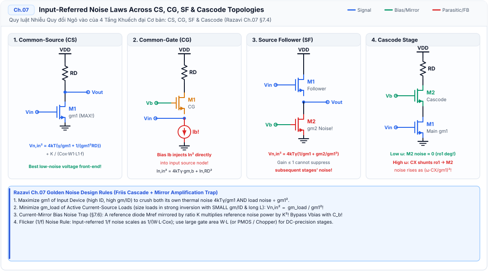

---
{
  "id": "law-noise-in-single-stage-amplifiers",
  "kind": "law",
  "domain": "dynamics-noise-feedback",
  "title_vi": "Định luật Nhiễu Quy về Ngõ vào của Các Tầng Khuếch đại Đơn: CS, CG, Bám Nguồn & Cascode (Single-Stage Amplifier Noise Laws)",
  "title_en": "Complete Input-Referred Thermal and Flicker Noise Laws of CS, Degenerated CS, CG, Source Follower, and Cascode Stages",
  "summary": "Hệ thống hóa phép suy diễn chặt chẽ và đối chiếu trực diện mật độ phổ nhiễu nhiệt cùng nhiễu nhấp nháy 1/f quy về ngõ vào (cả nguồn áp Vn,in^2 và nguồn dòng In,in^2) cho toàn bộ họ khuếch đại một tầng CMOS: CS tải điện trở/nguồn dòng/đẩy-kéo/suy biến nguồn RS, CG với gánh nặng nhiễu dòng kép 4kT*gamma*(gm2+gm3), Bám nguồn SF tự khử gmb trong nhiễu áp nhưng làm suy hao hệ số nhiễu toàn hệ thống, và tầng Cascode nén nhiễu M2 theo (gm2*rO1)^2 ở tần số thấp nhưng bùng phát nhiễu theo (omega*CX)^2 ở tần số cao.",
  "diagram": "../../diagrams/noise-stages-comparison.svg",
  "razavi_refs": [
    {
      "chapter": 7,
      "section": "7.4.1-7.4.4",
      "pages": "243-254",
      "equations": ["7.75", "7.78", "7.81", "7.85", "7.93", "7.98", "7.103", "7.108", "7.111", "7.112", "7.113"]
    }
  ],
  "glossary_codes": ["T021", "T023", "T082", "T392", "T499", "T1139", "T1147", "T1178", "T1179"],
  "process_agnostic": true,
  "roles": {
    "cs_transconductor_core": "Tầng nguồn chung (CS) chuyển đổi trực tiếp áp cổng thành dòng máng với Rin cực cao ở tần số thấp, đạt nhiễu quy về ngõ vào thấp nhất khi cực đại hóa gm1 và biến tải thành phần tử đồng khuếch đại (push-pull)",
    "source_degeneration_element": "Điện trở suy biến cực nguồn RS tuyến tính hóa hỗ dẫn nhưng luôn cộng trực tiếp nhiễu nhiệt 4kT*RS vào cổng và đẩy nhiễu của tải RD tăng vọt theo thừa số (1 + gm1*RS)^2",
    "cg_current_buffer_stage": "Tầng cổng chung (CG) cung cấp trở kháng vào thấp ~1/(gm1+gmb1) nhưng có độ lợi dòng bằng 1, nên quy trực tiếp dòng nhiễu của cả nguồn dòng phân cực dưới nguồn M2 lẫn nguồn dòng tải trên máng M3 về thẳng ngõ vào",
    "source_follower_voltage_buffer": "Mạch bám nguồn (SF) triệt tiêu hệ số thân gmb khi quy nhiễu nội tại về cổng cho biểu thức giống hệt CS, nhưng vì độ lợi áp Av < 1 nên làm khuếch đại nhiễu của các tầng đứng sau khi quy về đầu vào toàn tuyến",
    "cascode_shield_transistor": "Transistor cascode M2 thấy tổng trở nút nội ZX(s) = rO1 || (1/sCX): tự triệt dòng nhiễu kênh ở tần số thấp nhờ suy biến rO1, nhưng mở đường thoát nhiễu mạnh ra tải khi tụ ký sinh CX ngắn mạch xuống đất ở tần số RF"
  },
  "symptoms_addressed": [
    "choosing-wrong-front-end-stage-for-given-source-impedance",
    "unexpected-noise-figure-degradation-in-cg-or-degenerated-cs-stages",
    "placing-source-follower-ahead-of-low-noise-gain-stage",
    "high-frequency-cascode-noise-rise-due-to-internal-node-capacitance-cx",
    "headroom-collapse-when-increasing-id-or-rd-to-suppress-cs-thermal-noise"
  ],
  "limitations": [
    "low-frequency-gate-referred-noise-lemma-neglects-cgs-and-induced-gate-noise-at-rf",
    "cg-stage-cannot-simultaneously-match-50-ohm-source-and-achieve-sub-3db-nf-without-noise-cancellation",
    "push-pull-complementary-cs-suffers-poor-psrr-and-pvt-sensitive-dc-bias-current"
  ],
  "checklists": ["common-mos", "single-stage"]
}
---

## 1. Bản chất Nguyên lý, Sơ đồ Mạch & Vai trò Từng Nhánh Cấu trúc

Mọi bộ thu tương tự băng gốc, tiền khuếch đại cảm biến, LNA vô tuyến hay tầng đầu Op-Amp suy cho cùng đều bắt đầu bằng một trong bốn cấu hình khuếch đại một tầng kinh điển: **tầng nguồn chung (`T023`, common-source stage — CS)**, **tầng cổng chung (`T021`, common-gate stage — CG)**, **mạch bám nguồn (`T082`, source follower — SF)**, và **tầng cascode (`T499`, cascode stage)** (Razavi Chương 7, §7.4.1–§7.4.4, tr. 243–254). Tuy nhiên, bốn cấu trúc này thể hiện bốn định luật vật lý hoàn toàn khác biệt đối với cặp nguồn nhiễu tương đương hai cửa $(\overline{V_{n,in}^2}, \overline{I_{n,in}^2})$, bắt nguồn từ hai câu hỏi cốt lõi: *(1) Tầng đó có độ lợi dòng điện hay không?* và *(2) Cực nguồn của transistor đang mang nhiễu nhìn thấy trở kháng cao hay thấp?*



Nền tảng toán học mở khóa toàn bộ §7.4 là **Bổ đề Nhiễu Quy về Cực Cổng (Gate-Referred Noise Lemma, Hình 7.39–7.40, Phương trình 7.73–7.74 & Ví dụ 7.14, tr. 243–244)**: với một MOSFET $M_1$ có trở kháng suy biến bất kỳ $Z_S$ nối ở cực nguồn (ở tần số thấp khi dòng cổng bằng $0$), dòng nhiễu ngắn mạch ngõ ra do nguồn dòng nhiễu kênh $\overline{I_n^2}$ sinh ra là $I_{n,\text{out}1} = \dfrac{I_n}{1 + (g_m + g_{mb} + r_O^{-1}) Z_S}$, trùng khít hoàn toàn với dòng ngắn mạch ngõ ra $I_{n,\text{out}2} = \dfrac{g_m V_n}{1 + (g_m + g_{mb} + r_O^{-1}) Z_S}$ khi đặt một **điện áp nhiễu quy về cực cổng (`T1147`, gate-referred noise voltage)** mắc nối tiếp ngay tại cực cổng có mật độ phổ công suất:

$$
\overline{V_{n,\text{gate}}^2}(f) = \frac{\overline{I_{n,\text{th}}^2} + \overline{I_{n,1/f}^2}}{g_m^2} = \frac{4 k T \gamma}{g_m} + \frac{K}{C_{ox} W L f}
$$

Nhờ bổ đề này, vai trò nhiễu của từng cấu hình một tầng lộ diện tức khắc ngay trên sơ đồ mạch:
1. **Tầng Nguồn Chung (`T023`, CS):** Tín hiệu kích thẳng vào cực cổng có $Z_{in} \to \infty$ ở tần số thấp ($\overline{I_{n,in}^2} \approx 0$), cung cấp độ lợi dòng vô hạn và độ lợi áp lớn $-g_{m1} R_{\text{out}}$. Đây là **nhà vô địch tuyệt đối về nhiễu điện áp thấp** khi ghép với nguồn tín hiệu trở kháng vừa và cao.
2. **Tầng CS Có Suy biến Cực nguồn (`T1179`, Degenerated CS):** Đổi độ lợi lấy độ tuyến tính thông qua $R_S$, nhưng phải gánh phạt nhiễu kép: $R_S$ bơm thẳng nhiễu nhiệt $4kT R_S$ nối tiếp với ngõ vào, đồng thời làm sụt hỗ dẫn hiệu dụng $G_m \approx \frac{g_{m1}}{1 + g_{m1} R_S}$ khiến nhiễu của tải cực máng $R_D$ quy về ngõ vào phình to gấp $(1 + g_{m1} R_S)^2$ lần!
3. **Tầng Cổng Chung (`T021`, CG):** Nhận tín hiệu tại cực nguồn trở kháng thấp $\approx \frac{1}{g_{m1} + g_{mb1}}$, rất tiện phối hợp trở kháng $50\,\Omega$, nhưng **độ lợi dòng điện chỉ bằng đúng đơn vị ($A_I = 1$)**! Hậu quả chí mạng là mọi dòng nhiễu từ nguồn dòng phân cực dưới nguồn $M_2$ và tải nguồn dòng trên máng $M_3$ đều phản chiếu $1:1$ thành $\overline{I_{n,in}^2}$ khổng lồ tại cửa vào!
4. **Mạch Bám Nguồn (`T082`, Source Follower):** Dù hiệu ứng thân $g_{mb1}$ làm giảm độ lợi điện áp xuống dưới $1$, các thừa số $(g_{m1} + g_{mb1})$ triệt tiêu nhau hoàn toàn khi quy nhiễu của chính SF về cổng, trả lại $\overline{V_{n,in}^2}$ hệt như tầng CS. Tuy nhiên, vì $|A_v| < 1$, đặt SF ở đầu chuỗi thu sẽ **phóng đại nhiễu của tầng kế tiếp** lên $1/A_v^2$ lần!
5. **Tầng Cascode (`T499`, Cascode):** Giữ nguyên nhiễu tần số thấp siêu sạch của CS đơn vì dòng nhiễu của transistor cascode $M_2$ bị trở kháng $r_{O1}$ khóa chặt không cho chảy ra tải; song khi tần số tiến lên vùng RF làm tụ ký sinh nút nội $C_X$ dẫn mạnh xuống đất, lá chắn $r_{O1}$ bị nối tắt và $M_2$ bắt đầu phun nhiễu ra ngõ ra.

---

## 2. Hệ Phương trình Cốt lõi & Tư duy "Nhìn Mạch Đọc Nhanh" (Analysis by Inspection)

### 2.1. Bốn Biến Thể Tầng Nguồn Chung (CS): Từ Tải Thụ động đến Bổ sung Đẩy–Kéo & Suy biến Nguồn (§7.4.1, Phương trình 7.75–7.92)
- **Biến thể 1 — CS tải điện trở $R_D$ (Hình 7.29 & 7.41a, Phương trình 7.75 & 7.84):** Cộng công suất dòng nhiễu không tương quan tại cực máng rồi chia cho $g_{m1}^2$, tổng **nhiễu nhiệt quy về ngõ vào (`T1139`)** và **nhiễu nhấp nháy quy về ngõ vào (`T1178`, `T392`)** trên một đơn vị băng thông là:

$$
\overline{V_{n,in,\text{CS-R}}^2} = 4 k T \left( \frac{\gamma}{g_{m1}} + \frac{1}{g_{m1}^2 R_D} \right) + \frac{K_N}{C_{ox} W_1 L_1 f} \qquad \text{(Phương trình 7.75)}
$$

Nếu biểu diễn theo sụt áp DC trên tải $V_{RD} = I_D R_D$ và điện áp vượt ngưỡng $V_{OV1} = V_{GS1} - V_{TH1}$ với $g_{m1} = \frac{2 I_D}{V_{OV1}}$ (Phương trình 7.84, tr. 247):

$$
\overline{V_{n,in,\text{th}}^2} = 4 k T \left[ \frac{\gamma V_{OV1}}{2 I_D} + \frac{V_{OV1}^2}{4 I_D \cdot (I_D R_D)} \right]
$$

Công thức này bóc trần xung đột *Nhiễu – Công suất – Khoảng dự trữ điện áp (Headroom)*: nếu tăng $I_D$ trên một transistor cố định và giữ cố định sụt áp $I_D R_D$ (bằng cách giảm $R_D$), $V_{OV1} \propto \sqrt{I_D}$ tăng lên làm số hạng thứ hai **không hề giảm**! Muốn giảm $\overline{V_{n,in}^2}$ mà giữ nguyên cửa sổ dao động $V_{DD} - I_D R_D - V_{OV1}$, bắt buộc phải tăng đồng thời cả $W_1$ tỉ lệ với $I_D$ để giữ $V_{OV1}$ (hoặc $g_m/I_D$) không đổi!
  * *Ví dụ Thiết kế Định lượng của Razavi (Ví dụ 7.19, Hình 7.45, Phương trình 7.86–7.92, tr. 248–249):* Thiết kế tầng CS tải $R_D$ trên nguồn $V_{DD} = 1\text{ V}$, công suất tối đa $P = 1\text{ mW}$ ($\Rightarrow I_D \le 1\text{ mA}$), băng thông $f_{-3\text{dB}} = \frac{1}{2\pi R_D C_L} = 1\text{ GHz}$, tổng nhiễu tích phân quy về ngõ vào $V_{n,in,\text{rms}} = 100\,\mu\text{V}_{\text{rms}}$ ($\gamma = 1$). Tích phân phổ nhiễu ngõ ra trên tải $C_L$ cho $\overline{V_{n,\text{out,tot}}^2} = (1 + \gamma g_m R_D)\frac{kT}{C_L}$ (Phương trình 7.90). Chia cho $(g_m R_D)^2$ và thay $\frac{1}{C_L} = 2\pi R_D f_{-3\text{dB}}$ dẫn tới phương trình ràng buộc bất biến (Phương trình 7.91–7.92):

$$
\frac{1 + \gamma g_m R_D}{g_m^2 R_D} \cdot 2\pi k T f_{-3\text{dB}} = (100\,\mu\text{V}_{\text{rms}})^2 \implies \frac{g_m^2 R_D}{1 + \gamma g_m R_D} = 384\,\Omega^{-1}\text{ (tức } \text{S}\text{)}
$$

Chọn độ lợi $g_m R_D = 3 \implies \frac{1}{g_m} = 288\,\Omega$ ($g_m = 3{,}47\text{ mS}$) và $R_D = 864\,\Omega$. Kiểm tra lại phân cực với $I_D = 1\text{ mA}$: sụt áp $I_D R_D = 864\text{ mV}$ chỉ chừa lại $V_{DS1} = 1\text{ V} - 0{,}864\text{ V} = 136\text{ mV}$ — cực kỳ sát biên triode! Nếu hạ độ lợi xuống $g_m R_D = 2$, ta được $R_D = 586\,\Omega$ ($V_{DS1} = 414\text{ mV}$ rộng rãi hơn nhiều) nhưng đòi hỏi $g_m = 3{,}41\text{ mS}$ trên cùng $1\text{ mA}$.

- **Biến thể 2 — CS tải nguồn dòng chủ động PMOS $M_2$ & Tỉ số SNR trên Tụ Tải $C_L$ (Ví dụ 7.15 & 7.17, Hình 7.42 & 7.44, Phương trình 7.78, 7.80–7.82, 7.85):** Khi thay $R_D$ bằng nguồn dòng PMOS $M_2$ (và trường hợp tổng quát mắc song song thêm $R_D$ như Hình 7.44a), độ lợi áp tăng vọt lên $-g_{m1}(r_{O1} \parallel r_{O2} \parallel R_D)$ nhưng $M_2$ bơm thẳng nhiễu của nó vào nút ra:

$$
\overline{V_{n,in,\text{CS-act}}^2} = 4 k T \gamma \left( \frac{1}{g_{m1}} + \frac{g_{m2}}{g_{m1}^2} \right) + \frac{1}{C_{ox} f} \left[ \frac{K_N}{(WL)_1} + \frac{K_P}{(WL)_2} \left( \frac{g_{m2}}{g_{m1}} \right)^2 \right] + \frac{4 k T}{g_{m1}^2 R_D} \quad \text{(Phương trình 7.78, 7.85)}
$$

Khi bỏ $R_D$ ($R_D \to \infty$) và mạch chỉ lái tụ tải $C_L$, tích phân phổ nhiễu nhiệt trên $[0, \infty)$ cho $\overline{V_{n,\text{out,tot}}^2} = \gamma(g_{m1} + g_{m2})(r_{O1} \parallel r_{O2}) \frac{kT}{C_L}$ (Phương trình 7.80). Với tín hiệu vào hình sin biên độ đỉnh $V_m$, tỉ số tín hiệu trên nhiễu ở ngõ ra là (Phương trình 7.81–7.82):

$$
\text{SNR}_{\text{out}} = \frac{\frac{1}{2} V_m^2 g_{m1}^2 (r_{O1} \parallel r_{O2})^2}{\gamma (g_{m1} + g_{m2})(r_{O1} \parallel r_{O2}) \dfrac{kT}{C_L}} = \frac{g_{m1}^2 (r_{O1} \parallel r_{O2}) C_L V_m^2}{2 \gamma (g_{m1} + g_{m2}) k T}
$$

- **Biến thể 3 — CS Bổ sung Đẩy–Kéo (Complementary Push-Pull CS, Ví dụ 7.16, Hình 7.43, Phương trình 7.83):** Đưa tín hiệu $V_{in}$ vào đồng thời cả cổng NMOS $M_1$ lẫn cổng PMOS $M_2$. Cả hai transistor vẫn sinh tổng công suất dòng nhiễu ngõ ra $4kT\gamma(g_{m1} + g_{m2})$ y hệt Hình 7.42, nhưng giờ đây **cả hai cùng làm phần tử hỗ dẫn khuếch đại tín hiệu** với $G_{m,\text{tot}} = g_{m1} + g_{m2}$! Chia cho $(g_{m1} + g_{m2})^2$:

$$
\overline{V_{n,in,\text{push-pull}}^2} = \frac{4 k T \gamma}{g_{m1} + g_{m2}} \qquad \text{(Phương trình 7.83)}
$$

Với $g_{m1} = g_{m2} = g_m$, cấu trúc đẩy–kéo cắt giảm công suất nhiễu nhiệt đi **$4\times$ ($-6\text{ dB}$)** so với CS tải nguồn dòng PMOS ở cùng dòng tĩnh $I_D$ (từ $\frac{8kT\gamma}{g_m}$ xuống chỉ còn $\frac{2kT\gamma}{g_m}$)! Đây là bí quyết của các LNA tái sử dụng dòng (current-reuse inverter LNA) siêu tiết kiệm năng lượng.
- **Biến thể 4 — Tầng CS Có Suy biến Cực nguồn $R_S$ (`T1179`, Bài tập 7.13 Hình 7.76 & Bài tập 7.18 Hình 7.78):** Dùng ngay Bổ đề Nhiễu Quy về Cổng (Hình 7.39b), đặt $V_{n,M1}$ nối tiếp ở cổng $M_1$, $V_{n,RS}$ nối tiếp với $R_S$ ở cực nguồn (cả hai đều tạo cùng dòng ngắn mạch ngõ ra với hỗ dẫn hiệu dụng $G_{m,\text{deg}} = \frac{g_{m1}}{1 + g_{m1} R_S}$ khi bỏ qua $g_{mb1}, r_{O1}$), và quy dòng nhiễu tải $\frac{4kT}{R_D}$ qua $G_{m,\text{deg}}^2$:

$$
\overline{V_{n,in,\text{deg}}^2} = \frac{4 k T \gamma}{g_{m1}} + 4 k T R_S + \frac{4 k T}{R_D} \left( \frac{1}{g_{m1}} + R_S \right)^2
$$

Nếu vì yêu cầu tuyến tính phải chọn sụt áp một chiều $I_D R_S = V_{OV1} \implies g_{m1} R_S = \frac{2 I_D}{V_{OV1}} \frac{V_{OV1}}{I_D} = 2$, riêng điện trở $R_S = \frac{2}{g_{m1}}$ đã đóng góp nhiễu nhiệt $4kT\left(\frac{2}{g_{m1}}\right)$ — lớn gấp **$2/\gamma$ ($\approx 2\text{–}3$ lần)** nhiễu của chính transistor $M_1$, đồng thời đẩy nhiễu của tải $R_D$ tăng vọt lên $(1 + 2)^2 = 9$ lần!

### 2.2. Tầng Cổng Chung (CG): Cái Bẫy Nhiễu Dòng Kép do Độ Lợi Dòng Bằng Đơn Vị (§7.4.2, Phương trình 7.93–7.107)
Khác hoàn toàn với CS, tầng CG có điện trở vào thấp $R_{in} \approx \frac{1}{g_{m1} + g_{mb1}}$, nên **bắt buộc phải tính đủ cả $\overline{V_{n,in}^2}$ (ngắn mạch cửa vào) lẫn $\overline{I_{n,in}^2}$ (hở mạch cửa vào)**:
1. **CG tải điện trở $R_D$ lý tưởng nguồn phân cực (Hình 7.46–7.47, Phương trình 7.93–7.95):**
   - Khi nối tắt cửa vào xuống đất ($V_{in} = 0$), cả $I_{n1}$ lẫn $I_{n,RD}$ chạy qua $R_D$; chia cho bình phương độ lợi áp $(g_{m1} + g_{mb1})^2 R_D^2$ (Phương trình 7.93–7.94):

$$
\overline{V_{n,in,\text{CG-R}}^2} = \frac{4 k T (\gamma g_{m1} + 1/R_D) R_D^2}{(g_{m1} + g_{mb1})^2 R_D^2} = \frac{4 k T \left( \gamma g_{m1} + \dfrac{1}{R_D} \right)}{(g_{m1} + g_{mb1})^2}
$$

   - Khi để hở cửa vào ($I_{in} = 0$): theo KCL tại cực nguồn để hở của $M_1$, dòng nhiễu kênh $I_{n1}$ tự quay vòng nội bộ ($I_{n1} + I_{D1} = 0$) không thoát ra $R_D$, nhưng dòng nhiễu của $R_D$ tạo $\overline{V_{n,\text{out}}^2} = 4kT R_D$. Vì hỗ trở từ $I_{in}$ tới $V_{\text{out}}$ đúng bằng $R_D$ (độ lợi dòng $A_I = 1$!), quy về cửa vào cho $\overline{I_{n,in}^2} = \dfrac{4kT}{R_D}$ (Phương trình 7.95)!
2. **CG thực tế phân cực bằng nguồn dòng dưới nguồn $M_2$ và tải nguồn dòng trên máng $M_3$ (Ví dụ 7.20, Hình 7.49–7.50, Phương trình 7.98, 7.103, 7.105, 7.107):**
   - **Khi ngắn mạch cửa vào:** Dòng nhiễu của $M_2$ đổ thẳng xuống đất ngắn mạch nên không lên tới ngõ ra! Chỉ có $M_1$ và $M_3$ đóng góp vào $\overline{V_{n,in}^2}$ (Phương trình 7.98 & 7.105):

$$
\overline{V_{n,in,\text{CG}}^2} = \frac{4 k T \gamma (g_{m1} + g_{m3})}{(g_{m1} + g_{mb1})^2} + \frac{1}{(g_{m1} + g_{mb1})^2 C_{ox} f} \left[ \frac{K_N g_{m1}^2}{(WL)_1} + \frac{K_P g_{m3}^2}{(WL)_3} \right]
$$

   - **Khi hở mạch cửa vào:** Toàn bộ dòng nhiễu của $M_2$ bị ép đi xuyên qua $M_1$ lên nút ngõ ra, cộng công suất trực tiếp với dòng nhiễu của tải $M_3$ (trong khi nhiễu của $M_1$ bị $r_{O2}$ suy biến nén nhỏ không đáng kể, Bài tập 7.31), tạo ra **nguồn dòng nhiễu quy về ngõ vào cực lớn** (Phương trình 7.103 & 7.107):

$$
\overline{I_{n,in,\text{CG}}^2} = 4 k T \gamma (g_{m2} + g_{m3}) + \frac{1}{C_{ox} f} \left[ \frac{K_N g_{m2}^2}{(WL)_2} + \frac{K_P g_{m3}^2}{(WL)_3} \right]
$$

   *Hệ quả thực chiến với nguồn tín hiệu có nội trở $R_S$ (ví dụ ăng-ten $R_S = 50\,\Omega$ phối hợp trở kháng $\frac{1}{g_{m1}+g_{mb1}} = R_S$):* Tổng nhiễu tại cửa vào do mạch CG cộng thêm vào $4kT R_S$ là $\overline{V_{n,in,\text{CG}}^2} + \overline{I_{n,in,\text{CG}}^2} R_S^2 = 4kT\gamma R_S^2 (g_{m1} + g_{m3}) + 4kT\gamma R_S^2 (g_{m2} + g_{m3}) = 4kT\gamma R_S \left[ \frac{g_{m1}}{g_{m1}+g_{mb1}} + (g_{m2} + 2 g_{m3}) R_S \right]$! Riêng tải $M_3$ bị tính phạt **HAI LẦN** (một lần qua $V_{n,in}$ và một lần qua $I_{n,in} R_S$, thực chất cộng tương quan biên độ khiến ảnh hưởng của $M_3$ tăng gấp $4\times$ công suất khi phối hợp trở kháng!), đẩy hệ số nhiễu $\text{NF} > 10\log_{10}(1 + \gamma) \ge 3\text{ dB}$!

### 2.3. Mạch Bám Nguồn (Source Follower) & Tầng Cascode (§7.4.3–§7.4.4, Phương trình 7.108–7.113)
- **Mạch Bám Nguồn (`T082`, Hình 7.51, Phương trình 7.108–7.111):** Đặt $V_{n1}$ ở cổng $M_1$, còn dòng nhiễu $\overline{I_{n2}^2} = 4kT\gamma g_{m2}$ của nguồn dòng phân cực $M_2$ nhìn lên cực nguồn $M_1$ thấy trở kháng $\frac{1}{g_{m1} + g_{mb1}}$ (bỏ qua $r_O$), tạo ra điện áp nhiễu ngõ ra do $M_2$ bằng $\overline{V_{n,\text{out}}|_{M2}^2} = 4kT\gamma g_{m2} \left(\frac{1}{g_{m1} + g_{mb1}}\right)^2$ (Phương trình 7.108). Vì độ lợi áp của SF là $A_{v,\text{SF}} = \frac{g_{m1}}{g_{m1} + g_{mb1}}$ (Phương trình 7.109), khi tính $\overline{V_{n,in,\text{SF}}^2} = \overline{V_{n1}^2} + \frac{\overline{V_{n,\text{out}}|_{M2}^2}}{A_{v,\text{SF}}^2}$, thừa số $(g_{m1} + g_{mb1})^2$ **triệt tiêu hoàn toàn** (Phương trình 7.110–7.111):

$$
\overline{V_{n,in,\text{SF}}^2} = 4 k T \gamma \left( \frac{1}{g_{m1}} + \frac{g_{m2}}{g_{m1}^2} \right) + \frac{1}{C_{ox} f} \left[ \frac{K_N}{(WL)_1} + \frac{K_N}{(WL)_2} \left(\frac{g_{m2}}{g_{m1}}\right)^2 \right]
$$

- **Tầng Cascode (`T499`, Hình 7.52, Phương trình 7.112–7.113 & Bài tập 7.25):** Với $M_1$ ở dưới, $M_2$ chồng cascode ở trên và tải $R_D$ (hoặc tải cascode chủ động), gọi $Z_X(s) = r_{O1} \parallel \frac{1}{s C_X}$ là tổng trở từ nút nội $X$ (giữa máng $M_1$ và nguồn $M_2$) xuống đất, với $C_X = C_{DB1} + C_{GS2} + C_{SB2} + C_{GD1}$.
  - Ở **tần số thấp** ($\omega \ll \frac{1}{r_{O1} C_X}$): $Z_X \approx r_{O1}$ cực lớn. Quy nhiễu của $M_2$ thành nguồn áp $V_{n2}$ tại cổng $M_2$ (Hình 7.52c), độ lợi từ $V_{n2}$ tới ngõ ra là $\frac{V_{\text{out}}}{V_{n2}} = \frac{-(g_{m2}+g_{mb2}) R_D}{1 + (g_{m2}+g_{mb2}) r_{O1}} \approx -\frac{R_D}{r_{O1}}$, nhỏ hơn độ lợi tín hiệu chính $-g_{m1} R_D$ tới $(g_{m1} r_{O1})$ lần! Do đó đóng góp công suất nhiễu của $M_2$ quy về cổng $M_1$ chỉ là $\frac{4kT\gamma}{g_{m2}} \frac{1}{g_{m1}^2 r_{O1}^2}$ (nhỏ hơn nhiễu của $M_1$ khoảng $(g_m r_O)^2 \sim 100\text{–}1000$ lần!), trả lại Phương trình (7.112):

$$
\left.\overline{V_{n,in,\text{cas}}^2}\right|_{\omega \to 0} \approx 4 k T \left( \frac{\gamma}{g_{m1}} + \frac{1}{g_{m1}^2 R_D} \right) + \frac{K_N}{C_{ox} W_1 L_1 f}
$$

  - Ở **tần số cao** ($\omega \gg \frac{1}{r_{O1} C_X}$): tụ $C_X$ ngắn mạch $r_{O1}$, làm độ lợi từ $V_{n2}$ tới $V_{\text{out}}$ vọt lên (Phương trình 7.113):

$$
\frac{V_{\text{out}}}{V_{n2}}(s) \approx \frac{-R_D}{\dfrac{1}{g_{m2} + g_{mb2}} + \dfrac{1}{s C_X}}
$$

Đồng thời, $C_X$ hút bớt dòng tín hiệu của $M_1$ làm độ lợi chính sụt còn $A_{v,\text{main}}(s) = -g_{m1} R_D \frac{g_{m2} + g_{mb2}}{g_{m2} + g_{mb2} + s C_X}$. Chia hai hàm truyền này cho nhau (Bài tập 7.25) cho thấy đóng góp nhiễu nhiệt của $M_2$ quy về cổng $M_1$ bùng phát bậc hai theo tần số:

$$
\left.\overline{V_{n,in}^2}(f)\right|_{M2} \approx \frac{4 k T \gamma g_{m2}}{g_{m1}^2 (g_{m2} + g_{mb2})^2} \cdot (2\pi f C_X)^2 \approx \frac{4 k T \gamma}{g_{m1}^2 g_{m2}} (2\pi f C_X)^2
$$

### 2.4. Bảng Đối Chiếu Toàn Diện 5 Cấu Hình Tầng Đơn (Side-by-Side Master Table)

| Cấu hình Tầng Đơn | Độ lợi Áp $A_v$ ($r_O \to \infty$) | $\overline{V_{n,in,\text{th}}^2}$ (Ngắn mạch vào) | $\overline{I_{n,in,\text{th}}^2}$ (Hở mạch vào, $\omega$ thấp) | Đánh giá Vai trò ở Đầu Tuyến Thu |
|---|---|---|---|---|
| **CS tải $M_2$** (`T023`) | $-g_{m1}(r_{O1} \parallel r_{O2})$ | $4kT\gamma\left(\dfrac{1}{g_{m1}} + \dfrac{g_{m2}}{g_{m1}^2}\right)$ | $\approx 0$ (tăng theo $\omega^2 C_{in}^2$ ở $\omega$ cao) | Chuẩn mực nhiễu thấp dải rộng khi ép $g_{m2} \ll g_{m1}$ |
| **CS Đẩy–Kéo** (`T507`) | $-(g_{m1}+g_{m2})(r_{O1}\parallel r_{O2})$ | $\dfrac{4kT\gamma}{g_{m1} + g_{m2}}$ | $\approx 0$ | Hiệu suất nhiễu/dòng tối ưu tuyệt đối ($4\times$ tốt hơn CS tải dòng) |
| **CS Suy biến $R_S$** (`T1179`) | $-\dfrac{g_{m1} R_D}{1 + g_{m1} R_S}$ | $\dfrac{4kT\gamma}{g_{m1}} + 4kT R_S + \dfrac{4kT}{R_D}\left(\dfrac{1}{g_{m1}} + R_S\right)^2$ | $\approx 0$ | Rất ồn do $R_S$; muốn suy biến không nhiễu ở RF phải dùng cuộn cảm $L_S$! |
| **CG tải $M_3$, bias $M_2$** (`T021`) | $+(g_{m1}+g_{mb1})(r_{O1}\parallel r_{O3})$ | $\dfrac{4kT\gamma(g_{m1}+g_{m3})}{(g_{m1}+g_{mb1})^2}$ | $4kT\gamma(g_{m2} + g_{m3})$ *(Rất lớn!)* | Tiện phối hợp $50\,\Omega$ băng rộng nhưng NF kém do $I_{n,in}$ của $M_2, M_3$ |
| **Bám nguồn SF** (`T082`) | $+\dfrac{g_{m1}}{g_{m1} + g_{mb1}} < 1$ | $4kT\gamma\left(\dfrac{1}{g_{m1}} + \dfrac{g_{m2}}{g_{m1}^2}\right)$ | $\approx 0$ | **Cấm đặt ở đầu vào LNA/Preamp** vì $|A_v| < 1$ làm tăng nhiễu tầng sau |
| **Cascode** (`T499`) | $-g_{m1} R_D$ (hoặc $-g_{m1} g_{m2} r_O^2$) | $\dfrac{4kT\gamma}{g_{m1}} + \dfrac{4kT}{g_{m1}^2 R_D} + \dfrac{4kT\gamma (2\pi f C_X)^2}{g_{m1}^2 g_{m2}}$ | $\approx 0$ (ở $\omega$ thấp) | Hoàn hảo ở tần số thấp/trung; ở RF phải tối thiểu hóa $C_X$ hoặc đặt cuộn cảm triệt $C_X$ |

---

## 3. Bất biến Cấu trúc & Các Bẫy Lỗi Kinh điển (Structural Invariants & Traps)

- **[INV-SS-NOISE-01] Định lý Bảo toàn Nhiễu Nhấp nháy Theo Diện tích $WL$ ở Cùng Overdrive (Ví dụ 7.18, tr. 248):**
  Một ngộ nhận rất phổ biến của người mới học là viết dòng nhiễu $1/f$ cực máng thành $\overline{I_{n,1/f}^2} = \frac{K}{WL C_{ox} f} g_m^2 = \frac{K}{WL C_{ox} f} \left(2 \mu_n C_{ox} \frac{W}{L} I_D\right) = \frac{2 K \mu_n I_D}{L^2 f}$ rồi kết luận sai lầm rằng *"dòng nhiễu $1/f$ độc lập với $W$"*! Sai lầm nằm ở chỗ giữ cố định $I_D$ mà tăng $W$ thì $V_{OV}$ bị thay đổi! Trong thiết kế thực tế với ngân sách dòng $I_D$ và cửa sổ headroom $V_{DS,\min} = V_{OV}$ cố định ($g_m/I_D$ cố định $\implies g_m$ cố định!), dòng nhiễu $1/f$ là $\overline{I_{n,1/f}^2} = \frac{K}{WL C_{ox} f} \left(\frac{2 I_D}{V_{OV}}\right)^2$ và điện áp nhiễu $1/f$ quy về cổng là $\frac{K}{C_{ox} W L f}$ — **luôn giảm tỉ lệ nghịch với tổng diện tích cổng $W \cdot L$**! Vì thế, nhân cả $W$ lẫn $L$ lên $k$ lần (giữ nguyên $W/L$) sẽ giữ nguyên $g_m$ và nhiễu nhiệt nhưng cắt giảm công suất nhiễu $1/f$ đi $k^2$ lần (đổi lấy $C_{GS}$ tăng $k^2$ lần).
- **[INV-SS-NOISE-02] Quy tắc Công thức Friis Cho Mạch Ghép Tầng Điện Áp — Vì Sao Không Bao Giờ Đặt Source Follower Ở Đầu Tuyến:**
  Khi đặt tầng 1 (độ lợi áp hở tải $A_{v1}$, nhiễu $\overline{V_{n,in1}^2}$) đứng trước tầng 2 (nhiễu $\overline{V_{n,in2}^2}$, trở kháng vào rất cao), tổng nhiễu quy về ngõ vào hệ thống là:

$$
\overline{V_{n,in,\text{sys}}^2} = \overline{V_{n,in1}^2} + \frac{\overline{V_{n,in2}^2}}{A_{v1}^2}
$$

  Nếu tầng 1 là Source Follower có $A_{v1} \approx 0{,}75\text{–}0{,}85\text{ V/V}$, nó không những cộng trọn vẹn nhiễu $\frac{4kT\gamma}{g_{m1}}\left(1 + \frac{g_{m2}}{g_{m1}}\right)$ của chính nó mà còn **nhân công suất nhiễu của tầng khuếch đại phía sau lên $\frac{1}{0{,}75^2} \approx 1{,}78$ lần ($+2{,}5\text{ dB}$)**!
- **[TRAP-SS-NOISE-01] Bẫy Đọc Sai Chứng Minh Cascode Tải Trở Kháng Cao (`NG07-06`, tr. 254):**
  Khi tải cực máng của tầng cascode không phải điện trở nhỏ $R_D$ mà là tải cascode PMOS có $R_{\text{load}} \approx g_{m3} r_{O3} r_{O4} \sim g_m r_O^2$, độ lợi từ nguồn nhiễu $V_{n2}$ tại cổng cascode $M_2$ tới ngõ ra là $\left|\frac{V_{\text{out}}}{V_{n2}}\right| \approx \frac{R_{\text{load}} \parallel (g_{m2} r_{O2} r_{O1})}{r_{O1}} \sim \frac{1}{2} g_m r_O \gg 1$ — **tức bản thân $V_{n2}$ VẪN ĐƯỢC KHUẾCH ĐẠI LỚN ra ngõ ra**! Đừng hoang mang: lý do $M_2$ vẫn vô hình khi quy về cổng $M_1$ là vì độ lợi tín hiệu chính từ cổng $M_1$ tới ngõ ra lúc đó đạt tới $\left|\frac{V_{\text{out}}}{V_{in}}\right| \sim \frac{1}{2} (g_m r_O)^2$, vẫn lớn hơn $\left|\frac{V_{\text{out}}}{V_{n2}}\right|$ đúng $(g_m r_O)$ lần!
- **[TRAP-SS-NOISE-02] Bỏ Sót Tương Quan Giữa $V_{n,in}$ và $I_{n,in}$ Của Tầng CG Khi Có $R_S$ (`NG07-05` & Bài tập 7.20–7.23):**
  Trong tầng CG (Hình 7.49), nhiễu của tải trên máng $M_3$ xuất hiện **đồng thời** trong cả $V_{n,in}|_{M3} = \frac{I_{n3}}{g_{m1}+g_{mb1}}$ lẫn $I_{n,in}|_{M3} = I_{n3}$ với hệ số tương quan $+100\%$! Nếu tính nhiễu tổng với nguồn có nội trở $R_S$ bằng cách cộng mù quáng hai công suất độc lập $\overline{V_{n,in}^2} + \overline{I_{n,in}^2} R_S^2$, bạn sẽ bỏ sót số hạng giao thoa $2 R_S \overline{V_{n,in} I_{n,in}^*}$ và tính thiếu tới $50\%$ công suất nhiễu thực tế của $M_3$ khi $(g_{m1}+g_{mb1})R_S = 1$! Cách làm an toàn nhất khi đã biết $R_S$ là tính trực tiếp hàm truyền từ $I_{n3}$ ra ngõ ra với $R_S$ gắn sẵn tại cực nguồn: $I_{n3}$ không bị chia dòng còn tín hiệu $V_S$ bị chia đôi qua phối hợp trở kháng, nên $\overline{V_{n,S}^2}\big|_{M3} = 4kT\gamma g_{m3} \left(R_S + \frac{1}{g_{m1}+g_{mb1}}\right)^2 = 16 k T \gamma g_{m3} R_S^2$!

---

## 4. Lộ trình Nâng cấp Cấu trúc & Bát giác Đánh đổi (Upgrade Paths & Design Octagon)

| Điểm nghẽn nhiễu của tầng đơn | Nâng cấp sang cấu trúc đích (Canonical Node) | Đột phá vật lý đạt được | Đánh đổi trên Bát giác Thiết kế (`concept-analog-design-octagon`) |
|---|---|---|---|
| Tầng CS tải nguồn dòng (`topo-cs-current-source-and-active-load`) bị $M_2$ cộng thêm $30\%\text{–}100\%$ nhiễu và giới hạn hiệu suất $g_m/I_D$ | Tầng CS Đẩy–Kéo Bổ sung (`T507`, Hình 7.43) hoặc tự phân cực qua điện trở lớn $R_F$ (`topo-transimpedance-amplifier-tia-feedback`) | Biến tải PMOS thành phần tử khuếch đại thứ hai: tăng gấp đôi $G_m = g_{mN} + g_{mP}$, hạ nhiễu nhiệt xuống $\frac{4kT\gamma}{g_{mN}+g_{mP}}$ | Dòng tĩnh nhạy mạnh với $V_{DD}$ và góc tiến trình FF/SS (cần mạch LDO hoặc vòng khóa dòng phân cực replica) |
| Tầng CS suy biến điện trở $R_S$ (`topo-cs-source-degeneration`) bị nhiễu nhiệt $4kT R_S$ phá hỏng NF ở đầu thu RF | Suy biến cảm kháng bằng cuộn cảm cực nguồn $L_S$ (Inductively Degenerated Cascode LNA) | Tạo phần thực trở kháng vào $R_{in} = \frac{g_{m1} L_S}{C_{GS1}} = 50\,\Omega$ để phối hợp trở kháng mà **không phát sinh nhiễu nhiệt $4kT R$**! | Chỉ hoạt động băng hẹp quanh $\omega_0 = \frac{1}{\sqrt{(L_G+L_S)C_{GS1}}}$ và tốn diện tích cuộn cảm trên chip |
| Tầng CG (`topo-common-gate-stage`) phối hợp $50\,\Omega$ băng rộng nhưng vướng trần hệ số nhiễu $\text{NF} > 3\text{ dB}$ và nhiễu dòng $M_2, M_3$ | LNA Khử Nhiễu CG–CS (Bruccoleri Noise-Canceling CG-CS) hoặc thay $M_2$ bằng cuộn cảm chắn RF | Nhánh CS phụ đọc điện áp nhiễu ngược pha tại cực nguồn CG và cộng đồng pha tín hiệu tại ngõ ra, triệt sạch nhiễu kênh của transistor CG! | Tiêu thụ thêm dòng DC cho nhánh CS khử nhiễu và yêu cầu khớp tỉ số độ lợi giữa hai đường |
| Tầng Cascode (`topo-cascode-stage`) bị bùng nhiễu ở tần số GHz do tụ ký sinh nút nội $C_X$ | Bố trí chia sẻ vùng máng–nguồn (Shared-Diffusion Dual-Gate Layout) hoặc chèn cuộn cảm nối tiếp/song song cộng hưởng triệt $C_X$ | Cắt giảm $40\%\text{–}50\%$ $C_{DB1} + C_{SB2}$ tại nút $X$ hoặc cộng hưởng hở mạch $C_X$ tại tần số mang $\omega_0$ | Không chèn được tiếp điểm kim loại đo nút $X$ (khi shared diffusion) hoặc thu hẹp băng tần (khi dùng $L$) |

---

## 5. Thích ứng Đa Tiến trình (90nm / 65nm / 45nm) & Cách Kiểm chứng trong Cadence / Spectre

### 5.1. Bảng Định Cỡ $g_m/I_D$ & $V_{DS,\min}$ Tối Ưu Nhiễu Cho Tầng Đơn Trên 90nm / 65nm / 45nm
Ở các nút công nghệ kênh ngắn **90nm / 65nm / 45nm**, hệ số nhiễu nhiệt dư $\gamma$ tăng từ $2/3$ (kênh dài) lên $\gamma_{\text{short}} \approx 1{,}0\text{–}1{,}4$ do hạt tải nóng và hiệu ứng vận tốc bão hòa (`law-mos-thermal-and-flicker-noise`), đồng thời tần số góc $1/f$ ($f_C$) của NMOS kênh tối thiểu vọt lên $5\text{–}30\text{ MHz}$. Bảng dưới đây chuẩn hóa quy tắc định cỡ bất biến tiến trình:

| Vai trò Transistor trong Tầng Đơn | Mục tiêu $g_m/I_D$ ($\text{V}^{-1}$) | $V_{DS,\min}$ Phân bổ ($\text{mV}$) | Chiều dài kênh $L$ khuyến nghị | Lý do Vật lý theo Phương trình Nhiễu |
|---|---|---|---|---|
| **Transistor hỗ dẫn chính $M_1$** (CS, Cascode đáy, SF) | $18 \text{ – } 24$ *(Nghịch đảo vừa/yếu)* | $90 \text{ – } 120$ | $1{,}2\text{–}2{,}0\,L_{\min}$ (băng rộng) hoặc $3\text{–}5\,L_{\min}$ (âm tần/DC) | Tối đa hóa $g_{m1}$ trên mỗi $\mu\text{A}$ để ép nhỏ $\frac{4kT\gamma}{g_{m1}}$ và chia nhỏ nhiễu tải theo $\frac{1}{g_{m1}^2}$ |
| **Tải nguồn dòng $M_2, M_3$ & Nguồn bias CG $M_2$** | $5 \text{ – } 8$ *(Nghịch đảo mạnh)* | $220 \text{ – } 320$ | $3{,}0 \text{ – } 8{,}0\,L_{\min}$ | Giảm tỉ số $\frac{g_{m,\text{load}}}{g_{m1}} = \frac{(g_m/I_D)_{\text{load}}}{(g_m/I_D)_1} \le 0{,}30$ cho nhiễu nhiệt và nén nhiễu $1/f$ theo cả $(WL)^{-1}$ lẫn $(g_{m,\text{load}}/g_{m1})^2 \le 0{,}09$! |
| **Transistor lá chắn Cascode $M_2$** | $12 \text{ – } 16$ *(Nghịch đảo vừa)* | $110 \text{ – } 150$ | $1{,}0 \text{ – } 1{,}2\,L_{\min}$ *(Ngắn nhất có thể!)* | Tối đa hóa $f_{T2} = \frac{g_{m2}}{2\pi C_{GS2}}$ để giảm tụ nút nội $C_X$, đẩy tần số bùng phát nhiễu $\frac{g_{m2}}{2\pi C_X}$ lên cao nhất! |

### 5.2. Quy trình Kiểm chứng trong Cadence Virtuoso / Spectre (OCEAN Verification Script)
Khi mô phỏng nhiễu tầng đơn trong Spectre, nếu dùng `vsource` lý tưởng (`r=0`) kích cổng thì mọi đóng góp của $\overline{I_{n,in}^2}$ bị nối tắt bằng $0$ và bạn sẽ **không bao giờ phát hiện ra thảm họa nhiễu dòng của tầng CG hoặc nhiễu cổng cảm ứng ở RF**! Luôn kích bằng `port` hoặc `vsource` có nội trở thực `R_src` của tầng đứng trước (hoặc chạy hai lần với `R_src = 1 mOhm` và `R_src = 100 kOhm` để tách riêng $\overline{V_{n,in}^2}$ và $\overline{I_{n,in}^2}$):

```lisp
; === OCEAN Script: Trich xuat Vn_in, In_in & kiem tra bung nhieu Cascode theo CX ===
simulator('spectre)
design("libName" "tb_single_stage_noise" "schematic")
resultsDir("./sim_ss_noise")

; 1. Quet R_src = 1mOhm (do Vn_in) va R_src = 1MOhm (do In_in)
desVar("R_src" 1m)
analysis('dc ?saveOppoint t)
analysis('noise ?start 1 ?stop 20G ?dec 30 ? oprobe "" ?onode "/vout" ?iprobe "/VSRC")
run()

selectResult('noise)
vn_in_1k  = value(getData("in" ?result "noise") 1e3)
vn_in_100M = value(getData("in" ?result "noise") 1e8)
vn_in_5G  = value(getData("in" ?result "noise") 5e9)

printf("Spot Input Noise @ 1 kHz (1/f)   = %.3f nV/rtHz\n" vn_in_1k*1e9)
printf("Spot Input Noise @ 100 MHz (th)  = %.3f nV/rtHz\n" vn_in_100M*1e9)
printf("Spot Input Noise @ 5 GHz (CX up) = %.3f nV/rtHz\n" vn_in_5G*1e9)

; 2. In bang Noise Summary tai 100 MHz va 5 GHz de doi chieu ty trong cascode M2
noiseSummary('spot ?frequency 1e8 ?resultsDir "./sim_ss_noise/psf" ?noiseUnit "V^2/Hz" ?truncateType 'top ?truncateData 6)
noiseSummary('spot ?frequency 5e9 ?resultsDir "./sim_ss_noise/psf" ?noiseUnit "V^2/Hz" ?truncateType 'top ?truncateData 6)
```

---

## 6. Mốc Đối chiếu Sách Razavi & Thuật ngữ Chuẩn CLB

### 6.1. Đối chiếu Sách Gốc Razavi (2nd Edition) & Chú giải Học thuật CLB
- **Chương 7:** §7.4 *Noise in Single-Stage Amplifiers* (tr. 243–244: Bổ đề nhiễu quy về cổng Hình 7.39–7.40, Phương trình 7.73–7.74, Ví dụ 7.14), §7.4.1 *Common-Source Stage* (tr. 244–249: Phương trình 7.75–7.92, Ví dụ 7.15–7.19, Hình 7.41–7.45; đối chiếu cùng Bài tập 7.13 Hình 7.76 & Bài tập 7.18 Hình 7.78 cho tầng CS suy biến nguồn $R_S$), §7.4.2 *Common-Gate Stage* (tr. 249–253: Phương trình 7.93–7.107, Ví dụ 7.20, Hình 7.46–7.50), §7.4.3 *Source Followers* (tr. 253–254: Phương trình 7.108–7.111, Hình 7.51), §7.4.4 *Cascode Stage* (tr. 254: Phương trình 7.112–7.113, Hình 7.52 & Bài tập 7.25 tr. 270).
- **Chú giải Hiệu đính Học thuật CLB (`source_issues.json` — Chương 07):**
  - **`NG07-04` (tr. 247, Hình 7.44b & Phương trình 7.85):** Trong sơ đồ tương đương nhiễu Hình 7.44(b) của Ví dụ 7.17, nguồn dòng nhiễu của điện trở tải cực máng bị in nhầm nhãn là $\overline{I_{n,R1}^2}$; điện trở tải thực sự trên sơ đồ Hình 7.44(a) và trong số hạng $\frac{4kT}{g_{m1}^2 R_D}$ của Phương trình (7.85) là $R_D$.
  - **`NG07-05` (tr. 252, Phương trình 7.101–7.102):** Khi quy nhiễu của tải nguồn dòng $M_3$ về ngõ vào tầng CG trong Ví dụ 7.20, Phương trình (7.101) viết theo biên độ dòng $I_{n,in}\big|_{M3} \approx I_{n3}$ nhưng sang dòng kế tiếp (7.102) lại viết nối dấu $\approx 4kT\gamma g_{m3}$ (có đơn vị $\text{A}^2/\text{Hz}$, tức là mật độ phổ bình phương trung bình $\overline{I_{n3}^2}$!). Khi đọc cần hiểu bước (7.102) đã chuyển sang đại lượng bình phương trung bình như viết tường minh ở Phương trình (7.103).
  - **`NG07-06` (tr. 254, Hình 7.52c):** Ở đoạn cuối §7.4.4 xét tải cascode có $R_D \approx g_m r_O^2$, sách viết tắt rằng *"$V_{out}/V_n$ vẫn lớn hơn rất nhiều"* (vừa viết thiếu chỉ số $2$ của $V_{n2}$ trong Hình 7.52c, vừa không ghi rõ đại lượng đối chiếu): hiểu chính xác là độ lợi từ cổng tín hiệu chính $\left|V_{out}/V_{in}\right| \sim (g_m r_O)^2$ vẫn lớn hơn rất nhiều so với độ lợi từ cổng cascode $\left|V_{out}/V_{n2}\right| \sim g_m r_O$.
  - **`NG07-11` (tr. 268, Bài tập 7.6–7.9, 7.12, 7.13):** Đề bài in giả thiết gộp $\lambda = \gamma = 0$; sách Razavi dùng trùng chữ Hy Lạp $\gamma$ cho cả *hệ số hiệu ứng thân* (trong $g_{mb}$) lẫn *hệ số nhiễu nhiệt kênh dẫn* (trong $4kT\gamma g_m$). Trong các bài tập tính nhiễu nhiệt transistor này, $\gamma = 0$ chỉ mang nghĩa bỏ qua hiệu ứng thân ($g_{mb} = 0$), còn hệ số nhiễu nhiệt kênh dẫn $\gamma$ trong $4kT\gamma g_m$ vẫn phải giữ nguyên khác không!

### 6.2. Bảng Thuật ngữ Chuẩn CLB Vi Mạch Sử dụng trong Thẻ
| Mã CLB | Thuật ngữ Tiếng Anh | Thuật ngữ Tiếng Việt Chuẩn | Ghi chú Ngữ cảnh |
|---|---|---|---|
| `T023` | common-source stage, CS | tầng nguồn chung | Cấu hình đầu vào nhiễu áp thấp chuẩn mực nhờ $Z_{in}$ lớn và độ lợi dòng cao |
| `T1179` | degenerated common-source stage | tầng nguồn chung có suy biến cực nguồn | Đổi độ lợi lấy độ tuyến tính nhưng chịu phạt nhiễu nặng từ $4kT R_S$ |
| `T021` | common-gate stage, CG | tầng cổng chung | Trở kháng vào thấp nhưng $\overline{I_{n,in}^2}$ rất lớn vì độ lợi dòng bằng $1$ |
| `T082` | source follower | mạch bám nguồn | Tự khử $g_{mb}$ trong $\overline{V_{n,in}^2}$ nội tại nhưng $|A_v| < 1$ làm xấu NF toàn chuỗi |
| `T499` | cascode stage | tầng cascode | Triệt nhiễu $M_2$ theo $(g_{m2} r_{O1})^{-2}$ ở $\omega$ thấp, lộ nhiễu qua $C_X$ ở $\omega$ cao |
| `T1147` | gate-referred noise voltage | điện áp nhiễu quy về cực cổng | Bổ đề quy đổi $\overline{V_{n,\text{gate}}^2} = \overline{I_n^2}/g_m^2$ đúng với mọi $Z_S$ ở tần số thấp |
| `T1139` | input-referred thermal noise | nhiễu nhiệt quy về ngõ vào | Thành phần mật độ phổ phẳng theo tần số quy về cửa vào |
| `T1178` | input-referred flicker noise | nhiễu nhấp nháy quy về ngõ vào | Thành phần mật độ phổ tỉ lệ $1/f$ quy về cửa vào |
| `T392` | Flicker noise | nhiễu nhấp nháy | Tỉ lệ nghịch với tích diện tích cổng $W \cdot L$ ở cùng $V_{OV}$ và $I_D$ |
