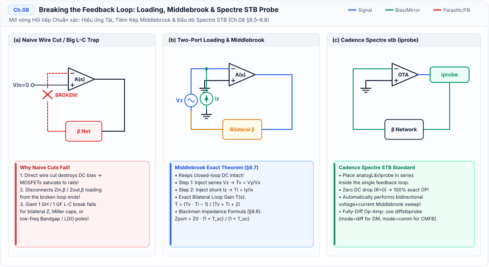

---
{
  "id": "tech-bode-blackman-middlebrook-stb",
  "kind": "technique",
  "domain": "dynamics-noise-feedback",
  "title_vi": "Phân tích Hồi tiếp Chính xác theo Bode, Định lý Blackman, Phương pháp Middlebrook & Kiểm chứng Spectre STB",
  "title_en": "Bode's Return-Difference Analysis, Blackman's Impedance Theorem, Middlebrook's Method, and Cadence Spectre STB",
  "summary": "Hệ thống phương pháp giải tích chính xác tuyệt đối KHÔNG cần cắt vòng hồi tiếp: công thức độ lợi tiệm cận của Bode, định lý trở kháng Blackman Z = Z0*(1 + Tsc)/(1 + Toc), phương pháp bơm kép điện áp–dòng điện của Middlebrook, sự khác biệt giữa tỉ số hồi trả (return ratio) và độ lợi vòng, cùng quy trình thiết lập iprobe / diffstbprobe chuẩn xác trong Cadence Spectre.",
  "diagram": "../../diagrams/middlebrook-stb-loop-probe.svg",
  "razavi_refs": [
    {
      "chapter": 8,
      "section": "8.6-8.9",
      "pages": "315-339",
      "equations": ["8.140", "8.141", "8.171", "8.172", "8.174", "8.198", "8.200", "8.201", "8.202", "8.205", "8.212", "8.219"]
    }
  ],
  "glossary_codes": ["T051", "T068", "T071", "T1188", "T1189", "T1300", "T1301", "T1338", "T1340", "T1341", "T1342", "T1351", "T1352"],
  "process_agnostic": true,
  "roles": {
    "controlled_source_return_ratio": "Tỉ số hồi trả T = -gm*D của một nguồn phụ thuộc được tách riêng khi đặt kích thích ngoài bằng 0 mà không hề cắt đứt bất kỳ dây dẫn nào",
    "blackman_port_pair": "Cặp độ lợi vòng ngắn mạch Tsc và độ lợi vòng hở mạch Toc nhìn từ cảng cần tính trở kháng, phản ánh trọn vẹn cả hồi tiếp nối tiếp lẫn song song hỗn hợp",
    "middlebrook_dual_probe": "Cặp nguồn thử điện áp nối tiếp Vt và dòng điện song song It bơm vào một nhánh giữ nguyên vòng kín để đo Ti, Tv và truyền ngược Trev",
    "spectre_stb_iprobe": "Phần tử đầu dò dòng không trở kháng iprobe / diffstbprobe trong Cadence Spectre thực thi tự động phép đo ma trận truyền vòng đa chiều"
  },
  "symptoms_addressed": [
    "false-phase-margin-from-1gf-1gh-loop-break",
    "ambiguous-loop-breaking-point-in-local-feedback-stages",
    "mixed-series-shunt-port-impedance-calculation",
    "bilateral-reverse-transmission-degrading-loop-gain",
    "differential-vs-common-mode-loop-stability-separation"
  ],
  "limitations": [
    "return-ratio-of-single-transistor-depends-on-chosen-device-and-differs-from-loop-gain-if-h0-nonzero",
    "middlebrook-single-branch-injection-requires-placement-inside-major-loop-outside-minor-loops",
    "blackman-requires-careful-choice-of-disabled-reference-element-so-z0-is-finite-and-nonzero"
  ],
  "checklists": ["common-mos", "feedback-and-stb", "cmfb"]
}
---

## 1. Bản chất Nguyên lý, Sơ đồ Mạch & Vai trò Từng Nhánh Cấu trúc

Trong các mạch thực tế phức tạp — chẳng hạn tầng nguồn chung suy biến nguồn có $r_O$ hữu hạn, tầng cascode tăng cường độ lợi (`topo-gain-boosted-cascode`), mạch ổn áp LDO (`topo-cmos-ldo-regulator`), hay Op-Amp hai tầng có tụ Miller nối chéo (`tech-miller-pole-splitting`) — ranh giới giữa "khối khuếch đại $A$" và "mạng hồi tiếp $\beta$" bị xóa nhòa, đồng thời tín hiệu rò hai chiều làm mọi phép "cắt dây mở vòng" cổ điển đều vấp phải câu hỏi bế tắc: *Cắt ở nút nào? Gắn tải giả gì? Bơm áp hay bơm dòng?*

Chương 8 (§8.6–§8.9) của Razavi trình bày cuộc cách mạng tư duy của **Hendrik Bode**, **Ralph Blackman** và **R. D. Middlebrook**: **TUYỆT ĐỐI KHÔNG CẮT DÂY VÒNG HỒI TIẾP!** Toàn bộ tô-pô mạng điện trở–tụ điện được giữ nguyên vẹn 100%, do đó hiệu ứng tải hai chiều và đường truyền thẳng tự động đúng chính xác tuyệt đối.



Bốn công cụ nối tiếp nhau từ giải tích tay đến mô phỏng EDA hiện đại gồm:
1. **Phân tích Bode & Phương trình Độ lợi Tiệm cận (`T1300`, Bode's Method, §8.6.1–8.6.3 & §8.9):** Cô lập nguồn dòng phụ thuộc $I_1 = g_m V_1$ của một transistor chủ chốt ra khỏi mạng còn lại, thay bằng nguồn thử độc lập $I_1$ để định nghĩa **tỉ số hồi trả (`T071`, return ratio)** $T = -g_m D$ mà không cắt bất kỳ nhánh nào.
2. **Định lý Trở kháng Blackman (`T1340`, Blackman's Impedance Theorem, §8.6.4):** Tính chính xác tuyệt đối trở kháng nhìn vào **bất kỳ cặp nút nào** của mạch hồi tiếp (kể cả khi hồi tiếp vừa tăng vừa giảm trở kháng đồng thời!) chỉ qua 3 đại lượng cực dễ nhìn mạch: $Z_0$, $T_{sc}$, và $T_{oc}$.
3. **Phương pháp Bơm Kép của Middlebrook (`T1301`, Middlebrook's Method, §8.7):** Giữ mạch khép kín hoàn toàn và chèn đồng thời nguồn áp thử $V_t$ nối tiếp cùng nguồn dòng thử $I_t$ song song tại một nhánh trong vòng chính để bóc tách độ lợi vòng dòng $T_i$, độ lợi vòng áp $T_v$, và sự suy giảm do truyền ngược $T_{\text{rev}}$.
4. **Phân tích `stb` trong Cadence Spectre (`iprobe` & `diffstbprobe`):** Hiện thực hóa trực tiếp phương pháp ma trận bơm kép của Middlebrook / Hurst-Lewis trong trình mô phỏng vi mạch chuẩn công nghiệp mà không cần dùng cuộn cảm/tụ điện khổng lồ gây sai lệch tải!

---

## 2. Hệ Phương trình Cốt lõi & Tư duy "Nhìn Mạch Đọc Nhanh" (Analysis by Inspection)

### 2.1. Phương pháp Bode & Dạng Độ lợi Tiệm cận (Asymptotic Gain Form — §8.6.3 & §8.9)
Chọn một phần tử khuếch đại có nguồn dòng phụ thuộc $I_1 = g_m V_1$. Khi tạm coi $I_1$ là nguồn độc lập bên cạnh nguồn tín hiệu vào $V_{in}$, tính tuyến tính cho phép viết chính xác (Phương trình 8.137–8.138):

$$
V_{\text{out}} = A V_{in} + B I_1, \qquad V_1 = C V_{in} + D I_1
$$

Khôi phục luật điều khiển $I_1 = g_m V_1$, ta thu được hàm truyền vòng kín **chính xác tuyệt đối** của Bode (Phương trình 8.140) và **Phương trình Độ lợi Tiệm cận (Asymptotic Gain Equation, Phương trình 8.212)**:

$$
\frac{V_{\text{out}}}{V_{in}} = A + \frac{g_m B C}{1 - g_m D} = H_\infty \frac{T}{1 + T} + H_0 \frac{1}{1 + T}
$$

trong đó cả 3 thành phần đều mang ý nghĩa vật lý trực quan:
- **$T = -g_m D = -\left.g_m \dfrac{V_1}{I_1}\right|_{V_{in}=0}$:** **Tỉ số hồi trả (`T071`, return ratio)** đối với $g_m$ (tắt $V_{in}=0$, bơm nguồn dòng độc lập $I_1$ vào đúng chỗ nguồn phụ thuộc $g_m V_1$, đo áp rơi trên nhánh điều khiển $V_1$ rồi nhân $-g_m$).
- **$H_0 = A = \left.\dfrac{V_{\text{out}}}{V_{in}}\right|_{g_m = 0}$:** **Độ lợi truyền thẳng trực tiếp (Direct Feedthrough)** khi vô hiệu hóa transistor đó ($g_m = 0$).
- **$H_\infty = A - \dfrac{B C}{D} = \lim_{g_m \to \infty} \dfrac{V_{\text{out}}}{V_{in}}$:** **Độ lợi lý tưởng khi $g_m \to \infty$** (lúc đó để dòng $I_1$ hữu hạn thì điện áp điều khiển bắt buộc bị ép về đất ảo $V_1 \to 0$, tìm $V_{\text{out}}/V_{in}$ bằng KCL sơ cấp giống hệt Op-Amp lý tưởng!).

Ngoài ra, Razavi còn dẫn xuất dạng đối ngẫu cực đẹp liên hệ với **tỉ số hồi trả khi triệt ngõ ra** $T_{\text{out},0} = -\left.g_m \dfrac{V_1}{I_1}\right|_{V_{\text{out}}=0}$ (khi $H_0 \neq 0$, Phương trình 8.219):

$$
\frac{V_{\text{out}}}{V_{in}} = H_0 \cdot \frac{1 + T_{\text{out},0}}{1 + T}
$$

### 2.2. Định lý Trở kháng Blackman (`T1340`, §8.6.4, Phương trình 8.171–8.174)
Trở kháng $Z_{\text{port}}$ nhìn vào bất kỳ cặp nút $(P, Q)$ nào của một mạng tuyến tính có hồi tiếp bằng:

$$
Z_{\text{port}} = Z_0 \cdot \frac{1 + T_{sc}}{1 + T_{oc}}
$$

trong đó chọn một nguồn phụ thuộc $g_m$ chủ chốt trong vòng hồi tiếp:
1. **$Z_0 = \left.\dfrac{V_{\text{test}}}{I_{\text{test}}}\right|_{g_m = 0}$:** Trở kháng nhìn vào cảng $(P, Q)$ khi tắt nguồn phụ thuộc đó ($g_m = 0$, nhưng **giữ nguyên $r_O$ và mọi tụ điện/điện trở**!).
2. **$T_{oc} = -\left.g_m \dfrac{V_1}{I_1}\right|_{\text{port }(P,Q)\text{ OPEN}}$:** Tỉ số hồi trả của $g_m$ khi để **hở mạch** cảng $(P, Q)$ (`T1341`, open-circuit loop gain).
3. **$T_{sc} = -\left.g_m \dfrac{V_1}{I_1}\right|_{\text{port }(P,Q)\text{ SHORTED}}$:** Tỉ số hồi trả của $g_m$ khi **ngắn mạch** hai đầu cảng $(P, Q)$ lại với nhau (`T1342`, short-circuit loop gain).

**Sức mạnh "Nhìn Mạch Đọc Nhanh" bằng Blackman (Kiểm chứng ngay trong 10 giây!):**
- *Ví dụ 1 — Trở kháng ra tầng CS suy biến nguồn $R_S$ (Ví dụ 8.25, Hình 8.77):* Cảng đo từ máng xuống đất.
  - Cho $g_m = 0$: chỉ còn $r_O$ nối tiếp $R_S \implies Z_0 = r_O + R_S$.
  - Để hở cảng máng: dòng bơm $I_1$ từ máng về nguồn chỉ chạy quẩn trong $r_O$, dòng qua $R_S$ bằng $0 \implies V_{gs1} = 0 \implies T_{oc} = 0$!
  - Ngắn mạch cảng máng xuống đất: dòng $I_1$ chia đôi qua $R_S \parallel r_O$, tạo $V_{gs1} = -I_1 (R_S \parallel r_O) \implies T_{sc} = +g_m (R_S \parallel r_O)$.
  - Thế vào Blackman: $Z_{\text{out}} = (r_O + R_S)\left[1 + g_m \frac{R_S r_O}{R_S + r_O}\right] = r_O + (1 + g_m r_O) R_S$ — **ra kết quả chính xác 100% không cần giải một dòng KVL nào!**
- *Ví dụ 2 — Nút mà hồi tiếp song song làm giảm trở kháng ($T_{sc} = 0, T_{oc} > 0$):* Cho $Z_{\text{port}} = \frac{Z_0}{1 + T_{oc}}$.
- *Ví dụ 3 — Mạch có hai cơ chế hồi tiếp hỗn hợp (như LNA vừa hồi tiếp áp $R_F$ vừa suy biến dòng $R_S$ để phối hợp trở kháng):* Cả $T_{sc} \neq 0$ và $T_{oc} \neq 0$ cùng tồn tại; công thức đơn giản nhân/chia $(1+L)$ của §8.2 hoàn toàn bất lực, trong khi Blackman cho kết quả chính xác tuyệt đối!

### 2.3. Phương pháp Bơm Kép của Middlebrook (§8.7, Phương trình 8.198–8.205)
Giữ vòng hồi tiếp khép kín hoàn toàn, chèn nối tiếp nguồn áp thử $V_t$ và bơm song song nguồn dòng thử $I_t$ tại một nhánh trên vòng chính (Hình 8.84, tắt nguồn tín hiệu ngoài $V_{in} = 0$). Đo 4 tỉ số truyền vòng (Phương trình 8.201–8.204):
- $T_i = \left.\dfrac{I_1}{I_2}\right|_{V_1=0}$ (độ lợi vòng dòng điện truyền thuận ngắn mạch) và $T_v = \left.\dfrac{V_1}{V_2}\right|_{I_1=0}$ (độ lợi vòng điện áp truyền thuận hở mạch).
- $\dfrac{1}{T_i'} = \left.\dfrac{I_2}{I_1}\right|_{V_2=0}$ và $\dfrac{1}{T_v'} = \left.\dfrac{V_2}{V_1}\right|_{I_2=0}$ (hai thành phần truyền ngược do không đơn hướng).

Độ lợi vòng thực tế $T_1$ quyết định mẫu số cực vòng kín $(1 + T_1)$ được ghép từ cả hai phép đo (Phương trình 8.200, 8.205):

$$
\frac{1}{T_1} = \frac{1}{T_i} + \frac{1}{T_v} + \frac{1}{T_i' T_v'} \quad \Longleftrightarrow \quad T_1 = \frac{T_{\text{fwd}}}{1 + T_{\text{rev}}}, \qquad \text{với } T_{\text{fwd}} = T_i \parallel T_v = \frac{T_i T_v}{T_i + T_v}
$$

**Hệ quả thiết kế quan trọng:**
1. Nếu đường vòng là đơn hướng ($T_{\text{rev}} \approx 0$) nhưng bạn đặt đầu dò ở nơi trở kháng hai phía không lệch xa nhau ($Z_{\text{in,next}}$ cùng bậc với $Z_{\text{out,prev}}$), riêng $T_v$ hoặc riêng $T_i$ đều bị sai do hiệu ứng tải, nhưng **tổ hợp song song $T_v \parallel T_i$ của Middlebrook khử sạch sai số tải ở MỌI điểm đặt đầu dò**!
2. Nếu truyền ngược qua $C_{GD}$ hoặc mạng thụ động ở tần số cao làm $|T_{\text{rev}}|$ tiến gần $1$, độ lợi vòng thực $T_1$ bị kéo sụt ngay cả khi $T_{\text{fwd}}$ vẫn lớn!

---

## 3. Bất biến Cấu trúc & Các Bẫy Lỗi Kinh điển (Structural Invariants & Traps)

- **[INV-STB-01] Bất biến Đa thức Đặc trưng Mẫu số $(1 + T)$:** Dù giá trị riêng lẻ của tỉ số hồi trả $T_k = -g_{m,k} D_k$ có thể khác nhau khi chọn transistor $M_1$ hay chọn transistor $M_2$ (như Ví dụ 8.32, Hình 8.92 cho thấy $T_1 \neq T_2$ vì $H_0$ khác nhau!), nghiệm không của $(1 + T_k(s)) = 0$ — khi phần mạch còn lại với $g_{m,k}=0$ ổn định — **luôn quy tụ về đúng cùng một tập hợp các cực vòng kín vật lý của hệ thống**!
- **[TRAP-STB-01] Bẫy Đánh Đồng Tỉ số Hồi trả (`Return Ratio`) với Độ lợi Vòng (`Loop Gain`) (§8.8.2, Hình 8.88–8.91):**
  Razavi dành hẳn §8.8.2 để cảnh báo: một transistor đơn lẻ (ví dụ tầng CS đơn có tụ $C_{GD}$ nối chéo cổng–máng và tải $R_D$) cũng có tỉ số hồi trả đối với $g_m$ khác không: $T_{CS}(s) = g_m \frac{s C_{GD} R_S R_D}{1 + s C_{GD}(R_S + R_D)}$, nhưng ta thường coi $C_{GD}$ là hồi tiếp cục bộ không mong muốn chứ không phải vòng hồi tiếp chính. Quan trọng hơn, trong mạch nhiều vòng hồi tiếp lồng nhau (ví dụ Op-Amp hai tầng có tụ bù Miller $C_C$ tạo vòng nội quanh tầng 2, rồi bên ngoài lại bọc cầu điện trở $R_1\text{–}R_2$ tạo vòng toàn cục!), **đầu dò đặt ở nhánh vòng ngoài** cho hàm truyền vòng của **vòng phản hồi toàn cục** (đã bao gồm hiệu ứng tách cực của $C_C$), còn **đầu dò đặt lọt vào bên trong nhánh chỉ thuộc tầng 2** sẽ trộn lẫn cả hai vòng!
  **Quy tắc đặt đầu dò chuẩn xác:** Luôn đặt đầu dò trên một nhánh **nằm trọn trong vòng hồi tiếp toàn cục cần đo và nằm BÊN NGOÀI mọi vòng hồi tiếp cục bộ nội tại** (ví dụ ngay sát nối tiếp cực cổng đầu vào Op-Amp hoặc ngay tại đầu ra tổng trước điểm rẽ vào mạng $\beta$, chú ý hướng mũi tên dòng để giữ đúng dấu vòng!).
- **[TRAP-STB-02] Tại sao Mạch Phá Vòng `L = 1 GH, C = 1 GF` Thất bại Thảm hại trong Cadence Spectre:**
  1. Ở DC, `L = 1 GH` nối thông nhưng ở mọi tần số AC $> 0\text{ Hz}$ nó hở mạch hoàn toàn, cắt đứt trở kháng tải chiều về (làm sai $A_{\text{open}}$ và $\text{GBW}$ như đã chứng minh ở §8.8.1!).
  2. Chặn đứng hoàn toàn thành phần truyền ngược $T_{\text{rev}}$ (ví dụ truyền qua mạng $\beta$ hoặc tụ bù), cho dự trữ pha giả tạo lạc quan hơn thực tế!
  3. Đối với mạch vi sai hoàn toàn có CMFB (`tech-common-mode-feedback-cmfb`), cắt dây vi sai bằng `1 GH` rất dễ làm hỏng tính đối xứng hoặc trôi điểm hội tụ ma trận homotopy của Spectre khi linh kiện rò pA!

---

## 4. Lộ trình Nâng cấp Cấu trúc & Bát giác Đánh đổi (Upgrade Paths & Design Octagon)

| Thách thức ổn định vòng hồi tiếp gặp phải | Thẻ Tri thức tiếp nối (Canonical Node) | Hành động kỹ thuật | Ý nghĩa thiết kế |
|---|---|---|---|
| Đã đo ra hàm truyền vòng chính xác $T(j\omega)$ bằng `stb`, cần thiết kế dự trữ pha $\text{PM} \ge 60^\circ$ | `law-multipole-phase-margin` & `tech-miller-pole-splitting` | Dịch cực không trội $\omega_{p2} \ge \sqrt{3}\text{–}3 \times \omega_{GX}$ bằng tách cực Miller + triệt RHP zero | Đảm bảo đáp ứng bậc thang không rung (overshoot $< 5\text{–}10\%$) |
| Mạch đa vòng (ví dụ Gain-Boosted Cascode hoặc LDO bù phức tạp) có pha cắt $-180^\circ$ nhiều lần làm đồ thị Bode bối rối | `tech-nyquist-stability-criterion` | Đọc trực tiếp đồ thị cực Nyquist `nyquist` của $T(j\omega)$ xoay quanh điểm tới hạn $(-1, 0)$ | Phân biệt dứt khoát hệ ổn định có điều kiện với hệ tự dao động! |
| Mạch khuếch đại vi sai hoàn toàn cần kiểm tra đồng thời cả vòng tín hiệu vi sai (DM) lẫn vòng chế độ chung (CMFB) | `tech-common-mode-feedback-cmfb` | Dùng phần tử `diffstbprobe` chuyển chế độ `mode=diff` và `mode=comm` trong Spectre | Bắt tận gốc bệnh mạch ổn định hoàn hảo ở DM nhưng tự dao động dữ dội ở CM! |

---

## 5. Thích ứng Đa Tiến trình (90nm / 65nm / 45nm) & Cách Kiểm chứng trong Cadence / Spectre

### 5.1. Thích ứng Công nghệ Nanomet (90nm / 65nm / 45nm)
- **Tầm quan trọng sống còn của Phương pháp Chính xác ở 65nm/45nm:** Trong các tiến trình nanomet, $r_O$ thấp làm tỉ số $Z_{\text{out,prev}} / Z_{\text{in,next}}$ thu hẹp mạnh và tỉ phần $C_{GD}/C_{GS}$ tăng cao ($\sim 0{,}4$), khiến giả thiết "vòng truyền một chiều đơn hướng ($T_{\text{rev}} \ll 1$)" bị vi phạm nghiêm trọng ở tần số vài trăm MHz – vài GHz. Do đó mọi mạch hồi tiếp 90nm/65nm/45nm (Op-Amp, BGR, LDO, bộ lọc tích cực, vòng điều khiển biên độ) **bắt buộc 100% phải kiểm chứng bằng phân tích `stb` dùng phép bơm kép giữ nguyên vòng kín** trên tất cả 5 góc tiến trình (`TT, FF, SS, FS, SF`) và dải nhiệt độ!

### 5.2. Cẩm nang Thiết lập `stb` Chuẩn Xác trong Cadence Virtuoso / Spectre
1. **Đối với Vòng Hồi tiếp Đơn đầu (Single-Ended Loop — dùng `analogLib/iprobe`):**
   - Chèn một phần tử `iprobe` (ví dụ đặt tên instance `IPRB0`) mắc **nối tiếp trên nhánh duy nhất mang toàn bộ tín hiệu vòng chính** (ví dụ: ngay đầu ra bộ khuếch đại lỗi trước khi rẽ vào tải/cầu hồi tiếp nếu muốn gộp tải, hoặc tốt nhất là **trên nhánh từ đỉnh cầu phân áp hồi tiếp đi vào cực cổng đầu vào của bộ khuếch đại lỗi**, đảm bảo không cắt ngang vòng bù Miller cục bộ!).
   - Cú pháp netlist Spectre trực tiếp:
     ```spectre
     IPRB0 (fb_sense opamp_in_minus) iprobe
     stb_dm stb probe=IPRB0 start=1 stop=100G dec=50
     ```
   - Spectre tự động giải điểm làm việc DC khép kín nguyên bản, sau đó áp thuật toán bơm kép Middlebrook/Hurst tính chính xác hàm truyền vòng phức `loopGain`, xuất trực tiếp:
     - **Phase Margin (`phaseMargin`)** và tần số cắt độ lợi **`phaseMarginFreq`** ($f_{GX}$ tại $|T|=0\text{ dB}$).
     - **Gain Margin (`gainMargin`)** và tần số cắt pha **`gainMarginFreq`** ($f_{PX}$ tại $\angle T = 0^\circ / \pm 180^\circ$ tùy quy ước dấu `stb` của Spectre — lưu ý trong Spectre `stb`, `loopGain` đã nhân sẵn dấu trừ của vòng hồi tiếp âm nên ở DC hồi tiếp âm chuẩn có pha bắt đầu ở **$0^\circ$** và tiến về **$-180^\circ$**, tức $\text{PM} = 180^\circ + \angle\text{loopGain}(f_{GX})$!).
2. **Đối với Mạch Vi sai Hoàn toàn & CMFB (Fully-Differential Loop — dùng `analogLib/diffstbprobe`):**
   - Đặt một khối 4 cực `diffstbprobe` nối tiếp trên cặp dây hồi tiếp vi sai `(fb_p, fb_n) -> (in_p, in_n)`.
   - Chạy **2 phép phân tích `stb` riêng biệt**:
     - Lần 1 đặt tham số `mode=diff` (hoặc `stb_mode=1`) để đo ổn định **Vòng Vi sai (Differential-Mode Loop)**.
     - Lần 2 đặt tham số `mode=comm` (hoặc `stb_mode=2`, hoặc đặt thêm `iprobe` trên dây điều khiển áp phân cực $V_{\text{cmfb}}$ đơn đầu!) để đo ổn định **Vòng Chế độ Chung (Common-Mode Feedback Loop)**.
3. **Kiểm tra chéo Dấu Hồi tiếp DC ngay dòng đầu tiên của `stb`:** Tại tần số thấp nhất (`1 Hz`), kiểm tra góc pha của `loopGain` trong Spectre: nếu pha ở `1 Hz` bằng **`0 deg`** (và $|T| > 0\text{ dB}$), vòng đang là **hồi tiếp âm đúng cực tính**; nếu pha ở `1 Hz` bằng **`180 deg` / `-180 deg`**, bạn đã **đấu ngược dây hồi tiếp thành hồi tiếp dương** (dù AC thường không báo lỗi nhưng mạch thực tế chốt cứng lên nguồn ngay lập tức!).

---

## 6. Mốc Đối chiếu Sách Razavi & Thuật ngữ Chuẩn CLB

### 6.1. Đối chiếu Sách Gốc Razavi (2nd Edition)
- **Chương 8:** §8.6 *Bode's Analysis of Feedback Circuits* (tr. 315–330, Phương trình 8.107–8.197, bao gồm §8.6.4 *Blackman's Impedance Theorem* tr. 325–330), §8.7 *Middlebrook's Method* (tr. 331–332, Phương trình 8.198–8.205, Hình 8.84), §8.8 *Loop Gain Calculation Issues* (tr. 332–336, Phương trình 8.206–8.208, Hình 8.85–8.91), §8.9 *Alternative Interpretations of Bode's Method* (tr. 336–339, Phương trình 8.209–8.224).
- **Chú giải Hiệu đính Học thuật CLB (`NG08`):**
  - **`NG08-05` (tr. 316):** Lời văn nguồn ngay trên Phương trình (8.111) in thiếu dấu chia $(V_{in}-V_1)R_S$ khi diễn tả dòng điện; biểu thức đúng theo định luật Ohm (và đúng như trong chính phương trình 8.111) là $(V_{in}-V_1)/R_S$.
  - **`NG08-06` (tr. 326):** Câu cuối ngay dưới công thức Blackman (8.174) trong sách gốc viết tắt $Z_{in}$ thay cho $A$ ($Z_0$): ý chính xác là trở kháng vòng kín tổng quát $Z_{\text{port}}$ không phải lúc nào cũng viết được thành trở kháng khi tắt transistor $Z_0$ nhân hoặc chia cho một thừa số $(1 + T)$ duy nhất, vì cả $T_{sc}$ lẫn $T_{oc}$ có thể cùng khác 0!
  - **`NG08-07` (tr. 327, Phương trình 8.185–8.186):** Khi áp dụng Blackman cho cascode tăng cường độ lợi (Ví dụ 8.26), phép khai triển đúng ở (8.185) là $Z_{out} = r_O + R_S + g_m r_O R_S A_1 = r_O + (1 + g_m r_O A_1) R_S$, trong khi dòng (8.186) sách viết xấp xỉ thành $r_O + (1 + g_m r_O) A_1 R_S$ (chênh nhau $(A_1 - 1)R_S$, chỉ tương đương khi $g_m r_O A_1 \gg A_1 \gg 1$).
  - **`NG08-08` (tr. 334, Hình 8.88):** Chú thích Hình 8.88 in thiếu chữ $G$ thành $C_{D2}$; đúng theo sơ đồ và lời văn là tụ cổng–máng $C_{GD2}$.

### 6.2. Bảng Thuật ngữ Chuẩn CLB Vi Mạch Sử dụng trong Thẻ
| Mã CLB | Thuật ngữ Tiếng Anh | Thuật ngữ Tiếng Việt Chuẩn | Ghi chú Ngữ cảnh |
|---|---|---|---|
| `T071` / `T1338` | return ratio | tỉ số hồi trả (return ratio) | Gắn với một nguồn phụ thuộc cụ thể $T = -g_m D$; không đồng nhất máy móc với độ lợi vòng $\beta A$ |
| `T1300` | Bode's Method | phương pháp Bode | Giải hàm truyền vòng kín chính xác không cần mở vòng |
| `T1340` | Blackman's Impedance Theorem | định lý trở kháng Blackman | $Z = Z_0 (1 + T_{sc}) / (1 + T_{oc})$ |
| `T1341` | open-circuit loop gain | độ lợi vòng hở mạch | $T_{oc}$ tính khi để hở cảng đang xét trở kháng |
| `T1342` | short-circuit loop gain | độ lợi vòng ngắn mạch | $T_{sc}$ tính khi nối tắt cảng đang xét trở kháng |
| `T1301` | Middlebrook's Method | phương pháp Middlebrook | Bơm kép $V_t, I_t$ tách truyền thuận $T_i, T_v$ và truyền ngược $T_{\text{rev}}$ |
| `T1351` | reverse loop gain | độ lợi vòng truyền ngược | Định lượng sự rò tín hiệu ngược chiều quanh vòng không đơn hướng |
| `T068` | probe | đầu dò | Phần tử `iprobe` / `diffstbprobe` trong phân tích `stb` |
