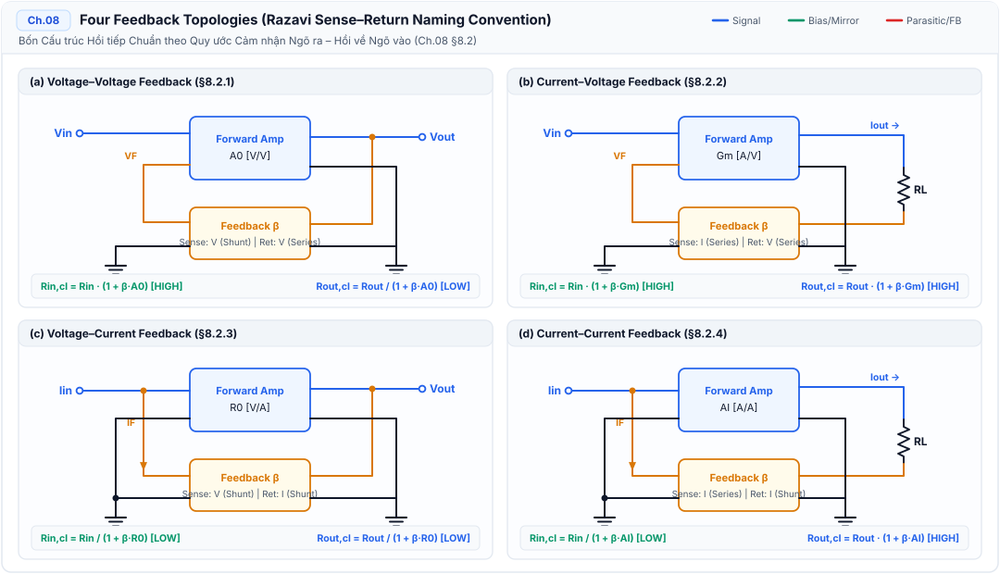

---
{
  "id": "tech-feedback-four-topologies-loading-examples",
  "kind": "technique",
  "domain": "dynamics-noise-feedback",
  "title_vi": "Quy trình Giải Mạch Hồi tiếp Hai Cửa Từng Bước & Chuỗi Ví dụ Mẫu Transistor CMOS Cho Cả 4 Cấu hình (Two-Port Loading Algorithm & Worked Examples)",
  "title_en": "Step-by-Step Two-Port Feedback Port-Breaking Algorithm and Worked Transistor-Level CMOS Examples (VV, CV, VC, CC)",
  "summary": "Cẩm nang thực hành giải tích tay trọn vẹn từ ma trận hai cửa (g, z, y, h) sang quy tắc cắt vòng trực quan của Razavi (Bảng 8.67) kèm lời giải từng bước 7 mạch transistor CMOS kinh điển (Ví dụ 8.11–8.17): hai tầng CS hồi tiếp về nguồn (VV), mạch ổn dòng sạc pin PMOS + rM (CV), khuếch đại hỗ trở & đảo có RS-RF (VC), và bộ khuếch đại dòng hai tầng cảm nhận nguồn RS-RF (CC).",
  "diagram": "../../diagrams/feedback-four-topologies.svg",
  "razavi_refs": [
    {
      "chapter": 8,
      "section": "8.2-8.5.6",
      "pages": "286-315",
      "equations": ["8.31", "8.45", "8.51", "8.57", "8.61", "8.66", "8.73", "8.75", "8.82", "8.86", "8.88", "8.96", "8.102", "8.106"]
    }
  ],
  "glossary_codes": ["T042", "T051", "T534", "T812", "T1142", "T1182", "T1186", "T1187", "T1192"],
  "process_agnostic": true,
  "roles": {
    "two_port_parameter_selector": "Bộ ánh xạ kiểu ghép cửa (nối tiếp cộng áp hay song song cộng dòng) sang đúng mô hình ma trận hai cửa (G cho VV, Y+Z cho CV, Z+Y cho VC, H cho CC) sao cho tham số truyền thuận hữu hạn với cổng MOSFET",
    "port_termination_breaker": "Thao tác kết cuối chính xác hai đầu mạng hồi tiếp khi tách vòng: ngắn mạch xoay chiều tại cửa song song (shunt/áp) và hở mạch xoay chiều tại cửa nối tiếp (series/dòng)",
    "loaded_forward_amplifier_aol": "Mạch khuếch đại thuận vòng hở đã gắn kèm hai trở kháng tải tương đương của mạng hồi tiếp ở cả cửa vào lẫn cửa ra để tính chính xác A_OL, Rin_open, Rout_open",
    "unilateral_feedback_ratio_beta": "Tỉ số truyền ngược của riêng mạng hồi tiếp thụ động (g21, z21, y21, h21) đo dưới đúng điều kiện kết cuối cửa trả ở ngõ vào (hở nếu trả áp, ngắn nếu trả dòng)"
  },
  "symptoms_addressed": [
    "getting-infinite-current-gain-h21-when-modeling-mos-gate-input-with-wrong-two-port",
    "breaking-feedback-loop-at-mos-gate-yields-loop-gain-but-fails-to-give-rin-and-rout",
    "measuring-wrong-output-impedance-in-series-output-current-voltage-feedback",
    "forgetting-norton-source-conversion-when-shunt-shunt-amplifier-is-driven-by-thevenin-voltage-source",
    "sign-inversion-errors-in-y21-and-h21-two-port-feedback-factors"
  ],
  "limitations": [
    "neglects-forward-feedthrough-via-feedback-network-such-as-g12-z12-y12-h12",
    "slight-discrepancy-between-arbitrary-gate-break-loop-gain-and-two-port-beta-times-aol-when-rd-comparable-to-rf",
    "cannot-directly-solve-noncanonical-source-degenerated-drain-output-stage-without-bode-blackman"
  ],
  "checklists": ["common-mos", "feedback-and-stb"]
}
---

## 1. Bản chất Nguyên lý, Sơ đồ Mạch & Vai trò Từng Nhánh Cấu trúc

Khi đối mặt với một **bộ khuếch đại hồi tiếp âm (`T1182`, negative-feedback amplifier)** vẽ ở cấp độ transistor thực tế — chẳng hạn hai tầng CS có cặp điện trở $R_F\text{–}R_S$ nối từ cực máng tầng 2 quay về cực nguồn tầng 1 (Hình 8.45d / 8.54), hay mạch nguồn dòng có Op-Amp $A_1$ đọc áp rơi trên điện trở cảm nhận $r_M$ (Hình 8.59) — câu hỏi hóc búa nhất luôn là: **Cắt vòng hồi tiếp (`T534`) ở đâu và nối đất hay để hở hai đầu dây vừa cắt để tính đúng độ lợi vòng (`T051`) cùng $R_{in,\text{closed}}, R_{out,\text{closed}}$?**



Trong Ví dụ 8.11 (Hình 8.46, tr. 300–301), Razavi chỉ ra một nghịch lý rất sâu sắc: nếu bạn láu lỉnh ngắt vòng ngay tại **cực cổng MOSFET $M_2$** (nơi trở kháng vào ở tần số thấp bằng $\infty$), bạn quả thực tránh được rắc rối hiệu ứng tải để tìm ra một giá trị độ lợi vòng, **nhưng bạn hoàn toàn bó tay không thể tìm được $A_{\text{open}}$, $R_{in,\text{open}}$ và $R_{out,\text{open}}$** để nhân/chia với $(1 + \beta A_{\text{open}})$! Để giải quyết tận gốc bài toán tải của **các mạng hồi tiếp (`T1192`, feedback networks)** trên cả bốn **cấu hình hồi tiếp (`T1186`, feedback topologies)**, Razavi (§8.5.1–§8.5.6, tr. 303–315) xây dựng **kỹ thuật mạng hai cửa (`T1187`, two-port technique)** dựa trên bốn họ phương trình của **mạch hai cửa tuyến tính (`T1142`, linear two-port circuit, Hình 8.50)**:
- **Mô hình $Z$ (Phương trình 8.57–8.58):** $V_1 = Z_{11} I_1 + Z_{12} I_2$, $\; V_2 = Z_{21} I_1 + Z_{22} I_2$ *(mọi tham số đo khi hở mạch một cửa)*.
- **Mô hình $Y$ (Phương trình 8.59–8.60):** $I_1 = Y_{11} V_1 + Y_{12} V_2$, $\; I_2 = Y_{21} V_1 + Y_{22} V_2$ *(mọi tham số đo khi ngắn mạch một cửa)*.
- **Mô hình lai $H$ (Phương trình 8.61–8.62):** $V_1 = H_{11} I_1 + H_{12} V_2$, $\; I_2 = H_{21} I_1 + H_{22} V_2$.
- **Mô hình lai nghịch $G$ (Phương trình 8.63–8.64):** $I_1 = G_{11} V_1 + G_{12} I_2$, $\; V_2 = G_{21} V_1 + G_{22} I_2$.

**Bí quyết chọn mô hình không bao giờ bị suy biến với MOSFET (§8.5.1–§8.5.2, Ví dụ 8.13, Phương trình 8.74–8.80):** Với bộ khuếch đại điện áp có ngõ vào là cực cổng MOSFET ($I_{in} = 0$ ở tần số thấp), nếu dùng nhầm mô hình $Z$ hoặc mô hình $H$ (Ví dụ 8.13, Hình 8.55, Phương trình 8.75: $H_{22} V_{\text{out}} + H_{21} I_{in} + g_{11} V_{\text{out}} + g_{12} I_{in} = 0$), hệ số khuếch đại dòng $H_{21} = I_2 / I_1 \to \infty$ khiến phép tính tay rơi vào dạng vô định $\infty \cdot 0$! Ngược lại, dùng **mô hình $G$** cho bộ khuếch đại điện áp ($G_{11} = Z_{in}^{-1} = 0$, $G_{21} = A_0$ hữu hạn, $G_{22} = Z_{\text{out}}$) khớp 100% với trực giác vật lý của MOSFET! Tuyệt vời hơn cả: sau khi thực hiện phép biến đổi đại số hai cửa một lần duy nhất, người thiết kế **không bao giờ cần viết lại ma trận $Z, Y, H, G$ nữa**, mà chỉ cần áp dụng **Thuật toán 4 Bước Cắt Vòng Trực Quan (Hình 8.67, §8.5.6)** dưới đây!

---

## 2. Hệ Phương trình Cốt lõi & Tư duy "Nhìn Mạch Đọc Nhanh" (Analysis by Inspection)

### 2.1. Thuật toán Tổng quát 4 Bước Cắt Vòng Giữ Tải (Razavi §8.5.6, Hình 8.67)
Quy ước nhất quán với Hình 8.67 của sách Razavi: đối với riêng mạng hồi tiếp thụ động hai cửa $\beta$, gọi **Cửa 1 (Port 1)** là cửa nối vào **ngõ ra bộ khuếch đại (Sense Port)** và **Cửa 2 (Port 2)** là cửa nối về **ngõ vào bộ khuếch đại (Return Port)**:
1. **Bước 1 — Nhận diện cặp (Sense tại Cửa 1 – Return tại Cửa 2):** Kiểm tra mạng hồi tiếp đo áp (song song/shunt) hay đo dòng (nối tiếp/series) ở ngõ ra; trả áp (nối tiếp/series) hay trả dòng (song song/shunt) ở ngõ vào.
2. **Bước 2 — Lập mạch Khuếch đại Vòng hở Có tải ($A_{\text{OL}}$):**
   - *Tải gắn vào Ngõ vào khối khuếch đại:* Tại Cửa 1 (ngõ ra), **ngắn mạch áp ($V_1 = 0$)** nếu Sense $V$, hoặc **hở mạch dòng ($I_1 = 0$)** nếu Sense $I$; nhìn vào Cửa 2 thấy trở kháng bao nhiêu thì gắn đúng vào ngõ vào khối khuếch đại!
   - *Tải gắn vào Ngõ ra khối khuếch đại:* Tại Cửa 2 (ngõ vào), **hở mạch dòng ($I_2 = 0$)** nếu Return $V$, hoặc **ngắn mạch áp ($V_2 = 0$)** nếu Return $I$; nhìn vào Cửa 1 thấy trở kháng bao nhiêu thì gắn đúng vào ngõ ra khối khuếch đại!
   - Giải mạch vòng hở đã gắn tải này để lấy bộ ba: **$A_{\text{OL}}$**, **$R_{in,\text{open}}$**, **$R_{out,\text{open}}$**.
3. **Bước 3 — Tính Tỉ số Hồi tiếp $\beta$ của Riêng Mạng Hồi tiếp (với chỉ số $1 = \text{Out/Sense}$, $2 = \text{In/Return}$):**
   - **VV (`g21`):** $\beta = \left.\dfrac{V_2}{V_1}\right|_{I_2 = 0}$ $\qquad$ **CV (`z21`):** $\beta = \left.\dfrac{V_2}{I_1}\right|_{I_2 = 0}$ $\qquad$ **VC (`y21`):** $\beta = \left.\dfrac{I_2}{V_1}\right|_{V_2 = 0}$ $\qquad$ **CC (`h21`):** $\beta = \left.\dfrac{I_2}{I_1}\right|_{V_2 = 0}$
4. **Bước 4 — Đóng Vòng Bằng Hệ Số Giảm Độ Nhạy $(1 + L) = (1 + \beta A_{\text{OL}})$:**
   Chia độ lợi $A_{\text{cl}} = \dfrac{A_{\text{OL}}}{1 + \beta A_{\text{OL}}}$; nhân $(1 + \beta A_{\text{OL}})$ tại mọi cửa mắc nối tiếp (Return $V$ cho $R_{in}$; Sense $I$ cho $R_{out}$) và chia $(1 + \beta A_{\text{OL}})$ tại mọi cửa mắc song song (Return $I$ cho $R_{in}$; Sense $V$ cho $R_{out}$)!

### 2.2. Giải Chi Tiết Cấu Hình 1 & 2: Voltage–Voltage (VV) và Current–Voltage (CV)
1. **Cấu hình 1 — Hồi tiếp Điện áp–Điện áp (VV / Series–Shunt, §8.2.1 Phương trình 8.31 & §8.5.2 Phương trình 8.65–8.73):**
   - *Cơ sở hai cửa (Hình 8.51b):* Viết KVL vòng vào và KCL nút ra khi bỏ qua $G_{12}, g_{12}$ (Phương trình 8.65–8.66): $V_{in} = \frac{g_{22}}{Z_{in}} V_e + V_e + g_{21} V_{\text{out}}$ và $\frac{V_{\text{out}} - A_0 V_e}{Z_{\text{out}}} + g_{11} V_{\text{out}} = 0$, rút ra $A_{v,\text{open}} = \frac{A_0}{(1 + g_{22}/Z_{in})(1 + g_{11} Z_{\text{out}})}$ và $\beta = g_{21}$ (Phương trình 8.68–8.70).
   - *Ví dụ Mẫu Transistor CMOS 1 — Hai tầng CS hồi tiếp cầu $R_F\text{–}R_S$ về cực nguồn $M_1$ (Ví dụ 8.12, Hình 8.54, Phương trình 8.73, tr. 306–307):*
     Cho $M_1$ (tải $R_{D1}$) lái cổng $M_2$ (tải $R_{D2}$), ngõ ra $V_{\text{out}}$ tại máng $M_2$ nối qua $R_F$ về cực nguồn $M_1$ (có $R_S$ nối xuống đất). Giả sử $\lambda = \gamma = 0$.
     * *Kiểm tra dấu hồi tiếp:* $V_{in} \uparrow \implies V_{D1} \downarrow \implies V_{\text{out}} \uparrow \implies V_{S1} \uparrow$ (cùng dấu $+$ tại cực nguồn làm giảm $V_{GS1} = V_{in} - V_{S1}$ $\implies$ **hồi tiếp âm chuẩn!**).
     * *Cắt vòng giữ tải:* (a) Ngắn mạch $V_{\text{out}} = 0$ $\implies$ cực nguồn $M_1$ thấy tải $g_{22} = R_S \parallel R_F$ nối đất! (b) Hở mạch nhánh đi vào cực nguồn $M_1$ ($I_2 = 0$) $\implies$ cực máng $M_2$ thấy tải $g_{11}^{-1} = R_F + R_S$ song song với $R_{D2}$!
     * *Phương trình vòng hở có tải (Phương trình 8.73) & kết quả vòng kín:*

$$
A_{v,\text{open}} = \left( \frac{-g_{m1} R_{D1}}{1 + g_{m1} (R_S \parallel R_F)} \right) \cdot \Big\{ -g_{m2} \big[ R_{D2} \parallel (R_F + R_S) \big] \Big\} = \frac{+g_{m1} g_{m2} R_{D1} \big[ R_{D2} \parallel (R_F + R_S) \big]}{1 + g_{m1} (R_S \parallel R_F)}
$$

$$
\beta = \left.\frac{V_2}{V_1}\right|_{I_2=0} = \frac{R_S}{R_S + R_F}, \qquad A_{v,\text{closed}} = \frac{A_{v,\text{open}}}{1 + \beta A_{v,\text{open}}} \xrightarrow{\beta A_{v,\text{open}} \gg 1} 1 + \frac{R_F}{R_S}, \qquad R_{\text{out,closed}} = \frac{R_{D2} \parallel (R_F + R_S)}{1 + \beta A_{v,\text{open}}}
$$

     * *Thử số thực tế:* Với $g_{m1} = g_{m2} = 4\text{ mS}$, $R_{D1} = R_{D2} = 5\text{ k}\Omega$, $R_S = 1\text{ k}\Omega$, $R_F = 3\text{ k}\Omega$: nếu quên hiệu ứng tải sẽ tính nhầm $A_{v0,\text{unloaded}} = 20 \times 20 = 400$; tính đúng theo (8.73) với $R_S \parallel R_F = 0{,}75\text{ k}\Omega$ ($1 + g_{m1} \cdot 0{,}75\text{k} = 4$) và $R_{D2} \parallel 4\text{k} = 2{,}22\text{ k}\Omega$ cho **$A_{v,\text{open}} = \frac{20}{4} \times 8{,}89 = 44{,}4\text{ V/V}$** (nhỏ hơn gần **$9\times$** so với khi quên tải!), $\beta = 0{,}25$, $L = 11{,}1$, $A_{v,\text{cl}} = 3{,}67\text{ V/V}$ và $R_{\text{out,cl}} = \frac{2222}{12{,}1} = 183\,\Omega$!

2. **Cấu hình 2 — Hồi tiếp Dòng điện–Điện áp (CV / Series–Series, §8.2.2 & §8.5.3 Phương trình 8.81–8.88):**
   - *Cơ sở hai cửa (Hình 8.56):* Khối thuận là hỗ dẫn $Y$, mạng hồi tiếp là trở kháng nối tiếp $Z$; hai phương trình KVL (Phương trình 8.81–8.82): $V_{in} = V_e + Y_{11} V_e z_{22} + z_{21} I_{\text{out}}$ và $I_{\text{out}} = Y_{21} V_e - I_{\text{out}} z_{11} Y_{22}$, cho $G_{m,\text{open}} = \frac{Y_{21}}{(1 + z_{22} Y_{11})(1 + z_{11} Y_{22})}$ và $\beta = z_{21}$ (Phương trình 8.84–8.85).
   - *Ví dụ Mẫu Transistor CMOS 2 — Nguồn dòng sạc pin chuẩn xác PMOS + Op-Amp $A_1$ + điện trở đo dòng $r_M$ (Ví dụ 8.14, Hình 8.59, Phương trình 8.86–8.88, tr. 310):*
     Điện áp chuẩn $V_b$ đưa vào cực $-$ của bộ khuếch đại $A_1$, cực $+$ nối vào đầu trên của điện trở nhỏ $r_M$ nối đất (đo dòng $I_{\text{out}}$ từ cực máng PMOS $M_1$ đổ qua tải xuống $r_M$), ngõ ra $A_1$ lái cực cổng PMOS $M_1$ (có nguồn nối $V_{DD}$ — lưu ý đảo cực tính phù hợp để giữ hồi tiếp âm!).
     * *Cắt vòng giữ tải (Hình 8.59d):* Hở mạch đường dòng ngõ ra ($I_1 = 0$) và hở mạch cổng $+$ của $A_1$ ($I_2 = 0$), điện trở $r_M$ nằm nối tiếp trong mạch tải (nếu bỏ qua dòng rẽ qua $r_{O1}$ khi tìm hỗ dẫn ngắn mạch tải, Phương trình 8.86–8.88):

$$
G_{m,\text{open}} = \frac{A_1 g_{m1} r_{O1}}{r_{O1} + r_M} \approx A_1 g_{m1}, \qquad \beta = z_{21} = r_M, \qquad I_{\text{out}} = \frac{A_1 g_{m1}}{1 + A_1 g_{m1} r_M} V_b \approx \frac{V_b}{r_M}
$$

     * *Trở kháng ngõ ra nhìn từ tải $Z_L$:* Khi mở vòng, tải nằm nối tiếp trên nhánh giữa máng $M_1$ và đầu trên $r_M$ nhìn thấy trở kháng vòng hở $R_{\text{out,open}} = r_{O1} + r_M$. Nhờ lấy mẫu dòng nối tiếp, hồi tiếp nhân trở kháng này lên $(1 + A_1 g_{m1} r_M)$ lần:

$$
R_{\text{out,closed}} = (1 + A_1 g_{m1} r_M)(r_{O1} + r_M) \approx A_1 g_{m1} r_{O1} r_M
$$

### 2.3. Giải Chi Tiết Cấu Hình 3 & 4: Voltage–Current (VC) và Current–Current (CC)
3. **Cấu hình 3 — Hồi tiếp Điện áp–Dòng điện (VC / Shunt–Shunt, §8.2.3 Phương trình 8.45, 8.51 & §8.5.4 Phương trình 8.89–8.100):**
   - *Cơ sở hai cửa (Hình 8.60):* Khối thuận hỗ trở dùng $Z$, mạng hồi tiếp dùng $Y$ (Phương trình 8.89–8.90): $I_{in} = I_e + I_e Z_{11} y_{22} + y_{21} V_{\text{out}}$ và $V_{\text{out}} + Z_{22} (I_{\text{out}} + y_{11} V_{\text{out}}) = Z_{21} I_e$ (với $I_{\text{out}} = 0$), cho $R_{0,\text{open}} = \frac{Z_{21}}{(1 + y_{22} Z_{11})(1 + y_{11} Z_{22})}$ và $\beta = y_{21}$ (Phương trình 8.92–8.93).
   - *Ví dụ Mẫu Transistor CMOS 3a & 3b — Tầng CS có $R_F$ nối chéo kích dòng (Ví dụ 8.15, Hình 8.62, Phương trình 8.94–8.97) và kích nguồn áp $V_{in} + R_S$ (Ví dụ 8.16, Hình 8.63, Phương trình 8.98–8.100):*
     * Với kích dòng $I_{in}$ (Ví dụ 8.15): ngắn mạch $V_{\text{out}} = 0$ đặt $R_F$ từ cổng xuống đất; ngắn mạch $V_{in} = 0$ đặt $R_F$ từ máng xuống đất song song với $R_D$. Do đó $R_{0,\text{open}} = -R_F g_m (R_F \parallel R_D)$ (Phương trình 8.94), $\beta = y_{21} = -\frac{1}{R_F}$, độ lợi vòng $L = \beta R_{0,\text{open}} = +g_m (R_F \parallel R_D) > 0$, suy ra (Phương trình 8.95–8.97; khi $R_F \gg R_D$ quay về Phương trình 8.51–8.53 của Ví dụ 8.10):

$$
R_{T,\text{closed}} = \frac{-R_F g_m (R_F \parallel R_D)}{1 + g_m (R_F \parallel R_D)}, \qquad R_{\text{in,closed}} = \frac{R_F}{1 + g_m (R_F \parallel R_D)}, \qquad R_{\text{out,closed}} = \frac{R_F \parallel R_D}{1 + g_m (R_F \parallel R_D)}
$$

     * Với kích nguồn áp $V_{in}$ nối tiếp $R_S$ (Ví dụ 8.16, Hình 8.63): **bắt buộc đổi tương đương Norton** thành dòng kích $I_N = \frac{V_{in}}{R_S}$ song song với $R_S$, rồi gộp $R_S$ vào cửa vào bộ khuếch đại chính! Khi đó $R_{0,\text{open}} = -(R_S \parallel R_F) g_m (R_F \parallel R_D)$ (Phương trình 8.99), $\beta = -\frac{1}{R_F} \implies L = g_m (R_F \parallel R_D) \frac{R_S}{R_S + R_F}$, và $\frac{V_{\text{out}}}{V_{in}} = \frac{1}{R_S} \frac{R_{0,\text{open}}}{1 + L} = \frac{-g_m (R_F \parallel R_D) \frac{R_F}{R_S + R_F}}{1 + g_m (R_F \parallel R_D) \frac{R_S}{R_S + R_F}}$ (Phương trình 8.100)!

4. **Cấu hình 4 — Hồi tiếp Dòng điện–Dòng điện (CC / Shunt–Series, §8.2.4 & §8.5.5 Phương trình 8.101–8.106):**
   - *Cơ sở hai cửa (Hình 8.64):* Cả khối thuận lẫn mạng hồi tiếp đều biểu diễn bằng mô hình lai $H$ (Phương trình 8.101–8.102): $I_{in} = I_e H_{11} h_{22} + h_{21} I_{\text{out}} + I_e$ và $I_{\text{out}} = -I_{\text{out}} h_{11} H_{22} + H_{21} I_e$, rút ra $A_{I,\text{open}} = \frac{H_{21}}{(1 + h_{22} H_{11})(1 + h_{11} H_{22})}$ và $\beta = h_{21}$ (Phương trình 8.104–8.105).
   - *Ví dụ Mẫu Transistor CMOS 4 — Khuếch đại dòng hai tầng $M_1\text{–}M_2$ cảm nhận dòng nguồn $M_2$ qua cầu chia dòng $R_S\text{–}R_F$ (Ví dụ 8.17, Hình 8.66, Phương trình 8.106, tr. 314):*
     Dòng $I_{in}$ bơm vào cực cổng $M_1$ (có tải máng $R_D$ nối sang cổng $M_2$), dòng ra $I_{\text{out}}$ lấy tại cực máng $M_2$; cực nguồn $M_2$ có $R_S$ nối đất và $R_F$ quay ngược về cực cổng $M_1$ ($\lambda = \gamma = 0$).
     * *Cắt vòng giữ tải (Hình 8.66b):*
       - Tại cửa cảm nhận dòng (cực nguồn $M_2$), cho **hở mạch dòng ($I_1 = 0$)** $\implies$ nhìn từ cổng $M_1$ vào mạng hồi tiếp thấy điện trở **$h_{22}^{-1} = R_F + R_S$** nối đất (biến $I_{in}$ thành áp cổng $V_{G1} = I_{in}(R_F + R_S)$!).
       - Tại cửa trả dòng (cực cổng $M_1$), cho **ngắn mạch áp ($V_2 = 0$)** $\implies$ nhìn từ cực nguồn $M_2$ xuống mạng hồi tiếp thấy điện trở **$h_{11} = R_S \parallel R_F$** làm suy biến nguồn $M_2$!
     * *Độ lợi dòng mở vòng có tải (Phương trình 8.106), hệ số $\beta$ và kết quả vòng kín:*

$$
A_{I,\text{open}} = -(R_F + R_S) g_{m1} R_D \cdot \frac{1}{(R_S \parallel R_F) + \dfrac{1}{g_{m2}}}, \qquad \beta = h_{21} = \left.\frac{I_2}{I_1}\right|_{V_2=0} = -\frac{R_S}{R_S + R_F}
$$

$$
L = \beta A_{I,\text{open}} = +\frac{R_S g_{m1} R_D}{(R_S \parallel R_F) + \dfrac{1}{g_{m2}}} > 0, \qquad A_{I,\text{closed}} = \frac{A_{I,\text{open}}}{1 + L} \xrightarrow{L \gg 1} \frac{1}{\beta} = -\left( 1 + \frac{R_F}{R_S} \right)
$$

$$
R_{\text{in,closed}} = \frac{R_F + R_S}{1 + L}, \qquad R_{\text{out,closed}} = R_{\text{out,open}} (1 + L) \quad (\text{khi tính đến } r_{O2} < \infty!)
$$

---

## 3. Bất biến Cấu trúc & Các Bẫy Lỗi Kinh điển (Structural Invariants & Traps)

- **[INV-TWOPORT-01] Định lý Dấu Dương Của Độ Lợi Vòng $L = \beta A_{\text{OL}} > 0$ Bất Chấp Quy Ước Dòng Hai Cửa:**
  Trong lý thuyết mạng hai cửa, dòng ở cả Cửa 1 lẫn Cửa 2 đều quy ước **đi vào trong hộp mạng $\beta$**. Do đó, với cầu điện trở nối chéo $R_F$ (VC) hay cầu chia dòng $R_S\text{–}R_F$ (CC), khi kích điện áp/dòng dương vào Cửa 1 thì dòng thực tế chảy **ra khỏi** Cửa 2, làm $y_{21} = -\frac{1}{R_F} < 0$ và $h_{21} = -\frac{R_S}{R_S + R_F} < 0$! Đồng thời, khối khuếch đại thuận tương ứng ($R_{0,\text{open}} < 0$ ở Ví dụ 8.15 và $A_{I,\text{open}} < 0$ ở Ví dụ 8.17) cũng mang dấu âm, nên tích **$L = \beta A_{\text{OL}}$ luôn mang dấu DƯƠNG ($+$)** đối với mọi mạch hồi tiếp âm! Đây là chốt kiểm tra tự động: nếu bạn tính ra tích $\beta A_{\text{OL}} < 0$ ở tần số thấp, chắc chắn bạn đã hoặc mắc mạch thành hồi tiếp dương, hoặc quên dấu trừ của dòng hai cửa!
- **[TRAP-TWOPORT-01] Bẫy Đặt Sai Cửa Đo $R_{\text{out}}$ Trong Hồi Tiếp Lấy Mẫu Dòng (CV & CC — Ví dụ 8.14, Hình 8.59b, tr. 310):**
  Trong các cấu hình lấy mẫu dòng nối tiếp (CV và CC), trở kháng ngõ ra tăng lên $(1 + \beta A_{\text{OL}})$ lần chỉ đúng đối với **trở kháng nhìn vào hai đầu dây bị cắt ra trên chính nhánh dòng tải** (như giữa hai điểm $X\text{–}Y$ nơi đặt tải sạc pin trong Hình 8.59b)! Nếu bạn lại đứng từ một nút điện áp trung gian đo xuống đất (ví dụ đo tại cực cổng MOSFET hay đo song song hai đầu $r_M$), hồi tiếp đang cố ghim điện áp trên $r_M$ không đổi nên trở kháng tại nút trên $r_M$ xuống đất lại **giảm đi $(1 + L)$ lần** chứ không phải tăng!
- **[TRAP-TWOPORT-02] Sai Số Xấp Xỉ Của Phương Pháp Hai Cửa Khi $R_D$ Xấp Xỉ $R_F$ (Nhận xét cuối Ví dụ 8.15, tr. 312 & `NG08-04`):**
  Trong tầng CS hồi tiếp $R_F$ (Hình 8.62a), giải KCL chính xác tuyệt đối cho trở kháng ra $R_{\text{out,exact}} = R_D \parallel \frac{1}{g_m} = \frac{R_D}{1 + g_m R_D}$, trong khi công thức hai cửa (8.97) lại cho $\frac{R_F \parallel R_D}{1 + g_m(R_F \parallel R_D)} = \frac{R_D}{1 + g_m R_D + R_D / R_F}$ (dư thêm số hạng nhỏ $R_D / R_F$ dưới mẫu số do đã bỏ qua $y_{12}$ khi đơn hướng hóa!). Hiểu rõ ranh giới này giúp bạn không bối rối khi so sánh công thức hai cửa ($R_F \gg R_D$ hoặc $g_m R_F \gg 1$) với kết quả giải nút trực tiếp hoặc phương pháp Bode/Blackman (`tech-bode-blackman-middlebrook-stb`).
- **[TRAP-TWOPORT-03] Không Áp Dụng Máy Móc 4 Cấu Hình Chuẩn Tắc Cho Tầng CS Suy Biến Nguồn Lấy Áp Ở Máng (Hình 8.48 & Hình 8.44, Phương trình 8.55–8.56):**
  Khi mạch lấy mẫu dòng ở cực nguồn qua $R_S$ nhưng lại xuất **điện áp ở cực máng** qua $R_D$ (Hình 8.48), cửa lấy mẫu khác với cửa ngõ ra! Nếu lầm tưởng nó là hồi tiếp điện áp ở máng, bạn sẽ kết luận sai rằng $R_{\text{out}}$ tại máng giảm đi — trong khi thực tế $R_{\text{out}} = r_O + (1 + g_m r_O) R_S$ **tăng vọt lên**, và nhiễu của tải $R_D$ quy về ngõ vào còn tăng xấu đi khi tăng $A_1$ (Phương trình 8.55)!

---

## 4. Lộ trình Nâng cấp Cấu trúc & Bát giác Đánh đổi (Upgrade Paths & Design Octagon)

| Giới hạn của Phép Phân tích Hai Cửa & Mạch Ví dụ | Nâng cấp sang Phương pháp / Cấu trúc Đích (Canonical Node) | Giải quyết Triệt để Vấn đề Gì | Đánh đổi / Chi phí Kỹ thuật |
|---|---|---|---|
| Cặp điện trở hồi tiếp $R_F, R_S$ nhỏ làm sụt nặng độ lợi mở vòng (như Ví dụ 8.12 sụt $9\times$!) và tạo truyền thẳng hai chiều mạnh | Phân tích chính xác bằng `tech-bode-blackman-middlebrook-stb`, đồng thời chèn tầng đệm hoặc nâng khối thuận lên `topo-two-stage-opamp` / `topo-folded-cascode-ota` | Cho hàm truyền và trở kháng vòng kín **đúng tuyệt đối 100%** (kể cả zero truyền thẳng $1 - g_m R_F$) mà không cần cắt vòng giả định đơn hướng | Phải tính $A_{\text{dead}}, T_{sc}, T_{oc}$ nhiều bước hơn khi tính tay |
| Mạng hồi tiếp điện trở tiêu thụ dòng tĩnh lớn từ tầng ra làm cạn biên độ dao động ở $V_{DD} \le 1{,}2\text{ V}$ | Mạng hồi tiếp chia tụ chuyển mạch `topo-switched-capacitor-amplifiers-integrators` (Ví dụ 8.4–8.6 dùng $C_1, C_2$ kèm khóa reset DC) | Không tải dòng DC ($g_{11,\text{DC}} = 0$), khớp tỉ số tụ chính xác $< 0{,}05\%$ trên silicon và không sinh nhiễu nhiệt liên tục $4kTR$ | Gây tải điện dung $C_{\text{load,eff}} = C_L + \frac{C_1 C_2}{C_1 + C_2}$ làm giảm $\text{GBW}$ và hệ số $\beta = \frac{C_1}{C_1 + C_2 + C_{in}}$ bị suy giảm bởi $C_{in}$! |
| Vòng hồi tiếp hai/ba tầng (Ví dụ 8.12, 8.17) mất ổn định dao động do có nhiều cực nằm gần nhau | Áp dụng bù tách cực Miller `tech-miller-pole-splitting` & `tech-miller-rhp-zero-nulling-and-cascode-comp` | Đẩy cực phụ ra trên $2{,}5\times \text{GBW}$ đảm bảo dự trữ pha $\text{PM} \ge 60^\circ$ | Giảm băng thông vòng hở cực trội và phải khử RHP zero của tụ bù |

---

## 5. Thích ứng Đa Tiến trình (90nm / 65nm / 45nm) & Cách Kiểm chứng trong Cadence / Spectre

### 5.1. Bảng Định Cỡ Bất Biến Tiến Trình Cho Các Khối Hồi Tiếp Hai Cửa Trên 90nm / 65nm / 45nm
Ở công nghệ **90nm / 65nm / 45nm**, trở kháng ra nội tại $r_O$ của MOSFET kênh ngắn chỉ còn cỡ $2\text{–}15\text{ k}\Omega$ (ngang ngửa với chính các điện trở mạng hồi tiếp $R_F, R_1, R_2$!), khiến **hiệu ứng tải ngõ ra ($g_{11} Z_{\text{out}}, y_{11} Z_{22}$) trở nên khốc liệt gấp bội so với tiến trình $0{,}5\,\mu\text{m}$**:

| Thành phần trong Hệ Hồi tiếp Hai Cửa | Mục tiêu $g_m/I_D$ ($\text{V}^{-1}$) & $V_{DS,\min}$ | Quy tắc Chọn Tỉ số Trở kháng Tải (90nm / 65nm / 45nm) | Cảnh báo Đặc thù Nanomet |
|---|---|---|---|
| **Tầng đầu nhận áp trả nối tiếp** ($M_1$ trong VV / CV, Ví dụ 8.12, 8.14) | $g_m/I_D = 16 \text{ – } 22\text{ V}^{-1}$, $V_{DS,\min} \approx 100\text{ mV}$ | Chọn $R_S \parallel R_F \ll \frac{1}{g_{m1}}$ nếu muốn bảo toàn độ lợi mở vòng tầng 1; hoặc đưa tín hiệu hồi tiếp về cổng $-$ của cặp vi sai (`I2 = 0` thực sự!) | Suy biến cực nguồn trên 1 transistor đơn làm mất $1 + g_{m1}(R_S \parallel R_F)$ độ lợi vòng VÀ tăng nhiễu nhiệt $4kT(R_S \parallel R_F)$! |
| **Tầng công suất / tầng ra lái mạng $\beta$** ($M_2$ trong VV/CC, $M_1$ trong CV) | $g_m/I_D = 10 \text{ – } 14\text{ V}^{-1}$, $V_{DS,\min} \approx 150\text{ mV}$ | Thiết kế $R_F + R_S \ge (5\text{–}10) \times (r_{O2} \parallel R_{D2})$ để tổn hao tải ngõ ra $(1 + g_{11} Z_{\text{out}})^{-1}$ mất dưới $< 1{,}5\text{ dB}$ | Ở 45nm, $r_{O2}$ nhỏ nên độ lợi vòng $L$ thường thiếu: cần $\beta A_{\text{OL}} \ge 20\text{–}50$ cho mạch tương tự thông dụng và $\ge 500$ cho độ chính xác cao |
| **Điện trở cảm nhận dòng nối tiếp $r_M, R_S$** (trong CV / CC, Ví dụ 8.14, 8.17) | Sụt áp DC $I_{\text{out}} r_M \approx 50 \text{ – } 100\text{ mV}$ | Dùng điện trở poly không silicide (`rppolywo`) có hệ số nhiệt $\text{TCR}$ thấp và ghép Kelvin 4 dây (4-wire Kelvin sense) về ngõ vào $A_1$ | Điện trở dây kim loại ký sinh $2\,\Omega$ nối tiếp với $r_M = 20\,\Omega$ gây sai số dòng sạc $10\%$ nếu không lấy nhánh cảm nhận Kelvin riêng! |

### 5.2. Quy trình Kiểm chứng trong Cadence Virtuoso / Spectre (Đối chiếu Hai Cửa vs. `stb` + `xf`)
Dưới đây là mẫu netlist Spectre kiểm chứng trực tiếp mạch hai tầng hồi tiếp VV của **Ví dụ 8.12 (Hình 8.54)** hoặc mạch CC của **Ví dụ 8.17 (Hình 8.66)**, đối chiếu sai lệch nhỏ giữa độ lợi vòng hai cửa $\beta A_{\text{OL}}$ và tỉ số hồi trả chính xác từ `stb`:

```spectre
// === Kiem chung Vi du 8.12 (VV Feedback, Hinh 8.54) tren Spectre ===
parameters gm1_val=4m gm2_val=4m RD1_val=5k RD2_val=5k RS_val=1k RF_val=3k

// Mach kin day du (dung VCCS ly tuong hoac BSIM4 MOSFET tai diem tinh)
VSRC (vin 0) vsource dc=0 mag=1
R_S  (vs1 0)    resistor r=RS_val
R_F  (vout fb_x) resistor r=RF_val
IPRB (fb_x vs1) iprobe               // Dat iprobe ngay tren duong hoi tiep RF!
G_M1 (vd1 vs1 vin vs1) vccs gm=gm1_val
R_D1 (vd1 0)    resistor r=RD1_val
G_M2 (vout 0 vd1 0)    vccs gm=gm2_val
R_D2 (vout 0)   resistor r=RD2_val
ITEST_OUT (0 vout) isource dc=0 mag=0 // Doi mag=1 khi do Rout_closed

// 1. Chay STB lay chinh xac Return Ratio T va Phase Margin co day du tai 2 chieu + feedforward
stb_chk stb probe=IPRB start=1 stop=10G dec=40

// 2. Chay AC lay Av_closed = V(vout)/V(vin)
ac_gain ac start=1 stop=10G dec=40
// Doi chieu voi cong thuc Hai Cua (8.73):
//   Av_open = (4m*5k / (1 + 4m*0.75k)) * (4m * (5k || 4k)) = 5 * 8.889 = 44.44 V/V
//   L_2port = 0.25 * 44.44 = 11.11, Av_cl_2port = 44.44 / 12.11 = 3.670 V/V!
```

---

## 6. Mốc Đối chiếu Sách Razavi & Thuật ngữ Chuẩn CLB

### 6.1. Đối chiếu Sách Gốc Razavi (2nd Edition) & Chú giải Học thuật CLB
- **Chương 8:** §8.2 *Feedback Topologies* (tr. 286–298: Phương trình 8.31–8.53, Ví dụ 8.4–8.10, Hình 8.20–8.42), §8.4 *Feedback Analysis Difficulties* (tr. 299–302: 5 khó khăn Bảng 8.1, so sánh 3 phương pháp Bảng 8.2, Ví dụ 8.11 Hình 8.46), §8.5 *Effect of Loading* — §8.5.1 *Two-Port Network Models* (tr. 303–304: Phương trình 8.57–8.64, Hình 8.50), §8.5.2 *Loading in VV Feedback* (tr. 304–308: Phương trình 8.65–8.80, Ví dụ 8.12–8.13, Hình 8.51–8.55), §8.5.3 *Loading in CV Feedback* (tr. 308–310: Phương trình 8.81–8.88, Ví dụ 8.14, Hình 8.56–8.59), §8.5.4 *Loading in VC Feedback* (tr. 310–313: Phương trình 8.89–8.100, Ví dụ 8.15–8.16, Hình 8.60–8.63), §8.5.5 *Loading in CC Feedback* (tr. 313–314: Phương trình 8.101–8.106, Ví dụ 8.17, Hình 8.64–8.66), §8.5.6 *Summary of Loading Effects* (tr. 315: Hình 8.67).
- **Chú giải Hiệu đính Học thuật CLB (`source_issues.json` — Chương 08):**
  - **`NG08-02` (tr. 292, Chú thích chân trang 10 trong §8.2.2):** Chú thích chân trang của Hình 8.32 gọi nhầm khối khuếch đại thuận lý tưởng $G_m$ là *"transimpedance amplifier"* (bộ khuếch đại hỗ trở); vì khối $G_m$ nhận điện áp $V_e$ và xuất dòng điện $I_{\text{out}}$ qua nguồn dòng phụ thuộc áp, tên đúng theo phân loại chuẩn Hình 8.13 là **bộ khuếch đại hỗ dẫn (*transconductance amplifier*)**.
  - **`NG08-03` (tr. 304–306, Hình 8.51a):** Khi vẽ mô hình tham số $G$ đầy đủ cho bộ khuếch đại chính trong hồi tiếp VV, nhãn trên Hình 8.51(a) và lời văn trang 304, 306 in nhầm nguồn dòng truyền ngược ở cửa 1 là $G_{12} V_{\text{out}}$; theo đúng hệ phương trình định nghĩa mô hình $G$ ở (8.63) ($I_1 = G_{11} V_1 + G_{12} I_2$), biến điều khiển của nguồn phụ thuộc này là dòng cửa 2, tức **$G_{12} I_2$**.
  - **`NG08-04` (tr. 312, cuối Ví dụ 8.15):** Đoạn bình luận ngay sau Phương trình (8.97) gọi nhầm mạch Hình 8.62 là *"transconductance amplifier"*; với ngõ vào kích dòng $I_{in}$ và ngõ ra lấy áp $V_{\text{out}}$, mạch đang xét chính là **bộ khuếch đại hỗ trở (*transimpedance amplifier*)**.
  - **`NG08-09` (tr. 340, Bài tập 8.9):** Đề Bài tập 8.9 in hoa ký hiệu $G_{21}$ cho mạng hồi tiếp của Hình 8.54, trong khi phần lý thuyết §8.5.2 và Ví dụ 8.12 quy ước chữ hoa cho khối khuếch đại chính và chữ thường $g_{21}$ cho mạng hồi tiếp — cần chú ý không đánh đồng trực tiếp mà phải đối chiếu đúng cửa định nghĩa.

### 6.2. Bảng Thuật ngữ Chuẩn CLB Vi Mạch Sử dụng trong Thẻ
| Mã CLB | Thuật ngữ Tiếng Anh | Thuật ngữ Tiếng Việt Chuẩn | Ghi chú Ngữ cảnh |
|---|---|---|---|
| `T042` / `T812` | feedback / negative feedback | hồi tiếp / hồi tiếp âm | Trừ tín hiệu hồi trả khỏi ngõ vào sao cho tích $\beta A_{\text{OL}} > 0$ |
| `T051` | loop gain | độ lợi vòng | Tích $\beta A_{\text{OL}}$ tính từ khối mở vòng đã gắn đủ tải hai cửa |
| `T534` | feedback loop | vòng hồi tiếp | Phải ngắt kèm trở kháng kết cuối đúng quy tắc Ngắn Áp – Hở Dòng |
| `T1182` | negative-feedback amplifier | bộ khuếch đại hồi tiếp âm | Gồm khối khuếch đại thuận ghép hai cửa với mạng hồi tiếp $\beta$ |
| `T1186` | feedback topologies | các cấu hình hồi tiếp | Bốn cấu hình chuẩn tắc VV, CV, VC, CC theo cặp (Sense – Return) |
| `T1192` | feedback networks | mạng hồi tiếp | Mạng thụ động $R, C$ hai chiều gây tải đồng thời lên cả cửa vào và cửa ra |
| `T1142` | linear two-port circuit | mạch hai cửa tuyến tính | Biểu diễn chính xác bởi 4 bộ tham số $Z, Y, H, G$ (Hình 8.50) |
| `T1187` | two-port technique | kỹ thuật mạng hai cửa | Rút ra quy tắc cắt vòng tổng quát trong Hình 8.67 (§8.5.6) |
