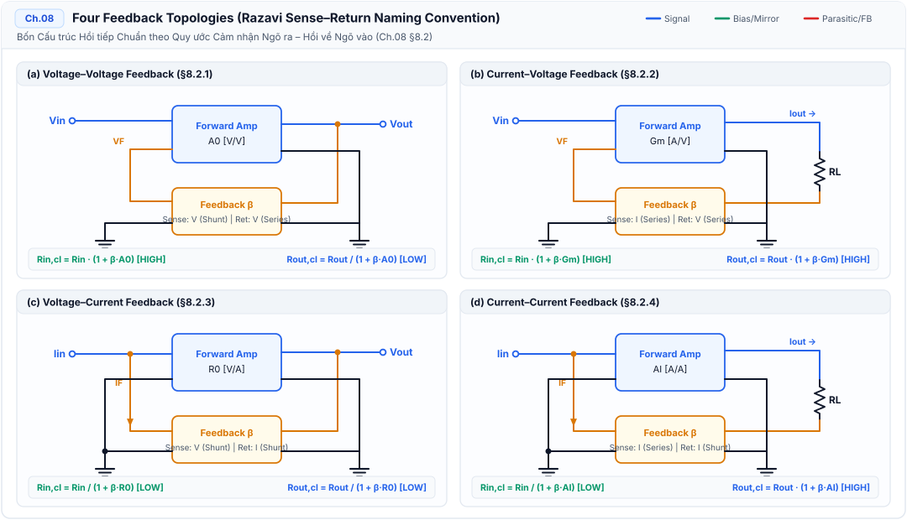

---
{
  "id": "tech-feedback-two-port-loading",
  "kind": "technique",
  "domain": "dynamics-noise-feedback",
  "title_vi": "Phân tích Hiệu ứng Tải bằng Mạng Hai Cửa & Quy tắc Mở Vòng Chuẩn xác cho 4 Cấu hình Hồi tiếp (Two-Port Feedback Loading Rules)",
  "title_en": "Two-Port Feedback Loading Analysis and Exact Loop-Breaking Rules Across VV, CV, VC, and CC Topologies",
  "summary": "Giải quyết triệt để bài toán mạng hồi tiếp thụ động gây tải đồng thời lên cả ngõ vào và ngõ ra của bộ khuếch đại chính: ánh xạ 4 cấu hình hồi tiếp sang 4 bộ tham số hai cửa (g, z, y, h) để suy ra quy tắc mở vòng giữ nguyên tải chính xác và sửa đổi Rin, Rout theo (1 + beta*A_open).",
  "diagram": "../../diagrams/feedback-four-topologies.svg",
  "razavi_refs": [
    {
      "chapter": 8,
      "section": "8.4-8.5",
      "pages": "299-315",
      "equations": ["8.57", "8.59", "8.61", "8.63", "8.68", "8.70", "8.79", "8.84", "8.85", "8.92", "8.93", "8.104", "8.105"]
    }
  ],
  "glossary_codes": ["T1187", "T1220", "T1254", "T1283", "T1287", "T1298", "T1299", "T1306", "T1322", "T1327"],
  "process_agnostic": true,
  "roles": {
    "bilateral_feedback_twoport": "Mạng hồi tiếp thụ động (như cầu chia R1-R2 hoặc một điện trở RF nối chéo) hút dòng ở ngõ ra và áp trở kháng hữu hạn lên ngõ vào",
    "input_loading_termination": "Trở kháng tương đương của mạng hồi tiếp gắn lại vào cửa vào bộ khuếch đại khi mở vòng (ngắn mạch nếu cảm nhận áp, hở mạch nếu cảm nhận dòng)",
    "output_loading_termination": "Trở kháng tương đương của mạng hồi tiếp gắn lại vào cửa ra bộ khuếch đại khi mở vòng (hở mạch nếu hồi trả áp, ngắn mạch nếu hồi trả dòng)",
    "loaded_open_loop_core": "Bộ khuếch đại vòng hở có tính tải (A_open) — đại lượng duy nhất hợp lệ để nhân với beta tạo độ lợi vòng và tính Rin,cl, Rout,cl"
  },
  "symptoms_addressed": [
    "wrong-loop-gain-due-to-missing-feedback-resistor-loading",
    "confusion-whether-to-short-or-open-feedback-network-ports",
    "inaccurate-closed-loop-rin-rout-with-low-value-resistors",
    "feedforward-through-rf-in-shunt-shunt-tia"
  ],
  "limitations": [
    "two-port-method-still-assumes-forward-feedthrough-via-feedback-network-is-much-smaller-than-amplifier-gain",
    "hard-to-partition-when-local-and-global-feedback-share-same-transistor-terminals",
    "replaced-by-bode-blackman-for-strongly-bilateral-low-gain-stages"
  ],
  "checklists": ["common-mos", "feedback-and-stb"]
}
---

## 1. Bản chất Nguyên lý, Sơ đồ Mạch & Vai trò Từng Nhánh Cấu trúc

Trong sơ đồ khối lý tưởng của lý thuyết điều khiển, mạng hồi tiếp $\beta$ có trở kháng vào vô cùng lớn (hoặc bằng 0 khi đo dòng), không tiêu thụ công suất từ ngõ ra và chỉ truyền tín hiệu một chiều từ ngõ ra ngược về ngõ vào. Trên vi mạch CMOS thực tế (Razavi Chương 8, §8.4–§8.5), mạng hồi tiếp gần như luôn là **mạng thụ động hai chiều (bilateral passive network)** — chẳng hạn cầu phân áp $R_1\text{–}R_2$, điện trở nối chéo cổng–máng $R_F$, hoặc cặp tụ $C_1\text{–}C_2$. Nếu người thiết kế chỉ đơn giản "rút phích cắm" tháo rời mạng hồi tiếp ra để tính độ lợi vòng hở $A_0$, **hai sai số nghiêm trọng lập tức xuất hiện**:
1. **Mất tải ngõ ra (Missing Output Loading):** Trong mạch kín, $R_1 + R_2$ hoặc $R_F$ hút dòng xoay chiều trực tiếp từ cực máng tầng ra (song song với $r_O$ hoặc $R_D$), làm giảm độ lợi thực của tầng ra!
2. **Mất tải ngõ vào (Missing Input Loading):** Mạng hồi tiếp đồng thời trình diện một trở kháng hữu hạn tại nút trừ ở ngõ vào (làm suy biến nguồn MOSFET đầu vào hoặc chia dòng với nguồn tín hiệu $R_S$)!



Để giải bài toán này một cách chặt chẽ bằng đại số tuyến tính mà không phải đoán mò, **Phương pháp Mạng Hai Cửa (`T1299`, Two-Port Method, §8.5)** ghép cặp bộ khuếch đại chính và mạng hồi tiếp theo đúng kiểu đấu nối (nối tiếp cộng điện áp $\Rightarrow$ cộng ma trận $Z$; song song cộng dòng $\Rightarrow$ cộng ma trận $Y$; nối tiếp–song song $\Rightarrow$ ma trận lai $H$ hoặc $G$):
- **Voltage–Voltage (Series–Shunt):** Ghép nối tiếp ở cửa 1, song song ở cửa 2 $\implies$ cộng **tham số $g$** (khi đánh số cửa 1 ở ngõ ra, cửa 2 ở ngõ vào theo Hình 8.51–8.52) hoặc ma trận $H$.
- **Current–Voltage (Series–Series):** Ghép nối tiếp ở cả hai cửa $\implies$ cộng **tham số $Z$** ($V = Z I$).
- **Voltage–Current (Shunt–Shunt):** Ghép song song ở cả hai cửa $\implies$ cộng **tham số $Y$** ($I = Y V$).
- **Current–Current (Shunt–Series):** Ghép song song ở cửa vào, nối tiếp ở cửa ra $\implies$ cộng **tham số $H$**.

Khi bỏ qua truyền thẳng thụ động chiều thuận qua mạng hồi tiếp so với truyền thuận khuếch đại lớn của transistor, bốn phép cộng ma trận trên đều hội tụ về **MỘT QUY TẮC MỞ VÒNG DUY NHẤT CỰC KỲ ĐƠN GIẢN**!

---

## 2. Hệ Phương trình Cốt lõi & Tư duy "Nhìn Mạch Đọc Nhanh" (Analysis by Inspection)

### 2.1. Quy tắc Vàng Mở Vòng Bảo toàn Tải ("Ngắn Áp – Hở Dòng" / Short-Shunt, Open-Series)
Đặt tên cửa nối với ngõ vào bộ khuếch đại của mạng hồi tiếp là **Cửa Trả (Return Port — Port In)** và cửa nối với ngõ ra bộ khuếch đại của mạng hồi tiếp là **Cửa Cảm nhận (Sense Port — Port Out)**. Quy tắc 3 bước tính **bộ khuếch đại vòng hở có tính tải (`T1327`, loaded open-loop amplifier $A_{\text{open}}$)** và **hệ số hồi tiếp $\beta$** cho mọi cấu hình (§8.5.6, Bảng tóm tắt tr. 315):

1. **Tìm Tải Gắn vào Ngõ Vào của Bộ Khuếch đại Chính:** Nhìn vào **Cửa Cảm nhận (Ngõ ra)** của mạng hồi tiếp:
   - Nếu cảm nhận **Điện áp** (mắc song song / Shunt ở ngõ ra): **NGẮN MẠCH xoay chiều** nút ngõ ra xuống đất ($V_{\text{out}} = 0$), rồi gắn phần mạng hồi tiếp còn lại vào ngõ vào!
   - Nếu cảm nhận **Dòng điện** (mắc nối tiếp / Series ở ngõ ra): **HỞ MẠCH xoay chiều** đường dòng ngõ ra ($I_{\text{out}} = 0$), rồi gắn phần mạng hồi tiếp còn lại vào ngõ vào!
2. **Tìm Tải Gắn vào Ngõ Ra của Bộ Khuếch đại Chính:** Nhìn vào **Cửa Trả (Ngõ vào)** của mạng hồi tiếp:
   - Nếu hồi trả **Điện áp** (mắc nối tiếp / Series ở ngõ vào): **HỞ MẠCH xoay chiều** cửa trả ở ngõ vào ($I_{\text{fb,in}} = 0$), rồi gắn phần mạng hồi tiếp đó vào ngõ ra!
   - Nếu hồi trả **Dòng điện** (mắc song song / Shunt ở ngõ vào): **NGẮN MẠCH xoay chiều** cửa trả ở ngõ vào xuống đất ($V_{\text{fb,in}} = 0$), rồi gắn phần mạng hồi tiếp đó vào ngõ ra!
3. **Tính Hệ số Hồi tiếp $\beta$ của Riêng Mạng Hồi tiếp:** Kích nguồn đúng loại đại lượng cảm nhận ($V_{\text{out}}$ hoặc $I_{\text{out}}$) vào cửa ngõ ra của mạng hồi tiếp, đo đại lượng trả về ở cửa ngõ vào với **cùng điều kiện kết cuối cửa vào như Bước 2** (tức hở mạch cửa vào nếu trả áp, ngắn mạch cửa vào nếu trả dòng!).

### 2.2. Bảng Công thức Tường minh Cho Cả 4 Cấu hình (Phương trình 8.68–8.105)

| Cấu hình Hồi tiếp | Kết cuối tìm tải Ngõ Vào | Kết cuối tìm tải Ngõ Ra | Công thức $\beta$ chính xác | Trở kháng Vào & Ra Vòng Kín (từ mạch $A_{\text{open}}$ đã mang tải!) |
|---|---|---|---|---|
| **1. Voltage–Voltage** (`§8.5.2`, Series–Shunt, vd cầu $R_1, R_2$ về cực nguồn/cổng $-$ ) | Đặt $V_{\text{out}} = 0$ $\implies$ thấy $(R_1 \parallel R_2)$ tại cửa trả | Đặt $I_{\text{fb,in}} = 0$ $\implies$ thấy $(R_1 + R_2)$ song song ngõ ra | $\beta = \left.\dfrac{V_{F}}{V_{\text{out}}}\right\|_{I_{\text{fb,in}}=0} = \dfrac{R_1}{R_1 + R_2}$ | $R_{in,\text{cl}} = R_{in,\text{open}}(1 + \beta A_{v,\text{open}})$<br>$R_{out,\text{cl}} = \dfrac{R_{out,\text{open}}}{1 + \beta A_{v,\text{open}}}$ |
| **2. Current–Voltage** (`§8.5.3`, Series–Series, hỗ dẫn $G_{m,\text{open}}$) | Đặt $I_{\text{out}} = 0$ tại cửa ra mạng $\beta$ | Đặt $I_{\text{fb,in}} = 0$ tại cửa vào mạng $\beta$ | $\beta = z_{21} = \left.\dfrac{V_{F}}{I_{\text{out}}}\right\|_{I_{\text{fb,in}}=0}$ | $R_{in,\text{cl}} = R_{in,\text{open}}(1 + \beta G_{m,\text{open}})$<br>$R_{out,\text{cl}} = R_{out,\text{open}}(1 + \beta G_{m,\text{open}})$ |
| **3. Voltage–Current** (`§8.5.4`, Shunt–Shunt TIA, vd $R_F$ nối chéo vào–ra, hỗ trở $R_{T,\text{open}}$) | Đặt $V_{\text{out}} = 0$ $\implies$ thấy $R_F$ nối từ ngõ vào xuống đất! | Đặt $V_{\text{fb,in}} = 0$ $\implies$ thấy $R_F$ nối từ ngõ ra xuống đất! | $\beta = y_{21} = \left.\dfrac{I_{F}}{V_{\text{out}}}\right\|_{V_{\text{fb,in}}=0} = -\dfrac{1}{R_F}$ *(với quy ước dấu dòng hai cửa)* | $R_{in,\text{cl}} = \dfrac{R_{in,\text{open}}}{1 + \beta R_{T,\text{open}}}$<br>$R_{out,\text{cl}} = \dfrac{R_{out,\text{open}}}{1 + \beta R_{T,\text{open}}}$ |
| **4. Current–Current** (`§8.5.5`, Shunt–Series, khuếch đại dòng $A_{I,\text{open}}$) | Đặt $I_{\text{out}} = 0$ tại cửa ra mạng $\beta$ | Đặt $V_{\text{fb,in}} = 0$ tại cửa vào mạng $\beta$ | $\beta = h_{21} = \left.\dfrac{I_{F}}{I_{\text{out}}}\right\|_{V_{\text{fb,in}}=0}$ | $R_{in,\text{cl}} = \dfrac{R_{in,\text{open}}}{1 + \beta A_{I,\text{open}}}$<br>$R_{out,\text{cl}} = R_{out,\text{open}}(1 + \beta A_{I,\text{open}})$ |

### 2.3. Ví dụ Mẫu Kinh điển: Tầng CS có Điện trở Hồi tiếp Nối chéo $R_F$ (Shunt–Shunt TIA, Ví dụ 8.15–8.16, tr. 312–313)
Xét tầng CS ($g_m$, tải $R_D$, bỏ qua $r_O$ hoặc gộp vào $R_D$) có điện trở $R_F$ nối từ máng về cổng, được lái bởi nguồn áp $V_S$ nối tiếp điện trở nguồn $R_S$:
- Đổi tương đương Norton nguồn kích thích thành dòng $I_{in} = V_S / R_S$ đi kèm $R_S$ song song ngõ vào!
- Mở vòng giữ tải cho cấu hình **Voltage–Current (Shunt–Shunt)**:
  - Ngắn mạch ngõ ra ($V_{out} = 0$) $\implies R_F$ nối từ cổng xuống đất (song song với $R_S$!).
  - Ngắn mạch ngõ vào ($V_{in} = 0$) $\implies R_F$ nối từ máng xuống đất (song song với $R_D$!).
- Vậy mạch vòng hở có tải có $R_{in,\text{open}} = R_S \parallel R_F$, $R_{out,\text{open}} = R_D \parallel R_F$, hỗ trở mở vòng $R_{T,\text{open}} = -(R_S \parallel R_F) g_m (R_F \parallel R_D)$, và $\beta = -\frac{1}{R_F}$ (tích độ lợi vòng dương $L = \beta R_{T,\text{open}} = g_m (R_F \parallel R_D) \frac{R_S}{R_S + R_F}$, Phương trình 8.99–8.100)!
- Từ đó đọc ra ngay trọn bộ độ lợi điện áp và trở kháng vòng kín:

$$
\frac{V_{\text{out}}}{V_S} = \frac{1}{R_S} \cdot \frac{R_{T,\text{open}}}{1 + \beta R_{T,\text{open}}} = \frac{-g_m (R_F \parallel R_D) \dfrac{R_F}{R_S + R_F}}{1 + g_m (R_F \parallel R_D) \dfrac{R_S}{R_S + R_F}}
$$

$$
R_{\text{out,closed}} = \frac{R_D \parallel R_F}{1 + g_m (R_F \parallel R_D) \dfrac{R_S}{R_S + R_F}}, \qquad R_{\text{in,gate,closed}} = \frac{R_F}{1 + g_m (R_F \parallel R_D)} \quad (\text{nhìn sau } R_S!)
$$

### 2.4. Ví dụ Định lượng Cấu hình Voltage–Voltage (Series–Shunt): Hai Tầng CS Hồi tiếp Về Cực Nguồn $M_1$ (Ví dụ 8.12, Hình 8.54, tr. 306–307)
Xét bộ khuếch đại hai tầng CS ($M_1$ tải $R_{D1}$, ghép sang cổng $M_2$ tải $R_{D2}$), cầu phân áp gồm $R_F$ (nối từ máng $M_2$ về cực nguồn $M_1$) và $R_S$ (nối từ cực nguồn $M_1$ xuống đất):
1. **Tìm tải ngõ vào (tại cực nguồn $M_1$):** Vì cảm nhận điện áp tại ngõ ra ($V_{\text{out}}$), ta ngắn mạch $V_{\text{out}} = 0$ $\implies$ nhìn từ cực nguồn $M_1$ xuống mạng hồi tiếp thấy **$(R_S \parallel R_F)$** làm điện trở suy biến nguồn cho $M_1$!
2. **Tìm tải ngõ ra (tại cực máng $M_2$):** Vì hồi trả điện áp nối tiếp tại cực nguồn $M_1$, ta để hở cực nguồn $M_1$ ($I_{S1} = 0$) $\implies$ nhìn từ $V_{\text{out}}$ vào mạng hồi tiếp thấy **$(R_F + R_S)$** mắc song song với $R_{D2}$!
3. **Độ lợi vòng hở có tính tải $A_{v,\text{open}}$ và hệ số hồi tiếp $\beta$ (Phương trình 8.73):**

$$
A_{v,\text{open}} = \left[ \frac{-g_{m1} R_{D1}}{1 + (g_{m1} + g_{mb1})(R_S \parallel R_F)} \right] \cdot \Big[ -g_{m2} \big(R_{D2} \parallel (R_F + R_S)\big) \Big], \qquad \beta = \frac{R_S}{R_S + R_F}
$$

Nếu bỏ sót hiệu ứng tải $(R_S \parallel R_F)$ ở cực nguồn $M_1$ và $(R_F + R_S)$ ở cực máng $M_2$, độ lợi vòng $\beta A_{v,\text{open}}$ tính tay có thể sai gấp $2\text{–}4$ lần thực tế!

---

## 3. Bất biến Cấu trúc & Các Bẫy Lỗi Kinh điển (Structural Invariants & Traps)

- **[INV-LOAD-01] Bất biến Bao gồm Trở kháng Nguồn $R_S$ và Tải $R_L$ vào Mạch Mở Vòng:** Khi tính độ lợi vòng thực tế $\beta A_{\text{open}}$ để xét độ ổn định hoặc tính trở kháng cửa đối diện, điện trở nguồn tín hiệu $R_S$ và tải $R_L$ bên ngoài **bắt buộc phải giữ nguyên** trong mạch mở vòng (trừ chính trở kháng của nguồn thử tại cửa mà ta đang đứng nhìn vào để tìm $R_{in}$ hay $R_{out}$ của riêng khối khuếch đại!). Quên $R_S$ ở mạch Shunt–Shunt (như Ví dụ 8.16 trên: nếu $R_S = 0$ thì cổng bị khóa cứng vào nguồn áp lý tưởng làm $L \to 0$!) sẽ cho độ lợi vòng sai hoàn toàn!
- **[TRAP-LOAD-01] Bẫy Bỏ Sót Đường Truyền Thẳng Thụ động (Feedforward Path) qua $R_F$ khi $g_m R_F$ Nhỏ:** Phương pháp mạng hai cửa giả thiết rằng dòng truyền thuận qua bộ khuếch đại lớn hơn rất nhiều so với dòng truyền thẳng thụ động qua mạng hồi tiếp (ví dụ trong TIA Shunt–Shunt, giả thiết $g_m \gg \frac{1}{R_F}$, bỏ qua $y_{12}$ so với $Y_{21}$ ở Phương trình 8.91–8.92!). Nếu $R_F$ nhỏ đến mức $g_m R_F \sim 1\text{–}3$, dòng chảy thẳng từ ngõ vào qua $R_F$ sang ngõ ra tạo sai số lớn (và đổi dấu tử số thành $(1 - g_m R_F)$!) — lúc đó **bắt buộc chuyển sang phương pháp chính xác tuyệt đối của Bode (`tech-bode-blackman-middlebrook-stb`)**!
- **[TRAP-LOAD-02] Lẫn Lộn Dấu của Tham số Hai Cửa $g_{21}, y_{21}, h_{21}$ (`NG08-03`, `NG08-09`):** Trong định nghĩa mạng hai cửa chuẩn học thuật, dòng $I_1$ và $I_2$ đều hướng **đi vào** cả hai cửa của hộp hai cửa! Vì vậy với điện trở nối chéo $R_F$, $y_{21} = -1/R_F$ mang dấu âm, nhân với $R_{T,\text{open}} = -g_m (\dots)$ mang dấu âm tạo ra tích độ lợi vòng **dương** ($L = \beta A > 0$ cho hồi tiếp âm). Nếu nhầm dấu làm mẫu số thành $(1 - |L|)$ thay vì $(1 + |L|)$, kết quả giải tích sẽ biến mạch hồi tiếp âm thành mạch hồi tiếp dương chốt cứng!
- **[TRAP-LOAD-03] Cắt Vòng Ở Sai Vị Trí Làm Đổi Trở Kháng Tải Của Cả Hai Phía (§8.8.1, Hình 8.85):** Ví dụ trong bộ khuếch đại hai tầng hồi tiếp áp từ máng $M_2$ qua cầu $R_1\text{–}R_2$ về nguồn $M_1$: nếu cắt ngay giữa máng $M_2$ và đầu trên $R_1$ rồi bơm áp thử vào $R_1$, cực máng $M_2$ lập tức mất tải $(R_1 + R_2)$ làm độ lợi vòng tính tay vọt cao giả tạo! Cắt tại **cực cổng MOSFET** ở tần số thấp an toàn hơn, nhưng ở tần số cao ngay cả cực cổng cũng có $C_{GS2} + C_{GD2,\text{Miller}}$ nên phải cắt phía sau tụ cổng hoặc dùng phương pháp không cắt vòng!

---

## 4. Lộ trình Nâng cấp Cấu trúc & Bát giác Đánh đổi (Upgrade Paths & Design Octagon)

| Vấn đề tải phát sinh trong thực tế | Giải pháp cấu trúc / Phương pháp đích (Canonical Node) | Tác dụng kỹ thuật | Đánh đổi trên Bát giác Thiết kế |
|---|---|---|---|
| Cầu điện trở hồi tiếp $R_1 + R_2$ quá nhỏ làm sụt độ lợi tầng 2 của Op-Amp (`topo-two-stage-opamp`) | Tăng $R_1, R_2$ đi kèm tụ bù hoặc chuyển sang hồi tiếp tụ chuyển mạch (`topo-switched-capacitor-amplifiers-integrators`) | Khôi phục $A_{v2} = g_{m2}(r_{O2} \parallel r_{O4})$ không bị $(R_1+R_2)$ kéo sập | Điện trở lớn tăng nhiễu nhiệt $4kT(R_1\parallel R_2)$ và tạo cực phụ với $C_{in}$ ở nút trừ! |
| Không tách bạch được ranh giới giữa khối $A$ và khối $\beta$ (ví dụ hồi tiếp cục bộ chồng lên hồi tiếp toàn cục) | `tech-bode-blackman-middlebrook-stb` | Giải thẳng hàm truyền và trở kháng cảng bằng Bode & định lý Blackman không cần mở vòng! | Tính hai tỉ số hồi trả $T_{sc}, T_{oc}$ thay vì ước lượng hai cửa |
| Cần đệm ngõ ra để mạng hồi tiếp điện trở nhỏ không tải trực tiếp nút trở kháng cao cascode | Thêm tầng CS thứ hai (`topo-two-stage-opamp`) hoặc tầng đẩy–kéo lớp AB (`tech-slew-rate-and-class-ab-opamps`) | Cung cấp dòng lái lớn cho mạng $R_1 + R_2$ và tải ngoài mà giữ tầng 1 độ lợi cao | Tốn thêm nhánh dòng tĩnh và đòi hỏi bù tần số |

---

## 5. Thích ứng Đa Tiến trình (90nm / 65nm / 45nm) & Cách Kiểm chứng trong Cadence / Spectre

### 5.1. Thích ứng Công nghệ Nanomet (90nm $\to$ 65nm $\to$ 45nm)
- **Tương tác Giữa Điện trở Hồi tiếp & Điện dung Cổng $C_{in}$ ở Nút Trừ (Feedback Network Zero/Pole):** Trong các bộ khuếch đại băng rộng trên công nghệ **90nm / 65nm / 45nm** (như Ví dụ Chương 11 §11.6 của Razavi), cặp vi sai đầu vào được định cỡ rộng ($W = 40\text{–}100\,\mu\text{m}$) để đạt $g_m$ lớn và nhiễu thấp, khiến điện dung ngõ vào $C_{in}$ tại nút trừ lên tới $50\text{–}200\text{ fF}$. Khi dùng cầu hồi tiếp điện trở $R_1, R_2$ (ví dụ $R_1 = 2\text{ k}\Omega, R_2 = 8\text{ k}\Omega$), chính mạng hồi tiếp bị $C_{in}$ tải ở cửa trả tạo ra một **cực phụ nằm ngay trong hệ số hồi tiếp**:

$$
\beta(s) = \frac{R_1}{R_1 + R_2} \cdot \frac{1}{1 + s (R_1 \parallel R_2) C_{in}}
$$

Cực của $\beta(s)$ chính là cực của độ lợi vòng $\beta(s) A(s)$ làm sụt dự trữ pha! Mẹo khắc phục chuẩn công nghiệp: mắc một tụ bù nhỏ $C_F$ song song với $R_2$ sao cho $R_2 C_F = R_1 C_{in}$ (bù phân áp đầu dò — compensated attenuator) để khử sạch cực tải ngõ vào và thậm chí tạo LHP zero nâng dự trữ pha!

### 5.2. Quy trình Kiểm chứng trong Cadence Virtuoso / Spectre
1. **Tuyệt đối KHÔNG dùng cuộn cảm khổng lồ `1 GH` và tụ khổng lồ `1 GF` để cắt vòng đo AC:**
   - Cách làm cổ điển cắt dây chèn `L=1GH` nối DC và `C=1GF` bơm AC **phá hỏng hoàn toàn hiệu ứng tải hai chiều ở tần số AC** (y hệt lỗi cắt vòng thô ở Hình 8.85b!), làm sai lệch cả $\text{GBW}$ lẫn dự trữ pha `PM` từ $5^\circ$ đến $30^\circ$ khi dùng mạng hồi tiếp điện trở hoặc Op-Amp không đệm!
2. **Dùng `stb` với `iprobe` để Tự Động Bảo Toàn 100% Hiệu Ứng Tải:**
   - Chèn linh kiện `iprobe` (trong thư viện `analogLib`, điện trở DC và AC bằng $0\,\Omega$ lý tưởng!) nối tiếp ngay trên đường vòng hồi tiếp và chạy phân tích `stb`: Spectre giữ mạch đóng kín hoàn toàn và tính chính xác hàm truyền vòng bao gồm đầy đủ tải hai chiều lẫn truyền thẳng!
3. **Đo Trở kháng Vòng kín $Z_{in,\text{cl}}(f), Z_{out,\text{cl}}(f)$ bằng `xf` / `ac`:** Đặt nguồn dòng thử AC `mag=1` tại cửa vào hoặc cửa ra của mạch đóng kín hoàn chỉnh để xác nhận $Z_{\text{cl}}(0)$ khớp với công thức nhân/chia $(1 + L)$ ở tần số thấp và quan sát sự nhô lên của $Z_{out,\text{cl}}(f)$ (inductive behavior!) khi độ lợi vòng $L(j\omega)$ giảm $-20\text{ dB/dec}$ ở tần số trung bình!
4. **Mẫu Netlist Spectre Đo Chính Xác Đồng Thời Độ Lợi Vòng Có Tải & Trở kháng Ra Vòng Kín:**
   ```spectre
   // Mach khuếch dai hoi tiep dien tro R1-R2 khép kín hoàn chỉnh
   R2 (out fb_node) resistor r=8k
   R1 (fb_node 0)   resistor r=2k
   IPRB_LOOP (fb_node amp_in_minus) iprobe
   ITEST_OUT (0 out) isource dc=0 mag=1

   // 1. Do chinh xac beta * A_open da tinh du hieu ung tai hai chieu
   stb_loaded stb probe=IPRB_LOOP start=1 stop=50G dec=50

   // 2. Do tro khang ngo ra vong kin Zout_cl(f) = V(out)/1A
   ac_zout ac start=1 stop=50G dec=50
   ```
   - Đối chiếu tại `100 Hz`: `mag(V(out))` trong `ac_zout` khớp sát công thức `Rout_open / (1 + mag(value(loopGain, 100)))` với sai số `< 0.5%`!

---

## 6. Mốc Đối chiếu Sách Razavi & Thuật ngữ Chuẩn CLB

### 6.1. Đối chiếu Sách Gốc Razavi (2nd Edition)
- **Chương 8:** §8.4 *Feedback Analysis Difficulties* (tr. 299–302, Hình 8.45–8.49), §8.5 *Effect of Loading* — §8.5.1 *Two-Port Network Models* (tr. 303–304, Phương trình 8.57–8.64), §8.5.2 *Loading in VV Feedback* (tr. 304–308), §8.5.3 *Loading in CV Feedback* (tr. 308–310), §8.5.4 *Loading in VC Feedback* (tr. 310–313), §8.5.5 *Loading in CC Feedback* (tr. 313–314), §8.5.6 *Summary of Loading Effects* (tr. 315).
- **Chú giải Hiệu đính Học thuật CLB (`NG08`):**
  - **`NG08-03` (tr. 304–306, Hình 8.51a):** Khi mô hình hóa bộ khuếch đại chính trong hồi tiếp áp–áp bằng tham số $G$, lời văn trang 304, 306 và nhãn Hình 8.51(a) viết nhầm số hạng nguồn dòng truyền ngược ở cửa 1 thành $G_{12} V_{out}$; theo đúng định nghĩa hệ phương trình mô hình $G$ ở (8.63) $I_1 = G_{11} V_1 + G_{12} I_2$, biến điều khiển phải là dòng $I_2$ ($G_{12} I_2$).
  - **`NG08-04` (tr. 312, Ví dụ 8.15):** Đoạn mở đầu ngay trước Ví dụ 8.15 gọi nhầm mạch ở Hình 8.62 là *"transconductance amplifier"* (bộ khuếch đại hỗ dẫn); thực tế ngõ vào là $I_{in}$, ngõ ra là $V_{out}$ với hồi tiếp Shunt–Shunt, nên đây là **bộ khuếch đại hỗ trở (`T1237`, transimpedance amplifier)**.
  - **`NG08-09` (tr. 340, Bài tập 8.9):** Bài tập in hoa $G_{21}$, trong khi phần thân bài §8.5.2 dùng chữ thường $g_{21}$ cho mạng hồi tiếp và chữ hoa cho khối khuếch đại chính — cần đối chiếu đúng định nghĩa cửa khi so sánh với $g_{21} A_{v,\text{open}}$.

### 6.2. Bảng Thuật ngữ Chuẩn CLB Vi Mạch Sử dụng trong Thẻ
| Mã CLB | Thuật ngữ Tiếng Anh | Thuật ngữ Tiếng Việt Chuẩn | Ghi chú Ngữ cảnh |
|---|---|---|---|
| `T1220` / `T1254` | loading / loading effects | hiệu ứng tải | Tác động qua lại về trở kháng giữa mạng $\beta$ và khối $A$ |
| `T1287` | input loading | hiệu ứng tải ngõ vào | Mạng $\beta$ làm suy hao hoặc đổi trở kháng tại cửa vào |
| `T1299` | Two-Port Method | phương pháp mạng hai cửa | Tách tải bằng 4 họ ma trận $Z, Y, H, G$ |
| `T1306` | two-port network | mạng hai cửa | Biểu diễn hệ bốn cực tuyến tính |
| `T1327` | loaded open-loop amplifier | bộ khuếch đại vòng hở có tính tải | Khối khuếch đại sau khi đã gắn trở kháng kết cuối tương đương của mạng $\beta$ |
| `T1322` | equivalent open-loop gain | độ lợi vòng hở tương đương | $A_{\text{open}}$ dùng để nhân với $\beta$ tạo độ lợi vòng |
