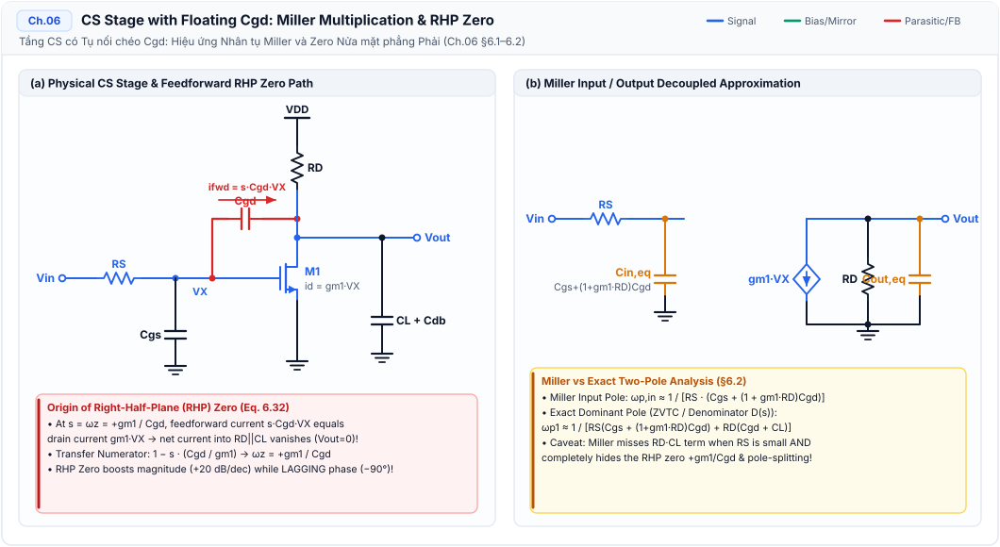

---
{
  "id": "tech-zvtc-and-eet-bandwidth",
  "kind": "technique",
  "domain": "dynamics-noise-feedback",
  "title_vi": "Phương pháp Hằng số Thời gian Giá trị Không (ZVTC), Định lý Phần tử Bổ sung (EET) & Đánh đổi Độ lợi–Băng thông",
  "title_en": "Zero-Value Time Constant (ZVTC) Method, Extra Element Theorem (EET), Dual of Miller's Theorem, and GBW Trade-offs",
  "summary": "Bộ công cụ giải tích nhanh cho mạch nhiều tụ ký sinh: ước lượng băng thông -3 dB bằng tổng hằng số thời gian giá trị không (ZVTC), phân tích chính xác ảnh hưởng của một phần tử thêm vào bằng EET của Middlebrook, đối ngẫu Miller cho dòng điện, và định luật suy giảm băng thông khi ghép tầng nhiều cực.",
  "diagram": "../../diagrams/miller-effect-rhp-zero.svg",
  "razavi_refs": [
    {
      "chapter": 6,
      "section": "6.7-6.10",
      "pages": "203-214",
      "equations": ["6.98", "6.100", "6.102", "6.106", "6.107", "6.110", "6.114", "6.122", "6.126", "6.128", "6.129"]
    }
  ],
  "glossary_codes": ["T521", "T522", "T941", "T977", "T979", "T980", "T981", "T984", "T991", "T993", "T999"],
  "process_agnostic": true,
  "roles": {
    "zvtc_driving_point_resistance": "Điện trở Thevenin Req,j nhìn từ hai đầu tụ thứ j khi đặt nguồn kích thích độc lập bằng 0 và mở mạch mọi tụ còn lại",
    "eet_null_excitation": "Trạng thái kích thích kép (double injection / nulling) làm đầu ra bằng 0 để tìm trở kháng Rn điều khiển phần tử không ở tử số",
    "eet_zero_input_resistance": "Điện trở Rd nhìn từ cảng gắn phần tử phụ khi tắt nguồn vào độc lập, quyết định độ dịch cực ở mẫu số",
    "cascade_stage_chain": "Chuỗi n tầng khuếch đại đồng nhất nhân mũ độ lợi nhưng làm co hẹp băng thông -3 dB theo căn bậc hai của (2^(1/n) - 1)"
  },
  "symptoms_addressed": [
    "intractable-high-order-kcl-algebra",
    "unclear-dominant-capacitor-bottleneck",
    "cascaded-amplifier-bandwidth-shrinkage",
    "bridged-current-branch-analysis"
  ],
  "limitations": [
    "zvtc-misses-transfer-function-zeros",
    "zvtc-overestimates-bandwidth-if-poles-are-closely-spaced-without-dominance",
    "dual-miller-requires-known-branch-current-ratio"
  ],
  "checklists": ["common-mos", "single-stage", "feedback-and-stb"]
}
---

## 1. Bản chất Nguyên lý, Sơ đồ Mạch & Vai trò Từng Nhánh Cấu trúc

Khi một mạch khuếch đại thực tế chứa từ 3 đến 10 tụ ký sinh (bao gồm cả các tụ cầu nối $C_{GD}$ nối chéo không chạm đất), việc lập hệ phương trình nút KCL để tìm đa thức mẫu số bậc $n$ nhanh chóng trở nên bất khả thi bằng tay và che khuất trực giác thiết kế: **tụ nào và điện trở nút nào đang thực sự bóp nghẹt băng thông $-3\text{ dB}$?** Chương 6 (§6.7–§6.10) của Razavi cung cấp 4 công cụ giải tích hệ thống giúp người thiết kế bóc tách đóng góp của từng phần tử mà không cần giải định thức ma trận lớn.

Bốn trụ cột kỹ thuật trong thẻ này đóng các vai trò bổ trợ nhau:
1. **Phương pháp hằng số thời gian giá trị không (Zero-Value Time Constant Method — ZVTC, §6.9):** Tính trực tiếp hệ số bậc nhất $b_1$ của đa thức mẫu số $D(s) = 1 + b_1 s + b_2 s^2 + \dots$ bằng cách xét từng tụ $C_j$ một khi mọi tụ khác nhận "giá trị bằng không" (tức mở mạch $C_{k \neq j} = 0$). Mỗi tích $\tau_{j0} = R_{j0} C_j$ chỉ đích danh phần trăm độ trễ mà tụ $C_j$ đóng góp!
2. **Định lý phần tử bổ sung của Middlebrook (Extra Element Theorem — EET, §6.8):** Cho phép giữ nguyên hàm truyền $H_0(s)$ đã giải của mạch đơn giản, rồi nhân thêm đúng một thừa số hiệu chỉnh chính xác (không xấp xỉ!) khi gắn thêm một tụ ký sinh hay một điện trở tải mới $Z_E$.
3. **Đối ngẫu của định lý Miller (Dual of Miller's Theorem, §6.10):** Tách một trở kháng $Z$ nằm chung trên hai vòng dòng điện có tỉ số dòng đã biết thành hai trở kháng nối tiếp độc lập trên từng nhánh.
4. **Quy luật đánh đổi độ lợi–băng thông trong mạch một cực và nhiều cực (Gain-Bandwidth Trade-offs, §6.7):** Xác định khi nào tích độ lợi–băng thông (gain-bandwidth product, GBW) là hằng số bảo toàn và cách ghép tầng (cascading) mở rộng GBW nhưng đánh đổi công suất cùng sự co hẹp băng thông $-3\text{ dB}$.

---

## 2. Hệ Phương trình Cốt lõi & Tư duy "Nhìn Mạch Đọc Nhanh" (Analysis by Inspection)

### 2.1. Phương pháp Hằng số Thời gian Giá trị Không (ZVTC — §6.9)
Xét mạng tuyến tính bất kỳ có đa thức mẫu số chuẩn hóa theo các cực $\omega_{p1}, \omega_{p2}, \dots, \omega_{pn}$:

$$
D(s) = \left(1 + \frac{s}{\omega_{p1}}\right)\left(1 + \frac{s}{\omega_{p2}}\right)\cdots\left(1 + \frac{s}{\omega_{pn}}\right) = 1 + \left(\sum_{k=1}^{n} \frac{1}{\omega_{pk}}\right) s + \left(\sum_{i < j} \frac{1}{\omega_{pi}\omega_{pj}}\right) s^2 + \cdots
$$

Định lý ZVTC chứng minh rằng hệ số bậc nhất $b_1$ **bằng chính xác** tổng các hằng số thời gian khi xét riêng từng tụ (Phương trình 6.121–6.122):

$$
b_1 = \sum_{k=1}^{n} \frac{1}{\omega_{pk}} = \sum_{j=1}^{m} R_{j0} C_j = \sum_{j=1}^{m} \tau_{j0}
$$

trong đó **$R_{j0}$ là điện trở Thevenin nhìn từ hai cực của tụ $C_j$** khi:
1. Đặt nguồn kích thích độc lập ở ngõ vào bằng 0 ($V_{in} = 0$ thay bằng ngắn mạch, $I_{in} = 0$ thay bằng hở mạch).
2. Đặt mọi tụ điện khác bằng 0 ($C_{k \neq j} = 0$, tức hở mạch tất cả các tụ còn lại).

Nếu mạch có một cực trội ($\omega_{p1} \ll \omega_{p2}, \dots, \omega_{pn}$) và không có zero nằm gần hoặc thấp hơn $\omega_{p1}$, thì băng thông $-3\text{ dB}$ được ước lượng trực tiếp bởi:

$$
\omega_{-3\text{dB}} \approx \omega_{p1} \approx \frac{1}{\sum_{j=1}^{m} R_{j0} C_j}
$$

**Ví dụ Kinh điển Đọc Nhanh bằng ZVTC — Tầng CS có Suy biến Cực nguồn $R_S$ và Điện trở Cổng $R_G$ (§6.9, Hình 6.60, Phương trình 6.123–6.126):**
Với 3 tụ $C_{GS}$ (nối cổng–nguồn), $C_{GD}$ (nối cổng–máng) và $C_L$ (nối máng–đất), thay vì lập 3 phương trình nút khổng lồ, ZVTC đọc ngay 3 điện trở nhìn từ từng tụ:
- Nhìn từ $C_{GS}$: $R_{GS,0} = \dfrac{R_G + R_S}{1 + g_m R_S}$ (suy biến nguồn làm giảm điện trở nhìn từ cổng–nguồn đi $(1 + g_m R_S)$ lần!).
- Nhìn từ $C_{GD}$: $R_{GD,0} = R_G + \left(1 + \dfrac{g_m R_G}{1 + g_m R_S}\right) R_D = R_G \left(1 + \dfrac{g_m R_D}{1 + g_m R_S}\right) + R_D$.
- Nhìn từ $C_L$: $R_{L,0} = R_D$ (khi bỏ qua $r_O$, hoặc $R_D \parallel [(1+g_m r_O)R_S + r_O]$ khi tính $r_O$).

Tổng lại cho kết quả chính xác trong 30 giây (Phương trình 6.126):

$$
\omega_{-3\text{dB}} \approx \left[ \frac{R_G + R_S}{1 + g_m R_S} C_{GS} + \left( R_G + R_D + \frac{g_m R_G R_D}{1 + g_m R_S} \right) C_{GD} + R_D C_L \right]^{-1}
$$

Khi $R_S \to 0$ và thay $R_G$ bằng trở kháng nguồn tín hiệu, công thức lập tức quay về đúng Phương trình (6.35) của tầng CS!

### 2.2. Định lý Phần tử Bổ sung của Middlebrook (EET — §6.8)
Giả sử hàm truyền khi chưa gắn phần tử phụ (tức $Z_E = \infty$, hở mạch hai đầu cặp nút gắn $Z_E$) là $H(s)\big|_{Z_E \to \infty}$. Khi gắn trở kháng bất kỳ $Z_E$ (ví dụ tụ $Z_E = \frac{1}{s C_F}$) vào cặp nút đó, hàm truyền mới **chính xác tuyệt đối** là (Phương trình 6.110):

$$
H(s) = H(s)\Big|_{Z_E \to \infty} \cdot \frac{1 + \dfrac{Z_n}{Z_E}}{1 + \dfrac{Z_d}{Z_E}}
$$

trong đó hai trở kháng thử $Z_d$ và $Z_n$ đều được tính trên mạch **không chứa $Z_E$** theo hai phép đo trực quan:
- **$Z_d$ (Driving-point impedance with zero input):** Đặt nguồn vào bằng 0 ($V_{in} = 0$), bơm dòng thử $I_X$ vào hai đầu nơi định gắn $Z_E$ và đo điện áp $V_X \implies Z_d = \left.\dfrac{V_X}{I_X}\right|_{V_{in}=0}$.
- **$Z_n$ (Null-output driving-point impedance):** Giữ cả nguồn vào $V_{in}$ lẫn nguồn thử $I_X$ tại cảng gắn $Z_E$, đồng thời điều chỉnh tỉ lệ giữa $V_{in}$ và $I_X$ sao cho **tín hiệu ngõ ra bị triệt hoàn toàn về không ($V_{out} = 0$)** $\implies Z_n = \left.\dfrac{V_X}{I_X}\right|_{V_{out}=0}$.

Khi phần tử bổ sung là tụ điện $Z_E = \frac{1}{s C_F}$, công thức EET biến thành $\frac{1 + s Z_n C_F}{1 + s Z_d C_F}$: mẫu số trả về hằng số thời gian cực đúng bằng ZVTC ($Z_d C_F$), còn tử số **tự động bóc ra chính xác vị trí điểm không (zero)** $s_z = -\frac{1}{Z_n C_F}$ (với tụ $C_{GD}$ của tầng CS, phép triệt $V_{out}=0$ cho $Z_n = -1/g_m \implies s_z = +g_m/C_{GD}$!).

### 2.3. Đối ngẫu của Định lý Miller (Dual of Miller's Theorem — §6.10)
Nếu hai vòng mạch mang dòng $I_1$ và $I_2$ đi chung qua một nhánh trở kháng nối đất $Z$ (tổng dòng qua $Z$ là $I_1 + I_2$, ví dụ điện trở suy biến nguồn dùng chung hoặc trở kháng đường đất chung), ta có thể tách $Z$ thành $Z_a$ nằm riêng trên nhánh $I_1$ và $Z_b$ nằm riêng trên nhánh $I_2$ giữ nguyên điện áp rơi (Phương trình 6.128–6.129):

$$
Z_a = \left(1 + \frac{I_2}{I_1}\right) Z, \qquad Z_b = \left(1 + \frac{I_1}{I_2}\right) Z
$$

### 2.4. Đánh đổi Độ lợi – Băng thông: Mạch Một Cực so với Ghép Tầng Nhiều Cực (§6.7)
- **Mạch một cực đơn tầng ($H(s) = \frac{A_0}{1 + s/\omega_p}$, ví dụ CS tải $R_D, C_L$):** Với $A_0 = g_m R_D$ và $\omega_p = \frac{1}{R_D C_L}$, tích độ lợi–băng thông tính theo tần số góc là $\text{GBW}_\omega = A_0 \omega_p = \frac{g_m}{C_L}$ (hoặc theo Hz là $\text{GBW}_f = \frac{g_m}{2\pi C_L}$, độc lập với $R_D$!). Tần số độ lợi đơn vị $|H(j\omega_u)| = 1$ bằng $\omega_u = \omega_p \sqrt{A_0^2 - 1} \approx A_0 \omega_p$ khi $A_0 \gg 1$ (Phương trình 6.98–6.103).
- **Ghép chuỗi $n$ tầng một cực giống hệt nhau ($H_{\text{tot}}(s) = \left[\frac{A_0}{1 + s/\omega_p}\right]^n$):** Độ lợi DC tăng theo hàm mũ $A_{\text{tot}} = A_0^n$, nhưng tại $\omega_{-3\text{dB,tot}}$ mỗi tầng chỉ được phép suy giảm $-\frac{3}{n}\text{ dB}$, làm **co hẹp băng thông tổng** (Phương trình 6.106–6.107):

$$
\omega_{-3\text{dB,tot}} = \omega_p \sqrt{2^{1/n} - 1} \quad \implies \quad \begin{cases} n = 2: & \omega_{-3\text{dB,tot}} \approx 0{,}644\,\omega_p \\ n = 3: & \omega_{-3\text{dB,tot}} \approx 0{,}510\,\omega_p \\ n = 4: & \omega_{-3\text{dB,tot}} \approx 0{,}435\,\omega_p \end{cases}
$$

Tuy băng thông $-3\text{ dB}$ co lại, độ lợi tăng mũ $A_0^n$ nên khi cần độ lợi tổng cố định lớn (ví dụ $A_{\text{tot}} = 100$) trên băng thông rộng (như bộ khuếch đại giới hạn trong thu quang), chia thành 2–3 tầng độ lợi vừa phải cho băng thông rộng hơn hẳn một tầng duy nhất — đổi lại công suất tăng gấp $n$ lần và mạch nhiều cực **không thể đóng vòng hồi tiếp âm sâu** nếu không bù tần số!

---

## 3. Bất biến Cấu trúc & Các Bẫy Lỗi Kinh điển (Structural Invariants & Traps)

- **[INV-ZVTC-01] Bất biến Cận Dưới Băng thông của ZVTC (Đối với Hệ Toàn Cực Thực, Không Zero):** Vì $\sum \frac{1}{\omega_{pk}} > \frac{1}{\omega_{p1}}$, tần số ước lượng $\omega_{\text{ZVTC}} = \frac{1}{\sum \tau_{j0}}$ luôn là một **ước lượng bảo toàn (conservative lower bound)** nhỏ hơn hoặc bằng cực thứ nhất $\omega_{p1}$ nếu hệ chỉ có các cực thực âm và không có zero. Ví dụ với 2 cực trùng nhau $\omega_{p1} = \omega_{p2} = \omega_0$: băng thông thực là $0{,}644\,\omega_0$, còn ZVTC cho $0{,}5\,\omega_0$ (sai số an toàn $\sim 22\%$).
- **[TRAP-ZVTC-01] Bẫy Bỏ Quên Zero Nằm Thấp làm ZVTC Sai Lệch Nặng:** ZVTC chỉ nhìn thấy mẫu số $D(s)$ mà mù hoàn toàn trước tử số $N(s)$! Nếu mạch có zero LHP tăng cường băng thông (peaking zero, như suy biến nguồn có tụ bypass $C_S$ song song $R_S$) hoặc doublet gương dòng, dùng riêng ZVTC mà không kiểm tra zero bằng EET/ngắn mạch ngõ ra sẽ chẩn đoán sai đáp ứng tần số.
- **[TRAP-ZVTC-02] Bẫy Các Tụ Tạo Vòng Kín Phụ Thuộc (Capacitive Loops):** Nếu ba tụ tạo thành một vòng kín $\Delta$ (ví dụ $C_{GS}$, $C_{GD}$, và tụ ký sinh máng–nguồn $C_{DS}$ khi nút nguồn không nối đất!), chỉ có 2 biến trạng thái điện áp độc lập nên bậc thực của mẫu số là 2, nhưng tổng $\sum_{j=1}^{3} R_{j0} C_j$ của ZVTC **vẫn đúng tuyệt đối** cho hệ số bậc nhất $b_1$! Sai lầm chỉ xảy ra khi người thiết kế tưởng rằng 3 hằng số thời gian đồng nghĩa với 3 cực độc lập.
- **[TRAP-EET-01] Lẫn lộn Giữa Hai Lần Áp dụng EET Liên tiếp:** Khi dùng EET lần thứ hai để gắn thêm tụ thứ hai $C_2$ vào mạch đã có $C_1$ (Ví dụ 6.18, tr. 207–208), trở kháng $Z_d$ và $Z_n$ nhìn từ cảng $C_2$ **phải được tính trong khi tụ $C_1$ vẫn đang gắn trong mạch** (tức $Z_d(s)$ trở thành hàm theo $s$, không còn là điện trở thuần $R_{20}$!).

---

## 4. Lộ trình Nâng cấp Cấu trúc & Bát giác Đánh đổi (Upgrade Paths & Design Octagon)

| Nhu cầu phân tích / Nâng cấp băng thông | Công cụ / Cấu trúc đích (Canonical Node) | Khi nào sử dụng | Đánh đổi trên Bát giác Thiết kế |
|---|---|---|---|
| Phát hiện một nhánh $R_{j0} C_j$ của $C_{GD}$ chiếm $>70\%$ tổng $\sum \tau_{j0}$ | `concept-high-freq-cs-cg-cascode` / `topo-cascode-stage` | Chặn hệ số nhân Miller trong biểu thức $R_{GD,0}$ bằng tầng cascode | Tiêu tốn khoảng dự trữ điện áp $V_{DS,\min}$, thêm một cực phụ tần số cao tại nút cascode |
| Cần tăng đồng thời cả độ lợi lẫn băng thông vòng hở cho bộ tiền khuếch đại không đóng vòng toàn cục | Ghép chuỗi nhiều tầng CS độ lợi thấp (§6.7.2) | Khi một tầng CS duy nhất bị khóa chặt bởi $\text{GBW} = g_m / C_L$ | Công suất tiêu tán nhân $n$ lần; trễ pha tích lũy $-n \times 90^\circ$ gây mất ổn định nếu bọc hồi tiếp toàn cục (`law-multipole-phase-margin`) |
| Mạch có hồi tiếp hai chiều (bilateral feedback) vừa tải ngõ vào/ra vừa có nhiều vòng phụ | `tech-bode-blackman-middlebrook-stb` | Khi EET một phần tử không đủ cho mạng hồi tiếp đa transistor, nâng cấp sang định lý trở kháng Blackman và phương pháp tách vòng Middlebrook | Cần giải hai tỉ số hồi trả $T_{sc}, T_{oc}$ hoặc chạy `stb` trong Spectre |
| Muốn giảm hằng số thời gian ngõ vào mà vẫn giữ tuyến tính cao | `topo-cs-source-degeneration` | Suy biến nguồn $R_S$ chia nhỏ cả $R_{GS,0}$ lẫn hệ số nhân Miller của $C_{GD}$ đi $(1 + g_m R_S)$ lần | Giảm độ lợi hỗ dẫn hiệu dụng xuống $G_m = g_m / (1 + g_m R_S)$ và tăng nhiễu nhiệt do điện trở $R_S$ (`law-stage-and-mirror-noise-rules`) |

---

## 5. Thích ứng Đa Tiến trình (90nm / 65nm / 45nm) & Cách Kiểm chứng trong Cadence / Spectre

### 5.1. Thích ứng Công nghệ Nanomet (90nm $\to$ 65nm $\to$ 45nm)
- **Tác động của $r_O$ thấp lên ZVTC:** Trong công nghệ 180nm trở lên, ta thường bỏ qua $r_O$ khi tính $R_{j0}$ nhanh. Ở **90nm / 65nm / 45nm**, độ lợi nội tại $g_m r_O$ chỉ còn $8 \text{–} 20$, nên khi tính $R_{j0}$ cho tầng CS suy biến nguồn hoặc tầng cascode, **bắt buộc giữ $r_O$ hữu hạn** vì nhánh rẽ qua $r_O$ làm thay đổi đáng kể điện trở nhìn vào cực nguồn và cực máng!
- **Bảng Kiểm toán Ngân sách Hằng số Thời gian ($\tau$-Budget Table):** Quy trình thiết kế chuẩn độc lập tiến trình là lập bảng $\tau_{j0} = R_{j0} C_j$ cho mọi nút, chuẩn hóa thành tỷ trọng $\eta_j = \tau_{j0} / \sum \tau_{k0}$. Nếu một transistor có $C_{DB}$ hoặc $C_{GS}$ chiếm $\eta_j > 40\%$, việc tăng dòng $I_D$ và tăng $W$ cùng tỉ lệ ở chính tầng đó (tự tải — self-loading) sẽ không cải thiện thêm băng thông vì $R_{j0} \propto 1/I_D$ giảm bao nhiêu thì $C_j \propto W \propto I_D$ tăng bấy nhiêu!

### 5.2. Quy trình Kiểm chứng ZVTC & EET trong Cadence / Spectre
1. **Đo trực tiếp $R_{j0}$ cho ZVTC bằng mô phỏng `xf` / `ac`:**
   - Để kiểm tra phép tính tay $R_{j0}$ giữa hai nút $A$ và $B$ quanh điểm làm việc DC thực tế mà không làm lệch phân cực: đặt nguồn dòng AC `isource` (`mag=1`, `dc=0`) giữa $A$ và $B$, tắt AC của nguồn vào (`mag=0`), chạy `ac` tại tần số rất thấp (ví dụ `1 kHz` nơi mọi tụ ký sinh coi như hở mạch!). Điện áp AC $|V(A,B)|$ đọc ra **bằng chính xác $R_{j0}$ (tính bằng $\Omega$)** bao gồm đầy đủ $g_m, g_{mb}, r_O$ của BSIM4!
2. **Xác minh Băng thông & Cực-Zero thực tế:**
   - Nhân bảng $R_{j0}$ vừa đo ở `1 kHz` với điện dung trích từ điểm làm việc DC (`cgs`, `cgd`, `cdb`), tính $f_{-3\text{dB,ZVTC}} = \frac{1}{2\pi \sum R_{j0} C_j}$, và so sánh với điểm $-3\text{ dB}$ trên đường quét `ac` toàn dải. Nếu $f_{-3\text{dB,AC}}$ lệch quá $25\%$ so với $f_{-3\text{dB,ZVTC}}$, mạch chắc chắn đang có **hai cực nằm sát nhau (complex/closely-spaced poles)** hoặc một **zero tần số thấp** cần soi bằng phân tích `pz`!

---

## 6. Mốc Đối chiếu Sách Razavi & Thuật ngữ Chuẩn CLB

### 6.1. Đối chiếu Sách Gốc Razavi (2nd Edition)
- **Chương 6:** §6.7 *Gain-Bandwidth Trade-Offs* (tr. 203–206, Phương trình 6.98–6.109), §6.8 *Appendix A: Extra Element Theorem* (tr. 206–208, Phương trình 6.110–6.115), §6.9 *Appendix B: Zero-Value Time Constant Method* (tr. 208–212, Phương trình 6.116–6.126), §6.10 *Appendix C: Dual of Miller's Theorem* (tr. 212–214, Phương trình 6.127–6.132).
- **Chú giải Hiệu đính Học thuật CLB (`NG06`):**
  - **`NG06-06` (tr. 204):** Phương trình (6.98) định nghĩa $\text{GBW} = A_0 \omega_p$ (rad/s), nhưng ngay sang Phương trình (6.99)–(6.100) sách đưa thêm thừa số $2\pi$ vào mẫu số ($\text{GBW} = \frac{g_m}{2\pi C_L}$, tính theo Hz) mà không báo trước sự đổi đơn vị. Khi thế số luôn ghi rõ $\text{GBW}_\omega$ (rad/s) hay $\text{GBW}_f$ (Hz)!
  - **`NG06-07` (tr. 210):** Ngay sau Phương trình (6.122), bản in gốc in nhầm số hạng cuối của tổng nghịch đảo tần số cực thành $\omega_{p1}^{-n}$; biểu thức đúng (như dòng sau 6.121) là $\omega_{pn}^{-1}$.
  - **`NG06-08` (tr. 214):** Dòng ngay trước Phương trình (6.132) trong phần đối ngẫu Miller in nhầm phép chia thành phép nhân $Z_1 = (1 - V_Y/V_X)Z$; công thức định lý Miller gốc đúng ở (6.128) là $Z_a = Z / (1 - V_Y/V_X)$, còn đối ngẫu dòng điện mới mang dạng nhân $Z_a = (1 + I_2/I_1)Z$ ở (6.129).

### 6.2. Bảng Thuật ngữ Chuẩn CLB Vi Mạch Sử dụng trong Thẻ
| Mã CLB | Thuật ngữ Tiếng Anh | Thuật ngữ Tiếng Việt Chuẩn | Ghi chú Ngữ cảnh |
|---|---|---|---|
| `T521` | bandwidth | băng thông | Phân biệt băng thông $-3\text{ dB}$ (`T979`) và băng thông độ lợi đơn vị (`T980`) |
| `T522` | time constant | hằng số thời gian | Tích $RC$ có thứ nguyên giây (s), nghịch đảo của tần số góc cực (rad/s) |
| `T941` | gain-bandwidth product | tích độ lợi–băng thông | Luôn kiểm tra đơn vị rad/s hay Hz (`NG06-06`) |
| `T981` | one-pole circuits | mạch một cực | $\text{GBW}$ bảo toàn khi thay đổi điện trở tải |
| `T984` | multi-pole circuits | mạch nhiều cực | Ghép tầng làm giảm băng thông $-3\text{ dB}$ theo $\sqrt{2^{1/n}-1}$ |
| `T991` | extra element theorem | định lý phần tử bổ sung | Định lý Middlebrook cho hàm truyền chính xác khi thêm 1 phần tử |
| `T993` | zero-value time constant method | phương pháp hằng số thời gian giá trị không | Tính hệ số bậc nhất $b_1 = \sum R_{j0} C_j$ |
| `T999` | dual of Miller's theorem | đối ngẫu của định lý Miller | Tách trở kháng chung trên nhánh tổng hai dòng điện |
