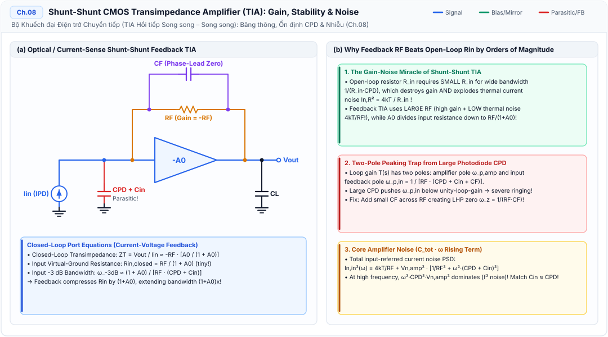

---
{
  "id": "topo-transimpedance-amplifier-tia-feedback",
  "kind": "topology",
  "domain": "dynamics-noise-feedback",
  "title_vi": "Bộ Khuếch đại Hỗ trở Hồi tiếp Điện áp–Dòng điện / Shunt–Shunt (CMOS Transimpedance Amplifier — TIA)",
  "title_en": "Shunt-Shunt (Voltage-Current) Feedback CMOS Transimpedance Amplifier: Gain, Rin Compression, Photodiode Stability, and Noise Advantage",
  "summary": "Giải phẫu toàn diện cấu trúc Bộ khuếch đại Hỗ trở (TIA) theo chuẩn Hồi tiếp Điện áp–Dòng điện của Razavi (tương đương Shunt–Shunt công nghiệp): nén điện trở đầu vào Rin,cl = RF/(1+Av) để phá vỡ nút thắt băng thông R*C_PD của photodiode, đồng thời đạt lợi thế kép băng rộng lẫn nhiễu dòng nhiệt thấp 4kT/RF so với tải điện trở vòng hở, kèm điều kiện ổn định hệ 2 cực và bù pha bằng tụ CF nhỏ song song RF.",
  "diagram": "../../diagrams/tia-shunt-shunt-feedback.svg",
  "razavi_refs": [
    {
      "chapter": 8,
      "section": "8.1.1-8.1.2, 8.2.3, 8.3, 8.5.4",
      "pages": "281-284, 294-299, 310-313",
      "equations": ["8.27", "8.45", "8.47", "8.48", "8.50", "8.53", "8.54", "8.89", "8.95", "8.96", "8.97"]
    }
  ],
  "glossary_codes": ["T042", "T051", "T515", "T535", "T812", "T1182", "T1186", "T1192"],
  "process_agnostic": true,
  "roles": {
    "current_mode_sensor_source": "Nguồn dòng cảm biến đầu vào (như photodiode phân cực ngược I_PD đi kèm điện dung tiếp giáp lớn C_PD) đòi hỏi điện trở đầu vào Rin tiến về 0 để không làm suy hao băng thông",
    "inverting_voltage_core_av": "Lõi khuếch đại điện áp đảo pha băng rộng (-Av, dùng tầng CS, Cascode, Push-Pull Inverter hoặc OTA) cung cấp độ lợi vòng lớn để tạo nút đất ảo chủ động tại cửa vào",
    "shunt_feedback_resistor_rf": "Điện trở hồi tiếp nối chéo RF cảm nhận điện áp ngõ ra và hồi trả dòng điện IF = -Vout/RF về nút vào, thiết lập độ lợi hỗ trở vòng kín RT,cl ~ -RF cùng nền nhiễu nhiệt thấp 4kT/RF",
    "phase_lead_capacitor_cf": "Tụ bù nhỏ CF mắc song song với RF tạo zero nửa mặt phẳng trái (LHP zero) khử dịch pha của cực ngõ vào C_PD, triệt tiêu đỉnh vọt lố cộng hưởng (peaking) cho đáp ứng phẳng Butterworth"
  },
  "symptoms_addressed": [
    "photodiode-capacitance-cpd-crushing-open-loop-resistor-bandwidth",
    "high-thermal-noise-current-4kt-over-rl-when-shrinking-resistor-for-wide-bandwidth",
    "severe-ringing-or-oscillation-when-connecting-large-sensor-capacitance-to-tia-input",
    "high-frequency-f-squared-noise-surge-from-amplifier-vn-differentiated-across-cpd",
    "terminology-confusion-between-razavi-voltage-current-and-industry-shunt-shunt-tia"
  ],
  "limitations": [
    "transimpedance-bandwidth-product-is-bounded-by-second-order-transimpedance-limit-proportional-to-gbw-over-cpd",
    "feedforward-transmission-through-rf-creates-rhp-zero-gm-minus-1-over-rf-when-gm-rf-is-small",
    "large-photocurrent-overload-saturates-output-swing-unless-automatic-gain-control-shunts-rf"
  ],
  "checklists": ["common-mos", "feedback-and-stb"]
}
---

## 1. Bản chất Nguyên lý, Sơ đồ Mạch & Vai trò Từng Nhánh Cấu trúc

Trong mọi hệ thống thu thông tin sợi quang (10G/100G/400G optical receivers), cảm biến xung khoảng cách LiDAR, máy giải trình tự sinh học nanopore hay đầu đọc MEMS điện dung, tín hiệu vật lý sơ cấp sinh ra từ cảm biến là một **dòng điện yếu $I_{in}$** (cỡ $\text{nA}$ đến vài trăm $\mu\text{A}$) đi kèm một **điện dung ký sinh cửa vào $C_{PD}$ rất lớn** ($0{,}2\text{ pF}\text{–}5\text{ pF}$ của photodiode phân cực ngược!). Bài toán trung tâm là biến đổi dòng điện $I_{in}$ đó thành điện áp $V_{\text{out}}$ đủ lớn, băng thông đủ rộng và ít nhiễu nhất thông qua một **bộ khuếch đại hỗ trở (Transimpedance Amplifier — TIA)** có độ lợi hỗ trở $R_T = V_{\text{out}} / I_{in}$ (đơn vị $\Omega$, hoặc biểu diễn theo $\text{dB}\Omega \triangleq 20 \log_{10}(|R_T| / 1\,\Omega)$, trong đó $R_T = 1\text{ k}\Omega \iff 60\text{ dB}\Omega$).



Ngay từ bước đầu tiếp cận, người thiết kế cần xóa bỏ hoàn toàn sự nhầm lẫn thuật ngữ giữa giáo trình Razavi và tài liệu công nghiệp trong nhóm **các cấu hình hồi tiếp (`T1186`)**:
- **Theo danh pháp Cảm nhận – Hồi trả của Razavi (§8.1.2, §8.2.3 & §8.5.4):** Mạch TIA thuộc cấu hình **Hồi tiếp Điện áp–Dòng điện (Voltage–Current Feedback)** — chữ thứ nhất (*Voltage*) chỉ việc **mạng hồi tiếp (`T1192`)** mắc song song ở ngõ ra để *cảm nhận điện áp $V_{\text{out}}$*; chữ thứ hai (*Current*) chỉ việc mạng hồi tiếp bơm một *dòng điện tỉ lệ $I_F$* quay về chụm chung vào nút đầu vào để thực hiện phép trừ dòng KCL $I_e = I_{in} - I_F$.
- **Theo danh pháp Đấu nối Cửa Công nghiệp (Chú thích chân trang 11, tr. 294):** Vì mạng hồi tiếp mắc song song (*shunt*) tại cửa vào VÀ mắc song song (*shunt*) tại cửa ra, cấu trúc này được gọi là **Hồi tiếp Song song–Song song (Shunt–Shunt Feedback)**. Hai tên gọi này chỉ **cùng một mạch điện duy nhất**!

**Tại sao không dùng một điện trở tải đơn giản $R_1$ (Hình 8.40a) mà bắt buộc phải dùng vòng hồi tiếp âm (`T535`, `T812`) TIA (Hình 8.40b)?**
Nếu cho dòng photodiode $I_{PD}$ chảy thẳng qua điện trở $R_1$ xuống đất, điện áp thu được là $V_{\text{out}} = I_{PD} R_1$, băng thông bị khóa cứng ở $f_{-3\text{dB,OL}} = \dfrac{1}{2\pi R_1 C_{PD}}$ và mật độ phổ dòng nhiễu nhiệt là $\overline{I_{n,R1}^2} = \dfrac{4 k T}{R_1}$. Muốn đạt tốc độ $1\text{ GHz}$ với $C_{PD} = 1\text{ pF}$, mạch vòng hở ép bạn phải hạ $R_1$ xuống chỉ còn **$159\,\Omega$** — vừa cho biên độ áp quá bé, vừa sinh dòng nhiễu nhiệt khổng lồ $10{,}2\text{ pA}/\sqrt{\text{Hz}}$! Ngược lại, khi quấn điện trở lớn $R_F$ thành **bộ khuếch đại hồi tiếp âm (`T1182`)** bao quanh một lõi khuếch đại điện áp đảo pha $-A_v$ (Hình 8.40b), **điện trở đầu vào (`T515`, input resistance)** bị hiệu ứng Miller / hồi tiếp song song nén nhỏ đi $(1 + A_v)$ lần xuống chỉ còn $R_{in,\text{closed}} = \dfrac{R_F}{1 + A_v}$! Nhờ vậy, bạn được phép chọn **$R_F = (1 + A_v) \times 159\,\Omega \approx 3{,}3\text{ k}\Omega$** (với $A_v = 20$): giữ nguyên băng thông rộng $1\text{ GHz}$, nâng độ lợi hỗ trở lớn gấp **$21$ lần**, đồng thời **cắt giảm công suất nhiễu nhiệt của điện trở đi $21$ lần** ($\frac{4kT}{R_F} \ll \frac{4kT}{R_1}$)!

---

## 2. Hệ Phương trình Cốt lõi & Tư duy "Nhìn Mạch Đọc Nhanh" (Analysis by Inspection)

### 2.1. Phép Suy Diễn Hai Cửa Có Tính Tải Cho CMOS TIA (§8.2.3 & §8.5.4, Phương trình 8.45–8.53, 8.89–8.97)
1. **Mô hình Khối Hỗ trở Tổng quát & Cắt Vòng Hai Cửa ($Z + Y$, Hình 8.35, 8.38, 8.60–8.61):**
   Với khối khuếch đại thuận hỗ trở lý tưởng $R_0$ và mạng hồi tiếp hỗ dẫn $g_{mF}$ (Phương trình 8.45, 8.49, 8.50):

$$
R_{T,\text{closed}} = \frac{V_{\text{out}}}{I_{in}} = \frac{R_0}{1 + g_{mF} R_0}, \qquad R_{\text{in,closed}} = \frac{R_{\text{in}}}{1 + g_{mF} R_0}, \qquad R_{\text{out,closed}} = \frac{R_{\text{out}}}{1 + g_{mF} R_0}
$$

   Khi tính đầy đủ hiệu ứng tải hai chiều của điện trở hồi tiếp thực $R_F$ bằng mô hình $Z$ (cho khối thuận) ghép song song mô hình $Y$ (cho mạng hồi tiếp $R_F$, Phương trình 8.89–8.93), ta áp dụng quy tắc **"Ngắn mạch cửa ra để tìm tải vào; Ngắn mạch cửa vào để tìm tải ra"** trên tầng CS CMOS điển hình ($M_1$ có hỗ dẫn $g_m$, tổng trở tải cực máng $R_D' = R_D \parallel r_O$, Ví dụ 8.15 Hình 8.62, Phương trình 8.94–8.97):
   - **Hỗ trở mở vòng có tải $R_{0,\text{open}}$ và hệ số hồi tiếp $\beta$:** Ngắn mạch $V_{\text{out}} = 0$ đặt $R_F$ từ cổng $M_1$ xuống đất (biến $I_{in}$ thành $V_{G1} = I_{in} R_F$); ngắn mạch $V_{in} = 0$ đặt $R_F$ song song với $R_D'$ tại máng. Do đó:

$$
R_{0,\text{open}} = -R_F \, g_m (R_F \parallel R_D'), \qquad \beta = y_{21} = \left.\frac{I_2}{V_1}\right|_{V_2=0} = -\frac{1}{R_F} \implies L = \beta R_{0,\text{open}} = +g_m (R_F \parallel R_D')
$$

   - **Bộ ba tham số vòng kín theo mạng hai cửa (Phương trình 8.95–8.97; quy về 8.51–8.53 khi $R_F \gg R_D'$):**

$$
R_{T,\text{closed}} = \frac{-R_F \, g_m (R_F \parallel R_D')}{1 + g_m (R_F \parallel R_D')} \approx -R_F, \qquad R_{\text{in,closed}} = \frac{R_F}{1 + g_m (R_F \parallel R_D')} \approx \frac{1}{g_m}\left(1 + \frac{R_F}{R_D'}\right), \qquad R_{\text{out,closed}} = \frac{R_F \parallel R_D'}{1 + g_m (R_F \parallel R_D')} \approx \frac{1}{g_m}
$$

   - **Đối chiếu với Nghiệm KCL Chính Xác Tuyệt Đối (Kể cả Truyền Thẳng Qua $R_F$):** Giải trực tiếp KCL nút vào và nút ra cho mạch Hình 8.62a cho nghiệm chính xác không xấp xỉ:

$$
R_{T,\text{exact}} = -\frac{(g_m R_F - 1) R_D'}{1 + g_m R_D'}, \qquad R_{\text{in,exact}} = \frac{R_F + R_D'}{1 + g_m R_D'}, \qquad R_{\text{out,exact}} = \frac{R_D'}{1 + g_m R_D'} = R_D' \parallel \frac{1}{g_m}
$$

   Tổng quát cho một lõi khuếch đại điện áp đảo pha có độ lợi hở tải $-A_v$ ($A_v > 0$) và trở kháng ra $R_{\text{out,core}}$: điện trở đầu vào vòng kín là **$R_{\text{in,closed}} = \dfrac{R_F + R_{\text{out,core}}}{1 + A_v}$** — cho thấy muốn $R_{\text{in,closed}}$ thật thấp, bản thân lõi khuếch đại không chỉ cần $A_v$ lớn mà còn cần $R_{\text{out,core}} \ll R_F$ (ví dụ thêm tầng đệm Source Follower trước khi nối $R_F$ quay về cổng!).

### 2.2. Động lực học Hai Cực với Tụ Photodiode $C_{PD}$, Giới hạn Hỗ trở & Bù Pha Bằng Tụ $C_F$
Đây là bài toán thiết kế sống còn của mọi mạch TIA ngoài đời thực: ngay cả khi lõi khuếch đại $-A(s) = -\dfrac{A_0}{1 + s/\omega_a}$ chỉ có **một cực duy nhất $\omega_a$** (với băng thông độ lợi đơn vị lõi $f_u = \frac{\omega_u}{2\pi} = \frac{A_0 \omega_a}{2\pi}$), việc gắn photodiode có điện dung $C_{PD}$ (cộng điện dung vào của MOSFET đầu vào $C_{in}$ thành $C_{\text{tot}} = C_{PD} + C_{in}$) ngay lập tức biến vòng hồi tiếp TIA thành **hệ thống bậc hai (Two-Pole Loop)**!
1. **Khi chưa có tụ bù ($C_F = 0$):** Cực thứ hai nằm ngay trong hệ số truyền vòng từ $V_{\text{out}}$ qua cầu chia $R_F$ và $C_{\text{tot}}$ về cổng: $\beta_{\text{eff}}(s) A(s) = \dfrac{1}{1 + s R_F C_{\text{tot}}} \cdot \dfrac{A_0}{1 + s/\omega_a}$. Hàm truyền hỗ trở vòng kín có dạng chuẩn bậc hai:

$$
R_T(s) = \frac{V_{\text{out}}(s)}{I_{in}(s)} \approx \frac{-R_F \dfrac{A_0}{1 + A_0}}{1 + \dfrac{s}{\omega_n Q} + \dfrac{s^2}{\omega_n^2}}, \qquad \omega_n = \sqrt{\frac{(1 + A_0)\omega_a}{R_F C_{\text{tot}}}} \approx \sqrt{\frac{\omega_u}{R_F C_{\text{tot}}}}, \qquad Q = \frac{1}{2\zeta} \approx \frac{\sqrt{A_0 \omega_a R_F C_{\text{tot}}}}{1 + R_F C_{\text{tot}} \omega_a}
$$

   - **Cảnh báo Dao động / Vọt lố Nghiêm trọng:** Với lõi Op-Amp/OTA băng rộng có $\omega_a$ vừa phải nhưng $A_0 R_F C_{\text{tot}} \omega_a \gg 1$ (tức cực ngõ vào $\frac{1}{R_F C_{\text{tot}}}$ nằm thấp hơn nhiều so với $\omega_u$), hệ số phẩm chất $Q \gg \frac{1}{\sqrt{2}}$ ($\zeta \ll 0{,}707$, dự trữ pha $\text{PM} < 45^\circ$), gây đỉnh nhọn cộng hưởng (gain peaking) trên phổ tần số và rung chuông (ringing) làm hỏng hoàn toàn biểu đồ mắt (eye diagram) dữ liệu số NRZ/PAM4!
   - **Định luật Giới hạn Hỗ trở (The Fundamental Transimpedance Limit):** Nếu thiết kế hệ bậc hai đạt đáp ứng phẳng tối đa Butterworth ($Q = \frac{1}{\sqrt{2}} \iff \zeta = \frac{1}{\sqrt{2}}$, cho băng thông $f_{-3\text{dB}} = f_n = \frac{\omega_n}{2\pi}$), tích giữa hỗ trở $R_F$ và bình phương băng thông bị chặn trên cứng rắn bởi tỷ số $f_u / C_{\text{tot}}$:

$$
R_F \cdot f_{-3\text{dB}}^2 \le \frac{f_u}{2 \pi C_{\text{tot}}} \implies R_{F,\max} = \frac{f_u}{2 \pi C_{\text{tot}} f_{-3\text{dB}}^2}
$$

   *(Ý nghĩa sâu sắc: muốn nhân đôi băng thông $f_{-3\text{dB}}$ của TIA trên cùng cảm biến $C_{\text{tot}}$ và cùng công nghệ $f_u$, bạn phải giảm $R_F$ đi **$4\times$** chứ không phải $2\times$!)*
2. **Kỹ thuật Bù Pha Bằng Tụ Nhỏ $C_F$ Song Song Với $R_F$:**
   Khi lõi Op-Amp có $f_u$ lớn làm $\zeta$ quá nhỏ, thay vì giảm $A_0$, ta mắc một tụ bù nhỏ $C_F$ (cỡ vài chục $\text{fF}$) song song với $R_F$. Tụ $C_F$ tạo một đường dẫn xoay chiều tần số cao từ $V_{\text{out}}$ thẳng về nút vào, sinh ra một **LHP zero nằm trong độ lợi vòng** tại $\omega_z = \dfrac{1}{R_F C_F}$:

$$
L(s) = \frac{A_0}{1 + s / \omega_a} \cdot \frac{1 + s R_F C_F}{1 + s R_F (C_{\text{tot}} + C_F)}
$$

   Chọn $C_F$ sao cho hệ số tắt dần vòng kín đạt chuẩn Butterworth $\zeta = \frac{1}{\sqrt{2}}$ ($\text{PM} \approx 65^\circ$, không vọt lố miền tần số, vọt lố bước nhảy chỉ $4{,}3\%$):

$$
C_{F,\text{opt}} \approx \sqrt{\frac{C_{\text{tot}}}{\pi R_F f_u}} = \sqrt{\frac{2 C_{\text{tot}}}{R_F \omega_u}} \qquad \left(\text{khi } C_F \ll C_{\text{tot}}\right)
$$

### 2.3. Phân Tích Nhiễu Dòng Quy Về Ngõ Vào Của TIA & Quy Tắc Phối Hợp Điện Dung $C_{in} = C_{PD}$ (§8.3 & Chương 7 Ví dụ 7.13)
Theo định luật bất biến nhiễu dưới hồi tiếp (§8.3 Phương trình 8.54 & Chương 7 Ví dụ 7.13 Phương trình 7.68–7.71), xét TIA gồm điện trở hồi tiếp $R_F$ và lõi khuếch đại có điện áp nhiễu quy về cổng $\overline{V_{n,\text{amp}}^2}(f) = \frac{4kT\gamma}{g_{m1}} + \frac{K}{C_{ox} W_1 L_1 f}$ (với dòng nhiễu cổng ở tần số thấp bằng $0$). Để hở cửa vào (giữ nguyên tụ cảm biến $C_{PD}$ nối đất tại cửa vào!), mật độ phổ **dòng nhiễu tổng quy về ngõ vào TIA** là:

$$
\overline{I_{n,in,\text{TIA}}^2}(f) = \frac{4 k T}{R_F} + \overline{V_{n,\text{amp}}^2}(f) \cdot \left| \frac{1}{R_F} + j 2\pi f (C_{PD} + C_{in}) \right|^2 = \frac{4 k T}{R_F} + \frac{\overline{V_{n,\text{amp}}^2}(f)}{R_F^2} + (2\pi f)^2 (C_{PD} + C_{in})^2 \overline{V_{n,\text{amp}}^2}(f)
$$

- **Ở tần số thấp và trung bình:** Số hạng $\frac{4kT}{R_F}$ chi phối, nhưng vì $R_F$ lớn gấp $(1 + A_v)$ lần điện trở vòng hở cùng băng thông, nhiễu nền thấp hơn mạch vòng hở $(1 + A_v)$ lần!
- **Ở tần số cao (Hiệu ứng Nhiễu Tăng Theo $f^2$ — $f^2$-Noise Corner):** Điện áp nhiễu $\overline{V_{n,\text{amp}}^2}$ của transistor đầu vào bị tổng điện dung $(C_{PD} + C_{in})$ lấy đạo hàm thành dòng nhiễu tăng vọt theo $f^2$! Thay $\overline{V_{n,\text{amp,th}}^2} = \frac{4kT\gamma}{g_{m1}}$ và $g_{m1} = 2\pi f_T C_{in}$ vào số hạng $f^2$:

$$
\left.\overline{I_{n,in,\text{TIA}}^2}(f)\right|_{\text{high-}f} = 4 k T \gamma \frac{2\pi f^2}{f_T} \cdot \frac{(C_{PD} + C_{in})^2}{C_{in}}
$$

  Lấy đạo hàm theo chiều rộng $W_1$ (tức theo $C_{in}$) và cho bằng $0$: hàm $\frac{(C_{PD} + C_{in})^2}{C_{in}}$ đạt **cực tiểu tuyệt đối khi $C_{in,\text{opt}} = C_{PD}$**! (Nếu chọn $W_1$ quá nhỏ làm $C_{in} \ll C_{PD}$ thì $g_{m1}$ bé làm $V_{n,\text{amp}}$ quá to; nếu chọn $W_1$ quá lớn làm $C_{in} \gg C_{PD}$ thì tự $C_{in}$ làm phình tổng điện dung lấy đạo hàm!). Trong thực tế tiết kiệm công suất, điểm tối ưu vàng công nghiệp thường chọn **$C_{in} \approx (0{,}3 \text{ – } 1{,}0)\,C_{PD}$**.

---

## 3. Bất biến Cấu trúc & Các Bẫy Lỗi Kinh điển (Structural Invariants & Traps)

- **[INV-TIA-01] Bất biến Giảm Độ Nhạy Phi Tuyến Biên Độ Dưới Vòng Hồi Tiếp Âm (§8.1.1, Phương trình 8.27–8.28 & `NG08-01`):**
  Trong lõi TIA dùng tầng đẩy–kéo CMOS hoặc CS không suy biến, khi dòng tín hiệu quang lớn làm điểm làm việc lệch đi, độ lợi mở vòng sụt từ $A_1$ xuống $A_2$, nhưng nhờ **hệ số giảm độ nhạy $(1 + \beta A_2)$** (Phương trình 8.27–8.28), độ lợi hỗ trở vòng kín chỉ thay đổi một lượng cực nhỏ $\frac{\Delta R_T}{R_T} \approx \frac{A_1 - A_2}{A_1 (1 + \beta A_2)}$ — cho phép TIA giữ độ tuyến tính cao cho điều chế đa mức PAM4 hoặc cảm biến tương tự miễn là ngõ ra chưa chạm biên bão hòa.
- **[TRAP-TIA-01] Sai Lầm Kinh Điển Dùng Nguồn Áp Lý Tưởng Kích Thử Cửa Vào TIA Rồi Kết Luận "Độ Lợi Vòng Bằng Không" (Ví dụ 8.9, Hình 8.37, Phương trình 8.48, tr. 295–296):**
  Trong Ví dụ 8.8–8.9 (mạch TIA cổng chung hồi tiếp chia tụ $C_1\text{–}C_2$ có $R_{\text{in,cl}} = \frac{1}{(g_{m1}+g_{mb1}) + g_{m1} R_D \frac{C_1}{C_1+C_2}}$, Phương trình 8.47–8.48), một sinh viên thay nguồn dòng kích $I_{in}$ bằng nguồn áp lý tưởng $V_{in}$ để tìm $R_{in}$; khi đặt $V_{in} = 0$ (nối tắt cửa vào xuống đất!), toàn bộ dòng hồi tiếp bị nguồn áp ngắn mạch hút sạch xuống đất làm độ lợi vòng đo được bằng $0$, rồi sinh viên kết luận sai rằng hồi tiếp không làm giảm $R_{in}$! Bài học cốt tử của Razavi: **mạch hồi trả dòng điện (Shunt input) giả định cửa vào nhìn thấy nguồn dòng có trở kháng cao (hở mạch khi triệt nguồn độc lập!)**; nếu muốn nối nguồn áp thử để tìm $R_{in}$ mà không phạm lỗi, phải áp dụng Định lý Blackman (`tech-bode-blackman-middlebrook-stb`, §8.6.4)!
- **[TRAP-TIA-02] Zero Nửa Mặt Phẳng Phải (RHP Zero) Do Truyền Thẳng Qua $R_F$ Khi $g_m R_F$ Nhỏ:**
  Nhìn vào tử số nghiệm chính xác $R_{T,\text{exact}}(s) = -\frac{(g_m - 1/R_F - s C_{GD}) R_F R_D'}{\dots}$: tại tần số rất cao hoặc khi giảm $R_F$ nhỏ trong chế độ AGC dòng quang lớn sao cho $g_m R_F \to 1$, dòng tín hiệu đi thẳng qua $R_F$ ngược pha với dòng khuếch đại qua $-g_m$, làm sụt độ lợi và đẩy pha xấu đi! Luôn bảo đảm $g_m R_F \ge 5\text{–}10$ ở mọi chế độ độ lợi.
- **[TRAP-TIA-03] Quá Tải Dòng Quang Lớn (Optical Overload / DC Photocurrent Saturation):**
  Dòng photodiode thực tế không đối xứng quanh $0$ mà là dòng một chiều xung dương $I_{PD}(t) = I_{\text{DC,avg}} + i_{\text{ac}}(t)$! Nếu ánh sáng mạnh chiếu vào ($I_{\text{DC,avg}} = 1\text{ mA}$) chảy qua $R_F = 3\text{ k}\Omega$, điện áp ngõ ra cố vọt lên $3\text{ V}$ trên nguồn $V_{DD} = 1{,}0\text{ V}$, đánh sập toàn bộ transistor ngõ ra vào vùng triode! Mọi TIA thực tế đều phải có mạch **trừ dòng DC tự động (DC Photocurrent Cancellation Servo Loop)** hút $I_{\text{DC,avg}}$ xuống đất ở tần số thấp VÀ khóa MOSFET mắc song song $R_F$ để hạ độ lợi tự động (AGC).

---

## 4. Lộ trình Nâng cấp Cấu trúc & Bát giác Đánh đổi (Upgrade Paths & Design Octagon)

| Nút thắt hiệu năng của Shunt–Shunt TIA Cơ bản | Nâng cấp sang Cấu trúc Đích (Canonical Node) | Đột phá Vật lý Đạt được | Đánh đổi trên Bát giác Thiết kế |
|---|---|---|---|
| Lõi CS tải nguồn dòng bị giới hạn hiệu suất $g_m / I_D$ và khoảng dự trữ điện áp ở $V_{DD} = 0{,}9\text{–}1{,}0\text{ V}$ | **CMOS Inverter Push-Pull TIA** (Lõi cổng đảo đẩy–kéo `T507` tự phân cực bằng chính $R_F$ nối từ máng về cổng!) | Gấp đôi $G_m = g_{mN} + g_{mP}$ trên cùng dòng $I_D$, tự thiết lập điểm tĩnh $V_{\text{in,DC}} = V_{\text{out,DC}} \approx V_{DD}/2$ không cần mạch bias ngoài, nhiễu thấp nhất ở 28nm–65nm! | Nhạy với biến thiên nguồn cấp ($\text{PSRR}$ kém $\implies$ bắt buộc nuôi qua bộ ổn áp nội `topo-cmos-ldo-regulator` kèm bản sao giả lập vi sai dummy TIA!) |
| Tụ photodiode $C_{PD}$ quá lớn ($> 2\text{ pF}$) làm sập băng thông Shunt–Shunt TIA do giới hạn hỗ trở bậc 2 | Đặt tầng đệm dòng **Regulated Cascode (RGC)** hoặc Cổng chung (`topo-common-gate-stage` + `topo-gain-boosted-cascode`) đứng trước TIA | RGC nén trở kháng vào xuống $\frac{1}{g_{m1}(1 + A_{\text{aux}})} \sim 5\text{–}15\,\Omega$ ngay tại cực nguồn mà không phụ thuộc vòng hồi tiếp toàn cục $R_F$, cô lập hoàn toàn $C_{PD}$! | Chịu phạt nhiễu dòng $\overline{I_{n,in}^2}$ của nguồn dòng phân cực dưới nguồn RGC (`law-noise-in-single-stage-amplifiers`) và tốn thêm headroom chồng tầng |
| Nhiễu nhiệt $4kT/R_F$ quá lớn trong ứng dụng đo dòng sinh học cực nhỏ ($\text{fA}\text{–}\text{pA}$, băng thông $\text{kHz}$) | **Capacitive-Feedback TIA (Integrator + Differentiator / Reset)** dùng tụ $C_F$ thay cho $R_F$ (`topo-switched-capacitor-amplifiers-integrators`) | Loại bỏ hoàn toàn điện trở $R_F$ và nguồn nhiễu nhiệt $4kT/R_F$ khỏi cửa vào, đạt nền nhiễu dưới vài $\text{fA}/\sqrt{\text{Hz}}$! | Cần cơ chế xả tụ định kỳ (reset switch) hoặc mạch vi phân khôi phục dạng sóng phía sau |

---

## 5. Thích ứng Đa Tiến trình (90nm / 65nm / 45nm) & Cách Kiểm chứng trong Cadence / Spectre

### 5.1. Bảng Định Cỡ Tối Ưu Cho 10-Gb/s CMOS Inverter / Cascode Shunt–Shunt TIA Trên 65nm / 45nm ($C_{PD} = 250\text{ fF}$, $V_{DD} = 1{,}0\text{ V}$)
Giả sử thiết kế bộ thu quang $10\text{ Gb/s}$ NRZ yêu cầu băng thông $f_{-3\text{dB}} \approx 0{,}7 \times 10\text{ GHz} = 7\text{ GHz}$, hỗ trở $R_{T,\text{cl}} \approx 1\text{ k}\Omega$ ($60\text{ dB}\Omega$) trên tiến trình **65nm / 45nm** ($f_{T,\text{peak}} \approx 140\text{–}200\text{ GHz}$):

| Tham số / Khối Thành Phần TIA | Giá trị Định Cỡ Khuyến Nghị | Vùng $g_m/I_D$ & $V_{DS,\min}$ | Cơ Sở Toán Học & Lý Do Thiết Kế |
|---|---|---|---|
| **Tổng kích thước cặp đẩy–kéo đầu vào ($M_{1N} + M_{1P}$)** | Sao cho $C_{in} = C_{GS,N} + C_{GS,P} + C_{GD,\text{Miller}} \approx 120\text{–}200\text{ fF}$ ($\approx 0{,}5\text{–}0{,}8\,C_{PD}$) | $g_m/I_D \approx 12 \text{ – } 15\text{ V}^{-1}$, $V_{DS} = V_{DD}/2 = 500\text{ mV}$, $L = L_{\min}$ | Phối hợp điện dung cận điểm tối ưu $C_{in} \approx C_{PD}$ để cực tiểu hóa nhiễu tăng theo $f^2$ mà vẫn giữ $f_T$ cao ($I_{D,\text{core}} \approx 2{,}5\text{–}4\text{ mA}$, $G_m \approx 35\text{–}50\text{ mS}$) |
| **Điện trở hồi tiếp $R_F$** | $R_F = 1{,}15\text{ k}\Omega$ (độ lợi lõi $A_v \approx 8\text{–}10\text{ V/V} \implies R_{T,\text{cl}} \approx 1{,}0\text{ k}\Omega$) | Điện trở poly không silicide chiều rộng vừa để giảm tụ ký sinh xuống nền | Nén $R_{\text{in,cl}} = \frac{R_F}{1+A_v} \approx 115\,\Omega$, đặt cực ngõ vào vòng kín lên $\sim 7\text{–}8\text{ GHz}$ và giữ nhiễu nhiệt $R_F$ chỉ $3{,}8\text{ pA}/\sqrt{\text{Hz}}$ |
| **Tụ bù pha song song $C_F$** | $C_F \approx 25 \text{ – } 45\text{ fF}$ (kể cả điện dung ký sinh hai đầu của chính thân điện trở $R_F$!) | Tụ MOM kim loại tầng cao (`M5–M6`) | Đặt zero bù pha giữ dự trữ pha $\text{PM} \approx 62^\circ\text{–}65^\circ$ ($\zeta \approx 0{,}707$), triệt tiêu rung chuông ISI trên biểu đồ mắt! |

### 5.2. Quy trình Kiểm chứng Toàn Diện TIA trong Cadence Virtuoso / Spectre
Khi mô phỏng TIA trong Spectre, **phải đặt mô hình tương đương của Photodiode (nguồn dòng `isource` song song với tụ `C_PD` + điện cảm dây hàn `L_bond ~ 0.3 nH` nếu đóng gói ngoài)** ngay tại cửa vào, chèn `iprobe` nối tiếp với nhánh $R_F \parallel C_F$ để đo `stb`, và kiểm chứng đầy đủ 4 phép đo chuẩn:

```spectre
// === Testbench Chuan Kiem Chung CMOS Shunt-Shunt TIA tren Spectre ===
parameters C_PD=250f R_F=1.15k C_F=35f I_pd_dc=50u

// 1. Mo hinh Photodiode tai ngo vao (phai co C_PD khi chay ca AC, STB lan NOISE!)
IPD_SIG (0 tia_in) isource dc=I_pd_dc mag=1 type=pulse val0=0 val1=100u period=200p rise=15p fall=15p width=100p
CPD_PAR (tia_in 0) capacitor c=C_PD

// 2. Mang hoi tiep song song RF || CF kem iprobe do STB chinh xac 100%
RF_MAIN (tia_out fb_mid) resistor r=R_F
CF_COMP (tia_out fb_mid) capacitor c=C_F
IPRB_TIA (fb_mid tia_in) iprobe

// 3. Bo 4 phan tich bat buoc cho TIA:
//   - ac:    RT_dBOhm = db20(mag(V(tia_out))) [vi I_in AC mag = 1 A!], kiem tra peaking < 0.5 dB!
//   - xf/ac: Rin_closed(f) = mag(V(tia_in))   [do I_in = 1 A => V(tia_in) chinh la Zin_cl(f)!]
//   - stb:   Kiem tra Phase Margin >= 60 deg tai C_PD_max (goc SS/Slow, nhiet do cao)
//   - noise: Input-referred current noise (A/rtHz) va Total Integrated Input Noise Current (nArms)!
ac_tia    ac    start=1M stop=50G dec=50
stb_tia   stb   probe=IPRB_TIA start=1M stop=50G dec=50
noise_tia noise (tia_out 0) IPD_SIG start=1M stop=50G dec=50
tran_eye  tran  stop=20n errpreset=conservative
```

---

## 6. Mốc Đối chiếu Sách Razavi & Thuật ngữ Chuẩn CLB

### 6.1. Đối chiếu Sách Gốc Razavi (2nd Edition) & Chú giải Học thuật CLB
- **Chương 8:** §8.1.1 (tr. 282: Phương trình 8.27–8.28 về nén phi tuyến biên độ), §8.1.2 *Types of Amplifiers* (tr. 282–284: định nghĩa bộ khuếch đại hỗ trở Hình 8.13c), §8.2.3 *Voltage-Current Feedback* (tr. 294–297: Phương trình 8.45–8.53, Ví dụ 8.8–8.10, Hình 8.35–8.40 — đặc biệt Hình 8.40 so sánh điện trở vòng hở với TIA đầu thu quang!), §8.3 *Effect of Feedback on Noise* (tr. 298–299: Phương trình 8.54), §8.5.4 *Loading in Voltage-Current Feedback* (tr. 310–313: Phương trình 8.89–8.100, Ví dụ 8.15–8.16, Hình 8.60–8.63; đối chiếu cùng Chương 7 Ví dụ 7.13 tr. 242–243 về nhiễu của CS hồi tiếp $R_F$).
- **Chú giải Hiệu đính Học thuật CLB (`source_issues.json` — Chương 07 & Chương 08):**
  - **`NG08-04` (tr. 312, Ví dụ 8.15):** Đoạn nhận xét ngay dưới Phương trình (8.97) trong sách gốc viết nhầm cụm *"This transconductance amplifier..."* (bộ khuếch đại hỗ dẫn này); vì mạch Hình 8.62 nhận dòng điện $I_{in}$ và xuất điện áp $V_{\text{out}}$ cho ứng dụng thông tin quang, tên gọi chính xác của mạch là **bộ khuếch đại hỗ trở (*transimpedance amplifier*)**.
  - **`NG08-01` (tr. 282, sau Phương trình 8.28):** Lời văn nguồn gọi $(1 + \beta A_2)$ là *"độ lợi vòng"*; theo định nghĩa chuẩn `T051` ở tr. 276, **độ lợi vòng là $\beta A_2$**, còn $(1 + \beta A_2)$ là hệ số giảm độ nhạy (*desensitization factor*).
  - **`NG07-03` (tr. 243, Ví dụ 7.13 phân tích nhiễu tầng CS hồi tiếp $R_F$):** Khi tính độ lợi dòng điện $I_{\text{out}} = (g_m R_F - 1) I_{in}$ ở Phương trình (7.69)–(7.71), lời văn nguồn dẫn nhầm sang Hình 7.38(c) (vốn dùng nguồn áp $V_{in}$); sơ đồ đúng dùng nguồn dòng kích $I_{in}$ để tính $\overline{I_{n,in}^2}$ của TIA là **Hình 7.38(e)**.

### 6.2. Bảng Thuật ngữ Chuẩn CLB Vi Mạch Sử dụng trong Thẻ
| Mã CLB | Thuật ngữ Tiếng Anh | Thuật ngữ Tiếng Việt Chuẩn | Ghi chú Ngữ cảnh |
|---|---|---|---|
| `T042` / `T812` | feedback / negative feedback | hồi tiếp / hồi tiếp âm | Phá vỡ ràng buộc cứng giữa độ lợi hỗ trở, băng thông và nhiễu nhiệt |
| `T535` | negative-feedback loop | vòng hồi tiếp âm | Tạo nút đất ảo chủ động ghim biên độ áp trên tụ photodiode $C_{PD}$ gần bằng $0$ |
| `T1182` | negative-feedback amplifier | bộ khuếch đại hồi tiếp âm | Kiến trúc TIA gồm lõi đảo pha $-A_v$ quấn điện trở $R_F \parallel C_F$ |
| `T051` | loop gain | độ lợi vòng | $L(s) = \beta(s) R_{0,\text{open}}(s)$, quyết định hệ số nén $R_{in}$ và dự trữ pha hệ 2 cực |
| `T515` | input resistance | điện trở đầu vào | Bị nén xuống $R_{\text{in,cl}} \approx \frac{R_F}{1 + A_v}$, quyết định trực tiếp cực tần số với $C_{PD}$ |
| `T1186` | feedback topologies | các cấu hình hồi tiếp | Razavi "Voltage–Current" (Sense $V$, Return $I$) $\equiv$ công nghiệp "Shunt–Shunt" |
| `T1192` | feedback networks | mạng hồi tiếp | Cặp $R_F \parallel C_F$ vừa định nghĩa hỗ trở $-R_F$ vừa chèn LHP zero bù pha |
