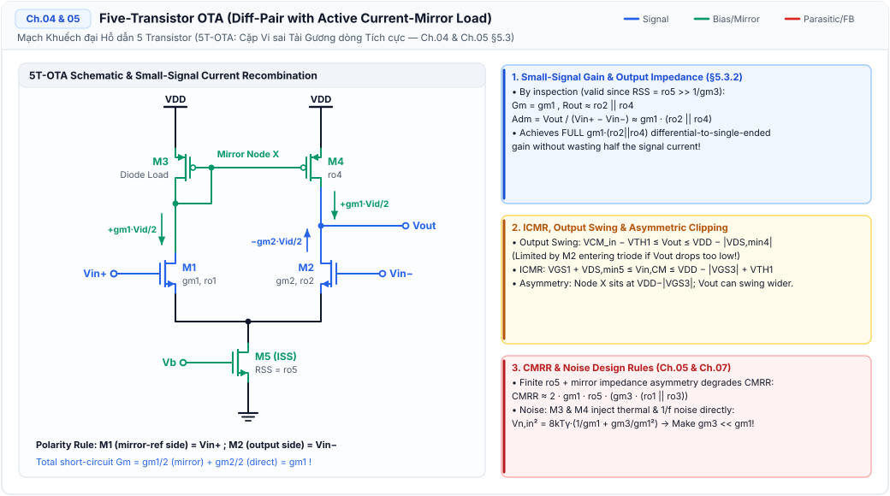

---
{
  "id": "skill-5t-ota-root-cause-fault-tree",
  "kind": "skill",
  "domain": "eda-and-github-skills",
  "title_vi": "Cây Chẩn đoán Nguyên nhân Gốc rễ & Sửa Lỗi Định cỡ Bộ Khuếch đại 5 Transistor (5T-OTA Fault Tree)",
  "title_en": "5-Transistor OTA Root-Cause Diagnosis Fault Tree & Priority-Ordered Sizing Repair Workflow",
  "summary": "Hệ thống cây quyết định chẩn đoán lỗi theo thứ tự ưu tiên nghiêm ngặt cho 5T-OTA (cặp vi sai tải gương dòng chủ động): kiểm tra vùng bão hòa và khoảng dự trữ nguồn dòng đuôi trước tiên (nút thắt ẩn làm sụp đồng loạt CMRR, PSRR- và GBW), phân bổ ngân sách công suất dư, rồi ánh xạ từng triệu chứng trượt Gain, GBW, PM/Doublet, Slew Rate, Swing, Nhiễu và Offset Pelgrom sang đúng tham số W/L/gm-ID.",
  "diagram": "../../diagrams/five-transistor-ota.svg",
  "razavi_refs": [
    {
      "chapter": 4,
      "section": "4.3-4.4",
      "pages": "118-126",
      "equations": ["4.58", "4.60"]
    },
    {
      "chapter": 5,
      "section": "5.3, 5.3.1-5.3.4",
      "pages": "146-160",
      "equations": ["5.22", "5.26", "5.35", "5.47", "5.55"]
    },
    {
      "chapter": 6,
      "section": "6.6.2",
      "pages": "201-203",
      "equations": ["6.91", "6.94", "6.96"]
    },
    {
      "chapter": 7,
      "section": "7.5-7.6",
      "pages": "254-263",
      "equations": ["7.125", "7.133"]
    }
  ],
  "github_refs": [
    {
      "repo": "jiyuanduan001-oss/LLM_Amplifier_Sizing",
      "url": "https://github.com/jiyuanduan001-oss/LLM_Amplifier_Sizing",
      "use": "Thứ tự ưu tiên chẩn đoán cây lỗi AnalogAgent (OP bão hòa -> khoảng dự trữ nguồn đuôi -> chỉ tiêu AC/Tran)"
    },
    {
      "repo": "iic-jku/analog-circuit-design",
      "url": "https://github.com/iic-jku/analog-circuit-design",
      "use": "Phân tích chi tiết điểm làm việc DC, trở kháng ra bất đối xứng và nhiễu của Basic 5T-OTA"
    },
    {
      "repo": "KwantaeKim/cdl_gen",
      "url": "https://github.com/KwantaeKim/cdl_gen",
      "use": "Mẫu cấu trúc tham số hóa 5T-OTA kèm nhánh gương dòng phân cực trên Cadence Virtuoso"
    }
  ],
  "glossary_codes": ["T052", "T063", "T079", "T394", "T620", "T788", "T1214", "T1851"],
  "process_agnostic": true,
  "roles": {
    "input_diff_pair": "Cặp vi sai đầu vào (M1, M2) quyết định trực tiếp Gm = gm1, nhiễu nhiệt sàn, dung kháng cổng Cin và đóng góp chính vào V_OS",
    "active_mirror_load": "Cặp gương dòng chủ động đối cực (M3 nối diode tại nút gương E, M4 xuất dòng tại Vout) thực hiện biến đổi vi sai sang đơn đầu và khôi phục trọn vẹn Gm = gm1",
    "tail_current_source": "Nguồn dòng đuôi M5 (sao chép từ diode phân cực M6) thiết lập dòng tĩnh Itail, quyết định Slew Rate, chặn nhiễu đồng pha CMRR và nhiễu nguồn dưới PSRR-",
    "fault_tree_arbiter": "Bộ phân xử thứ tự sửa lỗi ngăn vòng lặp quẩn (sửa Gain làm hỏng GBW hoặc sửa CMRR bằng tăng L khi M5 đang lún vào triode)"
  },
  "symptoms_addressed": [
    "cmrr-psrr-minus-and-gbw-all-fail-simultaneously-due-to-compressed-tail-vds",
    "spice-cmrr-is-20db-worse-than-hand-formula-prediction",
    "asymmetric-positive-vs-negative-slewing-and-clipping-in-single-ended-5t-ota",
    "slow-settling-tail-caused-by-active-mirror-pole-zero-doublet"
  ],
  "limitations": [
    "single-tier-gain-gm-ro-caps-around-25-to-40db-in-65nm-45nm-cmos",
    "output-upper-swing-clamped-by-input-common-mode-plus-vthn-in-nmos-in-5t-ota",
    "asymmetric-output-node-creates-systematic-offset-when-vout-differs-from-mirror-drain"
  ],
  "checklists": ["common-mos", "differential-pair", "current-mirror", "single-stage"]
}
---

## 1. Cấu trúc Vật lý Của `5T-OTA` & Quy luật Thứ tự Ưu tiên Chẩn đoán Bất di Bất dịch

Mạch khuếch đại hỗ dẫn 5 transistor (**`5T-OTA`**, Razavi Chương 5 §5.3, tr. 146–160; thẻ nền tảng `topo-five-transistor-ota` & `topo-diff-pair-active-current-mirror-load`) là viên gạch cơ sở đầu tiên của mọi bộ khuếch đại vi sai chuyển đổi sang đơn đầu, đồng thời là tầng đầu của Op-Amp hai tầng Miller và LDO Error Amplifier. Gọi $M_1, M_2$ là cặp vi sai NMOS đầu vào, $M_3$ (nối diode tại nút gương $E$) và $M_4$ (tại nút ngõ ra $V_{\text{out}}$) là cặp gương dòng tải PMOS, còn $M_5$ (ghép gương tỉ lệ $K:1$ với transistor chuẩn $M_6$ nhận dòng $I_{\text{bias}}$) là nguồn dòng đuôi.



Khi một thiết kế `5T-OTA` trượt một hoặc nhiều chỉ tiêu trong Spectre, sai lầm phổ biến nhất là nhảy ngay vào chỉnh sửa công thức chỉ tiêu bị trượt (ví dụ thấy `CMRR` thấp liền tăng chiều dài $L_5$ của nguồn đuôi trong khi thực chất $M_5$ đang bị ép sát vùng triode!). Chắt lọc từ kinh nghiệm chẩn đoán hệ thống (`jiyuanduan001-oss/LLM_Amplifier_Sizing` & `iic-jku/analog-circuit-design`), quy trình sửa lỗi **bắt buộc tuân thủ 3 cổng kiểm soát tuần tự**:
1. **Cổng Ưu tiên Số 0 — Điểm Làm Việc Bão Hòa & Khoảng Dự Trữ Nguồn Đuôi (`OP & Tail Headroom Gate`):** Mọi transistor ($M_1, M_2, M_3, M_4, M_5, M_6$) phải nằm vững trong vùng bão hòa (`region == 2`) với biên dự trữ $|V_{DS}| - V_{DS,\text{sat}} \ge 80\text{–}100\text{ mV}$ ở TT (và $\ge 40\text{ mV}$ ở góc xấu nhất). Chừng nào cổng này chưa qua, mọi con số AC/CMRR/PSRR đều vô nghĩa!
2. **Cổng Ưu tiên Số 1 — Kiểm toán Mức Sử dụng Ngân sách Công suất (`Power Budget Utilization Gate`):** Trước khi hy sinh độ lợi hay phình diện tích, kiểm tra xem tổng dòng $I_{DD} = I_{\text{tail}} + I_{\text{bias}}$ đang dùng bao nhiêu phần trăm trần công suất $P_{\max}$ cho phép. Nếu $P_{\text{DC}} \ll P_{\max}$ mà mạch trượt đồng thời `GBW`, `Slew Rate` hoặc `Thermal Noise`, giải pháp sạch nhất là **tăng $I_{\text{tail}}$** (giữ nguyên $g_m/I_D$)!
3. **Cổng Ưu tiên Số 2 — Phân nhánh Cây Lỗi Chỉ Tiêu Đơn Lẻ (`Metric-Specific Fault Trees`):** Chỉ sau khi Cổng 0 và Cổng 1 đã sạch mới tra bảng ánh xạ triệu chứng $\to$ nguyên nhân vật lý $\to$ tham số chỉnh sửa kèm tác dụng phụ.

---

## 2. Giải phẫu Nút Thắt Liên thông Nguồn Đuôi & Hệ Phương trình Chẩn đoán Nhanh

### 2.1. Tại sao Khoảng Dự trữ Nguồn Đuôi $M_5$ Là "Thủ phạm Ngầm" Đánh sập 4 Chỉ tiêu Cùng Lúc?
Điện áp cực máng–nguồn của nguồn dòng đuôi $M_5$ bị khóa cứng bởi mức chế độ chung ngõ vào $V_{in,\text{CM}}$ và điện áp cổng–nguồn cặp vi sai $M_1$:

$$
V_{DS5} = V_{in,\text{CM}} - V_{GS1}, \qquad \Delta V_{\text{margin},5} = V_{DS5} - V_{DS,\text{sat},5}
$$

Trong mô hình BSIM4 kênh ngắn, khi $\Delta V_{\text{margin},5}$ bị ép xuống dưới $80\text{–}100\text{ mV}$ (do $V_{in,\text{CM}}$ thấp, hoặc tỉ số gương $I_{\text{tail}}/I_{\text{bias}}$ quá lớn làm $V_{DS5} \ll V_{DS6} = V_{GS6}$), độ dẫn ra $g_{ds5} = 1/r_{O5}$ **không còn là hằng số mà tăng vọt gấp $5\text{–}20$ lần** khi tiến sát vùng triode! Hệ quả dây chuyền tức thì (Razavi Chương 5 §5.3.2–5.3.4):
1. **Dòng đuôi thực tế bị hụt mạnh ($I_{\text{tail,actual}} < K \cdot I_{\text{bias}}$)** do điều biến chiều dài kênh và DIBL $\implies$ $g_{m1}$ giảm $\implies$ **trượt đồng thời `GBW` và `Slew Rate`**!
2. **Tỷ số nén đồng pha `CMRR` rơi tự do $15\text{–}25\text{ dB}$** (vì $\text{CMRR} \approx 2 g_{m1} g_{m3} R_{\text{out}} r_{O5}$, phụ thuộc bậc nhất vào $r_{O5}$!).
3. **Tỷ số nén nhiễu nguồn âm `PSRR-` (từ $V_{SS}$) sụp đổ y hệt `CMRR`** (vì biến thiên trên $V_{SS}$ điều biến trực tiếp dòng đuôi qua chính $g_{ds5}$!).

### 2.2. Tóm tắt Hệ Phương trình Nhạy Tham số của `5T-OTA`
| Đại lượng Đo Kiểm | Biểu thức Vật lý Chủ đạo (Razavi Ch.5–7, 14) | Tham số Điều khiển Trực tiếp |
|---|---|---|
| Độ lợi DC vòng hở $A_0$ | $A_0 = g_{m1} \left( r_{O2} \parallel r_{O4} \right) = \dfrac{g_{m1}}{g_{ds2} + g_{ds4}}$ | Chiều dài kênh $L_{1,2}$ (giảm $g_{ds2}$) và $L_{3,4}$ (giảm $g_{ds4}$) |
| Tích độ lợi–băng thông $\text{GBW}$ | $\text{GBW} = \dfrac{g_{m1}}{2\pi (C_L + C_{db2} + C_{db4} + C_{gd2} + C_{gd4})}$ | $I_{\text{tail}}$ và $(g_m/I_D)_{1,2}$ |
| Cặp cực–zero nút gương $E$ (`Doublet`) | $\omega_{p,\text{mirror}} \approx \dfrac{g_{m3}}{2 C_{GS3,4} + C_{DB1,3}}, \quad \omega_{z,\text{LHP}} = 2\,\omega_{p,\text{mirror}}$ | Ngắn hóa $L_{3,4}$ và giảm $(g_m/I_D)_{3,4}$ để đẩy $\omega_{p,\text{mirror}} \gg \text{GBW}$ |
| Tốc độ biến thiên $\text{SR}^+ / \text{SR}^-$ | $\text{SR}^+ = \dfrac{I_{\text{tail}}}{C_{L,\text{tot}}}, \quad \text{SR}^- = \dfrac{I_{\text{tail}}}{C_{L,\text{tot}}}$ (nhưng bất đối xứng ở gần biên do $M_2$ vào triode!) | Duy nhất $I_{\text{tail}}$ (khi $C_L$ đã cố định) |
| Biên độ ra tĩnh $\Delta V_{\text{out}}$ | $V_{in,\text{CM}} - V_{THN1} \le V_{\text{out}} \le V_{DD} - |V_{DS,\text{sat},4}|$ (không cắt mép đối xứng!) | $(g_m/I_D)_4$ (biên trên) và mức $V_{in,\text{CM}}$ (khóa biên dưới!) |
| Nhiễu nhiệt quy về ngõ vào $\overline{V_{n,\text{in}}^2}$ | $8 k T \gamma \left( \dfrac{1}{g_{m1}} + \dfrac{g_{m3}}{g_{m1}^2} \right)$ | Tăng $g_{m1}$ và ép $(g_m/I_D)_{3,4} \ll (g_m/I_D)_{1,2}$ sao cho $g_{m3} \le 0{,}35\,g_{m1}$ |
| Phương sai lệch ngẫu nhiên $\sigma^2(V_{OS})$ | $\dfrac{A_{VTN}^2}{W_1 L_1} + \left(\dfrac{g_{m3}}{g_{m1}}\right)^2 \dfrac{A_{VTP}^2}{W_3 L_3}$ | Tăng diện tích $W_1 L_1$, tăng $L_{3,4}$ và hạ thấp tỉ số $g_{m3}/g_{m1}$! |

---

## 3. Bất biến Chẩn đoán & Các Bẫy Kinh điển Của `5T-OTA` (Invariants & Traps)

- **[INV-5T-01] Khóa Kẹp Ngõ Ra Dưới Bởi Điện Áp Chế Độ Chung Ngõ Vào (`Input-Clamped Output Swing`):** Khác với Folded-Cascode hay Two-Stage, cực máng của transistor đầu vào $M_2$ chính là nút ngõ ra $V_{\text{out}}$! Do đó khi $V_{\text{out}}$ tụt xuống dưới $V_{in,\text{CM}} - V_{THN2}$, $M_2$ lập tức rời vùng bão hòa! Nếu đề bài yêu cầu nối tắt hồi tiếp độ lợi đơn vị ($V_{\text{out}} = V_{in-}$) và quét tín hiệu biên độ lớn gần $V_{DD}$, `5T-OTA` sẽ bị kẹp đỉnh bởi $|V_{GS3}|$ ở phía nhánh gương ($M_1$ vào triode khi $V_{in+} > V_{DD} - |V_{GS3}| + V_{THN1}$) — lúc đó đừng cố ép $W/L$, hãy nâng cấp cấu trúc sang `topo-folded-cascode-ota` hoặc `topo-two-stage-opamp`!
- **[INV-5T-02] Độ Lệch Hệ Thống (`Systematic Offset`) Do Bất Đối Xứng Áp Máng $V_{DS3} \neq V_{DS4}$:** Nút gương $E$ bị khóa cứng ở $V_E = V_{DD} - |V_{GS3}|$, trong khi nút ngõ ra được hồi tiếp ngoài ép về $V_{\text{out,DC}}$ (ví dụ $V_{DD}/2$). Nếu $V_{\text{out,DC}} \neq V_{DD} - |V_{GS3}|$, hiệu ứng điều biến chiều dài kênh làm $I_{D4} \neq I_{D3}$ ngay cả khi hai nhánh khớp hình học $100\%$, sinh ra điện áp lệch hệ thống:
  $$V_{OS,\text{sys}} \approx \frac{\Delta V_{DS,34}}{A_0} = \frac{\left(V_{DD} - |V_{GS3}| - V_{\text{out,DC}}\right)}{g_{m1}(r_{O2} \parallel r_{O4})}$$
  Ở công nghệ $65\text{ nm}/45\text{ nm}$ nơi $A_0$ của `5T-OTA` chỉ đạt $20\text{–}30\text{ V/V}$, chênh lệch $0{,}3\text{ V}$ tạo ra tới **$10\text{–}15\text{ mV}$ offset hệ thống cố định**!
- **[TRAP-5T-01] Bẫy Đuôi Xác lập Chậm Do Cặp Cực–Zero Nút Gương (`Mirror Doublet Settling Trap`, Razavi §6.6.2):** Trên đồ thị Bode, cặp cực gương $\omega_m = g_{m3}/C_E$ và zero nửa mặt phẳng trái $2\omega_m$ luôn đi sát nhau nên chỉ làm lõm pha tối đa $\sim 19{,}5^\circ$ rồi tự hồi phục pha — khiến dự trữ pha $\text{PM}$ nhìn có vẻ luôn $> 70^\circ$! Tuy nhiên, nếu bạn tăng $L_{3,4}$ quá dài (ví dụ $L_{3,4} = 4\text{ }\mu\text{m}$) để vớt độ lợi và giảm nhiễu $1/f$, điện dung cổng khổng lồ $2 C_{GS3,4}$ kéo $\omega_m$ tụt xuống dưới $\text{GBW}$, sinh ra thành phần hàm mũ chậm $\sim \frac{1}{2} e^{-\omega_m t}$ làm **thời gian xác lập chính xác $0{,}1\%$ kéo dài gấp $5\text{–}10$ lần**! Luôn kiểm tra $\omega_m / (2\pi) \ge 3 \cdot \text{GBW}$!
- **[TRAP-5T-02] Tỉ số Nhân Gương Đuôi Quá Lớn ($I_{\text{tail}} / I_{\text{bias}} > 10$) Làm Nhân Nhiễu & Co Hẹp $V_{DS5}$:** Mọi dòng nhiễu nhiệt và $1/f$ của nhánh tạo dòng chuẩn $M_6$ đều bị nhân công suất lên $K^2 = (I_{\text{tail}}/I_{\text{bias}})^2$ lần vào dòng đuôi (một phần biến thành nhiễu vi sai khi mạch slewing hoặc lệch nhẹ), đồng thời làm lệch dòng tĩnh lớn khi $V_{DS5} \neq V_{GS6}$. Giữ $K \le 4\text{–}8$!

---

## 4. Cây Quyết định Chẩn đoán & Sửa Lỗi Từng Triệu chứng (Symptom $\to$ Root Cause $\to$ Action)

```text
[BƯỚC 0] Kiểm tra DC OP (Spectre dcOp.dc): Có transistor nào region != 2 hoặc |VDS| - Vdsat < 80 mV?
 ├── M5 (TAIL) lún triode / thiếu headroom (V_cm - VGS1 < Vdsat5 + 80mV):
 │    ├── Cách 1 (Ưu tiên số 1): Tăng (gm/ID)_5,6 lên 12..15 V^-1 (tăng W5, W6 cùng L) -> hạ trực tiếp Vdsat5!
 │    ├── Cách 2: Tăng (gm/ID)_1,2 lên 16..20 V^-1 (tăng W1,2) -> hạ VGS1 mở thêm trần VDS5 (chú ý tăng Cin).
 │    └── Cách 3: Nếu V_cm quá sát đất (< 0.55 V ở 1.2V) -> Đổi sang 5T-OTA đầu vào PMOS (gương tải NMOS)!
 └── M2 hoặc M4 rời bão hòa tại Vout = Vcm:
      └── Kiểm tra điều kiện kẹp Vcm - Vthn1 <= Vout <= VDD - |Vdsat4|; tăng (gm/ID)_3,4 nếu thiếu trần trên.

[BƯỚC 1] Kiểm tra Công suất: P_sim < 0.75 * P_max_spec VÀ đang trượt (GBW hoặc SR hoặc Thermal Noise)?
 └── ĐÚNG -> Tăng I_tail lên sát ngân sách công suất (nhân đồng dạng W1..W5 giữ nguyên gm/ID)! Cải thiện cả 3 chỉ tiêu cùng lúc!

[BƯỚC 2] Chẩn đoán Từng Chỉ tiêu Bị Trượt:
 ├── [A0 Thấp] A0 = gm1 / (gds2 + gds4) < A0_spec:
 │    ├── Đọc OP so sánh gds2 với gds4: nhánh nào có gds lớn hơn là nút thắt chính!
 │    ├── Nếu gds2 lớn -> Tăng L1,2 (giữ gm/ID_1,2 => tăng nhẹ W1,2). Hệ quả: tăng Cin.
 │    ├── Nếu gds4 lớn -> Tăng L3,4 (kiểm tra cực gương f_m = gm3/(2*pi*CE) vẫn >= 3*GBW!).
 │    └── Đã kéo L = 5..8*Lmin ở 65nm/45nm mà vẫn thiếu > 15 dB -> Nâng cấp lên `topo-telescopic-cascode-opamp` hoặc `topo-folded-cascode-ota`!
 ├── [GBW Thấp] GBW < GBW_spec:
 │    ├── Nếu còn dư công suất -> Tăng I_tail.
 │    ├── Nếu kịch trần công suất -> Tăng (gm/ID)_1,2 lên vùng nghịch đảo yếu hơn (16..22 V^-1) để tăng gm1 tại cùng ID!
 │    └── Nếu tự tải (Cdb2 + Cdb4) > 0.4 * CL -> Thu gọn L1,2 / L3,4 bị chọn dư quá mức và chia ngón chẵn nf!
 ├── [CMRR hoặc PSRR- Thấp]:
 │    ├── Kiểm tra đầu tiên: VDS5 - Vdsat5 có < 100 mV không? Nếu có -> Quay lại sửa M5 ở BƯỚC 0 (sẽ hồi phục ngay 15-20 dB!).
 │    └── Nếu M5 đã dư headroom -> Tăng L5,6 (tăng rO5 mà không ảnh hưởng tốc độ đường tín hiệu!) hoặc cascode nguồn đuôi.
 ├── [PSRR+ Thấp]:
 │    └── Trong 5T-OTA NMOS-in (gương PMOS treo VDD), nhiễu VDD được gương dòng hủy một phần ở tần thấp nên PSRR+ ~ A0 -> Tăng A0!
 └── [Noise hoặc Offset 3-sigma Cao]:
      ├── Kiểm tra tỉ số gm3 / gm1 trong OP: nếu gm3 > 0.35 * gm1 -> Hạ (gm/ID)_3,4 xuống 5..7 V^-1 (tăng L3,4, giảm W3,4)!
      ├── Nếu nhiễu nhiệt vẫn cao -> Tăng gm1 (tăng I_tail hoặc tăng gm/ID_1,2).
      └── Nếu nhiễu 1/f hoặc sigma(V_OS) cao -> Tăng đồng thời cả W1 và L1 (giữ nguyên tỉ số W1/L1 để bảo toàn OP!).
```

---

## 5. Thích ứng Đa Tiến trình (180nm / 90nm / 65nm / 45nm) & Script Kiểm toán Tự động `5T-OTA`

### 5.1. Trần Vật lý Thực tế Của `5T-OTA` Qua Các Tiến trình
- **180nm ($V_{DD} = 1{,}8\text{ V}$):** Dễ dàng đạt $A_0 \approx 42\text{–}50\text{ dB}$ với $L_{1..4} \approx 0{,}5\text{–}1{,}0\text{ }\mu\text{m}$ và khoảng dao động ngõ ra rộng $\sim 1{,}0\text{ V}$.
- **90nm (`GPDK090`, $V_{DD} = 1{,}2\text{ V}$):** Độ lợi một tầng giới hạn ở $A_0 \approx 30\text{–}38\text{ dB}$; rất nhạy với cửa sổ $V_{in,\text{CM}} \in [0{,}60\text{ V}, 0{,}90\text{ V}]$.
- **65nm / 45nm (`GPDK045`, $V_{DD} = 1{,}0\text{–}1{,}1\text{ V}$):** Độ lợi $A_0$ của `5T-OTA` thuần túy thường chỉ đạt **$22\text{–}30\text{ dB}$** ngay cả khi kéo dài $L$; ở tiến trình này `5T-OTA` chủ yếu đóng vai trò bộ khuếch đại phụ (`Aux-OTA` cho Gain-Boosting), bộ so sánh tiền khuếch đại tốc độ cao hoặc tầng 1 của Op-Amp hai/ba tầng!

### 5.2. Hàm Kiểm toán Chẩn đoán Tự động Từ Kết quả `dcOp.dc` Của Spectre (`diagnose_5t_ota.py`)
```python
# Chẩn đoán tự động điểm nghẽn 5T-OTA từ từ điển Spectre PSF ASCII dcOp.dc
import math

def diagnose_5t_ota_op(op, cl_farad, a0_target_db=34.0, gbw_target_hz=50e6):
    findings = []
    # Kiểm tra Cổng 0: Vùng bão hòa và khoảng dự trữ nguồn đuôi M5
    for dev in ("M1", "M2", "M3", "M4", "M5"):
        vds_margin = abs(op[dev + ":vds"]) - abs(op[dev + ":vdsat"])
        if vds_margin < 0.040:
            findings.append("CRITICAL_TRIODE: %s margin=%.1f mV (< 40 mV)" % (dev, vds_margin * 1e3))
        elif dev == "M5" and vds_margin < 0.090:
            findings.append("WARN_TAIL_HEADROOM: M5 margin=%.1f mV (< 90 mV -> degrades CMRR/PSRR-)" % (vds_margin * 1e3))

    gm1, gm3 = op["M1:gm"], op["M3:gm"]
    gds2, gds4 = op["M2:gds"], op["M4:gds"]
    a0_vv = gm1 / (gds2 + gds4)
    a0_db = 20.0 * math.log10(max(a0_vv, 1e-12))
    c_out_tot = cl_farad + abs(op["M2:cdd"]) + abs(op["M4:cdd"])
    gbw_est_hz = gm1 / (2.0 * math.pi * c_out_tot)
    c_mirror = abs(op["M3:cgg"]) + abs(op["M4:cgg"]) + abs(op["M1:cdd"])
    f_mirror_hz = gm3 / (2.0 * math.pi * max(c_mirror, 1e-18))

    if a0_db < a0_target_db:
        bottleneck = "M2 (increase L1,L2)" if gds2 >= gds4 else "M4 load (increase L3,L4)"
        findings.append("LOW_A0: %.2f dB < %.2f dB; dominant gds bottleneck = %s" % (a0_db, a0_target_db, bottleneck))
    if gm3 > 0.40 * gm1:
        findings.append("NOISE_OFFSET_PENALTY: gm3/gm1 = %.2f (> 0.35 -> lower (gm/ID)_3,4!)" % (gm3 / gm1))
    if f_mirror_hz < 3.0 * gbw_est_hz:
        findings.append("DOUBLET_RISK: mirror pole %.1f MHz < 3 * GBW (%.1f MHz)" % (f_mirror_hz * 1e-6, gbw_est_hz * 1e-6))

    return {"a0_db_est": round(a0_db, 2), "gbw_mhz_est": round(gbw_est_hz * 1e-6, 2), "findings": findings}
```

---

## 6. Đối chiếu Sách Razavi, Nguồn GitHub Đã Kiểm định & Thuật ngữ Chuẩn CLB

### 6.1. Đối chiếu Sách Gốc Razavi (2nd Edition) & Nguồn Mở GitHub
- **Razavi Chương 5 (§5.3.1–5.3.4, tr. 146–160, Phương trình 5.22–5.57):** Phân tích tín hiệu lớn, tín hiệu nhỏ bằng xếp chồng nửa mạch và công thức `CMRR` chính xác của cặp vi sai tải gương dòng chủ động.
- **Razavi Chương 6 (§6.6.2, tr. 201–203, Phương trình 6.91–6.96):** Nguồn gốc vật lý của cực gương $\omega_m$ và zero $2\omega_m$ (`mirror pole-zero doublet`).
- **Razavi Chương 7 (§7.5–7.6, tr. 254–263):** Nhiễu của gương dòng và cặp vi sai tải chủ động.
- **Nguồn GitHub Đã Kiểm định:**
  - [`jiyuanduan001-oss/LLM_Amplifier_Sizing`](https://github.com/jiyuanduan001-oss/LLM_Amplifier_Sizing) (commit `2cbff780e74e`, MIT subtree): Cây chẩn đoán lỗi ưu tiên của `5TOTA` và cảnh báo sai lệch giải tích `CMRR` khi nguồn đuôi thiếu headroom.
  - [`iic-jku/analog-circuit-design`](https://github.com/iic-jku/analog-circuit-design) (commit `6075ea0ebcf0`, Apache-2.0): Chương `ota_basic` phân tích toàn diện điểm làm việc, độ lệch hệ thống và nhiễu của 5T-OTA.

### 6.2. Bảng Thuật ngữ Chuẩn CLB Vi Mạch Sử dụng trong Thẻ
| Mã CLB | Thuật ngữ Tiếng Anh | Thuật ngữ Tiếng Việt Chuẩn | Ngữ cảnh trong Cây Chẩn đoán 5T-OTA |
|---|---|---|---|
| `T1214` / `T394` | open-loop gain / Intrinsic gain | độ lợi vòng hở / Độ lợi nội tại | Bị giới hạn bởi nhánh có $g_{ds}$ lớn hơn trong cặp $(g_{ds2}, g_{ds4})$ |
| `T1851` | gm/ID ratio | tỉ số gm/ID | Đặt cao cho cặp đầu vào $M_{1,2}$ và thấp cho cặp tải gương $M_{3,4}$ |
| `T620` / `T788` | offset / input-referred offset voltage | độ lệch / điện áp lệch quy về ngõ vào | Gồm cả lệch hệ thống ($V_{DS4} \neq V_{GS3}$) lẫn lệch ngẫu nhiên Pelgrom |
| `T079` | slew rate | Tốc độ biến thiên điện áp cực đại | Quyết định trực tiếp bởi tỉ số $I_{\text{tail}} / C_{L,\text{tot}}$ |
