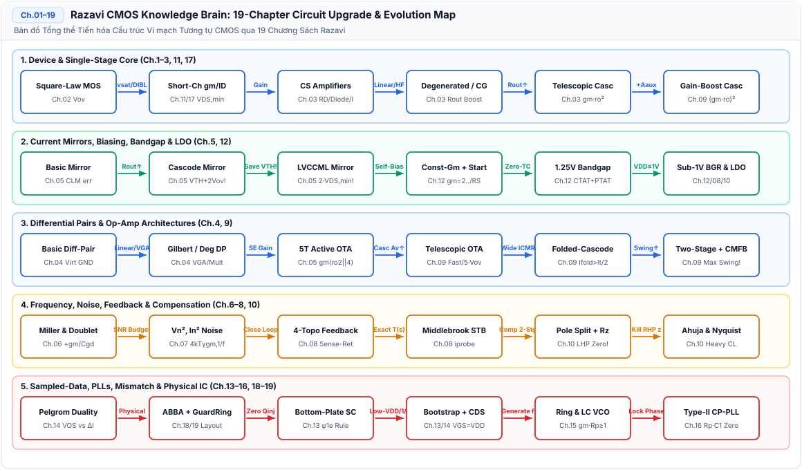

---
{
  "id": "skill-amplifier-25-topology-selector",
  "kind": "skill",
  "domain": "eda-and-github-skills",
  "title_vi": "Ma trận Lựa chọn 25 Cấu trúc Khuếch đại Thuật toán CMOS (Từ Razavi đến Đa tầng Nanomet)",
  "title_en": "25-Topology CMOS Amplifier Selection Matrix (Single-Stage, Miller, R2R, NMC, DFCFC, PFC & Class-AB)",
  "summary": "Hệ thống phân loại và ma trận quyết định chọn đúng cấu trúc khuếch đại ngay từ bước lập kiến trúc: kết nối các họ Op-Amp kinh điển của Razavi với 25 cấu trúc thực chiến trong danh mục Amplifier-Copilot (1 tầng Cascode/Folded, 2 tầng Miller/SMCNR/Cascode-Miller/Rail-to-Rail PN-input, 3 tầng bù lồng NMC/NMCF/NMCNR/DFCFC/AFFC/PFC/ACBC/AZC và Class-AB lái tải tụ siêu lớn).",
  "diagram": "../../diagrams/upgrade-evolution-map.svg",
  "razavi_refs": [
    {
      "chapter": 9,
      "section": "9.1-9.6, 9.8-9.9",
      "pages": "345-374, 388-395",
      "equations": ["9.15", "9.17", "9.18", "9.23", "9.44", "9.46", "9.58"]
    },
    {
      "chapter": 10,
      "section": "10.4-10.7",
      "pages": "420-439",
      "equations": ["10.25", "10.30", "10.33", "10.46", "10.50"]
    },
    {
      "chapter": 11,
      "section": "11.5.1-11.6.5",
      "pages": "472-507",
      "equations": ["11.10", "11.14", "11.20"]
    }
  ],
  "github_refs": [
    {
      "repo": "AmpCopilot/Amplifier-Copilot",
      "url": "https://github.com/AmpCopilot/Amplifier-Copilot/tree/20f02d00002c39b1811a28b2684014db0860135d/Database",
      "use": "Phân loại hệ thống 25 cấu trúc OTA/Op-Amp 1/2/3 tầng theo tải điện dung CL, điện áp nguồn VDD và mạng bù tần số"
    },
    {
      "repo": "laiyao1/AnalogCoder",
      "url": "https://github.com/laiyao1/AnalogCoder/tree/591a865427bc1e271c8b1f3c88d8be13c350df4f",
      "use": "Phân rã khối mạch con theo vai trò chức năng và kiểm tra ràng buộc khả thi điểm làm việc DC ở bước chọn kiến trúc"
    },
    {
      "repo": "iic-jku/analog-circuit-design",
      "url": "https://github.com/iic-jku/analog-circuit-design/tree/6075ea0ebcf08f5c7f6033a84e9dd3c91450f5e1",
      "use": "Đối chiếu giới hạn vật lý giữa OTA một tầng, OTA hai tầng Miller và ngõ vào toàn dải Rail-to-Rail"
    }
  ],
  "glossary_codes": ["T063", "T095", "T500", "T501", "T874", "T1191", "T1533", "T1566", "T1583"],
  "process_agnostic": true,
  "roles": {
    "spec_feasibility_screener": "Bộ lọc bất khả thi vật lý sơ bộ dựa trên bộ tứ (VDD, A0_min, CL/I_budget, ICMR/Swing) trước khi chạy bất kỳ vòng định cỡ nào",
    "stage_count_selector": "Quy tắc chọn số tầng khuếch đại N_stage thuộc {1, 2, 3} dựa trên tỉ số log(A0_req) chia cho log(gm*ro công nghệ) và giới hạn xếp chồng dọc VDD",
    "input_stage_family": "Lựa chọn cặp đầu vào NMOS, PMOS hoặc cặp bổ sung song song NMOS+PMOS (Rail-to-Rail Constant-Gm) theo dải chế độ chung ICMR",
    "compensation_engine": "Cơ chế bù tần số khớp với trở kháng tải: Tự bù CL (1 tầng), Miller Rz / Cascode Ahuja (2 tầng), hoặc NMC / DFCFC / AFFC / PFC / AZC (3 tầng tải tụ cực lớn)"
  },
  "symptoms_addressed": [
    "wrong-topology-selected-causing-endless-sizing-failure",
    "insufficient-dc-gain-in-sub-1v-nanometer-cmos-when-cascode-cannot-stack",
    "massive-compensation-capacitor-area-when-driving-hundreds-of-pf-to-nf-loads",
    "gm-doubling-loop-bandwidth-shift-across-rail-to-rail-input-common-mode",
    "severe-slew-rate-bottleneck-under-strict-quiescent-power-budget"
  ],
  "limitations": [
    "three-stage-topologies-have-complex-conditional-stability-and-minimum-cl-bounds",
    "multipath-feedforward-cancellation-sensitive-to-pvt-and-pex-parasitic-shifts",
    "tsmc-benchmark-numbers-in-external-databases-never-transfer-directly-to-local-gpdk"
  ],
  "checklists": ["common-mos", "differential-pair", "folded-cascode", "two-stage-miller", "feedback-and-stb"]
}
---

## 1. Tại sao Chọn Sai Cấu trúc Làm Phá sản Mọi Nỗ lực Định cỡ?

Sai lầm tốn thời gian nhất của người thiết kế tương tự (và của các vòng lặp tối ưu hóa tự động mù quáng) là **ép một cấu trúc không khớp vật lý phải gánh một vector đặc tả bất khả thi**. Ví dụ: cố ép `topo-telescopic-cascode-opamp` chạy làm bộ đệm nối tắt $V_{\text{out}} = V_{\text{in}-}$ trên dải $1\text{ V}$; cố ép 5T-OTA một tầng đạt $A_0 = 80\text{ dB}$ ở công nghệ $65\text{ nm}$ ($g_m r_O \approx 9 \implies A_0 \le 20\text{ dB}$!); hoặc cố dùng Op-Amp hai tầng Miller kinh điển lái tải tụ khổng lồ $C_L = 500\text{ pF}$ với dòng tĩnh chỉ $20\text{ }\mu\text{A}$ (đòi hỏi $g_{m2} > 3\omega_u C_L$ bất khả thi về năng lượng!).



Bằng cách hợp nhất nền tảng vật lý Chương 9–11 của Behzad Razavi với phân loại thực nghiệm **25 cấu trúc bộ khuếch đại** trong cơ sở dữ liệu `AmpCopilot/Amplifier-Copilot` (quy ước đặt tên `<Họ_Bù>_<Kiểu_Ngõ_Vào>_<Số_Tầng>`, ví dụ `R2R_SMCNR_PNin_2` = 2 tầng, đầu vào Rail-to-Rail `PNin`, bù Simple Miller with Nulling Resistor; `Leung_DFCFC1_Pin_3` = 3 tầng, đầu vào PMOS `Pin`, bù Damping-Factor-Control Frequency Compensation), kỹ năng này cung cấp **thuật toán sàng lọc kiến trúc tất định 4 bước** trước khi chạm tay vào kích thước $W/L$.

---

## 2. Phương trình Biên Khả thi Vật lý & Phân cấp 1 – 2 – 3 Tầng

### 2.1. Ba Chỉ số Sàng lọc Nhanh Trước Khi Chọn Cấu trúc
Từ bảng thông số công nghệ đích (với tự lợi nội tại một transistor ở $L = 2\text{–}3\,L_{\min}$ là $A_{\text{intr}} = (g_m r_O)_{\text{tech}}$ và điện áp bão hòa tối thiểu $V_{DS,\min} \approx 120\text{–}180\text{ mV}$), tính ngay **ba con số chỉ báo kiến trúc**:

1. **Bậc xếp chồng độ lợi cần thiết ($N_{\text{gain}}$):**

$$
N_{\text{gain}} = \left\lceil \frac{\ln(A_{0,\text{req}} \cdot \gamma_{\text{margin}})}{\ln(0{,}5 \cdot A_{\text{intr}})} \right\rceil \qquad (\gamma_{\text{margin}} \approx 2{,}0 \text{ dự trữ góc PVT})
$$

   - Nếu $A_{\text{intr}} \approx 30$ ($180\text{ nm}$) và $A_{0,\text{req}} = 60\text{ dB}$ ($10^3$): $N_{\text{gain}} = 2$ (một tầng Cascode hoặc hai tầng CS đều đủ).
   - Nếu $A_{\text{intr}} \approx 8$ ($45\text{ nm}/65\text{ nm}$) và $A_{0,\text{req}} = 85\text{ dB}$ ($1{,}8 \times 10^4$): $0{,}5 A_{\text{intr}} = 4 \implies N_{\text{gain}} = \lceil \ln(3{,}6\times 10^4)/\ln 4 \rceil = \lceil 10{,}5 / 1{,}386 \rceil = 8$ nếu chỉ xếp không chuẩn, tức thực tế **bắt buộc phải dùng Gain-Boosted Cascode (tương đương $N_{\text{gain}} = 3\text{–}4$ theo chiều ngang) hoặc Khuếch đại 3 tầng nối tiếp ($A_0 \propto (0{,}5 A_{\text{intr}})^3$)**!

2. **Số tầng xếp chồng dọc tối đa cho phép trên cột ngõ ra ($K_{\text{stack,max}}$):**

$$
K_{\text{stack,max}} = \left\lfloor \frac{V_{DD} - \Delta V_{\text{out,se,req}}}{V_{DS,\min}} \right\rfloor
$$

   - $K_{\text{stack,max}} \ge 5$: Cho phép Telescopic Cascode (`topo-telescopic-cascode-opamp`).
   - $K_{\text{stack,max}} = 4$: Cho phép Folded-Cascode hoặc Gain-Boosted Folded-Cascode.
   - $K_{\text{stack,max}} = 2\text{–}3$: Cấm tiệt mọi cascode ở tầng ngõ ra $\implies$ **Bắt buộc dùng tầng ngõ ra Nguồn chung (CS) không cascode** (tức cấu trúc 2 tầng hoặc 3 tầng biên độ Rail-to-Rail ngõ ra $V_{DD} - 2 V_{DS,\min}$)!

3. **Hệ số Gánh nặng Tụ tải – Công suất ($\text{FoM}_{C_L}$ — MHz$\cdot$pF/mA):**

$$
\text{FoM}_{C_L} = \frac{f_{u,\text{MHz}} \cdot C_{L,\text{pF}}}{I_{\text{total,mA}}}
$$

   - $\text{FoM}_{C_L} < 300\text{ MHz}\cdot\text{pF/mA}$ và $C_L \le 10\text{ pF}$: OTA 1 tầng (Folded-Cascode) hoặc 2 tầng Miller chuẩn (`SMCNR`) đạt dễ dàng.
   - $300 \le \text{FoM}_{C_L} \le 1500$: Cần bù Cascode/Ahuja (`Cascode_Miller`), nhân dòng gương chủ động (`HSOTA` / Recycling FC) hoặc đầu ra Class-AB (`CLASSAB_NULL`).
   - $\text{FoM}_{C_L} > 1500$ với $C_L = 100\text{ pF}\text{–}10\text{ nF}$ (ví dụ bộ đệm tham chiếu, LDO không tụ ngoài, cảm biến MEMS): Miller chuẩn sụp đổ vì đòi hỏi $g_{m,\text{out}} > 3 \omega_u C_L$ ngốn dòng khổng lồ! Lúc này các cấu trúc **3 tầng nâng cao (DFCFC, AFFC, RAFFC, PFC, ACBC, AZC)** tỏa sáng vì giải phóng $g_{m,\text{out}}$ khỏi điều kiện đẩy cực tải, thu nhỏ tụ bù $C_m$ đi $10\text{–}50$ lần!

---

## 3. Phân loại Toàn diện 25 Cấu trúc Khuếch đại & Cơ chế Bù Tần số

Bảng dưới đây ánh xạ trọn vẹn **25 cấu trúc trong danh mục `Amplifier-Copilot`** cùng các nút chuẩn hóa Razavi sang **5 nhóm kiến trúc vật lý** (tuyệt đối chỉ kế thừa nguyên lý cấu trúc và mạng bù, không lấy con số TSMC 22nm áp cho GPDK!):

| Nhóm Họ Cấu trúc | Tên Cấu trúc Điển hình (25-Topology Taxonomy) | Số tầng & Đầu vào | Cơ chế Bù Tần số & Đột phá Vật lý | Miền Ứng dụng Tối ưu |
|---|---|---|---|---|
| **Họ I: Một tầng & Giả hai tầng tốc độ cao** ($C_L$ nhỏ–vừa, tự ổn định theo $C_L$) | `Cascode_CS_Nin_1`, `Cascode_Null_Pin_1`, `PseudoTwoSt_Null_Pin_1` + Razavi `5T-OTA`, `Telescopic`, `Folded-Cascode`, `Gain-Boosted FC` | $1$ tầng (`Nin` / `Pin`) | Cực trội nằm ngay tại tải $C_L$: $\omega_{p1} = 1/(R_{\text{out}} C_L)$, tăng $C_L$ càng ổn định; bản `Null` thêm zero nội tinh chỉnh pha nút gập | Mạch tụ chuyển mạch SC tốc độ cao, Pipeline/SAR ADC nội suy $C_L = 0{,}2\text{–}5\text{ pF}$ |
| **Họ II: Hai tầng Miller Kinh điển & Cải tiến Dòng Gương** | `TwoStFixIRatio_SMCNR_Pin_2`, `TwoStFixRatio_SMCNR_Pin_2`, `Cascode_Miller_Pin_2`, `HSOTA_CS_Pin_2`, `HSOTA_COMP_Pin_2` | $2$ tầng (`Pin`) | `SMCNR`: Tách cực Miller $C_c$ + điện trở khử RHP zero $R_z$; `Cascode_Miller` (Ahuja, Razavi §10.7): hồi tiếp dòng $C_c$ qua cực nguồn cascode tầng 1 chặn đường truyền thẳng và đẩy $\omega_{p2} \propto \sqrt{C_c/C_L}$ | Bộ đệm áp nguồn thấp $0{,}9\text{–}1{,}2\text{ V}$, Error Amp của LDO, bộ lọc thời gian liên tục $C_L = 2\text{–}50\text{ pF}$ |
| **Họ III: Hai tầng Ngõ vào Toàn dải Nguồn cấp (`T1583`)** | `R2R_Miller_PNin_2`, `R2R_SMCNR_PNin_2` (`topo-rail-to-rail-complementary-input-stage`, Razavi §9.8) | $2$ tầng (`PNin` NMOS $\parallel$ PMOS) | Cặp vi sai NMOS và PMOS ghép song song đổ dòng vào nhánh gập tổng hợp giúp ICMR phủ trọn $[0,\; V_{DD}]$; cần ổn định tổng hỗ dẫn $g_{mN} + g_{mP} = \text{const}$ để GBW và bù $R_z$ không nhảy gấp đôi ở vùng giữa nguồn | Bộ đệm cảm biến/âm thanh đơn vị $V_{\text{out}} = V_{\text{in}}$ quét từ $\text{GND}$ lên sát $V_{DD}$ |
| **Họ IV-A: Ba tầng Bù Miller Lồng nhau Kinh điển (NMC Family)** | `HSOTA_CS_Pin_3`, `Leung_NMCF_Pin_3`, `Leung_NMCNR_Pin_3`, `Fan_SMC_Pin_3` (`tech-nested-miller-and-multipath-compensation`) | $3$ tầng (`Pin`) | Hai vòng tụ Miller lồng nhau ($C_{m1}$ ngoài cùng, $C_{m2}$ vòng trong) đạt độ lợi $(g_m r_O)^3 > 90\text{ dB}$ ở $V_{DD} \le 0{,}9\text{ V}$; `NMCF` thêm đường truyền thuận $g_{mf}$ và `SMC` (Single Miller Cap) bỏ bớt $C_{m2}$ để tăng mạnh GBW so với NMC thuần | Mạch chính xác siêu cao ở tiến trình sâu $28\text{–}65\text{ nm}$ không thể xếp chồng cascode |
| **Họ IV-B: Ba tầng Kiểm soát Hệ số Tắt dần & Triệt Zero Chủ động ($C_L$ Khổng lồ)** | `Leung_DFCFC1_Pin_3`, `Leung_DFCFC2_Pin_3`, `HoiLee_AFFC_Pin_3`, `Alfio_RAFFC_Pin_3`, `Ramos_PFC_Pin_3`, `Sau_CFCC_Pin_3`, `Peng_ACBC_Pin_3`, `Qu2017_AZC_Pin_3`, `Yan_AZ_Pin_3`, `Yan_NCM_Pin_3` | $3$ tầng (`Pin`, tải $C_L = 100\text{ pF}\text{–}10\text{ nF}$) | Thay vòng Miller trong bằng khối kiểm soát hệ số tắt dần (`DFCFC`), hồi tiếp dung chủ động (`AFFC`/`RAFFC` đưa tụ bù nối tiếp qua đệm dòng $g_{ma}$), bù phản hồi dương kiểm soát (`PFC`), điều khiển cực–zero chủ động (`AZC`/`ACBC`) giúp $C_m \ll C_L$ mà cặp cực phức cao tần vẫn có $\zeta \approx 0{,}707$! | LDO không tụ ngoài (Capless LDO), bộ lái đường truyền/LCD/MEMS tải hàng trăm $\text{pF}$ với dòng tĩnh siêu thấp $\mu\text{A}$ |
| **Họ V: Ba tầng Ngõ ra Đẩy–Kéo Lớp AB (`T1566`)** | `CLASSAB_NULL_Pin_3` (`tech-slew-rate-and-class-ab-opamps`, Razavi §9.9–9.10) | $3$ tầng đẩy–kéo Class-AB | Tầng cuối điều khiển đồng thời cả cổng PMOS và cổng NMOS qua lưới dịch mức nổi (floating class-AB control), cho dòng nạp/xả đỉnh lớn gấp $10\text{–}30\times$ dòng tĩnh $I_{Q3}$, phá vỡ giới hạn Slew Rate $I_Q / C_L$ và lái được tải trở $R_L$ nhỏ | Bộ lái ADC/DAC tốc độ biến thiên lớn, bộ đệm tai nghe/tải trở, bộ đệm tham chiếu chịu xung dòng |

---

## 4. Bất biến Kỹ thuật & Các Bẫy Lỗi Khi Chọn Cấu trúc (Invariants & Traps)

- **[INV-SEL-01] Bất biến Ngược Chiều Tụ Tải $C_L$ Giữa Họ I (1 Tầng) và Họ II/IV (2–3 Tầng):**
  - Với **OTA 1 tầng** (Folded/Telescopic/Gain-Boosted): $C_L$ tăng $\implies$ cực trội $\omega_{p1}$ giảm $\implies$ **Dự trữ pha TĂNG**. Nguy cơ mất ổn định nằm ở **$C_L$ quá nhỏ** ($C_{L,\min}$)!
  - Với **Op-Amp 2 tầng Miller (`SMCNR`)**: $C_L$ tăng $\implies$ cực phụ ngõ ra $\omega_{p2} = g_{m2}/C_L$ giảm $\implies$ **Dự trữ pha SỤT GIẢM**. Nguy cơ mất ổn định nằm ở **$C_L$ cực đại** ($C_{L,\max}$)!
  - Với **Op-Amp 3 tầng tải lớn (`DFCFC`, `AFFC`, `PFC`, `AZC`)**: Hệ có điều kiện ổn định hai biên (conditionally / bounded-$C_L$ stable)! Nếu tháo tải $C_L \to 0$ (no-load), cực phức bậc hai mất lực hãm điện dung tải và **tự dao động dữ dội**! Luôn phải kiểm tra cả $C_{L,\min}$ lẫn $C_{L,\max}$!
- **[INV-SEL-02] Bất biến Biến thiên $2\times G_m$ trong Họ III (`R2R_Miller_PNin_2`):** Ở hai đầu nguồn cấp ($V_{\text{in,CM}} \approx 0$ hoặc $V_{\text{in,CM}} \approx V_{DD}$), chỉ 1 trong 2 cặp vi sai dẫn ($G_m = g_{mP}$ hoặc $g_{mN}$); ở giữa nguồn ($V_{\text{in,CM}} \approx V_{DD}/2$), cả hai cặp cùng dẫn làm $G_m = g_{mN} + g_{mP} \approx 2 g_{m0}$! Nếu không có mạch điều khiển dòng đuôi $I_{\text{tail}} \propto 1/G_m^2$ (hoặc công tắc chuyển dòng $1:3$, xem `topo-rail-to-rail-complementary-input-stage`), băng thông vòng $\omega_u = G_m/C_c$ ở giữa nguồn sẽ tăng gấp đôi và cắt thẳng vào $\omega_{p2}$ làm sập dự trữ pha!
- **[TRAP-SEL-01] Bẫy Bê Nguyên Cấu trúc 3 Tầng Vào Mạch Chuyển Mạch Nhanh Cần Xác lập $0{,}01\%$:** Dù các họ 3 tầng (`AFFC`, `DFCFC`, `PFC`) đạt chỉ số $\text{FoM}_{C_L}$ kỷ lục trên giấy báo IEEE JSSC cho tải $100\text{–}1000\text{ pF}$, chúng luôn chứa các cặp cực–zero khử nhau phụ thuộc tham số. Dưới biến thiên góc `FS`/`SF` và trích xuất ký sinh `PEX`, phần dư chưa khử hết tạo thành các doublet nhỏ làm thời gian xác lập chính xác $12\text{–}14\text{ bit}$ chậm hơn nhiều so với `Gain-Boosted Folded-Cascode` 1 tầng hoặc `Cascode_Miller_Pin_2` 2 tầng!
- **[TRAP-SEL-02] Bẫy Ngộ nhận Số liệu TSMC 22ULL Trong Repo Tham chiếu:** Các netlist mẫu trong `AmpCopilot` được tối ưu trên công nghệ TSMC 22nm Ultra-Low-Leakage có $f_T$ và đặc tính dưới ngưỡng khác hẳn `GPDK180`/`GPDK090`/`GPDK045`. Tuyệt đối chỉ dùng sơ đồ kết nối nhánh (topology graph) và công thức tính mạng bù, sau đó định cỡ lại từ đầu bằng bảng tra LUT của đúng PDK mục tiêu (`skill-gm-id-lookup-table-sizing`).

---

## 5. Cây Quyết định Định lượng & Kịch bản Sàng lọc Tự động Đa Tiến trình

### 5.1. Sơ đồ Luồng Chọn Cấu trúc 5 Câu Hỏi Dứt khoát
```text
[Q1] Phải lái tải điện trở nhỏ (R_L < 10 kΩ) hoặc cần dòng đỉnh nạp/xả I_peak >> I_Q?
 ├── CÓ  --> Chọn Họ V: Two-Stage Class-AB hoặc CLASSAB_NULL_Pin_3 (tầng ra đẩy-kéo).
 └── KHÔNG (Tải dung hoặc R_L rất lớn) -> Sang [Q2]

[Q2] Dải chế độ chung ngõ vào ICMR bắt buộc quét sát CẢ HAI nguồn [0 V .. VDD]?
 ├── CÓ  --> Chọn Họ III: R2R_SMCNR_PNin_2 (kèm mạch ổn định tổng Gm qua V_in,CM).
 └── KHÔNG (ICMR cố định như đất ảo SC/Inverting, hoặc chỉ chạm 1 biên nguồn) -> Sang [Q3]

[Q3] Biên độ ra đơn đầu yêu cầu > (VDD - 4 * V_DS,min) (ví dụ VDD <= 1.0 V, Swing >= 0.6 V)?
 ├── KHÔNG (Đủ chỗ cho 4-5 tầng cascode)
 │    ├── Không nối tắt Vin=Vout & A0 <= (gm*ro)^2 --> Telescopic Cascode (Power thấp nhất!)
 │    ├── Cần ICMR chạm 1 nguồn / nối tắt & A0 <= 55 dB --> Folded-Cascode chuẩn
 │    └── Cần A0 >= 75-95 dB + Settling 12-16 bit nhanh --> Gain-Boosted Folded-Cascode!
 └── CÓ (Bắt buộc ngõ ra CS chỉ tốn 2 * V_DS,min) -> Sang [Q4]

[Q4] Tụ tải C_L và ngân sách dòng nằm ở miền nào?
 ├── C_L <= 50 pF (FoM_CL <= 1000 MHz*pF/mA) & (gm*ro)^2 đủ đạt A0:
 │    ├── Cần PSRR cao tần tốt & C_L biến thiên rộng --> Cascode_Miller_Pin_2 (Bù Ahuja!)
 │    └── Mạch đa dụng đơn giản, diện tích nhỏ      --> TwoSt_SMCNR_Pin_2 (Miller Cc + Rz!)
 └── C_L >= 100 pF HOẶC VDD <= 0.9 V ở 45nm/65nm khiến 2 tầng thiếu A0 (< 60 dB):
      ├── Ưu tiên ổn định bền vững qua PVT         --> Leung_NMCNR_Pin_3 / Leung_DFCFC1_Pin_3
      └── Ưu tiên diện tích tụ bù nhỏ nhất ở uW    --> HoiLee_AFFC_Pin_3 / Ramos_PFC_Pin_3
```

### 5.2. Kịch bản Python Chấm Điểm Khả thi & Khuyến nghị Cấu trúc Chuẩn xác
```python
# Chạy với: PYTHONDONTWRITEBYTECODE=1 python -B select_amp_topology.py
import math

def recommend_amplifier_topology(vdd, vds_min, gm_ro_tech, a0_db, gbw_mhz, cl_pf,
                                 i_max_ma, swing_se_v, r2r_in=False, rl_ohm=1e9):
    a0_lin = 10.0 ** (a0_db / 20.0)
    k_stack = int(math.floor((vdd - swing_se_v) / vds_min))
    fom_cl = (gbw_mhz * cl_pf) / max(i_max_ma, 1e-6)
    gain_1st = 0.5 * gm_ro_tech
    gain_cas = 0.35 * (gm_ro_tech ** 2)
    gain_2st = (0.5 * gm_ro_tech) ** 2

    candidates = []
    if rl_ohm < 10e3:
        candidates.append(("CLASSAB_NULL_Pin_3 / Two-Stage Class-AB", "Bắt buộc tầng ra đẩy-kéo Class-AB để cấp dòng tải R_L mà không tốn dòng tĩnh lớn"))
        return {"k_stack": k_stack, "fom_cl": round(fom_cl, 1), "recommended": candidates}

    if r2r_in:
        candidates.append(("R2R_SMCNR_PNin_2 (topo-rail-to-rail-complementary-input-stage)", "ICMR toàn dải yêu cầu cặp vi sai song song NMOS+PMOS kèm ổn định Constant-Gm"))
        return {"k_stack": k_stack, "fom_cl": round(fom_cl, 1), "recommended": candidates}

    if k_stack >= 4 and cl_pf <= 20.0:
        if a0_lin <= 0.6 * gain_cas:
            candidates.append(("topo-folded-cascode-ota", "Đủ ngân sách 4*Vds,min, tải dung vừa phải, tự bù 1 cực sạch không cần tụ Miller"))
        else:
            candidates.append(("topo-gain-boosted-cascode", "Đạt A0 > 80 dB với hành vi xác lập 1 tầng nhanh bằng 2 OTA phụ trợ"))

    if k_stack >= 2:
        if a0_lin <= 0.7 * gain_2st and fom_cl <= 1200.0:
            candidates.append(("Cascode_Miller_Pin_2 (Bù Ahuja)", "Mở biên độ ra VDD - 2*Vds,min, chặn RHP zero và giữ PSRR cao tần vượt trội SMCNR"))
            candidates.append(("TwoStFixIRatio_SMCNR_Pin_2 (topo-two-stage-opamp)", "Cấu trúc 2 tầng Miller + Rz kinh điển, ít nhánh tĩnh và dễ kiểm soát điểm làm việc"))
        else:
            candidates.append(("Leung_DFCFC1_Pin_3 / Leung_NMCNR_Pin_3 (tech-nested-miller-and-multipath-compensation)", "3 tầng nâng độ lợi (gm*ro)^3 dưới VDD thấp hoặc lái tải tụ C_L lớn ở ngân sách dòng hẹp"))
            if fom_cl > 1200.0:
                candidates.append(("HoiLee_AFFC_Pin_3 / Ramos_PFC_Pin_3", "Bù dung chủ động / phản hồi dương giảm mạnh kích thước tụ bù cho C_L hàng trăm pF"))
    return {"k_stack": k_stack, "fom_cl": round(fom_cl, 1), "recommended": candidates}
```

### 5.3. Bộ Phép Đo Chuẩn Bắt buộc Trong ADE / Spectre 15.1 Khi So sánh Hai Cấu trúc
Khi phân vân giữa hai ứng viên (ví dụ `Cascode_Miller_Pin_2` với `Leung_DFCFC1_Pin_3`), luôn đặt cả hai vào **cùng một hợp đồng testbench 6 phép đo đóng vòng** trên đúng PDK (`GPDK180`/`GPDK090`/`GPDK045`):
1. `stb` vi sai tại **cả $C_{L,\min}$ lẫn $C_{L,\max}$** qua 5 góc `{TT, FF, SS, FS, SF}`: loại ngay mọi cấu trúc 3 tầng có độ lồi biên độ (gain peaking) $> 2\text{ dB}$ hoặc cắt pha $-180^\circ$ sớm (ổn định có điều kiện rủi ro cao).
2. `xf` hoặc `ac` đo riêng $PSRR^+(f)$ và $PSRR^-(f)$ từ $1\text{ Hz}$ đến $10\times \text{GBW}$: kiểm tra sụt hố $0\text{ dB}$ ở tần số cao do tụ bù $C_c$ nối tắt cổng transistor tải PMOS/NMOS!
3. `tran` bước nhảy nhỏ ($10\text{ mV}$) và bước nhảy lớn ($70\%$ toàn thang): đo đồng thời vọt lố $\text{OS}\%$, tốc độ sườn lên/xuống $\min(\text{SR}^+, \text{SR}^-)$ và thời gian xác lập $0{,}1\% / 0{,}01\%$.
4. `dc` quét $V_{\text{in,CM}}$ trong cấu hình bộ đệm đơn vị: xác nhận độ lệch độ lợi biến thiên $< 3\text{ dB}$ trên toàn dải ICMR cam kết.

---

## 6. Đối chiếu Sách Razavi, Nguồn GitHub Đã Kiểm định & Thuật ngữ Chuẩn CLB

### 6.1. Mốc Tọa độ Sách Razavi (2nd Edition) & Nguồn GitHub
- **Chương 9:** §9.1 *General Considerations & Performance Parameters* (tr. 345–349), §9.2–9.4 *One-Stage, Two-Stage & Gain-Boosting* (tr. 350–372), §9.5 *Comparison* (tr. 373, Bảng 9.1 đối chiếu 4 họ cốt lõi!), §9.8 *Input Range Limitations / Rail-to-Rail* (tr. 388–390, Phương trình 9.58).
- **Chương 10 & Chương 11:** §10.5–10.7 *Miller & Cascode Compensation* (tr. 426–439), §11.5–11.6 *Nanometer Op-Amp Design Studies* (tr. 472–507).
- **Kho GitHub Đối chiếu:** `AmpCopilot/Amplifier-Copilot` (`20f02d0000`, danh mục phân loại 25 cấu trúc khuếch đại và mẫu trạng thái đo ADE), `laiyao1/AnalogCoder` (`591a865427`, kiểm tra tính khả thi điểm phân cực khối con) và `iic-jku/analog-circuit-design` (`6075ea0ebc`).

### 6.2. Bảng Thuật ngữ Chuẩn CLB Vi Mạch
| Mã CLB | Thuật ngữ Tiếng Anh | Thuật ngữ Tiếng Việt Chuẩn | Ý nghĩa Khi Chọn Cấu trúc |
|---|---|---|---|
| `T501` / `T500` | telescopic cascode / folded cascode | cascode telescopic / cascode gập | Hai họ OTA một tầng tốc độ cao tự bù bằng tụ tải $C_L$ |
| `T874` | Miller effect | hiệu ứng Miller | Nền tảng tách cực trong các họ 2 tầng (`SMCNR`) và 3 tầng lồng nhau (`NMC`) |
| `T1533` / `T1583` | rail-to-rail / rail-to-rail input | toàn dải nguồn cấp / ngõ vào toàn dải nguồn cấp | Yêu cầu ép buộc dùng tầng đầu vào bổ sung `PNin` hoặc tầng ra CS |
| `T1191` | feedforward | đường truyền thuận | Nhánh truyền thẳng $g_{mf}$ dùng để khử RHP zero và nâng GBW trong họ 3 tầng `NMCF`/`AFFC`/`DFCFC` |
| `T1566` | class-AB amplifiers | bộ khuếch đại lớp AB | Cấu trúc ngõ ra đẩy–kéo cấp dòng động lớn hơn nhiều lần dòng phân cực tĩnh |
| `T095` / `T063` | voltage swing / phase margin | dải dao động điện áp / dự trữ pha | Hai ràng buộc biên cứng loại bỏ nhanh các cấu trúc không phù hợp |
