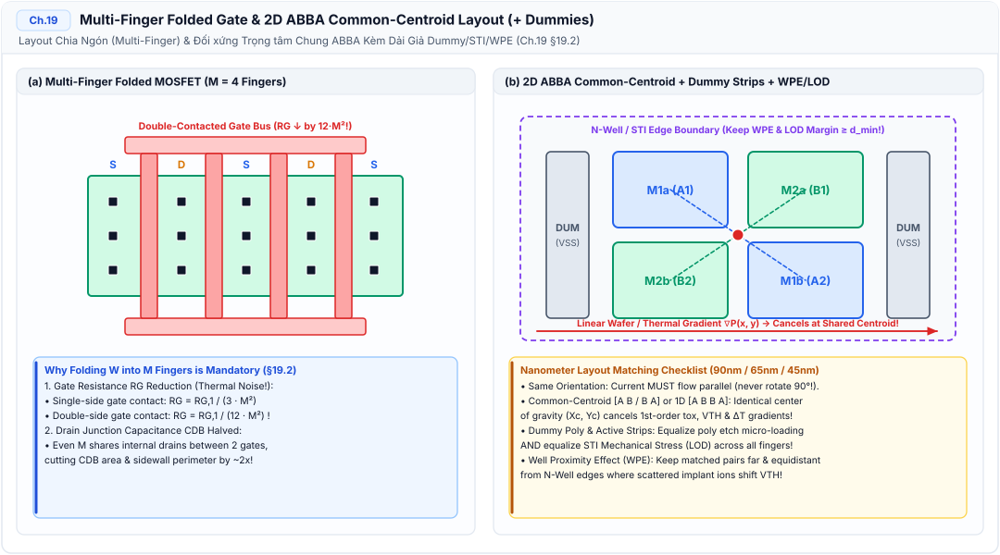

---
{
  "id": "skill-analog-layout-common-centroid-matching",
  "kind": "skill",
  "domain": "eda-and-github-skills",
  "title_vi": "Kỹ thuật Layout Tương tự & Ghép Khớp Tâm Chung (Common-Centroid): Chia Ngón Chẵn, Dummy STI/WPE, Mảng Tụ & Vòng Bảo vệ",
  "title_en": "Analog IC Layout & Common-Centroid Matching Playbook: Multi-Finger Folding, STI/WPE Dummies, Unit-Cap Arrays & Guard Rings",
  "summary": "Cẩm nang thực chiến thiết kế mặt bằng vật lý (floorplanning) và bố trí ghép khớp chính xác trên Cadence Virtuoso Layout XL (IC617): bốn tiên đề bất biến của ma trận tâm chung 1D/2D (trùng tâm, đối xứng trục, phân tán đều, gọn chặt), quy tắc chia ngón chẵn cắt đôi điện dung tiếp giáp Cdb, bố trí dải cực cổng/OD giả chặn ứng suất rãnh nông STI (LOD) và hiệu ứng lân cận bờ giếng (WPE), ma trận đơn vị cho BJT Bandgap & mảng tụ CDAC/SC, cùng vòng bảo vệ kép triệt tiêu khóa cứng SCR Latch-up.",
  "diagram": "../../diagrams/common-centroid-multifinger.svg",
  "razavi_refs": [
    {
      "chapter": 14,
      "section": "14.2.1",
      "pages": "593-598",
      "equations": ["14.75", "14.79", "14.84"]
    },
    {
      "chapter": 18,
      "section": "18.7-18.8",
      "pages": "721-731",
      "equations": ["18.1", "18.3"]
    },
    {
      "chapter": 19,
      "section": "19.1-19.3",
      "pages": "735-764",
      "equations": ["19.4", "19.6", "19.9", "19.11", "19.14"]
    }
  ],
  "github_refs": [
    {
      "repo": "ALIGN-analoglayout/ALIGN-public",
      "url": "https://github.com/ALIGN-analoglayout/ALIGN-public",
      "use": "Hệ thống ràng buộc đối xứng khối (SymmetricBlocks, SameTemplate, Align, ShieldNet, GuardRing) và cấu trúc ô cơ sở có ngón giả"
    },
    {
      "repo": "magical-eda/MAGICAL",
      "url": "https://github.com/magical-eda/MAGICAL",
      "use": "Phương pháp nhận dạng cặp linh kiện nhạy cảm độ lệch và đi dây vi sai đối xứng gương qua trục trung tâm"
    },
    {
      "repo": "ucb-art/BAG_framework",
      "url": "https://github.com/ucb-art/BAG_framework",
      "use": "Kiến trúc hàng transistor chuẩn hóa AnalogBase trên nền OpenAccess IC617 với dải dummy bao quanh và lưới kim loại đối xứng"
    }
  ],
  "glossary_codes": [
    "T052",
    "T620",
    "T788",
    "T2153",
    "T2154",
    "T2155",
    "T2156",
    "T2188",
    "T2189",
    "T2190",
    "T2191",
    "T2192",
    "T2193",
    "T2194",
    "T2195",
    "T2196",
    "T2197"
  ],
  "process_agnostic": true,
  "roles": {
    "unit_finger_cell": "Phần tử ngón đơn vị chuẩn hóa (cùng W_f, cùng L, cùng hướng dòng chảy S->D và cùng môi trường lân cận) làm viên gạch duy nhất xây nên mọi cặp vi sai và gương dòng tỉ số nguyên",
    "common_centroid_matrix": "Ma trận đan cài 1D (ABBA) hoặc 2D (tâm đối xứng X-Y) làm trùng khít tọa độ trọng tâm hình học của hai hay nhiều linh kiện để triệt tiêu hoàn toàn gradient bậc nhất trên mặt wafer",
    "sti_wpe_dummy_frame": "Khung ngón cổng giả (dummy poly) và dải vùng hoạt động giả (dummy OD) nối đất/nguồn xác định ở rìa mảng để đẩy vùng méo quang khắc và ứng suất cơ học STI ra khỏi linh kiện thật",
    "double_guard_ring": "Vành thu hạt dẫn thiểu số và đa số kép (p+ tap nối VSS bao quanh n+ well tap nối VDD) cô lập nhiễu đế số đồng thời phá vỡ chu trình tái sinh thyristor pnp-npn gây Latch-up"
  },
  "symptoms_addressed": [
    "measured-input-offset-voltage-is-5x-worse-than-pelgrom-monte-carlo-prediction-due-to-layout-gradient-and-sti-stress",
    "current-mirror-integer-ratio-1-to-k-suffers-systematic-gain-error-from-scaling-w-instead-of-unit-multiplicity",
    "high-gate-series-resistance-rg-and-huge-drain-junction-capacitance-cdb-ruin-ota-nondominant-pole-post-layout",
    "asymmetric-metal-routing-capacitance-between-vip-and-vin-injects-clock-kickback-offset-and-degrades-cmrr",
    "parasitic-scr-latchup-triggers-under-ldo-or-io-current-transient-due-to-missing-guard-rings"
  ],
  "limitations": [
    "2d-cross-coupled-common-centroid-routing-adds-inter-wire-crossover-capacitance-that-can-penalize-multi-ghz-rf-nodes",
    "dummy-devices-and-wpe-well-setback-margins-increase-active-silicon-footprint-by-25-to-60-percent",
    "common-centroid-cancels-linear-spatial-gradients-but-cannot-reduce-uncorrelated-atomic-dopant-fluctuation-governed-by-pelgrom-area-law"
  ],
  "checklists": [
    "common-mos",
    "layout-and-matching",
    "differential-pair",
    "current-mirror"
  ]
}
---

## 1. Khoảng cách Giữa Schematic Và Silicon Thực: Hai Họ Sai lệch & Kiến trúc Layout XL

Trên schematic lý tưởng, hai transistor $M_1$ và $M_2$ của cặp vi sai có cùng $W/L$ sẽ khớp nhau tuyệt đối; ngay cả khi bật mô phỏng Monte Carlo trên schematic, trình mô phỏng thường chỉ gieo biến thiên ngẫu nhiên không tương quan theo **định luật Pelgrom (`T2153`, $\sigma_{\Delta V_{TH}} = A_{VTH}/\sqrt{W L}$)**. Thế nhưng khi đem chế tạo silicon thực tế ở công nghệ $180\text{ nm}$ xuống $90\text{ nm} / 65\text{ nm} / 45\text{ nm}$, nếu người vẽ layout đặt $M_1$ và $M_2$ tách rời hoặc thiếu đối xứng môi trường lân cận, **độ lệch hệ thống do bố cục (`T2156`, layout-induced systematic offset)** sẽ vọt lên $5\text{–}20\text{ mV}$ — lớn gấp $5\text{–}10$ lần sai lệch ngẫu nhiên Pelgrom!



 Theo Razavi Chương 14 (§14.2.1) và Chương 19 (§19.1–§19.3, tr. 735–764) kết hợp kiến trúc ràng buộc vật lý từ ba khung tự động hóa layout hàng đầu (`ALIGN-public`, `MAGICAL`, và `UC Berkeley BAG`), mọi khối tương tự chính xác trên **Cadence Virtuoso Layout XL (IC617)** phải được kiểm soát chặt qua **5 lớp bảo vệ hình học**:
1. **Chia Ngón Cực Cổng Số Chẵn (`Even Multi-Finger Folding`, `T2193`):** Biến một transistor rộng $W$ thành $N_f = 2k$ ngón đơn vị rộng $W_f = W / N_f$ dùng chung các vùng cực nguồn/cực máng xen kẽ `S–D–S–D–S` để giảm tới mức tối thiểu điện trở cổng $R_G$ và cắt một nửa diện tích/chu vi tiếp giáp cực máng $C_{DB}$.
2. **Ghép Khớp Trọng tâm Chung 1D / 2D (`Common-Centroid Placement`, `T2194`):** Đan cài các ngón/ô đơn vị của cặp vi sai, gương dòng, ma trận điện trở hay mảng tụ CDAC sao cho trọng tâm tọa độ $(\bar{x}_A, \bar{y}_A) \equiv (\bar{x}_B, \bar{y}_B)$ trùng khít nhau.
3. **Đồng nhất Hóa Vi Môi trường Biên (`STI/LOD, WPE & Etch Dummies`, `T2195`, `T2196`):** Chèn các ngón giả ở hai đầu dải active mở rộng và giữ khoảng lùi an toàn tới mép giếng N (`n-well`) để mọi ngón mang dòng đều chịu cùng một trường ứng suất cơ học STI và cùng mật độ tán xạ tạp chất giếng.
4. **Đi Dây Vi sai Đối xứng Gương & Đấu Nối Bốn Dây Kelvin (`Symmetric Differential Routing & Kelvin Sense`, `T2197`):** Cân bằng tuyệt đối $R_{\text{wire}}$ và $C_{\text{wire}}$ giữa nhánh dương–âm, che chắn đường nhạy cảm và tách đường cảm biến áp khỏi đường mang dòng lớn.
5. **Vòng Bảo vệ Kép Chống Khóa Cứng SCR & Nhiễu Đế (`Double Guard Rings`, `T2190`, `T2191`):** Cô lập các khối nhiễu xung nhịp số/công suất khỏi vùng tương tự nhạy cảm.

---

## 2. Hệ Phương trình Vật lý Layout: Điện trở Cổng $R_G$, Tụ Tiếp giáp $C_{DB}$, Gradient Tuyến tính & LOD/WPE

### 2.1. Toán học Chia Ngón Chẵn $N_f = 2k$: Nén Điện trở Cổng $R_G$ Đi $4 N_f^2$ Lần & Cắt Nửa $C_{DB}$
Xét một transistor có tổng chiều rộng $W$, chiều dài kênh $L$, điện trở vuông lớp silicua cực cổng $R_{\square,\text{poly}}$. Nếu vẽ thành 1 dải duy nhất nối cổng một đầu, điện trở cổng phân bố đóng góp vào nhiễu nhiệt là $R_{G,1} = \frac{1}{3} R_{\square,\text{poly}} \frac{W}{L}$ (Razavi §19.2.1, Phương trình 19.4). Khi chia thành **$N_f$ ngón song song** (mỗi ngón rộng $W_f = W/N_f$) và nối kim loại ở **cả hai đầu** ngón cực cổng (hệ số $\frac{1}{12}$ thay vì $\frac{1}{3}$):

$$
R_{G,\text{tot}} = \frac{1}{N_f} \left( \frac{1}{12} R_{\square,\text{poly}} \frac{W_f}{L} \right) = \frac{1}{12\,N_f^2} R_{\square,\text{poly}} \frac{W}{L}
$$

Chia thành $N_f = 8$ ngón nối hai đầu làm giảm điện trở cực cổng đi **$4 \times 64 = 256$ lần**, xóa sạch hoàn toàn nhiễu nhiệt cực cổng $4kT R_G$!

Đồng thời xét diện tích và chu vi vùng khuếch tán cực máng (drain diffusion có chiều dài tiếp xúc $L_{\text{diff}}$). Nếu chọn **$N_f = 2k$ là số chẵn** và xếp chuỗi tiếp xúc theo thứ tự nguồn nằm ngoài rìa **`S – G – D – G – S – ... – S`**:
- Toàn bộ $\frac{N_f}{2}$ vùng cực máng đều được **dùng chung (shared)** giữa hai ngón liền kề, và hai mép biên ngoài cùng gặp vách rãnh STI đều là **cực nguồn (`S` — thường nối AC ground hoặc nút đuôi ít nhạy cảm)** chứ không phải cực máng!
- Nhờ đó, tổng điện dung tiếp giáp đáy cực máng $C_{DB,\text{bot}}$ giảm đúng **một nửa ($50\%$)** và điện dung vách biên tiếp xúc trực tiếp với STI của cực máng dọc cạnh ngoài giảm về **$0$** (Razavi §19.2.1, Hình 19.8–19.10)!

### 2.2. Triệt tiêu Gradient Không gian Bậc Nhất Bằng Trọng tâm Chung (`Common-Centroid`)
Giả sử một thông số công nghệ bất kỳ $P(x, y)$ (độ dày oxit cổng $t_{\text{ox}}$, liều cấy ngưỡng $V_{TH}$, hoặc trường nhiệt độ $\Delta T$ tỏa ra từ transistor công suất LDO bên cạnh) biến thiên theo mặt phẳng xấp xỉ bậc nhất quanh gốc tọa độ:

$$
P(x, y) \approx P_0 + g_x x + g_y y
$$

Nếu linh kiện $A$ gồm $M$ phần tử đơn vị đặt tại $\{(x_{A,i}, y_{A,i})\}_{i=1}^M$ và linh kiện $B$ gồm $M$ phần tử đơn vị đặt tại $\{(x_{B,i}, y_{B,i})\}_{i=1}^M$, độ lệch trung bình $\Delta P_{AB}$ giữa $A$ và $B$ là:

$$
\Delta P_{AB} = \frac{1}{M}\sum_{i=1}^{M} P(x_{A,i}, y_{A,i}) - \frac{1}{M}\sum_{i=1}^{M} P(x_{B,i}, y_{B,i}) = g_x (\bar{x}_A - \bar{x}_B) + g_y (\bar{y}_A - \bar{y}_B)
$$

Khi và chỉ khi hai tọa độ trọng tâm trùng khít nhau — **$\bar{x}_A = \bar{x}_B$ và $\bar{y}_A = \bar{y}_B$** — thì $\Delta P_{AB} \equiv 0$ với **mọi vector gradient tuyến tính $(g_x, g_y)$ bất kỳ**! Một bố cục tâm chung chuẩn công nghiệp phải thỏa mãn **4 quy tắc bất biến**:
1. **Coincidence (Trùng tâm):** Trọng tâm hình học của $A$ và $B$ nằm tại cùng một điểm $(x_0, y_0)$.
2. **Symmetry (Đối xứng qua cả hai trục):** Mảng đối xứng qua cả trục dọc $X$ lẫn trục ngang $Y$ (chẳng hạn mảng 1D số lượng chẵn `A B B A` hoặc `A B A B B A B A`, hoặc ma trận 2D đan chéo `[[A, B], [B, A]]`). *(Cảnh báo kinh điển: chuỗi xen kẽ đơn giản `A B A B` có $\bar{x}_A = 2{,}0\,d \neq \bar{x}_B = 3{,}0\,d$ — ĐÓ CHỈ LÀ INTERDIGITATED, KHÔNG PHẢI COMMON-CENTROID!)*
3. **Dispersion (Phân tán đồng đều):** Các phần tử con đan xen ở tần số không gian cao nhất có thể để lọc cả thành phần cong bậc hai.
4. **Compactness & Identical Orientation (Gọn chặt & Cùng hướng dòng chảy):** Khoảng cách tổng thể nhỏ nhất (ưu tiên khối gần hình vuông) và dòng điện trong **mọi ngón đơn vị đều chảy cùng một chiều** (ví dụ từ trái sang phải, tuyệt đối không để ngón $A$ chảy trái-phải còn ngón $B$ chảy phải-trái dễ dính bất đối xứng góc cấy nghiêng ion `tilt-angle implant`!).

### 2.3. Hai Hiệu ứng Vật lý Nanomet Phá Vỡ Ghép Khớp: STI Stress (`LOD`) & Well Proximity (`WPE`)
Ở công nghệ $\le 180\text{ nm}$ dùng **cách ly rãnh nông (`T2189`, STI)** và cấy giếng năng lượng cao (`T2196`):
- **Length of Diffusion (`LOD` / STI Mechanical Stress):** Khối oxit điền đầy rãnh STI có hệ số giãn nở nhiệt khác tinh thể silic nên ép nén/kéo cơ học lên kênh dẫn làm biến đổi độ linh động $\mu$ và $V_{TH}$ theo nghịch đảo khoảng cách từ cổng tới hai mép biên vùng khuếch tán OD ($SA, SB$): $\Delta V_{TH,\text{LOD}} \propto \left(\frac{1}{SA + L/2} + \frac{1}{SB + L/2}\right)$. Nếu đặt mảng `D – A – B – B – A – D` trên **một vùng OD liền mạch duy nhất** kèm ít nhất $1\text{–}2$ ngón dummy $D$ ở mỗi đầu, khoảng cách $SA, SB$ của các ngón ngoài và ngón trong trở nên gần bằng nhau vượt trội!
- **Well Proximity Effect (`WPE`):** Khi cấy hạt ion năng lượng cao tạo giếng N qua lớp cản quang (photoresist) dày, các hạt ion va vào thành đứng của lớp cản quang bị tán xạ chéo cắm thêm vào bề mặt silic trong phạm vi **$1{,}0\text{–}2{,}0\text{ }\mu\text{m}$ tính từ mép giếng**, làm lệch mạnh $V_{TH}$ tới hàng chục $\text{mV}$! Quy tắc bắt buộc: đặt tất cả các linh kiện cần khớp nhau trong **cùng một giếng chung** và lùi mép ngoài vùng hoạt động OD cách rìa giếng N ít nhất $d_{\text{WPE}} \ge 1{,}5\text{–}2{,}5\text{ }\mu\text{m}$ đồng đều cả 4 phía!

---

## 3. Bất biến Kỹ thuật & Các Bẫy Lỗi Thực chiến Trong Virtuoso Layout XL

- **[INV-LAY-01] Bất biến Ghép Tỉ số Nguyên Gương Dòng (Tuyệt đối Cấm Nhân Chiều Rộng $W$):** Để thực hiện gương dòng tỉ số $1 : K$ (hoặc BJT $1 : 8$ trong Bandgap, mảng tụ nhị phân $1 : 2 : 4 : 8\,C_u$ trong SAR CDAC), bắt buộc dùng **cùng một ô đơn vị giống hệt nhau** rồi ghép song song $1$ ô so với $K$ ô (`m` hoặc `fingers` bội nguyên)! Nếu nhân $W_2 = K \cdot W_1$ trên một ngón lớn, hiệu ứng hẹp kênh (narrow-width effect), độ dốc viền ăn mòn quang khắc $\Delta W$ và khoảng cách STI $SA/SB$ không tỉ lệ tuyến tính theo $K$, sinh sai số tỉ số dòng hệ thống $2\%\text{–}8\%$ không thể sửa bằng tăng dòng! Nếu $K$ lẻ (ví dụ $1 : 8$ trong BJT Bandgap), dùng ma trận tâm chung $3 \times 3$ với phần tử tham chiếu $1\times$ đặt chính giữa tâm và $8$ phần tử $B$ vây đối xứng 8 hướng xung quanh (kèm vòng dummy ngoài rìa thành lưới $5 \times 5$)!
- **[INV-LAY-02] Bất biến Buộc Cứng Điện thế Cho Mọi Ngón Dummy (`Never Float Dummy Gates!`):** Một lỗi chí mạng là vẽ các dải cực cổng giả (`dummy poly`) ở hai đầu mảng rồi bỏ lơ lửng điện thế (`floating`)! Cực cổng treo tích điện tích tĩnh điện ngẫu nhiên trong buồng plasma ăn mòn, vừa làm trôi trường điện rìa bất định lên ngón thật kế bên, vừa bị công cụ kiểm tra DRC/ERC báo lỗi `Floating Gate`! Bắt buộc nối cứng cực cổng, nguồn và máng của dummy NMOS về `VSS` (tắt hẳn) và dummy PMOS về `VDD`!
- **[TRAP-LAY-01] Bẫy Đan Chéo Dây Cổng–Máng Trên Cặp Vi sai Tốc độ Cao Làm Nhân Tụ Miller $C_{GD}$:** Trong ma trận tâm chung 2D, các đường kim loại ` Metal 1 / Metal 2` nối chéo giữa hai góc đối diện $(1,1) \leftrightarrow (2,2)$ rất dễ cắt chồng trực tiếp lên nhau tạo tụ giao thoa giữa **cực cổng nhánh P** và **cực máng nhánh N** (hoặc ngược lại)! Trong cặp vi sai, tụ chéo giữa `VIP` và `VOUTP` đóng vai trò phản hồi dương cục bộ, còn tụ giữa `VIP` và `VOUTN` bị nhân Miller $(1 + A_v)$ lần! Phải chia tầng kim loại riêng biệt (ví dụ `M1` ngang cho Source, `M2` dọc cho Drain, `M3` có dây che chắn nối đất `VSS` kẹp giữa cho Gate) và kiểm tra bảng tụ chéo trích xuất `RCC` sau layout!
- **[TRAP-LAY-02] Bẫy Hiệu ứng Anten Chế tạo (`Antenna Effect`, `T2192`) Trên Dây Dài Nối Vào Cổng OTA:** Khi một đường kim loại tầng dưới (như `M1` hoặc `M2`) có diện tích bề mặt lớn nối thẳng vào cực cổng oxit mỏng của cặp vi sai mà chưa có đường thoát xuống tiếp giáp diode khuếch tán, điện tích ion tích tụ trong quá trình khắc plasma RIE sẽ đánh thủng hoặc làm suy biến oxit cổng tăng vọt nhiễu $1/f$ và lệch $V_{TH}$! Khắc phục bằng **cầu nhảy lên tầng kim loại trên cùng (`Metal Jumper` ngay sát cực cổng)** hoặc gắn diode bảo vệ anten ngược chiều kích thước tối thiểu theo quy tắc DRC của PDK.

---

## 4. Ma trận Chọn Mẫu Ghép Khớp Chuẩn Cho Từng Khối Mạch Điển hình

| Khối mạch tương tự cần vẽ Layout | Mẫu hình học chuẩn khuyến nghị | Tỉ lệ & Cấu hình Dummy bắt buộc | Chi tiết đi dây & Vòng bảo vệ quyết định |
|---|---|---|---|
| **Cặp Vi sai Đầu vào OTA / Comparator** ($M_1, M_2$) | Tâm chung 1D `A B B A` (cho $4, 8$ ngón) hoặc 2D chữ thập $2 \times 2$ / $4 \times 4$ (cho diện tích lớn khử offset $< 1\text{ mV}$) | Chung một OD liên tục + $\ge 2$ ngón dummy mỗi đầu nối tắt `S=D=G=VSS` (NMOS) hoặc `VDD` (PMOS) | Tách riêng giếng N (nếu PMOS) nối về cực nguồn đuôi hoặc VDD sạch; đi dây `VIP/VIN` đối xứng gương tuyệt đối kèm dây đất che chắn hai bên |
| **Gương dòng Đa Nhánh Phân cực** ($I_{\text{ref}} : I_1 : I_2 = 1 : 2 : 4$) | Chuỗi 1D tâm chung đối xứng quanh trục giữa: `D C B C A C B C D` (với `A`=1, `B`=2, `C`=4, `D`=dummy) | Chung L dài ($4\text{–}10\,L_{\min}$), cùng chiều dòng chảy; ít nhất $1\text{–}2$ dummy hai đầu | Dùng đường cái `VSS`/`VDD` bản rộng giảm sụt áp $I R < 0{,}2\text{ mV}$ giữa chân nguồn nhánh chuẩn và nhánh sao chép (chỉ $1\text{ mV}$ lệch $\Delta V_{GS}$ đã gây $1\%\text{–}2\%$ sai số dòng!) |
| **Mảng BJT $1:8$ & Mạng Điện trở Bandgap** ($R_1, R_2, R_3$) | Lưới BJT $3 \times 3$ tâm $Q_1$ + vòng dummy ngoài thành $5 \times 5$; điện trở thanh đơn vị đan cài `R2 R1 R2 ...` cùng chiều | Dải điện trở poly giả không mang dòng đặt hai rìa ngoài mảng để đồng nhất tốc độ ăn mòn hóa học | Đi dây đo áp 4 đầu **Kelvin connection** ngay tại chân cực phát/cực gốc BJT $Q_1, Q_2$ để điện trở dây kim loại không cộng nối tiếp vào $R_1$! |
| **Mảng Tụ Nhị phân SAR CDAC** ($C_0, C_1, \dots, C_{N-1}$) | Ma trận 2D tâm chung đồng tâm từ bit lớn nhất ở quanh tâm phân bổ đối xứng ra ngoài, dùng một ô tụ MOM/MIM đơn vị $C_u$ | Vành đai tụ giả (`dummy unit caps`) nối đất bao kín toàn bộ chu vi 4 cạnh mảng CDAC | Tấm đỉnh (`Top Plate` nhạy cảm nhất) đi ngắn gọn ở tầng kim loại cao có lồng chắn đất bao quanh cách ly tuyệt đối khỏi dây điều khiển công tắc tấm đáy! |
| **Transistor Truyền Công suất LDO / Pad I/O / Khối Số Cạnh Analog** | Ma trận đa hàng chia ngón đều + lưới kim loại đan ô cờ (mesh) xẻ rãnh chống di cư điện (`slotting`) | Tiếp xúc nền/giếng kẹp xen giữa mỗi $2\text{–}4$ cột ngón để giữ điện trở đế cực thấp | Bọc **Double Guard Ring** khép kín $360^\circ$ (vành trong thu hạt thiểu số, vành ngoài ghim thế đế) chặn triệt để `topo` SCR Latch-up! |

---

## 5. Thích ứng Đa Tiến trình (180nm–45nm) & Quy trình Thao tác Chuẩn Trên Virtuoso Layout XL (IC617)

### 5.1. Sự Dịch chuyển Trọng số Hiệu ứng Layout Từ 180nm Xuống 65nm / 45nm
- **Ở 180nm:** Gradient ngang wafer và hiệu ứng ăn mòn rìa quang khắc chiếm ưu thế; khoảng lùi giếng N vừa phải ($\sim 1\text{ }\mu\text{m}$), các quy tắc hướng cực cổng tự do hơn (vẫn cho phép xoay cổng $90^\circ$ dù không khuyến khích cho cặp khớp).
- **Ở 90nm / 65nm / 45nm:**
  1. **Quy tắc Cực cổng Một Hướng Duy Nhất (`1D Unidirectional Poly Pitch`):** Ở $\le 65\text{ nm}$, mọi thanh cực cổng polysilicon trên toàn chip bắt buộc nằm song song theo **một hướng duy nhất** (ví dụ toàn bộ nằm dọc trục $Y$) và ở 45nm tiến dần tới bước lưới cổng cố định để quang khắc nhúng giao thoa không bị méo!
  2. **Sự thống trị của LOD & WPE:** BSIM4 từ 90nm trở xuống mô hình hóa trực tiếp tham số `sa`, `sb` (LOD) và `sca`, `scb`, `scc` (WPE) ngay trong netlist trích xuất LVS/PEX! Điều đó có nghĩa là nếu $M_1$ và $M_2$ trên layout có khoảng cách tới mép OD hoặc mép giếng N lệch nhau, mô phỏng hậu layout (`post-layout simulation`) sẽ hiện rõ điện áp lệch hàng milivôn ngay cả ở góc danh định `TT` không cần chạy Monte Carlo!

### 5.2. Quy trình 6 Bước Dựng Khối Tương tự Sạch Kết nối Từ Đầu (`Connectivity-Driven Layout XL`) Trên IC617
```text
Bước 1 — Chuẩn bị Schematic cho Layout:
  • Chuyển đổi mọi transistor rộng thành bội số ngón chẵn (`fingers = 2*k`) và gương dòng thành bội số `m`
    ngay trên Schematic (kèm chạy CDF callback đồng bộ `ad/as/pd/ps`!).
  • Thêm sẵn các linh kiện `dummy` nối cứng `G=S=D=VSS` (hoặc `VDD`) ngay trong Schematic của khối nhạy cảm
    để tránh hoàn toàn lỗi dư linh kiện khi chạy LVS về sau!

Bước 2 — Khởi tạo Layout XL (`Launch -> Layout XL`):
  • Chạy `Connectivity -> Generate -> All From Source` (bật `I/O Pins`, `PR Boundary`, giữ nhóm cặp vi sai).
  • Bật hiển thị đường bay kết nối (`Flight Lines / Incomplete Nets`) để định hướng đặt khối (Floorplan):
    đặt đường phân cực ở biên, cặp vi sai + gương tải nằm dọc trục đối xứng trung tâm, tầng ra gần chân xuất.

Bước 3 — Ghép Modgen / Common-Centroid cho Cặp Khớp:
  • Chọn cặp `M1, M2` + `Mdum` -> tạo nhóm ràng buộc (`Create -> Multipart Path / Modgen` hoặc sắp tay theo tọa độ lưới):
    hợp nhất vùng OD (`abutment` tự động khi kéo hai cực Source chạm nhau trong Layout XL!), kiểm tra thứ tự
    `D_dum - S - G(A) - D(A) - S - G(B) - D(B) - S - G(B) - D(B) - S - G(A) - D(A) - S - D_dum`.

Bước 4 — Dựng Khung Bảo vệ (Wells & Guard Rings):
  • Mở rộng hình chữ nhật `Nwell` vượt ra ngoài mép OD của mọi PMOS khớp nhau tối thiểu >= 2.0 um đều 4 cạnh.
  • Dùng `Create -> Multipart Path (MPP)` vẽ vòng tiếp xúc `ptap` (nối VSS) và `ntap` (nối VDD) bao kín khối với mật độ via tối đa.

Bước 5 — Đi Dây Đối xứng Cấp Tín hiệu Trước, Nguồn Sau:
  • Đi dây các nút nhạy cảm nhất (cổng cặp vi sai, tấm đỉnh tụ, nút gương/nút gập) ngắn nhất và đối xứng gương
    tọa độ X qua trục tâm; đặt tối thiểu >= 2 via cho mỗi điểm chuyển tầng kim loại (`double-cut via` tăng độ tin cậy!).

Bước 6 — Kiểm Tra Chéo Nhanh Bằng SKILL Audit Trước Khi Đóng Gói:
  • Xác minh trong Layout XL thanh trạng thái báo `0 Incomplete Nets` và `0 Shorts`, sau đó chạy DRC + LVS ngay ở cấp khối con!
```

---

## 6. Đối chiếu Sách Razavi, Nguồn GitHub Đã Kiểm định & Bảng Thuật ngữ Chuẩn CLB

### 6.1. Mốc Tọa độ Chính xác Trong Sách Razavi (2nd Edition) & Kho GitHub
- **Razavi Chương 14, 18 & 19:** §14.2.1 *Random Mismatches & Pelgrom's Law* (tr. 593–598, Phương trình 14.75, 14.79, 14.84), §18.7–§18.8 *Passive Devices & Latch-Up* (tr. 721–731, cấu trúc SCR ký sinh và cơ chế kích hoạt dòng đế), §19.1 *General Layout Considerations* — quy tắc thiết kế hình học và hiệu ứng anten (tr. 735–739), §19.2 *Analog Layout Techniques* — transistor đa ngón, đối xứng tâm chung, điện trở/tụ điện ghép khớp và đường dây kết nối (tr. 739–760, Phương trình 19.4, 19.6, 19.9, 19.11, 19.14), §19.3 *Substrate Coupling* — nhiễu xuyên đế và vành bảo vệ (tr. 760–764).
- **Đối chiếu Nguồn Mở Đã Kiểm Định:**
  - `ALIGN-analoglayout/ALIGN-public` (`8d3cc2e9aa55`, BSD-3-Clause) & `magical-eda/MAGICAL` (`199ab0719f85`, BSD-3-Clause): Ngôn ngữ hình thức hóa ràng buộc đối xứng trục/tâm chung, che chắn mạng nhạy cảm và đi dây vi sai gương.
  - `ucb-art/BAG_framework` (`daf4b0aaa72f`, BSD-3-Clause): Mẫu chuẩn hàng transistor `AnalogBase` có dải dummy tích hợp sẵn trên OpenAccess của Cadence Virtuoso IC617.

### 6.2. Bảng Thuật ngữ Chuẩn CLB Vi Mạch Sử dụng trong Thẻ
| Mã CLB | Thuật ngữ Tiếng Anh | Thuật ngữ Tiếng Việt Chuẩn | Ý nghĩa Kỹ thuật Cốt lõi |
|---|---|---|---|
| `T2193` | multi-finger transistor | transistor chia nhiều ngón cực cổng | Nén điện trở cổng $R_G \propto 1/N_f^2$ và cắt giảm một nửa diện tích tiếp giáp cực máng khi $N_f$ chẵn |
| `T2194` | interdigitated and common-centroid layout | bố trí cài răng lược và đồng tâm chung | Làm trùng tọa độ trọng tâm $(\bar{x}, \bar{y})$ để triệt tiêu hoàn toàn gradient bậc nhất trên mặt đế |
| `T2195` | dummy device / dummy poly-OD strip | phần tử giả / dải cực cổng và vùng hoạt động giả | Đẩy hiệu ứng nhiễu xạ rìa quang khắc và biến thiên ăn mòn ra khỏi các phần tử mang tín hiệu thật |
| `T2196` | STI mechanical stress (LOD) & WPE | ứng suất cơ học rãnh STI (LOD) & hiệu ứng lân cận bờ giếng (WPE) | Hai nguồn gây lệch hệ thống mạnh ở công nghệ nanomet phụ thuộc khoảng cách tới mép OD và mép giếng |
| `T2190` / `T2191` | latch-up / guard ring | hiện tượng chốt ký sinh SCR / vòng bảo vệ | Vòng tiếp xúc thu hạt dẫn ngăn dòng tiêm vào đế kích hoạt cấu trúc bốn lớp `p-n-p-n` khóa cứng nguồn–đất |
| `T2197` | Kelvin connection and star ground routing | đấu nối bốn dây Kelvin và đi đất hình sao | Tách riêng cặp dây đo điện thế không mang dòng khỏi đường dây dẫn dòng lớn để khử sai số rơi áp $I R$ |
