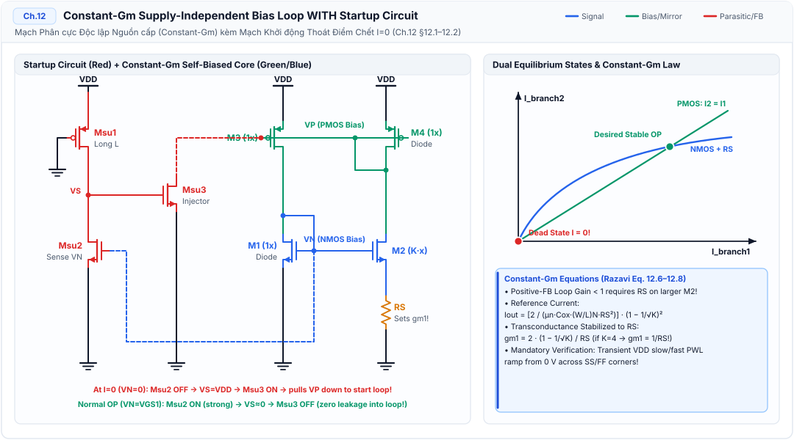

---
{
  "id": "skill-bandgap-startup-curvature-montecarlo-tb",
  "kind": "skill",
  "domain": "eda-and-github-skills",
  "title_vi": "Bộ Testbench Sign-Off Mạch Tham chiếu Bandgap (Bẫy Khởi động I=0, Độ cong Nhiệt độ, Trim & Monte Carlo)",
  "title_en": "Sign-Off Verification Testbench for CMOS Bandgap References (Zero-Current Startup Trap, Box TC, Trim & Monte Carlo)",
  "summary": "Quy trình kiểm định toàn diện không khoan nhượng cho mạch tham chiếu điện áp Bandgap cổ điển 1.2V và phân số dưới 1V (Banba) trên Cadence Spectre 15.1: ép kiểm tra nghiệm suy biến dòng bằng không (nodeset + quét DC hai chiều + bật nguồn chậm/nhanh), đo hệ số nhiệt độ phương pháp hộp (Box-Method ppm/°C), hiệu chuẩn mã trim điện trở nhị phân, kiểm toán phân bố lệch chuẩn Pelgrom Monte Carlo (1+R2/R3)*VOS và kiểm tra ổn định vòng hồi tiếp kép âm-dương.",
  "diagram": "../../diagrams/supply-independent-bias-startup.svg",
  "razavi_refs": [
    {
      "chapter": 12,
      "section": "12.2-12.8",
      "pages": "509-536",
      "equations": ["12.13", "12.20", "12.33", "12.37", "12.48", "12.66", "12.75"]
    },
    {
      "chapter": 14,
      "section": "14.2.1-14.2.2",
      "pages": "593-602",
      "equations": ["14.75", "14.88"]
    }
  ],
  "github_refs": [
    {
      "repo": "iic-jku/analog-circuit-design",
      "url": "https://github.com/iic-jku/analog-circuit-design/tree/6075ea0ebcf08f5c7f6033a84e9dd3c91450f5e1/content/bias",
      "use": "Nguyên lý tự phân cực hai điểm cân bằng, thiết kế mạch khởi động tự ngắt và bù nhiệt bậc nhất Bandgap"
    },
    {
      "repo": "efabless/cace",
      "url": "https://github.com/efabless/cace/tree/d71c8da5f8d8a5bfb4cfb2640714bdd374a9b84a",
      "use": "Cấu trúc ma trận đo kiểm tự động hóa datasheet cho Bandgap qua đa góc PVT, tốc độ dốc nguồn và Monte Carlo"
    },
    {
      "repo": "Arcadia-1/analog-agents",
      "url": "https://github.com/Arcadia-1/analog-agents/tree/4d6bd218ceff60624d7ee62887787aa83daecdb4",
      "use": "Danh mục kiểm toán tiền/hậu layout cho khối tham chiếu điện áp và nguồn phân cực chống lỗi chết trên silicon"
    }
  ],
  "glossary_codes": ["T011", "T052", "T649", "T788", "T2008", "T2041", "T2067", "T2071", "T2101", "T2153"],
  "process_agnostic": true,
  "roles": {
    "degenerate_state_hunter": "Bộ ba phép thử khắc nghiệt (nodeset ép điểm chết, quét DC lên/xuống có trễ và PWL VDD ramp 1us..100ms) vạch trần bẫy khởi động giả tạo do tụ ký sinh",
    "box_tc_and_trim_engine": "Thuật toán đo độ cong nhiệt độ Box-Method ppm/°C trên [-40, 125] °C và tìm mã cắt tỉa nhị phân (trim code) tại một điểm nhiệt phòng 27 °C",
    "dual_loop_stb_auditor": "Đầu dò stb đặt trên cổng gương PMOS/Op-Amp kiểm chứng biên độ hồi tiếp âm thắng tuyệt đối vòng hồi tiếp dương PTAT trên mọi tần số",
    "montecarlo_vos_decomposer": "Phân tích Monte Carlo tách đóng góp phương sai của Op-Amp VOS, mismatch gương dòng PMOS và mismatch tỷ số BJT/điện trở"
  },
  "symptoms_addressed": [
    "bandgap-wakes-up-in-fast-transient-ramp-but-stays-dead-on-silicon-slow-powerup",
    "startup-branch-fails-to-turn-off-after-wakeup-corrupting-temperature-coefficient",
    "severe-vref-lot-to-lot-and-wafer-spread-from-amplified-opamp-input-offset",
    "internal-bandgap-opamp-ringing-due-to-competing-positive-and-negative-feedback-loops",
    "untrimmed-process-corner-shift-pushing-zero-tc-inflection-point-outside-operating-range"
  ],
  "limitations": [
    "single-temperature-room-trim-corrects-ptat-slope-offset-but-cannot-erase-nonlinear-t-ln-t-curvature",
    "vertical-substrate-pnp-collectors-tied-to-gnd-restrict-topology-choices-in-standard-twin-well-cmos",
    "monte-carlo-accuracy-strictly-depends-on-validated-pdk-statistical-bjt-and-mos-mismatch-models"
  ],
  "checklists": ["common-mos", "bandgap-and-bias", "current-mirror", "differential-pair", "layout-and-matching", "feedback-and-stb"]
}
---

## 1. Tại sao Bandgap Là Khối "Dễ Chết Thầm Lặng Nhất Trên Silicon"?

Trong lịch sử chế tạo chip tương tự và hệ thống trên chip (SoC), **mạch tham chiếu vùng cấm (`T011`, Bandgap Reference — BGR)** đứng đầu danh sách nguyên nhân gây **chết toàn bộ chip ở lần đúc đầu tiên (first-silicon spin failure)**. Sự nguy hiểm của Bandgap không nằm ở công thức cộng $V_{BE} + K V_T \ln n \approx 1{,}25\text{ V}$, mà nằm ở **bốn cơ chế đánh lừa trình mô phỏng SPICE/Spectre** nếu kỹ sư thiết lập testbench ngây thơ:
1. **Ảo giác khởi động nhờ điện dung ký sinh $C_{GD}$:** Khi bật nguồn bằng xung `vpulse` sườn lên nhanh $100\text{ ns}$ trong `tran`, dòng nạp tụ $C_{GD} \frac{dV_{DD}}{dt}$ vô tình mồi cho mạch chạy dù mạch khởi động bị hỏng hoàn toàn! Khi ra bo mạch thật, nguồn LDO ngoài lên chậm trong $20\text{ ms}$ ($\frac{dV_{DD}}{dt} \approx 0$), chip nằm chết vĩnh viễn ở trạng thái dòng $I = 0$!
2. **Rò dòng hậu khởi động (Startup Bleed Contamination):** Ở góc `FF` $125\,^\circ\text{C}$ hoặc `FS`, khóa khởi động không ngắt hẳn mà rò vài trăm $\text{nA}$ vào nút PTAT, bẻ cong hoàn toàn đỉnh parabol nhiệt độ!
3. **Khuếch đại Offset Op-Amp lên $(1 + R_2/R_1) \approx 9\text{–}12$ lần (Razavi §12.3.3, Phương trình 12.33):** Chỉ $3\text{ mV}$ lệch ngẫu nhiên $V_{OS}$ của cặp vi sai CMOS cũng bị nhân thành $\pm 30\text{ mV}$ sai lệch trên $V_{\text{REF}}$ ($\pm 2{,}5\%$), nuốt chửng mọi nỗ lực bù nhiệt tinh vi nếu không kiểm toán Monte Carlo và thiết kế mạng cắt tỉa (trimming)!
4. **Cạnh tranh Vòng Hồi tiếp Dương và Vòng Hồi tiếp Âm:** Mọi lõi Bandgap dùng Op-Amp ép hai nhánh $V_X = V_Y$ đều chứa **đồng thời một vòng hồi tiếp âm và một vòng hồi tiếp dương**! Nếu ở tần số cao (hoặc khi bật nguồn), hệ số hồi tiếp dương vượt qua hệ số hồi tiếp âm, mạch biến thành mạch chốt Schmitt hoặc tự dao động ngầm ở vài chục $\text{MHz}$!



---

## 2. Hệ Phương trình Đo Kiểm Định lượng: Box-TC, Phóng đại Offset & Tỷ số Vòng Kép

### 2.1. Phương trình Chuẩn Của Độ trôi Nhiệt độ Phương pháp Hộp (Box-Method TC)
Vì đường cong $V_{\text{REF}}(T)$ thực tế có dạng parabol úp ngược (hoặc bậc ba chữ S nếu có **hiệu chỉnh độ cong `T2071`**) do số hạng phi tuyến $-(4 - n_{\text{mob}}) V_T \ln(T/T_0)$ của $V_{BE}(T)$ (Razavi Phương trình 12.48, tr. 521), việc chỉ lấy đạo hàm $\partial V_{\text{REF}} / \partial T$ tại $27\,^\circ\text{C}$ là hoàn toàn vô nghĩa! Tiêu chuẩn công nghiệp bắt buộc tính **hệ số nhiệt độ phương pháp hộp (`TC_box`)** trên toàn dải nhiệt độ làm việc $[T_{\min}, T_{\max}]$ (thường $[-40\,^\circ\text{C}, +125\,^\circ\text{C}]$, $\Delta T = 165\,^\circ\text{C}$):

$$
\text{TC}_{\text{box}}\;(\text{ppm}/^\circ\text{C}) = \frac{\max_{T \in [T_{\min}, T_{\max}]} V_{\text{REF}}(T) \;-\; \min_{T \in [T_{\min}, T_{\max}]} V_{\text{REF}}(T)}{V_{\text{REF}}(27\,^\circ\text{C}) \cdot (T_{\max} - T_{\min})} \times 10^6
$$

Với Bandgap bậc nhất chuẩn chưa bù cong bậc cao, giới hạn vật lý lý thuyết tốt nhất trên dải $165\,^\circ\text{C}$ là khoảng **$15\text{–}25\text{ ppm}/^\circ\text{C}$** (tương ứng độ võng hộp $\Delta V_{\text{box}} \approx 3\text{–}5\text{ mV}$ trên nền $1{,}22\text{ V}$).

### 2.2. Ngân sách Phương sai Monte Carlo & Thuật toán Trim 1 Nhiệt độ (1-Point Room-Temp Trim)
Xét lõi Kuijk/Brokaw dùng Op-Amp ép hai nhánh BJT tỷ lệ diện tích $1:n$ qua điện trở $R_1$ và nhân lên bởi $R_2$ (hoặc bản dòng phân số sub-1V Banba $V_{\text{REF}} = R_4 \left(\frac{V_{BE}}{R_{2a}} + \frac{V_T \ln n}{R_1}\right)$, Phương trình 12.75). Khi có điện áp lệch quy về ngõ vào của Op-Amp là $V_{OS}$ và lệch dòng gương PMOS là $\Delta I_P / I_P$ (Razavi Phương trình 12.33, tr. 517):

$$
V_{\text{REF}} \approx V_{BE2} + \left(1 + \frac{R_2}{R_1}\right) \Big( V_T \ln n + V_{OS} \Big)
$$

Suy ra hai hệ quả sống còn cho testbench Monte Carlo và thuật toán cắt tỉa số (digital trim):
1. Vì $V_{OS}$ của Op-Amp CMOS thường không phải là đại lượng thuần PTAT, số hạng $(1 + R_2/R_1) V_{OS}$ vừa làm **dịch mức tuyệt đối $V_{\text{REF}}(27\,^\circ\text{C})$**, vừa làm **nghiêng độ dốc nhiệt độ** đi một lượng $\Delta \text{TC} \propto V_{OS}$! Do đó cặp đầu vào Op-Amp và gương dòng PMOS trong BGR bắt buộc phải định cỡ diện tích $W \times L$ lớn (Pelgrom $\sigma(V_{OS}) < 0{,}8\text{ mV}$, hoặc dùng khóa chuyển mạch khử lệch Chopper/Auto-Zero `tech-chopper-stabilization-vs-autozeroing`).
2. **Quy tắc Trim Thực tế Sản xuất Hàng loạt:** Trên dây chuyền kiểm thử wafer (ATE wafer sort), việc nung/làm lạnh từng con chip ở $-40\,^\circ\text{C}$ và $+125\,^\circ\text{C}$ cực kỳ đắt đỏ! Kỹ thuật công nghiệp là **chỉ đo duy nhất $V_{\text{REF}}$ tại nhiệt độ phòng $T_0 = 27\,^\circ\text{C}$** và chọn mã nhị phân $D_{\text{trim}} \in [0,\; 2^B - 1]$ điều chỉnh mảng điện trở PTAT $R_2(D_{\text{trim}})$ sao cho $V_{\text{REF}}(27\,^\circ\text{C})$ trùng khít với **điện áp ma thuật (`V_magic` $\approx 1{,}225\text{ V}$)** — bởi vì khi cả sự trôi góc của $V_{BE0}$ lẫn độ nghiêng PTAT đều đồng quy về năng lượng vùng cấm ngoại suy $E_{g0}/q$ tại $0\text{ K}$, việc chỉnh đúng mức áp tại $27\,^\circ\text{C}$ sẽ **tự động chỉnh phẳng luôn đạo hàm nhiệt độ bậc nhất**!

### 2.3. Điều kiện Ổn định Tuyệt đối Của Vòng Hồi tiếp Kép Âm – Dương
Khi đặt một `iprobe` nối tiếp ngay tại ngõ ra của Op-Amp lõi (lái chung cổng các nguồn dòng PMOS bơm xuống hai nhánh $X$ tại cực phát BJT $Q_1$ trực tiếp và nhánh $Y$ qua $R_1$ nối tiếp $Q_2$), độ lợi vòng tổng cộng $T_{\text{net}}(s)$ mà `stb` đo được chính là hiệu giữa nhánh hồi tiếp âm và nhánh hồi tiếp dương:

$$
T_{\text{net}}(s) = A_{\text{op}}(s) \cdot g_{mP}(s) \cdot \Big[ R_{\text{branch,neg}}(s) - R_{\text{branch,pos}}(s) \Big]
$$

Tại DC, nhánh chứa $R_1 + 1/g_{m,Q2}$ có trở kháng lớn hơn nhánh chỉ chứa $1/g_{m,Q1}$ một lượng đúng bằng $R_1$, đảm bảo hồi tiếp âm thắng thế ($\beta_{\text{net}} > 0$). Nhưng ở tần số cao, nếu tụ ký sinh tại nút $X$ và nút $Y$ không cân xứng làm pha của $R_{\text{branch,neg}}(j\omega)$ trễ nhanh hơn $R_{\text{branch,pos}}(j\omega)$, hiệu số trong ngoặc vuông có thể **đảo dấu sang hồi tiếp dương trước khi $|A_{\text{op}}(j\omega)|$ kịp lăn xuống dưới $0\text{ dB}$**! Do đó bắt buộc phải kiểm tra cả đồ thị Bode lẫn **đường cong cực Nyquist** (`nyquist-polar-stability.svg`) của `stb` trên lõi Bandgap!

---

## 3. Bất biến Kiểm chứng & Các Bẫy Lỗi Chết Silicon (Invariants & Traps)

- **[INV-BGR-01] Ba Phép Thử Bắt Sống Nghiệm Suy biến $I = 0$ (Zero-Current Trap Triad):** Một mạch khởi động Bandgap CHỈ được phép ký duyệt (PASS) khi vượt qua đồng thời cả **3 bài kiểm tra độc lập** trên mọi góc PVT:
  1. **Quét DC hai chiều (`dc` hysteresis sweep):** Quét $V_{DD}$ từ $0\text{ V} \to V_{DD,\max}$ (kiểm tra áp đánh thức $V_{DD,\text{wake}} \le 0{,}85\,V_{DD,\min}$) VÀ quét ngược từ $V_{DD,\max} \to 0\text{ V}$.
  2. **Quá độ sườn nguồn siêu chậm (`tran` ultra-slow ramp):** Dùng nguồn `vsource type=pwl` tăng tuyến tính từ $0\text{ V}$ lên $V_{DD,\min}$ trong **$50\text{ ms}$** (loại bỏ $100\%$ dòng mồi giả tạo $C \frac{dV}{dt}$) VÀ một phép thử sườn nhanh **$1\text{ }\mu\text{s}$** (kiểm tra vọt lố không chốt SCR/dao động).
  3. **Cưỡng bức nghiệm chết (`nodeset` / `ic` injection trap):** Ép điều kiện đầu nút cổng gương PMOS $= V_{DD}$, nút cổng gương NMOS $= 0\text{ V}$, $V_X = V_Y = 0\text{ V}$ lúc $V_{DD}$ đã đứng yên ở $V_{DD,\min}$, chạy `tran` và xác minh nhánh khởi động tự lôi mạch bật dậy trong $< 50\text{ }\mu\text{s}$!
- **[INV-BGR-02] Bất biến Ngắt Sạch Nhánh Khởi động Sau Đánh thức ($I_{\text{leak,startup}} < 1\text{ nA}$):** Sau khi $V_{\text{REF}}$ đã xác lập, dòng chảy từ nhánh khởi động tiêm vào lõi chính ở góc xấu nhất (`FF` / `FS`, $V_{DD,\max}$, $125\,^\circ\text{C}$) phải nhỏ hơn **$0{,}01\%$ dòng nhánh PTAT** (thường $< 0{,}5\text{–}1\text{ nA}$).
- **[TRAP-BGR-01] Bẫy Đấu Tụ Lọc Ngõ Ra $C_{\text{load}}$ Làm Mất Ổn định Ngầm Banba Sub-1V BGR:** Trong Bandgap chế độ dòng dưới $1\text{ V}$ (Hình 12.33), ngõ ra $V_{\text{REF}}$ chỉ là một nhánh gương dòng PMOS đổ xuống điện trở $R_4$ song song tụ lọc $C_{\text{out}}$ (ngoài vòng hồi tiếp), nên gắn $C_{\text{out}}$ lớn cực kỳ an toàn và giúp lọc sạch nhiễu nhiệt $4kTR_4$. Ngược lại, trong cấu trúc Bandgap xuất áp trực tiếp từ ngõ ra Op-Amp (Hình 12.24), gắn tụ decoupling $C_{\text{out}} = 100\text{ pF}$ trực tiếp lên $V_{\text{REF}}$ sẽ đạp cực ngõ ra Op-Amp sập xuống gây dao động vòng nếu Op-Amp là cấu trúc 2 tầng chưa bù tải lớn!
- **[TRAP-BGR-02] Bẫy Mất Khớp Tỷ số BJT Khi Chọn $n$ Chẵn Hoặc Quên Vòng Dummy PNP:** Trong công nghệ CMOS tiêu chuẩn, BJT là transistor `pnp` dọc ăn xuống đế p-substrate (collector nối cứng $\text{GND}$). Nếu chọn tỷ số $1:n = 1:8$ xếp thành ma trận $3 \times 3$ (ô $Q_1$ nằm chính tâm $(2,2)$, 8 ô $Q_2$ vây kín xung quanh, cộng thêm 1 vòng ngoài gồm 16 ô dummy `pnp` nối tắt xuống đất!), sự đối xứng tâm chung đạt mức hoàn hảo nhất! Chọn $n = 7$ hoặc $n = 10$ làm phá vỡ hình vuông đối xứng tâm và gây sai lệch gradient nhiệt.

---

## 4. Ma trận 6 Bài Kiểm định Sign-Off Của Khối Bandgap Reference

| Mã Bài Đo | Loại Phân tích Spectre | Điều kiện Kích thích & Góc Quét | Chỉ tiêu Đạt Chuẩn (Sign-Off Target) | Hư hỏng Bị Phát hiện |
|---|---|---|---|---|
| **TB-1: Startup Triad** | `dc` + `tran` (PWL $50\text{ ms}$ & $1\text{ }\mu\text{s}$ + `ic`) | 5 góc `{TT,FF,SS,FS,SF}` $\times$ `{-40, 27, 125 °C}` tại $V_{DD,\min}$ | Khởi động $100\%$; $I_{\text{startup,steady}} < 1\text{ nA}$ | Chết chip trên bo mạch thật hoặc rò dòng làm trôi nhiệt |
| **TB-2: Box-TC & Trim** | `dc` quét `temp=-40:1:125` | Quét mã `trim_code=0..15` tại `TT/FF/SS`, chốt mã tại $27\,^\circ\text{C}$ | Sau 1-point trim: $\text{TC}_{\text{box}} \le 25\text{ ppm}/^\circ\text{C}$ | Dải trim không đủ phủ góc `SS`/`FF` hoặc bước trim quá thô |
| **TB-3: Line Regulation** | `dc` quét `vdd=Vmin..Vmax` | 5 góc $\times$ 3 nhiệt độ | $\Delta V_{\text{REF}} / \Delta V_{DD} \le 1{,}5\text{ mV/V}$ | Lộ thiếu cascode gương PMOS làm dòng phụ thuộc $V_{DD}$ |
| **TB-4: Loop Stability** | `stb` (`iprobe` tại cổng gương PMOS) | Đóng vòng thực, quét $C_{\text{decouple}} = 0\text{..}100\text{ pF}$ | $\text{PM} \ge 60^\circ$, $\text{GM} \ge 12\text{ dB}$, Nyquist không bao $(-1,0)$ | Dao động tự kích giữa nhánh hồi tiếp dương và âm |
| **TB-5: PSRR & Noise** | `xf` / `ac` trên nguồn + `noise` | $f = 1\text{ Hz}..1\text{ GHz}$ | $\text{PSRR}(1\text{ kHz}) \ge 60\text{ dB}$; tích phân nhiễu $[0{,}1\text{ Hz}, 10\text{ Hz}]$ & băng rộng đạt chuẩn ADC/PLL | Xuyên nhiễu nguồn qua $C_{GD}$ gương PMOS xuống nút $V_{\text{REF}}$ |
| **TB-6: Monte Carlo** | `montecarlo` (`variations=all`, $N=200$) | Tại $27\,^\circ\text{C}$ (chưa trim) & quét `temp` (đã trim 1 điểm) | $3\sigma(V_{\text{REF,untrimmed}}) / \mu \le 3{,}0\%$ (nằm gọn trong dải bù của mảng trim!) | Cặp đầu vào Op-Amp quá nhỏ làm $V_{OS}$ tràn biên trim |

---

## 5. Mẫu Testbench Spectre 15.1 Hoàn chỉnh & Kịch bản Python Hiệu chuẩn Mã Trim

### 5.1. Netlist Testbench Spectre 15.1 Kiểm tra Khởi động Chậm, Độ cong Nhiệt & `stb`
```spice
// tb_bgr_signoff.scs — Spectre 15.1 Complete Bandgap Verification Deck
simulator lang=spectre
global 0
parameters vdd_nom=1.2 vdd_min=1.08 vdd_max=1.32 trim_code=8

// Nguồn PWL bật siêu chậm 50 ms để triệt tiêu mồi điện dung C*dV/dt, sau đó giữ ổn định
VDD_SRC (vdd 0) vsource dc=vdd_nom mag=1 type=pwl \
    wave=[0 0 50m vdd_min 55m vdd_min 56m vdd_max 60m vdd_nom]

// Đặt IPR_LOOP (opamp_out pmos_mirror_gate) iprobe bên trong subckt BGR để đo tổng lợi vòng!
// Cưỡng bức thử nghiệm bẫy điểm chết khi chạy bài test ic_trap:
ic XBGR.pmos_mirror_gate=vdd_min XBGR.vx=0 XBGR.vy=0

// 1. Quét DC nguồn cấp kiểm tra ngưỡng đánh thức V_wake
dc_vdd  dc param=vdd_nom start=0 stop=1.4 step=5m

// 2. Quét DC nhiệt độ mịn 1 °C phục vụ tính chính xác cực đại/cực tiểu Box-Method TC
dc_temp dc temp start=-40 stop=125 step=1

// 3. Phân tích ổn định vòng hồi tiếp nội bộ và xuyên nhiễu nguồn PSRR + Nhiễu tích phân
stb_bgr   stb start=1 stop=1G dec=40 probe=XBGR.IPR_LOOP
ac_psrr   ac  start=1 stop=1G dec=30
noise_bgr noise (vref 0) iprobe=VDD_SRC start=0.1 stop=10M dec=20

// 4. Mô phỏng quá độ sườn nguồn 50 ms kiểm chứng khởi động thực trên silicon
tran_slow_ramp tran stop=65m errpreset=conservative maxstep=50u write="spectre.ic"
```

### 5.2. Kịch bản Python Tính Box-Method TC & Tự động Chọn Mã Trim 1 Điểm Tại $27\,^\circ\text{C}$
Đoạn mã Python chuẩn dưới đây nhận họ đường cong $V_{\text{REF}}(T, D_{\text{trim}})$ xuất từ quét tham số Spectre/OCEAN, thực hiện đúng quy trình ATE công nghiệp (chỉ nhìn giá trị tại $27\,^\circ\text{C}$ để chốt mã trim!) rồi báo cáo $\text{TC}_{\text{box}}$ trước và sau khi trim:

```python
# Chạy với: PYTHONDONTWRITEBYTECODE=1 python -B evaluate_bgr_trim_and_tc.py
def compute_box_tc_ppm(temps_c, vref_volts, ref_temp_c=27.0):
    if len(temps_c) != len(vref_volts) or len(temps_c) < 3:
        raise ValueError("Dữ liệu nhiệt độ không hợp lệ — trạng thái NOT VERIFIED")
    t_span = float(max(temps_c) - min(temps_c))
    # Tìm giá trị gần 27 °C nhất làm mẫu số chuẩn hóa
    idx_27 = min(range(len(temps_c)), key=lambda i: abs(temps_c[i] - ref_temp_c))
    v_27 = float(vref_volts[idx_27])
    if v_27 <= 0.05:
        return {"status": "DEAD_ZERO_STATE", "v27_V": v_27, "tc_box_ppm": float("inf")}
    v_max, v_min = max(vref_volts), min(vref_volts)
    tc_ppm = ((v_max - v_min) / (v_27 * t_span)) * 1.0e6
    return {
        "status": "ACTIVE",
        "v27_V": round(v_27, 6),
        "delta_box_mV": round((v_max - v_min) * 1e3, 3),
        "tc_box_ppm": round(tc_ppm, 2),
    }

def calibrate_single_point_room_trim(temps_c, sweep_by_code, v_magic_target):
    """Chọn mã trim duy nhất dựa trên phép đo ở 27 °C, sau đó chấm điểm TC toàn dải."""
    idx_27 = min(range(len(temps_c)), key=lambda i: abs(temps_c[i] - 27.0))
    best_code = min(
        sweep_by_code.keys(),
        key=lambda code: abs(sweep_by_code[code][idx_27] - v_magic_target),
    )
    post_trim_report = compute_box_tc_ppm(temps_c, sweep_by_code[best_code])
    post_trim_report["selected_trim_code"] = best_code
    post_trim_report["v27_error_mV"] = round((sweep_by_code[best_code][idx_27] - v_magic_target) * 1e3, 3)
    return post_trim_report
```

---

## 6. Đối chiếu Sách Razavi, Nguồn GitHub Đã Kiểm định & Thuật ngữ Chuẩn CLB

### 6.1. Mốc Tọa độ Sách Razavi (2nd Edition) & Nguồn GitHub
- **Chương 12:** §12.2 *Supply-Independent Biasing & Startup* (tr. 509–513, Hình 12.4–12.6), §12.3.1–12.3.3 *Temperature-Independent References & CMOS Bandgap Core* (tr. 513–523, Phương trình 12.13, 12.20, 12.33, 12.48 — chú ý hiệu đính học thuật về nhân lệch $V_{OS}$), §12.6 *Speed and Noise Issues* (tr. 525–529), §12.7 *Low-Voltage Bandgap References* (tr. 529–533, Phương trình 12.66–12.75, Hình 12.32–12.33).
- **Chương 14:** §14.2.1–14.2.2 *Pelgrom Mismatch & Offset Cancellation* (tr. 593–602).
- **Kho GitHub Đối chiếu:** `iic-jku/analog-circuit-design` (`6075ea0ebc`, mục `bias`), `efabless/cace` (`d71c8da5f8`, khung kiểm thử datasheet tự động cho Bandgap qua góc PVT và Monte Carlo) và `Arcadia-1/analog-agents` (`4d6bd218ce`).

### 6.2. Bảng Thuật ngữ Chuẩn CLB Vi Mạch
| Mã CLB | Thuật ngữ Tiếng Anh | Thuật ngữ Tiếng Việt Chuẩn | Vai trò Trong Testbench |
|---|---|---|---|
| `T011` / `T2067` | bandgap reference / bandgap voltage | mạch tham chiếu vùng cấm / điện áp vùng cấm tương đương | Khối tạo điện áp chuẩn độc lập PVT xấp xỉ $1{,}22\text{–}1{,}25\text{ V}$ (hoặc phân số) |
| `T2008` | supply-independent biasing | phân cực độc lập nguồn cấp | Vòng tự khóa dòng sinh ra điểm cân bằng suy biến $I = 0$ phải kiểm tra khởi động |
| `T2041` | PTAT voltage | điện áp PTAT | Điện áp $\Delta V_{BE} = V_T \ln n$ dùng để bù trừ hệ số nhiệt âm của $V_{BE}$ |
| `T2071` | Curvature Correction | hiệu chỉnh độ cong đặc tính nhiệt | Kỹ thuật nén độ võng phi tuyến $T \ln T$ xuống dưới $10\text{ ppm}/^\circ\text{C}$ |
| `T2101` | Low-Voltage Bandgap References | mạch tham chiếu bandgap điện áp thấp | Kiến trúc cộng dòng trên điện trở tải tạo $V_{\text{REF}} < 1\text{ V}$ cho công nghệ nanomet |
| `T788` / `T2153` | input-referred offset voltage / Pelgrom's law | điện áp lệch quy về ngõ vào / định luật Pelgrom | Nguồn gốc gây phân tán $V_{\text{REF}}$ giữa các vi mạch buộc phải kiểm toán Monte Carlo |
