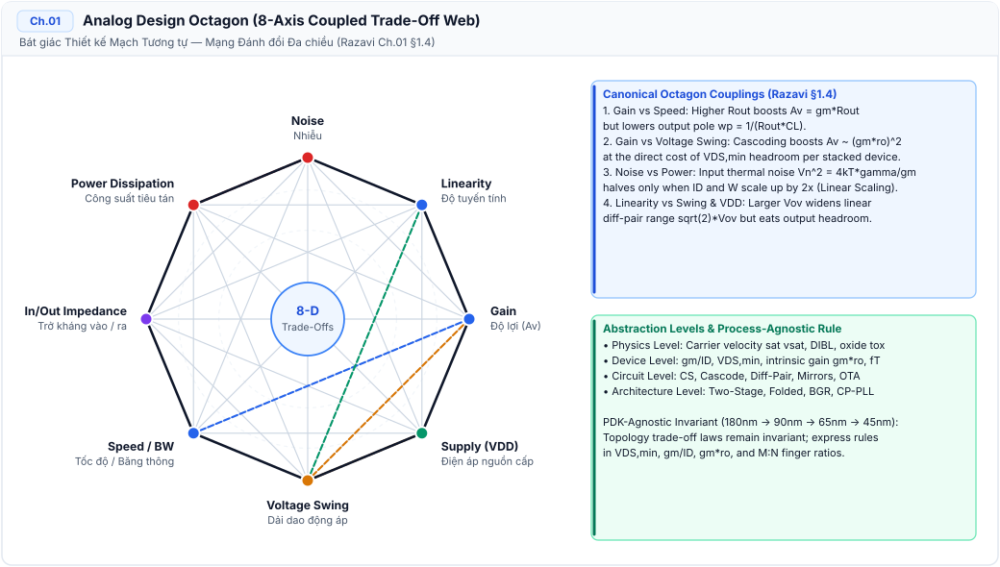

---
{
  "id": "skill-cace-spec-driven-characterization-contract",
  "kind": "skill",
  "domain": "eda-and-github-skills",
  "title_vi": "Đặc tính Hóa Theo Hợp đồng Datasheet (CACE): Ma trận Hồi quy Đa Góc PVT, Thống kê Monte Carlo Cpk & Kỷ luật Sign-Off",
  "title_en": "Datasheet-Driven Characterization Contract (CACE Flow): Multi-Corner PVT Matrix, Monte Carlo Cpk Yield & Sign-Off Discipline",
  "summary": "Kiến trúc kiểm chứng hồi quy tự động lấy đặc tả Datasheet làm hợp đồng pháp lý (chuyển dịch từ chuẩn mở Efabless CACE sang Cadence Virtuoso IC617 + Spectre 15.1): định nghĩa tệp hợp đồng máy đọc được ràng buộc chặt từng chỉ tiêu {min, typ, max, unit} với đúng testbench, quét ma trận tổ hợp đầy đủ 45 góc PVT ({TT, FF, SS, FS, SF} x {Vmin, Vnom, Vmax} x {-40, 27, 125 °C}), tính chỉ số năng lực quy trình Cpk từ N=200 mẫu Monte Carlo mismatch, đối chiếu song song Schematic vs Post-Layout PEX, và áp đặt kỷ luật chống gian lận số đo.",
  "diagram": "../../diagrams/analog-design-octagon.svg",
  "razavi_refs": [
    {
      "chapter": 1,
      "section": "1.4-1.5",
      "pages": "5-6",
      "equations": []
    },
    {
      "chapter": 9,
      "section": "9.1",
      "pages": "345-349",
      "equations": []
    },
    {
      "chapter": 14,
      "section": "14.2.1",
      "pages": "593-598",
      "equations": [
        "14.75",
        "14.79"
      ]
    },
    {
      "chapter": 17,
      "section": "17.3.7-17.4",
      "pages": "707-710",
      "equations": [
        "17.52",
        "17.53"
      ]
    }
  ],
  "github_refs": [
    {
      "repo": "efabless/cace",
      "url": "https://github.com/efabless/cace",
      "use": "Kiến trúc Circuit Automatic Characterization Engine: biểu diễn datasheet dưới dạng hợp đồng máy đọc được và tự động hóa ma trận PVT + Monte Carlo + Schematic/PEX"
    },
    {
      "repo": "Arcadia-1/analog-agents",
      "url": "https://github.com/Arcadia-1/analog-agents",
      "use": "Kỷ luật tách biệt vai trò người thiết kế với trình kiểm toán độc lập (anti-spec-tampering & fail-loud audit)"
    },
    {
      "repo": "Arcadia-1/razavi-bench",
      "url": "https://github.com/Arcadia-1/razavi-bench",
      "use": "Thang đo định lượng chuẩn hóa không mơ hồ đối với các chỉ tiêu hiệu năng của khối mạch tương tự"
    },
    {
      "repo": "iic-jku/Circuit-Designers-Etiquette",
      "url": "https://github.com/iic-jku/Circuit-Designers-Etiquette",
      "use": "Tiêu chuẩn bàn giao hồ sơ thiết kế mạch tương tự trước khi phê duyệt tape-out"
    }
  ],
  "glossary_codes": [
    "T051",
    "T052",
    "T063",
    "T079",
    "T527",
    "T788",
    "T1944",
    "T2153",
    "T2185",
    "T2186"
  ],
  "process_agnostic": true,
  "roles": {
    "spec_contract_manifest": "Tệp đặc tả trung tâm (JSON/YAML bất biến do kiến trúc sư hệ thống khóa cứng) liệt kê toàn bộ chỉ tiêu min/typ/max, đơn vị vật lý, công thức trích xuất và điều kiện biên môi trường",
    "pvt_matrix_generator": "Bộ sinh tổ hợp tự động quét đầy đủ 5 góc quy trình {TT/NN, FF, SS, FS, SF} nhân với 3 mức nguồn cấp và 3 điểm nhiệt độ cực trị, kèm các góc chuyên biệt (như bật nguồn chậm cho Bandgap)",
    "montecarlo_yield_auditor": "Bộ đánh giá thống kê năng lực sản xuất (Process Capability Index Cpk và phân vị 3-sigma) từ tập mẫu ngẫu nhiên Pelgrom mismatch + biến thiên lô (process + mismatch)",
    "fail_loud_gatekeeper": "Cổng kiểm tra toàn vẹn dữ liệu từ chối thẳng mọi kết quả thiếu điểm cắt 0 dB, chứa NaN/Inf, chưa hội tụ DC/PSS hoặc chưa đối chiếu trên bản trích xuất ký sinh PEX"
  },
  "symptoms_addressed": [
    "circuit-passes-nominal-tt-27c-simulation-but-fails-catastrophically-at-ss-vddmin-125c-or-skewed-fs-sf-corners",
    "manual-ad-hoc-ade-clicking-forgets-to-reverify-cmrr-noise-or-startup-after-a-late-stage-sizing-tweak",
    "automated-sizing-loop-cheats-by-reading-wrong-gain-polarity-or-treating-missing-zero-crossing-as-infinite-phase-margin",
    "gaussian-mean-plus-3sigma-assumption-hides-non-gaussian-tail-failures-in-bandgap-startup-or-comparator-metastability",
    "confusing-gpdk090-nn-section-naming-with-gpdk045-tt-section-naming-causes-silent-wrong-corner-includes"
  ],
  "limitations": [
    "full-45-corner-pvt-plus-200-run-post-layout-monte-carlo-matrix-is-compute-intensive-requiring-tiered-smoke-vs-signoff-schedules",
    "corner-models-sometimes-over-conservatively-bound-uncorrelated-passive-r-c-extremes-unless-combined-with-statistical-mc",
    "cace-yaml-native-cli-targets-ngspice-by-default-so-cadence-ic617-deployments-use-an-ocean-or-python-psf-adapter-implementing-the-same-contract"
  ],
  "checklists": [
    "common-mos",
    "feedback-and-stb",
    "layout-and-matching"
  ]
}
---

## 1. Triết lý "Datasheet Là Hợp Đồng Pháp Lý Duy Nhất" (Từ Efabless CACE Đến Cadence Sign-Off)

Trong quá trình tối ưu hóa mạch tương tự trên **Bát giác Thiết kế 8 Trục (Razavi Chương 1, §1.4)**, mọi tham số đều giằng chéo nhau: nâng chiều dài kênh $L$ để cứu độ lợi $A_0$ ở góc `FF` thì lại kéo tụt cực phụ làm hỏng dự trữ pha ở góc `SS / -40 °C`; thu nhỏ dòng tĩnh để đạt chỉ tiêu công suất thì làm tốc độ biến thiên cực đại (`Slew Rate`) trượt dưới ngưỡng yêu cầu khi tụ tải $C_L$ tăng $+20\%$! Nếu người kỹ sư (hoặc tác tử tự động hóa AI) kiểm tra mạch bằng cách bấm chạy thủ công từng phép đo rời rạc ở điểm danh định `TT, 27 °C, VDD_nom`, mỗi lần sửa kích thước $W/L$ để vá một lỗi sẽ **âm thầm làm thủng hai chỉ tiêu khác ở góc biên** mà không ai hay biết cho tới ngày silicon từ nhà máy trả về chết hàng loạt!



Khung mã nguồn mở **CACE (`efabless/cace` — Circuit Automatic Characterization Engine)** đã chuẩn hóa một triết lý công nghiệp tối quan trọng mà mọi dự án trên **Cadence Virtuoso IC617 + Spectre 15.1** cần áp dụng triệt để: **Datasheet-Driven Characterization Contract (Hợp đồng Đặc tính Hóa Dẫn dắt bởi Datasheet)**:
1. **Tách Biệt Tuyệt Đối Tệp Đặc Tả Khỏi Kịch Bản Sửa Mạch:** Toàn bộ mục tiêu hiệu năng (`min`, `typ`, `max`, đơn vị chuẩn SI, tên testbench đo lường và không gian điều kiện biên) được khóa cứng trong một tệp hợp đồng `datasheet_contract.json` có mã băm kiểm soát phiên bản — người thiết kế hay vòng lặp tối ưu chỉ được sửa kích thước linh kiện mạch, **tuyệt đối không được nới lỏng hợp đồng**!
2. **Hồi Quy Toàn Bộ Ma Trận Chỉ Với Một Lệnh Duy Nhất:** Mọi ứng viên thiết kế muốn được công nhận là `PASS` phải vượt qua đồng thời tất cả các bài kiểm tra trên ma trận tổ hợp **PVT + Monte Carlo + Hậu kiểm PEX**, xuất ra bảng tổng hợp giống hệt một tờ Datasheet thương mại của TI / ADI!
3. **Kỷ Luật Báo Lỗi Tường Minh (`Fail-Loud / NOT VERIFIED`):** Bất kỳ phép đo nào thiếu tệp kết quả `.raw`, không hội tụ, xuất hiện `NaN`/`Inf`, hoặc không tìm thấy giao điểm cắt ngưỡng $0\text{ dB}$ đều bị gắn nhãn **`FAIL / NOT VERIFIED`** ngay lập tức thay vì đoán mò hay gán số mặc định!

---

## 2. Cơ sở Toán học Của Không gian Góc Quy trình PVT, Thống kê Năng lực $C_{pk}$ & Xác suất Đạt Yield

### 2.1. Cấu trúc Ma trận Góc Quy trình (`T2186`) & Ý nghĩa Vật lý Của Các Góc Lệch Chéo `FS` / `SF`
Theo Razavi Chương 17 (§17.3.7–§17.4, tr. 707–710), do quy trình cấy ion và tạo giếng của NMOS và PMOS sử dụng các bước mặt nạ độc lập một phần, một lô wafer thực tế không chỉ rơi vào hai cực đồng hướng **Nhanh–Nhanh (`FF`: $V_{TH}$ thấp, $t_{\text{ox}}/\Delta L$ mỏng)** hay **Chậm–Chậm (`SS`: $V_{TH}$ cao, dòng bão hòa yếu)**, mà còn có thể rơi vào **hai góc lệch chéo (`Skewed Corners`)**:
- **`FS` (Fast NMOS, Slow PMOS)** và **`SF` (Slow NMOS, Fast PMOS)**: Đây là hai góc nguy hiểm bậc nhất đối với các mạch dựa trên sự cân bằng giữa nhánh kéo lên PMOS và nhánh kéo xuống NMOS! Cụ thể: (a) trong Folded-Cascode OTA, sự lệch pha giữa nguồn đuôi PMOS và nguồn dòng gập NMOS tại `FS/SF` có thể làm cạn kiệt dòng nhánh cascode $I_{\text{cas}} = I_{\text{fold}} - I_{SS}/2$; (b) trong bộ đệm đẩy–kéo Class-AB và cổng truyền dẫn CMOS, điểm chuyển mạch bị xô lệch mạnh gây méo hài chẵn $\text{HD}_2$; (c) trong mạch tạo xung không chồng lấn, độ trễ cổng đảo bất đối xứng ăn lẹm khoảng chết!

Một ma trận **Sign-Off PVT cơ sở** cho khối tương tự trên GPDK090 / GPDK045 / 180nm là tích Đề-các 3 chiều (tổng cộng $5 \times 3 \times 3 = 45$ góc môi trường, cộng thêm biến thiên $\pm 15\%\text{–}20\%$ của điện trở/tụ thụ động nếu PDK tách riêng section `res_min/max`, `cap_min/max`):

$$
\mathcal{M}_{\text{PVT}} = \underbrace{\{\text{TT/NN},\; \text{FF},\; \text{SS},\; \text{FS},\; \text{SF}\}}_{\text{5 góc MOSFET}} \;\times\; \underbrace{\{0{,}9\,V_{DD},\; 1{,}0\,V_{DD},\; 1{,}1\,V_{DD}\}}_{\text{3 biên điện áp nguồn }\pm 10\%} \;\times\; \underbrace{\{-40\,^\circ\text{C},\; +27\,^\circ\text{C},\; +125\,^\circ\text{C}\}}_{\text{3 điểm nhiệt độ công nghiệp/ô-tô}}
$$

*(Mẹo cực nhanh cho vòng lặp thiết kế hàng ngày — **Tier-1 Smoke Matrix 9 góc**: chạy trước điểm danh định `(TT, Vnom, 27°C)` cùng 8 góc đỉnh hộp khắc nghiệt nhất: `{FF, SS, FS, SF} x {(Vmin, 125°C), (Vmax, -40°C)}` cộng riêng góc `(SS, Vmin, -40°C)` — vì ở $-40\,^\circ\text{C}$, điện áp ngưỡng $|V_{TH}|$ tăng cao nhất làm dễ sập khoảng dự trữ bão hòa `VDS - Vdsat` nhất, trong khi ở $+125\,^\circ\text{C}$, độ linh động $\mu(T) \propto T^{-1{,}5}$ giảm mạnh nhất làm $g_m$ và $\text{GBW}$ thấp nhất!)*

### 2.2. Chỉ số Năng lực Quy trình $C_{pk}$ & Định cỡ Cỡ Mẫu Monte Carlo `process + mismatch`
Các góc cố định `FF/SS` chỉ đại diện cho sự dịch chuyển đồng loạt toàn cục trên mặt wafer (`global / lot-to-lot variation`), hoàn toàn **vô hình trước sai lệch ngẫu nhiên cục bộ giữa hai transistor nằm sát cạnh nhau** (`local Pelgrom mismatch`, Razavi §14.2.1)! Vì vậy đối với mọi chỉ tiêu phụ thuộc sự đối xứng (như điện áp lệch ngõ vào $V_{OS}$, sai số điện áp Bandgap $V_{\text{REF}}$, độ lệch bước mã DNL/INL của SAR CDAC, vạch giả tham chiếu Charge Pump và ngưỡng lật bộ so sánh), bắt buộc chạy mô phỏng thống kê **Monte Carlo (`variations=all` hoặc `mismatch`)** với $N_{\text{MC}} \ge 200$ lần chạy độc lập!

Gọi $\hat{\mu}$ và $\hat{\sigma}$ là kỳ vọng mẫu và độ lệch chuẩn mẫu của chỉ tiêu $X$ thu được từ $N_{\text{MC}}$ lần chạy, với cận đặc tả dưới $\text{LSL}$ (`min`) và cận đặc tả trên $\text{USL}$ (`max`). **Chỉ số năng lực quy trình sản xuất $C_{pk}$** được định nghĩa là:

$$
C_{pk} = \min\!\left( \frac{\text{USL} - \hat{\mu}}{3\,\hat{\sigma}},\; \frac{\hat{\mu} - \text{LSL}}{3\,\hat{\sigma}} \right)
$$

- Nếu $C_{pk} < 1{,}00$: Phân bố chạm ra ngoài biên đặc tả trong phạm vi $\pm 3\sigma$ $\implies$ tỷ lệ hỏng > $0{,}27\%$ (**KHÔNG ĐẠT**).
- Nếu $C_{pk} \ge 1{,}33$ (tương đương dự trữ $\pm 4\sigma$ khi tâm cân bằng): Khoảng tin cậy $95\%$ của $C_{pk}$ với $N_{\text{MC}} = 200$ mẫu có sai số chuẩn $\approx \pm \frac{C_{pk}}{\sqrt{2 N_{\text{MC}}}} = \pm 6{,}6\%$, đảm bảo xác suất đạt năng suất sản xuất **Yield $\ge 99{,}99\%$** (**ĐẠT CHUẨN SIGN-OFF**)!
- Đối với các biến phân bố lệch không chuẩn (ví dụ độ lớn tuyệt đối $|V_{OS}|$ tuân theo phân bố nửa chuẩn folded-normal, hoặc thời gian khởi động Bandgap), ngoài $C_{pk}$ phải kiểm tra trực tiếp **phân vị mẫu không tham số (`99.5th percentile` và `max` trên 200 mẫu)**!

---

## 3. Bất biến Kỹ thuật & Kỷ luật Chống Gian lận Số đo (`Anti-Cheat Verification Invariants`)

- **[INV-CACE-01] Bất biến Đồng nhất Bảng Ánh Xạ Tên Góc Theo Từng Bộ PDK Cụ Thể:** Không bao giờ viết cứng tên chuỗi `"tt"` dùng chung mù quáng cho mọi công nghệ! Ví dụ thực tế đã kiểm định trên hệ thống Cadence GPDK: trong **`gpdk045`**, các section mô hình đặt tên chữ thường `tt`, `ff`, `ss`, `fs`, `sf`, `mc`; ngược lại trong **`gpdk090`**, góc danh định đặt tên là **`NN` (Nominal–Nominal)** cùng chữ hoa `SS`, `SF`, `FS`, `FF` (và nhánh `_highPerf`)! Tệp hợp đồng đặc tính hóa bắt buộc đi kèm một bảng ánh xạ `pdk_corner_map` đã được xác thực băm tệp model `.scs` thực tế trước khi khởi chạy!
- **[INV-CACE-02] Bất biến Giữ Cố định Hạt giống Ngẫu nhiên (`mc_seed`) Để Tái lập Đối chứng Trước–Sau:** Khi chạy $N_{\text{MC}} = 200$ mẫu Monte Carlo trong Spectre (`seed=12345 firstrun=1 numruns=200`), luôn khóa cố định `seed` trong hợp đồng. Nhờ đó, nếu mẫu thứ `#137` bị trượt khởi động Bandgap, bạn có thể chạy lại **đúng một mẫu duy nhất `firstrun=137 numruns=1`** trong $2\text{ giây}$ để mở toàn bộ sóng nội bộ chẩn đoán nguyên nhân và xác nhận bản sửa đã cứu sống đúng mẫu `#137` đó!
- **[TRAP-CACE-01] Bẫy "Đạt Giả Tạo" Do Hàm Đo `cross()` Trả Về `nil` Hoặc Đọc Sai Cực Tính Vòng:** Trong OCEAN/Python, nếu một bộ khuếch đại bị kẹp bão hòa mất sạch độ lợi khiến $|T(j\omega)| < 0\text{ dB}$ ở mọi tần số, hàm tìm tần số cắt 0 dB `cross(db20(loopGain), 0.0, ...)` trả về `nil` (hoặc `None`); một kịch bản cẩu thả viết `if pm == nil or pm > 60` sẽ chấm nhầm mạch chết thành mạch siêu ổn định! Hợp đồng CACE bắt buộc kiểm tra chuỗi điều kiện liên hoàn: **(1) Mọi transistor chính đúng vùng hoạt động DC $\to$ (2) $A_0 \ge A_{0,\min} > 0\text{ dB}$ $\to$ (3) Tồn tại hữu hạn duy nhất $f_{\text{UGF}} > 0$ $\to$ (4) $\text{PM}(f_{\text{UGF}}) \ge \text{PM}_{\min}$**!
- **[TRAP-CACE-02] Bẫy Gộp Chung Điện dung Lọc Nguồn Lý tưởng Vào Mọi Testbench Làm Che Khuất PSRR & Tương tác Trở kháng Nguồn:** Nếu testbench đo AC/Tran dùng nguồn lý tưởng `vsource` nội trở $0\text{ }\Omega$ cho cả `VDD` và `VREF`, bạn sẽ không bao giờ thấy hiện tượng tự kích qua đường phân cực chung hay sụt ENOB do gợn tham chiếu! Hợp đồng sign-off cấp khối phải có ít nhất một bài kiểm tra gắn trở kháng nguồn/cuộn cảm dây hàn thực tế ($L_{\text{bond}} \approx 1\text{–}2\text{ nH} + R_{\text{esr}}$) trên đường cấp nguồn!

---

## 4. Cấu trúc Ma trận Bài Kiểm tra Bắt buộc Theo Họ Mạch Tương tự (CACE Standard Profiles)

| Họ khối IP tương tự | Bộ bài kiểm tra bắt buộc trong Hợp đồng CACE | Cận kiểm chứng đặc thù bắt buộc có mặt | Chỉ tiêu bắt buộc chạy Monte Carlo (`N=200`) |
|---|---|---|---|
| **Op-Amp / OTA Vi sai** | `op_dc`, `stb_dm`, `stb_cmfb`, `ac_cmrr_psrr`, `noise_in`, `tran_step_large_small` | Đủ 45 góc PVT + tải tụ biến thiên $[0{,}8\,C_L, 1{,}2\,C_L]$; kiểm tra sườn lên & sườn xuống riêng biệt | Điện áp lệch ngõ vào $V_{OS}$, độ lệch mức đồng pha ra $V_{\text{out,CM}}$, dòng tĩnh $I_{DD}$ và $\text{PM}_{\min}$ |
| **Tham chiếu Bandgap (`BGR`)** | `dc_temp_box`, `dc_line_reg`, `tran_startup_slow_fast`, `stb_loop`, `ac_psrr`, `noise_out` | Bật nguồn PWL cả cực chậm ($10\text{ ms}$) lẫn cực nhanh ($100\text{ ns}$) tại `-40 °C`; kiểm tra dòng rò mạch mồi $= 0$ sau khi bật | Điện áp $V_{\text{REF}}(27\,^\circ\text{C})$ trước/sau trim, hệ số nhiệt độ Box-TC ($\text{ppm}/^\circ\text{C}$) và ngưỡng $V_{DD,\text{min,start}}$ |
| **Bộ Ổn áp Tuyến tính (`LDO`)** | `stb_load_sweep`, `dc_load_line_reg`, `dc_dropout`, `tran_load_step`, `ac_psrr_hf`, `noise_integ` | Quét dòng tải lô-ga $I_{\text{load}} \in \{0, 10\text{ }\mu\text{A}, 100\text{ }\mu\text{A}, 1\text{ mA}, I_{\max}\} \times \{R_{\text{esr,min}}, R_{\text{esr,max}}\}$ | Độ chính xác áp ra $V_{\text{OUT}}$, dòng tĩnh không tải $I_Q$ và sụt áp đỉnh $\Delta V_{\text{droop}}$ |
| **SAR ADC / Comparator / SC** | `tran_coherent_fft`, `tran_ramp_hist`, `pss_pnoise_cmp`, `tran_boot_oxide` | Lấy mẫu mạch lạc ở cả $f_{\text{in,low}}$ và sát Nyquist $f_s/2$ với `tranNoise=yes` trên `av_extracted` | DNL/INL cực đại (chống mất mã từ lệch tụ CDAC), offset bộ so sánh sau trim và phân bố SNDR/ENOB |

---

## 5. Mẫu Hợp đồng JSON Chuẩn CACE & Trình Chấm Điểm Hồi Quy Tự động Cho Spectre PSF

### 5.1. Mẫu Tệp Hợp đồng Đặc tả Máy Đọc Được (`cace_folded_cascode_contract.json`)
```json
{
  "schema": "cace-spectre-contract.v1",
  "ip_name": "ota_folded_cascode_pmos_in",
  "pdk": "gpdk090",
  "pdk_corner_map": {
    "TT": "NN", "FF": "FF", "SS": "SS", "FS": "FS", "SF": "SF", "MC": "mc"
  },
  "views_required": ["schematic", "av_extracted"],
  "conditions": {
    "corners": ["TT", "FF", "SS", "FS", "SF"],
    "vdd_v": [1.08, 1.20, 1.32],
    "temp_c": [-40.0, 27.0, 125.0],
    "cload_pf": [2.0],
    "mc_runs": 200,
    "mc_seed": 20261118
  },
  "parameters": [
    {"id": "idd_ua",     "title": "Quiescent Supply Current", "unit": "uA",  "min": 80.0, "typ": 160.0, "max": 220.0, "tb": "tb_dc_stb"},
    {"id": "vds_margin", "title": "Worst Stack Vds - Vdsat",  "unit": "mV",  "min": 35.0, "typ": 85.0,  "max": null,  "tb": "tb_dc_stb"},
    {"id": "a0_db",      "title": "DC Loop Gain",             "unit": "dB",  "min": 56.0, "typ": 64.0,  "max": null,  "tb": "tb_dc_stb"},
    {"id": "ugf_mhz",    "title": "Unity-Gain Bandwidth",     "unit": "MHz", "min": 65.0, "typ": 95.0,  "max": null,  "tb": "tb_dc_stb"},
    {"id": "pm_deg",     "title": "Phase Margin (DM STB)",    "unit": "deg", "min": 55.0, "typ": 66.0,  "max": 88.0,  "tb": "tb_dc_stb"},
    {"id": "vos_3s_mv",  "title": "Input Offset |Vos| (MC)",  "unit": "mV",  "min": null, "typ": 1.2,   "max": 4.5,   "tb": "tb_mc_vos", "cpk_min": 1.33}
  ]
}
```

### 5.2. Trình Chấm Điểm Hợp đồng Nghiêm ngặt Không Phụ thuộc Thư viện Ngoài (`cace_contract_evaluator.py`)
```python
#!/usr/bin/env python3
"""Strict CACE-Style Contract Evaluator with Fail-Loud NaN/Missing Gate & Cpk Calculation."""
import json, math

def evaluate_parameter(spec, pvt_records, mc_samples=None):
    pid = spec["id"]
    lo, hi = spec.get("min"), spec.get("max")
    if not pvt_records:
        return {"id": pid, "status": "NOT_VERIFIED", "reason": "Zero PVT records supplied"}

    vals = []
    worst_fail = None
    for rec in pvt_records:
        v = rec.get("value")
        tag = f"{rec.get('view')}:{rec.get('corner')}/{rec.get('vdd')}V/{rec.get('temp')}C"
        if v is None or isinstance(v, bool) or math.isnan(v) or math.isinf(v):
            return {"id": pid, "status": "NOT_VERIFIED", "reason": f"Invalid/missing measurement at {tag}"}
        vals.append(v)
        if (lo is not None and v < lo) or (hi is not None and v > hi):
            if worst_fail is None:
                worst_fail = f"{tag} -> {v:.4g}"

    report = {
        "id": pid,
        "unit": spec["unit"],
        "measured_min": round(min(vals), 4),
        "measured_max": round(max(vals), 4),
        "pvt_count": len(vals),
        "status": "FAIL" if worst_fail else "PASS",
    }
    if worst_fail:
        report["first_violation"] = worst_fail

    if mc_samples is not None and spec.get("cpk_min") is not None:
        n = len(mc_samples)
        if n < 30 or any(x is None or math.isnan(x) or math.isinf(x) for x in mc_samples):
            report["status"] = "NOT_VERIFIED"
            report["reason"] = "Insufficient or non-finite Monte Carlo samples"
            return report
        mu = sum(mc_samples) / n
        sd = math.sqrt(sum((x - mu) ** 2 for x in mc_samples) / (n - 1))
        cpk_list = []
        if hi is not None and sd > 0:
            cpk_list.append((hi - mu) / (3.0 * sd))
        if lo is not None and sd > 0:
            cpk_list.append((mu - lo) / (3.0 * sd))
        cpk = min(cpk_list) if cpk_list else 0.0
        report["mc_mean"] = round(mu, 4)
        report["mc_sigma"] = round(sd, 4)
        report["cpk"] = round(cpk, 3)
        if cpk < spec["cpk_min"]:
            report["status"] = "FAIL"
    return report
```

### 5.3. Năm Điều Kiện Cổng Cuối Cùng (`Final Tape-Out Sign-Off Checklist`)
```text
[1] Provenance khóa cứng:      Ghi rõ SHA-256 của netlist, tệp model PDK, phiên bản Spectre 15.1 và seed MC
[2] Đủ 2 chế độ view:          100% chỉ tiêu trong hợp đồng đều có cột `schematic` VÀ cột `av_extracted`
[3] Đủ không gian góc PVT:     0 điểm `NOT_VERIFIED` trên toàn bộ 45 góc PVT (kể cả góc chéo FS và SF!)
[4] Đạt năng suất thống kê:    Mọi chỉ tiêu nhạy mismatch đạt Cpk >= 1.33 trên N >= 200 lần chạy Monte Carlo
[5] Kiểm tra độc lập:          Biểu thức đo không bị sửa đổi trong suốt quá trình tinh chỉnh kích thước mạch
```

---

## 6. Đối chiếu Sách Razavi, Nguồn GitHub Đã Kiểm định & Bảng Thuật ngữ Chuẩn CLB

### 6.1. Mốc Tọa độ Chính xác Trong Sách Razavi (2nd Edition) & Kho GitHub
- **Razavi Chương 1, 9, 14 & 17:** §1.4 *Analog Design Octagon* (tr. 5–6 — không gian 8 trục đánh đổi chặt chẽ đòi hỏi kiểm chứng đồng thời mọi chỉ tiêu), §9.1 *General Considerations: Performance Parameters* (tr. 345–349 — định nghĩa hợp đồng đặc tả của Op-Amp), §14.2.1 *Pelgrom's Law* (tr. 593–598, Phương trình 14.75, 14.79 — cơ sở vật lý của thống kê mismatch Monte Carlo), §17.3.7 *Temperature Dependence* & §17.4 *Process Corners* (tr. 707–710, Phương trình 17.52–17.53 — điểm cân bằng nhiệt ZTC và miền bao góc quy trình `SS/FF/FS/SF`).
- **Đối chiếu Nguồn Mở Đã Kiểm Định:**
  - `efabless/cace` (`d71c8da5f8d8`, Apache-2.0): Chuẩn công nghiệp mã nguồn mở về đặc tính hóa tự động hướng hợp đồng datasheet qua đa góc PVT, Monte Carlo và chế độ Schematic/PEX.
  - `Arcadia-1/analog-agents` (`4d6bd218ceff`), `Arcadia-1/razavi-bench` (`30e6a5e3657f`) & `iic-jku/Circuit-Designers-Etiquette` (`e330aea62574`, Apache-2.0): Kỷ luật kiểm toán độc lập chống sửa spec, chuẩn hóa chỉ số đo và quy trình nghiệm thu trước tape-out.

### 6.2. Bảng Thuật ngữ Chuẩn CLB Vi Mạch Sử dụng trong Thẻ
| Mã CLB | Thuật ngữ Tiếng Anh | Thuật ngữ Tiếng Việt Chuẩn | Ý nghĩa Kỹ thuật Cốt lõi |
|---|---|---|---|
| `T1944` / `T2186` | corner of the process / process corners (TT/NN, FF, SS, FS, SF) | góc công nghệ chế tạo / các góc quy trình chế tạo | Năm tổ hợp biên tốc độ NMOS–PMOS phản ánh biến thiên toàn cục giữa các lô wafer |
| `T2185` | zero-temperature-coefficient point, ZTC | điểm phân cực có hệ số nhiệt bằng không (ZTC) | Điểm giao nhau mà sự giảm $|V_{TH}(T)|$ bù trừ sự giảm độ linh động $\mu(T)$ khi nhiệt độ tăng |
| `T052` / `T2153` | mismatch / Pelgrom's law | sai lệch linh kiện / định luật Pelgrom | Sai lệch ngẫu nhiên cục bộ $\sigma \propto 1/\sqrt{W L}$ chỉ có thể kiểm định bằng phân tích thống kê Monte Carlo |
| `T788` | input-referred offset voltage | điện áp lệch quy về ngõ vào | Chỉ tiêu tiêu biểu bắt buộc kiểm soát năng lực quy trình $C_{pk} \ge 1{,}33$ trên tập mẫu ngẫu nhiên |
