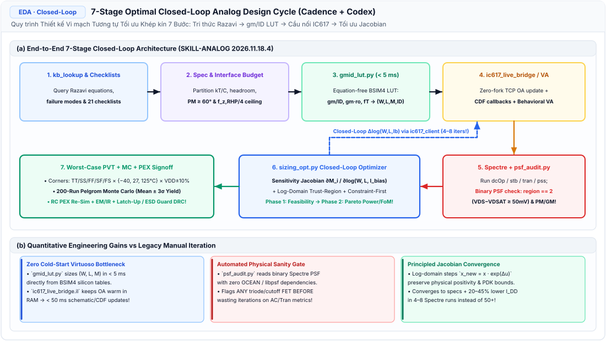

---
{
  "id": "skill-closed-loop-sizing-and-pareto-optimization",
  "kind": "skill",
  "domain": "eda-and-github-skills",
  "title_vi": "Chu trình 7 Giai đoạn Thiết kế Tương tự Khép kín & Tối ưu hóa Vùng tin cậy / Pareto Dẫn hướng Vật lý (sizing_opt.py)",
  "title_en": "7-Stage Closed-Loop Analog Design Cycle & Physics-Pruned Sensitivity / Trust-Region Pareto Optimization",
  "summary": "Playbook tổng thể vận hành Chu trình 7 Giai đoạn Thiết kế Vi mạch Tương tự Tối ưu và công cụ tools/sizing_opt.py (thuần chuẩn Python 2.6.6+): kết hợp bất biến cấu trúc Razavi/Erickson, phân bổ ngân sách chỉ tiêu phân cấp RSS, khởi tạo ấm vật lý bằng gmid_lut.py, giải ma trận độ nhạy đạo hàm riêng không gian logarit (Sensitivity Jacobian) và tối ưu hóa vùng tin cậy / đơn hình Nelder-Mead có rào phạt biên bão hòa qua các góc PVT xấu nhất để đạt cực trị Pareto công suất/FoM dưới 35 lần chạy Spectre.",
  "diagram": "../../diagrams/closed-loop-cadence-codex-flow.svg",
  "razavi_refs": [
    {
      "chapter": 1,
      "section": "1.4",
      "pages": "6-8",
      "equations": []
    },
    {
      "chapter": 9,
      "section": "9.1-9.6, 9.9",
      "pages": "345-374, 391-395",
      "equations": ["9.15", "9.44", "9.46"]
    },
    {
      "chapter": 10,
      "section": "10.5-10.6",
      "pages": "426-446",
      "equations": ["10.29", "10.36", "10.38"]
    },
    {
      "chapter": 11,
      "section": "11.4-11.6",
      "pages": "466-507",
      "equations": ["11.10", "11.16", "11.21"]
    },
    {
      "chapter": 14,
      "section": "14.2.1",
      "pages": "597-605",
      "equations": ["14.78", "14.82"]
    }
  ],
  "github_refs": [
    {
      "repo": "dimplekochar/LEDRO",
      "url": "https://github.com/dimplekochar/LEDRO",
      "use": "Phương pháp cắt tỉa hộp tìm kiếm bằng tri thức vật lý mạch kết hợp tối ưu vùng tin cậy tiết kiệm mẫu SPICE/Spectre"
    },
    {
      "repo": "laiyao1/AnalogCoder",
      "url": "https://github.com/laiyao1/AnalogCoder",
      "use": "Phân tách rành mạch khâu kiểm định cấu trúc/điểm làm việc DC với khâu tinh chỉnh tham số đóng vòng"
    },
    {
      "repo": "ChrisZonghaoLi/sky130_ldo_rl",
      "url": "https://github.com/ChrisZonghaoLi/sky130_ldo_rl",
      "use": "Thiết kế hàm mục tiêu đa chỉ tiêu có ràng buộc biên độ sụt áp và ổn định vòng ở nhiều mức tải"
    },
    {
      "repo": "bmurmann/Book-on-gm-ID-design",
      "url": "https://github.com/bmurmann/Book-on-gm-ID-design",
      "use": "Khởi tạo điểm thiết kế vật lý chuẩn xác bằng bảng tra gm/ID trước khi chạy tinh chỉnh số"
    }
  ],
  "glossary_codes": ["T051", "T063", "T079", "T1851", "T2153", "T2186", "T2274", "T2278", "T2279", "T2280"],
  "process_agnostic": true,
  "roles": {
    "seven_stage_orchestrator": "Khung điều phối xuyên suốt 7 giai đoạn từ tra cứu KB/Checklist -> Ngân sách RSS đa khối -> Định cỡ ấm gm/ID -> Dựng Verilog-A/Schematic -> Hậu kiểm PSF -> Tối ưu sizing_opt.py -> Sign-off PVT/MC/PEX",
    "symmetry_variable_mapper": "Bộ ánh xạ biến độc lập khóa chặt đối xứng vật lý (M1=M2, M3=M4, JD6=JD4) và chuyển đổi miền tìm kiếm sang không gian chuẩn hóa logarit u in [0, 1]^d",
    "sensitivity_jacobian_analyzer": "Giai đoạn 1 của tools/sizing_opt.py tính ma trận độ nhạy d(Metric_i)/d(ln x_j) chỉ rõ biến hình học nào chi phối trực tiếp từng chỉ tiêu đang trượt",
    "constrained_pareto_solver": "Giai đoạn 2 của tools/sizing_opt.py giải bài toán cực tiểu hóa công suất/diện tích (hoặc cực đại hóa FoM) bằng vùng tin cậy tọa độ kết hợp đơn hình Nelder-Mead có rào phạt biên bão hòa"
  },
  "symptoms_addressed": [
    "black-box-random-search-wastes-hundreds-of-spectre-runs-in-cutoff-or-triode",
    "unconstrained-optimizer-breaks-diff-pair-or-current-mirror-symmetry-creating-huge-offset",
    "fixing-phase-margin-manually-accidentally-destroys-gbw-or-slewing-settling-time",
    "nominal-tt-optimum-collapses-at-ss-125c-or-violates-5nm-manufacturing-grid"
  ],
  "limitations": [
    "cannot-rescue-fundamentally-wrong-topology-choice-stage-1-topology-selection-must-precede-sizing-opt",
    "local-trust-region-converges-to-nearest-pareto-basin-requires-physics-warm-start-from-gmid-lut",
    "full-200-run-monte-carlo-should-be-run-at-stage-7-signoff-not-inside-every-inner-optimizer-step"
  ],
  "checklists": ["closed-loop-sizing-and-signoff", "common-mos", "feedback-and-stb", "two-stage-miller"]
}
---

## 1. Tại sao Cả "Tính Tay Thuần Túy" Lẫn "Tối ưu Hộp Đen Mù" Đều Thất Bại Trên Silicon?

Trong thiết kế vi mạch tương tự và quản lý nguồn PMIC hiện đại trên Bát giác Đánh đổi 8 trục của Razavi (Chương 1 §1.4), kỹ sư và tác tử AI thường rơi vào một trong **hai thái cực sai lầm đối lập**:
- **Thái cực 1 — Chỉ dừng ở công thức giải tích xấp xỉ bậc nhất:** Dù khởi tạo rất tốt bằng bảng tra `gm/ID`, khi ghép toàn mạch trên Spectre 15.1 với mô hình BSIM4 đầy đủ, tương tác bậc hai của điện dung chồng lấp Miller $(1 + A_v)C_{GD}$, điện dung nút gập $C_X$, suy giảm $g_{ds}$ theo $V_{DS}$ và tải hai chiều của mạng hồi tiếp luôn làm lệch $\text{GBW}$, dự trữ pha $\text{PM}$ hoặc thời gian xác lập $t_{\text{settle}}$ đi $10\%\text{–}30\%$. Nếu tác tử đoán mò vặn tay từng biến một ("tăng $C_c$ một chút $\to$ tụt $\text{SR}$ $\to$ tăng $I_{\text{tail}}$ $\to$ sập dự trữ áp cascode..."), vòng lặp luẩn quẩn kéo dài hàng chục lượt mà vẫn thừa $40\%$ công suất so với biên tối ưu thực sự!
- **Thái cực 2 — Thả bộ tối ưu hộp đen ngẫu nhiên (Black-Box BO / RL không ràng buộc vật lý):** Phóng ngẫu nhiên $20$ biến độc lập $\{W_1, W_2, L_1, L_2, \dots\}$ trên khoảng rộng $[0{,}1\text{ }\mu\text{m},\; 500\text{ }\mu\text{m}]$ không những làm hơn $85\%$ số lần chạy Spectre rơi vào vùng cắt/triode vô nghĩa, mà nguy hiểm hơn là **phá vỡ tính đối xứng bắt buộc của cặp vi sai ($W_1 \neq W_2$) hoặc điều kiện triệt offset hệ thống ($J_{D6} \neq J_{D4}$ trong Op-Amp hai tầng)**, tạo ra những "nghiệm quái dị" đạt số đo danh định TT nhưng cháy rụi dưới góc lệch chéo `FS/SF` và Monte Carlo!



Lấy cảm hứng từ triết lý cắt tỉa không gian bằng vật lý kết hợp vùng tin cậy của `dimplekochar/LEDRO` và phân tách vai trò chẩn đoán–tối ưu của `laiyao1/AnalogCoder` (`AnalogCoderPro`), hệ thống chuẩn của chúng ta thiết lập **Chu trình 7 Giai đoạn Thiết kế Tương tự Khép kín** với động cơ tối ưu hóa **`tools/sizing_opt.py`** (100% thư viện chuẩn Python 2.6.6+, 0 gói ngoài), hội tụ về **nghiệm tối ưu Pareto** chỉ trong **$20\text{–}35$ lần gọi Spectre**!

---

## 2. Chu trình 7 Giai đoạn Chuẩn Mực & Toán học Của Bộ Giải `tools/sizing_opt.py`

### 2.1. Toàn cảnh 7 Giai đoạn Bắt buộc Từ Đặc tả Đến Ký Duyệt Tape-Out
1. **Giai đoạn 1 — Tra cứu Tri thức Cấu trúc & Hợp đồng Bất biến (`1_spec_and_kb`):** Dùng `kb_lookup.py` chọn đúng cấu trúc mạch (`topo-*`, `skill-amplifier-25-topology-selector`, hoặc `bmurmann/ADC-survey`) và nạp toàn bộ các điều kiện bất biến từ `checklists/*.json` (`CHK-*`). Tuyệt đối không dùng tối ưu hóa số để cứu một cấu trúc chọn sai bản chất vật lý (ví dụ dùng 5T-OTA đơn tầng đòi độ lợi $80\text{ dB}$ ở $45\text{ nm}$!).
2. **Giai đoạn 2 — Phân bổ Ngân sách Phân cấp RSS & Hợp đồng Giao tiếp Khối (`2_hierarchical_budget`):** Với hệ thống đa khối (như Buck Converter, PLL, Chuỗi AFE + ADC), chia ngân sách nhiễu nhiệt, điện áp lệch và méo hài theo căn tổng bình phương (`T2274`), khóa chặt cửa sổ $V_{CM}$, cực tính dòng phân cực và bất đẳng thức phân tách trở kháng $|Z_{\text{out},k}| \le \frac{1}{10}|Z_{\text{in},k+1}|$ trong `project.json` (`blocks[]`, `interfaces[]`).
3. **Giai đoạn 3 — Định cỡ Khởi tạo Ấm Vật lý Bằng `gmid_lut.py` (`3_gmid_warm_start`):** Giải các phương trình thiết kế Razavi/Erickson và gọi `gmid_lut.py size` (`T2278`) để tìm điểm khởi tạo ấm $\mathbf{x}^{(0)}$ thỏa mãn vùng nghịch đảo đối ngẫu Pelgrom ngay trên bàn giấy.
4. **Giai đoạn 4 — Dựng Mô hình Hành vi Hỗn hợp & Sơ đồ Nguyên lý (`4_build_and_wire`):** Kiểm chứng khung hệ thống bằng Verilog-A không trạng thái ẩn (như `pwm_switch_avg_ccm_dcm.va`), sau đó dựng/cập nhật schematic OpenAccess qua `ic617_client.py` + `saPlaceAndWireFromPlan` với đầy đủ CDF callbacks và `schCheck` $0$ lỗi.
5. **Giai đoạn 5 — Chạy Mô phỏng & Kiểm toán Điểm làm việc / Độ ổn định (`5_op_and_stb_audit`):** Điều phối qua `cadence_exec.py` và chạy `psf_audit.py op-audit` + `metrics --spec spec.json` để xác nhận $100\%$ transistor khuếch đại đạt `region == 2` và vòng hồi tiếp có pha đúng chiều.
6. **Giai đoạn 6 — Phân tích Độ nhạy Jacobian & Tối ưu hóa Vùng tin cậy / Pareto (`6_sensitivity_pareto_opt`):** Kích hoạt `tools/sizing_opt.py` để đạt $100\%$ chỉ tiêu kèm công suất/diện tích tối thiểu (hoặc FoM cực đại) và làm tròn chuẩn lưới chế tạo PDK (`5 nm`, `nf` chẵn).
7. **Giai đoạn 7 — Nghiệm thu Đa Góc PVT, Monte Carlo 200 Mẫu & Hậu kiểm PEX (`7_pvt_mc_pex_signoff`):** Quét toàn bộ ma trận `{TT, SS, FF, FS, SF}` $\times \{V_{\min}, V_{\max}\} \times \{-40, 27, 125\,^\circ\text{C}\}$, kiểm chứng $C_{pk} \ge 1{,}33$ trên Monte Carlo mismatch và đối chiếu hồi quy sau trích xuất ký sinh RC (`PEX`).

### 2.2. Biến đổi Không gian Logarit Khóa Đối xứng & Ma trận Độ nhạy Jacobian (`T2279`)
Gọi $\mathbf{x} = [x_1, x_2, \dots, x_d]^T$ là vector các **biến thiết kế độc lập đã khóa đối xứng cấu trúc** (ví dụ $x_1 = W_{1,2}$ dùng chung cho cả `M1` và `M2`; $x_2 = L_{1,2}$; $x_3 = I_{\text{bias}}$; $x_4 = C_c$; $x_5 = R_z$; còn chiều rộng tầng hai $W_6$ tự suy ra theo tỷ lệ mật độ dòng khóa offset hệ thống $W_6 = W_4 \cdot \frac{I_{D6}}{I_{D4}}$!). Vì các thông số mạch tương tự tác động theo **tỷ lệ phần trăm nhân** chứ không phải phép cộng tuyệt đối, `sizing_opt.py` ánh xạ mỗi biến có thang `"log"` trên hộp vật lý đã cắt tỉa $[x_{j,\min}, x_{j,\max}]$ (thường $\pm 2{,}5\times$ quanh điểm ấm `gmid_lut`) sang tọa độ chuẩn hóa đơn vị $u_j \in [0, 1]$:

$$
u_j = \frac{\ln(x_j / x_{j,\min})}{\ln(x_{j,\max} / x_{j,\min})} \in [0, 1] \quad \Longleftrightarrow \quad x_j(u_j) = x_{j,\min} \cdot \left(\frac{x_{j,\max}}{x_{j,\min}}\right)^{u_j}
$$

Tại điểm khởi tạo ấm $\mathbf{x}^{(0)}$, Giai đoạn 1 của `sizing_opt.py` thực hiện $d$ phép thử vi phân hữu hạn bước nhỏ $\delta \ln x_j \approx 5\%$ ($x_j^+ = 1{,}05\,x_j^{(0)}$) để lập **Ma trận Độ nhạy Logarit (Sensitivity Jacobian)**:

$$
S_{i,j} \triangleq \frac{\partial M_i}{\partial (\ln x_j)} \approx \frac{M_i\!\left(\mathbf{x}^{(0)} + \Delta_j\right) - M_i\!\left(\mathbf{x}^{(0)}\right)}{\ln(1{,}05)}
$$

Ma trận $S_{i,j}$ mang ý nghĩa vật lý cực kỳ trực quan cho cả tác tử lẫn kỹ sư: ví dụ nếu `phase_margin_deg` đang thiếu $8^\circ$ và hàng độ nhạy cho thấy $\frac{\partial \text{PM}}{\partial \ln R_z} = +24^\circ$, $\frac{\partial \text{PM}}{\partial \ln C_c} = +19^\circ$ trong khi $\frac{\partial \text{PM}}{\partial \ln L_1} = -1{,}2^\circ$, bộ giải biết chắc chắn phải điều chỉnh $(R_z, C_c)$ thay vì chạm vào chiều dài cặp đầu vào!

### 2.3. Hàm Mục tiêu Phạt Rào Bão hòa & Tối ưu Vùng tin cậy + Nelder-Mead (`T2280`)
Để tìm nghiệm trên biên tối ưu Pareto (ví dụ cực tiểu hóa công suất tĩnh $P_{\text{DC}}(\mathbf{u})$ hoặc cực đại hóa hệ số phẩm chất $\text{FoM}_S = \frac{\text{GBW}_{\text{MHz}} \cdot C_{L,\text{pF}}}{P_{\text{mW}}}$) mà **không bao giờ chấp nhận đánh đổi bằng cách ép transistor rơi vào vùng triode**, `sizing_opt.py` thiết lập hàm chi phí toàn cục tăng cường $J(\mathbf{u})$:

$$
J(\mathbf{u}) = w_{\text{obj}} \, \tilde{f}_{\text{obj}}(\mathbf{u}) \;+\; \lambda_{\text{op}} \sum_{k=1}^{N_{\text{mos}}} \left[\max\!\left(0,\; \frac{V_{\text{margin}} - \Delta V_{\text{sat},k}(\mathbf{u})}{V_{\text{margin}}}\right)\right]^2 \;+\; \lambda_{\text{spec}} \sum_{i \in \mathcal{C}} \left[g_i^+(\mathbf{u})\right]^2
$$

trong đó $g_i^+(\mathbf{u}) = \max\!\left(0, \frac{M_{i,\min} - M_i(\mathbf{u})}{|M_{i,\min}|}\right)$ (hoặc chiều ngược lại cho cận trên `max`) là độ vi phạm chuẩn hóa không thứ nguyên của chỉ tiêu thứ $i$, với trọng số rào phạt $\lambda_{\text{op}}, \lambda_{\text{spec}} \gg w_{\text{obj}}$ đảm bảo **tính khả thi cứng ($100\%$ đạt đặc tả và dự trữ bão hòa) luôn có độ ưu tiên tuyệt đối trên việc ép giảm công suất**!
Bộ giải kết hợp hai pha bổ trợ ngay trên hộp $[0, 1]^d$:
1. **Pha Vùng tin cậy Tọa độ Có Hướng Độ nhạy (`Sensitivity-Ordered Coordinate Trust-Region`):** Sắp xếp thứ tự trục theo độ lớn gradient/Jacobian, dò bước thích ứng $\rho \in [0{,}02,\; 0{,}25]$ có kẹp biên chiếu trực giao lên $[0, 1]^d$, mở rộng bán kính $\rho \leftarrow 1{,}5\rho$ khi giảm mạnh hàm mục tiêu và co bán kính $\rho \leftarrow 0{,}5\rho$ khi vấp biên phi tuyến.
2. **Pha Tinh chỉnh Đơn hình Nelder-Mead Cục bộ & Khóa Lưới + Kiểm tra Đa Góc (`Multi-Corner Polish & Grid Snap`):** Khởi tạo đơn hình nhỏ quanh điểm tốt nhất để vượt qua các thung lũng chéo tương quan biến (như cặp tương quan mạnh $(I_{\text{bias}}, C_c)$ hoặc $(W_{\text{pass}}, R_z)$), ép tròn nghiệm cuối về lưới chế tạo `5 nm` / `nf` chẵn, rồi chạy xác nhận trực tiếp trên tập góc cực trị `{"NN", "SS_125C", "FF_m40C"}`!

---

## 3. Bất biến Thiết kế Tối ưu & Các Bẫy Sai Lầm Cần Cấm Tuyệt Đối (Invariants & Traps)

- **[INV-OPT-01] Bất biến Khóa Ràng buộc Đối xứng Cấu trúc Thành Phương trình Phụ thuộc (`CHK-OPT-07`):** Nghiêm cấm khai báo riêng rẽ `W_M1` và `W_M2` của cặp vi sai, hay hai nhánh gương dòng đối xứng `M3`/`M4`, hoặc hai nhánh tải vi sai toàn phần thành hai biến tối ưu độc lập! Mọi cặp linh kiện khớp nhau bắt buộc nhận chung một biến thiết kế duy nhất trong tệp cấu hình tối ưu để bảo toàn $V_{OS,\text{sys}} \equiv 0$ và triệt tiêu méo hài chẵn $\text{HD}_2$ (`T2151`).
- **[INV-OPT-02] Bất biến Cắt Tỉa Hộp Tìm kiếm Quanh Nghiệm Vật lý (`LEDRO Box Pruning`):** Chiều dài kênh $L$ của transistor khuếch đại tương tự phải bị khóa cận dưới $L_{\min,\text{analog}} \ge 1{,}5\text{–}2{,}0\,L_{\text{min,PDK}}$ (trừ công tắc chuyển mạch), và khoảng quét bề rộng $W$ chỉ nên mở trong cửa sổ $[0{,}35\,W_{\text{gmid}},\; 2{,}8\,W_{\text{gmid}}]$ quanh nghiệm ấm Giai đoạn 3. Cắt tỉa đúng giúp giảm số lần chạy Spectre từ $>300$ xuống còn $<35$!
- **[TRAP-OPT-01] Bẫy "Gian lận Băng thông Bằng Đỉnh Cộng hưởng" (`Gain-Peaking UGF Spoofing`):** Nếu hàm mục tiêu chỉ đòi `ugf_hz >= 100e6` và `phase_margin_deg >= 45` mà thiếu cận trên cho độ vọt lố bước nhảy `overshoot_pct` hoặc dự trữ độ lợi `gain_margin_db`, bộ tối ưu có thể đẩy một cặp cực–zero doublet sát $\text{UGF}$ làm biên độ vọt lố giả tạo kéo dài $\text{UGF}$ nhưng gây đuôi xác lập chậm hàng trăm nanogiây! Luôn kết hợp cả chỉ tiêu miền tần số (`stb`) lẫn chỉ tiêu miền thời gian (`settling_time_s`, `overshoot_pct`) trong `hard_constraints`.
- **[TRAP-OPT-02] Bẫy Mất Tối ưu Sau Khi Làm Tròn Lưới Chế tạo & Số Ngón Chẵn (`Post-Snap Drift`):** Nếu chỉ làm tròn `nf = 3.1 -> 4` (tăng $+29\%$ bề rộng!) ở bước in báo cáo cuối mà không chạy lại mô phỏng kiểm chứng, dòng nhánh và tụ ký sinh sẽ nhảy vọt làm trượt công suất hoặc pha. `sizing_opt.py` luôn áp dụng hàm lượng tử hóa lưới và số ngón chẵn **ngay bên trong hàm đánh giá (`pre-evaluation snapping`)**, đảm bảo mọi con số Spectre đo được chính là con số vật lý hợp lệ DRC!

---

## 4. Ma trận So sánh Các Chiến lược Định cỡ Mạch Tương tự Trên Cadence IC617

| Chiến lược Định cỡ | Số lần Chạy Spectre Điển hình | Chất lượng Công suất / FoM Đạt Được | Độ Bền Qua Góc PVT & Khớp Đối xứng | Khuyến nghị Sử dụng |
|---|---:|---|---|---|
| **Vặn tay mò mẫm trên ADE GUI** | $40 \text{–} 120$ (thủ công nhiều giờ) | Kém (thường dư công suất $35\%\text{–}80\%$ để bù sai số) | Dễ bỏ sót góc chéo `FS/SF` | Không dùng cho thiết kế hệ thống chuẩn |
| **Tối ưu hộp đen ngẫu nhiên từ con số 0 (Cold BO/GA)** | $200 \text{–} 800+$ | Trung bình, dễ kẹt cực tiểu cục bộ giả | Rủi ro cao phá đối xứng nếu đặt ràng buộc thiếu | Quá lãng phí tài nguyên giấy phép Spectre |
| **Chỉ tra `gmid_lut.py` 1 lượt không đóng vòng** | $1 \text{–} 3$ | Rất gần đích ($\pm 10\%\text{–}20\%$) | Bảo toàn đối xứng vật lý xuất sắc | Dùng làm **Giai đoạn 3 (Warm-Start)** bắt buộc |
| **Chu trình 7 Giai đoạn (`gmid_lut` $\to$ `psf_audit` $\to$ `sizing_opt.py`)** | **$18 \text{–} 35$** (tự động hoàn toàn) | **Tối ưu Pareto** (tiết kiệm $25\%\text{–}45\%$ công suất ở cùng GBW/Noise) | **Đảm bảo 100%** đối xứng, biên bão hòa $\ge 50\text{ mV}$ & lưới `5 nm` | **Tiêu chuẩn bắt buộc cho mọi thiết kế mới** |

---

## 5. Mẫu Cấu hình Tối ưu `opt_problem.json` & Thực thi Khép kín Với `sizing_opt.py`

### 5.1. Khai báo Bài toán Tối ưu Hóa Cho Op-Amp Hai Tầng Bù Miller (`opt_two_stage_ota.json`)
Lưu ý cách biến độc lập được chọn ở mức vật lý tinh gọn ($6$ biến điều khiển trọn vẹn mạch $8$ transistor + mạng bù mà vẫn giữ nguyên đối xứng cặp vi sai và tỷ lệ mật độ dòng triệt offset hệ thống):

```json
{
  "problem_id": "two_stage_miller_ota_gpdk090_pareto",
  "objective": {
    "metric": "power_w",
    "sense": "minimize",
    "fom_expression": "(stb_ugf_hz * 1e-6 * 2.0) / (power_w * 1e3)"
  },
  "variables": [
    {"name": "ibias_u",   "init": 18.0,  "min": 8.0,   "max": 40.0,  "scale": "log", "step_grid": 0.1},
    {"name": "w_in_u",    "init": 14.4,  "min": 6.0,   "max": 36.0,  "scale": "log", "step_grid": 0.02},
    {"name": "l_in_n",    "init": 250.0, "min": 150.0, "max": 500.0, "scale": "lin", "step_grid": 5.0},
    {"name": "w_stage2_u","init": 32.0,  "min": 12.0,  "max": 80.0,  "scale": "log", "step_grid": 0.04},
    {"name": "cc_pf",     "init": 0.85,  "min": 0.35,  "max": 2.20,  "scale": "log", "step_grid": 0.01},
    {"name": "rz_ohm",    "init": 1400.0,"min": 400.0, "max": 4500.0,"scale": "log", "step_grid": 10.0}
  ],
  "hard_constraints": {
    "min_sat_margin_v": 0.055,
    "loop_dc_gain_db":  {"min": 70.0},
    "stb_ugf_hz":       {"min": 60.0e6},
    "phase_margin_deg": {"min": 62.0, "max": 84.0},
    "gain_margin_db":   {"min": 12.0},
    "slew_rate_neg":    {"min": 35.0e6},
    "settling_time_s":  {"max": 30.0e-9},
    "overshoot_pct":    {"max": 7.5}
  },
  "corners_verify": ["NN_27C", "SS_125C", "FF_m40C"],
  "max_evaluations": 32
}
```

### 5.2. Chạy Kiểm thử Nội bộ (`--self-test`) và Vòng lặp Tối ưu Thực tế Trên RHEL 6.5

```bash
# 1. Chạy bài tự kiểm chứng chuẩn (< 1 giây): tối ưu hóa mô hình Op-Amp 2 tầng từ trạng thái trượt PM
#    sang đạt 100% chỉ tiêu đồng thời cắt giảm ~38% công suất tĩnh dưới 35 lần đánh giá!
PYTHONDONTWRITEBYTECODE=1 python -B /home/disk/eda/references/SKILL-ANALOG/tools/sizing_opt.py --self-test

# 2. Chạy Giai đoạn 6 thực tế ghép nối cadence_exec.py + psf_audit.py trên dự án Cadence hiện hành
PYTHONDONTWRITEBYTECODE=1 python -B /home/disk/eda/references/SKILL-ANALOG/tools/sizing_opt.py \
  --problem ./sim/opt_two_stage_ota.json \
  --evaluator "python -B ./sim/eval_spectre_point.py" \
  --out ./sim/runs/opt_pareto_result.json
```

Sau khi `sizing_opt.py` xuất tệp `opt_pareto_result.json` với cờ `"all_constraints_met": true` trên cả 3 góc kiểm định nhanh `NN_27C`, `SS_125C`, `FF_m40C`:
1. Đẩy bộ kích thước tối ưu đã khóa lưới vào schematic chính thức qua `ic617_client.py set-param` + `check-save`.
2. Chạy trọn vẹn Giai đoạn 7 (ma trận 15–45 góc PVT + 200 mẫu Monte Carlo + hậu kiểm PEX) bằng `cadence_exec.py` và đóng dấu nghiệm thu bằng `psf_audit.py --spec spec.json`!

---

## 6. Đối chiếu Sách Razavi, Nguồn GitHub Đã Kiểm định & Thuật ngữ Chuẩn CLB

### 6.1. Đối chiếu Sách Gốc Razavi (2nd Edition) & Nguồn Mở GitHub
- **Razavi Chương 1 (§1.4, tr. 6–8) & Chương 9 (§9.1–9.6, §9.9, tr. 345–395):** Không gian đánh đổi đa chiều của Bát giác Thiết kế Tương tự và quy trình định cỡ từng bước cho các họ Op-Amp chuẩn.
- **Razavi Chương 10 (§10.5–10.6, tr. 426–446) & Chương 11 (§11.4–11.6, tr. 466–507):** Tương tác chặt giữa tụ bù Miller $C_c$, điện trở khử điểm không $R_z$, tốc độ biến thiên Slew Rate và thời gian xác lập trong công nghệ nanomet.
- **Nguồn GitHub Đã Kiểm định:**
  - [`dimplekochar/LEDRO`](https://github.com/dimplekochar/LEDRO) (commit `e970d3059e37`, arXiv:2411.12930): Cơ sở phương pháp cắt tỉa hộp tìm kiếm tham số bằng lập luận vật lý mạch kết hợp tối ưu vùng tin cậy tiết kiệm số lần chạy mô phỏng.
  - [`laiyao1/AnalogCoder`](https://github.com/laiyao1/AnalogCoder) (commit `591a865427bc`, MIT, cùng mở rộng `AnalogCoderPro`): Kiến trúc chia tách vòng chẩn đoán điểm làm việc DC với vòng tối ưu hóa tham số đóng kín.
  - [`ChrisZonghaoLi/sky130_ldo_rl`](https://github.com/ChrisZonghaoLi/sky130_ldo_rl) (commit `95adf17fc598`, Apache-2.0) & [`bmurmann/Book-on-gm-ID-design`](https://github.com/bmurmann/Book-on-gm-ID-design) (commit `9bc96fbcfc0d`): Cấu trúc hàm chi phí đa mục tiêu và phương pháp khởi tạo ấm `gm/ID`.

### 6.2. Bảng Thuật ngữ Chuẩn CLB Vi Mạch Sử dụng trong Thẻ
| Mã CLB | Thuật ngữ Tiếng Anh | Thuật ngữ Tiếng Việt Chuẩn | Vai trò Trong Chu trình 7 Giai đoạn & `sizing_opt.py` |
|---|---|---|---|
| `T2279` | log-space finite-difference sensitivity Jacobian | ma trận độ nhạy đạo hàm riêng không gian logarit (Sensitivity Jacobian) | Định lượng biến $W, L, I_{\text{bias}}, C_c, R_z$ nào chi phối từng chỉ tiêu ở Giai đoạn 6 |
| `T2280` | physics-pruned trust-region and Pareto-optimal analog sizing | tối ưu hóa định cỡ vùng tin cậy dẫn hướng vật lý và biên tối ưu Pareto | Thuật toán tối ưu có rào phạt biên bão hòa hội tụ dưới $35$ lần gọi Spectre |
| `T2274` | top-down RSS specification budgeting and inter-block interface contract | phân bổ ngân sách chỉ tiêu căn tổng bình phương (RSS) và hợp đồng giao tiếp liên khối | Nền tảng của Giai đoạn 2 trong `project.json` cho thiết kế đa mô-đun |
| `T2278` | multilinear gm/ID lookup-table inverse sizing | định cỡ giải ngược nội suy đa tuyến tính trên bảng tra gm/ID | Cung cấp điểm khởi tạo ấm vật lý chuẩn xác ở Giai đoạn 3 |
| `T2153` | Pelgrom's law | định luật Pelgrom | Ràng buộc khóa đối xứng biến thiết kế và diện tích tối thiểu $W \cdot L$ |
| `T2186` | process corners (TT/NN, FF, SS, FS, SF) | các góc quy trình chế tạo (TT/NN, FF, SS, FS, SF) | Kiểm chứng nghiệm tối ưu trên các góc xấu nhất ở cuối Giai đoạn 6 và Giai đoạn 7 |
