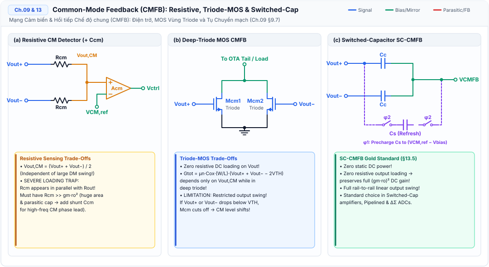

---
{
  "id": "skill-cmfb-continuous-and-sc-testbench",
  "kind": "skill",
  "domain": "eda-and-github-skills",
  "title_vi": "Thiết kế & Kiểm chứng Vòng Hồi tiếp Chế độ Chung (CMFB Liên tục & Tụ Chuyển mạch SC-CMFB)",
  "title_en": "Designing and Verifying Continuous-Time and Switched-Capacitor Common-Mode Feedback (CMFB) Loops",
  "summary": "Quy trình chọn cấu trúc, phân chia dòng KCL chống khóa chết và thiết lập testbench Spectre 15.1 chuẩn xác cho mạng hồi tiếp chế độ chung (cầu chia điện trở + tụ vượt tốc, MOS vùng triode, DDA và tụ chuyển mạch SC-CMFB): đo tách biệt độ lợi vòng CM so với DM bằng diffstbprobe, phân tích ổn định tuần hoàn pstb cho SC-CMFB và kiểm tra trôi áp chế độ chung dưới dao động vi sai biên độ lớn.",
  "diagram": "../../diagrams/cmfb-sensing-networks.svg",
  "razavi_refs": [
    {
      "chapter": 9,
      "section": "9.6-9.7.4",
      "pages": "373-388",
      "equations": ["9.47", "9.48", "9.49", "9.51", "9.53", "9.55", "9.57"]
    },
    {
      "chapter": 13,
      "section": "13.5",
      "pages": "571-573",
      "equations": []
    }
  ],
  "github_refs": [
    {
      "repo": "iic-jku/analog-circuit-design",
      "url": "https://github.com/iic-jku/analog-circuit-design/tree/6075ea0ebcf08f5c7f6033a84e9dd3c91450f5e1/content/ota_diff",
      "use": "Giải tích nửa mạch chế độ chung (CM half-circuit), ghép bù Miller dùng chung cho vòng CMFB và kiểm chứng ổn định"
    },
    {
      "repo": "Arcadia-1/virtuoso-bridge-lite",
      "url": "https://github.com/Arcadia-1/virtuoso-bridge-lite/tree/1f186abfbb3d658211743cd707f3156ed2f59a87/skills/spectre",
      "use": "Cấu hình chạy độc lập Spectre stb/pss/pstb và đọc nghiệm phức từ tệp PSF ASCII"
    },
    {
      "repo": "KenKundert/psf_utils",
      "url": "https://github.com/KenKundert/psf_utils/tree/67971463a7bfdbfdb362376374b68fef379c6f9e",
      "use": "Đọc hàm truyền vòng phức stb.stb và biên độ ổn định dự trữ pha/độ lợi từ dữ liệu mô phỏng Spectre"
    }
  ],
  "glossary_codes": ["T022", "T051", "T582", "T800", "T1301", "T1526", "T1527", "T1532", "T1534", "T2148"],
  "process_agnostic": true,
  "roles": {
    "cm_sensing_detector": "Mạng dò trung bình điện áp ngõ ra Vout,CM = (Vout+ + Vout-)/2 mà không gây suy giảm độ lợi vi sai hay tạo méo chéo DM-sang-CM",
    "cm_error_amplifier": "Bộ so sánh sai lệch giữa Vout,CM và mức chuẩn Vref,CM (thường chọn VDD/2 hoặc mức tối ưu đối xứng swing tầng sau)",
    "split_current_actuator": "Cơ cấu chấp hành chia nhánh nguồn dòng tĩnh (70% cố định + 30% điều khiển CMFB) ngăn chặn khóa chết điểm làm việc khi khởi động",
    "dual_mode_stb_probe": "Đầu dò vi sai 4 cổng diffstbprobe (cho CT-CMFB) hoặc chuỗi pss + pstb (cho SC-CMFB) đo chính xác hàm truyền vòng chế độ chung mà không phá tải"
  },
  "symptoms_addressed": [
    "fully-differential-opamp-outputs-pinned-to-vdd-or-gnd-at-dc",
    "common-mode-oscillation-hidden-during-differential-ac-simulation",
    "output-common-mode-droop-under-large-differential-output-swing",
    "open-loop-gain-collapse-from-resistive-cmfb-loading",
    "sc-cmfb-charge-pumping-ripple-and-slow-initial-wakeup"
  ],
  "limitations": [
    "resistive-cmfb-trades-off-resistor-area-against-open-loop-gain-loading",
    "triode-mos-and-dda-cmfb-suffer-nonlinear-dm-rectification-near-rail-extremes",
    "sc-cmfb-injects-clock-spurs-and-adds-continuous-capacitive-load-to-ota-outputs"
  ],
  "checklists": ["common-mos", "cmfb", "folded-cascode", "two-stage-miller", "switched-capacitor", "feedback-and-stb"]
}
---

## 1. Bản chất Vật lý Của Bài toán CMFB & Phân loại 5 Kiến trúc Mạng Cảm biến

Trong mọi bộ khuếch đại vi sai toàn phần (Telescopic, Folded-Cascode, Gain-Boosted hay Two-Stage Fully-Differential Op-Amp, Razavi Chương 9 §9.6–9.7), đường hồi tiếp tín hiệu bên ngoài chỉ khóa hiệu điện thế $V_{\text{out,DM}} = V_{\text{out}+} - V_{\text{out}-}$, còn mức trung bình **điện áp chế độ chung đầu ra (`T582`, $V_{\text{out,CM}} = \frac{1}{2}(V_{\text{out}+} + V_{\text{out}-})$)** nằm lơ lửng giữa hai nguồn dòng trở kháng rất cao $r_{O,N}$ và $r_{O,P}$ đấu đối đầu! Chỉ cần lệch dòng $\Delta I_{CM} = 100\text{ nA}$ giữa nguồn dòng PMOS phía trên và nguồn dòng NMOS phía dưới nhân với $(r_{O,N} \parallel r_{O,P}) = 2\text{ M}\Omega$ là đủ tạo sai số $\Delta V_{\text{out,CM}} = 200\text{ V}$ — ép cả hai ngõ ra $V_{\text{out}+}, V_{\text{out}-}$ đập cứng vào $V_{DD}$ hoặc $\text{GND}$ và đẩy transistor tải sập sâu vào vùng triode ngay tại DC!



Một **vòng hồi tiếp chế độ chung (`T1534`, CMFB loop)** chuẩn mực phải thực hiện ba thao tác đồng thời: (1) đo trung bình $V_{\text{out,CM}}$ tuyến tính trên toàn bộ dải dao động vi sai lớn mà không làm tụt trở kháng tải vi sai, (2) so sánh với $V_{\text{ref,CM}}$ với dự trữ pha $\text{PM}_{\text{CM}} \ge 55^\circ\text{–}60^\circ$, và (3) bơm dòng hiệu chỉnh trở lại nhánh nguồn đuôi hoặc nguồn tải. Năm cấu trúc thực chiến phổ biến nhất là:
1. **Cầu chia điện trở lớn $R_{\text{cm}} - R_{\text{cm}}$ song song tụ vượt tốc $C_{\text{cm}}$ (Razavi §9.7.1, Hình 9.43 & 9.48):** Tuyến tính tuyệt đối tới sát hai nguồn cấp, không giới hạn biên độ ra, nhưng $R_{\text{cm}}$ mắc song song trực tiếp với $R_{\text{out}}$ làm giảm độ lợi vi sai nếu chọn $R_{\text{cm}}$ nhỏ, đồng thời tạo cực phụ tại nút giữa $V_{\text{sense}}$ bắt buộc phải triệt bằng tụ song song $C_{\text{cm}}$.
2. **Cặp Đệm Theo Nguồn (Source-Follower Buffering Resistive Divider, Hình 9.44):** Cô lập $R_{\text{cm}}$ khỏi nút ngõ ra trở kháng cao, nhưng mất một điện áp ngưỡng $V_{TH} + V_{OV}$ làm cụt dải dao động và bị chỉnh lưu phi tuyến khi một bên đệm tắt ở biên độ vi sai lớn!
3. **Mạng Cảm biến MOSFET Vùng Triode (`T1526`, Hình 9.50):** Đặt hai transistor sâu trong vùng triode nhận cổng $V_{\text{out}+}, V_{\text{out}-}$ cộng tổng dòng dẫn $G_{DS1} + G_{DS2} \propto (V_{\text{out}+} + V_{\text{out}-} - 2 V_{TH})$. Không gây tải điện trở lên ngõ ra OTA, diện tích gọn, nhưng chỉ tuyến tính khi cả hai ngõ ra còn cao hơn $V_{TH} + V_{DS,\text{tri}}$!
4. **Cặp Vi sai Kép Khuếch đại Hiệu Sai (DDA — Dual Differential Pair CMFB, Hình 9.46):** Dùng hai cặp vi sai nối song song so sánh trực tiếp $(V_{\text{out}+} - V_{\text{ref,CM}}) + (V_{\text{out}-} - V_{\text{ref,CM}})$. Không tải điện trở ngõ ra, nhưng dải tuyến tính bị khóa cứng trong $\left|V_{\text{out,DM}}\right| < \sqrt{2}\,V_{OV,\text{cmfb}}$.
5. **Hồi tiếp Chế độ Chung Tụ Chuyển mạch (`T2148`, SC-CMFB, Razavi Chương 13 §13.5, Hình 13.34):** Chuẩn vàng tuyệt đối trong mọi mạch có xung nhịp (Pipeline/SAR/$\Delta\Sigma$ ADC, bộ lọc SC): dùng hai tụ cảm nhận liên tục $C_{C1} = C_{C2}$ tạo mức áp trung bình nối thẳng về cổng điều khiển và hai tụ làm tươi chuyển mạch $C_{S1} = C_{S2}$ nạp điện áp phân cực chuẩn ở pha $\phi_1$ rồi bơm vào $C_C$ ở pha $\phi_2$. Đạt đồng thời **$0\text{ W}$ công suất tĩnh phụ, dải dao động Rail-to-Rail trọn vẹn và không suy giảm độ lợi DC**!

---

## 2. Hệ Phương trình Thiết kế Vòng CMFB & Bù Tần số Chế độ Chung

### 2.1. Điều kiện Không Tải Độ lợi & Hằng số Thời gian Vượt tốc Cho CT-CMFB Điện trở
Để cầu chia $R_{\text{cm}}$ không ăn mòn quá $10\%$ độ lợi vòng hở vi sai $A_{0,\text{DM}} = g_{m1} R_{\text{out,DM}}$, điện trở mỗi nhánh cảm biến phải thỏa mãn (Razavi Phương trình 9.47):

$$
R_{\text{cm}} \ge 10 \, R_{\text{out,DM}}
$$

Tại nút cảm biến trung tâm $V_{\text{sense}}$, hai điện trở $R_{\text{cm}}$ chập song song tạo trở kháng $R_{\text{cm}}/2$ lái điện dung cổng của bộ khuếch đại lỗi CMFB $C_{\text{in,err}}$, sinh ra một cực ký sinh rất thấp $\omega_{p,\text{sense}} = \frac{2}{R_{\text{cm}} C_{\text{in,err}}}$ nằm ngay trong dải tần vòng làm sập dự trữ pha $\text{PM}_{\text{CM}}$ xuống âm! Giải pháp bắt buộc là mắc tụ $C_{\text{cm}}$ song song với mỗi $R_{\text{cm}}$ (Hình 9.48) để tạo cặp cực–zero triệt tiêu lẫn nhau:

$$
\omega_{z,\text{sense}} = \frac{1}{R_{\text{cm}} C_{\text{cm}}}, \qquad \omega_{p,\text{sense}} = \frac{1}{(R_{\text{cm}}/2)(C_{\text{in,err}} + 2 C_{\text{cm}})} = \frac{2}{R_{\text{cm}}(C_{\text{in,err}} + 2 C_{\text{cm}})}
$$

Nếu chọn **$2 C_{\text{cm}} \gg C_{\text{in,err}}$** (thực tế chọn $C_{\text{cm}} \approx (2\text{–}4)\,C_{\text{in,err}}$, ví dụ $C_{\text{cm}} = 150\text{–}300\text{ fF}$), thì $\omega_{p,\text{sense}} \approx \frac{1}{R_{\text{cm}} C_{\text{cm}}} = \omega_{z,\text{sense}}$ — mạng cảm biến trở thành bộ chia điện dung băng rộng phẳng từ DC tới tận GHz!

### 2.2. Nửa Mạch Chế độ Chung, Phân chia Nhánh Dòng KCL & SC-CMFB
Khi phân tích ổn định vòng CMFB, hai nhánh trái–phải của OTA dao động **cùng pha** ($\Delta V_{\text{out}+} = \Delta V_{\text{out}-} = \Delta v_{\text{cm}}$), do đó:
- **Trong Op-Amp 1 tầng (Telescopic / Folded-Cascode):** Nếu đưa tín hiệu điều khiển $V_{\text{ctrl,CM}}$ về cực cổng nguồn dòng tải (ví dụ tải PMOS $M_{9,10}$) hoặc nguồn dòng gập NMOS $M_{5,6}$ (Razavi §9.7.3, Hình 9.52), cực trội của vòng CMFB nằm ngay tại chính tụ tải $C_L$ ở hai ngõ ra! Muốn băng thông vòng CMFB $\omega_{u,\text{CM}}$ tương đương $0{,}3\text{–}0{,}8\,\omega_{u,\text{DM}}$ mà không bị quá lợi mất ổn định, tuyệt đối **không cho CMFB lái $100\%$ chiều rộng $W$ của nguồn dòng**, mà phải **chia tách nguồn dòng thành hai phần song song**:

$$
I_{\text{source,total}} = I_{\text{fixed}} + I_{\text{cmfb}} = (1 - \kappa_{\text{cm}}) I_0 + \kappa_{\text{cm}} I_0 \qquad \text{với} \qquad \kappa_{\text{cm}} \in [0{,}25,\; 0{,}40]
$$

Nhánh cố định $(1-\kappa_{\text{cm}})I_0$ giữ cho OTA luôn có dòng sống ngay lúc bật nguồn, còn nhánh $\kappa_{\text{cm}} I_0$ vẫn dư sức sửa mọi sai lệch gương dòng $\pm 15\%$ giữa góc `FS` và `SF` đồng thời giảm độ hỗ dẫn truyền vòng $g_{m,\text{cmfb}} = \kappa_{\text{cm}} g_{m,\text{total}}$ giúp dự trữ pha $\text{PM}_{\text{CM}}$ đạt trên $60^\circ$!
- **Trong SC-CMFB (Razavi Hình 13.34):** Điện dung tương đương của tụ chuyển mạch làm tươi $C_S$ hoạt động ở tần số nhịp $f_{\text{clk}}$ là $R_{\text{eq,SC}} = \frac{1}{f_{\text{clk}} C_S}$, tạo hằng số thời gian hội tụ mức phân cực DC vào khoảng $\tau_{\text{SC}} \approx \frac{C_C + C_{\text{gate,cmfb}}}{f_{\text{clk}} C_S}$ chu kỳ. Chọn tỷ số vàng **$C_S \approx (0{,}25\text{–}0{,}5)\,C_C$** với $C_C \approx (0{,}1\text{–}0{,}2)\,C_L$ để vừa hội tụ trong $< 10$ chu kỳ nhịp, vừa giảm nhẹ gợn phun điện tích công tắc!

---

## 3. Bất biến Kỹ thuật & Các Bẫy Lỗi Kinh điển (Invariants & Traps)

- **[INV-CMFB-01] Bất biến Chiều Cực tính Âm Trên Cả Đường Hồi tiếp Chế độ Chung (`T1534`):** Lỗi xảy ra thường xuyên nhất trong phòng lab là đấu đúng cực tính âm cho vòng vi sai nhưng **đấu nhầm thành hồi tiếp dương cho vòng CMFB** (đặc biệt trong Op-Amp hai tầng vi sai toàn phần `T1532` khi tiêm tín hiệu CMFB vào tầng 1 thay vì tầng 2 mà đếm thiếu một lần đảo dấu!). Kiểm tra nhẩm bắt buộc trước khi nhấn chạy: giả sử $V_{\text{out}+}$ và $V_{\text{out}-}$ cùng tăng nhẹ $+\delta V \implies V_{\text{sense}}$ tăng $\implies V_{\text{ctrl,CM}}$ biến thiên theo chiều làm dòng kéo xuống NMOS tăng (hoặc dòng bơm lên PMOS giảm) $\implies$ kéo cả $V_{\text{out}+}, V_{\text{out}-}$ giảm ngược lại $-\delta V$!
- **[INV-CMFB-02] Bất biến Không Phá Bù Tần số Khi Đặt CMFB Quanh Op-Amp Hai Tầng (§9.7.4, Hình 9.57):** Trong Op-Amp hai tầng Miller, nếu tiêm tín hiệu điều khiển CMFB vào nguồn đuôi tầng 1 thì vòng CMFB phải đi xuyên qua **cả 2 tầng khuếch đại + mạng cảm biến**, dễ có 3 cực làm nổ dao động chế độ chung trừ khi tụ Miller $C_c$ cũng tách cực hiệu quả cho chế độ chung! Cách an toàn hơn ở tốc độ cao là cảm biến $V_{\text{out,CM}}$ điều khiển trực tiếp nguồn dòng tầng 2 (vòng 1 tầng cực nhanh) kết hợp một vòng phụ/replica khóa chế độ chung ngõ ra tầng 1.
- **[TRAP-CMFB-01] Bẫy Chỉnh lưu Phi tuyến DM-sang-CM (Nonlinear Common-Mode Shift Under Large Swing):** Khi thử AC nhỏ tại $\Delta V_{\text{out,DM}} = 0$, cả DDA lẫn Triode-CMFB đều giữ $V_{\text{out,CM}} = 0{,}600\text{ V}$ hoàn hảo. Nhưng khi có sóng sin vi sai biên độ lớn $\pm 0{,}4\text{ V}$, một nhánh của cặp DDA bị ngắt dòng hoặc một MOSFET triode chạm ranh giới bão hòa khiến dòng tổng bị chỉnh lưu bậc hai $\propto V_{\text{out,DM}}^2$, kéo tụt $V_{\text{out,CM}}$ đi $80\text{–}150\text{ mV}$ ở tần số gấp đôi $2 f_{\text{in}}$ và đè bẹp biên độ ngõ ra! Bắt buộc chạy phép thử quá độ biên độ lớn kiểm tra đường sóng $0{,}5(V_{\text{out}+}(t) + V_{\text{out}-}(t))$!
- **[TRAP-CMFB-02] Bẫy Ngộ nhận `stb` Thường Cho Mạch SC-CMFB:** Phân tích `stb` tuyến tính dừng thời gian chỉ xét trạng thái tĩnh tại $t = 0$, lúc đó các công tắc xung nhịp $\phi_1, \phi_2$ của mạng SC-CMFB một nửa đang đóng, một nửa đang hở cứng! Muốn đo đúng dự trữ pha và băng thông của vòng SC-CMFB bao gồm cả hiệu ứng lấy mẫu/giữ và điện trở chuyển mạch $1/(f_{\text{clk}}C_S)$, bắt buộc phải dùng phân tích **Periodic Stability (`pss` + `pstb`)** trong Spectre 15.1!

---

## 4. Ma trận Lựa chọn Cấu trúc CMFB Theo Bát giác Thiết kế

| Họ Mạng CMFB | Dải Tuyến tính Ngõ ra | Suy hao Độ lợi DM $A_{0,\text{DM}}$ | Tải Tụ Cộng thêm Lên $V_{\text{out}}$ | Công suất Phụ | Phép Đo Ổn định Spectre Chuẩn | Ứng dụng Khuyến nghị |
|---|---|---|---|---|---|---|
| **Cầu điện trở $R_{\text{cm}} \parallel C_{\text{cm}}$ + OTA lỗi** | Toàn dải Rail-to-Rail | Giảm nhẹ theo $R_{\text{out}} \parallel R_{\text{cm}}$ | $C_{\text{cm}}$ ($100\text{–}300\text{ fF}$) | Dòng cầu $R_{\text{cm}}$ + OTA lỗi | `stb` (`diffstbprobe` `mode=comm`) | Op-Amp thời gian liên tục độ tuyến tính cao (Filter, TIA, PGA, Audio/RF baseband) |
| **MOSFET Vùng Triode (`T1526`)** | Hẹp–Vừa (cần $V_{\text{out}} > V_{TH}$) | $0\text{ dB}$ (Cổng cách ly DC) | $C_{GS,\text{tri}} + C_{GD,\text{tri}}$ | $0$ thêm nhánh cảm biến | `stb` + `tran` kiểm tra lệch $2f_{\text{in}}$ | OTA 1 tầng biên độ vừa phải không muốn tốn diện tích điện trở M$\Omega$ |
| **Cặp Vi sai Kép DDA** | Hẹp ($\left|V_{\text{DM}}\right| < \sqrt{2}V_{OV}$) | $0\text{ dB}$ | $C_{GS,\text{DDA}}$ nhỏ | $2 \times I_{\text{tail,DDA}}$ | `stb` + quét DC $\Delta V_{\text{in,DM}}$ | Tầng đầu chuỗi khuếch đại có biên độ ngõ ra nhỏ ($< 250\text{ mV}_{\text{pp}}$) |
| **Tụ Chuyển mạch `SC-CMFB` (`T2148`)** | Toàn dải Rail-to-Rail | $0\text{ dB}$ ở DC | $C_C + C_{S,\text{par}}$ ($\sim 0{,}15\,C_L$) | $\approx 0\text{ W}$ tĩnh | `pss` + `pstb` + `tran` gợn nhịp | Mọi bộ tích phân SC, khuếch đại C1/C2, Pipeline/SAR/$\Delta\Sigma$ ADC |

---

## 5. Thích ứng Đa Tiến trình & Bộ Testbench Spectre 15.1 Cho CT-CMFB và SC-CMFB

### 5.1. Thích ứng Ở Tiến trình Sâu 90nm / 65nm / 45nm ($V_{DD} \le 1{,}2\text{ V}$)
- Khi $V_{DD} = 1{,}0\text{ V}$ ($65\text{ nm}/45\text{ nm}$) và $V_{\text{ref,CM}} = 0{,}5\text{ V}$: mạng cảm biến MOSFET vùng triode thông thường sập dải hoạt động khi $V_{\text{out}-}$ xuống tới $0{,}25\text{ V} < V_{THN}$! Chỉ còn **hai lựa chọn sống sót thực tế**: (1) **Cầu chia điện trở poly không silicide $R_{\text{cm}} \parallel C_{\text{cm}}$ đưa vào Error Amp PMOS-in** cho mạch thời gian liên tục, hoặc (2) **SC-CMFB dùng công tắc CMOS/low-$V_{TH}$** cho mạch có xung nhịp!

### 5.2. Mẫu Testbench Spectre 15.1 Số 1 — Kiểm định Kép DM vs CM Cho CT-CMFB (`diffstbprobe`)
Đầu dò `diffstbprobe` trong thư viện `analogLib` của Cadence IC617 là vũ khí lợi hại nhất vì chỉ cần cắm **một lần duy nhất** trên cặp dây hồi tiếp vi sai, Spectre có thể đo riêng hàm truyền vi sai (`diffprobe_mode=diff`) hoặc đo hàm truyền chế độ chung nếu hồi tiếp chung đường; còn với vòng CMFB nội bộ khép kín bên trong thân OTA, đặt một `iprobe` nối tiếp ngay trên dây tín hiệu điều khiển đơn đầu `vctrl_cmfb` (nơi 2 nhánh trái–phải đã gộp làm một nút vô hướng duy nhất!):

```spice
// tb_ct_cmfb_verification.scs — Spectre 15.1 Continuous-Time CMFB Testbench
simulator lang=spectre
global 0
parameters vdd=1.2 vref_cm=0.6 cload=2p rfb=50k rin=50k

// Mạch khuếch đại vi sai toàn phần đóng vòng độ lợi -Rfb/Rin = -1
// Bên trong subckt OTA: đặt IPR_CM (cmfb_amp_out vctrl_cmfb_gate) iprobe!
DSTB_EXT (vout_p vout_n fb_node_p fb_node_n) diffstbprobe

// 1. Kiểm tra DC OP và độ chính xác ghim mức Vout,CM
dcOp dc write="spectre.dc" maxiters=150
dcOpInfo info what=oppoint where=rawfile

// 2. Đo ổn định vòng Vi sai ngoài (DM) và vòng CMFB nội bộ (qua IPR_CM)
stb_dm   stb start=1 stop=10G dec=40 probe=DSTB_EXT diffprobe_mode=diff
stb_cmfb stb start=1 stop=10G dec=40 probe=XOTA.IPR_CM

// 3. Bước nhảy trên chính chân Vref_CM (+50 mV, tr=100ps) kiểm tra vọt lố chế độ chung
// VÀ sóng sin vi sai biên độ lớn (0.8 Vpp_diff) kiểm tra độ trôi DM-to-CM!
tran_cm_audit tran stop=200n errpreset=conservative maxstep=50p
```

### 5.3. Mẫu Testbench Spectre 15.1 Số 2 — Kiểm định `pss` + `pstb` Cho Mạch `SC-CMFB`
Đối với OTA dùng mạng tụ chuyển mạch `SC-CMFB` chạy xung nhịp hai pha không chồng lấn $\phi_1, \phi_2$ ở tần số $f_{\text{clk}}$:

```spice
// tb_sc_cmfb_pstb.scs — Spectre 15.1 Periodic Stability (PSS + PSTB) for SC-CMFB
simulator lang=spectre
global 0
parameters vdd=1.2 vref_cm=0.6 fclk=50M tper=1/fclk

// Đặt iprobe nối tiếp trên dây vctrl_cmfb điều khiển cổng nguồn dòng tải của OTA!
// Xung nhịp phi1, phi2 không chồng lấn (deadtime = 0.4 ns) điều khiển các khóa làm tươi Cs1, Cs2

// 1. Tìm quỹ đạo xác lập tuần hoàn (cho tstab đủ >= 15 chu kỳ để tụ Cc nạp đầy tới cân bằng!)
pss_sc pss fund=fclk harms=12 errpreset=conservative tstab=20*tper saveinit=yes

// 2. Đo độ lợi vòng và dự trữ pha trung bình theo chu kỳ của vòng SC-CMFB bằng pstb!
pstb_cm pstb start=10 stop=0.49*fclk dec=30 probe=XOTA.IPR_CM

// 3. Quá độ khởi động từ trạng thái tụ rỗng (ic=0) đo số chu kỳ khóa mức Vout,CM & biên độ gợn nhịp
tran_wakeup tran stop=30*tper errpreset=conservative maxstep=20p
```

**Bảng chuẩn nghiệm thu vòng CMFB (Sign-Off Pass Gates):**
1. **Sai số tĩnh $V_{\text{out,CM}}$:** $\left| \frac{V_{\text{out}+} + V_{\text{out}-}}{2} - V_{\text{ref,CM}} \right| \le 15\text{ mV}$ trên toàn bộ 5 góc `{TT, FF, SS, FS, SF}` và nhiệt độ $-40\text{..}125\,^\circ\text{C}$.
2. **Độ ổn định vòng CMFB (`stb_cmfb` / `pstb_cm`):** Dự trữ pha $\text{PM}_{\text{CM}} \ge 55^\circ$, dự trữ độ lợi $\text{GM}_{\text{CM}} \ge 10\text{ dB}$, băng thông cắt $f_{u,\text{CM}} \in [0{,}25\,f_{u,\text{DM}},\; 1{,}0\,f_{u,\text{DM}}]$.
3. **Độ trôi phi tuyến DM-sang-CM:** Khi ngõ ra dao động vi sai đạt $80\%$ dải swing định mức, độ dịch chuyển trung bình của $V_{\text{out,CM}}(t)$ không vượt quá $20\text{ mV}$!
4. **Gợn xung nhịp SC-CMFB:** Biên độ đỉnh–đỉnh của gợn đồng pha trên $0{,}5(V_{\text{out}+} + V_{\text{out}-})$ ở trạng thái xác lập $< 2\text{ mV}_{\text{pp}}$ (và đối xứng vi sai triệt tiêu phần dư trên $V_{\text{out}+} - V_{\text{out}-}$ xuống dưới $0{,}2\text{ LSB}$).

---

## 6. Đối chiếu Sách Razavi, Nguồn GitHub Đã Kiểm định & Thuật ngữ Chuẩn CLB

### 6.1. Mốc Tọa độ Sách Razavi (2nd Edition) & Nguồn GitHub
- **Chương 9:** §9.6 *Fully Differential Op Amps* (tr. 373–374), §9.7.1–9.7.4 *Common-Mode Feedback: Sensing CM Level, Comparison & Control, CMFB in One-Stage and Two-Stage Op Amps* (tr. 374–388, Phương trình 9.47–9.57, Ví dụ 9.16–9.21, Hình 9.40–9.57).
- **Chương 13:** §13.5 *Switched-Capacitor Common-Mode Feedback* (tr. 571–573, Hình 13.32–13.34).
- **Kho GitHub Đối chiếu:** `iic-jku/analog-circuit-design` (`6075ea0ebc`, mục `ota_diff` phân tích nửa mạch đồng pha và bù tần số chung), `Arcadia-1/virtuoso-bridge-lite` (`1f186abfbb`) và `KenKundert/psf_utils` (`67971463a7`).

### 6.2. Bảng Thuật ngữ Chuẩn CLB Vi Mạch
| Mã CLB | Thuật ngữ Tiếng Anh | Thuật ngữ Tiếng Việt Chuẩn | Ngữ cảnh Kiểm chứng |
|---|---|---|---|
| `T800` / `T1534` | common-mode feedback / CMFB loop | hồi tiếp chế độ chung / vòng hồi tiếp chế độ chung | Vòng phản hồi âm ghim mức DC trung bình của hai ngõ ra vi sai |
| `T582` | output common-mode level | mức chế độ chung đầu ra | Đại lượng $V_{\text{out,CM}} = 0{,}5(V_{\text{out}+} + V_{\text{out}-})$ cần khóa vào $V_{\text{ref,CM}}$ |
| `T1526` | CMFB using triode devices | hồi tiếp chế độ chung dùng linh kiện vùng triode | Cảm biến không gây tải điện trở DC lên nút ra của OTA |
| `T1532` | CMFB in Two-Stage Op Amps | hồi tiếp chế độ chung trong bộ khuếch đại thuật toán hai tầng | Trường hợp dễ dao động nếu tiêm tín hiệu sai tầng mà thiếu tách cực CM |
| `T2148` | switched-capacitor common-mode feedback, SC-CMFB | hồi tiếp chế độ chung dùng tụ chuyển mạch | Kiến trúc CMFB không công suất tĩnh, toàn dải, kiểm chứng bằng `pss`+`pstb` |
| `T1301` | Middlebrook's Method | phương pháp Middlebrook | Nền tảng toán học của đầu dò `iprobe` / `diffstbprobe` trong Spectre |
