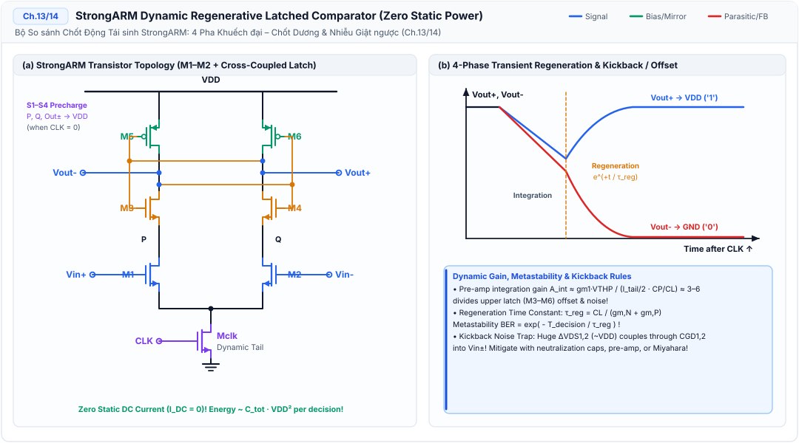

---
{
  "id": "skill-comparator-kickback-offset-metastability-tb",
  "kind": "skill",
  "domain": "eda-and-github-skills",
  "title_vi": "Kiểm chứng Bộ So sánh Động StrongARM & Miyahara (Hằng số Tái sinh τ_reg, BER Siêu ổn định, Kickback, Offset & Nhiễu PNoise/Probit)",
  "title_en": "Dynamic Latched Comparator Characterization Testbench (StrongARM & Miyahara Regeneration τ_reg, Metastability BER, Kickback, Offset & PNoise/Probit)",
  "summary": "Quy trình thiết lập testbench Spectre 15.1 chuẩn công nghiệp cho bộ so sánh chốt động không dòng tĩnh (StrongARM 1 tầng và Miyahara hai đuôi Double-Tail): đo hằng số thời gian tái sinh dương tau_reg từ độ dốc logarit trễ quá kích để dự báo xác suất lỗi siêu ổn định BER < 10^-12, định lượng nhiễu giật ngược (kickback noise) lên trở kháng nguồn/CDAC, hiệu chuẩn bù lệch cascode nhị phân + Monte Carlo VOS và đối chiếu nhiễu quy về ngõ vào bằng cả phương pháp thống kê Probit lẫn SpectreRF PSS+PNoise jitterevent.",
  "diagram": "../../diagrams/strongarm-dynamic-comparator.svg",
  "razavi_refs": [
    {
      "chapter": 13,
      "section": "13.2.3",
      "pages": "549-553",
      "equations": ["13.25", "13.30"]
    },
    {
      "chapter": 14,
      "section": "14.2.1-14.2.2",
      "pages": "593-602",
      "equations": ["14.75", "14.88", "14.91", "14.95"]
    }
  ],
  "github_refs": [
    {
      "repo": "Arcadia-1/sar-adc-skills",
      "url": "https://github.com/Arcadia-1/sar-adc-skills/tree/27de09a34ea3ec6feb2ee2797d32dc673d35d1ad/sar-adc-skill/references",
      "use": "Phân tích 4 pha hoạt động của StrongARM, thiết kế mạng trim cascode nhị phân đối xứng, giao tiếp chốt SR và đo nhiễu bằng Probit / PSS+PNoise"
    },
    {
      "repo": "Arcadia-1/virtuoso-bridge-lite",
      "url": "https://github.com/Arcadia-1/virtuoso-bridge-lite/tree/1f186abfbb3d658211743cd707f3156ed2f59a87/skills/spectre",
      "use": "Quy tắc chọn chế độ giải phương trình chính xác (+aps / reltol <= 1e-4, cấm dùng lx/vx) và cấu hình Transient Noise noiseruns=1"
    },
    {
      "repo": "Arcadia-1/circuits-and-systems-classroom",
      "url": "https://github.com/Arcadia-1/circuits-and-systems-classroom/tree/f377bd965e8acfef82b303cf807a210c064fc1a6",
      "use": "Cơ sở vật lý của nhiễu tích phân theo thời gian (cyclostationary integration noise) trong giai đoạn tiền khuếch đại của bộ so sánh động"
    }
  ],
  "glossary_codes": ["T014", "T052", "T392", "T620", "T788", "T1009", "T1556", "T2153"],
  "process_agnostic": true,
  "roles": {
    "dynamic_integrating_preamp": "Cặp vi sai đầu vào có khóa nguồn đuôi tích phân dòng chênh lệch lên hai nút trung gian VX+/VX- trong pha lấy mẫu/đánh giá đầu tiên mà không tốn dòng DC",
    "regenerative_cross_coupled_latch": "Cặp inverter/cổng chéo NMOS-PMOS bật phản hồi dương khuếch đại hàm mũ exp(t/tau_reg) đưa ngõ ra chạm hai biên nguồn VDD và GND",
    "sr_or_async_capture_latch": "Mạch chốt giữ trạng thái sau bộ đệm ngõ ra ngăn không cho kết quả so sánh bị xóa trắng khi xung CLK sập về pha nạp trước (precharge)",
    "probit_and_pnoise_harnesses": "Hai buồng đo độc lập xác định nhiễu RMS quy về ngõ vào sigma_vn và độ lệch ngẫu nhiên sigma_VOS ở trạng thái chuyển mạch tuần hoàn lớn"
  },
  "symptoms_addressed": [
    "cannot-measure-dynamic-comparator-gain-noise-or-offset-with-standard-dc-or-ac-analysis",
    "sar-adc-sparkle-codes-and-bit-error-rate-floor-from-comparator-metastability",
    "cdac-top-plate-corrupted-by-asymmetric-comparator-kickback-charge-spikes",
    "comparator-decision-erased-to-all-ones-or-zeros-during-clock-reset-phase",
    "severe-false-enob-drop-when-running-spectre-fast-lx-or-vx-solver-presets"
  ],
  "limitations": [
    "classic-strongarm-stacks-four-transistors-limiting-low-vdd-headroom-compared-to-miyahara-double-tail",
    "pss-shooting-convergence-can-fail-if-differential-dc-overdrive-vid-is-set-exactly-to-zero",
    "transient-probit-method-requires-hundreds-of-clock-cycles-with-carefully-chosen-noisefmax"
  ],
  "checklists": ["common-mos", "differential-pair", "switched-capacitor", "layout-and-matching"]
}
---

## 1. Tại sao Mọi Phép Đo `dc` / `ac` Truyền thống Đều Vô dụng Với Bộ So sánh Động?

Trong các bộ biến đổi SAR ADC, Flash ADC và bộ thu dữ liệu tốc độ cao GHz hiện đại, bộ so sánh tĩnh tiêu thụ dòng DC liên tục đã bị thay thế gần như hoàn toàn bởi **bộ so sánh chốt động không dòng tĩnh (Dynamic Latched Comparator)**: kinh điển nhất là **StrongARM Latch** (xếp chồng 1 đuôi dòng gồm 9–11 transistor lõi + 2 inverter đệm) và **Miyahara / Schinkel Double-Tail Comparator** (tách tầng tiền khuếch đại động đuôi NMOS riêng với tầng chốt tái sinh đuôi PMOS riêng để chạy ở $V_{DD} = 0{,}6\text{–}0{,}9\text{ V}$ và giảm giật ngược).



Vì bộ so sánh động là **hệ phi tuyến mạnh biến thiên tuần hoàn theo thời gian (LPTV / Cyclostationary Regenerative System)**:
- Khi `CLK = 0` (pha Reset / Precharge): khóa đuôi $M_0$ ngắt hẳn ($I_D = 0$), các khóa PMOS nạp trước kéo toàn bộ nút nội $V_{XP}, V_{XN}, V_{LP}, V_{LN}$ lên cứng $V_{DD}$. Mạch không có độ lợi khuếch đại!
- Khi `CLK` nhảy lên `1` (pha Tích phân $\to$ Pha Tái sinh Hồi tiếp Dương): $V_{XP}, V_{XN}$ phóng điện dốc xuống với tốc độ chênh lệch tỉ lệ với $g_{m1,2} \Delta V_{\text{in}}$, đánh thức cặp chéo NMOS–PMOS lao vào vùng phản hồi dương hàm mũ $\Delta V_{\text{latch}}(t) = \Delta V_0 \, e^{+t/\tau_{\text{reg}}}$ cho tới khi một bên chạm $\text{GND}$ và bên kia bật ngược về $V_{DD}$!

Hệ quả sống còn trong Cadence Spectre: **bấm chạy `.dc` hay `.ac` hay `.noise` tĩnh trên StrongARM chỉ đo được một đống transistor đang tắt ngúm ($g_m = 0$)!** Người thiết kế bắt buộc phải trang bị **bộ 5 phép đo động chuyên biệt** được trình bày chi tiết dưới đây.

---

## 2. Hệ Phương trình 5 Chỉ số Cốt lõi Của Bộ So sánh Động

### 2.1. Thời gian Quyết định $T_{\text{cmp}}$, Hằng số Tái sinh $\tau_{\text{reg}}$ & Xác suất Siêu ổn định (BER)
Tổng thời gian trễ từ sườn lên của `CLK` tới khi hiệu điện thế ngõ ra vượt ngưỡng logic $\Delta V_{\text{logic}} \approx V_{DD}/2$ gồm hai thành phần cộng tính: thời gian tích phân xả nút đến ngưỡng mở chốt $T_{\text{int}}$ và thời gian nhân hàm mũ tái sinh $T_{\text{regen}}$:

$$
T_{\text{cmp}}(\Delta V_{\text{in}}) = T_{\text{int}} + \tau_{\text{reg}} \ln\!\left( \frac{V_{DD}/2}{A_{\text{int}} \left|\Delta V_{\text{in}}\right|} \right), \qquad \tau_{\text{reg}} = \frac{C_{\text{latch}}}{g_{m,\text{eff,latch}}} \approx \frac{C_{\text{latch}}}{g_{m,N\text{lat}} + g_{m,P\text{lat}}}
$$

Lấy đạo hàm của $T_{\text{cmp}}$ theo $\ln|\Delta V_{\text{in}}|$, ta có **phương pháp thực nghiệm trích xuất trực tiếp $\tau_{\text{reg}}$ trong Spectre không cần đoán $C_{\text{latch}}$ hay $g_m$**: chỉ cần chạy hai điểm điện áp quá kích nhỏ cách nhau đúng 1 thập kỷ (ví dụ $\Delta V_{\text{in},1} = 1\text{ mV}$ và $\Delta V_{\text{in},2} = 0{,}1\text{ mV}$):

$$
\tau_{\text{reg}} = \frac{T_{\text{cmp}}(0{,}1\text{ mV}) - T_{\text{cmp}}(1\text{ mV})}{\ln(10)} = \frac{\Delta T_{\text{decade}}}{2{,}3026}
$$

Từ $\tau_{\text{reg}}$ đo được và cửa sổ thời gian tối đa dành cho bộ so sánh trong một chu kỳ bit SAR (hoặc chu kỳ lấy mẫu Flash/RX) là $T_{\text{avail}}$, xác suất xảy ra **lỗi siêu ổn định (Metastability Bit Error Rate — BER)** dưới tín hiệu phân bố đều trên $\pm \frac{1}{2}\text{LSB}$ là:

$$
\text{BER}_{\text{meta}} \approx \frac{V_{DD}}{A_{\text{int}} \cdot V_{\text{LSB}}} \, \exp\!\left( -\frac{T_{\text{avail}} - T_{\text{int}}}{\tau_{\text{reg}}} \right)
$$

Để đạt chuẩn công nghiệp $\text{BER}_{\text{meta}} \le 10^{-12}\text{–}10^{-15}$ (không xuất hiện mã lấp lánh *sparkle codes*), cửa sổ thời gian còn lại $(T_{\text{avail}} - T_{\text{int}})$ bắt buộc phải lớn hơn **$28\text{–}35\,\tau_{\text{reg}}$** ngay tại góc chậm nhất (`SS`, $V_{DD,\min}$, nhiệt độ xấu nhất)!

### 2.2. Điện tích Giật ngược Ngõ vào (Kickback Noise) & Phân biệt Lệch Tĩnh vs Nhiễu Động
1. **Nhiễu giật ngược (Kickback Noise, Razavi §13.2.3 & thực tế CDAC):** Khi các nút nội $V_{XP}, V_{XN}$ và $V_{LP}, V_{LN}$ sập biên độ lớn $\Delta V \approx V_{DD}$ trong vài chục $\text{ps}$, xung áp tốc độ cao này phóng ngược qua điện dung cổng–máng $C_{GD1,2}$ và cổng–nguồn $C_{GS1,2}$ ra hai chân đầu vào $V_{\text{IN}+}, V_{\text{IN}-}$! Nếu trở kháng nguồn hai phía không cân xứng (hoặc bản thân $\Delta V_{\text{in}} \neq 0$ làm sườn rơi hai nhánh lệch thời điểm!), một **hiệu điện thế sai số vi sai $\Delta V_{\text{kick,diff}}$** bị tiêm thẳng lên tấm đỉnh của mảng tụ CDAC trước khi chốt kịp quyết định xong!
2. **Hai phương pháp chuẩn đo Nhiễu RMS Quy về Ngõ vào ($\sigma_{v_n}$):**
   - **Phương pháp Thống kê Probit trong Miền Quá độ (`tranNoise=yes`):** Đặt một điện áp DC vi sai nhỏ cố định $V_{\text{id,test}}$ (nằm trong vùng chuyển tiếp $0{,}5\sigma_{v_n} \le V_{\text{id,test}} \le 1{,}5\sigma_{v_n}$, ví dụ $200\text{ }\mu\text{V}$), chạy $K = 400\text{–}1000$ chu kỳ xung nhịp có bật nhiễu nhiệt/nhấp nháy quá độ, đếm xác suất ra mức `'1'` là $P_1 = N_{\text{ones}} / K$, rồi giải ngược hàm phân phối chuẩn tích lũy $\Phi^{-1}(P_1) = \sqrt{2}\,\text{erfinv}(2 P_1 - 1)$:

$$
\sigma_{v_n} = \frac{V_{\text{id,test}} - V_{OS,\text{sys}}}{\Phi^{-1}(P_1)}
$$

   - **Phương pháp Chuẩn Nhanh SpectreRF (`pss` + `pnoise` `noisetype=sampled` / `jitterevent`):** Đặt quá kích nhỏ $V_{\text{id}} = 1\text{ mV}$ để quỹ đạo chu kỳ hội tụ tất định (không nảy qua lại ngẫu nhiên), kích hoạt sự kiện đo tại giao điểm vượt ngưỡng của hai nút chốt nội (`LP`, `LM`) và chia nhiễu/jitter lấy mẫu ở ngõ ra cho độ lợi điện áp–thời gian (hoặc độ lợi chuyển đổi hiệu dụng) để nhận được $\sigma_{v_n}$ chỉ trong vài giây chạy máy!
3. **Chỉ số Phẩm chất Năng lượng – Nhiễu – Tốc độ (Comparator FoM):**

$$
\text{FoM}_1 = E_{\text{cycle}} \cdot \sigma_{v_n}^2 \quad (\text{J}\cdot\text{V}^2), \qquad \text{FoM}_2 = E_{\text{cycle}} \cdot \sigma_{v_n}^2 \cdot T_{\text{cmp}} \quad (\text{J}\cdot\text{V}^2\cdot\text{s}), \qquad E_{\text{cycle}} = \frac{1}{f_{\text{clk}}} \int_0^{T_{\text{clk}}} I_{VDD}(t) V_{DD}\,dt
$$

---

## 3. Bất biến Kỹ thuật & Các Bẫy Lỗi Kinh điển (Invariants & Traps)

- **[INV-CMP-01] Bất biến Cấm Dùng Chế độ Giải Nhanh `+preset=lx` Hoặc `+preset=vx` Của Spectre!** Các bộ so sánh tái sinh giải tích phân vi sai cỡ micro-volt trước khi khuếch đại hàm mũ. Chế độ `lx` nới lỏng `reltol` lên $10^{-3}$ còn `vx` tắt kiểm soát sai số cắt cụt cục bộ (LTE), làm nhiễu số học của bộ giải lấn át hoàn toàn tín hiệu $\Delta V_{\text{in}} = 0{,}2\text{ mV}$ (gây tụt giả tạo $3\text{–}8\text{ bit}$ ENOB!). Bắt buộc dùng **`errpreset=conservative` với `reltol=1e-4` (hoặc `1e-5`)** và `maxstep <= T_clk / 100`!
- **[INV-CMP-02] Bất biến Bắt buộc Chốt Giữ Trạng thái (SR Latch / Async Dynamic Latch) Trước Khi Đọc Mã:** Trong StrongARM chuẩn, suốt nửa chu kỳ `CLK = 0`, cả hai ngõ ra sau đệm `OUTP` và `OUTN` đều bị kéo về cùng một mức logic (ví dụ cùng bằng `1` hoặc cùng bằng `0`)! Nếu khối logic SAR đọc dữ liệu ở sườn xuống của `CLK` mà không đi qua chốt SR NAND/NOR (hoặc ô chốt bất đồng bộ giữ trạng thái), toàn bộ dữ liệu quyết định bị xóa sạch!
- **[TRAP-CMP-01] Bẫy Chạy `pss` Tại Đúng $\Delta V_{\text{in}} = 0\text{ V}$ Làm Nổ Hội tụ Shooting:** Khi đặt $V_{\text{IN}+} = V_{\text{IN}-}$ tuyệt đối bằng nhau không lệch một femtovolt nào, bộ so sánh nằm chênh vênh trên đỉnh yên ngựa siêu ổn định (unstable equilibrium) hoặc dao động nhị phân giữa hai chu kỳ khiến giải thuật Shooting Newton của `pss` báo lỗi không hội tụ! Luôn cấp một độ lệch tĩnh nhỏ có kiểm soát **$V_{\text{id}} = 0{,}5\text{–}1{,}0\text{ mV}$** khi chạy `pss` + `pnoise`, và đặt điểm đo `jitterevent` trên **hai nút chốt tái sinh nội (`LP`, `LM`)** thay vì sau chuỗi inverter đệm ngõ ra!
- **[TRAP-CMP-02] Bẫy Đo Kickback Bằng Nguồn Áp Lý tưởng $R_S = 0\text{ }\Omega$:** Nếu nối trực tiếp hai nguồn `vsource` lý tưởng vào chân `INP`, `INN`, nguồn áp lý tưởng nuốt trọn $100\%$ dòng xung giật ngược mà điện áp chân vào không nhúc nhích một micro-volt nào — kỹ sư tưởng nhầm mạch có kickback bằng không! Trong testbench đo kickback thực tế, **BẮT BUỘC chèn mạng tương đương Thevenin của công tắc lấy mẫu/CDAC** (gồm tụ giữ mẫu $C_{\text{CDAC}} = 0{,}5\text{–}2\text{ pF}$ nạp trước qua khóa rồi thả nổi ở pha so sánh, hoặc $R_{\text{on}} \parallel C_{\text{top}}$) để thấy rõ cú giật điện áp thực sự trên tấm đỉnh CDAC!
- **[TRAP-CMP-03] Bẫy `noiseruns=100` Thừa thãi Hoặc Chọn Sai `noisefmax` Trong Phương pháp Probit:** Trong `tranNoise=yes`, tần số cắt nhiễu `noisefmax` phải đặt cao hơn băng thông mở cổng tích phân của cặp đầu vào ($\approx 20\text{–}50\text{ GHz}$, tức $\ge 5 \times 1/T_{\text{int}}$) để các mẫu nhiễu giữa hai chu kỳ `CLK` liên tiếp hoàn toàn không tương quan với nhau, đồng thời giữ `noiseruns=1` chạy 1 chuỗi dài $K = 500$ chu kỳ thay vì lặp 100 phiên song song tốn giấy phép!

---

## 4. Bảng So sánh StrongARM vs Miyahara Double-Tail & Lộ trình Nâng cấp

| Tiêu chí Đánh giá | StrongARM Kinh điển (Razavi / Kobayashi) | Miyahara / Schinkel Double-Tail Comparator | Nâng cấp Trọng tâm Khi Trượt Spec |
|---|---|---|---|
| **Số tầng transistor xếp chồng** | $4$ tầng ($M_0 + M_1 + M_3 + M_5$) $\implies$ cần $V_{DD} \ge 0{,}85\text{–}1{,}0\text{ V}$ | Tầng 1 chỉ xếp $2\text{–}3$ tầng, Tầng 2 xếp $2\text{–}3$ tầng $\implies$ chạy mượt tới $V_{DD} = 0{,}6\text{ V}$! | Chuyển từ StrongARM sang Double-Tail khi $V_{DD} \le 0{,}8\text{ V}$ hoặc $V_{\text{in,CM}}$ thấp |
| **Nhiễu giật ngược (Kickback)** | Khá lớn vì nút tái sinh biên độ đầy nối trực tiếp qua $M_{3,4}$ xuống máng cặp đầu vào | Nhỏ hơn $3\text{–}5\times$ vì tầng chốt tái sinh cách ly khỏi cặp đầu vào qua nút trung gian `FN/FP`! | Thêm cặp khóa trung hòa điện tích (neutralization cross-coupled dummy MOS) hoặc giảm $V_{\text{swing}}$ tầng 1 |
| **Nhiễu quy về ngõ vào $\sigma_{v_n}$** | Rất hiệu quả năng lượng nhờ tích phân dòng trực tiếp trên $C_X$ | Tốn thêm dòng nhánh tầng 2 nhưng dễ tối ưu độc lập giữa $\sigma_{v_n}$ (tầng 1) và $\tau_{\text{reg}}$ (tầng 2)! | Tăng $W_{1,2}$ và tụ ổn định nhỏ $C_X$ ở nút tích phân nếu thừa tốc độ nhưng thiếu SNR |
| **Bù lệch tĩnh $V_{OS}$** | Gắn mảng cascode nhị phân có trọng số $1\times, 2\times, 4\times, 8\times$ song song nhánh đầu vào (kèm dummy phía đối diện!) | Bù dòng hoặc bù tải tụ nhị phân nhỏ tại nút trung gian `FN/FP` | Giữ bước chỉnh $\Delta V_{\text{trim}} \le 0{,}25\text{ LSB}$ và tổng dải phủ $\ge \pm 3{,}5\,\sigma(V_{OS})$ |

---

## 5. Mẫu Testbench Spectre 15.1 (Đo $\tau_{\text{reg}}$, Kickback, Offset Staircase & Probit/PNoise)

### 5.1. Netlist Spectre 15.1 Đo Hằng số Tái sinh $\tau_{\text{reg}}$, Kickback Trên Tụ Nổi & Nhiễu `pss`+`pnoise`
```spice
// tb_strongarm_characterization.scs — Spectre 15.1 Dynamic Comparator Sign-Off Deck
simulator lang=spectre
global 0
parameters vdd=1.0 vcm=0.5 vid=1m fclk=500M tper=1/fclk c_cdac=1p

VDD_SRC (vdd 0) vsource dc=vdd
VCLK    (clk 0) vsource type=pulse val0=0 val1=vdd delay=0.2n rise=15p fall=15p \
                        width=0.45*tper period=tper

// Mô hình nguồn thực tế có tụ giữ mẫu C_CDAC nạp ở pha CLK=0 qua khóa lý tưởng để đo ĐÚNG Kickback!
VINP_REF (ref_p 0) vsource dc=vcm+0.5*vid
VINN_REF (ref_n 0) vsource dc=vcm-0.5*vid
SW_P (ref_p inp clk 0) relay vt1=0.3*vdd vt2=0.7*vdd ropen=1T rclosed=50
SW_N (ref_n inn clk 0) relay vt1=0.3*vdd vt2=0.7*vdd ropen=1T rclosed=50
CDAC_P (inp 0) capacitor c=c_cdac
CDAC_N (inn 0) capacitor c=c_cdac

// (Lưu ý: với relay mở khi V(clk) > vt2, đặt cực tính đảo clk_b sao cho đóng khi CLK=0 và thả nổi khi CLK=1!)

// 1. Chạy quá độ chính xác cao ở vid = 10mV, 1mV, 100uV, 10uV để khớp đường thẳng Tcmp vs ln(vid) -> tau_reg!
tran_tau tran stop=6*tper errpreset=conservative reltol=1e-5 maxstep=2p

// 2. Đo nhiễu lấy mẫu tuần hoàn bằng SpectreRF PSS + PNoise (với vid = 1mV cố định trên nguồn cứng)
pss_cmp pss fund=fclk harms=12 errpreset=conservative autotstab=yes saveinit=yes
pnoise_cmp pnoise (XCMP.lp XCMP.lm) start=1k stop=0.5*fclk dec=25 \
           noisetype=sampled
```

### 5.2. Kịch bản Python Trích xuất $\tau_{\text{reg}}$, Dự báo BER & Giải Ngược Nhiễu Probit
```python
# Chạy với: PYTHONDONTWRITEBYTECODE=1 python -B analyze_comparator_metrics.py
import math

def inv_normal_cdf(p):
    """Xấp xỉ hữu tỷ chính xác cao Acklam cho hàm Probit Phi^-1(p), chạy thuần Python stdlib."""
    if not (0.0 < p < 1.0):
        raise ValueError("Xác suất P1 phải nằm nghiêm ngặt trong khoảng (0, 1); hãy giảm Vid_test!")
    a = [-3.969683028665376e01, 2.209460984245205e02, -2.759285104469687e02,
          1.383577518672690e02, -3.066479806614716e01, 2.506628277459239e00]
    b = [-5.447609879822406e01, 1.615858368580409e02, -1.556989798598866e02,
          6.680131188771972e01, -1.328068155288572e01]
    c = [-7.784894002430293e-03, -3.223964580411365e-01, -2.400758277161838e00,
         -2.549732539343734e00,  4.374664141464968e00,  2.938163982698783e00]
    d = [ 7.784695709041462e-03,  3.224671290700398e-01,  2.445134137142996e00,
          3.754408661907416e00]
    plow, phigh = 0.02425, 1.0 - 0.02425
    if p < plow:
        q = math.sqrt(-2.0 * math.log(p))
        return (((((c[0]*q+c[1])*q+c[2])*q+c[3])*q+c[4])*q+c[5]) / ((((d[0]*q+d[1])*q+d[2])*q+d[3])*q+1.0)
    if p <= phigh:
        q = p - 0.5
        r = q * q
        return (((((a[0]*r+a[1])*r+a[2])*r+a[3])*r+a[4])*r+a[5])*q / (((((b[0]*r+b[1])*r+b[2])*r+b[3])*r+b[4])*r+1.0)
    q = math.sqrt(-2.0 * math.log(1.0 - p))
    return -(((((c[0]*q+c[1])*q+c[2])*q+c[3])*q+c[4])*q+c[5]) / ((((d[0]*q+d[1])*q+d[2])*q+d[3])*q+1.0)

def extract_tau_and_ber(vid_list_v, tcmp_list_s, t_avail_s, vdd_v, v_lsb_v):
    """Khớp bình phương tối thiểu Tcmp = C0 - tau_reg * ln(|Vid|) và tính BER siêu ổn định."""
    xs = [-math.log(abs(v)) for v in vid_list_v]
    ys = list(tcmp_list_s)
    mx = sum(xs) / len(xs)
    my = sum(ys) / len(ys)
    tau_reg = sum((x - mx) * (y - my) for x, y in zip(xs, ys)) / sum((x - mx) ** 2 for x in xs)
    t_int_est = max(0.0, min(ys) - 2.0 * tau_reg)
    ber = (vdd_v / (2.0 * v_lsb_v)) * math.exp(-(t_avail_s - t_int_est) / tau_reg)
    return {"tau_reg_ps": round(tau_reg * 1e12, 3), "ber_est": ber, "meets_1e12": ber <= 1e-12}

def probit_input_noise(vid_pos_v, p1_pos, vid_neg_v, p1_neg):
    """Khử đồng thời VOS hệ thống và giải sigma_vn bằng 2 điểm đối xứng +Vid và -Vid."""
    z_pos = inv_normal_cdf(p1_pos)
    z_neg = inv_normal_cdf(p1_neg)
    sigma_vn = (vid_pos_v - vid_neg_v) / (z_pos - z_neg)
    vos_sys = 0.5 * ((vid_pos_v - sigma_vn * z_pos) + (vid_neg_v - sigma_vn * z_neg))
    return {"sigma_vn_uV": round(sigma_vn * 1e6, 2), "vos_sys_uV": round(vos_sys * 1e6, 2)}
```

**Hợp đồng nghiệm thu bộ so sánh cho SAR ADC $N$-bit:**
1. **Nhiễu nhiệt quy về ngõ vào:** $\sigma_{v_n} \le 0{,}35\text{–}0{,}50\,\text{LSB}$ (đối chiếu khớp trong phạm vi $\pm 15\%$ giữa Probit 2 điểm và `pss`+`pnoise`).
2. **Tốc độ tái sinh & BER:** $(T_{\text{avail}} - T_{\text{int}}) / \tau_{\text{reg}} \ge 30$ ở góc chậm nhất `SS`, đảm bảo $\text{BER} < 10^{-12}$.
3. **Kickback vi sai lên $C_{\text{CDAC}}$:** $\left|\Delta V_{\text{kick,diff}}\right| \le 0{,}25\,\text{LSB}$ trên toàn dải tín hiệu vi sai.
4. **Dải phủ mạng Trim Offset:** Bước nhảy đơn điệu không khuyết mã và biên trim lớn hơn $\pm 3{,}5\,\sigma(V_{OS,\text{MC}})$ từ $200$ mẫu Monte Carlo.

---

## 6. Đối chiếu Sách Razavi, Nguồn GitHub Đã Kiểm định & Thuật ngữ Chuẩn CLB

### 6.1. Mốc Tọa độ Sách Razavi (2nd Edition) & Nguồn GitHub
- **Chương 13:** §13.2.3 *Channel Charge Injection & Clock Feedthrough* (tr. 549–553, Phương trình 13.25, 13.30 — cơ chế bơm điện tích xung nhịp xuyên tụ cổng).
- **Chương 14:** §14.2.1 *Pelgrom's Law & Offset in Differential Pairs* (tr. 593–598, Phương trình 14.75), §14.2.2 *Offset Cancellation Techniques* (tr. 598–602, Phương trình 14.88–14.95).
- **Kho GitHub Đối chiếu:** `Arcadia-1/sar-adc-skills` (`27de09a34e`, tệp `references/comparator.md` chi tiết thiết kế StrongARM 28nm có bù lệch cascode nhị phân và cấu hình `pss`+`pnoise`), `Arcadia-1/virtuoso-bridge-lite` (`1f186abfbb`, quy tắc chống sập độ chính xác do solver `lx/vx` và `noiseruns`) và `Arcadia-1/circuits-and-systems-classroom` (`f377bd965e`, giải tích nhiễu tích phân comparator).

### 6.2. Bảng Thuật ngữ Chuẩn CLB Vi Mạch
| Mã CLB | Thuật ngữ Tiếng Anh | Thuật ngữ Tiếng Việt Chuẩn | Ngữ cảnh Đo kiểm Comparator |
|---|---|---|---|
| `T788` / `T620` | input-referred offset voltage / offset | điện áp lệch quy về ngõ vào / độ lệch (offset) | Độ dịch tĩnh ngưỡng lật quyết định đo bằng bậc thang mảnh hoặc Probit 2 điểm |
| `T1009` / `T392` | thermal noise / Flicker noise | nhiễu nhiệt / nhiễu nhấp nháy | Biến động ngẫu nhiên giữa các chu kỳ `CLK` quyết định trực tiếp trần ENOB |
| `T014` | charge injection | phun điện tích | Nguồn gốc xung giật ngược (kickback) phóng qua $C_{GD1,2}, C_{GS1,2}$ vào CDAC |
| `T1556` | overdrive recovery | phục hồi sau quá kích | Khả năng xóa sạch ký ức chu kỳ bão hòa trước nhờ khóa cân bằng `LP–LM` trong pha Reset |
| `T052` / `T2153` | mismatch / Pelgrom's law | sai lệch linh kiện / định luật Pelgrom | Chi phối phương sai $\sigma(V_{OS}) \approx A_{VT}/\sqrt{W_1 L_1}$ của cặp đầu vào $M_{1,2}$ |
