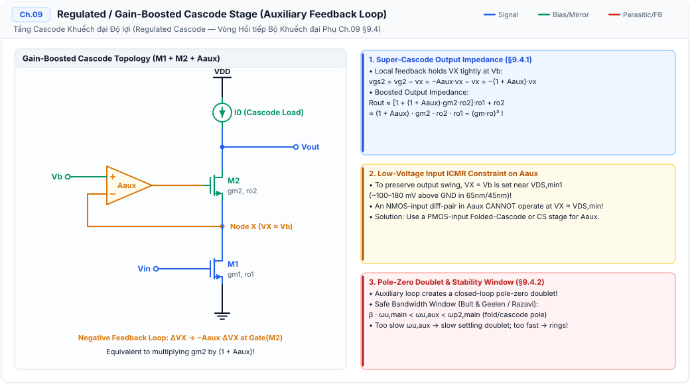

---
{
  "id": "skill-folded-cascode-and-gainboost-sizing-flow",
  "kind": "skill",
  "domain": "eda-and-github-skills",
  "title_vi": "Quy trình Định cỡ Thực chiến Folded-Cascode & Gain-Boosted OTA bằng Bảng tra gm/ID",
  "title_en": "Practical gm/ID & Headroom Sizing Workflow for Folded-Cascode and Gain-Boosted OTAs",
  "summary": "Quy trình định cỡ từng bước bất biến tiến trình (180nm/90nm/65nm/45nm) cho Folded-Cascode và Gain-Boosted Folded-Cascode OTA: phân bổ ngân sách dòng gập Ifold = (1.0–1.2)*Itail chống sập nút gập khi slewing, nén nhiễu nguồn dòng gập gm_fold << gm1, chọn cực tính hai OTA phụ đối ngẫu (PMOS-in gần GND, NMOS-in gần VDD) và khóa cửa sổ tần số vàng beta_aux*GBW_main < GBW_aux < wp_cas chống đuôi xác lập chậm doublet.",
  "diagram": "../../diagrams/gain-boosted-cascode.svg",
  "razavi_refs": [
    {
      "chapter": 9,
      "section": "9.2.4-9.3",
      "pages": "355-364",
      "equations": ["9.17", "9.18"]
    },
    {
      "chapter": 9,
      "section": "9.4.1-9.4.3, 9.9, 9.12",
      "pages": "364-373, 390-396, 402-405",
      "equations": ["9.19", "9.20", "9.23", "9.26", "9.34", "9.35", "9.91"]
    },
    {
      "chapter": 11,
      "section": "11.4-11.6.1",
      "pages": "466-498",
      "equations": ["11.10", "11.14"]
    }
  ],
  "github_refs": [
    {
      "repo": "bmurmann/Book-on-gm-ID-design",
      "url": "https://github.com/bmurmann/Book-on-gm-ID-design/tree/9bc96fbcfc0d40a4acdacdde78af884ae8d4b22e",
      "use": "Phương pháp định cỡ tách bậc tự do gm/ID, gm/gds, fT và mật độ dòng JD = ID/W từ bảng tra đặc tính Spectre"
    },
    {
      "repo": "iic-jku/analog-circuit-design",
      "url": "https://github.com/iic-jku/analog-circuit-design/tree/6075ea0ebcf08f5c7f6033a84e9dd3c91450f5e1/content/ota_improved",
      "use": "Quy trình phân bổ ngân sách dòng, áp vượt ngưỡng, mạng phân cực cascode điện áp thấp và đo kiểm OTA cải tiến"
    },
    {
      "repo": "dreoilin/pygmid",
      "url": "https://github.com/dreoilin/pygmid/tree/a9563980b30b84abbaf7870df05ee02aaa798654",
      "use": "Tra cứu nội suy tự động Python Lookup cho các vai trò cặp vi sai, nguồn gập, lá chắn cascode và OTA phụ"
    }
  ],
  "glossary_codes": ["T500", "T1393", "T1460", "T1487", "T1499", "T1506", "T1556", "T1707", "T1851"],
  "process_agnostic": true,
  "roles": {
    "main_input_pair": "Cặp vi sai chính M1-M2 định cỡ ở vùng nghịch đảo vừa/yếu (gm/ID = 15-20 S/A) để cực đại hóa gm1 trên mỗi micro-ampe và ép nhiễu/offset xuống thấp nhất",
    "folding_current_sources": "Cặp nguồn dòng gập M5-M6 định cỡ ở vùng nghịch đảo mạnh (gm/ID = 6-9 S/A, L dài) với Ifold = (1.0-1.2)*Itail để vừa chống sập slewing vừa giảm hệ số bơm nhiễu gm_fold/gm1",
    "cascode_shields": "Cặp lá chắn cascode M3-M4 và M7-M8 định cỡ L ngắn vừa (1.2-1.8*Lmin, gm/ID = 10-13 S/A) nhằm giữ cực nút gập wp_fold >= 3*GBW_main trong khi tiêu tốn ít VDS,min",
    "gain_boost_aux_otas": "Hai bộ khuếch đại phụ đối ngẫu (PMOS-in cho cascode đáy gần GND, NMOS-in cho cascode đỉnh gần VDD) điều chỉnh cổng cascode nâng Rout lên A_aux*gm*ro^2"
  },
  "symptoms_addressed": [
    "nanometer-folded-cascode-dc-gain-stuck-at-40-to-50-db",
    "overdrive-recovery-hang-from-starved-folding-branch-during-slewing",
    "excess-thermal-and-flicker-noise-from-high-gm-folding-sources",
    "slow-settling-tail-caused-by-misplaced-gain-boost-doublet",
    "auxiliary-loop-ringing-or-instability-at-cascode-gate-node"
  ],
  "limitations": [
    "consumes-2x-core-quiescent-current-plus-auxiliary-ota-power",
    "requires-verifying-up-to-5-feedback-loops-dm-cmfb-and-aux-loops",
    "parasitic-capacitance-of-aux-ota-input-loads-the-folding-node-directly",
    "output-swing-bounded-by-vdd-minus-4-vdsmin-requiring-careful-bias-generation"
  ],
  "checklists": ["common-mos", "differential-pair", "current-mirror", "folded-cascode", "cmfb", "feedback-and-stb"]
}
---

## 1. Kiến trúc Luồng Định cỡ Thực chiến & Phối hợp Đa Vòng Lặp

Trong thiết kế vi mạch tương tự công nghiệp (ADC Pipeline, SAR tham chiếu đệm, bộ tích phân Switched-Capacitor độ phân giải 12–16 bit), **Folded-Cascode OTA (`T1460`)** kết hợp **tăng cường độ lợi (`T1393`, gain-boosting)** là kiến trúc "ngựa thồ" chủ lực vì giữ nguyên hành vi **một cực trội tự bù bởi tụ tải $C_L$** trong khi đạt đồng thời độ lợi vòng hở $A_0 \ge 80\text{–}95\text{ dB}$ ngay cả trên công nghệ $65\text{ nm}/45\text{ nm}$ (nơi $g_m r_O$ đơn linh kiện chỉ còn $7\text{–}12$). Tuy nhiên, nếu người thiết kế định cỡ mò mẫm bằng công thức kênh dài hoặc gắn đại một OTA phụ quá nhanh hay quá chậm vào cực cổng cascode, mạch sẽ sập ngay bởi một trong bốn thảm họa: (1) nhánh cascode cạn dòng ở góc chéo `FS`/`SF`, (2) nhiễu nhiệt tăng gấp $3\times$ do nguồn dòng gập, (3) vòng phụ tự dao động ở tần số GHz, hoặc (4) xuất hiện **cặp cực–zero gần trùng (`T1708`, doublet)** làm đuôi xác lập bước nhảy kéo dài gấp $5\text{–}10$ lần mặc dù dự trữ pha Bode trông vẫn đẹp $65^\circ$!



Quy trình thực chiến kết hợp phương pháp bảng tra $g_m/I_D$ của Boris Murmann (`bmurmann/Book-on-gm-ID-design`, `dreoilin/pygmid`) với giải tích Razavi Chương 9 (§9.2.4–9.2.6, §9.4.1–9.4.3) chia bài toán thành **hai giai đoạn tách rời rạch ròi**:
1. **Giai đoạn A — Khóa chặt khung xương Folded-Cascode chính (Core FC Synthesis):** Chốt cực tính đầu vào theo dải ICMR, tính $I_{SS}$ và $g_{m1}$ từ $\{C_L, \text{SR}, \text{GBW}, \overline{V_{n,\text{in}}^2}\}$, khóa dòng gập $I_{\text{fold}} = (1{,}0\text{–}1{,}2) I_{SS}$, phân bổ ngân sách $4\,V_{DS,\min}$ dọc cột ngõ ra và phân vùng $g_m/I_D$ đối ngẫu giữa cặp vi sai (nghịch đảo vừa/yếu) với nguồn dòng gập/tải (nghịch đảo mạnh).
2. **Giai đoạn B — Ghép có kiểm soát hai Bộ Khuếch đại Phụ trợ (`T1487`, Auxiliary Amplifiers $A_{\text{aux},N}, A_{\text{aux},P}$):** Chọn cực tính đầu vào đối ngẫu để bắt được mức áp DC cực thấp/cực cao của nút gập/chân cascode mà không tốn dịch mức, đồng thời đặt băng thông độ lợi đơn vị của vòng phụ rơi chính xác vào **cửa sổ tần số vàng Bult–Geelen** ($\beta_{\text{main}} \omega_{u,\text{main}} < \omega_{u,\text{aux}} < \omega_{p,\text{fold}}$).

---

## 2. Hệ Phương trình Định cỡ Định lượng & Cửa sổ Tần số Vàng

### 2.1. Ngân sách Dòng điện, Hỗ dẫn & Phương trình Nhiễu Quy về Ngõ vào
Cho bộ chỉ tiêu đặc tả: nguồn cấp $V_{DD}$, tụ tải hiệu dụng $C_{L,\text{eff}}$ (đã cộng tụ hồi tiếp $C_F \parallel (C_S + C_{\text{in}})$ và tụ cảm nhận CMFB!), băng thông độ lợi đơn vị $\omega_{u,\text{main}} = 2\pi f_{u,\text{main}}$, hệ số hồi tiếp vòng ngoài $\beta_{\text{main}}$, tốc độ biến thiên cực đại $\text{SR}_{\min}$, biên độ ngõ ra vi sai $\Delta V_{\text{out,diff}}$ và trần nhiễu nhiệt ngõ vào $\overline{V_{n,\text{in,th}}^2}$.

Bước 1 — Chốt dòng đuôi $I_{SS}$ và dòng gập $I_{\text{fold}}$ từ điều kiện không sập nút gập khi Slewing (Razavi §9.9, tr. 394–396):

$$
I_{SS} \ge \max\!\left( \text{SR}_{\min} \cdot C_{L,\text{eff}},\;\; \frac{2 \cdot g_{m1,\text{req}}}{(g_m/I_D)_1} \right), \qquad I_{\text{fold}} = \alpha_{\text{fold}} I_{SS} \;\;\text{với}\;\; \alpha_{\text{fold}} \in [1{,}05,\; 1{,}20]
$$

Khi đó tại điểm cân bằng tĩnh ($\Delta V_{\text{in}} = 0$), dòng chảy qua mỗi nhánh cascode và tải cascode là $I_{\text{cas}} = I_{\text{fold}} - 0{,}5\,I_{SS} = (\alpha_{\text{fold}} - 0{,}5) I_{SS} \in [0{,}55,\; 0{,}70]\,I_{SS}$. Ngay cả khi bước nhảy lớn lái trọn $100\%$ dòng đuôi $I_{SS}$ dồn sang một bên, nhánh cascode vẫn còn dòng dư $(\alpha_{\text{fold}} - 1) I_{SS} > 0$, ngăn chặn hoàn toàn hiện tượng nút gập bị kéo sập vào vùng triode gây liệt **phục hồi sau quá kích (`T1556`, overdrive recovery)**!

Bước 2 — Tính $g_{m1,2}$ có tính đến hệ số nhân nhiễu thừa $\eta_{\text{noise}}$ của nguồn gập và nguồn tải (Razavi Phương trình 9.91, tr. 403):

$$
\overline{V_{n,\text{in,th}}^2} = \frac{8 k T \gamma}{g_{m1}} \underbrace{\left( 1 + \frac{g_{m,\text{fold}}}{g_{m1}} + \frac{g_{m,\text{load}}}{g_{m1}} \right)}_{\eta_{\text{noise}}}, \qquad g_{m1} = \max\!\left( \omega_{u,\text{main}} C_{L,\text{eff}},\;\; \frac{8 k T \gamma \cdot \eta_{\text{noise}}}{\overline{V_{n,\text{in,th,max}}^2}} \right)
$$

Bằng cách ép $(g_m/I_D)_{\text{fold}} \approx 6\text{–}8\text{ S/A}$ và $(g_m/I_D)_1 \approx 16\text{–}20\text{ S/A}$, dù $I_{\text{fold}} \approx 2{,}2 \times I_{D1}$, tỷ số $\frac{g_{m,\text{fold}}}{g_{m1}} = \frac{I_{\text{fold}}}{I_{D1}} \frac{(g_m/I_D)_{\text{fold}}}{(g_m/I_D)_1} \approx 2{,}2 \times \frac{7}{18} \approx 0{,}85$, giữ hệ số nhân nhiễu $\eta_{\text{noise}} \approx 2{,}2$ thay vì vọt lên $4{,}0\text{–}5{,}0$!

### 2.2. Nhân Trở kháng Ngõ ra & Cửa sổ Băng thông OTA Phụ trợ (Bult & Geelen, Razavi §9.4.3)
Khi gắn bộ khuếch đại phụ có độ lợi DC $A_{\text{aux},0}$ cảm nhận điện áp nút gập $V_X$ (so với $V_{\text{ref,cas}}$) và lái cực cổng cascode $M_3$, độ hỗ dẫn hiệu dụng của $M_3$ đối với biến thiên tại $V_X$ được nhân lên $(1 + A_{\text{aux}}(s))$ lần (Phương trình 9.23 & 9.35):

$$
R_{\text{out,bot}} \approx \big[1 + A_{\text{aux},N}(0)\big] (g_{m3} + g_{mb3}) r_{O3} (r_{O1} \parallel r_{O5}), \qquad \left|A_{v,\text{GBFC}}\right| = g_{m1} \left( R_{\text{out,bot}} \parallel R_{\text{out,top}} \right)
$$

Xét động học s-plane: vòng hồi tiếp cục bộ quanh $M_3$ và $A_{\text{aux}}$ tạo ra một **doublet cực–zero** nằm ngay gần tần số cắt vòng của mạch phụ $\omega_{u,\text{aux,loop}} \approx \beta_{\text{aux}} \omega_{u,\text{aux}}$ (với $\beta_{\text{aux}} \approx 1$ ở tần số thấp khi nút máng cascode nhìn thấy tải trở kháng cao, nhưng suy giảm ở tần số cao khi $C_L$ nối tắt máng ngõ ra xuống đất AC!). Để **triệt tiêu hoàn toàn thành phần xác lập chậm do doublet** đồng thời giữ vòng cục bộ ổn định với $\text{PM}_{\text{aux}} \ge 60^\circ$, tần số độ lợi đơn vị của vòng phụ phải nằm trọn trong cửa sổ kép:

$$
\beta_{\text{main}} \, \omega_{u,\text{main}} \;<\; \omega_{u,\text{aux,loop}} \;<\; \frac{\omega_{p,\text{fold}}}{2{,}5} \qquad \text{với} \qquad \omega_{p,\text{fold}} \approx \frac{g_{m3} + g_{mb3}}{C_X + C_{\text{in,aux}}}
$$

- **Biên dưới ($\omega_{u,\text{aux,loop}} > \beta_{\text{main}} \omega_{u,\text{main}} = \omega_{-3\text{dB,closed-loop}}$):** Nếu $\omega_{u,\text{aux,loop}}$ thấp hơn băng thông vòng kín của mạch chính, hằng số thời gian của doublet $\tau_d = 1/\omega_{u,\text{aux,loop}}$ chậm hơn hằng số thời gian chính $\tau_{\text{main}} = 1/(\beta_{\text{main}}\omega_{u,\text{main}})$, sinh ra đuôi hàm mũ chậm không thể chấp nhận trong mạch lấy mẫu SC/ADC!
- **Biên trên ($\omega_{u,\text{aux,loop}} < \omega_{p,\text{fold}} / 2{,}5$):** Bản thân vòng cục bộ (đi từ ngõ vào âm của $A_{\text{aux}}$ tại nút $X \to$ cổng $M_3 \to$ nguồn $M_3$ tại nút $X$) có cực thứ hai chính là cực nút gập $\omega_{p,\text{fold}}$ (hoặc cực tại $C_L$ phản chiếu qua $r_{O3}$)! Nếu đẩy $\omega_{u,\text{aux}}$ vượt quá $\omega_{p,\text{fold}}/2$, vòng cục bộ mất dự trữ pha và rung tần số cao ngay trên cổng cascode!

---

## 3. Bất biến Kỹ thuật & Các Bẫy Lỗi Thực chiến (Invariants & Traps)

- **[INV-GBFC-01] Bất biến Cực tính Đối ngẫu của Hai OTA Phụ trợ (Complementary Aux Input Polarity):**
  - Nhánh cascode NMOS phía dưới ($M_{3,4}$) có điện áp nút gập DC rất thấp, chỉ bằng $V_{X,\text{DC}} = V_{DS5,\text{sat}} + \Delta V_{\text{margin}} \approx 180\text{–}250\text{ mV}$ trên đất! Một cặp đầu vào NMOS thường không thể hoạt động ở $V_{\text{in,CM}} = 200\text{ mV}$ vì $V_{GS,N} + V_{DS,\text{tail}} > 550\text{ mV}$. Do đó, **OTA phụ phía đáy ($A_{\text{aux},N}$) BẮT BUỘC dùng cặp vi sai đầu vào PMOS** (Folded-Cascode nhỏ hoặc 5T-OTA PMOS-in)!
  - Ngược lại, nhánh cascode PMOS phía đỉnh ($M_{7,8}$) có nút nguồn nằm sát $V_{DD}$ ($V_{DD} - |V_{DS9,\text{sat}}| - \Delta V_{\text{margin}} \approx V_{DD} - 200\text{ mV}$). Do đó, **OTA phụ phía đỉnh ($A_{\text{aux},P}$) BẮT BUỘC dùng cặp vi sai đầu vào NMOS**!
- **[INV-GBFC-02] Bất biến Đặt Áp Tham chiếu $V_{\text{ref,N}}, V_{\text{ref,P}}$ Từ Mạng Replica Bám Nhiệt/Góc:** Không bao giờ cấp $V_{\text{ref,N}} = 200\text{ mV}$ từ cầu chia điện trở cố định! Ở góc `SS` nhiệt độ $-40\,^\circ\text{C}$ hoặc $125\,^\circ\text{C}$, $V_{DS,\text{sat}5}$ nở rộng làm $M_5$ sập vào triode nếu $V_{\text{ref,N}}$ cứng nhắc. Phải sinh $V_{\text{ref,N}} = V_{DS,\text{sat},5,\text{rep}} + 60\text{ mV}$ từ nhánh gương dòng bản sao (replica bias) dùng cùng mật độ dòng và cùng $L_5$.
- **[TRAP-GBFC-01] Bẫy "Cổ chai Tự Lợi" Khi Quên Tăng Cường Cả Hai Phía (One-Sided Gain-Boosting Trap):** Tổng trở ngõ ra là tích song song $R_{\text{out,bot}} \parallel R_{\text{out,top}}$. Nếu chỉ gắn gain-boosting cho nhánh gập phía dưới ($R_{\text{out,bot}}$ vọt lên $50\text{ M}\Omega$) mà để nguyên tải cascode thường phía trên ($R_{\text{out,top}} = 500\text{ k}\Omega$), tổng trở ngõ ra chỉ đạt $50\text{ M}\Omega \parallel 500\text{ k}\Omega = 495\text{ k}\Omega$ — tăng chưa đầy $6\text{ dB}$ trong khi tốn công suất vô ích! Bắt buộc tăng cường đồng bộ cả nhánh NMOS lẫn nhánh PMOS khi mục tiêu $A_0 > 75\text{ dB}$.
- **[TRAP-GBFC-02] Bẫy Quá tải Tụ Ngõ vào OTA Phụ Làm Sập Cực Nút Gập $\omega_{p,\text{fold}}$:** Ngõ vào của $A_{\text{aux},N}$ nối trực tiếp vào nút gập $X, Y$ trên đường đi của tín hiệu chính! Nếu định cỡ cặp đầu vào của $A_{\text{aux},N}$ quá to để giảm offset, điện dung $C_{GS,\text{aux}}$ cộng thẳng vào $C_X$, kéo tụt $\omega_{p,\text{fold}}$ xuống sát $\omega_{u,\text{main}}$ và phá hỏng dự trữ pha của cả vòng chính lẫn vòng phụ! Quy tắc vàng: dòng tĩnh mỗi OTA phụ chỉ bằng **$5\%\text{–}12\%$ dòng nhánh chính** và $C_{\text{in,aux}} \le 0{,}15\,C_X$ (offset của $A_{\text{aux}}$ vài $\text{mV}$ chỉ làm xê dịch nhẹ $V_{DS5}$ chứ hầu như không cộng vào $V_{OS}$ ngõ vào chính vì bị chia cho $g_{m1} r_{O1}$!).
- **[TRAP-GBFC-03] Bẫy Bỏ Quên Mạch CMFB Riêng khi Dùng OTA Phụ Vi sai Toàn phần:** Nếu dùng một OTA phụ vi sai toàn phần điều khiển đồng thời cặp cổng $(M_3, M_4)$ (Razavi Hình 9.37) để tiết kiệm nửa số khối phụ, ngõ ra của OTA phụ đó cũng là nút trở kháng cao vi sai — nếu quên gắn mạng CMFB nhỏ bên trong OTA phụ, hai cực cổng cascode sẽ trôi chạm $V_{DD}$ hoặc $\text{GND}$ làm tê liệt toàn bộ mạch chính!

---

## 4. Ma trận Phân vai Định cỡ gm/ID & Lộ trình Nâng cấp

| Nhánh Linh kiện | Mục tiêu Vật lý Chủ đạo | Vùng $g_m/I_D$ Khuyến nghị | Chiều dài Kênh $L$ | Ngân sách $V_{DS,\min}$ | Ghi chú Layout & Ký sinh |
|---|---|---|---|---|---|
| **Cặp vi sai chính $M_{1,2}$** | Cực đại hóa $g_{m1}/I_D$, tối thiểu hóa $\overline{V_{n,\text{in}}^2}$ và $V_{OS}$ | $15\text{–}20\text{ S/A}$ (Nghịch đảo vừa/yếu) | $1{,}5\text{–}2{,}5\,L_{\min}$ | $80\text{–}110\text{ mV}$ | Ghép tâm chung 2D `ABBA`, số ngón chẵn giảm $C_{DB1}$ vào nút gập |
| **Nguồn dòng đuôi $M_{\text{tail}}$** | Giữ $R_{SS}$ cao bảo vệ CMRR & PSRR | $8\text{–}11\text{ S/A}$ | $3\text{–}5\,L_{\min}$ | $150\text{–}220\text{ mV}$ | Chia đa nhánh đồng bộ với bản sao phân cực |
| **Nguồn dòng gập $M_{5,6}$** | Cấp $I_{\text{fold}} = 1{,}1\,I_{SS}$, nén chặt $g_{m5} \ll g_{m1}$ chống nhiễu | $6\text{–}9\text{ S/A}$ (Nghịch đảo mạnh) | $3\text{–}5\,L_{\min}$ | $200\text{–}280\text{ mV}$ | Bắt buộc số ngón chẵn `nf`, dùng chung cực máng cắt nửa $C_{DB5}$ |
| **Lá chắn cascode gập $M_{3,4}$** | Cực nút gập $\omega_{p,\text{fold}}$ cao nhất, che chắn cực máng | $11\text{–}14\text{ S/A}$ | $1{,}2\text{–}1{,}8\,L_{\min}$ | $110\text{–}150\text{ mV}$ | Ngắn vừa để $f_T$ cao, giữ $C_{GS3} + C_{SB3}$ nhỏ |
| **Lá chắn cascode tải $M_{7,8}$** | Che chắn nguồn tải, tránh tạo cực phụ thấp | $10\text{–}13\text{ S/A}$ | $1{,}5\text{–}2{,}0\,L_{\min}$ | $120\text{–}160\text{ mV}$ | Đặt đối xứng gương sát cặp ngõ ra |
| **Nguồn dòng tải $M_{9,10}$** | Trở kháng $r_{O9}$ lớn, $g_{m9} \ll g_{m1}$, nhận tín hiệu CMFB | $6\text{–}9\text{ S/A}$ (Nghịch đảo mạnh) | $3\text{–}5\,L_{\min}$ | $180\text{–}250\text{ mV}$ | Tách $70\%$ dòng cố định + $30\%$ dòng điều khiển CMFB |
| **OTA Phụ trợ $A_{\text{aux},N}, A_{\text{aux},P}$** | Nâng $R_{\text{out}}$ thêm $35\text{–}45\text{ dB}$, giữ $C_{\text{in,aux}}$ cực nhỏ | $14\text{–}17\text{ S/A}$ (đầu vào) | $1{,}5\text{–}2{,}0\,L_{\min}$ | Theo biên cổng cascode | Bù thêm tụ nhỏ $C_{c,\text{aux}} = 50\text{–}200\text{ fF}$ tại cổng cascode nếu vòng phụ dư băng thông |

**Lộ trình chuyển đổi cấu trúc theo Bát giác Thiết kế:**
- Nếu $V_{DD} \ge 1{,}2\text{ V}$ và chỉ tiêu $A_0 \le 55\text{ dB}$: dừng ở `topo-folded-cascode-ota` chuẩn (tiết kiệm $20\%$ công suất, 0 rủi ro doublet vòng phụ).
- Nếu $V_{DD} \ge 1{,}1\text{ V}$, tải thuần dung $C_L$ và cần $A_0 \ge 80\text{ dB}$ kèm tốc độ xác lập bước nhảy nhanh cho ADC 14-bit: áp dụng trọn vẹn luồng **Gain-Boosted Folded-Cascode** (`topo-gain-boosted-cascode`) trong thẻ này.
- Nếu $V_{DD} \le 0{,}9\text{–}1{,}0\text{ V}$ đồng thời đòi hỏi biên độ ra đơn đầu $> 0{,}65\text{ V}$ (cột 4 tầng $4 V_{DS,\min} \approx 650\text{ mV}$ không còn chỗ thở): chuyển sang **Folded-Cascode + Tầng 2 CS bù Cascode Ahuja** (`topo-two-stage-opamp` + `tech-miller-rhp-zero-nulling-and-cascode-comp`), tra cứu thêm tại `skill-amplifier-25-topology-selector`.

---

## 5. Thích ứng Đa Tiến trình (180nm / 90nm / 65nm / 45nm) & Mẫu Kiểm chứng Python + Spectre 15.1

### 5.1. Điểm Khác biệt Cốt lõi Khi Dịch chuyển Giữa 180nm $\to$ 90nm $\to$ 65nm/45nm
- **Ở $180\text{ nm}$ ($V_{DD} = 1{,}8\text{ V}$):** $g_m r_O$ đơn chiếc đạt $25\text{–}45$, riêng Folded-Cascode thường đã đạt $62\text{–}70\text{ dB}$; khi thêm Gain-Boosting 5T-OTA đơn giản, $A_0$ vượt $105\text{ dB}$ dễ dàng và cửa sổ headroom $1{,}8\text{ V} - 4(0{,}2\text{ V}) = 1{,}0\text{ V}_{\text{se}}$ cực kỳ rộng rãi.
- **Ở $90\text{ nm}$ / $65\text{ nm}$ / $45\text{ nm}$ ($V_{DD} = 1{,}0\text{–}1{,}2\text{ V}$):** $g_m r_O$ giảm còn $8\text{–}14$ khiến Folded-Cascode thường rớt xuống $42\text{–}50\text{ dB}$ — Gain-Boosting trở thành bắt buộc cho độ chính xác $> 10\text{ bit}$! Đồng thời vì $f_T$ ở $45\text{ nm}/65\text{ nm}$ rất cao ($80\text{–}180\text{ GHz}$), một OTA phụ nhỏ rất dễ vọt băng thông vượt quá cực phụ hoặc bị điện dung cổng của chính transistor cascode $C_{GS3} + C_{GD3}(1 + g_{m3}R_L)$ đánh trôi cực, nên phải kiểm tra `stb` riêng từng vòng phụ!

### 5.2. Kịch bản Python `pygmid` Tự động Tính Kích thước Khởi tạo
Đoạn mã Python 3 dưới đây minh họa thuật toán định cỡ số học sạch từ bảng tra LUT `NCH`, `PCH` (chạy độc lập trên máy trạm phân tích trước khi nhập vào schematic IC617):

```python
# Chạy với: PYTHONDONTWRITEBYTECODE=1 python -B size_gbfc_ota.py
import math
from pygmid import Lookup as lk

def synthesize_gbfc_initial(nch_lut_path, pch_lut_path, specs):
    NCH = lk(nch_lut_path)
    PCH = lk(pch_lut_path)
    cl_eff = specs["CL_eff_F"]
    fu_hz = specs["GBW_Hz"]
    sr_v_s = specs["SR_V_per_s"]
    beta_fb = specs["beta_main"]
    vdd = specs["VDD"]

    # 1. Chọn bản PMOS-in -> NMOS folding cascode (ICMR chạm GND, cực nút gập nhanh)
    gm_id_in, l_in = 17.0, specs["L_in_um"]
    gm_id_fold, l_fold = 7.5, specs["L_supply_um"]
    gm_id_cas, l_cas = 12.5, specs["L_cas_um"]

    gm1_bw = 2.0 * math.pi * fu_hz * cl_eff * 1.15  # Dự trữ 15% cho tụ ký sinh ngõ ra
    i_tail_bw = 2.0 * (gm1_bw / gm_id_in)
    i_tail_sr = sr_v_s * cl_eff * 1.15
    i_tail = max(i_tail_bw, i_tail_sr)
    i_d1 = 0.5 * i_tail
    i_fold = 1.10 * i_tail        # Bất biến chống sập slewing: Ifold = 1.10 * Itail
    i_cas = i_fold - i_d1         # = 0.60 * Itail

    # 2. Tra mật độ dòng JD = ID/W để suy ra chiều rộng W (um)
    jd_p1 = float(PCH.lookup("ID_W", GM_ID=gm_id_in, L=l_in, VDS=0.35, VSB=0.0))
    jd_n5 = float(NCH.lookup("ID_W", GM_ID=gm_id_fold, L=l_fold, VDS=0.22, VSB=0.0))
    jd_n3 = float(NCH.lookup("ID_W", GM_ID=gm_id_cas, L=l_cas, VDS=0.25, VSB=0.22))

    w_1 = i_d1 / jd_p1
    w_5 = i_fold / jd_n5
    w_3 = i_cas / jd_n3

    # 3. Định vị cửa sổ tần số vàng cho OTA phụ đáy (PMOS-in 5T/FC nhỏ)
    f_aux_min = 1.8 * beta_fb * fu_hz
    ft_cas = float(NCH.lookup("GM_CGG", GM_ID=gm_id_cas, L=l_cas, VDS=0.25, VSB=0.22)) / (2.0 * math.pi)
    f_aux_target = min(3.0 * beta_fb * fu_hz, 0.15 * ft_cas)
    return {
        "I_tail_uA": i_tail * 1e6,
        "I_fold_uA": i_fold * 1e6,
        "I_cas_uA": i_cas * 1e6,
        "W1_um": w_1,
        "W5_um": w_5,
        "W3_um": w_3,
        "f_aux_window_MHz": (f_aux_min * 1e-6, f_aux_target * 1e-6),
    }
```

### 5.3. Mẫu Testbench Spectre 15.1 Kiểm định Đa Vòng (`stb` Vòng Chính + Vòng Phụ + Bước nhảy Doublet)
Trong Gain-Boosted Folded-Cascode vi sai toàn phần, có **4 loại vòng hồi tiếp tồn tại đồng thời**: (1) vòng vi sai chính (DM), (2) vòng chế độ chung (CMFB), (3) vòng OTA phụ đáy $A_{\text{aux},N}$, và (4) vòng OTA phụ đỉnh $A_{\text{aux},P}$. Tuyệt đối không chỉ đo `ac` vòng hở mà phải đặt `iprobe` / `diffstbprobe` kiểm định từng vòng trong trạng thái đóng vòng thực:

```spice
// tb_gbfc_multiloop_signoff.scs — Spectre 15.1 Multi-Loop Verification Deck
simulator lang=spectre
global 0
parameters vdd=1.2 vcm=0.6 cload=2p isrc_tail=100u vstep=0.2

// Đóng vòng hồi tiếp điện dung hệ số beta = CF / (CS + CF + Cin) ≈ 0.5
// Chèn diffstbprobe ở đường vi sai chính, và iprobe nối tiếp tại cổng cascode M3 & M7!
IPR_AUX_N (net_auxN_out gate_M3) iprobe
IPR_AUX_P (net_auxP_out gate_M7) iprobe
DSTB_MAIN (vout_p vout_n fb_p fb_n) diffstbprobe

dcOp dc write="spectre.dc" maxiters=150
dcOpInfo info what=oppoint where=rawfile

// 1. Kiểm tra ổn định vòng Vi sai chính (mode=diff) và vòng CMFB (mode=comm)
stb_dm   stb start=1 stop=10G dec=40 probe=DSTB_MAIN diffprobe_mode=diff
stb_cmfb stb start=1 stop=10G dec=40 probe=DSTB_MAIN diffprobe_mode=comm

// 2. Kiểm tra ổn định từng vòng Gain-Boost cục bộ (yêu cầu PM_aux >= 60 deg!)
stb_auxN stb start=1k stop=20G dec=40 probe=IPR_AUX_N
stb_auxP stb start=1k stop=20G dec=40 probe=IPR_AUX_P

// 3. Quá độ bước nhảy lớn với reltol chặt (1e-5) để bắt đuôi chậm doublet ở mức 0.01% (13-14 bit)!
tran_settle tran stop=80n errpreset=conservative reltol=1e-5 maxstep=20p
```

**5 tiêu chí nghiệm thu bắt buộc sau mô phỏng:**
1. `OP`: `I(M3) >= 0.45 * I_tail` tại cả 5 góc `{TT, FF, SS, FS, SF}` và `vds - vdsat >= 45 mV` trên toàn bộ 4 tầng cột ngõ ra + các transistor của 2 OTA phụ.
2. `stb_auxN` & `stb_auxP`: Dự trữ pha vòng phụ $\text{PM}_{\text{aux}} \ge 60^\circ$, tần số cắt $f_{u,\text{aux}}$ thỏa mãn $1{,}5 \beta_{\text{main}} f_{u,\text{main}} \le f_{u,\text{aux}} \le 0{,}4 f_{p,\text{fold}}$.
3. `stb_dm` & `stb_cmfb`: Đường pha của vòng chính lăn trơn tru qua $f_{u,\text{main}}$ mà không có vết gợn hình chữ S (dấu hiệu doublet trong dải!), $\text{PM}_{\text{DM}} \ge 62^\circ$ và $\text{PM}_{\text{CMFB}} \ge 55^\circ$.
4. `noise`: Đóng góp nhiễu tích phân của cặp nguồn gập $M_{5,6}$ chiếm $\le 35\%$ tổng công suất nhiễu ngõ ra.
5. `tran_settle`: Sai số tương đối $\left|\frac{V_{\text{out}}(t) - V_{\text{final}}}{V_{\text{step}}}\right|$ lọt hẳn vào dải $\pm 0{,}01\%$ trong thời gian mục tiêu mà không xuất hiện độ dốc gãy khúc thứ hai (double-slope settling tail)!

---

## 6. Đối chiếu Sách Razavi, Nguồn GitHub Đã Kiểm định & Thuật ngữ Chuẩn CLB

### 6.1. Mốc Tọa độ Sách Razavi (2nd Edition) & Nguồn GitHub
- **Chương 9:** §9.2.4–9.2.6 *Folded-Cascode Op Amps & Design Procedure* (tr. 355–361, Phương trình 9.17–9.19, Ví dụ 9.9), §9.4.1–9.4.3 *Gain Boosting & Frequency Response* (tr. 364–372, Phương trình 9.20–9.35, Hình 9.36–9.39), §9.9 *Slew Rate* (tr. 394–396, Hình 9.75–9.77), §9.12 *Noise in Op Amps* (tr. 402–404, Phương trình 9.91).
- **Chương 11:** §11.4–11.5.2 *Nanometer Design Studies* (tr. 466–495 — kết hợp cascode/đa tầng dưới nguồn thấp).
- **Kho GitHub Đối chiếu:** `bmurmann/Book-on-gm-ID-design` (`9bc96fbcfc`, luồng định cỡ tỷ số chuẩn hóa), `iic-jku/analog-circuit-design` (`6075ea0ebc`, chương `ota_improved` của GS. Harald Pretl) và `dreoilin/pygmid` (`a9563980b3`, nội suy bảng tra Python).

### 6.2. Bảng Thuật ngữ Chuẩn CLB Vi Mạch
| Mã CLB | Thuật ngữ Tiếng Anh | Thuật ngữ Tiếng Việt Chuẩn | Ý nghĩa Trong Quy trình Định cỡ |
|---|---|---|---|
| `T1460` / `T500` | folded-cascode op amps / folded cascode | bộ khuếch đại thuật toán cascode gấp / cascode gập | Cấu trúc lõi bẻ gập dòng tín hiệu sang nhánh cascode đối cực |
| `T1393` / `T1506` | gain-boosting / gain-boosted op amp | tăng cường độ lợi / bộ khuếch đại thuật toán tăng cường độ lợi | Dùng hồi tiếp cục bộ nhân trở kháng ra lên $(1+A_{\text{aux}})g_m r_O^2$ |
| `T1487` / `T1499` | auxiliary amplifier / differential auxiliary amplifier | bộ khuếch đại phụ trợ / bộ khuếch đại phụ trợ vi sai | Khối khuếch đại ghim áp nút gập và lái cổng transistor cascode |
| `T1707` / `T1708` | doublet problem / doublet | vấn đề cặp cực–zero gần trùng / cặp cực–zero gần trùng | Cặp cực–zero của vòng phụ gây đuôi xác lập hàm mũ chậm trong miền thời gian |
| `T1556` | overdrive recovery | phục hồi sau quá kích | Thời gian thoát bão hòa/triode khi $I_{\text{fold}}$ chọn nhỏ hơn $I_{SS}$ |
| `T1851` | gm/ID ratio | tỉ số gm/ID | Tham số điều khiển vùng nghịch đảo trung tâm của quy trình định cỡ |
