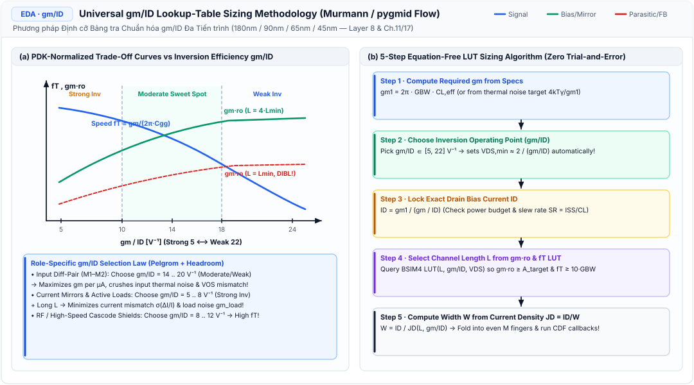

---
{
  "id": "skill-gm-id-lookup-table-sizing",
  "kind": "skill",
  "domain": "eda-and-github-skills",
  "title_vi": "Định cỡ Transistor theo Bảng tra gm/ID Đa Tiến trình (Murmann & pygmid LUT Flow)",
  "title_en": "Multi-Node gm/ID Lookup-Table Extraction & Systematic Transistor Sizing (180nm–45nm)",
  "summary": "Quy trình thực chiến trích xuất bảng tra đặc tính 4 chiều (L, VGS, VDS, VSB) từ Spectre 15.1 và định cỡ mạch tương tự độc lập tiến trình 180nm/90nm/65nm/45nm theo phương pháp Boris Murmann & pygmid: ánh xạ trực tiếp chỉ tiêu GBW, độ lợi nội tại gm/gds, fT, nhiễu và khoảng dự trữ áp sang vùng nghịch đảo gm/ID và mật độ dòng JD = ID/W, kèm bản vá 4 bẫy lỗi adapter trên GPDK.",
  "diagram": "../../diagrams/gmid-sizing-methodology.svg",
  "razavi_refs": [
    {
      "chapter": 2,
      "section": "2.3-2.4",
      "pages": "24-31",
      "equations": ["2.32", "2.36", "2.42"]
    },
    {
      "chapter": 11,
      "section": "11.2-11.4",
      "pages": "460-472",
      "equations": ["11.1", "11.4", "11.6", "11.9"]
    },
    {
      "chapter": 17,
      "section": "17.1-17.3",
      "pages": "693-707",
      "equations": ["17.12", "17.32", "17.41"]
    }
  ],
  "github_refs": [
    {
      "repo": "bmurmann/Book-on-gm-ID-design",
      "url": "https://github.com/bmurmann/Book-on-gm-ID-design",
      "use": "Cấu trúc quét Spectre techsweep.scs 4 chiều (L, VGS, VDS, VSB) và hàm tra cứu tỷ số bất biến Murmann"
    },
    {
      "repo": "dreoilin/pygmid",
      "url": "https://github.com/dreoilin/pygmid",
      "use": "Lớp Lookup Python 3 nội suy đa chiều GM_ID, GM_GDS, GM_CGG, ID_W và trích xuất tham số EKV"
    },
    {
      "repo": "Arcadia-1/gmoverid-skill",
      "url": "https://github.com/Arcadia-1/gmoverid-skill",
      "use": "Đối chiếu trực quan đường cong gm/ID, điện dung ký sinh Cgs/Cgd/Cdb và băng thông mạch thử nghiệm"
    }
  ],
  "glossary_codes": ["T276", "T355", "T394", "T655", "T1851", "T1944", "T2153", "T2186"],
  "process_agnostic": true,
  "roles": {
    "lut_characterizer": "Netlist Spectre quét một transistor tham chiếu chuẩn hóa W_ref trên lưới 4 chiều (L, VGS, VDS, VSB) để thu thập ID, gm, gmb, gds và ma trận điện dung cổng/máng",
    "inversion_selector": "Biến thiết kế chủ đạo gm/ID (S/A hay V^-1) định vị điểm làm việc từ nghịch đảo mạnh (5-8 V^-1) qua nghịch đảo vừa (10-16 V^-1) tới nghịch đảo yếu/dưới ngưỡng (18-26 V^-1)",
    "channel_length_selector": "Trục chiều dài kênh L điều khiển đánh đổi trực giao giữa độ lợi nội tại gm/gds (tăng theo L) và tần số cắt fT = gm/(2*pi*Cgg) (giảm gần tỷ lệ 1/L^2)",
    "width_scaler": "Mật độ dòng chuẩn hóa JD = ID/W giúp suy ra chiều rộng tổng W = ID / JD(gm/ID, L, VDS, VSB) và số ngón nf mà không cần công thức luật bình phương"
  },
  "symptoms_addressed": [
    "square-law-hand-calc-diverges-by-50pct-in-90nm-65nm-45nm",
    "vth-depends-strongly-on-channel-length-and-drain-bias-dibl",
    "cannot-hit-dc-gain-and-gbw-simultaneously-by-trial-and-error",
    "pygmid-sweep-kelvin-celsius-or-psf-colon-delimiter-mismatch"
  ],
  "limitations": [
    "lut-assumes-linear-width-scaling-deviates-at-narrow-width-sti-lod",
    "multi-finger-layout-changes-cdb-csb-sharing-relative-to-single-finger-ref",
    "single-corner-lut-does-not-replace-pvt-and-montecarlo-verification",
    "gate-leakage-and-flicker-noise-require-explicit-area-and-simulator-checks"
  ],
  "checklists": ["common-mos", "single-stage", "differential-pair", "current-mirror"]
}
---

## 1. Bản chất Kỹ thuật, Kiến trúc Luồng Bảng tra `gm/ID` & Vai trò Từng Trục Tự do

Ở các công nghệ dưới micromet sâu và nanomet ($180\text{ nm} \to 90\text{ nm} \to 65\text{ nm} \to 45\text{ nm}$, Razavi Chương 11 §11.2–11.4 & Chương 17 §17.1–17.3), ba giả định trụ cột của phương trình luật bình phương kênh dài sụp đổ hoàn toàn: bão hòa vận tốc hạt dẫn làm $I_D$ tiến về tuyến tính theo $(V_{GS}-V_{TH})$, hiệu ứng hạ rào thế cảm ứng cực máng (DIBL) khiến $g_{ds}$ tăng vọt và phụ thuộc phi tuyến vào $V_{DS}$, còn dòng dẫn dưới ngưỡng làm biên giới bật/tắt tại $V_{TH}$ mờ nhòa. Thay vì ép mạch thực tế vào các hằng số giả tạo $\mu_n C_{ox}$ và $\lambda$, phương pháp định cỡ hệ thống bằng **tỉ số hỗ dẫn trên dòng máng (`T1851`, $g_m/I_D$)** do Jespers và Boris Murmann chuẩn hóa biến chính mô hình BSIM4/PSP đã kiểm định của nhà máy đúc thành bảng tra số 4 chiều bất biến theo chiều rộng!



Nguyên lý tách biến nền tảng của luồng `gm/ID` (kết hợp phương pháp $V_{DS,\min}$ của Razavi §11.4 với khung tra cứu `bmurmann/Book-on-gm-ID-design` và `dreoilin/pygmid`) dựa trên tính đồng차 bậc một theo chiều rộng $W$: khi giữ cố định $(L, V_{GS}, V_{DS}, V_{SB})$ và nhân bội số ngón `nf` (hoặc hệ số nhân song song `m`) của một ngón đơn vị chuẩn $W_{\text{unit}}$, cả $I_D, g_m, g_{mb}, g_{ds}$ lẫn các tụ $C_{gg}, C_{gs}, C_{gd}, C_{dd}$ đều nhân tuyến tính theo $W$! Nhờ đó các **tỷ số chuẩn hóa** hoàn toàn độc lập với chiều rộng tổng $W$:
1. **Hiệu suất hỗ dẫn $g_m / I_D$ ($\text{V}^{-1}$ hoặc $\text{S/A}$):** Thay thế hoàn toàn vai trò của điện áp quá kích $V_{OV} = V_{GS} - V_{TH}$ kênh dài qua hệ thức tương đương $V^* = \dfrac{2}{g_m/I_D}$. Đây là núm vặn chủ đạo chọn **vùng nghịch đảo** của transistor theo đúng chức năng mạch học.
2. **Độ lợi nội tại (`T394`) $A_{\text{intr}} = g_m / g_{ds} = g_m r_O$ (V/V):** Đo trần khuếch đại điện áp cực đại của một linh kiện đơn lẻ tại $(g_m/I_D, L, V_{DS})$ đã chọn.
3. **Tần số cắt nội tại $\omega_T = g_m / C_{gg}$ hay $f_T = \dfrac{g_m}{2\pi C_{gg}}$ (Hz):** Đo tốc độ chuyển mạch/tần số cực phụ nội tại; tỷ lệ thuận với mật độ dòng và giảm mạnh khi kéo dài $L$.
4. **Mật độ dòng chuẩn hóa $J_D = I_D / W$ ($\text{A/m}$ hay $\mu\text{A}/\mu\text{m}$):** Cầu nối duy nhất từ miền tỷ số không thứ nguyên sang kích thước hình học vật lý $W = I_D / J_D$.

---

## 2. Hệ Phương trình Cốt lõi, Ba Chế độ Tra cứu & Thuật toán Định cỡ 6 Bước

### 2.1. Liên hệ Vật lý Giữa Ba Miền Nghịch đảo và Đại lượng Chuẩn hóa $V^*$
Đặt $V^* \triangleq \dfrac{2 I_D}{g_m} = \dfrac{2}{g_m/I_D}$. Đối chiếu với vật lý bán dẫn trong Razavi Chương 2 (§2.3, Phương trình 2.36) và Chương 11 (§11.3–11.4):

$$
\frac{g_m}{I_D} = \begin{cases}
\dfrac{2}{V_{GS} - V_{TH}} = \dfrac{2}{V_{OV}}, & \text{nghịch đảo mạnh (luật bình phương kênh dài)} \\[8pt]
\dfrac{1}{\zeta V_T} = \dfrac{q}{\zeta k T} \approx 24\text{–}30\text{ V}^{-1}\text{ (ở }300\text{ K)}, & \text{nghịch đảo yếu / dưới ngưỡng } (\zeta \approx 1{,}3\text{–}1{,}6)
\end{cases}
$$

Trong công nghệ nanomet thực tế, đường cong $g_m/I_D$ chuyển tiếp trơn liên tục qua ba phân vùng thiết kế chiến lược:
- **Nghịch đảo mạnh ($g_m/I_D \approx 5\text{–}8\text{ V}^{-1}$, $V^* \approx 250\text{–}400\text{ mV}$):** $f_T$ cao nhất, điện dung ký sinh trên mỗi đơn vị dòng thấp nhất, độ lệch dòng gương Pelgrom $\sigma(\Delta I_D / I_D)$ nhỏ nhất — **dành riêng cho gương dòng, tải nguồn dòng và nguồn dòng gập để nén nhiễu và lệch dòng** (`law-pelgrom-mismatch-and-sizing-duality`)! Đổi lại tốn khoảng dự trữ áp bão hòa $V_{DS,\text{sat}} \approx V^* \approx 250\text{–}350\text{ mV}$.
- **Nghịch đảo vừa ($g_m/I_D \approx 10\text{–}16\text{ V}^{-1}$, $V^* \approx 125\text{–}200\text{ mV}$):** Điểm cân bằng vàng cực đại hóa tích $(g_m/I_D) \cdot f_T$ (Figure of Merit tốc độ–công suất) với $V_{DS,\min} \approx 120\text{–}160\text{ mV}$ — **lựa chọn mặc định cho cặp vi sai đầu vào băng rộng, transistor cascode che chắn và tầng CS tốc độ cao**.
- **Nghịch đảo yếu / cận ngưỡng ($g_m/I_D \approx 18\text{–}25\text{ V}^{-1}$, $V^* \approx 80\text{–}110\text{ mV}$):** Đạt $g_m$ tối đa trên mỗi $\mu\text{A}$ dòng tĩnh, nén cực đại nhiễu nhiệt đầu vào $\overline{v_{n,\text{th}}^2} = \frac{4kT\gamma}{g_m}$ và giảm điện áp lệch $\sigma(V_{OS})$ nhờ $W$ rộng, đồng thời chỉ cần $V_{DS,\min} \approx 3\text{–}4\,V_T \approx 80\text{–}105\text{ mV}$ — **dành cho cặp vi sai đầu vào tiết kiệm năng lượng (IoT/BioCAS, Op-Amp trong Bandgap/LDO)** khi băng thông yêu cầu thấp hơn $f_T / 10$.

### 2.2. Ba Chế độ Tra cứu Chuẩn trong `pygmid` / Murmann LUT
Từ ma trận dữ liệu 4 chiều $\mathcal{D}(L, V_{GS}, V_{DS}, V_{SB})$, mọi bài toán thiết kế đều quy về 3 phép nội suy chuẩn hóa:
1. **Mode 1 — Tra thẳng tại tọa độ điện áp biết trước:** Cho $(L, V_{GS}, V_{DS}, V_{SB}) \mapsto$ đọc $I_D, g_m, g_{ds}, C_{gg}, V_{TH}$. Dùng khi kiểm tra điểm phân cực DC cố định.
2. **Mode 2 — Tính tỷ số bất biến dọc trục điện áp:** Tính trực tiếp mảng `GM_ID`, `GM_GDS`, `GM_CGG`, `CGG_W`, `CDD_W`, `ID_W` tại $(L, V_{DS}, V_{SB})$ để vẽ đồ thị đánh đổi công nghệ.
3. **Mode 3 — Tra chéo nghịch đảo (Cross-Lookup — Công cụ mạnh nhất):** Cho trước giá trị mục tiêu `GM_ID` (ví dụ $g_m/I_D = 15\text{ V}^{-1}$) tại $(L, V_{DS}, V_{SB})$, hàm nội suy ngược dọc đường cong đơn điệu $g_m/I_D(V_{GS})$ để trả về ngay lập tức:

$$
\left( \frac{g_m}{I_D} \right)_{\text{target}} \xrightarrow{\text{Cross-Lookup}} \left\{ J_D = \frac{I_D}{W},\; \frac{g_m}{g_{ds}},\; f_T = \frac{g_m}{2\pi C_{gg}},\; \frac{C_{dd}}{W},\; \frac{C_{gd}}{W},\; V_{GS} \right\}
$$

### 2.3. Quy trình 6 Bước Định cỡ Không Lặp Mò (Zero-Guesswork Sizing)
Giả sử cần định cỡ tầng khuếch đại đạt băng thông đơn vị $\text{GBW} = \frac{\omega_u}{2\pi}$ trên tụ tải $C_L$, độ lợi DC $A_0 \ge A_{0,\min}$ và biên độ ra $\Delta V_{\text{out}}$:
1. **Tính hỗ dẫn bắt buộc từ chỉ tiêu băng thông / nhiễu:** $g_m = 2\pi \cdot \text{GBW} \cdot (C_L + C_{\text{self,est}})$ (khởi tạo $C_{\text{self,est}} \approx 0{,}15\,C_L$).
2. **Chọn $g_m/I_D$ theo vai trò nhánh và ngân sách $V_{DS,\min}$:** Ví dụ chọn $g_m/I_D = 15\text{ V}^{-1}$ cho cặp vi sai đầu vào ($V_{DS,\min} \approx 135\text{ mV}$) hoặc $g_m/I_D = 7\text{ V}^{-1}$ cho nguồn dòng tải ($V_{DS,\min} \approx 280\text{ mV}$).
3. **Suy ngay dòng phân cực nhánh:** $I_D = \dfrac{g_m}{(g_m/I_D)}$.
4. **Quét tập chiều dài kênh $L \in \{L_{\min}, 1{,}5 L_{\min}, 2 L_{\min}, \dots\}$ bằng Cross-Lookup:** Chọn $L$ ngắn nhất thỏa mãn đồng thời $g_m / g_{ds}(L) \ge 2 A_{0,\text{stage}}$ (dành nửa kia trở kháng ra cho nhánh tải đối diện) và $f_T(L) \ge 10 \cdot \text{GBW}$.
5. **Tra mật độ dòng $J_D = (I_D/W)$ và chốt chiều rộng vật lý:** $W_{\text{tot}} = \dfrac{I_D}{J_D}$, chia thành số ngón chẵn $N_f = 2 \left\lceil \dfrac{W_{\text{tot}}}{2 W_{\text{finger,opt}}} \right\rceil$ (thường $W_{\text{finger}} \in [1\text{ }\mu\text{m}, 4\text{ }\mu\text{m}]$ để giảm điện trở cổng $R_g$).
6. **Cập nhật tự tải ký sinh $C_{\text{self}} = W_{\text{tot}} \cdot (C_{dd}/W)_{\text{LUT}}$ trong 1 vòng lặp duy nhất:** Tính lại $g_{m,\text{new}} = 2\pi \cdot \text{GBW} \cdot (C_L + C_{\text{self}})$ và nhân tỷ lệ đồng dạng cả $I_D$ lẫn $W_{\text{tot}}$ theo hệ số $(C_L + C_{\text{self}}) / (C_L + C_{\text{self,est}})$ — hội tụ dưới $2\%$ ngay từ lần mô phỏng Spectre đầu tiên!

---

## 3. Bất biến Kỹ thuật & Các Bẫy Lỗi Thực chiến (Invariants & Upstream Traps)

- **[INV-GMID-01] Bất biến Đơn điệu trên Trục $V_{GS}$ khi Nội suy Ngược:** Tỷ số $g_m/I_D$ chỉ đơn điệu giảm nghiêm ngặt theo $V_{GS}$ từ vùng nghịch đảo yếu sang nghịch đảo mạnh; ở vùng rò GIDL/subthreshold cực thấp ($V_{GS} \approx 0\text{ V}$), dòng rò máng làm $I_D$ đi ngang khiến $g_m/I_D$ sụp giả tạo về $0$ tạo thành một đỉnh cực đại! Mọi hàm Cross-Lookup (`look_up` / `Lookup.lookup`) bắt buộc phải cắt bỏ nhánh bên trái đỉnh cực đại của $g_m/I_D$ trước khi nội suy spline, nếu không bộ giải sẽ trả về nghiệm rác ở vùng tắt ($V_{GS} \approx 50\text{ mV}$, $J_D \approx 10^{-11}\text{ A}/\mu\text{m}$)!
- **[INV-GMID-02] Đồng bộ Tuyệt đối Hình học Ngón Đơn vị Giữa LUT và Mạch Thật:** Trong công nghệ $90\text{ nm}/65\text{ nm}/45\text{ nm}$, hiệu ứng ứng suất rãnh nông STI (`LOD`) làm $V_{TH}$ và $\mu_{\text{eff}}$ phụ thuộc chiều rộng một ngón $W_f$ và số ngón $N_f$. Bắt buộc trích xuất LUT trên transistor tham chiếu có **cùng chiều rộng một ngón chuẩn** (ví dụ $W_f = 2\text{ }\mu\text{m}$, $N_f = 2$ hoặc $4$) như ô đơn vị sẽ nhân bản (`m` hoặc `fingers`) trong thiết kế thực tế!
- **[TRAP-GMID-01] Bốn Lỗi Nghiêm trọng trong Adapter Quét Upstream `pygmid` & `pyMOSChar` trên GPDK:**
  1. *Bẫy đổi đơn vị Kelvin/Celsius ngầm:* Trong `pygmid/sweep/config.py`, bộ sinh netlist Spectre tính `temp_c = TEMP - 273.15`; nếu người dùng khai `TEMP = 27` tưởng là $27\,^\circ\text{C}$ thì Spectre chạy ở **$-246{,}15\,^\circ\text{C}$**! Muốn chạy đúng chuẩn $27\,^\circ\text{C}$ phải truyền `300.15` (hoặc sửa rõ ràng trong adapter riêng). Tệ hơn, kho `ashwith/pyMOSChar` khóa cứng `temp=27` trong netlist bất chấp tham số cấu hình và gọi `os.system('rm -fr ...')` — tuyệt đối không dùng!
  2. *Bẫy lệch ký tự phân tách tên tín hiệu PSF:* Cấu hình `pygmid` lưu khóa `mn:ids`, `mn:gm` nhưng hàm đọc PSF tách theo dấu chấm biến thành `mn.ids` khiến phép tra khóa gốc nhận toàn mảng `0.0`!
  3. *Bẫy nuốt lỗi `CalledProcessError`:* Khi Spectre thiếu license hoặc sai đường dẫn model, `simulator.py` bắt lỗi rồi trả `None`, nhưng `sweep.py` vẫn tiếp tục ghi file `.pkl` chứa toàn số `0` mà không báo hỏng! Luôn bắt buộc kiểm tra mã thoát `rc == 0`, kiểm tra không có `NaN`/`Inf` và xác nhận `max(ID) > 0` trước khi xuất LUT.
  4. *Bẫy quá áp mô hình mẫu GPDK090:* File mẫu `config_gpdk090.cfg` upstream quét `gpdk090_nmos1v` lên tới $1{,}8\text{ V}$ (vượt cấp áp danh định $1{,}0\text{–}1{,}2\text{ V}$ của linh kiện core mỏng!). Phải khóa trần quét đúng cấp áp linh kiện ($1{,}2\text{ V}$ cho GPDK090 1V core; $1{,}1\text{ V}$ cho GPDK045 core; $1{,}8\text{ V}$ cho 180nm/IO).
- **[TRAP-GMID-02] Lỗi Dấu Âm của Dòng và Điện áp PMOS:** Trong Spectre `oppoint`, tùy model BSIM4 hay subcircuit bọc ngoài của PDK mà `id` hoặc `vgs` của PMOS mang dấu âm trong khi `gm`, `gds` mang dấu dương. Khi dựng LUT cho PMOS, phải quét theo độ lớn $|V_{GS}|, |V_{DS}|, |V_{SB}|$ (treo cực nguồn PMOS tại `vdd`, kéo cực cổng xuống `vdd - vgs`, cực máng tại `vdd - vds`, cực thân tại `vdd + vsb`) và kiểm tra dấu của từng trường OP trên 3 điểm thử nghiệm trước khi lấy trị tuyệt đối có kiểm soát!

---

## 4. Ma trận Chọn Vùng Định cỡ Theo Vai trò Mạch & Lộ trình Nâng cấp

| Vai trò Nhánh Transistor trong Mạch | Dải $g_m/I_D$ Chuẩn ($\text{V}^{-1}$) | $V^* = \frac{2}{g_m/I_D}$ (mV) | Chiều dài kênh $L$ Khuyến nghị | Lý do Vật lý trên Bát giác Thiết kế & Node Liên kết |
|---|---|---|---|---|
| Cặp vi sai đầu vào tốc độ cao / băng rộng (`M1, M2`) | $12 \text{–} 16$ | $125 \text{–} 165$ | $1{,}2 \text{–} 2{,}5\,L_{\min}$ | Cân bằng tối ưu giữa $g_m$, $f_T$ cao và $C_{in}$ vừa phải (`topo-folded-cascode-ota`) |
| Cặp vi sai đầu vào siêu tiết kiệm áp / nhiễu thấp (BGR, LDO, Bio) | $18 \text{–} 24$ | $83 \text{–} 110$ | $2{,}0 \text{–} 5{,}0\,L_{\min}$ | Cực đại hóa $g_m$ trên mỗi $\mu\text{A}$, nén nhiễu nhiệt + nhiễu $1/f$ và giảm $\sigma(V_{OS})$ (`topo-bandgap-reference-core`) |
| Gương dòng phân cực, Nguồn đuôi, Tải nguồn dòng & Nguồn gập | $5 \text{–} 8{,}5$ | $235 \text{–} 400$ | $3{,}0 \text{–} 10\,L_{\min}$ | Giảm tối đa $g_{m,\text{mirror}}$ để chặn nhân nhiễu nhiệt/lệch dòng Pelgrom và tăng $r_O$ nâng CMRR/PSRR (`law-stage-and-mirror-noise-rules`) |
| Transistor Cascode che chắn (`M_cas`) | $10 \text{–} 14$ | $140 \text{–} 200$ | $1{,}0 \text{–} 1{,}5\,L_{\min}$ | Đẩy cực phụ nút cascode $\omega_{p,\text{cas}} \approx g_{m,\text{cas}}/C_X$ lên cao nhất đồng thời tốn ít khoảng dự trữ áp $V_{DS,\min}$ (`topo-lvccml-wide-swing-mirror`) |
| Tầng công suất ngõ ra CS của Two-Stage / Pass FET của LDO | $12 \text{–} 18$ | $110 \text{–} 165$ | $1{,}0 \text{–} 2{,}0\,L_{\min}$ | Đạt $g_{m2}$ lớn đẩy cực tải $\omega_{p2} = g_{m2}/C_L$ với sụt áp dropout nhỏ (`topo-two-stage-opamp`, `topo-cmos-ldo-regulator`) |
| Công tắc lấy mẫu & Cặp tái sinh Comparator động | $6 \text{–} 10$ (khi dẫn) | $200 \text{–} 330$ | $1{,}0\,L_{\min}$ | Tối thiểu hóa $R_{\text{on}} C_{\text{par}}$ và hằng số thời gian tái sinh $\tau_{\text{reg}} = C_{\text{latch}}/g_m$ (`topo-bootstrapped-sampling-switch`) |

---

## 5. Thích ứng Đa Tiến trình (180nm / 90nm / 65nm / 45nm) & Mẫu Triển khai Spectre 15.1

### 5.1. Đối chiếu Thông số Điển hình Qua 4 Thế hệ Công nghệ (Tại $g_m/I_D = 15\text{ V}^{-1}$, NMOS, TT $27\,^\circ\text{C}$)
- **180nm CMOS ($V_{DD} = 1{,}8\text{ V}$):** Tại $L = 180\text{ nm}$, $g_m/g_{ds} \approx 35\text{–}50$, $f_T \approx 25\text{–}35\text{ GHz}$, $J_D \approx 8\text{–}12\text{ }\mu\text{A}/\mu\text{m}$. Nâng lên $L = 500\text{ nm}$ dễ dàng đạt $g_m/g_{ds} > 100$.
- **90nm CMOS (`GPDK090`, $V_{DD} = 1{,}2\text{ V}$, core corners `NN/FF/SS/FS/SF`):** Tại $L = 100\text{ nm}$, $g_m/g_{ds} \approx 14\text{–}22$, $f_T \approx 75\text{–}95\text{ GHz}$, $J_D \approx 12\text{–}18\text{ }\mu\text{A}/\mu\text{m}$. Để OTA đạt độ lợi $> 60\text{ dB}$ với 1 tầng cascode, thường chọn $L \in [250\text{ nm}, 500\text{ nm}]$.
- **65nm CMOS ($V_{DD} = 1{,}0\text{–}1{,}2\text{ V}$):** Tại $L_{\min} = 60\text{ nm}$, DIBL mạnh làm $g_m/g_{ds}$ tụt còn $8\text{–}13$, nhưng $f_T$ vọt lên $130\text{–}170\text{ GHz}$; bắt buộc dùng $L \ge 150\text{–}300\text{ nm}$ cho transistor khuếch đại tín hiệu tương tự chính xác.
- **45nm CMOS (`GPDK045`, $V_{DD} = 1{,}0\text{–}1{,}1\text{ V}$, corners `tt/ff/ss/fs/sf/mc`):** Tại $L_{\min} = 45\text{ nm}$, $g_m/g_{ds} \approx 6\text{–}10$ ở $V_{DS} = 0{,}5\text{ V}$; ngay cả khi kéo $L = 250\text{ nm}$, $g_m/g_{ds}$ thường dừng ở $25\text{–}35$, giải thích vì sao thiết kế ở $45\text{ nm}$ chuyển dịch sang Gain-Boosting (`skill-folded-cascode-and-gainboost-sizing-flow`) hoặc bù đa tầng (`skill-amplifier-25-topology-selector`).

### 5.2. Mẫu Netlist Spectre 15.1 Chuẩn (`techsweep_gpdk090_pilot.scs`) & Kiểm chứng PSF ASCII
Luôn chạy trong thư mục cô lập `sim/runs/char_gpdk090_tt/` với cờ `spectre -format psfascii techsweep_gpdk090_pilot.scs`:

```scs
// Spectre 15.1 Pilot Characterization Deck (NMOS & PMOS Reference Cells)
simulator lang=spectre
global 0

// Ghi rõ đường dẫn model và đúng tên section của PDK (GPDK090 dùng NN, GPDK045 dùng tt)
include "/path/to/gpdk090/models/spectre/gpdk090.scs" section=NN

parameters l_val=200n w_f=2u nf_ref=2 vgs_val=0.55 vds_val=0.60 vsb_val=0.0 vdd_sup=1.2

// NMOS chuẩn: S=0, G=vgs, D=vds, B=-vsb
Vgs_n (ng 0) vsource dc=vgs_val
Vds_n (nd 0) vsource dc=vds_val
Vsb_n (nb 0) vsource dc=-vsb_val
MN0 (nd ng 0 nb) gpdk090_nmos1v w=w_f*nf_ref l=l_val fingers=nf_ref m=1

// PMOS chuẩn: S=vdd_sup, G=vdd_sup-vgs, D=vdd_sup-vds, B=vdd_sup+vsb
Vsup  (vddp 0) vsource dc=vdd_sup
Vgs_p (vddp pg) vsource dc=vgs_val
Vds_p (vddp pd) vsource dc=vds_val
Vsb_p (pb vddp) vsource dc=vsb_val
MP0 (pd pg vddp pb) gpdk090_pmos1v w=w_f*nf_ref l=l_val fingers=nf_ref m=1

simOpts options temp=27.0 tnom=27.0 reltol=1e-5 vabstol=1e-7 iabstol=1e-13

save MN0:ids MN0:gm MN0:gmb MN0:gds MN0:vth MN0:vdsat MN0:cgg MN0:cgs MN0:cgd MN0:cdd MN0:cdb
save MP0:ids MP0:gm MP0:gmb MP0:gds MP0:vth MP0:vdsat MP0:cgg MP0:cgs MP0:cgd MP0:cdd MP0:cdb
saveOptions options save=selected

// Pilot sweep VGS từ 0.05V đến 1.2V bước 25mV (tránh quá áp 1.8V trên core 1.2V!)
dc_vgs dc dev=Vgs_n param=dc start=0.05 stop=1.20 step=0.025
```

Trích xuất và kiểm tra hợp đồng dữ liệu bằng Python 3 (hoặc `psf_ascii_reader.py` trên RHEL 6.5) trước khi đóng gói bảng tra:

```python
# Kiểm chứng điểm tra cứu chéo và đối chiếu sai số < 2% với Spectre OP
import math

def audit_lut_point(op_dict, w_tot_m):
    id_a = abs(op_dict["MN0:ids"])
    gm_s = op_dict["MN0:gm"]
    gds_s = op_dict["MN0:gds"]
    cgg_f = abs(op_dict["MN0:cgg"])
    assert id_a > 1e-11 and gm_s > 0 and gds_s > 0, "Invalid/cutoff OP point!"
    gm_id = gm_s / id_a
    gm_gds = gm_s / gds_s
    ft_ghz = (gm_s / (2.0 * math.pi * cgg_f)) * 1e-9
    jd_ua_um = (id_a / (w_tot_m * 1e6)) * 1e6
    return {"gm_id": gm_id, "gm_gds": gm_gds, "ft_ghz": ft_ghz, "jd_ua_um": jd_ua_um}
```

---

## 6. Đối chiếu Sách Razavi, Nguồn GitHub Đã Kiểm định & Thuật ngữ Chuẩn CLB

### 6.1. Đối chiếu Sách Gốc Razavi (2nd Edition) & Nguồn Mở GitHub
- **Razavi Chương 2 (§2.3–2.4, tr. 24–31):** Dẫn xuất dòng dưới ngưỡng hàm mũ (Phương trình 2.32–2.36) giải thích trần vật lý cực đại $g_m/I_D = 1/(\zeta V_T)$ và cấu trúc 5 tụ ký sinh tín hiệu nhỏ theo vùng hoạt động.
- **Razavi Chương 11 (§11.2–11.4, tr. 460–472):** Khảo sát transistor nanomet thực tế, định nghĩa $V_{DS,\min}$, trích xuất đường cong đặc tính chuẩn hóa và quy trình thiết kế OTA không phụ thuộc công thức kênh dài.
- **Razavi Chương 17 (§17.1–17.3, tr. 693–707):** Bão hòa vận tốc, suy giảm độ linh động trường dọc, DIBL, điều biến chiều dài kênh hai đoạn và mô hình BSIM4.
- **Nguồn GitHub Đã Kiểm định:**
  - [`bmurmann/Book-on-gm-ID-design`](https://github.com/bmurmann/Book-on-gm-ID-design) (commit `9bc96fbcfc0d`, AGPL-3.0): Khuôn mẫu chuẩn `techsweep.scs` và hàm nội suy tỷ số đa chiều.
  - [`dreoilin/pygmid`](https://github.com/dreoilin/pygmid) (commit `a9563980b30b`, Apache-2.0): Thư viện `Lookup` Python 3; áp dụng kèm 4 bản vá adapter GPDK nêu tại Mục 3.
  - [`Arcadia-1/gmoverid-skill`](https://github.com/Arcadia-1/gmoverid-skill) (commit `8feb841f3684`): Quy trình đối chiếu chéo điện dung OP và băng thông AC thực tế.

### 6.2. Bảng Thuật ngữ Chuẩn CLB Vi Mạch Sử dụng trong Thẻ
| Mã CLB | Thuật ngữ Tiếng Anh | Thuật ngữ Tiếng Việt Chuẩn | Ghi chú Ứng dụng trong Quy trình `gm/ID` |
|---|---|---|---|
| `T1851` | gm/ID ratio | tỉ số gm/ID | Biến thiết kế chủ đạo định vị vùng nghịch đảo độc lập tiến trình |
| `T394` | Intrinsic gain (gm rO) | Độ lợi nội tại | Chỉ số `gm/gds` quyết định chiều dài kênh $L$ tối thiểu cho mỗi tầng |
| `T276` | Thermal voltage (VT = kT/q) | Điện áp nhiệt VT | Đặt trần hiệu suất hỗ dẫn dưới ngưỡng $g_m/I_D \le 1/(\zeta V_T)$ |
| `T355` | Body transconductance (gmb) | Độ hỗ dẫn thân gmb | Trích xuất dọc trục quét thứ tư `VSB` cho cascode và source follower |
| `T2153` | Pelgrom's law | định luật Pelgrom | Kết hợp với $g_m/I_D$ phân nhánh đối ngẫu giữa cặp vi sai và gương dòng |
| `T2186` | process corners (TT/NN, FF, SS, FS, SF) | các góc quy trình chế tạo (TT/NN, FF, SS, FS, SF) | Phải tách riêng tệp LUT theo từng góc quy trình và nhiệt độ |
