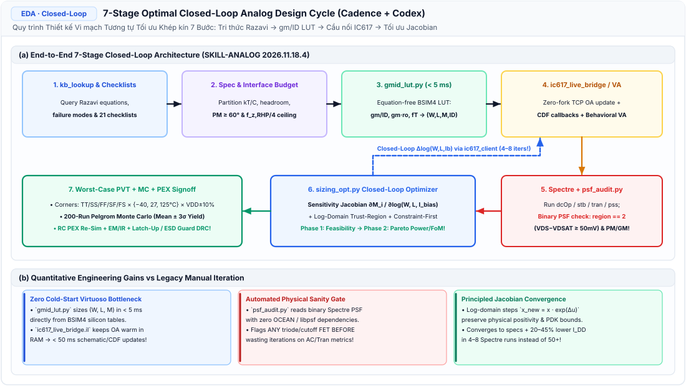

---
{
  "id": "skill-ic617-live-ipc-bridge-and-schematic-json",
  "kind": "skill",
  "domain": "eda-and-github-skills",
  "title_vi": "Cầu nối IPC Phiên Trực tiếp Virtuoso IC617 (Zero-Python3), Xuất/Dựng Schematic JSON & Điều phối An toàn Khóa .cdslck",
  "title_en": "Live Virtuoso IC617 CIW IPC Socket Bridge (RHEL 6.5 Python 2.6.6), Schematic JSON Serialization & Lock-Safe Execution",
  "summary": "Playbook vận hành trọn bộ hạ tầng cầu nối phiên trực tiếp tools/ic617_live_bridge.il + tools/ic617_client.py + tools/cadence_exec.py và bộ thư viện nâng cấp tools/ic617_oa_cdf.il trên RHEL 6.5 (Python 2.6.6): kiểm tra và chỉnh sửa trực tiếp schematic đang mở trong Virtuoso GUI với 0 xung đột khóa .cdslck, 0 tốn thêm license seat, sửa triệt để lỗi bọc nháy kép %L của CDF callback, xuất đồ thị kết nối saDumpSchematicJson và dựng mạch tự động saPlaceAndWireFromPlan trên lưới 0.0625 inch.",
  "diagram": "../../diagrams/closed-loop-cadence-codex-flow.svg",
  "razavi_refs": [
    {
      "chapter": 2,
      "section": "2.3-2.4.2",
      "pages": "24-31",
      "equations": ["2.38", "2.40", "2.42"]
    },
    {
      "chapter": 18,
      "section": "18.7.2",
      "pages": "721-727",
      "equations": ["18.1", "18.2"]
    },
    {
      "chapter": 19,
      "section": "19.2.1-19.2.6",
      "pages": "737-753",
      "equations": ["19.10"]
    }
  ],
  "github_refs": [
    {
      "repo": "si-view/via",
      "url": "https://github.com/si-view/via",
      "use": "Hình mẫu kiến trúc cầu nối Unix domain socket pure-SKILL + mã xác thực phiên cục bộ không phụ thuộc Python 3"
    },
    {
      "repo": "deanyou/virtuoso-cli",
      "url": "https://github.com/deanyou/virtuoso-cli",
      "use": "Phân tách nguyên tử các lệnh khảo sát cell, đặt tham số, dựng schematic, tái tạo netlist và chụp ảnh giao diện"
    },
    {
      "repo": "SiliCAD/Analog_MCP",
      "url": "https://github.com/SiliCAD/Analog_MCP",
      "use": "Mẫu bọc an toàn errset + unwindProtect chuyển hướng woport/poport bắt trọn đầu ra CIW và khởi tạo libInit.il"
    },
    {
      "repo": "Arcadia-1/virtuoso-bridge-lite",
      "url": "https://github.com/Arcadia-1/virtuoso-bridge-lite",
      "use": "Quy tắc cô lập thư mục mô phỏng batch, kiểm soát khóa OpenAccess và phòng tránh hộp thoại treo tiến trình"
    }
  ],
  "glossary_codes": ["T103", "T326", "T366", "T689", "T2194", "T2275"],
  "process_agnostic": true,
  "roles": {
    "live_ciw_server": "Kịch bản pure-SKILL tools/ic617_live_bridge.il chạy ngay trong cửa sổ CIW đang mở, khởi chạy helper socket qua ipcBeginProcess và thực thi SKILL trong khung bảo vệ unwindProtect + errset",
    "socket_client_py26": "Trình khách tools/ic617_client.py viết bằng thư viện chuẩn tương thích kép Python 2.6.6 và Python 3 (dùng optparse, Unix socket ~/.cache/skill-analog/ic617-<user>.sock 0700 và token 0600)",
    "oa_json_and_wiring_engine": "Các thủ tục nâng cấp trong tools/ic617_oa_cdf.il: saDumpSchematicJson xuất đồ thị kết nối thực tế, saPlaceAndWireFromPlan dựng sơ đồ trên lưới 0.0625 có sao lưu tự động, và saApplyInstCdfCallbacks sửa lỗi nhân đôi dấu nháy kép",
    "safe_cadence_dispatcher": "Trình bọc tools/cadence_exec.py tự động nạp $HOME/cadence/env.sh, gán CDS_Netlisting_Mode=Analog, kiểm tra khóa .cdslck và điều phối spectre/ocean/si vào <project>/sim/runs/<run_id>/"
  },
  "symptoms_addressed": [
    "skillbridge-and-virtuoso-bridge-lite-fail-syntaxerror-on-rhel6-python-2-6-6",
    "batch-virtuoso-nograph-collides-with-open-gui-cdslck-edit-lock-or-reads-stale-disk",
    "spawning-second-virtuoso-consumes-extra-license-seat-or-hangs-on-modal-dialog",
    "sprintf-percent-l-double-quotes-cdf-strings-corrupting-gpdk-w-fw-ad-pd",
    "blind-agent-edits-schematic-without-full-net-to-pin-connectivity-json"
  ],
  "limitations": [
    "live-bridge-requires-one-time-load-in-active-virtuoso-ciw-or-cdsinit-hook",
    "complex-multi-branch-analog-schematics-still-benefit-from-visual-png-inspection-after-auto-routing",
    "unix-domain-socket-is-local-to-guest-host-use-ssh-forwarding-when-driving-remotely"
  ],
  "checklists": ["closed-loop-sizing-and-signoff", "common-mos", "layout-and-matching"]
}
---

## 1. Giải phẫu Nút thắt Tử huyệt trên RHEL 6.5 (`Python 2.6.6`) & Kiến trúc Cầu nối Live CIW Zero-Python3

Trong môi trường thiết kế vi mạch thực tế chạy **Cadence Virtuoso IC6.1.7 + MMSIM/Spectre 15.1 trên máy chủ/máy ảo Linux RHEL 6.5**, tác tử tự động hóa (như Codex CLI) đối mặt đồng thời **bốn rào cản hạ tầng cứng** khiến hầu hết các kho cầu nối mã nguồn mở phổ biến bị tê liệt ngay từ vạch xuất phát:
1. **Rào cản Trình thông dịch Hệ thống (`/usr/bin/python == 2.6.6`):** Hệ điều hành RHEL 6.5 chỉ có sẵn Python `2.6.6` (thiếu cả `python2.7` lẫn `python3`, và thậm chí thư viện chuẩn Python 2.6 dùng `optparse` chứ chưa có `argparse`!). Các cầu nối nổi tiếng như `unihd-cag/skillbridge` (dùng f-string, dấu gạch dưới số `10_000`, kiểu hợp `Exception | str` của Python $\ge 3{,}10$) hay `Arcadia-1/virtuoso-bridge-lite` (đòi `PyYAML`/`pydantic` hoặc `#!/usr/bin/env python2.7`) lập tức báo `SyntaxError` hoặc thiếu trình chạy.
2. **Xung đột Khóa Sửa Đổi OpenAccess (`T2275`, `.cdslck`) và Dữ liệu Đĩa Cũ (`Stale Disk Read`):** Khi người thiết kế đang mở sơ đồ `my_lib/ota_core/schematic` ở chế độ sửa (`"a"`) trên giao diện đồ họa Virtuoso GUI, OpenAccess giữ khóa độc quyền `schematic.oa.cdslck`. Một tiến trình chạy nền `virtuoso -nograph -restore` bên ngoài **không thể mở quyền ghi `"a"`/`"w"`**, còn nếu mở chỉ đọc `"r"` hoặc gọi `si -batch` xuất netlist thì nó chỉ đọc bản lưu cũ trên ổ cứng chứ không thấy các chỉnh sửa đang nằm trên RAM cửa sổ GUI!
3. **Bẫy Chiếm dụng Thêm License Seat & Treo Hộp thoại Đồ họa:** Khởi chạy thêm một tiến trình `virtuoso` thứ hai tốn thời gian khởi động $8\text{–}20\text{ s}$, có nguy cơ vấp hộp thoại hỏi mượn giấy phép tiếp theo (`UseNextLicense="prompt"`) làm treo vĩnh viễn tiến trình chạy ngầm.
4. **Tính Bất biến Tuyệt đối của Cây Thư viện Chuẩn:** Trình kiểm tra toàn vẹn `analogctl.py verify` đối chiếu mã băm SHA-256 trên toàn bộ thư viện tham chiếu; bất kỳ tệp socket, nhật ký hay `.pyc` nào rơi vào thư mục thư viện đều làm hỏng trạng thái kiểm định.



Để giải quyết triệt để cả bốn nút thắt trên mà không cần cài thêm bất kỳ gói ngoài nào lên RHEL 6.5, kiến trúc chuẩn của chúng ta kết hợp tinh hoa từ `si-view/via`, `SiliCAD/Analog_MCP` và `deanyou/virtuoso-cli` thành **ba thành phần phối hợp chặt chẽ**:
- **`tools/ic617_live_bridge.il` (Pure-SKILL Server trong CIW):** Nạp một lần duy nhất vào phiên Virtuoso đang mở, dùng hàm gốc `ipcBeginProcess` của IC617 gọi trình trợ giúp socket nhẹ, nhận lệnh SKILL, thực thi an toàn trong bộ nhớ tiến trình GUI hiện hành (**0 tốn thêm license, 0 đụng `.cdslck`**) và trả kết quả JSON.
- **`tools/ic617_client.py` (Dual Python 2.6.6 / Python 3 Client & Socket Helper):** Đặt kênh Unix domain socket tại `~/.cache/skill-analog/ic617-<user>.sock` (quyền thư mục `0700`) kèm khóa xác thực phiên ngẫu nhiên `~/.cache/skill-analog/ic617-<user>.token` (quyền `0600`).
- **`tools/cadence_exec.py` (Lock-Aware Environment & Batch Dispatcher):** Tự động nạp `$HOME/cadence/env.sh`, thiết lập `CDS_Netlisting_Mode=Analog`, kiểm tra `.cdslck` trước mọi thao tác batch và cô lập toàn bộ đầu ra mô phỏng vào `<project>/sim/runs/<run_id>/`.

---

## 2. Giao thức IPC An toàn, Khử Lỗi Nháy Kép `%L` CDF & Toán học Biến đổi Tọa độ Pin

### 2.1. Khung Thực thi Bất khả Sập trong CIW (`unwindProtect` + `errset` + `woport`)
Nếu một kịch bản IPC gọi thẳng `evalstring(cmd)` trong CIW mà biểu thức SKILL gặp lỗi chia cho 0 hoặc sai tên hàm, cửa sổ CIW có thể rơi vào trình gỡ lỗi hoặc kẹt luồng xuất chuẩn. Học theo mẫu chuẩn của `SiliCAD/Analog_MCP`, hàm xử lý trung tâm trong `ic617_live_bridge.il` bọc mọi yêu cầu bằng hai lớp bảo vệ:
1. Tạo cổng chuỗi đệm trong bộ nhớ `outPort = outstring()` và chuyển hướng tạm thời `poport` / `woport` bên trong khối **`unwindProtect(..., close(outPort))`** — đảm bảo dù có lỗi nghiêm trọng đến đâu, cửa sổ CIW của kỹ sư vẫn được khôi phục nguyên trạng ngay lập tức.
2. Đánh giá biểu thức bằng **`errset(evalstring(cmd) t)`**: nếu thành công, `errset` trả về danh sách một phần tử `list(result)`; nếu thất bại, trả về `nil` và chuỗi lỗi chi tiết nằm trong `errset.errset`, được đóng gói sạch thành phản hồi JSON `{"ok": false, "error": "...", "stdout": "..."}`.

### 2.2. Bản Vá Lỗi Nhân đôi Dấu nháy Kép `%L` Trong `saApplyInstCdfCallbacks` (`tools/ic617_oa_cdf.il`)
Một lỗi ngầm cực kỳ tinh vi trong các kịch bản SKILL cũ là dùng `sprintf(nil "%L" param~>value)` khi ghi ngược giá trị từ đối tượng CDF xuống thuộc tính lưu trữ của instance OpenAccess. Trong SKILL, định dạng `%L` (print readable Lisp form) sẽ bọc thêm cặp dấu nháy kép thoát quanh một giá trị vốn đã là chuỗi ký tự:

$$
\text{param}\!\leadsto\!\text{value} = \texttt{"12u"} \;\;\xrightarrow{\texttt{sprintf(nil "\%L" val)}}\;\; \texttt{"\"12u\""} \quad (\text{SAI — hỏng trình xuất netlist GPDK!})
$$

Khi trình xuất netlist OSS của GPDK090/GPDK045 đọc chuỗi `"\"12u\""`, bộ phân tích số thực báo lỗi cú pháp hoặc bỏ qua giá trị mới và quay về giá trị mặc định $W_{\text{def}} = 120\text{ nm}$! Bản nâng cấp `tools/ic617_oa_cdf.il` khử triệt để lỗi này bằng ba quy tắc bắt buộc (`CHK-OPT-03`):
- Kiểm tra tên tham số có thực sự tồn tại và cho phép sửa trong `cdfData~>parameters` trước khi gán.
- Chuyển đổi kiểu bảo toàn chuỗi gốc: `valStr = if(stringp(val) val sprintf(nil "%L" val))`.
- Gọi đầy đủ chuỗi khởi tạo **`PasCdfFormInit(cdfData)`** $\to$ thực thi `evalstring(param~>callback)` theo đúng thứ tự vật lý (`l` $\to$ `fingers` $\to$ `w` $\to$ `m`) $\to$ gọi **`cdfUpdateInstParam(inst)`** để đồng bộ trọn vẹn `fw`, `simM`, `ad`, `as`, `pd`, `ps` (`T103`, `T366`).

### 2.3. Phép Biến đổi Hình học Tâm Chân Pin (`dbTransformPoint`) & Lưới `0.0625` Inch
Khi dựng schematic tự động bằng `saPlaceAndWireFromPlan`, tọa độ một chân cực (ví dụ cực `G`, `D`, `S`, `B` của MOSFET) nằm trong hệ quy chiếu nội của `master` symbol (`inst~>master~>terminals`). Để tính đúng tọa độ toàn cục $(X_{\text{pin}}, Y_{\text{pin}})$ trên tờ giấy schematic sau khi đặt linh kiện tại tâm $(X_0, Y_0)$ với hướng xoay/lật $\mathcal{R} \in \{\texttt{"R0"}, \texttt{"R90"}, \texttt{"R180"}, \texttt{"R270"}, \texttt{"MY"}, \texttt{"MX"}\}$, ta lấy tâm hộp giới hạn hình chữ nhật `bBox = list(list(x_ll y_ll) list(x_ur y_ur))` của hình chân cực đầu tiên `pinFig = car(term~>pins)~>fig`:

$$
\mathbf{p}_{\text{local}} = \left( \frac{x_{\text{ll}} + x_{\text{ur}}}{2},\; \frac{y_{\text{ll}} + y_{\text{ur}}}{2} \right), \qquad \mathbf{p}_{\text{global}} = \operatorname{dbTransformPoint}\!\left(\mathbf{p}_{\text{local}},\; \texttt{inst}\!\leadsto\!\texttt{transform}\right)
$$

Sau đó, mọi điểm bẻ góc dây nối vuông góc Manhattan và vị trí đặt linh kiện đều được ép tròn về đúng bội số nguyên của bước lưới chuẩn Schematic Editor $\Delta_{\text{grid}} = 0{,}0625 = \frac{1}{16}$ đơn vị:

$$
x_{\text{snap}} = \Delta_{\text{grid}} \cdot \operatorname{round}\!\left(\frac{x}{\Delta_{\text{grid}}}\right), \qquad \Delta_{\text{grid}} = 0{,}0625
$$

---

## 3. Bất biến An toàn & Các Bẫy Lỗi Vận hành Cầu nối IC617 (Invariants & Traps)

- **[INV-IPC-01] Bất biến Ưu tiên Phiên Live Khi Phát hiện Khóa `.cdslck` (`CHK-OPT-02`):** Trước bất kỳ lệnh sửa đổi hay xuất netlist nào trên một cellView, phải kiểm tra xem cầu nối `ic617_client.py ping` có đang hoạt động hay tệp `<cellDir>/<view>/schematic.oa.cdslck` có tồn tại hay không. Nếu cell đang mở trong GUI, **100% lệnh đọc JSON, đổi kích thước CDF và `Check & Save` phải đi qua `ic617_client.py`**, nhờ đó người dùng nhìn thấy sơ đồ cập nhật ngay trên màn hình và tệp trên đĩa được lưu sạch từ chính chủ sở hữu khóa!
- **[INV-IPC-02] Sao lưu Không Phá hủy Trước Khi Dựng Mạch (`Non-Destructive Backup`):** Khác với hàm `cdlgenPlaceSch` của upstream `KwantaeKim/cdl_gen` gọi thẳng `(ddDeleteObj old)` xóa trắng cell của người dùng, thủ tục `saPlaceAndWireFromPlan` luôn tự động tạo bản sao dự phòng `<cell>_bak_<timestamp>` bằng `dbCopyCellView` trước khi vẽ mới và bọc toàn bộ quá trình mở/sửa cellView trong `unwindProtect` để không bao giờ bỏ rớt khóa mồ côi nếu giữa chừng gặp lỗi.
- **[INV-IPC-03] Khởi tạo Thư viện PDK (`ddGetObj` / `libInit.il`) Trước Khi Gọi Callback:** Trong phiên Virtuoso vừa mở chưa từng chạm tới thư viện `gpdk090` hoặc `gpdk045`, các hàm nội bộ của callback PDK (như `gpdk090_mosCdfCb`) chưa được nạp vào bảng ký hiệu SKILL cho đến khi tệp `libInit.il` của thư viện đó chạy. Luôn gọi `ddGetObj("gpdk090")` trước khi kích hoạt bất kỳ callback CDF nào!
- **[TRAP-IPC-01] Bẫy Khác biệt Thuộc tính Lưu trữ (`inst~>prop`) và Thuộc tính Hiệu dụng CDF:** Trong OpenAccess, nếu một transistor đang giữ nguyên chiều dài mặc định của PDK (ví dụ `l = "100n"`), danh sách `inst~>prop` trên đĩa **không hề có phần tử `"l"`**! Nếu trình xuất sơ đồ chỉ duyệt `inst~>prop` (như các script sơ khai), tác tử sẽ tưởng linh kiện bị thiếu chiều dài kênh. Thủ tục `saDumpSchematicJson` giải quyết dứt điểm bằng cách hợp nhất cả `stored_props` lẫn giá trị hiệu dụng đọc từ `cdfGetInstCDF(inst)`.
- **[TRAP-IPC-02] Thiếu Biến Môi trường `CDS_Netlisting_Mode=Analog` Trong Shell Phụ của Tác tử:** Khi Codex gọi lệnh con trên RHEL 6.5, môi trường shell mặc định không nạp `.bashrc` tương tác nên thiếu cả đường dẫn `spectre`/`ocean` lẫn biến `CDS_Netlisting_Mode=Analog` (khiến trình xuất netlist OSS rơi về chế độ Digital hỏng hoàn toàn tham số tương tự!). Do đó, mọi lệnh batch bắt buộc đi qua `python -B tools/cadence_exec.py`!

---

## 4. Ma trận Phân vai Giữa Các Công cụ Tự động hóa IC617 Trong Hệ sinh thái Chuẩn

| Tác vụ Thiết kế / Kiểm chứng | Công cụ Gọi Chuẩn | Chế độ Chạy | Đầu ra Máy Đọc Được & Cam kết An toàn |
|---|---|---|---|
| Kiểm tra kết nối tới phiên Virtuoso GUI đang mở & xem cell hiện hành | `python -B tools/ic617_client.py active-cv` | Live Socket (`< 15 ms`) | JSON `{ok, lib, cell, view, mode}` — 0 tốn license phụ |
| Xuất toàn bộ đồ thị kết nối `net -> inst.term`, chân pin, CDF hiệu dụng & lỗi nối dây | `python -B tools/ic617_client.py dump-json --lib L --cell C --out sch.json` | Live Socket (hoặc Batch `"r"`) | Tệp JSON chuẩn từ `saDumpSchematicJson` phát hiện ngay `floating_nets` & `single_term_nets` |
| Cập nhật bộ kích thước `{w, l, fingers, m, r, c}` từ `gmid_lut.py` / `sizing_opt.py` | `python -B tools/ic617_client.py set-param --lib L --cell C --inst M1 --param l=180n --param fingers=4 --param w=16u` | Live Socket | Kích hoạt `PasCdfFormInit` + callback sạch `%L`, đồng bộ `fw/ad/as/pd/ps` |
| Kiểm tra quy tắc nối dây, lưu OpenAccess & chụp ảnh schematic PNG báo cáo | `ic617_client.py check-save` + `ic617_client.py export-png` | Live Socket | JSON đếm chính xác `errors`, `warnings` từ `schCheck(cv)` + ảnh PNG sắc nét |
| Dựng mới schematic + symbol hoàn chỉnh từ bản kế hoạch cấu trúc | `saPlaceAndWireFromPlan(planPath outJsonPath)` qua `ic617_client.py eval` | Live / Batch cô lập | Tự sao lưu `<cell>_bak_<ts>`, bắt lưới `0.0625`, nối dây vuông góc & sinh symbol |
| Chạy mô phỏng `spectre`, `ocean` hoặc xuất netlist `si` độc lập | `python -B tools/cadence_exec.py spectre --project P --run-id R --netlist input.scs --psf-ascii` | Subprocess cô lập | Tự nạp `env.sh`, kiểm tra `.cdslck`, xuất `-format psfascii` vào `sim/runs/<run_id>/` |

---

## 5. Quy trình Vận hành Thực chiến Từng Bước Trên RHEL 6.5 (Python 2.6.6 + IC617)

### 5.1. Bước 1 — Kích hoạt Cầu nối Trong Cửa sổ Virtuoso CIW & Xác minh Kết nối
Trong cửa sổ CIW của phiên Virtuoso IC617 đang mở (hoặc thêm dòng tùy chọn vào `~/.cdsinit` cá nhân của người dùng), nạp tệp cầu nối:

```lisp
;; Gõ một lần trong Virtuoso CIW (tự động khởi động cầu nối trừ khi SA_BRIDGE_NO_AUTOSTART=1)
load("/home/disk/eda/references/SKILL-ANALOG/tools/ic617_live_bridge.il")
saBridgeStart()
```

Từ dòng lệnh của Codex trên máy RHEL 6.5 (`Python 2.6.6`), kiểm tra kết nối tức thì và xuất toàn bộ cấu trúc mạch đang mở ra JSON:

```bash
# Kiểm tra nhịp sống cầu nối và cellView đang mở trên màn hình GUI
PYTHONDONTWRITEBYTECODE=1 python -B /home/disk/eda/references/SKILL-ANALOG/tools/ic617_client.py ping
PYTHONDONTWRITEBYTECODE=1 python -B /home/disk/eda/references/SKILL-ANALOG/tools/ic617_client.py active-cv

# Xuất đồ thị kết nối đầy đủ (instances, stored_props + effective_cdf, nets -> inst.term, pins, diagnostics)
PYTHONDONTWRITEBYTECODE=1 python -B /home/disk/eda/references/SKILL-ANALOG/tools/ic617_client.py dump-json \
  --lib analog_ws --cell folded_cascode_ota --view schematic \
  --out ./sim/runs/inspect_01/schematic_dump.json
```

### 5.2. Bước 2 — Dựng Mạch Từ Kế hoạch Dòng (`saPlaceAndWireFromPlan`) & Cập nhật Định cỡ Khép kín
Định dạng tệp kế hoạch `.plan` được thiết kế dạng chỉ thị theo dòng (`LIB ... TECH ...`, `CELL ... VIEW ...`, `GRID`, `SYMBOL`, `PIN`, `INST`, `PARAM`, `STUB`, `NET`, `WIRE`; tự động sao lưu `<cell>_bak_<ts>` nếu cell đã tồn tại) để bộ phân tích pure-SKILL trong IC617 đọc trực tiếp tốc độ cao mà không cần thư viện JSON bên thứ ba:

```text
# ota_core_build.plan — Line-oriented schematic & symbol synthesis plan (0.0625 grid)
LIB analog_ws TECH gpdk090
CELL five_t_ota_draft VIEW schematic
GRID 0.0625
SYMBOL true

PIN VINP input -1.0000 0.2500 R0
PIN VINN input -1.0000 -0.2500 R0
PIN VOUT output 1.2500 0.2500 R0
PIN IBIAS input -1.0000 -0.8750 R0
PIN VDD inputOutput 0.0000 1.2500 R0
PIN VSS inputOutput 0.0000 -1.2500 R0

INST M1 gpdk090 nmos1v symbol -0.3750 0.0000 R0
INST M2 gpdk090 nmos1v symbol  0.3750 0.0000 MY
INST M3 gpdk090 pmos1v symbol -0.3750 0.6250 R0
INST M4 gpdk090 pmos1v symbol  0.3750 0.6250 MY
INST M5 gpdk090 nmos1v symbol  0.0000 -0.6250 R0

PARAM M1 l 250n
PARAM M1 fingers 4
PARAM M1 w 12u
PARAM M2 l 250n
PARAM M2 fingers 4
PARAM M2 w 12u
PARAM M3 l 500n
PARAM M3 fingers 4
PARAM M3 w 16u
PARAM M4 l 500n
PARAM M4 fingers 4
PARAM M4 w 16u
PARAM M5 l 500n
PARAM M5 fingers 4
PARAM M5 w 16u

NET VINP M1.G PIN.VINP
NET VINN M2.G PIN.VINN
NET N_TAIL M1.S M2.S M5.D
NET N_MIR M3.G M3.D M1.D
NET VOUT M2.D M4.D PIN.VOUT
NET VDD M3.S M3.B M4.S M4.B PIN.VDD
NET VSS M5.S M5.B M1.B M2.B PIN.VSS
```

Kích hoạt dựng mạch, cập nhật một nhánh linh kiện trong vòng lặp tối ưu và chạy Spectre 15.1 an toàn qua `cadence_exec.py`:

```bash
# 1. Dựng schematic + symbol, tự chạy CDF callbacks + schCheck + dbSave
PYTHONDONTWRITEBYTECODE=1 python -B /home/disk/eda/references/SKILL-ANALOG/tools/ic617_client.py eval \
  --expr 'saPlaceAndWireFromPlan("./sim/runs/build_01/ota_core_build.plan" "./sim/runs/build_01/build_report.json")'

# 2. Tinh chỉnh kích thước M1/M2 trong vòng lặp tối ưu hóa và lưu sạch
PYTHONDONTWRITEBYTECODE=1 python -B /home/disk/eda/references/SKILL-ANALOG/tools/ic617_client.py set-param \
  --lib analog_ws --cell five_t_ota_draft --inst M1 --param l=300n --param fingers=4 --param w=14.4u
PYTHONDONTWRITEBYTECODE=1 python -B /home/disk/eda/references/SKILL-ANALOG/tools/ic617_client.py set-param \
  --lib analog_ws --cell five_t_ota_draft --inst M2 --param l=300n --param fingers=4 --param w=14.4u
PYTHONDONTWRITEBYTECODE=1 python -B /home/disk/eda/references/SKILL-ANALOG/tools/ic617_client.py check-save \
  --lib analog_ws --cell five_t_ota_draft

# 3. Xuất netlist và chạy Spectre 15.1 (-format psfascii) trong thư mục phiên chạy cô lập
PYTHONDONTWRITEBYTECODE=1 python -B /home/disk/eda/references/SKILL-ANALOG/tools/cadence_exec.py spectre \
  --project . --run-id iter_02_tt --netlist ./sim/tb_ota_stb.scs --psf-ascii
```

---

## 6. Đối chiếu Sách Razavi, Nguồn GitHub Đã Kiểm định & Thuật ngữ Chuẩn CLB

### 6.1. Đối chiếu Sách Gốc Razavi (2nd Edition) & Nguồn Mở GitHub
- **Razavi Chương 2 (§2.4.1–2.4.2, tr. 26–31) & Chương 19 (§19.2.1–19.2.6, tr. 739–755):** Ý nghĩa vật lý của cấu trúc chia ngón chẵn (`T326`) dùng chung vùng khuếch tán máng/nguồn đối với diện tích $A_D, A_S$, chu vi $P_D, P_S$ và điện dung ký sinh nút trong được hàm CDF Callback cập nhật tự động.
- **Razavi Chương 18 (§18.7.2, tr. 721–727):** Quy tắc tính điện trở phân đoạn và tụ tích hợp MOM/MIM qua các tham số hình học trên PDK.
- **Nguồn GitHub Đã Kiểm định:**
  - [`si-view/via`](https://github.com/si-view/via) (commit `64b0ae3b3aa4`, MIT): Kiến trúc cầu nối Unix domain socket pure-SKILL siêu gọn có mã xác thực phiên cục bộ.
  - [`deanyou/virtuoso-cli`](https://github.com/deanyou/virtuoso-cli) (commit `74a9fbcebdd3`, MIT): Thiết kế tập lệnh CLI nguyên tử điều khiển phiên Virtuoso trực tiếp không cần Python 3 trên guest.
  - [`SiliCAD/Analog_MCP`](https://github.com/SiliCAD/Analog_MCP) (commit `606ac2eba832`, MIT): Mẫu xử lý `errset` + `unwindProtect` bắt luồng `woport` và khởi tạo tự động `libInit.il`.
  - [`Arcadia-1/virtuoso-bridge-lite`](https://github.com/Arcadia-1/virtuoso-bridge-lite) (commit `1f186abfbb3d`, MIT): Quản lý cô lập thư mục mô phỏng và kiểm soát an toàn OpenAccess.

### 6.2. Bảng Thuật ngữ Chuẩn CLB Vi Mạch Sử dụng trong Thẻ
| Mã CLB | Thuật ngữ Tiếng Anh | Thuật ngữ Tiếng Việt Chuẩn | Áp dụng Thực tế trong Cầu nối IC617 |
|---|---|---|---|
| `T2275` | live Virtuoso CIW IPC socket bridge and OpenAccess lock safety | cầu nối IPC phiên trực tiếp Virtuoso CIW và an toàn khóa tệp OpenAccess (.cdslck) | Giao tiếp trực tiếp với phiên GUI qua `~/.cache/skill-analog/ic617-<user>.sock` tránh đụng `.cdslck` |
| `T326` | Folded transistor | Transistor bố trí gấp | Thuộc tính `fingers` chẵn cập nhật qua `set-param` đồng bộ `fw` và `simM` |
| `T103` / `T366` | Parasitic capacitances / Device parasitic capacitances | Các điện dung ký sinh (linh kiện) | Được tính chính xác từ `ad, as, pd, ps` sau khi khử lỗi bọc nháy kép `%L` |
| `T689` | parasitic resistance | điện trở ký sinh | Đồng bộ tổng trở `r` của điện trở poly phân đoạn qua `PasCdfFormInit` |
| `T2194` | interdigitated and common-centroid layout | bố trí cài răng lược và đồng tâm chung | Bắt đầu từ sơ đồ nguyên lý đối xứng gương `R0`/`MY` và số ngón chẵn kiểm chứng bởi `saDumpSchematicJson` |
