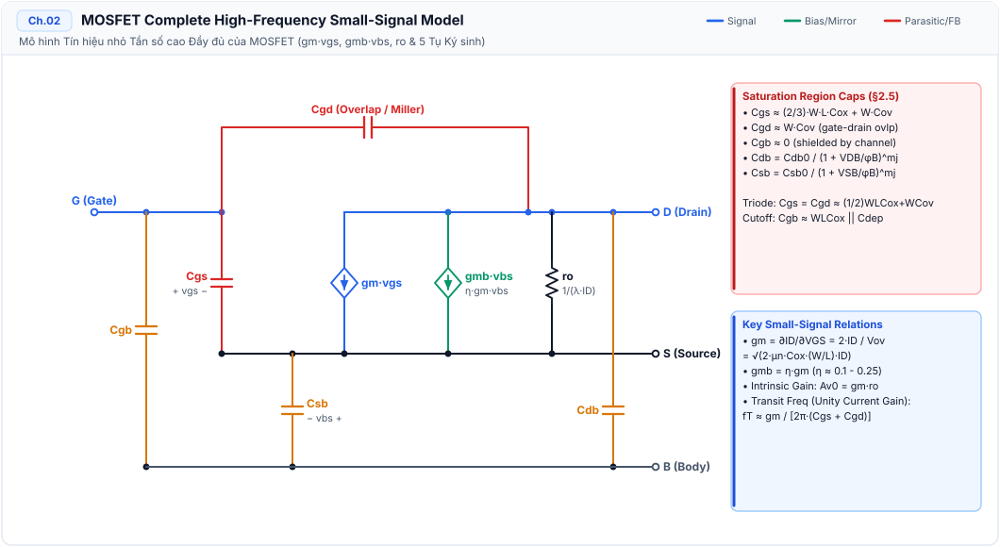

---
{
  "id": "skill-ic617-skill-sch-cdf-automation",
  "kind": "skill",
  "domain": "eda-and-github-skills",
  "title_vi": "Tự động hóa Schematic, OpenAccess & CDF Callback trong Cadence Virtuoso IC617 bằng SKILL",
  "title_en": "Cadence Virtuoso IC617 SKILL OpenAccess Schematic Automation, PasCdfFormInit Callbacks & Netlist Audit",
  "summary": "Quy trình chuẩn công nghiệp điều khiển cơ sở dữ liệu OpenAccess (OA) trong Cadence Virtuoso IC6.1.7 bằng SKILL/SKILL++ và cầu nối Python skillbridge: tại sao dbReplaceProp đơn độc làm sai lệch w/fw/simM/ad/as/pd/ps trên GPDK090/045, giao thức kích hoạt callback CDF chuẩn qua PasCdfFormInit, kiểm tra kết nối schCheck, lưới 0.0625 inch và xuất netlist Spectre tự động.",
  "diagram": "../../diagrams/mos-small-signal-caps.svg",
  "razavi_refs": [
    {
      "chapter": 2,
      "section": "2.4.1-2.4.2",
      "pages": "26-31",
      "equations": ["2.38", "2.40", "2.42"]
    },
    {
      "chapter": 18,
      "section": "18.7.2",
      "pages": "721-727",
      "equations": ["18.1", "18.2"]
    },
    {
      "chapter": 19,
      "section": "19.2.1-19.2.2",
      "pages": "739-743",
      "equations": []
    }
  ],
  "github_refs": [
    {
      "repo": "Arcadia-1/virtuoso-bridge-lite",
      "url": "https://github.com/Arcadia-1/virtuoso-bridge-lite",
      "use": "Tham chiếu thao tác OpenAccess schematic/symbol/library, xuất netlist batch và xử lý hộp thoại treo CIW"
    },
    {
      "repo": "unihd-cag/skillbridge",
      "url": "https://github.com/unihd-cag/skillbridge",
      "use": "Kiến trúc IPC Unix socket kết nối Python ngoài với phiên làm việc Virtuoso IC6.1.7+"
    },
    {
      "repo": "KwantaeKim/cdl_gen",
      "url": "https://github.com/KwantaeKim/cdl_gen",
      "use": "Bảng ánh xạ techmap.json cho thuộc tính CDF đa PDK và quy trình đặt linh kiện/nhãn dây tự động"
    },
    {
      "repo": "ebecheto/Skill",
      "url": "https://github.com/ebecheto/Skill",
      "use": "Kho thủ tục SKILL thực chiến duyệt cây thuộc tính, tạo bus pin và chụp ảnh schematic"
    }
  ],
  "glossary_codes": ["T103", "T326", "T366", "T652", "T660", "T689", "T2194"],
  "process_agnostic": true,
  "roles": {
    "oa_database_layer": "Lớp dữ liệu OpenAccess (dbOpenCellViewByType, cv~>instances, cv~>nets, dbReplaceProp, dbSave) lưu trữ hình học và thuộc tính thô trên đĩa",
    "cdf_callback_engine": "Cơ chế Component Description Format (cdfGetInstCDF, PasCdfFormInit, cdfgData) tính toán đồng bộ các tham số vật lý dẫn xuất ad, as, pd, ps, fw, simM và điện trở tấm r",
    "schematic_checker": "Trình biên dịch đồ họa - kết nối schCheck(cv) phát hiện chân hở, ngắn mạch nguồn, lệch độ rộng bus và cập nhật bảng kết nối nội trước khi tạo netlist",
    "ipc_transport": "Cầu nối Unix socket (skillbridge) hoặc chế độ chạy batch virtuoso -nograph -restore phục vụ tự động hóa an toàn"
  },
  "symptoms_addressed": [
    "changing-w-or-fingers-via-skill-does-not-update-spectre-netlist-or-ad-as-pd-ps",
    "segmented-poly-resistor-r-value-stays-frozen-after-editing-segw-segl",
    "automated-schematic-looks-wired-visually-but-nets-are-disconnected-off-grid",
    "stale-netlist-simulated-because-schcheck-and-dbsave-were-skipped"
  ],
  "limitations": [
    "pdk-cdf-parameter-names-vary-across-foundries-requiring-base-cdf-inspection-first",
    "modal-ciw-dialogs-can-block-headless-skill-scripts-if-gui-prompts-are-triggered",
    "destructive-schematic-generators-can-wipe-manual-annotations-unless-isolated-to-copy"
  ],
  "checklists": ["common-mos", "layout-and-matching"]
}
---

## 1. Kiến trúc Ba Tầng Dữ liệu trong Cadence Virtuoso IC617 (OpenAccess $\leftrightarrow$ CDF $\leftrightarrow$ Netlister)

Khi tự động hóa sửa kích thước transistor chia ngón (`T326`) hoặc dựng sơ đồ nguyên lý bằng ngôn ngữ SKILL trong Cadence Virtuoso IC6.1.7, hơn $90\%$ kịch bản tự viết trên mạng mắc phải một lỗi nền tảng cực kỳ nguy hiểm: dùng hàm `dbReplaceProp(inst "w" "string" "20u")` để sửa chiều rộng rồi lập tức xuất netlist mô phỏng! Trong kiến trúc của Virtuoso IC617, dữ liệu một linh kiện đi qua **ba tầng tách biệt**:
1. **Tầng Cơ sở dữ liệu OpenAccess (`db*`):** Chỉ lưu trữ các cặp khóa–giá trị tĩnh gắn trên từng instance (`inst~>prop`). Hàm `dbReplaceProp` chỉ ghi đè một chuỗi đơn lẻ mà **không hề đánh thức bất kỳ công thức vật lý nào của PDK**!
2. **Tầng Mô tả Linh kiện và Hàm Phản hồi (`CDF — Component Description Format`):** Khi người dùng gõ tay giá trị `Total Width = 20u` hoặc `Fingers = 8` trên cửa sổ *Edit Object Properties* (`q`) của GUI rồi nhấn `OK`/Tab, Virtuoso gọi chuỗi hàm **CDF Callback** của bộ PDK (`gpdk090`, `gpdk045`, TSMC, UMC...) để tính lại chiều rộng mỗi ngón `fw = w / fingers`, hệ số ghép `simM`, diện tích/chu vi vùng máng–nguồn `ad`, `as`, `pd`, `ps` (quyết định trực tiếp điện dung tiếp giáp $C_{DB}, C_{SB}$ trong Razavi Chương 2 §2.4.1, Phương trình 2.38–2.42!), hoặc tính lại tổng trở `r` từ `segW`, `segL` cho điện trở poly!
3. **Tầng Trích xuất Mạng & Xuất Netlist (`schCheck` $\to$ `OSS/Spectre Netlister`):** Trình xuất netlist đọc trực tiếp các thuộc tính dẫn xuất (`fw`, `simM`, `ad`, `as`, `pd`, `ps`, `r`) từ OpenAccess sau khi bảng kết nối đã được `schCheck(cv)` đóng dấu hợp lệ!



Nếu bỏ qua CDF Callback khi chạy SKILL, bạn sẽ rơi vào cảnh: sửa `w` từ `2u` lên `40u` nhưng trình xuất netlist của PDK lại đọc thuộc tính `fw` (hoặc `simW`) cũ vẫn đang kẹt ở `2u` — khiến kết quả mô phỏng Spectre hoàn toàn sai lệch so với chữ hiển thị trên màn hình schematic, hoặc $C_{DB}, C_{SB}$ bị cố định bằng hằng số của transistor nhỏ gấp 20 lần!

---

## 2. Giao thức Chuẩn Kích hoạt CDF Callback, Lưới Tọa độ `0.0625` & Kiến trúc Cầu nối Python

### 2.1. Toán học Chia Ngón Vật lý & Cơ chế Biến Động `cdfgData` / `PasCdfFormInit`
Xét một transistor đa ngón có chiều rộng mỗi ngón $W_f$, chiều dài $L$, số ngón $N_f$ (chẵn) và chiều dài phần khuếch tán cực máng/nguồn chuẩn $L_{\text{diff}}$ (thường $0{,}24\text{–}0{,}45\text{ }\mu\text{m}$ tùy công nghệ). Nhờ dùng chung vùng máng/nguồn giữa các ngón kề nhau (Razavi Chương 2 Ví dụ 2.10 & Chương 19 §19.2.1), hàm CDF Callback của PDK tính diện tích và chu vi vùng máng hiệu dụng giảm gần một nửa so với transistor đơn ngón:

$$
W_{\text{tot}} = N_f \cdot W_f, \qquad A_D = \frac{N_f}{2} \cdot W_f \cdot L_{\text{diff}}, \qquad P_D = \frac{N_f}{2} \cdot \left(2 L_{\text{diff}} + W_f_{\text{sidewall}}\right)
$$

Trong trình thông dịch SKILL của IC617 (xem quy chuẩn kiểm định tại `ic617_oa_cdf.il`), các hàm callback viết bởi nhà máy đúc PDK luôn đọc đối tượng CDF thông qua **biến phạm vi động (dynamic-scoped global variable) tên là `cdfgData`** (và đôi khi kiểm tra `cdfgForm`) đồng thời gọi hàm khởi tạo thư viện Analog Artist **`PasCdfFormInit(cdf)`**! Do đó, thứ tự bắt buộc gồm 5 bước không được đảo lộn:
1. Ghi các tham số đầu vào gốc (`l`, `fingers`, `w`, `m` hoặc `segW`, `segL`, `segments`) vào instance theo kiểu `"string"`.
2. Lấy đối tượng CDF hiệu dụng của instance bằng `cdf = cdfGetInstCDF(inst)`.
3. Khởi tạo biến cục bộ động trong khối `let((cdf cdfgData cdfgForm param) ...)` gán `cdfgData = cdf`, `cdfgForm = nil` và gọi `when(isCallable('PasCdfFormInit) PasCdfFormInit(cdf))`.
4. Duyệt tuần tự danh sách tham số theo **đúng thứ tự phụ thuộc vật lý** (ví dụ `l` $\to$ `fingers` $\to$ `w` $\to$ `m`) và thực thi `evalstring(param~>callback)`.
5. Đồng bộ ngược toàn bộ thuộc tính dẫn xuất (`fw`, `simW`, `simM`, `ad`, `as`, `pd`, `ps`, `r`, `segR`, `effW`, `effL`) từ `cdf` xuống `inst` bằng `dbReplaceProp`, sau đó bắt buộc chạy **`schCheck(cv)`** và **`dbSave(cv)`**!

### 2.2. Hệ Tọa độ Lưới Schematic `0.0625` Inch trong OpenAccess
Trong Virtuoso Schematic Editor L/XL của IC617 (`JPWang-OvO/analog-artist-skills` & `KwantaeKim/cdl_gen`), đơn vị người dùng (`user units`) được thiết lập sao cho lưới bắt điểm chuẩn (`schSnapSpacing`) bằng đúng **$0{,}0625$ đơn vị** ($\frac{1}{16} = 0{,}0625$, và $4$ bước lưới tạo thành $0{,}25$). Mọi tọa độ đặt linh kiện `xy = list(x y)` và mọi đoạn dây `schCreateWire(cv "draw" "full" list(p1 p2) 0.0625 0.0625 0.0)` **bắt buộc phải là bội số nguyên của `0.0625`**! Nếu tính tọa độ số thực bị lẻ (ví dụ `1.300` thay vì `1.3125`), đầu dây nằm sát chân pin bằng mắt thường nhưng thực chất bị hở mạch (`floating pin` + `unconnected wire`)!

---

## 3. Bất biến An toàn & Các Bẫy Lỗi Kinh điển Trên IC617 (Safety Invariants & Traps)

- **[INV-SKILL-01] Bất biến Sao Lưu / Thao Tác Trên Cell Nháp & Chế Độ Đọc Base CDF Trước Khi Sửa:** Tên thuộc tính CDF không hề đồng nhất giữa các PDK: có PDK dùng `w` là tổng chiều rộng và `fw` là chiều rộng 1 ngón, nhưng PDK khác lại dùng `w` là chiều rộng 1 ngón và `wtot` là tổng chiều rộng! Trước khi chạy bất kỳ hàm ghi đè nào trên PDK mới, **bắt buộc đọc Base CDF ở chế độ chỉ đọc (`cdfGetBaseCellCDF(ddGetObj(libName cellName))`)** để liệt kê chính xác `param~>name`, `param~>prompt`, `param~>defValue` và `param~>callback`, đồng thời luôn chạy thử trên bản sao cellView (`dbCopyCellView`) thay vì ghi đè thẳng lên bài thiết kế gốc!
- **[INV-SKILL-02] Không Bao Giờ Bỏ Qua `schCheck(cv)` Trước Khi Gọi `createNetlist`:** Trong IC617, nếu một cellView có cờ `connLastUpdated < instancesLastChanged` (vì vừa sửa bằng `dbCreateInst` / `dbReplaceProp` mà chưa gọi `schCheck(cv)`), trình xuất netlist batch của OCEAN/`si` sẽ báo lỗi `Netlist failed: schematic needs check-and-save` hoặc tệ hơn là âm thầm tái sử dụng tệp `netlist` cũ trong thư mục `ihnl/` từ lần chạy trước!
- **[TRAP-SKILL-01] Bẫy Treo Cứng Tiến Trình Batch Do Hộp Thoại Hỏi Đáp (`Modal Dialog Hang`):** Khi chạy không giao diện bằng `virtuoso -nograph -restore script.il` hoặc qua cầu nối IPC (`Arcadia-1/virtuoso-bridge-lite`, `unihd-cag/skillbridge`), bất kỳ lệnh nào vô tình kích hoạt hộp thoại xác nhận đồ họa (`hiDisplayAppDBox`) sẽ làm phiên Virtuoso đứng im vĩnh viễn chờ người nhấn nút! Phải luôn mở cellView với chế độ tường minh (`"r"` cho đọc, `"a"` cho sửa thêm, chỉ dùng `"w"` trên cell tạm mới tinh vì `"w"` xóa sạch toàn bộ nội dung đang có!) và kiểm tra khóa `.cdslck` trước khi mở ghi.
- **[TRAP-SKILL-02] Xung Đột Phiên Bản Python Trên Máy Ảo RHEL 6.5 (`Python 2.6.6` vs `skillbridge` `Python >= 3.8`):** Trên môi trường máy chủ/VM chạy RHEL 6.5 kinh điển đi kèm IC617 + MMSIM 15.1, trình thông dịch `/usr/bin/python` của hệ điều hành là **Python 2.6.6** (phục vụ `yum` và công cụ hệ thống). Các thư viện bên ngoài như `unihd-cag/skillbridge` hay `KwantaeKim/cdl_gen` đòi hỏi Python $\ge 3{,}8\text{–}3{,}9$: chỉ cài đặt chúng trong virtualenv Python 3 tách rời hoặc chạy kịch bản SKILL/OCEAN thuần nội bộ không phụ thuộc gói ngoài!

---

## 4. Ma trận Lựa chọn Phương thức Tự động hóa Trong Cadence IC617

| Nhu cầu Tự động hóa Thiết kế | Công cụ Chuẩn Khuyến nghị trên IC617 | Ưu điểm Cốt lõi | Rủi ro Cần Kiểm soát |
|---|---|---|---|
| Khảo sát tên tham số CDF (`w`, `fw`, `fingers`, `segL`...) của PDK lạ | Thủ tục SKILL chỉ đọc `cdfGetBaseCellCDF` (`virtuoso -nograph`) | An toàn tuyệt đối $100\%$, không mở quyền ghi lên bất kỳ cell nào | Lưu ý Base CDF chỉ chứa giá trị mặc định, chưa phản ánh giá trị trên từng instance cụ thể |
| Cập nhật hàng loạt bộ kích thước $\{W, L, N_f, M\}$ từ bảng tra `gm/ID` vào schematic | Thủ tục SKILL `saApplyInstCdfCallbacks` + `schCheck` + `dbSave` | Thực thi đầy đủ `PasCdfFormInit` cập nhật chuẩn `ad/as/pd/ps` và `r` | Phải chạy trên bản nháp hoặc sau khi commit snapshot Git/backup thư viện OA |
| Xuất netlist Spectre `.scs` chuẩn từ schematic để chạy quét batch độc lập | `ocean -nograph -restore export_netlist.ocn` (`createNetlist ?recreateAll t`) | Dùng chính bộ dịch OSS chính thống của Cadence, khớp 100% với ADE L | Phải chỉ định thư mục `resultsDir` riêng tránh đè lên thư mục `simulation` đang mở trên GUI |
| Vòng lặp tối ưu tương tác thời gian thực từ thuật toán Python bên ngoài | `unihd-cag/skillbridge` qua Unix socket `/tmp/skill-server-ID.sock` | Tốc độ gọi hàm cỡ mili-giây không tốn thời gian khởi động lại Virtuoso | Cần môi trường Python $\ge 3{,}8$ tách riêng và đóng kết nối sạch sau phiên làm việc |
| Xuất hình chụp sơ đồ nguyên lý độ phân giải cao phục vụ báo cáo kiểm duyệt | `virtuoso -restore` kèm `geOpen` + `hiExportImage` (`'entireDesign`) | Ghi nhận trung thực sơ đồ và chú thích tham số đang nằm trong OA | Đòi hỏi Xvfb hoặc màn hình hiển thị X11 đang hoạt động (không dùng `-nograph` thuần) |

---

## 5. Mẫu Thủ tục SKILL Chuẩn Công nghiệp Cho IC617 (`oa_cdf_sizing_flow.il`) & Kiểm chứng Netlist

### 5.1. Thủ tục SKILL Khảo sát Base CDF Chỉ Đọc & Cập nhật Đồng bộ CDF Callback Đa Linh kiện
Lưu tệp kịch bản với tiền tố tên riêng biệt (ví dụ `rzv*`), không tự chạy lệnh biến đổi dữ liệu ngay khi `load(...)`:

```lisp
;;; oa_cdf_sizing_flow.il — Safe Read-Only CDF Inspector & Multi-Device Sizing Updater for IC617

;;; 1. Khảo sát danh sách tham số Base CDF của 1 cell PDK hoàn toàn ở chế độ chỉ đọc (Read-Only)
procedure(rzvInspectCellBaseCdf(libName cellName reportFile)
  let((ddObj baseCdf out)
    ddObj = ddGetObj(libName cellName)
    unless(ddObj error("Cell %s/%s not found in cds.lib!\n" libName cellName))
    baseCdf = cdfGetBaseCellCDF(ddObj)
    unless(baseCdf error("No Base CDF attached to %s/%s!\n" libName cellName))
    out = outfile(reportFile)
    fprintf(out "=== BASE CDF AUDIT: %s/%s ===\n" libName cellName)
    foreach(p baseCdf~>parameters
      fprintf(out "PARAM %-14s | type=%-8s | def=%-10L | cb=%L\n"
              p~>name p~>paramType p~>defValue p~>callback)
    )
    close(out)
    t
  )
)

;;; 2. Áp bảng kích thước mới lên bản sao schematic, kích hoạt PasCdfFormInit + Callbacks, schCheck & dbSave
procedure(rzvUpdateSchematicSizing(libName srcCell dstCell sizingTable reportFile)
  let((srcCv dstCv cdf cdfgData cdfgForm param chk out)
    srcCv = dbOpenCellViewByType(libName srcCell "schematic" "schematic" "r")
    unless(srcCv error("Cannot open source schematic %s/%s!\n" libName srcCell))
    dstCv = dbCopyCellView(srcCv libName dstCell "schematic" nil nil t)
    dbClose(srcCv)
    unless(dstCv error("Failed to create working copy %s/%s!\n" libName dstCell))

    ;; sizingTable là danh sách: list( list("M1" list(list("l" "300n") list("fingers" "4") list("w" "16u"))) ... )
    foreach(entry sizingTable
      let((instName propPairs inst cbOrder derivedList)
        instName = car(entry)
        propPairs = cadr(entry)
        inst = dbFindAnyInstByName(dstCv instName)
        unless(inst error("Instance %s not found in %s/%s!\n" instName libName dstCell))

        foreach(pair propPairs
          dbReplaceProp(inst car(pair) "string" cadr(pair))
        )
        cdf = cdfGetInstCDF(inst)
        cdfgData = cdf
        cdfgForm = nil
        when(isCallable('PasCdfFormInit)
          PasCdfFormInit(cdf)
        )
        cbOrder = mapcar('car propPairs)
        foreach(pName cbOrder
          param = cdfFindParamByName(cdf pName)
          when(param && stringp(param~>callback) && param~>callback != ""
            evalstring(param~>callback)
          )
        )
        derivedList = list("l" "w" "fw" "fingers" "m" "simM" "simW" "ad" "as" "pd" "ps" "r" "segR" "effW" "effL")
        foreach(dName derivedList
          param = cdfFindParamByName(cdf dName)
          when(param && param~>value != nil
            dbReplaceProp(inst dName "string"
              if(stringp(param~>value) param~>value sprintf(nil "%L" param~>value)))
          )
        )
      )
    )

    ;; BẮT BUỘC: Kiểm tra kết nối schCheck và lưu xuống đĩa trước khi xuất netlist!
    chk = schCheck(dstCv)
    dbSave(dstCv)
    out = outfile(reportFile)
    fprintf(out "UPDATED_CELL %s/%s | SCHCHECK %L\n" libName dstCell chk)
    foreach(inst dstCv~>instances
      fprintf(out "INST %-8s (%s/%s) w=%L fw=%L fingers=%L l=%L ad=%L pd=%L\n"
              inst~>name inst~>libName inst~>cellName
              dbGetq(inst "w") dbGetq(inst "fw") dbGetq(inst "fingers")
              dbGetq(inst "l") dbGetq(inst "ad") dbGetq(inst "pd"))
    )
    close(out)
    dbClose(dstCv)
    chk
  )
)
```

### 5.2. Hợp đồng Kiểm chứng Khép kín Bằng Netlist Xuất Thực tế (`input.scs` + `dcOp`)
Sau khi chạy `rzvUpdateSchematicSizing` và gọi `createNetlist(?recreateAll t ?display nil)` trong OCEAN:
1. Mở tệp `netlist` văn bản vừa sinh ra và xác minh dòng khai báo `M1 (...) gpdk090_nmos1v` mang đúng các tham số vật lý đã nhân chia ngón (`w`, `l`, `fingers`, `ad`, `as`, `pd`, `ps`).
2. Chạy một điểm `dcOp` trong Spectre 15.1 và kiểm tra tỉ số $I_{D,\text{new}} / I_{D,\text{unit}} \approx N_f \cdot M$ kèm giá trị `M1:cdb` thay đổi đúng theo diện tích $A_D$ mới!

---

## 6. Đối chiếu Sách Razavi, Nguồn GitHub Đã Kiểm định & Thuật ngữ Chuẩn CLB

### 6.1. Đối chiếu Sách Gốc Razavi (2nd Edition) & Nguồn Mở GitHub
- **Razavi Chương 2 (§2.4.1–2.4.2, tr. 26–31, Phương trình 2.38–2.42, Ví dụ 2.10):** Tác động trực tiếp của cách gập ngón (`folded structure`) lên diện tích/chu vi vùng máng–nguồn $A_D, P_D$ và điện dung tiếp giáp đáy + thành bên $C_{DB}, C_{SB}$.
- **Razavi Chương 18 (§18.7.2, tr. 721–727) & Chương 19 (§19.2.1–19.2.2, tr. 739–743):** Điện trở tấm $R_\square$ của điện trở poly phân đoạn và bố trí transistor đa ngón đối xứng.
- **Nguồn GitHub Đã Kiểm định:**
  - [`Arcadia-1/virtuoso-bridge-lite`](https://github.com/Arcadia-1/virtuoso-bridge-lite) (commit `1f186abfbb3d`, MIT): Hệ thống tài liệu tham chiếu thao tác OpenAccess schematic, symbol, library và batch netlist.
  - [`unihd-cag/skillbridge`](https://github.com/unihd-cag/skillbridge) (commit `48f625c0a1d9`, LGPL-3.0): Giao thức IPC Unix socket nối Python 3 với Virtuoso IC6.1.7+.
  - [`KwantaeKim/cdl_gen`](https://github.com/KwantaeKim/cdl_gen) (commit `c6b6f263bc79`, MIT) & [`ebecheto/Skill`](https://github.com/ebecheto/Skill) (commit `0314dc92fbf7`, MIT): Mẫu ánh xạ CDF đa công nghệ và thủ tục duyệt cây thuộc tính SKILL.

### 6.2. Bảng Thuật ngữ Chuẩn CLB Vi Mạch Sử dụng trong Thẻ
| Mã CLB | Thuật ngữ Tiếng Anh | Thuật ngữ Tiếng Việt Chuẩn | Liên hệ Trực tiếp trong OA / CDF IC617 |
|---|---|---|---|
| `T326` | Folded transistor | Transistor bố trí gấp | Thuộc tính `fingers` (`nf`) chia chiều rộng tổng thành nhiều ngón song song |
| `T103` / `T366` | Parasitic capacitances / Device parasitic capacitances | Các điện dung ký sinh (linh kiện) | Phụ thuộc trực tiếp vào `ad`, `as`, `pd`, `ps` do hàm CDF Callback tính toán |
| `T689` | parasitic resistance | điện trở ký sinh | Điện trở cực cổng $R_g \propto W_f / (N_f L)$ giảm theo bình phương số ngón chia |
| `T2194` | interdigitated and common-centroid layout | bố trí cài răng lược và đồng tâm chung | Bắt đầu ngay từ việc chọn `fingers` chẵn và hệ số nhân `m` trên schematic |
