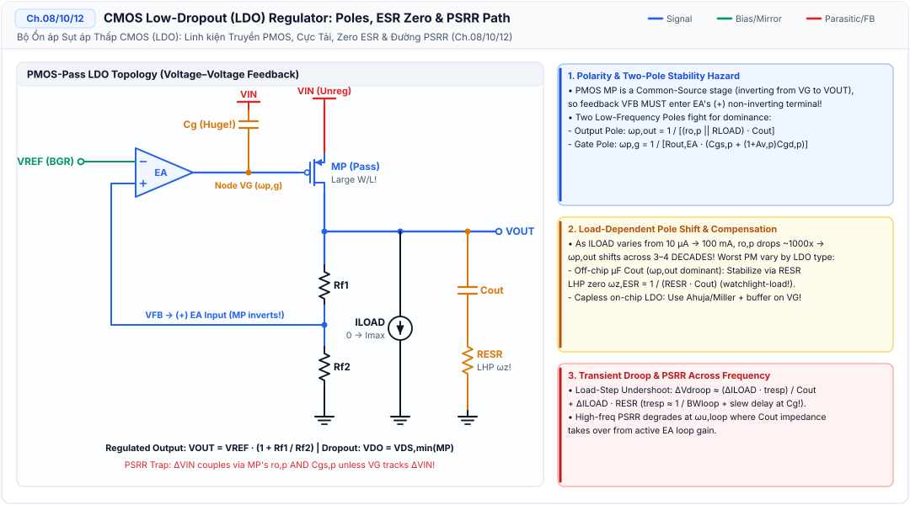

---
{
  "id": "skill-ldo-stability-load-line-psrr-tb",
  "kind": "skill",
  "domain": "eda-and-github-skills",
  "title_vi": "Thiết kế & Kiểm chứng Bộ Ổn áp Tuyến tính CMOS LDO (Quỹ đạo Cực Tải 4 Thập kỷ, Hầm ESR, Load-Step & PSRR)",
  "title_en": "CMOS Low-Dropout (LDO) Regulator Verification Testbench (4-Decade Load-Pole Locus, ESR Tunnel, Load-Step & PSRR)",
  "summary": "Quy trình định cỡ và kiểm định thực chiến cho bộ ổn áp tuyến tính sụt áp thấp dùng PMOS-pass so với NMOS-pass trên Cadence Spectre 15.1: quét stb liên tục qua 4 thập kỷ dòng tải Iload từ 0 đến Imax để bắt điểm trũng dự trữ pha tệ nhất, vẽ đường hầm ổn định điện trở nối tiếp tương đương R_ESR của tụ ngoài, bù Miller/Ahuja cho Capless LDO trên chip, kiểm tra sụt áp bước nhảy dòng ipulse và phân tách các đường suy giảm PSRR cao tần cấp nguồn sạch cho SAR ADC / VCO.",
  "diagram": "../../diagrams/cmos-ldo-regulator.svg",
  "razavi_refs": [
    {
      "chapter": 8,
      "section": "8.2.1, 8.3, 8.5.2",
      "pages": "286-291, 298-299, 304-308",
      "equations": [
        "8.36",
        "8.66",
        "8.73"
      ]
    },
    {
      "chapter": 10,
      "section": "10.5-10.7",
      "pages": "426-439",
      "equations": [
        "10.25",
        "10.30",
        "10.33",
        "10.46",
        "10.50"
      ]
    },
    {
      "chapter": 12,
      "section": "12.6, 12.8",
      "pages": "525-529, 533-535",
      "equations": [
        "12.55",
        "12.76"
      ]
    }
  ],
  "github_refs": [
    {
      "repo": "Arcadia-1/sar-adc-skills",
      "url": "https://github.com/Arcadia-1/sar-adc-skills/tree/27de09a34ea3ec6feb2ee2797d32dc673d35d1ad/sar-adc-skill/references",
      "use": "Quy trình thiết kế LDO PMOS-pass cấp nguồn sạch cho SAR ADC, ngân sách PSRR tại tần số Nyquist fs/2 và tính trở kháng ra chống sụt áp xung dòng CDAC"
    },
    {
      "repo": "iic-jku/analog-circuit-design",
      "url": "https://github.com/iic-jku/analog-circuit-design/tree/6075ea0ebcf08f5c7f6033a84e9dd3c91450f5e1/content/ota_basic",
      "use": "Phân tích hồi tiếp Điện áp–Điện áp (Shunt–Series), hiệu ứng tải cầu điện trở và đo vòng kín Middlebrook STB"
    },
    {
      "repo": "efabless/cace",
      "url": "https://github.com/efabless/cace/tree/d71c8da5f8d8a5bfb4cfb2640714bdd374a9b84a",
      "use": "Tổ chức bảng kiểm đặc tả Line Regulation, Load Regulation, Dropout Voltage, Quiescent Current và PSRR qua đa góc PVT"
    }
  ],
  "glossary_codes": [
    "T051",
    "T063",
    "T528",
    "T874",
    "T1215",
    "T1301",
    "T2191",
    "T2199",
    "T2200"
  ],
  "process_agnostic": true,
  "roles": {
    "pass_transistor_stage": "Phần tử truyền công suất M_pass (PMOS nguồn chung cho dropout thấp V_DO = Vds,min, hoặc NMOS theo nguồn cho Zout thấp và PSRR cao nếu có áp bơm cổng)",
    "error_amplifier_and_zero": "Bộ khuếch đại sai lệch độ lợi cao kèm mạng bù (Miller Rz+Cc, Ahuja cascode buffer hoặc zero ESR tụ tải) ghim Vout = Vref*(1 + Rfb1/Rfb2)",
    "bleeder_and_divider": "Cầu chia hồi tiếp Rfb1-Rfb2 kiêm dòng rỉ tối thiểu I_bleed giữ cực ngõ ra không lùi về s = 0 khi tải ngoài ngắt hoàn toàn (I_load = 0)",
    "load_and_esr_sweep_harness": "Khung quét tham số 2 chiều (I_load x R_ESR) trong Spectre stb/tran/xf phát hiện điểm mù mất ổn định ở dòng tải trung gian hoặc nhẹ"
  },
  "symptoms_addressed": [
    "ldo-stable-at-full-load-but-oscillates-violently-at-no-load-or-light-load",
    "ceramic-mlcc-low-esr-capacitor-destabilizing-external-cap-ldo-outside-esr-tunnel",
    "high-frequency-psrr-collapsing-to-0-db-corrupting-sar-adc-enob-or-vco-spurs",
    "severe-undershoot-droop-during-nanosecond-digital-or-cdac-burst-load-step",
    "dropout-headroom-violation-pushing-pmos-pass-fet-into-deep-triode-at-ss-hot-corner"
  ],
  "limitations": [
    "pmos-pass-device-huge-gate-capacitance-creates-low-internal-pole-requiring-buffer-or-miller-splitting",
    "nmos-source-follower-pass-requires-charge-pump-or-secondary-high-voltage-rail-for-low-dropout",
    "increasing-miller-cc-for-stability-degrades-high-frequency-load-transient-and-psrr-if-feedforward-unblocked"
  ],
  "checklists": [
    "common-mos",
    "ldo-regulator",
    "feedback-and-stb",
    "two-stage-miller",
    "bandgap-and-bias",
    "layout-and-matching"
  ]
}
---

## 1. Bản chất Động học Của LDO: Hệ Hồi tiếp Có Cực Trượt 4 Thập kỷ!

Khác hoàn toàn với một Op-Amp thông thường làm việc quanh một tải cố định, **bộ ổn áp tuyến tính sụt áp thấp (`T2199`, Low-Dropout Regulator — LDO)** là một hệ hồi tiếp âm Điện áp–Điện áp (Razavi Chương 8 §8.2.1: cảm nhận $V_{\text{OUT}}$ song song qua cầu điện trở $R_{\text{FB1}}\text{–}R_{\text{FB2}}$, hồi tiếp nối tiếp vào ngõ vào bộ khuếch đại lỗi) phải đối mặt với **sự dịch chuyển cực đoan của điểm làm việc theo dòng tải $I_{\text{load}}$ từ $0\text{ A}$ đến hàng trăm $\text{mA}$**!



Khi dòng tải $I_{\text{load}}$ quét qua 3–4 thập kỷ (ví dụ từ $10\text{ }\mu\text{A}$ chế độ ngủ lên $100\text{ mA}$ đầy tải), cả hỗ dẫn $g_{m,\text{pass}} \propto \sqrt{I_{\text{load}}}$ lẫn điện trở ra $r_{O,\text{pass}} \propto 1/I_{\text{load}}$ của transistor công suất PMOS $M_{\text{pass}}$ đều biến thiên hàng trăm đến hàng nghìn lần! Điều này chia thế giới thiết kế CMOS LDO thành **ba bài toán vật lý hoàn toàn khác nhau** cần phân biệt rạch ròi ngay từ đầu:
1. **LDO Có Tụ Ngoài Lớn (`External-Cap LDO`, $C_{\text{OUT}} = 0{,}47\text{–}4{,}7\text{ }\mu\text{F}$ trên PCB):** Cực trội $\omega_{p1} = \frac{1}{R_{\text{out,eq}} C_{\text{OUT}}}$ nằm ở chính ngõ ra $V_{\text{OUT}}$, còn cực tại cổng $M_{\text{pass}}$ ($\omega_{p,\text{gate}} = \frac{1}{R_{o,\text{EA}} C_{G,\text{pass}}}$) là cực phụ! Sự sống còn của vòng lặp phụ thuộc chặt vào điện trở nối tiếp tương đương $R_{\text{ESR}}$ của tụ gốm ngoài tạo zero cứu pha $\omega_{z,\text{ESR}} = \frac{1}{R_{\text{ESR}} C_{\text{OUT}}}$.
2. **LDO Tích hợp Không Tụ Ngoài (`Capless On-Chip LDO`, $C_{\text{OUT}} = 20\text{–}200\text{ pF}$ trên silicon):** Cực trội chuyển vào bên trong (nhờ tách cực Miller $C_c + R_z$ hoặc bù Cascode Ahuja từ cổng $M_{\text{pass}}$ sang $V_{\text{OUT}}$), còn cực ngõ ra $\omega_{p,\text{out}} \approx \frac{g_{m,\text{pass}} \text{ hoặc } 1/r_{O,\text{pass}}}{C_{\text{OUT}}}$ trở thành cực không trội $\omega_{p2}$! Lúc này trạng thái **không tải ($I_{\text{load}} \to 0$) là cơn ác mộng tệ nhất** vì $g_{m,\text{pass}}$ tụt thê thảm kéo $\omega_{p2}$ đâm sầm vào trong băng thông vòng!
3. **LDO Dùng NMOS Theo Nguồn (`NMOS Source-Follower Pass LDO`):** Cực ngõ ra tự động đẩy vọt lên $\frac{g_{m,\text{pass}}}{C_{\text{OUT}}}$, cách ly hoàn toàn cực nguồn khỏi cực máng $V_{\text{IN}}$ nên đạt PSRR cao tần xuất sắc cho VCO/SERDES, nhưng đánh đổi bằng điện áp rơi tối thiểu lớn $V_{DO} = V_{GS,N} + V_{DS,\text{EA}} > 0{,}6\text{ V}$ trừ khi dùng bơm điện tích nâng nguồn nuôi Error Amp lên $V_{DD,\text{CP}} > V_{\text{IN}} + V_{THN}$!

---

## 2. Hệ Phương trình Cốt lõi: Quỹ đạo Cực–Zero, Đường Hầm ESR, Sụt Áp Quá độ & PSRR

### 2.1. Độ lợi Vòng, Điện áp Sụt Tối thiểu (`T2200`) & Hệ Phương trình Ba Cực
Gọi hệ số hồi tiếp cầu chia là $\beta = \frac{R_{\text{FB2}}}{R_{\text{FB1}} + R_{\text{FB2}}} = \frac{V_{\text{REF}}}{V_{\text{OUT}}}$, dòng rỉ tĩnh qua cầu chia là $I_{\text{bleed}} = \frac{V_{\text{OUT}}}{R_{\text{FB1}} + R_{\text{FB2}}}$, độ lợi tầng khuếch đại lỗi là $A_{\text{EA}} = g_{m1} R_{o1}$.
- **Điều kiện điện áp sụt tối thiểu (Dropout Voltage $V_{\text{DO}}$):** Để $M_{\text{pass}}$ (chiều rộng khổng lồ $W_{\text{pass}} = 2\text{–}20\text{ mm}$, $L_{\text{pass}} = 1{,}0\text{–}1{,}5\,L_{\min}$) vẫn duy trì được vùng bão hòa có độ lợi ở dòng cực đại $I_{\text{load,max}}$ tại góc chậm nhất `SS` và nhiệt độ nóng nhất $125\,^\circ\text{C}$:

$$
\left|V_{DS,\text{sat,pass}}\right|_{\text{SS}, 125^\circ\text{C}}(I_{\text{load,max}}) \le V_{\text{DO,spec}} - \Delta V_{\text{IR,metal}} \qquad (\text{với } \Delta V_{\text{IR,metal}} = I_{\text{load,max}} R_{\text{wire}})
$$

- **Trong Capless LDO bù Miller ($C_c + R_z$ nối giữa cổng $M_{\text{pass}}$ và $V_{\text{OUT}}$):** Hàm truyền vòng hở $T(s)$ sở hữu độ lợi DC $T_0 = \beta \, g_{m1} R_{o1} \, g_{m,\text{pass}} \big[ r_{O,\text{pass}} \parallel (R_{\text{FB1}} + R_{\text{FB2}}) \parallel R_L \big]$ cùng bộ cực–zero phụ thuộc mạnh vào $I_{\text{load}}$:

$$
\omega_{u} \approx \frac{\beta \, g_{m1}}{C_c}, \qquad \omega_{p2}(I_{\text{load}}) \approx \frac{g_{m,\text{pass}}(I_{\text{load}})}{C_{\text{OUT}}} \;\;(\text{khi } C_{\text{OUT}} \gg C_{G,\text{pass}}), \qquad \omega_{z} = \frac{1}{\left(R_z - \dfrac{1}{g_{m,\text{pass}}}\right) C_c}
$$

Nhìn vào công thức của $\omega_{p2}(I_{\text{load}})$ và $\omega_z$: khi $I_{\text{load}} \to 0$, $g_{m,\text{pass}}$ sụt xuống cực nhỏ làm **$\omega_{p2}$ trôi tụt về tần số thấp VÀ đồng thời biến $R_z - 1/g_{m,\text{pass}}$ thành số âm (RHP zero hồi sinh!)** nếu $M_{\text{pass}}$ không được neo giữ bởi một dòng rỉ nền tối thiểu $I_{\text{bleed}} \ge 20\text{–}100\text{ }\mu\text{A}$ (hoặc dùng bù Cascode Ahuja chặn chiều truyền thuận qua $C_c$)!

### 2.2. Đường Hầm Ổn định ESR (`ESR Stability Tunnel`) Cho External-Cap LDO
Với LDO dùng tụ lọc ngoài $C_{\text{OUT}}$ có điện trở nối tiếp tương đương $R_{\text{ESR}}$, zero $\omega_{z,\text{ESR}} = \frac{1}{R_{\text{ESR}} C_{\text{OUT}}}$ bắt buộc phải nằm trong một dải hẹp quanh tần số cắt vòng $\omega_u$:
- **Nếu $R_{\text{ESR}}$ quá nhỏ** (ví dụ thay tụ Tantalum bằng tụ gốm MLCC có $R_{\text{ESR}} < 5\text{ m}\Omega$): $\omega_{z,\text{ESR}}$ vọt ra vô cực, hệ mất hoàn toàn lực nâng pha và gánh cùng lúc hai cực thấp ($\omega_{p,\text{out}}$ và $\omega_{p,\text{gate}}$) $\implies$ $\text{PM} \approx 5^\circ$, mạch dao động hình sin liên tục!
- **Nếu $R_{\text{ESR}}$ quá lớn** ($R_{\text{ESR}} > 2\text{ }\Omega$ ở nhiệt độ lạnh $-40\,^\circ\text{C}$): $\omega_{z,\text{ESR}}$ xuất hiện quá sớm làm độ lợi vòng ngưng giảm $-20\text{ dB/dec}$ mà đi ngang phẳng lì, đẩy tần số cắt $0\text{ dB}$ vọt xa vượt qua cả các cực ký sinh bậc ba $\omega_{p3}$ của tầng đệm cổng $\implies$ mạch lại mất ổn định ở tần số cao đồng thời vọt lố sụt áp $\Delta V_{\text{ESR}} = \Delta I_{\text{load}} R_{\text{ESR}}$ cực lớn!

### 2.3. Định luật Sụt Áp Bước nhảy Dòng ($\Delta V_{\text{droop}}$) & Khử Nhiễu Nguồn PSRR
Khi khối số hoặc mảng tụ CDAC của SAR ADC rút một bậc dòng đột ngột $\Delta I_{\text{load}}$ có thời gian sườn lên $t_r$ nhỏ hơn nhiều thời gian phản ứng của vòng lặp $\tau_{\text{loop}} \approx \frac{1}{2\pi f_u}$, trong khoảng thời gian mù $\Delta t_{\text{blind}} \approx \tau_{\text{loop}} + \frac{C_{G,\text{pass}} \Delta V_G}{I_{\text{SR,driver}}}$, toàn bộ điện tích thiếu hụt phải rút trực tiếp từ $C_{\text{OUT}}$:

$$
\Delta V_{\text{droop,max}} \approx \Delta I_{\text{load}} \cdot R_{\text{ESR}} \;+\; \frac{\Delta I_{\text{load}}}{C_{\text{OUT}}} \left( \frac{1}{2\pi f_u} + \frac{C_{G,\text{pass}} \, \Delta V_{SG,\text{pass}}}{I_{\text{slew,gate}}} \right)
$$

Phương trình này chỉ rõ: nếu cổng $M_{\text{pass}}$ có điện dung $C_{G,\text{pass}} = 15\text{ pF}$ được lái trực tiếp từ tầng 1 có dòng đuôi chỉ $10\text{ }\mu\text{A}$ (tốc độ biến thiên cổng chỉ $0{,}67\text{ V/}\mu\text{s}$!), dù băng thông tín hiệu nhỏ $f_u$ có cao đến đâu thì **giới hạn Slew Rate tại cổng $M_{\text{pass}}$** vẫn làm $V_{\text{OUT}}$ sập hàng trăm $\text{mV}$! Bắt buộc chèn một **tầng đệm trở kháng thấp (Super Source Follower / Class-AB Buffer)** giữa Error Amp và cổng $M_{\text{pass}}$!

Đối với **khả năng khử nhiễu nguồn cấp (`T528`, PSRR)** của PMOS-pass LDO, tồn tại 3 miền tần số điển hình:
1. **Miền tần số thấp ($f < f_{p,\text{EA}}$):** Được bảo vệ bởi toàn bộ độ lợi vòng $T_0 \implies \text{PSRR} \approx 60\text{–}80\text{ dB}$ (nhưng không vượt quá PSRR của chính điện áp chuẩn $V_{\text{REF}}$ nhân $1/\beta$!).
2. **Miền trung tần ($f_{p,\text{EA}} < f < f_u$):** Độ lợi vòng giảm $-20\text{ dB/dec}$, khiến trở kháng ra đóng vòng mang tính cảm kháng và $\text{PSRR}(f)$ rơi dốc xuống tạo **đáy thung lũng (PSRR valley)** ngay quanh $f_u$! Đặc biệt nếu cổng $M_{\text{pass}}$ không bám đồng pha theo $V_{\text{IN}}$ (tức $v_g \approx 0$ thay vì $v_g = v_{\text{in}}$), biến thiên $\Delta V_{\text{IN}}$ biến trực tiếp thành $\Delta V_{SG,\text{pass}} = \Delta V_{\text{IN}}$ và bơm thẳng dòng nhiễu $g_{m,\text{pass}} \Delta V_{\text{IN}}$ xuống tải!
3. **Miền siêu cao tần ($f \gg f_u$):** Vòng lặp mở hoàn toàn, nhiễu từ $V_{\text{IN}}$ phóng xuyên qua $r_{O,\text{pass}}$ và tụ $C_{GD}+C_{SD}$ xuống chia áp với $C_{\text{OUT}}$ và $R_{\text{ESR}}$.

---

## 3. Bất biến Thiết kế & Các Bẫy Lỗi Kinh điển (Invariants & Traps)

- **[INV-LDO-01] Bất biến Cực tính Hồi tiếp Đảo Ngược Của PMOS-Pass LDO:** Vì bản thân transistor công suất PMOS $M_{\text{pass}}$ mắc nguồn chung đã tạo ra **một lần đảo pha ($-180^\circ$)** từ cổng $V_G$ sang $V_{\text{OUT}}$ (khi $V_G$ hạ thấp $\implies V_{SG}$ tăng $\implies V_{\text{OUT}}$ tăng!), dây hồi tiếp $V_{\text{FB}}$ từ cầu chia điện trở **BẮT BUỘC phải nối vào ngõ vào DƯƠNG ($+$) của Error Amplifier** (và $V_{\text{REF}}$ nối vào ngõ vào ÂM ($-$))! (Ngược lại, với NMOS Source-Follower LDO không đảo pha, $V_{\text{FB}}$ nối vào ngõ vào ÂM ($-$)!). Đấu theo thói quen Op-Amp thường sẽ biến LDO thành mạch chốt đập sát $V_{\text{IN}}$ hoặc $0\text{ V}$ ngay tức khắc!
- **[INV-LDO-02] Bất biến Quét Logarit Dòng Tải Chứ Không Chỉ Đo 2 Đầu Mút $\{0, I_{\max}\}$:** Trong rất nhiều cấu trúc LDO hai tầng + đệm, dự trữ pha tại $I_{\text{load}} = 0$ đạt $65^\circ$ và tại $I_{\text{load}} = 100\text{ mA}$ đạt $70^\circ$, nhưng ở **dòng tải trung gian $I_{\text{load}} = 200\text{ }\mu\text{A}\text{–}2\text{ mA}$** (nơi $M_{\text{pass}}$ chuyển giao từ vùng yếu sang vùng mạnh làm cực tải và cực cổng cắt chéo nhau!), dự trữ pha tụt thảm xuống **$18^\circ$**! Bắt buộc quét `stb` trên lưới logarit tối thiểu 5 điểm/thập kỷ dòng tải: $\{0,\; 10\text{ }\mu\text{A},\; 50\text{ }\mu\text{A},\; 200\text{ }\mu\text{A},\; 1\text{ mA},\; 5\text{ mA},\; 20\text{ mA},\; I_{\max}\}$.
- **[TRAP-LDO-01] Bẫy Đấu Nguồn Cấp Error Amp Vào Đường Bẩn Mất Khớp Cổng PMOS:** Nếu Error Amp có tải gương dòng PMOS nối lên cùng đường $V_{\text{IN}}$ với cực nguồn của $M_{\text{pass}}$, gợn nhiễu $\Delta v_{\text{in}}$ truyền lên cực cổng $M_{\text{pass}}$ với hệ số gần bằng $1$ ($\Delta v_g \approx \Delta v_{\text{in}} \implies \Delta v_{sg,\text{pass}} \approx 0$), giúp triệt tiêu dòng nhiễu $g_{m,\text{pass}} \Delta v_{sg}$! Nếu vô tình dùng tụ Miller $C_c$ nối cổng $M_{\text{pass}}$ xuống đất (thay vì nối sang $V_{\text{OUT}}$ hoặc qua cascode hợp lý), ở tần số cao $C_c$ ghim cứng cổng $M_{\text{pass}}$ xuống $\text{GND}$ làm $\Delta v_{sg,\text{pass}} = \Delta v_{\text{in}}$, phá sập $\text{PSRR}$ xuống gần $0\text{ dB}$!
- **[TRAP-LDO-02] Bẫy Bỏ Quên Sụt Áp Dây Kim loại & Chốt SCR (`T2191`) Trên Layout $M_{\text{pass}}$:** Một transistor PMOS dẫn $100\text{ mA}$ với điện trở đường dây kim loại chỉ $0{,}8\text{ }\Omega$ đã ăn mất $80\text{ mV}$ ngân sách Dropout và nếu điểm lấy hồi tiếp Kelvin (`VOUT_sense`) đặt sai chỗ (đặt ngay cực máng nội thay vì đặt tại pad tải thực!), điện trở đường dây nằm ngoài vòng hồi tiếp làm hỏng hoàn toàn Load Regulation! Đồng thời $M_{\text{pass}}$ kích thước milimét phải được bao bọc bởi **vòng bảo vệ kép (`T2191`, double guard ring)** và ma trận tiếp xúc n-well dày đặc nối chặt lên $V_{\text{IN}}$ để không kích hoạt Latch-up khi tải đóng cắt đột ngột.

---

## 4. Bảng Đối chiếu Ba Kiến trúc LDO & Ma trận Phép Đo Nghiệm thu

| Đặc trưng Kỹ thuật | PMOS-Pass + Tụ Ngoài (External-Cap) | PMOS-Pass Không Tụ Ngoài (Capless On-Chip) | NMOS-Pass + Charge Pump / Dual-Rail |
|---|---|---|---|
| **Điện áp sụt $V_{\text{DO}}$ tối thiểu** | Rất thấp ($80\text{–}150\text{ mV}$) | Rất thấp ($80\text{–}150\text{ mV}$) | Rất thấp nếu cổng nuôi từ rail cao $V_{\text{BIAS}} \ge V_{\text{OUT}} + V_{GS,N}$ |
| **Vị trí cực trội $\omega_{p1}$** | Tại ngõ ra $V_{\text{OUT}}$ ($C_{\text{OUT}} = 1\text{ }\mu\text{F}$) | Tại nút nội Error Amp (tách cực Miller/Ahuja) | Tại nút nội Error Amp; ngõ ra là cực cao $g_{mN}/C_{\text{OUT}}$ |
| **Điểm tải dễ mất ổn định nhất** | $I_{\text{load}} = I_{\max}$ với $R_{\text{ESR}}$ quá nhỏ hoặc quá lớn | $I_{\text{load}} = 0$ đến $500\text{ }\mu\text{A}$ (cực tải lùi vào trong dải) | Ổn định rộng hơn nhiều do $1/g_{mN}$ tự hạ thấp trở kháng ra |
| **PSRR ở $1\text{–}50\text{ MHz}$ (cho ADC/RF)** | Phụ thuộc mạnh vào $C_{\text{OUT}}$ ngoài và cảm kháng chân vỏ $L_{\text{pkg}}$ | Trung bình ($25\text{–}45\text{ dB}$), cần tầng đệm Ahuja/cascode | Xuất sắc ($45\text{–}65\text{ dB}$) vì cực máng nối $V_{\text{IN}}$ tự che chắn! |

---

## 5. Mẫu Testbench Spectre 15.1 Toàn diện & Kịch bản Quét 2 Chiều $(I_{\text{load}}, R_{\text{ESR}})$

### 5.1. Netlist Spectre 15.1 Đo Trọn Bộ `stb`, `xf` (PSRR), `noise` và `tran` Load-Step
Để mô phỏng trung thực thực tế gắn trên bo mạch hoặc cấp nguồn cho khối SAR ADC trên chip, mô hình tải luôn phải gồm: (1) tụ tải $C_{\text{OUT}}$ nối tiếp $R_{\text{ESR}}$ (và cảm kháng chân vỏ $L_{\text{ESL}}$ nếu là tụ ngoài), (2) nguồn dòng tải tĩnh `iload_dc` để quét điểm làm việc, và (3) nguồn xung dòng bước nhảy nhanh `ipulse` để đo sụt áp động!

```spice
// tb_ldo_complete_signoff.scs — Spectre 15.1 LDO Multi-Load Stability, PSRR & Load-Step Deck
simulator lang=spectre
global 0
parameters vin_dc=1.35 vref_dc=0.60 vout_target=1.20 \
           iload_dc=100u iload_max=50m cout=100p resr=50m

// Nguồn vào có mag=1 phục vụ đo trực tiếp PSRR = -20*log10(|V(vout)|) trong phân tích AC!
VIN_SRC  (vin 0)  vsource dc=vin_dc mag=1
VREF_SRC (vref 0) vsource dc=vref_dc

// Đặt IPR_LDO (vout fb_top_in) iprobe ngay đầu vào cầu chia Rfb1-Rfb2 để giữ nguyên tải cầu chia!
// Nhánh tụ lọc ngõ ra (có ESR thực tế) và cặp nguồn dòng tải tĩnh + xung bước nhảy 1 ns:
C_LOAD   (vout net_esr) capacitor c=cout
R_ESR    (net_esr 0)    resistor  r=resr
I_DC     (vout 0)       isource   dc=iload_dc
I_STEP   (vout 0)       isource   type=pulse val0=0 val1=iload_max \
                                  delay=2u rise=1n fall=1n width=6u period=20u

// 1. Quét DC đặc tuyến Line Regulation và Dropout (xác định điểm gãy V_DO tại I_max)
dc_line dc param=vin_dc start=0.9 stop=1.8 step=10m
// 2. Quét DC đặc tuyến Load Regulation từ 0 đến I_max
dc_load dc param=iload_dc start=0 stop=iload_max step=500u

// 3. Phân tích STB đóng vòng (sẽ được bọc trong quét tham số logarit iload_dc x resr!)
stb_ldo stb start=1 stop=1G dec=40 probe=IPR_LDO

// 4. Đo PSRR từ 10 Hz đến 1 GHz (với VIN mag=1 => PSRR_dB = -db20(V(vout))) & Nhiễu ngõ ra
ac_psrr   ac    start=10 stop=1G dec=30
noise_ldo noise (vout 0) iprobe=VIN_SRC start=10 stop=100M dec=20

// 5. Đáp ứng quá độ bước nhảy dòng tải 0 -> I_max -> 0 trong 1 ns (kiểm tra droop/overshoot & ringing!)
tran_step tran stop=12u errpreset=conservative maxstep=500p
```

### 5.2. Kịch bản OCEAN Chạy Quét Ma trận Ổn định 2 Chiều $(I_{\text{load}} \times R_{\text{ESR}})$ Tự động
Kịch bản OCEAN chạy trực tiếp trên Cadence IC617 (`ocean -nograph -restore audit_ldo_tunnel.ocn`) dưới đây tự động tìm điểm dự trữ pha tối thiểu trên toàn bộ không gian tải mà không bỏ lọt "hố chết" dòng tải trung gian:

```lisp
;;; audit_ldo_tunnel.ocn — Quét 2D (I_load x R_ESR) xuất bản đồ dự trữ pha LDO trên IC617
simulator('spectre)
design("./tb_ldo_complete_signoff.scs")
resultsDir("./sim_ldo_tunnel")

iloadList = list(0.0 10u 50u 200u 1m 5m 20m 50m)
resrList  = list(1m 10m 50m 200m 500m 1.5)

outPort = outfile("./sim_ldo_tunnel/pm_tunnel_summary.csv")
fprintf(outPort "iload_A,resr_ohm,pm_deg,pm_freq_hz,gm_db,vout_dc_V\n")

foreach(ilVal iloadList
  foreach(esrVal resrList
    desVar("iload_dc" ilVal)
    desVar("resr" esrVal)
    analysis('dc ?saveOppoint t)
    analysis('stb ?start "1" ?stop "1G" ?dec "30" ?probe "/IPR_LDO")
    run()
    selectResult("dcOp")
    vdc = v("/vout")
    selectResult("stb-margin.stb")
    pm  = getData("phaseMargin")
    pmf = getData("phaseMarginFreq")
    gm  = getData("gainMargin")
    fprintf(outPort "%g,%g,%L,%L,%L,%L\n" ilVal esrVal pm pmf gm vdc)
  )
)
close(outPort)
exit()
```

**Ngưỡng ký duyệt bắt buộc (LDO Sign-Off Contract):**
1. **Toàn dải ổn định:** $\min_{I_{\text{load}}, R_{\text{ESR}}, \text{PVT}} (\text{PM}) \ge 45^\circ$ (tại danh định `TT` đạt $\ge 58^\circ$), dự trữ độ lợi $\text{GM} \ge 10\text{ dB}$, không có vòng vây $(-1, 0)$ trên đồ thị Nyquist.
2. **Độ sụt quá độ bước nhảy tải ($\Delta V_{\text{droop}}$ & $\Delta V_{\text{overshoot}}$):** Khi dòng tải nhảy $1\% \leftrightarrow 100\%\,I_{\max}$ trong $1\text{ ns}$ (cho Capless SoC/ADC LDO) hoặc $100\text{ ns}$ (cho External-Cap LDO), $|\Delta V_{\text{out}}| \le 3\%\text{–}5\%\,V_{\text{OUT}}$ (hoặc $\le 0{,}5\text{ LSB}$ tại tần số lặp lại xung dòng CDAC nếu nuôi trực tiếp tham chiếu ADC) và tắt hẳn dao động sau tối đa 2 chu kỳ lượn!
3. **PSRR tại tần số nhiễu chuyển mạch (ví dụ DC–DC buck $2\text{ MHz}$ hoặc Nyquist SAR $f_s/2$):** Đạt đúng mục tiêu ngân sách hệ thống (thường $\ge 45\text{ dB}$ ở $1\text{ MHz}$) kể cả sau khi trích xuất điện dung ký sinh $C_{GD,\text{pass}}$ từ layout PEX!

---

## 6. Đối chiếu Sách Razavi, Nguồn GitHub Đã Kiểm định & Thuật ngữ Chuẩn CLB

### 6.1. Mốc Tọa độ Sách Razavi (2nd Edition) & Nguồn GitHub
- **Chương 8:** §8.2.1 *Voltage-Voltage Feedback* & §8.3 *Effect of Feedback on Noise* (tr. 286–291, 298–299), §8.5.2 *Loading in Voltage-Voltage Feedback* (tr. 304–308 — quy tắc giữ nguyên cầu điện trở $R_{\text{FB1}} + R_{\text{FB2}}$ khi mở vòng).
- **Chương 10:** §10.5 *Miller Compensation & RHP Zero* (tr. 426–433), §10.7 *Other Compensation Techniques / Cascode Compensation* (tr. 436–439 — chìa khóa cho Capless LDO ổn định rộng!).
- **Chương 12:** §12.6 & §12.8 *Regulated Supply / LDO Application of Bandgap References* (tr. 525–529, 533–535, Hình 12.39–12.41).
- **Kho GitHub Đối chiếu:** `Arcadia-1/sar-adc-skills` (`27de09a34e`, tệp `references/ldo.md` phân tích ngân sách PSRR và dòng xung CDAC cho LDO nuôi ADC), `iic-jku/analog-circuit-design` (`6075ea0ebc`, ví dụ LDO và đo vòng Middlebrook) và `efabless/cace` (`d71c8da5f8`).

### 6.2. Bảng Thuật ngữ Chuẩn CLB Vi Mạch
| Mã CLB | Thuật ngữ Tiếng Anh | Thuật ngữ Tiếng Việt Chuẩn | Ngữ cảnh Kiểm chứng LDO |
|---|---|---|---|
| `T2199` | low-dropout regulator, LDO | bộ ổn áp tuyến tính sụt áp thấp (LDO) | Bộ điều chỉnh điện áp nối tiếp dùng phần tử truyền sụt áp nhỏ $V_{DS,\min}$ |
| `T2200` | dropout voltage and load-dependent output pole | điện áp sụt tối thiểu (dropout) và cực ngõ ra phụ thuộc dòng tải | Hai đặc tính vật lý phân biệt LDO với Op-Amp tải tĩnh thông thường |
| `T528` | supply noise | nhiễu nguồn cấp | Thành phần gợn từ nguồn ngoài/khối số cần bị nén bởi chỉ tiêu PSRR của LDO |
| `T051` / `T063` | loop gain / phase margin | độ lợi vòng / dự trữ pha | Phải đo bằng `stb` quét xuyên suốt 4 thập kỷ dòng tải từ $0$ đến $I_{\max}$ |
| `T2191` | guard ring | vòng bảo vệ (guard ring) | Vành cách ly bắt buộc quanh ma trận công suất $M_{\text{pass}}$ chống Latch-up |
