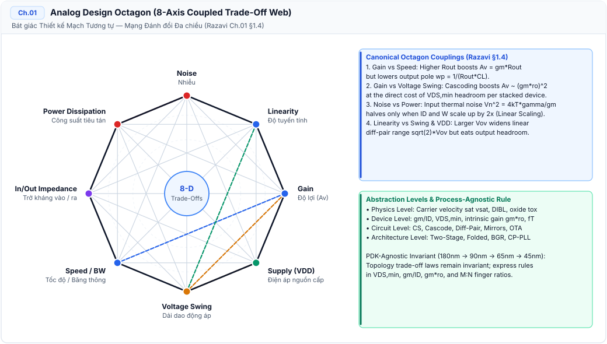

---
{
  "id": "skill-ocean-parametric-testbench-runner",
  "kind": "skill",
  "domain": "eda-and-github-skills",
  "title_vi": "Tự động hóa Chạy Batch OCEAN Không Giao diện & Giải mã Nghiêm ngặt Spectre PSF ASCII",
  "title_en": "Headless OCEAN Parametric Testbench Runner & Zero-Dependency Spectre 15.1 PSF ASCII Extraction",
  "summary": "Kiến trúc chạy mô phỏng tham số và hậu xử lý tự động không cần giao diện đồ họa (ocean -nograph & spectre -format psfascii) trên Cadence IC617 / RHEL 6.5: chuẩn hóa cô lập thư mục chạy, tránh bẫy cờ -param và ràng buộc sớm biểu thức phụ thuộc trong Spectre, trích xuất chính xác biên độ/pha/margin/quá độ bằng cả OCEAN lẫn trình đọc PSF ASCII thuần Python chuẩn.",
  "diagram": "../../diagrams/analog-design-octagon.svg",
  "razavi_refs": [
    {
      "chapter": 1,
      "section": "1.4",
      "pages": "6-8",
      "equations": []
    },
    {
      "chapter": 9,
      "section": "9.1, 9.5-9.6",
      "pages": "345-349, 373-374",
      "equations": ["9.44", "9.46"]
    },
    {
      "chapter": 11,
      "section": "11.5-11.6",
      "pages": "472-507",
      "equations": ["11.14", "11.20"]
    }
  ],
  "github_refs": [
    {
      "repo": "Arcadia-1/virtuoso-bridge-lite",
      "url": "https://github.com/Arcadia-1/virtuoso-bridge-lite",
      "use": "Quy chuẩn chạy Spectre batch cô lập thư mục, bẫy -param / re-declared parameters và trình đọc PSF nghiêm ngặt"
    },
    {
      "repo": "KenKundert/psf_utils",
      "url": "https://github.com/KenKundert/psf_utils",
      "use": "Đặc tả cấu trúc tệp Parameter Storage Format (PSF) ASCII và công cụ chuyển đổi nhị phân psf của MMSIM"
    },
    {
      "repo": "MatthewLoveQUB/SKILL_Tools",
      "url": "https://github.com/MatthewLoveQUB/SKILL_Tools",
      "use": "Mẫu hàm bọc an toàn tránh kết quả nil khi trích xuất sóng trong môi trường SKILL/OCEAN"
    }
  ],
  "glossary_codes": ["T051", "T063", "T079", "T527", "T1214", "T1437", "T2186"],
  "process_agnostic": true,
  "roles": {
    "ocean_batch_driver": "Trình thông dịch ocean -nograph -restore điều phối thiết kế, gán desVar, chọn modelFile theo góc PVT, chạy run() và đánh giá hàm đo sóng chuẩn Cadence",
    "standalone_spectre_runner": "Luồng chạy trực tiếp spectre +aps -format psfascii trên netlist .scs đã tham số hóa nhanh gấp 5-10 lần vì bỏ qua thời gian khởi tạo OpenAccess mỗi lần lặp",
    "psf_ascii_parser": "Bộ phân tích cú pháp đọc trực tiếp khối VALUE của op.dc, ac.ac, stb.stb, tran.tran, noise.noise với kiểm định chặt NaN/Inf và ký tự thoát bus",
    "provenance_manifest": "Bản ghi JSON lưu mã băm netlist, model section, nhiệt độ, mã thoát simulator và toàn bộ chỉ số Bát giác Thiết kế cho từng lần chạy"
  },
  "symptoms_addressed": [
    "manual-ade-gui-clicking-wastes-hours-across-corners-and-loses-reproducibility",
    "spectre-cli-param-flag-fails-or-dependent-parameter-expressions-stay-stale",
    "ocean-cross-or-bandwidth-returns-nil-silently-corrupting-summary-csv",
    "runaway-multi-gigabyte-psf-files-fill-disk-during-parametric-sweeps"
  ],
  "limitations": [
    "ocean-startup-overhead-is-several-seconds-per-process-use-in-script-loops-or-standalone-spectre",
    "psfascii-is-larger-on-disk-than-psfbin-unless-paired-with-save-selected-and-strobing",
    "ocean-v-and-getData-naming-conventions-differ-between-schematic-hierarchy-and-flat-scs"
  ],
  "checklists": ["common-mos", "feedback-and-stb", "single-stage"]
}
---

## 1. Tại sao Phải Chuyển Từ Bấm Chuột ADE GUI Sang Hạ tầng Batch `OCEAN` & `Spectre PSF ASCII`?

Khi thiết kế một khối tương tự trên Bát giác Đánh đổi 8 trục của Razavi (Chương 1 §1.4: Độ lợi, Băng thông, Dự trữ pha, Công suất, Nhiễu, Tuyến tính, Biên độ áp vào/ra và Diện tích), mỗi lần thay đổi một chiều dài kênh $L$ hay dòng đuôi $I_{SS}$ đòi hỏi kiểm tra đồng thời ít nhất $5\text{–}8$ phép đo (`dcOp`, `stb`, `ac` CMRR/PSRR, `noise`, `tran` Slew Rate & Settling) trên nhiều góc quy trình (`T2186`). Nếu bấm nút xanh trong cửa sổ ADE L và đọc con trỏ bằng mắt trên ViVA:
1. Rất dễ quên cập nhật một biến hoặc đọc nhầm đồ thị của lần chạy cũ khi một góc bị lỗi hội tụ.
2. Không thể quét tự động hàng chục tổ hợp `(gm/ID, L, Cc, Rz)` hay $15\text{–}45$ góc PVT một cách có kiểm chứng truy nguyên (`provenance`).



Trên nền Cadence Virtuoso IC617 + MMSIM/Spectre 15.1 (kể cả trên máy ảo Linux RHEL 6.5 dùng Python 2.6.6 mặc định không có gói ngoài), kiến trúc tự động hóa sạch, nhanh và bền vững nhất kết hợp **hai chế độ bổ trợ**:
- **Chế độ 1 — `OCEAN` Không Giao diện (`ocean -nograph -restore run_char.ocn`):** Khởi tạo trực tiếp từ cellView schematic OpenAccess, xuất netlist chuẩn một lần (`createNetlist`), quét biến thiết kế `desVar(...)` và góc `modelFile(...)` ngay trong cùng một phiên OCEAN, dùng chính bộ hàm đo sóng nội bộ của Cadence (`value`, `cross`, `phaseMargin`, `gainMargin`, `integ`, `clip`).
- **Chế độ 2 — `Spectre Standalone + Strict PSF ASCII` (`spectre -format psfascii`):** Sau khi đã xuất được netlist nền từ OCEAN/ADE, các vòng lặp quét tham số lớn hoặc chạy song song đa tiến trình gọi thẳng nhị phân `spectre` độc lập (khởi động dưới $0{,}2\text{ s}$ thay vì chờ mở Virtuoso!) rồi đọc tệp kết quả văn bản `.raw/*.dc`, `*.ac`, `*.stb`, `*.tran`, `*.noise` bằng trình phân tích PSF ASCII nghiêm ngặt!

---

## 2. Quy chuẩn Giải tích Các Phép Đo Sóng Chuẩn & Cấu trúc Định dạng `PSF ASCII`

### 2.1. Công thức Đo Tự động Không Mơ hồ Cho 6 Chỉ tiêu Cốt lõi
Để kịch bản OCEAN hoặc Python không bao giờ tính nhầm chỉ số thiết kế (xem thêm `Arcadia-1/virtuoso-bridge-lite` & `KenKundert/psf_utils`), mọi công thức trích xuất phải neo chặt vào định nghĩa vật lý của Razavi (Chương 9 §9.1 & Chương 10 §10.2):
1. **Công suất tĩnh thực tế ($P_{\text{DC}}$):** Luôn đo từ dòng thoát ra khỏi cực dương nguồn cấp chính $V_{DD}$ ở trạng thái tĩnh: $P_{\text{DC}} = V_{DD} \cdot \left|-I(V_{DD}\text{:p})\right|$ (bao gồm **cả mạch phân cực phụ và mạch CMFB**, tuyệt đối không chỉ lấy $V_{DD} \cdot I_{\text{tail}}$ trên giấy!).
2. **Độ lợi DC vòng hở ($A_0$) & Tần số lợi ích đơn vị ($\text{UGF} / \text{GBW}$):**
   $$A_{0,\text{dB}} = 20\log_{10}\left|H(f_{\min})\right| \;\; (f_{\min} \le 1\text{ Hz}), \qquad f_{\text{UGF}} : \left|H(j 2\pi f_{\text{UGF}})\right| = 1 \;\; (0\text{ dB}, \text{ sườn xuống đầu tiên})$$
3. **Tốc độ biến thiên cực đại Slew Rate dương và âm ($\text{SR}^+, \text{SR}^-$, `T079`):** Cắt đoạn sườn chuyển tiếp từ $10\%$ đến $90\%$ (hoặc $20\%\text{–}80\%$) của bước nhảy biên độ lớn $\Delta V_{\text{step}}$ trong cấu hình đệm đơn vị:
   $$\text{SR}^+ = \frac{V_{80\%} - V_{20\%}}{t_{\text{rise},80\%} - t_{\text{rise},20\%}}, \qquad \text{SR}^- = \frac{V_{80\%} - V_{20\%}}{t_{\text{fall},20\%} - t_{\text{fall},80\%}}, \qquad \text{SR}_{\text{worst}} = \min(\text{SR}^+, \text{SR}^-)$$
4. **Thời gian xác lập tổng cộng ($t_{\text{settle},\epsilon}$):** Thời điểm **cuối cùng** mà sóng ngõ ra đi vào và **ở hẳn bên trong** dải sai số tĩnh $V_{\text{final}} \pm \epsilon \cdot \Delta V_{\text{step}}$ (ví dụ $\epsilon = 0{,}1\%$ cho 10-bit; nếu dùng điểm cắt đầu tiên sẽ bỏ sót vọt lố rung lắc!).

### 2.2. Giải phẫu Cấu trúc Tệp `Spectre PSF ASCII`
Khi truyền cờ `-format psfascii` cho Spectre 15.1 (hoặc chuyển đổi tệp `.raw` nhị phân có sẵn bằng lệnh `psf -i sim.raw/ac.ac -o sim.raw/ac.psfascii` của bộ MMSIM), tệp văn bản gồm phần khai báo kiểu (`HEADER`, `TYPE`, `SWEEP`, `TRACE`) theo sau bởi khối dữ liệu **`VALUE` ... `END`**:
- Trong `dcOp.dc`: mỗi dòng có dạng `"M1:gm" 1.24503e-03` hoặc kèm khối `PROP( ... )` — giá trị là số thực vô hướng.
- Trong `ac.ac` và `stb.stb`: tần số `"freq" 1.00000e+03` xen kẽ với cặp số thực–ảo nằm trong ngoặc đơn `"loopGain" (4.52100e+02 -1.83400e+02)`.
- Trong `tran.tran`: thời gian `"time" 1.25000e-09` đi kèm giá trị tức thời của các nút đã chọn trong danh sách `save`.

---

## 3. Bất biến Thực thi & 5 Bẫy Lỗi Nghiêm trọng Trong OCEAN / Spectre CLI (Invariants & Traps)

- **[INV-RUN-01] Bất biến Cô lập Thư mục Chạy & Xác thực Mã Thoát + Lưới Dữ liệu Hữu hạn:** Mỗi lần chạy hoặc mỗi góc PVT bắt buộc được cấp một thư mục riêng biệt `sim/runs/<run_id>/`! Một kịch bản hậu xử lý **không bao giờ được suy diễn "có tệp trong thư mục `.raw` nghĩa là mô phỏng thành công"** — phải kiểm tra đồng thời: (1) mã thoát tiến trình `rc == 0`, (2) nhật ký `spectre.out` xuất thông báo hoàn tất `spectre completes with 0 errors`, và (3) mọi giá trị đọc từ PSF đều hữu hạn (`not NaN`, `not Inf`)!
- **[INV-RUN-02] Luôn Khóa Kích thước Tệp Đầu ra Bằng `save=selected` và `strobeoutput=strobeonly`:** Mặc định `save=allpub` lưu mọi nút và dòng nhánh tại mọi bước thời gian nội của trình giải, dễ dàng sinh hàng trăm MB cho một lần chạy `.tran` dài! Đặt `saveOptions options save=selected` chỉ giữ $10\text{–}20$ tín hiệu cần đo (cộng với `strobeoutput=strobeonly` khi chạy lấy mẫu đồng bộ; lưu ý `strobeoutput=all` thực chất ghi **cả hai luồng liên tục lẫn lấy mẫu** làm tệp càng phình to hơn!).
- **[TRAP-CLI-01] Bẫy Hỏng Cờ `-param X=Y` Trên Dòng Lệnh Spectre & Ràng buộc Sớm Biểu thức Phụ thuộc:**
  1. Truyền cờ `-param ibias=20u` ngoài dòng lệnh ở nhiều phiên bản Spectre gây lỗi phân tích đối số (`SPECTRE-132: input file has been re-specified`)!
  2. Nguy hiểm hơn: nếu tệp đầu trang có dòng `parameters N_pts=64 t_stop=(N_pts/Fs)` rồi ở cuối tệp bạn ghi đè `parameters N_pts=256`, Spectre cập nhật `N_pts` thành `256` nhưng **`t_stop` đã bị tính cứng từ dòng đầu tiên nên vẫn kẹt ở giá trị ứng với 64 chu kỳ**!
  - *Cách làm đúng duy nhất:* Đặt mẫu khóa rõ ràng (hoặc sinh riêng một tệp `params.scs` đặt **trước** mọi biểu thức phụ thuộc) rồi thay thế đúng dòng gốc trong thư mục con của từng điểm quét!
- **[TRAP-OCN-01] Bẫy Giá trị `nil` Câm lặng Của Hàm `cross()` Trong OCEAN:** Trong OCEAN, nếu mạch mất độ lợi ($A_0 < 0\text{ dB}$) hoặc chưa kịp xác lập trong khoảng thời gian mô phỏng, hàm `cross(db20(...) 0 1 "falling")` trả về hằng số rỗng **`nil`**. Nếu đưa thẳng kết quả vào `fprintf(out "%g" ugbw)` thì kịch bản OCEAN nổ lỗi dừng giữa chừng; tệ hơn, một số mã tự viết thay `nil` bằng `0` rồi chấm đạt điều kiện `< max_limit`! Phải kiểm tra `if(ugbw then ... else fprintf(out "NOT_VERIFIED"))` cho mọi chỉ số!
- **[TRAP-PSF-01] Ký tự Thoát Dấu Ngoặc Nhọn `\<` và `\>` Của Tín hiệu Bus Trong PSF ASCII:** Một dây bus lưu tên `DOUT<3>` trong schematic khi xuất ra tệp PSF ASCII sẽ được Spectre ghi thoát thành chuỗi nguyên văn **`"DOUT\<3\>"`** (có dấu gạch chéo ngược!). Trình đọc Python phải tra đúng khóa thô `r"DOUT\<3\>"` thay vì tự đoán tên!

---

## 4. Ma trận So sánh Các Phương thức Điều phối Mô phỏng Hàng loạt trên IC617

| Phương thức Điều phối | Tốc độ Lặp 20 Góc / Điểm Quét | Khả năng Xử lý Phổ Sâu (FFT, Fit, Custom) | Khi nào Nên Chọn Làm Công cụ Chính |
|---|---|---|---|
| **ADE L / ADE XL GUI Tương tác** | Chậm (tốn bộ nhớ đồ họa X11, thao tác tay) | Giới hạn trong các hàm Calculator tích hợp | Gỡ lỗi trực quan ban đầu 1–2 lần chạy khi mới vẽ xong mạch |
| **`ocean -nograph -restore script.ocn`** | Nhanh vừa (xuất netlist 1 lần, lặp `desVar`/`modelFile` trong RAM) | Tốt cho DC/AC/STB/Tran chuẩn (`phaseMargin`, `cross`, `integ`) | Khi mạch đang nằm dạng schematic OA trong IC617 và chạy tuần tự trên chính máy RHEL 6.5 |
| **`spectre -format psfascii` + Python Runner** | **Nhanh nhất** (chạy song song 4–8 luồng CPU độc lập, 0 overhead GUI) | **Toàn năng** (ghép mượt với kiểm toán Nyquist, xếp hạng nhiễu, `ADCToolbox`) | Khi quét LUT `gm/ID`, tối ưu đa biến, Monte Carlo hoặc kiểm thử hồi quy CACE (`skill-cace-spec-driven-characterization-contract`) |

---

## 5. Mẫu Kịch bản `OCEAN` Quét Đa Góc Không Giao diện & Bộ Đọc Python 2.6+/3 Chuẩn

### 5.1. Kịch bản `OCEAN` Chạy Batch Qua 5 Góc Quy trình (`run_pvt_audit.ocn`) Cho IC617 + Spectre 15.1
Chạy trực tiếp từ terminal Linux bằng lệnh: `ocean -nograph -restore run_pvt_audit.ocn`

```lisp
;;; run_pvt_audit.ocn — Headless IC617 OCEAN 5-Corner Characterization Script
simulator('spectre)
design("my_analog_lib" "tb_folded_cascode_ota" "schematic")
resultsDir("./sim/ocean_pvt_ota")

;; Xuất mới hoàn toàn netlist chuẩn 1 lần từ schematic đã qua schCheck
createNetlist(?recreateAll t ?display nil)

modelPath = "/path/to/gpdk090/models/spectre/gpdk090.scs"
;; GPDK090 dùng NN/FF/SS/FS/SF; đổi thành tt/ff/ss/fs/sf khi chạy trên GPDK045
corners = list(
  list("NOM_27C"  "NN" 1.20 27)
  list("FF_m40C"  "FF" 1.32 -40)
  list("SS_125C"  "SS" 1.08 125)
  list("FS_125C"  "FS" 1.08 125)
  list("SF_m40C"  "SF" 1.08 -40)
)

rep = outfile("./sim/ocean_pvt_ota/pvt_summary.csv")
fprintf(rep "corner,section,vdd_v,temp_c,idd_ua,a0_db,ugf_mhz,pm_deg,gm_db,sr_fall_vus\n")

foreach(cfg corners
  let((cName sec vddVal tVal idd a0 ugbw pm gm vstep t20 t80 srFall)
    cName  = nth(0 cfg)
    sec    = nth(1 cfg)
    vddVal = nth(2 cfg)
    tVal   = nth(3 cfg)

    modelFile(list(list(modelPath sec)))
    desVar("vdd" vddVal)
    desVar("vcm" 0.5 * vddVal)
    temp(tVal)
    option('reltol "1e-5" 'vabstol "1e-7" 'iabstol "1e-13")

    analysis('dc ?saveOppoint t)
    analysis('stb ?start "1" ?stop "10G" ?dec "25" ?probe "/IPRB_DM")
    analysis('tran ?stop "200n" ?errpreset "conservative")

    run()

    ;; 1. Dòng tổng nguồn cấp từ kết quả DC OP
    selectResult('dcOp)
    idd = abs(getData("/VDD_SRC/PLUS")) * 1e6

    ;; 2. Độ lợi vòng DC, UGF và Dự trữ pha từ STB
    selectResult("stb-stb")
    a0   = value(db20(mag(getData("loopGain"))) 1.0)
    ugbw = cross(db20(mag(getData("loopGain"))) 0.0 1 "falling")

    selectResult("stb-margin.stb")
    pm = getData("phaseMargin")
    gm = getData("gainMargin")

    ;; 3. Slew rate sườn xuống 80% -> 20% trên bước nhảy 200 mV (từ 0.7V xuống 0.5V)
    selectResult('tran)
    vstep = v("/vout")
    t80 = cross(vstep (0.5 * vddVal + 0.06) 1 "falling")
    t20 = cross(vstep (0.5 * vddVal - 0.06) 1 "falling")
    srFall = if(t80 && t20 && (t20 > t80) then (0.12 / ((t20 - t80) * 1e6)) else nil)

    fprintf(rep "%s,%s,%.2f,%d,%.2f,%s,%s,%s,%s,%s\n"
      cName sec vddVal tVal idd
      if(a0     sprintf(nil "%.2f" a0)            "NOT_VERIFIED")
      if(ugbw   sprintf(nil "%.3f" (ugbw * 1e-6)) "NOT_VERIFIED")
      if(pm     sprintf(nil "%.2f" pm)            "NOT_VERIFIED")
      if(gm     sprintf(nil "%.2f" gm)            "NOT_VERIFIED")
      if(srFall sprintf(nil "%.2f" srFall)        "NOT_VERIFIED")
    )
  )
)
close(rep)
exit()
```

### 5.2. Mẫu Điều phối Spectre Độc lập Tương thích Kép Python 2.6.6 & Python 3 (`run_spectre_ascii.py`)
```python
# -*- coding: utf-8 -*-
from __future__ import print_function
import math, os, re, subprocess, sys
sys.dont_write_bytecode = True

def run_spectre_psfascii(template_scs, run_dir, param_overrides):
    if not os.path.isdir(run_dir):
        os.makedirs(run_dir)
    fh = open(template_scs, "rb")
    try:
        deck = fh.read().decode("utf-8")
    finally:
        fh.close()
    # Thay thế trực tiếp dòng gốc parameters để mọi biểu thức phụ thuộc được tính lại chính xác!
    for key, val in param_overrides.items():
        pat = r"(\b" + re.escape(key) + r"\s*=\s*)([^\s\\]+)"
        deck, cnt = re.subn(pat, r"\g<1>" + str(val), deck, count=1)
        if cnt != 1:
            raise ValueError("Parameter %s not uniquely matched in template!" % key)
    netlist_path = os.path.join(run_dir, "input.scs")
    raw_dir = os.path.join(run_dir, "input.raw")
    log_path = os.path.join(run_dir, "spectre.out")
    out_fh = open(netlist_path, "wb")
    try:
        out_fh.write(deck.encode("utf-8"))
    finally:
        out_fh.close()
    cmd = ["spectre", "-format", "psfascii", "-raw", raw_dir, "+log", log_path, netlist_path]
    rc = subprocess.call(cmd, cwd=run_dir)
    if rc != 0 or not os.path.isdir(raw_dir):
        raise RuntimeError("Spectre failed with exit code %d (check %s)" % (rc, log_path))
    return raw_dir
```

---

## 6. Đối chiếu Sách Razavi, Nguồn GitHub Đã Kiểm định & Thuật ngữ Chuẩn CLB

### 6.1. Đối chiếu Sách Gốc Razavi (2nd Edition) & Nguồn Mở GitHub
- **Razavi Chương 1 (§1.4, tr. 6–8) & Chương 9 (§9.1, §9.5–9.6, tr. 345–349, 373–374):** Định nghĩa 8 trục của Bát giác Thiết kế Tương tự và hợp đồng chỉ tiêu hiệu năng của bộ khuếch đại thuật toán.
- **Razavi Chương 11 (§11.5–11.6, tr. 472–507):** Các nghiên cứu thiết kế từng bước kiểm chứng trên mô phỏng qua nhiều góc công nghệ nanomet.
- **Nguồn GitHub Đã Kiểm định:**
  - [`Arcadia-1/virtuoso-bridge-lite`](https://github.com/Arcadia-1/virtuoso-bridge-lite) (commit `1f186abfbb3d`, MIT): Quy tắc cô lập thư mục chạy, bẫy `-param` / biểu thức phụ thuộc và đọc PSF nghiêm ngặt.
  - [`KenKundert/psf_utils`](https://github.com/KenKundert/psf_utils) (commit `67971463a7bf`): Đặc tả định dạng tệp PSF ASCII và tiện ích chuyển đổi `psf` của Cadence MMSIM.
  - [`MatthewLoveQUB/SKILL_Tools`](https://github.com/MatthewLoveQUB/SKILL_Tools) (commit `828f0e403a34`, MIT): Cách kiểm tra an toàn kết quả `nil` trong môi trường SKILL/OCEAN.

### 6.2. Bảng Thuật ngữ Chuẩn CLB Vi Mạch Sử dụng trong Thẻ
| Mã CLB | Thuật ngữ Tiếng Anh | Thuật ngữ Tiếng Việt Chuẩn | Ánh xạ Hàm Đo Tự động trong OCEAN / PSF |
|---|---|---|---|
| `T1214` / `T051` | open-loop gain / loop gain | độ lợi vòng hở / Độ lợi vòng | `value(db20(mag(getData("loopGain"))) 1.0)` |
| `T063` | phase margin | Dự trữ pha | `getData("phaseMargin")` từ kết quả `stb-margin.stb` |
| `T079` | slew rate | Tốc độ biến thiên điện áp cực đại | Độ dốc đoạn $20\%\text{–}80\%$ của bước nhảy lớn trên kết quả `tran` |
| `T1437` | input common-mode voltage range | dải điện áp chế độ chung ngõ vào | Quét `desVar("vcm")` kiểm tra mọi transistor giữ nguyên `region == 2` |
| `T2186` | process corners (TT/NN, FF, SS, FS, SF) | các góc quy trình chế tạo (TT/NN, FF, SS, FS, SF) | Vòng lặp `foreach(cfg corners ... modelFile(...) temp(...) run())` |
