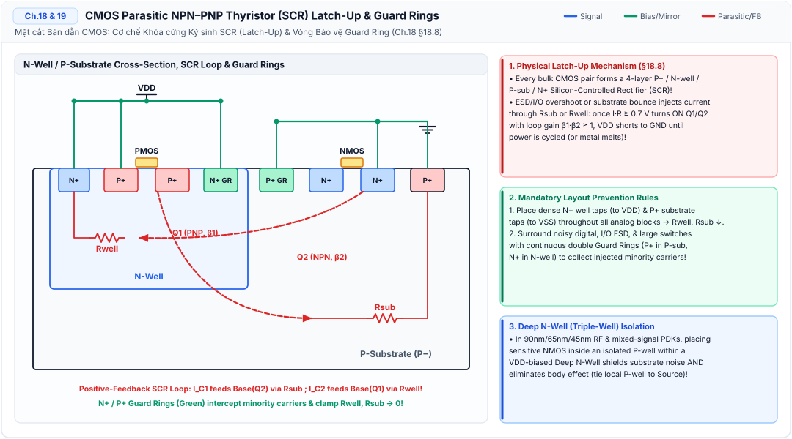

---
{
  "id": "skill-post-layout-pex-drc-lvs-debug",
  "kind": "skill",
  "domain": "eda-and-github-skills",
  "title_vi": "Gỡ lỗi Kiểm chứng Vật lý DRC / LVS & Cô lập Điểm Nghẽn Ký sinh Sau Layout (PEX) Trên Cadence IC617",
  "title_en": "Physical Verification (DRC / LVS) & Post-Layout Parasitic Extraction (PEX) Bottleneck Isolation in Cadence IC617",
  "summary": "Quy trình thực chiến gỡ lỗi nhanh sai khác LVS (Assura / PVS / Calibre) và chẩn đoán suy giảm hiệu năng sau trích xuất ký sinh RC/RCC (Quantus QRC / Calibre xRC) trên Cadence Virtuoso IC617: xử lý tận gốc 6 lỗi bất khớp LVS kinh điển (ngắn mạch giếng/đế, thiếu tiếp xúc tap, lệch qui tắc gộp m vs fingers, chập dummy), chiến lược cô lập nhị phân bằng Hierarchy Editor (config view) kết hợp ma trận 4 chế độ trích xuất {Schematic, C-only, R-only, RCC} để chỉ điểm chính xác thủ phạm gây sụt dự trữ pha, tăng nhiễu, lệch offset hay tụt biên độ dao động.",
  "diagram": "../../diagrams/latchup-and-guard-rings.svg",
  "razavi_refs": [
    {
      "chapter": 18,
      "section": "18.7-18.8",
      "pages": "721-731",
      "equations": ["18.1", "18.5", "18.6", "18.8", "18.11"]
    },
    {
      "chapter": 19,
      "section": "19.1-19.4",
      "pages": "735-772",
      "equations": ["19.4", "19.9", "19.11", "19.14", "19.17", "19.23"]
    }
  ],
  "github_refs": [
    {
      "repo": "ucb-art/BAG_framework",
      "url": "https://github.com/ucb-art/BAG_framework",
      "use": "Vòng lặp định cỡ đóng nhận biết ký sinh layout (parasitic-aware sizing) và tự động hóa kiểm chứng LVS/RCX trên OpenAccess IC617"
    },
    {
      "repo": "iic-jku/IIC-OSIC-TOOLS",
      "url": "https://github.com/iic-jku/IIC-OSIC-TOOLS",
      "use": "Đối chiếu quy trình kiểm chứng vật lý toàn phần DRC -> LVS -> RC PEX -> Post-Layout Regression trước khi gửi chế tạo"
    },
    {
      "repo": "Arcadia-1/analog-agents",
      "url": "https://github.com/Arcadia-1/analog-agents",
      "use": "Danh mục kiểm toán chéo so sánh độ lệch thông số trước và sau trích xuất ký sinh layout (Pre-Layout vs Post-Layout Audit)"
    },
    {
      "repo": "Arcadia-1/virtuoso-bridge-lite",
      "url": "https://github.com/Arcadia-1/virtuoso-bridge-lite",
      "use": "Quản lý cấu hình view chuyển mạch phân cấp (schematic vs av_extracted) và đối chiếu kết quả mô phỏng Spectre"
    }
  ],
  "glossary_codes": [
    "T103",
    "T366",
    "T652",
    "T660",
    "T689",
    "T2188",
    "T2190",
    "T2191",
    "T2192",
    "T2193",
    "T2197",
    "T2198"
  ],
  "process_agnostic": true,
  "roles": {
    "drc_erc_gatekeeper": "Bộ kiểm tra quy tắc hình học và điện học (DRC/ERC) xác nhận khoảng cách quang khắc tối thiểu, mật độ phủ kim loại, diện tích anten và không có cực cổng hay giếng nào bị bỏ nổi",
    "lvs_graph_isomorphism": "Bộ đối sánh đẳng cấu đồ thị mạch nguyên lý – mặt bằng (LVS: Assura/PVS/Calibre) xác minh 100% linh kiện, mạng kết nối, cực thân (bulk) và tham số W/L/M khớp giữa Schematic và Layout",
    "qrc_parasitic_extractor": "Công cụ giải trường điện từ 2.5D/3D (Quantus QRC / Assura RCX / Calibre xRC) trích xuất mạng điện trở dây/via R_p, tụ xuống đất C_gnd và tụ ghép chéo giữa các dây C_couple thành cellView av_extracted",
    "hierarchy_config_isolator": "Trình quản lý cấu hình phân cấp Cadence Hierarchy Editor (view config) cho phép bật/tắt ký sinh từng khối con độc lập để khoanh vùng chính xác khối làm hỏng chỉ tiêu toàn mạch"
  },
  "symptoms_addressed": [
    "lvs-fails-with-hundreds-of-phantom-net-and-instance-mismatches-caused-by-a-single-power-ground-or-well-short",
    "lvs-reports-property-error-between-multi-finger-layout-abutment-and-schematic-m-vs-fingers-definition",
    "post-layout-ota-phase-margin-collapses-by-25-degrees-and-gbw-drops-30-percent-with-unknown-culprit-node",
    "post-layout-bandgap-or-current-mirror-shifts-by-15-mv-due-to-unaccounted-metal-ir-drop-and-lod-wpe-params",
    "vco-oscillation-frequency-drops-15-percent-or-fails-startup-after-rcx-extraction"
  ],
  "limitations": [
    "quasi-static-rc-extraction-qrc-is-insufficient-for-spiral-inductors-and-mmwave-lines-which-require-full-wave-em-extraction",
    "full-rcc-extracted-netlists-can-multiply-matrix-node-count-by-20x-to-100x-requiring-aps-and-selective-block-extraction",
    "double-counting-transistor-intrinsic-finger-parasitics-occurs-if-rcx-deck-settings-do-not-match-bsim4-model-flags"
  ],
  "checklists": [
    "common-mos",
    "layout-and-matching",
    "feedback-and-stb",
    "esd-pad-and-substrate"
  ]
}
---

## 1. Tại sao Mạch Chạy Đẹp Trên Schematic Lại Chết Sau Khi Trích Xuất Ký Sinh (`PEX`)?

Trong quy trình thiết kế vi mạch tương tự thực tế trên **Cadence Virtuoso IC617**, hoàn thành mô phỏng trên `schematic` mới chỉ đi được **50% chặng đường**. Một mạch Op-Amp đạt $\text{PM} = 65^\circ$, một SAR ADC đạt $\text{ENOB} = 11{,}2\text{ bit}$, hay một LC-VCO dao động đúng $2{,}40\text{ GHz}$ trên sơ đồ nguyên lý hoàn toàn có thể rơi vào tự kích dao động ($\text{PM} = 18^\circ$), tụt xuống $\text{ENOB} = 8{,}4\text{ bit}$, hoặc lệch hẳn tần số xuống $2{,}05\text{ GHz}$ không thể bắt khóa PLL ngay ở lần chạy mô phỏng đầu tiên trên `av_extracted` (sau khi qua kiểm chứng **DRC -> LVS -> RCX/QRC PEX**)!



Nguyên nhân cốt lõi nằm ở chỗ `schematic` coi mọi đường dây nối là những nút đẳng thế toán học có **$R_{\text{wire}} = 0\text{ }\Omega$, $C_{\text{wire-gnd}} = 0\text{ fF}$, $C_{\text{couple}} = 0\text{ fF}$**, đồng thời đặt các tham số khoảng cách ứng suất rãnh nông STI (`sa`, `sb`) và bờ giếng (`sca`, `scb`, `scc`) ở giá trị mặc định đối xứng lý tưởng! Khi công cụ trích xuất như **Cadence Assura RCX / Quantus QRC** hoặc **Mentor Calibre xRC** bóc tách hình học thực tế (Razavi Chương 18 §18.7.3 & Chương 19 §19.2–§19.4), một khối mạch chỉ gồm $50$ transistor có thể biến thành một mạng khổng lồ gồm **$50$ transistor (với tham số LOD/WPE thực) + $3.000$ điện trở chia đoạn dây/via + $5.000$ tụ điện ký sinh nối đất và nối chéo**! Nếu không có phương pháp gỡ lỗi LVS có hệ thống và kỹ thuật **cô lập trực giao từng loại ký sinh**, người thiết kế sẽ bị nhấn chìm trong hàng nghìn phần tử ký sinh `rcx_...` mà không biết phải sửa sợi dây nào trên layout!

---

## 2. Cơ chế Toán học Của Bốn "Sát thủ" Ký Sinh Sau Layout (`The Four PEX Killers`)

Mọi sự suy giảm hiệu năng sau layout đều quy về một (hoặc tổ hợp) của **4 cơ chế vật lý định lượng** dưới đây (Razavi §18.7.3, Phương trình 18.5–18.11 & §19.2.5–§19.2.7, Phương trình 19.11–19.14):

### 2.1. Sát thủ #1 — Điện dung Dây Xuống Đất/Đế ($C_{\text{wire,gnd}}$) Hạ Thấp Cực Phụ & Lệch Tần số Cộng hưởng
Một đường dây kim loại tầng trung gian rộng $W_m$, dài $\ell$ không chỉ có tụ bản phẳng theo diện tích $W_m \ell$ mà còn chịu **điện dung trường rìa hai cạnh bên (`fringing capacitance`)** lớn tương đương hoặc gấp đôi tụ diện tích (điển hình tổng điện dung đơn vị chiều dài ở công nghệ $90\text{ nm}/65\text{ nm}$ cỡ **$0{,}15\text{–}0{,}25\text{ fF/}\mu\text{m}$**!):
- Một sợi dây dài chỉ $120\text{ }\mu\text{m}$ nối tại nút gập $X$ của Folded-Cascode OTA cộng thêm $\Delta C_X \approx 25\text{ fF}$ — nếu tổng tụ bản thân transistor tại nút gập vốn chỉ là $35\text{ fF}$, cực không trội $\omega_{p,\text{fold}} = g_{m,\text{cas}}/(C_X + \Delta C_X)$ lập tức **tụt mất $42\%$**, ăn lẹm $15^\circ\text{–}20^\circ$ dự trữ pha!
- Trong LC-VCO ở $5\text{ GHz}$ dùng cuộn cảm $L = 1\text{ nH}$ (tổng tụ cộng hưởng chỉ $\sim 1{,}0\text{ pF}$!), chỉ riêng cặp dây nối dài $150\text{ }\mu\text{m}$ từ cặp ghép chéo tới cuộn cảm và ngân hàng tụ đã cộng thêm $60\text{–}100\text{ fF}$ cố định, kéo sụt tần số cộng hưởng đi $4\%\text{–}8\%$ và ăn mất một nửa ngân sách dải điều chỉnh!

### 2.2. Sát thủ #2 — Tụ Ghép Chéo Giữa Hai Dây Song song ($C_{\text{couple}}$) Bị Nhân Miller Hoặc Phá Hủy Tỉ số CDAC
Khi hai đường kim loại cùng tầng chạy song song sát nhau ở khoảng cách tối thiểu $s_{\min}$ trên chiều dài $\ell$ (ở công nghệ nanomet dây kim loại có mặt cắt **cao và hẹp — tall aspect ratio** $H_m / W_m \approx 1{,}8\text{–}2{,}2$), tụ ghép ngang giữa hai thành đứng $C_{\text{couple}}$ còn lớn hơn cả tụ xuống đất!
- **Nhân tụ Miller & Zero nửa mặt phẳng phải:** Chỉ $2\text{ fF}$ tụ ghép chéo vô tình giữa dây đầu vào `VIN` và dây ngõ ra tầng khuếch đại độ lợi $-80\text{ V/V}$ sẽ biến thành **$2 \times 81 = 162\text{ fF}$** điện dung tải đầu vào!
- **Sai số trọng số bit phi tuyến trong SAR CDAC:** Trong mảng tụ SAR $12\text{-bit}$ dùng tụ đơn vị $C_u = 2\text{ fF}$, chỉ cần $0{,}15\text{ fF}$ tụ ký sinh ghép bất đối xứng từ dây điều khiển số hoặc giữa tấm đáy bit $k$ với tấm đỉnh `VTOP` đã tạo sai số trọng số lớn hơn nhiều LSB, đục thủng đường cong DNL/INL gây mất mã (`missing codes`)!

### 2.3. Sát thủ #3 — Điện trở Dây Nối Tiếp & Cụm Via ($R_{\text{wire}} + R_{\text{via}}$) Gây Rơi Áp $I R$, Tăng Nhiễu & Trễ Elmore
Lớp kim loại thấp `M1/M2` mỏng có điện trở tấm $R_{\square} \approx 0{,}08\text{–}0{,}15\text{ }\Omega/\square$, mỗi lỗ via đơn lẻ đóng góp $R_{\text{via}} \approx 1\text{–}5\text{ }\Omega$, còn dải polysilicon không phủ silicua (hoặc cổng mảnh dài) lên tới hàng chục $\Omega/\square$:
- **Rơi áp DC $I R$ giết chết gương dòng & Bandgap (`T2197`):** Dòng tổng $5\text{ mA}$ chạy qua đoạn dây đất `VSS` hẹp có điện trở chỉ **$0{,}6\text{ }\Omega$** tạo độ chênh thế đất $\Delta V_{SS} = 3{,}0\text{ mV}$! Nếu nhánh chuẩn gương dòng hoặc chân BJT của Bandgap nối chung vào đường đất đó, $3\text{ mV}$ này biến thẳng thành lệch $\Delta V_{BE}$ (nhân $10\times$ lên ngõ ra Bandgap thành **$30\text{ mV}$ sai số**!) hoặc làm lệch $6\%\text{–}10\%$ dòng sao chép!
- **Điện trở nối tiếp cực cổng $R_G$ & Trễ RC phân bố Elmore:** Điện trở cổng + via đầu cổng tiêm trực tiếp nhiễu nhiệt trắng $4kT R_G$ ngay trước $g_{m1}$ của LNA/OTA/Comparator; đồng thời đường xung nhịp dài có hằng số thời gian Elmore $\tau_D \approx \frac{1}{2} R_{\text{unit}} C_{\text{unit}} \ell^2$ làm tù sườn xung và ăn mòn khoảng không chồng lấn $\phi_{1e}/\phi_1$!

### 2.4. Sát thủ #4 — Tham số Ứng suất Lân cận Hình học Thực (`LOD / WPE`) Trong Bản Trích xuất LVS
Ngay cả khi bạn tắt hết $R$ và $C$ dây nối (`No-RC LVS-extracted netlist`), dòng gọi MOSFET trong netlist sau layout vẫn mang bộ tham số đo thực từ mặt bằng (`sa`, `sb`, `sd`, `sca`, `scb`, `scc`, diện tích/chu vi `ad`, `as`, `pd`, `ps`). Nếu người vẽ layout quên ngón dummy ở một phía hoặc đặt mép giếng N lệch, sự dịch chuyển $V_{TH}$ và $\mu_{\text{eff}}$ xuất hiện tức thì ngay ở mô phỏng DC điểm làm việc!

---

## 3. Quy tắc Gỡ Lỗi Nhanh 6 Bệnh LVS Kinh Điển & Các Bẫy Trích Xuất PEX

### 3.1. Sáu Nguyên tắc Gỡ Lỗi LVS Trong 5 Phút (Assura / PVS / Calibre RVE)
- **[INV-LVS-01] Khi LVS Báo Hàng Trăm Lỗi Sai Mạng — LUÔN SỬA LỖI CHẬP NGUỒN/ĐẤT (`Shorts`) ĐẦU TIÊN!** Nếu bạn vô tình để một mẩu kim loại nhỏ chập `VDD` vào `VSS` (hoặc chập hai mạng phân cực lớn), thuật toán đẳng cấu đồ thị gộp hai nút khổng lồ thành một siêu nút, kéo theo hàng trăm transistor liên quan bị báo sai kết nối dây chuyền! Tuyệt đối đừng đọc danh sách lỗi instance khi vẫn còn báo `Shorted Nets` — hãy dùng công cụ `Short Locator / Probe` tìm điểm giao nhau giữa hai mạng nguồn để cắt đứt điểm chập, $99\%$ lỗi còn lại sẽ tự biến mất!
- **[INV-LVS-02] Sửa Lỗi Bất Khớp Tham Số Gộp Ngón (`Property Mismatch: m vs fingers / w`):** Trên Schematic bạn đặt `w = 2u, fingers = 1, m = 4`, nhưng trên Layout bạn ghép chung vùng khuếch tán thành một dải 4 ngón (`w_tot = 8u, nf = 4, m = 1`). Tùy cấu hình `combine parallel MOSFETs` trong rule deck LVS, Assura/Calibre có thể so sánh tổng $W_{\text{tot}}$ hoặc so sánh nghiêm ngặt từng cặp `(w, nf)`. Quy tắc sạch nhất: đồng bộ Schematic dùng đúng `fingers = 4, m = 1` khớp 1-đối-1 với hình học từng dải liên tục trên Layout!
- **[TRAP-LVS-01] Bẫy Chập Mềm Cực Thân (`Soft-Connect / Missing Well or Substrate Stamp Error`):** Toàn bộ dây kim loại đều đúng nhưng LVS báo cực thứ tư (`B` — Bulk) của NMOS nối vào ` floating substrate` hoặc hai giếng N riêng biệt bị nhận nhầm là nối chung! Nguyên nhân: quên đặt vòng tiếp xúc `ptap` (nối kim loại gắn nhãn `VSS!`) cho đế p hoặc quên đặt `ntap` bên trong một đảo giếng N riêng biệt (như cặp đầu vào PMOS nối nguồn vào thân `S=B`!).
- **[TRAP-LVS-02] Bẫy Mất Điện trở Nối tiếp Hoặc Mất Dummy Do Quy tắc Rút gọn (`Series/Parallel Reduction & Dummy Filtering`):** Mạng $4$ thanh điện trở đơn vị mắc nối tiếp trên Schematic nhưng trên Layout nối bằng kim loại qua đầu thanh được LVS rút gọn thành $1$ điện trở tổng $4 R_u$ (hoặc ngược lại bị tách vì có nhánh rẽ đo áp!). Hãy kiểm tra cờ rút gọn linh kiện nối tiếp/song song và luôn khai báo tường minh cả các transistor dummy (`G=S=D`) trong Schematic để đồ thị hai bên đẳng cấu tuyệt đối không phụ thuộc bộ lọc dummy!
- **[TRAP-PEX-01] Bẫy Đếm Đôi Ký sinh Nội tại (`Double-Counting Intrinsic Gate/Diffusion R & C`):** Nếu mô hình BSIM4 trong PDK đã bật sẵn mô hình điện trở cổng nội tại (`rgatemod > 0`) và tụ tiếp giáp `ad/as/pd/ps`, mà bạn lại cấu hình QRC trích xuất thêm điện trở tấm dọc trên mặt cổng poly chồng lên kênh dẫn mà không tắt cờ tương ứng của deck PDK, $R_G$ và $C_{DB}$ sẽ bị **tính hai lần**! Luôn sử dụng đúng tệp cấu hình `qrcTechFile` và chế độ `MOS Gate Resistance / Diffusion` chuẩn do nhà máy đúc quy định cho đúng bộ model Spectre của PDK đó!

---

## 4. Phương pháp Cô lập Ma trận $2 \times 2$ Kết hợp Phân Đôi Phân cấp (`Binary-Search PEX Debug`)

Khi mạch tổng thể thất bại trên `av_extracted`, **tuyệt đối không đoán mò rồi đi sửa lại toàn bộ layout**! Hãy thực hiện quy trình khoanh vùng 2 chiều khoa học sau đây trên Cadence IC617:

### Chiều thứ nhất — Tách riêng Bản chất Vật lý Ký sinh Bằng 4 Chế độ Chạy QRC Trên Khối Đang Lỗi
| Chế độ trích xuất PEX | Phần tử được thêm vào so với Schematic | Nếu thông số sập ngay ở bước này $\implies$ Thủ phạm 100% là: | Hành động sửa Layout trực tiếp |
|---|---|---|---|
| **0. `LVS-Extracted (No RC)`** | Chỉ cập nhật hình học thực `ad/as/pd/ps` và `sa/sb/sca/scb/scc` (LOD/WPE) | Bất đối xứng môi trường rìa STI, thiếu dummy hoặc đặt sát mép giếng N làm lệch $V_{TH}, g_m, I_D$ | Bổ sung ngón dummy hai đầu OD, nới rộng giếng N cách OD $\ge 2\text{ }\mu\text{m}$, đồng nhất số ngón đơn vị |
| **1. `C-Only` (Coupled / Grounded C)** | Cộng toàn bộ $C_{\text{gnd}}$ và $C_{\text{couple}}$ dây nối (giữ $R_{\text{wire}} = 0$) | Quá tải điện dung nút cực phụ, nhân tụ Miller đường hồi tiếp chéo, hoặc lệch tỉ số tụ mảng CDAC/SC | Rút ngắn dây nút trở kháng cao, tách xa hai dây song song, nâng dây nhạy lên kim loại cao hơn và kẹp dây chắn đất `Shield` |
| **2. `R-Only`** | Cộng toàn bộ $R_{\text{wire}}$ và $R_{\text{via}}$ (giữ $C_{\text{wire}} = 0$) | Rơi áp $I R$ trên đường nguồn/đất gương dòng/Bandgap, $R_{\text{on}}$ dây công suất LDO, hoặc $R_G$ cổng gây nhiễu nhiệt! | Mở rộng gấp $3\text{–}5\times$ bề rộng dây nguồn/đất, đi dây cảm biến Kelvin 4 đầu, nối cổng transistor ở cả hai đầu kèm nhân đôi số via |
| **3. `Full RC / RCC`** | Đầy đủ mạng phân bố $R + C_{\text{gnd}} + C_{\text{couple}}$ | Tương tác hằng số thời gian dây phân bố $\tau = R_{\text{wire}} C_{\text{wire}}$ làm trễ pha đường xung nhịp hoặc tạo cực–zero ký sinh | Đệm lặp xung nhịp cục bộ, nâng đường xung nhịp tốc độ cao lên tầng kim loại dày điện trở thấp (`Top/Upper Metal`) |

### Chiều thứ hai — Chia Đôi Phân cấp Bằng `Hierarchy Editor` (`config` View) Của Virtuoso IC617
Khi thiết kế gồm nhiều khối con (`X_BIAS`, `X_OTA_CORE`, `X_CMFB`, `X_CLKGEN`, `X_CDAC`):
1. Tạo một cellView loại **`config`** (`New -> CellView -> Type: config`, chọn `Top Cell = tb_top`, dùng template `spectre`).
2. Trong bảng `Cell Bindings` của **Hierarchy Editor**, giữ tất cả các khối con ở `View To Use = schematic`, chỉ chuyển **từng khối một** sang `av_extracted` (bấm `Update` + chạy lại Spectre)!
3. Chỉ sau $\log_2(K)$ hoặc $K$ lần chạy nhanh, bạn chỉ đích danh khối con nào (ví dụ riêng `X_CMFB` chiếm $85\%$ độ sụt dự trữ pha!) chịu trách nhiệm cho sự suy giảm!

---

## 5. Thích ứng Đa Tiến trình (180nm–45nm) & Kịch bản Kiểm Toán Biến thiên Hậu PEX

### 5.1. Sự Đảo Ngược Cán Cân Ký Sinh Khi Thu Nhỏ Công Nghệ Xuống 65nm / 45nm
- **Ở 180nm:** Chiều rộng rãnh kim loại lớn ($\ge 0{,}28\text{ }\mu\text{m}$), điện dung bản thân của transistor ($C_{GS}, C_{DB}$) rất lớn so với tụ dây nối ngắn $\implies$ độ sụt GBW/PM sau PEX thường chỉ $5\%\text{–}12\%$.
- **Ở 65nm / 45nm:** Điện dung cổng transistor co nhỏ cực nhanh giúp $f_T$ vọt lên $> 150\text{ GHz}$, **NHƯNG** dây kim loại tầng thấp (`M1–M3`) bị bóp cực hẹp làm điện trở dây $R_{\text{wire}}$ tăng vọt theo nghịch đảo tiết diện và tụ ghép vách bên $C_{\text{couple}}$ giữ nguyên không giảm! Hệ quả là ở 65nm/45nm, **ký sinh dây nối chiếm tới $40\%\text{–}70\%$ tổng điện dung nút nội**! Khi định cỡ schematic ban đầu ở 65nm/45nm (theo phương pháp `BAG` parasitic-aware sizing), bắt buộc cộng dự phòng sẵn $C_{\text{wire,est}} \approx 15\%\text{–}30\%$ vào các nút cực phụ và đặt mục tiêu $\text{PM}_{\text{pre-layout}} \ge 65^\circ\text{–}70^\circ$ để sau PEX vẫn còn chắc chắn $\ge 55^\circ\text{–}60^\circ$!

### 5.2. Kịch bản OCEAN Chạy So Sánh Tự động `schematic` Đối Chiếu `av_extracted` (`pex_delta_audit.ocn`)
```lisp
;;; pex_delta_audit.ocn — Automated Pre-Layout vs Post-Layout Regression in IC617 OCEAN
simulator('spectre)

procedure(saRunStbOnView(lib tbCell configOrSchView runDir)
  let((pm gm ugf a0)
    design(lib tbCell configOrSchView)
    resultsDir(runDir)
    analysis('dc ?saveOppoint t)
    analysis('stb ?start "1" ?stop "10G" ?dec "30" ?probe "/IPROBE0")
    run()
    selectResult("stb-margin.stb")
    pm  = getData("phaseMargin")
    gm  = getData("gainMargin")
    selectResult("stb-stb")
    a0  = value(db20(getData("loopGain")) 1.0)
    ugf = cross(db20(getData("loopGain")) 0.0 1 "falling")
    list(a0 ugf pm gm)
  )
)

pre  = saRunStbOnView("WorkLib" "tb_ota" "config_pre_sch"  "./sim/pre_sch")
post = saRunStbOnView("WorkLib" "tb_ota" "config_post_pex" "./sim/post_pex")

printf("=== BAO CAO DOI CHIEU PRE-LAYOUT VS POST-LAYOUT PEX ===\n")
printf("A0  [dB]  : Pre = %7.2f | Post = %7.2f | Delta = %+6.2f dB\n" nth(0 pre) nth(0 post) nth(0 post)-nth(0 pre))
printf("UGF [MHz] : Pre = %7.2f | Post = %7.2f | Ratio = %6.1f %%\n" nth(1 pre)/1e6 nth(1 post)/1e6 100.0*nth(1 post)/nth(1 pre))
printf("PM  [deg] : Pre = %7.2f | Post = %7.2f | Delta = %+6.2f deg\n" nth(2 pre) nth(2 post) nth(2 post)-nth(2 pre))
exit()
```

### 5.3. Bảng Tiêu Chuẩn Chấp Nhận (`Sign-Off Gate`) Cho Kiểm Chứng Vật Lý & Hậu PEX
```text
[1] DRC & Antenna Sign-off:   0 lỗi DRC bắt buộc, 0 lỗi Antenna, 0 lỗi mật độ kim loại cục bộ
[2] ERC & Well Bias Audit:    0 cổng MOS lơ lửng, 0 giếng/đế nối mềm thiếu tiếp xúc kim loại
[3] LVS Cleanliness:          Netlists Match 100% (0 lỗi property W/L/nf/m, 0 port mismatch)
[4] Độ sụt băng thông PEX:    |UGF_post - UGF_pre| / UGF_pre <= 20% (nếu >25% phải kiểm toán dây nút cực phụ!)
[5] Dự trữ pha sau PEX + PVT: min_{PVT}(PM_post_RCC) >= 52 deg (cho OTA/LDO) & không đổi dấu offset hệ thống
```

---

## 6. Đối chiếu Sách Razavi, Nguồn GitHub Đã Kiểm định & Bảng Thuật ngữ Chuẩn CLB

### 6.1. Mốc Tọa độ Chính xác Trong Sách Razavi (2nd Edition) & Kho GitHub
- **Razavi Chương 18 & 19:** §18.7.3 *Interconnects* — điện trở tấm kim loại, điện dung bản phẳng + trường rìa và tụ ghép giữa hai dây song song (tr. 727–730, Phương trình 18.5–18.11, Ví dụ 18.3), §18.8 *Latch-Up* (tr. 730–731), §19.1.2 *Antenna Effect* (tr. 736–738), §19.2.5 *Interconnect Parasitics* & §19.2.7 *Symmetry and Routing* (tr. 744–746, 753–757, Phương trình 19.14), §19.4 *Packaging* — cảm kháng dây hàn chân vỏ $L_{\text{bond}}$ và nảy đất $L\,di/dt$ khi đóng gói (tr. 764–772, Phương trình 19.17, 19.23).
- **Đối chiếu Nguồn Mở Đã Kiểm Định:**
  - `ucb-art/BAG_framework` (`daf4b0aaa72f`, BSD-3-Clause): Quy trình tự động chạy LVS/RCX và phản hồi ký sinh thực quay lại bước định cỡ trên nền Cadence IC617.
  - `iic-jku/IIC-OSIC-TOOLS` (`f15ef6a303ef`, Apache-2.0) & `Arcadia-1/analog-agents` (`4d6bd218ceff`): Chuẩn hóa chuỗi kiểm chứng DRC/LVS/PEX và bảng kiểm toán độ lệch trước–sau layout.

### 6.2. Bảng Thuật ngữ Chuẩn CLB Vi Mạch Sử dụng trong Thẻ
| Mã CLB | Thuật ngữ Tiếng Anh | Thuật ngữ Tiếng Việt Chuẩn | Ý nghĩa Kỹ thuật Cốt lõi |
|---|---|---|---|
| `T652` / `T103` | parasitics / parasitic capacitances | các thành phần ký sinh / các điện dung ký sinh | Tập hợp $C_{\text{gnd}}, C_{\text{couple}}$ của mạng kim loại cộng dồn lên các nút nội mạch sau layout |
| `T689` | parasitic resistance | điện trở ký sinh | Điện trở phân bố của dây nối, lỗ via và cực cổng gây sụt áp DC $I R$, nhiễu nhiệt và trễ RC |
| `T2192` | antenna effect | hiệu ứng anten trong chế tạo | Tích tụ điện tích plasma trên dây kim loại hở trong lúc khắc làm suy giảm hoặc thủng oxit cực cổng |
| `T2198` | bondwire inductance and ground bounce | điện cảm dây hàn chân vỏ và nảy đất $L\,di/dt$ | Thành phần ký sinh cấp vỏ chip bắt buộc cộng nối tiếp vào nguồn/đất khi hậu kiểm khối công suất/RF/ADC |
