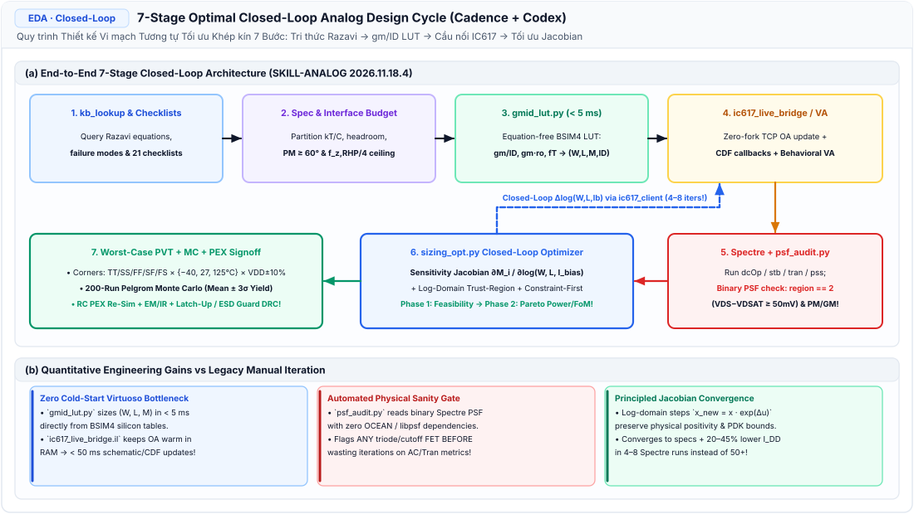

---
{
  "id": "skill-psf-mos-op-waveform-and-spec-auditor",
  "kind": "skill",
  "domain": "eda-and-github-skills",
  "title_vi": "Giải mã Spectre 15.1 PSF ASCII Toàn diện & Kiểm toán Tự động Điểm làm việc MOS, Dạng sóng, Đa Góc PVT theo spec.json",
  "title_en": "Full Spectre 15.1 PSF ASCII State-Machine Parser (STRUCT OP, TRACE GROUP & Delta Waveforms) & Automated Spec Auditor",
  "summary": "Playbook kỹ thuật cho cặp công cụ tools/psf_ascii_reader.py và tools/psf_audit.py (tương thích kép Python 2.6.6 & Python 3, 0 gói ngoài): giải mã trọn vẹn cấu trúc STRUCT BSIM4 trong dcOpInfo.info, bảng ánh xạ TRACE GROUP và sóng nén sai phân giữ bậc trong tran.tran/pss, kiểm toán tự động vùng bão hòa region==2 và biên dự trữ |VDS|-|Vdsat| qua mọi góc PVT, đồng thời chấm đạt/trượt minh bạch đối chiếu hợp đồng spec.json.",
  "diagram": "../../diagrams/closed-loop-cadence-codex-flow.svg",
  "razavi_refs": [
    {
      "chapter": 2,
      "section": "2.2.2-2.4.2",
      "pages": "16-31",
      "equations": ["2.11", "2.27", "2.36"]
    },
    {
      "chapter": 8,
      "section": "8.5, 8.8",
      "pages": "301-334",
      "equations": ["8.68", "8.184"]
    },
    {
      "chapter": 10,
      "section": "10.1-10.3, 10.6",
      "pages": "410-420, 439-446",
      "equations": ["10.2", "10.14", "10.36"]
    },
    {
      "chapter": 11,
      "section": "11.4-11.6",
      "pages": "466-507",
      "equations": ["11.6", "11.14"]
    }
  ],
  "github_refs": [
    {
      "repo": "KenKundert/psf_utils",
      "url": "https://github.com/KenKundert/psf_utils",
      "use": "Đặc tả chính thống các phân đoạn HEADER, TYPE, SWEEP, TRACE, VALUE và số phức trong tệp Spectre PSF ASCII"
    },
    {
      "repo": "ToonBettens/psf-parser",
      "url": "https://github.com/ToonBettens/psf-parser",
      "use": "Thuật toán máy trạng thái thuần Python giải mã cấu trúc phức hợp STRUCT và nhóm tín hiệu TRACE GROUP"
    },
    {
      "repo": "Arcadia-1/virtuoso-bridge-lite",
      "url": "https://github.com/Arcadia-1/virtuoso-bridge-lite",
      "use": "Quy chuẩn trích xuất chỉ số AC/STB/Tran nghiêm ngặt, chống đọc nhầm bus thoát ký tự và chống khử lỗi câm lặng"
    },
    {
      "repo": "Arcadia-1/analog-design-bench",
      "url": "https://github.com/Arcadia-1/analog-design-bench",
      "use": "Cấu trúc hợp đồng chấm điểm tách bạch điều kiện bão hòa DC với ma trận chỉ tiêu động đa góc PVT"
    }
  ],
  "glossary_codes": ["T051", "T063", "T079", "T394", "T1851", "T2186", "T2276"],
  "process_agnostic": true,
  "roles": {
    "psf_state_machine": "Trình phân tích tools/psf_ascii_reader.py duyệt tuần tự 5 khối HEADER -> TYPE -> SWEEP -> TRACE -> VALUE, dựng lược đồ trường STRUCT và bảng giải nén GROUP",
    "mos_op_auditor": "Lệnh con psf_audit.py op-audit kiểm toán toàn bộ MOSFET trong dcOpInfo.info, tính gm/ID, gm/gds, Vov, biên bão hòa |VDS|-|Vdsat| và gắn cờ ngay linh kiện rơi vào cắt/triode",
    "waveform_metric_extractor": "Lệnh con psf_audit.py metrics giải mã stb.stb (unwrapped phase loopGain), ac.ac, tran.tran và các thư mục con quét góc sw*.sweep*",
    "spec_contract_judge": "Bộ đánh giá đối chiếu từng chỉ số đo thực tế với ngưỡng min/max trong spec.json, xuất kết luận ba trạng thái trung thực PASS / FAIL / NOT_VERIFIED"
  },
  "symptoms_addressed": [
    "naive-psf-reader-crashes-on-bsim4-struct-tuple-in-dcopinfo-info",
    "transient-waveforms-stored-under-numeric-group-id-401-with-mismatched-time-length",
    "cascode-or-tail-transistor-silently-enters-triode-at-ss-corner-while-ac-gain-still-looks-positive",
    "phase-wrapping-around-180-deg-corrupts-automated-stb-phase-margin-calculation"
  ],
  "limitations": [
    "requires-psfascii-output-format-or-prior-conversion-via-mmsim-psf-binary-utility",
    "oscillatory-or-multi-crossing-nyquist-loops-require-full-trajectory-check-beyond-first-ugf",
    "subcircuit-wrapped-mosfets-may-nest-bsim4-instances-one-hierarchy-level-deeper"
  ],
  "checklists": ["closed-loop-sizing-and-signoff", "common-mos", "feedback-and-stb"]
}
---

## 1. Ba Hố Đen Của Định dạng Spectre 15.1 PSF ASCII Khiến Bộ Đọc Sơ Khai Sụp Đổ

Trong chu trình thiết kế tương tự khép kín trên máy chủ RHEL 6.5 (`Python 2.6.6`, Cadence Spectre 15.1), chạy mô phỏng bằng cờ `-format psfascii` nhanh gấp $5\text{–}10$ lần so với khởi động OCEAN mỗi vòng lặp. Tuy nhiên, định dạng **Parameter Storage Format (PSF) ASCII** (`T2276`) của Spectre thực chất không phải là tệp bảng hai cột đơn giản, mà là một cơ sở dữ liệu phân cấp tự mô tả kiểu! Một bộ đọc chỉ dùng biểu thức chính quy quét phần `VALUE` sẽ lập tức vấp phải **ba hố đen dữ liệu nghiêm trọng**:

1. **Hố đen #1 — Kiểu Cấu trúc Đa Trường `STRUCT(...)` Trong `dcOpInfo.info`:** Khi lưu thông tin điểm làm việc của toàn bộ transistor (`dcOpInfo info what=oppoint where=rawfile`), Spectre định nghĩa trong khối `TYPE` một cấu trúc `bsim4` (hoặc `psp102`, `mos1`) gồm hàng chục trường hỗn hợp số nguyên và số thực (`"region" INT BYTE`, `"ids" FLOAT DOUBLE`, `"gm" FLOAT DOUBLE`, `"vdsat" FLOAT DOUBLE`...), sau đó trong khối `VALUE` ghi một bộ tuple kéo dài hàng chục dòng:
   `"M1" "bsim4" ( 2 1.004e-04 1.521e-03 ... ) PROP( ... )`
   Mọi bộ đọc chỉ chờ cặp `"tên" số_thực` đều nổ ngoại lệ `ValueError` và mù hoàn toàn trước `region`, `gm`, `gds`, `vth`, `vdsat`, `cgg`!
2. **Hố đen #2 — Bảng Ánh xạ Nhóm `TRACE GROUP` & Nén Sai phân Giữ bậc (`Step-Hold Delta Compression`) Trong `tran.tran` / `pss`:** Để tiết kiệm dung lượng ổ cứng, khối `TRACE` gom $N$ tín hiệu vào một mã nhóm ẩn danh (ví dụ `" 401" GROUP 4` chứa `"vout"`, `"vg_pass"`, `"iload"`, `"vin"`). Xuống khối `VALUE`, tại bước thời gian $t_k$, nếu chỉ có $1$ hoặc $2$ tín hiệu thay đổi vượt ngưỡng dung sai còn các tín hiệu kia đứng yên (như nguồn DC `vin`), Spectre **chỉ in các phần tử thay đổi hoặc bỏ qua cập nhật nhóm tĩnh**! Nếu bỏ qua khối `TRACE` và không thực hiện giải nén giữ giá trị bước trước (`step-hold`), bộ đọc sẽ lưu nhầm sóng dưới cái tên vô nghĩa `" 401"` và tạo ra các mảng ngắn hơn trục `"time"`, làm sai lệch hoàn toàn thời điểm cắt Slew Rate và Settling Time!
3. **Hố đen #3 — Gập Pha $\pm 180^\circ$ Trong `stb.stb` & Ký tự Thoát Bus `\<k\>`:** Tệp `stb.stb` lưu độ lợi vòng dưới dạng số phức `"loopGain" (Re Im)`. Nếu chỉ tính $\operatorname{atan2}(\text{Im}, \text{Re})$ thô mà không trải pha liên tục (`phase unwrapping`), bước nhảy từ $-179{,}9^\circ$ sang $+179{,}8^\circ$ sẽ đánh lừa bộ đo dự trữ pha (`T063`) rằng mạch có $\text{PM} > 180^\circ$ trong khi thực tế mạch đang tự dao động!



Cặp công cụ chuẩn **`tools/psf_ascii_reader.py`** (máy trạng thái giải mã cấp thấp) và **`tools/psf_audit.py`** (bộ kiểm toán vật lý MOS & đánh giá đặc tả cấp cao) giải quyết trọn vẹn cả ba bài toán trên bằng thư viện chuẩn Python thuần túy, chạy mượt đồng thời trên `/usr/bin/python` (`2.6.6`) của RHEL 6.5 lẫn Python `3.10+` trên máy trạm ngoài.

---

## 2. Kiến trúc Máy Trạng thái 5 Phân đoạn & Toán học Trích xuất Chỉ số Vật lý

### 2.1. Máy Trạng thái Giải mã PSF (`HEADER` $\to$ `TYPE` $\to$ `SWEEP` $\to$ `TRACE` $\to$ `VALUE`)
Dựa trên đặc tả của `KenKundert/psf_utils` và `ToonBettens/psf-parser`, `psf_ascii_reader.py` duy trì 3 bảng từ điển trạng thái xuyên suốt tệp:
- **Bảng Kiểu (`type_defs`):** Ánh xạ tên kiểu (ví dụ `"bsim4"`) sang danh sách có thứ tự các cặp `(field_name, scalar_kind)` bên trong `STRUCT( ... )`, kể cả `STRUCT` lồng nhau.
- **Bảng Vết (`trace_defs`):** Ánh xạ định danh nhóm (ví dụ `" 401"`) sang danh sách có thứ tự $N$ tên tín hiệu thực `["vout", "vfb", ...]`, đồng thời nhận diện biến quét độc lập trong khối `SWEEP` (ví dụ `"time"` hoặc `"freq"`).
- **Bộ Giải nén Giữ bậc (`Sweep Row Synchronizer`):** Mỗi khi gặp nhãn biến quét mới tại chỉ số bước $k$, bộ đồng bộ kiểm tra toàn bộ tín hiệu đã khai báo trong `TRACE`: bất kỳ tín hiệu nào không xuất hiện bản ghi cập nhật ở bước $k-1$ sẽ tự động kế thừa giá trị giữ bậc $y_i[k-1]$ từ bước liền trước, đảm bảo bất biến độ dài mảng tuyệt đối $\operatorname{len}(y_i) \equiv \operatorname{len}(x_{\text{sweep}})$!

### 2.2. Hệ Chỉ số Kiểm toán Điểm Làm việc MOSFET (`op-audit`)
Từ bản ghi `STRUCT` của mỗi transistor $M_k$ trong `dcOpInfo.info` (kể cả transistor bọc trong subcircuit của PDK như `XMPASS.M0`), `psf_audit.py op-audit` trích xuất bộ thông số cốt lõi và tính toán các biến bất biến thiết kế Razavi Chương 2 & Chương 11 (`CHK-OPT-05`):

$$
\left(\frac{g_m}{I_D}\right)_k = \frac{g_{m,k}}{|I_{D,k}|}, \qquad A_{\text{intr},k} = \frac{g_{m,k}}{g_{ds,k}}, \qquad V_{\text{OV,eff},k} = |V_{GS,k}| - |V_{TH,k}|, \qquad \Delta V_{\text{sat},k} = |V_{DS,k}| - |V_{DS,\text{sat},k}|
$$

Bảng phân loại mã vùng hoạt động chuẩn của BSIM4/Spectre được kiểm tra nghiêm ngặt theo vai trò mạch:
- `region == 0` (**Cutoff / Ngắt**): Lỗi nghiêm trọng (`ERROR`) trừ các nhánh khởi động đã tắt hoặc khóa công tắc đang mở.
- `region == 1` (**Triode / Tuyến tính**): Lỗi nghiêm trọng (`ERROR`) cho mọi transistor khuếch đại, gương dòng và cascode (chỉ cho phép nếu tên linh kiện được khai báo tường minh trong `--expect-triode`, ví dụ tải triode hoặc khóa công suất Buck/LDO ở chế độ dẫn sâu).
- `region == 2` (**Saturation / Bão hòa**): Trạng thái chuẩn; kiểm tra thêm điều kiện biên dự trữ $\Delta V_{\text{sat},k} \ge V_{\text{margin}}$ (mặc định $50\text{ mV}$, khuyến nghị $\ge 70\text{ mV}$ tại góc danh định TT để sống sót qua góc `SS 125 °C`).
- `region == 3` (**Subthreshold / Dưới ngưỡng**): Cảnh báo có điều kiện — hợp lệ cho cặp vi sai đầu vào tiết kiệm áp ($g_m/I_D \ge 20\text{ V}^{-1}$) miễn là $|V_{DS,k}| \ge 4 V_T \approx 105\text{ mV}$, nhưng cấm đối với gương dòng chính xác!

### 2.3. Trải Pha Liên tục Cho `stb.stb` & Công thức Chỉ tiêu Quá độ Trên `tran.tran`
Với hàm truyền vòng phức $L(j\omega_n) = \text{Re}_n + j\,\text{Im}_n$ đọc từ `stb.stb` (theo chuẩn Middlebrook/Spectre `iprobe`, nơi độ lợi vòng phản hồi âm bắt đầu quanh pha $0^\circ$ ở DC và tiến dần về $-180^\circ$, hoặc quanh $+180^\circ \to 0^\circ$ tùy chiều đặt `iprobe`), `psf_audit.py` tự động chuẩn hóa gốc pha DC và thực hiện trải pha liên tục qua từng điểm tần số:

$$
\phi_{\text{raw}}[n] = \operatorname{atan2}(\text{Im}_n, \text{Re}_n) \cdot \frac{180}{\pi}, \qquad \phi_{\text{unwrap}}[n] = \phi_{\text{unwrap}}[n-1] + \operatorname{wrap}_{(-180, 180]}\!\left(\phi_{\text{raw}}[n] - \phi_{\text{raw}}[n-1]\right)
$$

Nội suy tuyến tính theo trục $\log_{10}(f)$ tại điểm cắt biên độ $0\text{ dB}$ đầu tiên ($|L(j2\pi f_{\text{UGF}})| = 1$) và điểm cắt pha $-180^\circ$ đầu tiên ($f_{-180}$) cho kết quả chính xác đến $0{,}05^\circ$:

$$
\text{PM} = 180^\circ + \phi_{\text{unwrap}}(f_{\text{UGF}}), \qquad \text{GM}_{\text{dB}} = -20\log_{10}\left|L(j 2\pi f_{-180})\right|
$$

Trên sóng quá độ `tran.tran`, bốn phép đo động được định nghĩa chặt chẽ không mơ hồ:
- **Slew Rate dương/âm (`slew_rate_pos`, `slew_rate_neg`):** Độ dốc cát tuyến giữa ngưỡng $20\%$ và $80\%$ biên độ bước nhảy $\Delta V = V_{\text{final}} - V_{\text{init}}$.
- **Độ vọt lố phần trăm (`overshoot_pct`):** $100 \times \max(0, (V_{\text{peak}} - V_{\text{final}}) / \Delta V)$ theo chiều bước nhảy.
- **Thời gian xác lập cuối cùng (`settling_time_s`):** Duyệt **ngược từ cuối mảng thời gian về đầu** để tìm thời điểm cuối cùng $|V(t) - V_{\text{final}}| > \epsilon |\Delta V|$ (mặc định $\epsilon = 0{,}001$ tức $0{,}1\%$), tuyệt đối không lấy điểm cắt đầu tiên!
- **Độ gợn đỉnh–đỉnh xác lập (`ripple_pp`):** $\max(V) - \min(V)$ tính riêng trên cửa sổ $20\%$ thời gian cuối khi mạch DC-DC hoặc bơm điện tích đã vào xác lập tuần hoàn.

---

## 3. Bất biến Kiểm toán & Bẫy Đọc Kết quả Mô phỏng (Invariants & Traps)

- **[INV-PSF-01] Bất biến Phân cấp Cổng Kiểm tra (`DC Saturation Gate Before AC/Tran Gate`):** Khi đánh giá một lần chạy mô phỏng, nếu `op-audit` phát hiện transistor chủ chốt bị ngắt (`region == 0`) hoặc rơi vào triode ngoài ý muốn (`region == 1`), kết quả tổng thể của điểm thiết kế đó phải bị gắn cờ **`OP_VIOLATION`**, không được dùng các con số băng thông hay công suất thấp giả tạo (do mạch bị tắt một nửa!) để làm đầu vào khen thưởng cho bộ tối ưu hóa!
- **[INV-PSF-02] Bất biến Trạng thái Ba Giá trị (`PASS` / `FAIL` / `NOT_VERIFIED`):** Nếu hàm truyền vòng có độ lợi DC $A_0 < 0\text{ dB}$ nên không bao giờ cắt trục $0\text{ dB}$, cả `stb_ugf_hz` lẫn `phase_margin_deg` đều không xác định. `psf_audit.py` bắt buộc ghi nhận `null` kèm trạng thái **`NOT_VERIFIED`** (tính là không đạt hợp đồng `spec.json`), nghiêm cấm điền số `0` hay `180` giả tạo!
- **[TRAP-PSF-01] Bẫy Định dạng Mặc định `psfxl` / `sst2` Của Phân tích `.tran` Trong Spectre 15.1:** Nếu quên truyền cờ `-format psfascii` cho `spectre`, tệp `dcOpInfo.info` đôi khi vẫn có thể đọc được bằng công cụ `psf`, nhưng phân tích `.tran` mặc định ghi ra định dạng nhị phân nén tốc độ cao `psfxl` (gồm cặp tệp `.tran.tran` + `.tran.tran.psfxl`). Khi đó phải truyền `-format psfascii` qua `cadence_exec.py --psf-ascii` ngay từ lúc chạy mô phỏng, hoặc gọi tiện ích `psf -i tran.tran -o tran.ascii` đi kèm bộ `/opt/MMSIM151/tools/bin/psf`.
- **[TRAP-PSF-02] Bẫy Transistor PDK Bọc Trong Subcircuit (`X` Prefix vs `M` Prefix):** Trong nhiều bộ PDK (như một số biến thể RF/IO của GPDK090/045 hoặc SKY130), mỗi linh kiện trên schematic thực chất là một `subckt` chứa mô hình hạt nhân `M0` bên trong kèm mạng điện trở cổng/đế ký sinh (`MN1.m0` hoặc `XMN1.main`). `psf_audit.py` tự động quét mọi bản ghi có kiểu chứa các trường đặc trưng `("ids", "gm", "gds", "vdsat")` bất kể tiền tố tên, rồi gộp theo tên instance cấp thiết kế để không bỏ sót linh kiện nào!

---

## 4. Bảng Ánh xạ Tệp Đầu ra Spectre 15.1 Sang Lệnh Kiểm toán `psf_audit.py`

| Phân tích Spectre (`.scs`) | Tên Tệp Mặc định Trong `<run>.raw/` | Cấu trúc PSF Nội tại | Chỉ số Trích xuất Tự động Bởi `psf_audit.py` |
|---|---|---|---|
| `dcOp dc write="spectre.dc"` + `dcOpInfo info what=oppoint where=rawfile` | `dcOp.dc` & `dcOpInfo.info` | Vô hướng thực + Tuple `STRUCT` BSIM4 nhiều trường | Dòng nguồn `idd_a`, `power_w`, bảng toàn bộ MOSFET `{region, gm_id, gm_gds, vov, sat_margin, cgg}` |
| `stb stb probe=IPRB0 start=1 stop=10G dec=25` | `stb.stb` & `stb.margin.stb` | Số phức `(re im)` dọc biến quét `"freq"` | `loop_dc_gain_db`, `stb_ugf_hz`, `phase_margin_deg` (trải pha liên tục), `gain_margin_db` |
| `ac ac start=1 stop=10G dec=25` | `ac.ac` | Số phức `(re im)` của các nút áp ra | `dc_gain_db`, `bw_3db_hz`, `ugf_hz`, `pm_ac_deg`, `psrr_dc_db`, `cmrr_dc_db` |
| `tran tran stop=2u errpreset=conservative` | `tran.tran` | `TRACE GROUP` + nén sai phân giữ bậc dọc `"time"` | `slew_rate_pos`, `slew_rate_neg`, `overshoot_pct`, `settling_time_s`, `ripple_pp`, `vout_final` |
| Quét tham số / Góc (`sweep` hoặc cây thư mục góc) | `sw1.sweep1/001_stb.stb` hoặc `corners/*/input.raw` | Đa thư mục con phân cấp | Bảng tổng hợp `worst_case` (`min`/`max` qua mọi góc) đối chiếu trực tiếp với `spec.json` |

---

## 5. Quy trình Thực hành Kiểm toán Điểm Làm việc & Chấm Điểm Hợp đồng `spec.json`

### 5.1. Cú pháp Cấu hình `spec.json` Chuẩn Cho Bộ Đánh giá Tự động
Tệp `spec.json` định nghĩa rành mạch tên chỉ số, ngưỡng `min`/`max`, đơn vị và tín hiệu mục tiêu để cả người thiết kế, `psf_audit.py` lẫn `sizing_opt.py` dùng chung một nguồn sự thật duy nhất:

```json
{
  "circuit_name": "folded_cascode_ota_gpdk090",
  "vdd_nominal": 1.2,
  "supply_current_signal": "VDD:p",
  "ac_output_signal": "vout_diff",
  "tran_output_signal": "vout",
  "mos_op_rules": {
    "min_sat_margin_v": 0.05,
    "allow_subthreshold": ["M1", "M2"],
    "expect_triode": []
  },
  "targets": {
    "loop_dc_gain_db":  {"min": 65.0, "unit": "dB"},
    "stb_ugf_hz":       {"min": 80.0e6, "unit": "Hz"},
    "phase_margin_deg": {"min": 60.0, "max": 85.0, "unit": "deg"},
    "gain_margin_db":   {"min": 12.0, "unit": "dB"},
    "slew_rate_neg":    {"min": 45.0e6, "unit": "V/s"},
    "settling_time_s":  {"max": 25.0e-9, "unit": "s"},
    "overshoot_pct":    {"max": 8.0, "unit": "%"},
    "power_w":          {"max": 480.0e-6, "unit": "W"}
  }
}
```

### 5.2. Chạy Lệnh Kiểm toán `op-audit` và `metrics` Trên RHEL 6.5 (`Python 2.6.6+`)

```bash
# 1. Kiểm toán điểm làm việc DC của mọi MOSFET (bắt ngay transistor rơi vào triode hoặc thiếu headroom < 50mV)
PYTHONDONTWRITEBYTECODE=1 python -B /home/disk/eda/references/SKILL-ANALOG/tools/psf_audit.py op-audit \
  ./sim/runs/iter_02_tt/input.raw/dcOpInfo.info \
  --vds-margin 0.05 \
  --expect-triode M_RCMFB1,M_RCMFB2

# 2. Giải mã toàn bộ sóng AC/STB/Tran (kể cả thư mục con quét góc PVT) và chấm đạt/trượt theo spec.json
PYTHONDONTWRITEBYTECODE=1 python -B /home/disk/eda/references/SKILL-ANALOG/tools/psf_audit.py metrics \
  ./sim/runs/iter_02_pvt \
  --spec ./spec.json \
  --out ./sim/runs/iter_02_pvt/audit_summary.json
```

Ví dụ cấu trúc báo cáo JSON súc tích do `psf_audit.py op-audit` trả về giúp tác tử chẩn đoán chính xác nút thắt vật lý trong 1 lượt đọc:

```json
{
  "ok": false,
  "device_count": 11,
  "violation_count": 1,
  "violations": [
    {
      "inst": "M_TAIL",
      "issue": "UNINTENDED_TRIODE",
      "region": 1,
      "vds_v": 0.072,
      "vdsat_v": 0.198,
      "sat_margin_v": -0.126,
      "gm_id": 8.4,
      "gm_gds": 3.1
    }
  ]
}
```

Nhìn vào dòng `M_TAIL: region=1, sat_margin_v=-0.126, gm_gds=3.1`, tác tử lập tức kết luận nguồn dòng đuôi bị ép sập vào vùng triode làm tụt trở kháng đuôi $R_{SS}$ (theo đúng cây lỗi `skill-5t-ota-root-cause-fault-tree`), thay vì mò mẫm tăng chiều rộng cặp vi sai!

---

## 6. Đối chiếu Sách Razavi, Nguồn GitHub Đã Kiểm định & Thuật ngữ Chuẩn CLB

### 6.1. Đối chiếu Sách Gốc Razavi (2nd Edition) & Nguồn Mở GitHub
- **Razavi Chương 2 (§2.2.2–2.4.2, tr. 16–31) & Chương 11 (§11.4, tr. 466–472):** Ranh giới vật lý vùng bão hòa so với vùng triode, định nghĩa khoảng dự trữ điện áp cực máng–nguồn tối thiểu $V_{DS,\min}$ giữ $r_O$ không sụp đổ.
- **Razavi Chương 8 (§8.5, §8.8, tr. 301–334) & Chương 10 (§10.1–10.3, §10.6, tr. 410–446):** Đo độ lợi vòng bảo toàn tải hai cửa và quan hệ định lượng giữa dự trữ pha Bode, độ vọt lố phần trăm và thời gian xác lập bước nhảy lớn.
- **Nguồn GitHub Đã Kiểm định:**
  - [`KenKundert/psf_utils`](https://github.com/KenKundert/psf_utils) (commit `67971463a7bf`): Tài liệu chuẩn hóa ngữ pháp định dạng Spectre PSF ASCII của chính tác giả khai sinh Spectre.
  - [`ToonBettens/psf-parser`](https://github.com/ToonBettens/psf-parser) (commit `05021e6e62cd`, MIT): Phương pháp phân tích máy trạng thái giải mã khối `STRUCT` và nhóm tín hiệu `TRACE GROUP` không phụ thuộc thư viện ngoài.
  - [`Arcadia-1/virtuoso-bridge-lite`](https://github.com/Arcadia-1/virtuoso-bridge-lite) (commit `1f186abfbb3d`, MIT) & [`Arcadia-1/analog-design-bench`](https://github.com/Arcadia-1/analog-design-bench) (commit `972f7cd7c953`): Quy tắc kiểm toán nghiêm ngặt chống kết quả giả tạo và cấu trúc hợp đồng đặc tả đa góc.

### 6.2. Bảng Thuật ngữ Chuẩn CLB Vi Mạch Sử dụng trong Thẻ
| Mã CLB | Thuật ngữ Tiếng Anh | Thuật ngữ Tiếng Việt Chuẩn | Trường Tương ứng Trong Báo cáo `psf_audit.py` |
|---|---|---|---|
| `T2276` | Spectre PSF STRUCT operating-point and delta-compressed waveform parser | bộ giải mã điểm làm việc STRUCT và dạng sóng nén sai phân Spectre PSF | Lõi máy trạng thái trong `psf_ascii_reader.py` đọc `dcOpInfo.info` và `tran.tran` |
| `T1851` | gm/ID ratio | tỉ số gm/ID | Trường `gm_id = gm / abs(ids)` tính tự động cho mọi MOSFET |
| `T394` | Intrinsic gain (gm rO) | Độ lợi nội tại | Trường `gm_gds = gm / gds` phát hiện tức thì linh kiện suy giảm $r_O$ |
| `T051` / `T063` | loop gain / phase margin | Độ lợi vòng / Dự trữ pha | `loop_dc_gain_db` và `phase_margin_deg` trích xuất từ `stb.stb` sau khi trải pha |
| `T079` | slew rate | Tốc độ biến thiên điện áp cực đại | `slew_rate_pos` và `slew_rate_neg` đo trên sườn $20\%\text{–}80\%$ của sóng giải nén |
| `T2186` | process corners (TT/NN, FF, SS, FS, SF) | các góc quy trình chế tạo (TT/NN, FF, SS, FS, SF) | Tổng hợp giá trị xấu nhất `worst_case` qua cây thư mục góc quy trình |
