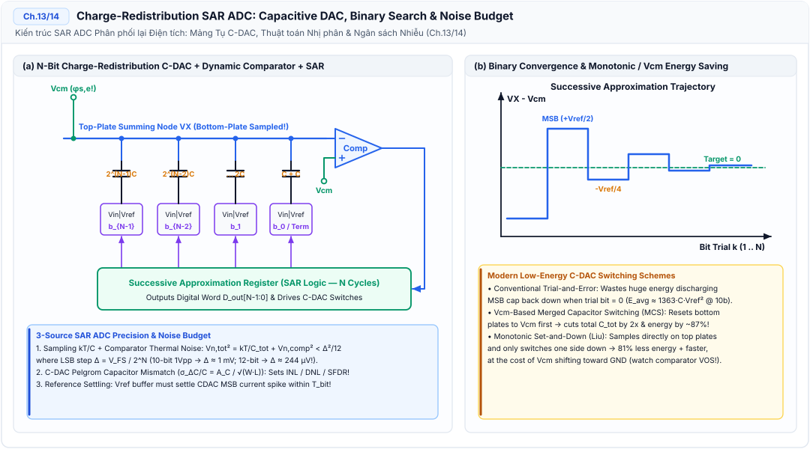

---
{
  "id": "skill-sar-adc-cdac-coherent-fft-calibration",
  "kind": "skill",
  "domain": "eda-and-github-skills",
  "title_vi": "Kiểm chứng & Hiệu chuẩn SAR ADC (Lấy mẫu Mạch lạc Nguyên tố, Chuyển mạch CDAC & Phổ FFT/Trọng số ADCToolbox)",
  "title_en": "SAR ADC Coherent FFT Verification, CDAC Switching & Digital Weight Calibration Playbook (Spectre + ADCToolbox)",
  "summary": "Quy trình thực chiến toàn trình từ lập ngân sách nhiễu SAR ADC, chọn sơ đồ chuyển mạch mảng tụ CDAC tiết kiệm năng lượng (Monotonic / Vcm-Based / Split-Bridge), thiết lập mô phỏng quá độ lấy mẫu mạch lạc nguyên tố cùng nhau fin = (M/N)*fs trong Cadence Spectre 15.1 (tránh bẫy mag/ampl, bus MSB-first và phình tệp PSF bằng strobeoutput=strobeonly) đến trích xuất chuẩn xác ENOB, SNDR, SFDR, THD, INL/DNL và hiệu chuẩn trọng số bit số bằng ADCToolbox.",
  "diagram": "../../diagrams/sar-adc-cdac-architecture.svg",
  "razavi_refs": [
    {
      "chapter": 13,
      "section": "13.1-13.3.2",
      "pages": "539-562",
      "equations": ["13.2", "13.6", "13.14", "13.25", "13.34", "13.40"]
    },
    {
      "chapter": 14,
      "section": "14.1.4-14.1.5, 14.2.1",
      "pages": "583-585, 593-598",
      "equations": ["14.37", "14.42", "14.44", "14.49", "14.75"]
    }
  ],
  "github_refs": [
    {
      "repo": "Arcadia-1/ADCToolbox",
      "url": "https://github.com/Arcadia-1/ADCToolbox/tree/372b714011db9c3f366bd0223d066e1fbde8dfb6",
      "use": "Hàm chuẩn hóa find_coherent_frequency, analyze_spectrum, quick_sndr, analyze_inl_from_sine và hiệu chuẩn trọng số calibrate_weight_sine / scale_calibration_output"
    },
    {
      "repo": "Arcadia-1/sar-adc-skills",
      "url": "https://github.com/Arcadia-1/sar-adc-skills/tree/27de09a34ea3ec6feb2ee2797d32dc673d35d1ad",
      "use": "Ngân sách nhiễu hệ thống SAR ADC, kiến trúc CDAC vi sai, khóa lấy mẫu bootstrap và quy trình xác minh 4 pha từ Verilog-A sang mức transistor"
    },
    {
      "repo": "Arcadia-1/virtuoso-bridge-lite",
      "url": "https://github.com/Arcadia-1/virtuoso-bridge-lite/tree/1f186abfbb3d658211743cd707f3156ed2f59a87/skills/spectre",
      "use": "Tối ưu tốc độ và dung lượng PSF 1500 lần bằng save=selected + strobeoutput=strobeonly cùng quản lý chế độ giải +aps / ax / mx"
    }
  ],
  "glossary_codes": ["T057", "T074", "T319", "T2135", "T2139", "T2142", "T2150", "T2151", "T2152"],
  "process_agnostic": true,
  "roles": {
    "bootstrapped_front_end": "Cặp công tắc lấy mẫu tự nâng áp cổng (VGS = VDD hằng số) nạp tín hiệu vi sai lên mảng tụ với méo hài THD < -75 dB tới sát tần số Nyquist",
    "differential_cdac_array": "Mảng tụ phân bố lại điện tích vi sai (trọng số nhị phân hoặc dưới cơ số 2 có dư thừa) thực hiện thuật toán tìm kiếm nhị phân liên tiếp",
    "coherent_strobe_testbench": "Buồng đo quá độ Spectre khóa tần số Fin = (M/N)*Fs nguyên tố cùng nhau và xuất mẫu đúng sườn chốt EOC qua strobeperiod = 1/Fs",
    "adctoolbox_postprocessor": "Chuỗi hậu xử lý phổ FFT không rò phổ, đo INL/DNL mật độ mã hình sin và hiệu chuẩn trọng số bit số cho mảng tụ có sai lệch Pelgrom"
  },
  "symptoms_addressed": [
    "spectral-leakage-skirt-destroying-simulated-sndr-and-enob-by-15-db",
    "bit-reversed-or-two-code-stuck-adc-output-from-spectre-bus-and-latch-bugs",
    "vsource-mag-vs-ampl-mistake-clipping-sar-input-with-2vpp-swing",
    "multi-gigabyte-psf-ascii-files-stalling-adc-transient-simulations",
    "missing-codes-and-harmonic-spurs-from-cdac-parasitic-bridge-and-mismatch"
  ],
  "limitations": [
    "sine-wave-weight-calibration-corrects-static-cap-weight-errors-but-cannot-fix-incomplete-dac-settling-or-thermal-noise",
    "top-plate-sampling-exposes-comparator-to-common-mode-shift-in-monotonic-switching",
    "full-1024-point-transistor-level-transient-noise-runs-require-hours-unless-phased-verification-is-used"
  ],
  "checklists": ["common-mos", "switched-capacitor", "differential-pair", "layout-and-matching"]
}
---

## 1. Kiến trúc Phối hợp Phân bố Điện tích SAR ADC & Luồng Xác minh 4 Pha

**Bộ biến đổi tương tự–số xấp xỉ liên tiếp phân bố lại điện tích (Charge-Redistribution SAR ADC)** thống trị tuyệt đối phân khúc độ phân giải $8\text{–}14\text{ bit}$, tốc độ từ vài $\text{kS/s}$ đến hàng trăm $\text{MS/s}$ nhờ không cần bất kỳ Op-Amp tiêu thụ công suất tĩnh nào: toàn bộ mạch chỉ gồm (1) **khóa lấy mẫu tự nâng áp cổng (`T2139`, bootstrapped switch)**, (2) **mảng tụ chuyển mạch vi sai (`CDAC`)**, (3) **bộ so sánh chốt động** (`skill-comparator-kickback-offset-metastability-tb`) và (4) **máy trạng thái logic SAR đồng bộ hoặc bất đồng bộ**.



Tuy nhiên, chạy thẳng một mô phỏng mức transistor toàn phần $N_{\text{FFT}} = 256$ chu kỳ ngay từ ngày đầu tiên gần như chắc chắn thất bại với kết quả $\text{ENOB} = 1{,}2\text{ bit}$ mà không biết lỗi nằm ở cực tính comparator, thứ tự dây bus, rò phổ lấy mẫu hay chưa kịp xác lập CDAC! Quy trình chuẩn công nghiệp được chắt lọc từ `Arcadia-1/sar-adc-skills`, `Arcadia-1/ADCToolbox` và `Arcadia-1/virtuoso-bridge-lite` bắt buộc đi qua **4 pha xác minh tách lỗi tuần tự**:
- **Pha 1 (100% Hành vi Verilog-A):** Xác nhận kiến trúc, cực tính dấu vi sai, thứ tự bit MSB$\to$LSB và thời gian đọc mẫu `strobe`, đạt trần lý tưởng $\text{ENOB} \approx B - 0{,}05\text{ bit}$.
- **Pha 2 (Đo Kiểm Độc lập Từng Khối Con):** Đo THD công tắc Bootstrap ($< -75\text{ dB}$), đo nhiễu/tốc độ Comparator bằng `pss`+`pnoise` ($\sigma_{v_n} < 0{,}4\text{ LSB}$), quét tĩnh $2^B$ mã mảng tụ CDAC kiểm tra tuyến tính và thời gian xác lập MSB.
- **Pha 3 (Thay thế Lai Từng Khối Một — Hybrid Incremental Replacement):** Lần lượt thay Comparator $\to$ Bootstrap $\to$ CDAC $\to$ Logic SAR sang mức transistor; nếu bước nào làm rơi $\text{ENOB} > 0{,}3\text{ bit}$ thì cô lập sửa dứt điểm ngay tại khối đó!
- **Pha 4 (Ký duyệt Toàn Mạch + Hiệu chuẩn Trọng số Số & Hậu kiểm PEX):** Chạy lấy mẫu mạch lạc có nhiễu quá độ (`tranNoise=yes`, `noiseruns=1`) và đánh giá bằng `ADCToolbox`.

---

## 2. Hệ Phương trình Ngân sách Nhiễu, Chuyển mạch CDAC & Lấy mẫu Mạch lạc

### 2.1. Ngân sách 4 Nguồn Nhiễu Quyết định Trần ENOB Thực tế
Với tín hiệu hình sin vi sai toàn thang biên độ đỉnh–đỉnh mỗi bên $V_{\text{FS,diff}} = 2 V_{\text{REF}}$ (tức sóng sin vi sai chạy từ $-V_{\text{REF}}$ đến $+V_{\text{REF}}$, công suất tín hiệu cực đại $P_{\text{sig}} = \frac{V_{\text{REF}}^2}{2}$, bước lượng tử $V_{\text{LSB}} = \frac{2 V_{\text{REF}}}{2^B}$), tổng công suất nhiễu quy về ngõ vào vi sai phải thỏa mãn:

$$
P_{n,\text{total}} = \underbrace{\frac{V_{\text{LSB}}^2}{12}}_{P_{\text{quant}}} \;+\; \underbrace{\frac{2 k T}{C_{\text{CDAC,se}}}}_{P_{kT/C,\text{diff}}} \;+\; \sigma_{v_n,\text{cmp}}^2 \;+\; \sigma_{v_n,\text{ref}}^2 \;+\; \left(2\pi f_{\text{in}} \frac{V_{\text{REF}}}{\sqrt{2}} \sigma_{t,\text{jitter}}\right)^2
$$

Từ tổng tỉ số tín hiệu trên nhiễu và méo hài $\text{SNDR}_{\text{dB}} = 10 \log_{10}(P_{\text{sig}} / P_{n,\text{total+dist}})$, số bit hiệu dụng theo chuẩn IEEE Std 1241 là:

$$
\text{ENOB} = \frac{\text{SNDR}_{\text{dBc}} - 1{,}76 + 20\log_{10}\!\left(\dfrac{A_{\text{FS}}}{A_{\text{in}}}\right)}{6{,}02}
$$

*(Lưu ý: khi sóng sin kiểm thử đặt ở $-0{,}5\text{ dBFS}$ tức $\approx 94\%$ toàn thang để tránh cắt ngọn do $V_{OS}$, phải phân biệt rõ $\text{ENOB}$ tính trực tiếp từ $\text{SNDR}_{\text{dBc}}$ tại biên độ đo so với $\text{ENOB}_{\text{FS}}$ ngoại suy toàn thang!).*

Để nhiễu nhiệt lấy mẫu (`T2142`, $2kT/C_{\text{CDAC,se}}$ cho mạch vi sai hai nhánh tụ đơn đầu $C_{\text{CDAC,se}}$) không ăn mất quá $0{,}15\text{ bit}$ ENOB, chọn $2kT/C_{\text{CDAC,se}} \le \frac{1}{4}\frac{V_{\text{LSB}}^2}{12} \implies C_{\text{CDAC,se}} \ge 96 k T / V_{\text{LSB}}^2$. Ở $10\text{ bit}$ ($V_{\text{REF}} = 1{,}0\text{ V} \implies V_{\text{LSB}} \approx 1{,}95\text{ mV}$), $C_{\text{CDAC,se}}$ nhiệt chỉ cần $\sim 105\text{ fF}$ (lúc này kích thước tụ đơn vị $C_u$ bị chi phối bởi **độ khớp Pelgrom $\sigma(\Delta C/C_u)$** thay vì $kT/C$!); còn ở $12\text{–}14\text{ bit}$, chính $kT/C$ chi phối tổng điện dung mảng tụ hàng $\text{pF}$!

### 2.2. So sánh 4 Sơ đồ Chuyển mạch CDAC & Điều kiện Lấy mẫu Mạch lạc Nguyên tố
1. **Chuyển mạch Kinh điển 2 Bước (Conventional Trial-and-Error):** Giảm $0\%$ năng lượng tham chiếu, tốn $2^B C_u$ mỗi bên.
2. **Chuyển mạch Dựa trên $V_{\text{cm}}$ (`Merged Capacitor Switching / Vcm-Based`):** Giữ mức đồng pha tấm đỉnh $V_{\text{top,CM}} = V_{\text{cm}}$ cố định suốt quá trình chuyển đổi (bảo vệ độ lệch $V_{OS}$ của comparator không bị biến thiên!), giảm $87\%$ năng lượng chuyển mạch và giảm một nửa tổng số tụ đơn vị ($2^{B-1} C_u$), đổi lại cần nguồn đệm $V_{\text{cm}}$ trở kháng thấp và công tắc 3 trạng thái (`VREFP`, `VCM`, `VREFN`).
3. **Chuyển mạch Đơn điệu (`Set-and-Down / Monotonic`, Liu et al.):** Lấy mẫu trực tiếp lên tấm đỉnh (`top-plate sampling`), sau mỗi lần so sánh chỉ gạt đúng 1 bên tụ từ $V_{\text{REFP}}$ xuống $V_{\text{REFN}}$ — giảm $81\%$ năng lượng, chỉ dùng khóa CMOS 2 trạng thái siêu đơn giản, nhưng mức đồng pha tấm đỉnh tụt dần từ $V_{\text{cm}}$ xuống gần $\text{GND}$, đòi hỏi comparator PMOS-in hoặc bù lệch động!
4. **Mảng Tụ Cầu Chia (`Split-Capacitor Bridge CDAC`):** Ngăn cách nhóm MSB và nhóm LSB bằng tụ cầu nối tiếp $C_B \approx C_u$, thu nhỏ diện tích mảng tụ $12\text{ bit}$ đi hàng chục lần, nhưng điện dung ký sinh tấm đáy/đỉnh của $C_B$ làm lệch tỉ số trọng số thực tế giữa nửa MSB và nửa LSB $\implies$ **cần trích xuất PEX và hiệu chuẩn trọng số bit số (`calibrate_weight_sine`)**!

**Định luật Lấy mẫu Mạch lạc Nguyên tố Cùng Nhau (Prime Coherent Sampling Law):** Để phép biến đổi Fourier rời rạc $N$ điểm bằng cửa sổ chữ nhật (rectangular window) thu toàn bộ năng lượng sóng cơ bản vào **đúng 1 vạch phổ duy nhất $M$** mà không rò phổ sang các bin lân cận và không làm các hài cao $2M, 3M, \dots$ đè trùng lên nhau khi gấp phổ Nyquist, tần số sóng vào $f_{\text{in}}$ bắt buộc khóa chặt theo công thức:

$$
f_{\text{in}} = \frac{M}{N} \, f_s \qquad \text{với } N = 2^k \text{ và } \gcd(M, N) = 1 \;\;(\text{tốt nhất chọn } M \text{ là số nguyên tố!})
$$

Ví dụ chuẩn cho kiểm thử gần tần số Nyquist ($f_{\text{in}} \approx 0{,}4\text{–}0{,}49\,f_s$ — nơi khóa Bootstrap và xác lập tham chiếu chịu áp lực khắc nghiệt nhất!):
- $N = 64 \implies M = 29$ hoặc $31$ (kiểm tra nhanh trong vòng lặp định cỡ).
- $N = 128 \implies M = 53$ hoặc $61$ (chuẩn xác minh khối $10\text{–}11\text{ bit}$).
- $N = 256 \implies M = 113$ hoặc $127$; $N = 1024 \implies M = 499$ hoặc $509$ (chuẩn xuất bản/sign-off $12\text{–}14\text{ bit}$).

---

## 3. Bất biến Kỹ thuật & Các Bẫy Lỗi Chết Người Trong Spectre + ADCToolbox

- **[INV-SAR-01] Bất biến Cắt Bỏ Chu kỳ Khởi động (`N_skip >= 4..8`) Trước Khi Đưa Vào FFT:** Trong vài chu kỳ đầu tiên lúc $t = 0$, điện tích trên mảng tụ CDAC, tụ nâng áp $C_{\text{boot}}$ của công tắc Bootstrap và điện áp tham chiếu chưa đi vào quỹ đạo tuần hoàn ổn định. Do đó tổng thời gian mô phỏng Spectre luôn phải đặt là $T_{\text{stop}} = (N_{\text{skip}} + N_{\text{FFT}}) / f_s$, và chỉ trích đúng **$N_{\text{FFT}}$ mẫu cuối cùng** đưa vào `analyze_spectrum`!
- **[TRAP-SAR-01] Bẫy Kinh điển `mag` vs `ampl` Trên `vsource` Của Spectre:** Trong cú pháp Spectre, tham số `mag=0.45` trên `vsource type=sine` **CHỈ có tác dụng cho phân tích `.ac` tín hiệu nhỏ**, còn trong `.tran` nếu quên khai báo `ampl=0.45` thì nguồn có thể không phát sóng hoặc phát biên độ mặc định sai hoàn toàn! Luôn viết tường minh `type=sine ampl=0.47*vref freq=fin sinedc=vcm` cho nhánh dương và `ampl=-0.47*vref` (hoặc `sinephase=180`) cho nhánh âm!
- **[TRAP-SAR-02] Bẫy Đảo Ngược Thứ tự Chân Bus `DOUT[B-1:0]` Của Spectre:** Khi khai báo cổng subcircuit dạng vector `DOUT[9:0]`, trình xuất netlist của Virtuoso/Spectre mở rộng theo thứ tự **MSB đứng đầu (`DOUT<9> DOUT<8> ... DOUT<0>`)**! Nếu kịch bản đọc kết quả hoặc khối DAC tái tạo gán nhầm phần tử đầu tiên là bit LSB `bit 0`, tín hiệu tái tạo bị đảo ngược trọng số bit làm đồ thị sóng trông như nhiễu trắng và $\text{ENOB} \approx 0{,}5\text{ bit}$ dù mạch tương tự hoạt động hoàn hảo!
- **[TRAP-SAR-03] Bẫy Phình Tệp PSF Hàng Gigabyte Khi Dùng `strobeoutput=all` Thay Vì `strobeonly`:** Trên Spectre, đặt `strobeoutput=all` ghi **cả hàng trăm nghìn điểm bước giải liên tục LẪN điểm chốt**, làm tệp PSF ASCII phình lên hàng trăm MB và ngốn hàng phút đọc đĩa! Khi đo ENOB/SNDR, luôn dùng tổ hợp vàng **`saveOptions options save=selected` + `strobeperiod=1/Fs strobeoutput=strobeonly strobe_delay=t_read_safe`** — dung lượng tệp `.tran` giảm ngay **$1000\text{–}1500\times$** (chỉ còn vài KB cho đúng $N_{\text{FFT}}$ mẫu sạch)!
- **[TRAP-SAR-04] Bẫy Lệch Đơn vị Tần số Chuẩn hóa & Thang dBFS Trong `ADCToolbox`:** Trong `ADCToolbox`, hàm `analyze_spectrum(aout, fs=Fs)` nhận `fs` tính bằng **Hz**, nhưng hàm hiệu chuẩn trọng số `calibrate_weight_sine(bits, freq=fin_norm)` nhận tần số **chuẩn hóa không thứ nguyên `fin_norm = fin_hz / Fs` $\in (0, 0{,}5)$**! Hơn nữa, đầu ra `result["calibrated_signal"]` mặc định chuẩn hóa theo biên độ sin đơn vị của bộ giải bình phương tối thiểu; muốn đọc đúng `sig_pwr_dbfs` và `noise_floor_dbfs` theo toàn thang vật lý của ADC, bắt buộc gọi tiếp `scale_calibration_output(result, target_weights=nominal_weights)`!

---

## 4. Ma trận Chẩn đoán Triệu chứng Hỏng Phổ SAR ADC (Symptom-to-Block Fault Matrix)

| Triệu chứng Trên Đồ thị Thời gian / Phổ FFT | Nguyên nhân Gốc rễ Xác suất Cao nhất | Biện pháp Kiểm chứng & Khắc phục Ngay |
|---|---|---|
| Chỉ xuất hiện đúng 2 mã (`0` và `2^B - 1`) hoặc toàn mã `0` | Ngược cực tính đầu ra Comparator HOẶC thiếu chốt SR làm mất dữ liệu ở pha Reset | Kiểm tra `VINP > VINN` xem bit MSB gạt tụ về đúng chiều giảm hiệu điện thế dư $\Delta V_{\text{top}} \to 0$ hay đẩy phân kỳ ra biên! |
| Đỉnh cơ bản sắc nét nhưng chân đỉnh loe rộng như hình chuông ($\text{SNDR}$ mất $15\text{ dB}$) | Sai tần số lấy mẫu mạch lạc HOẶC điểm lấy mẫu `t_strobe` trượt pha qua sườn chuyển đổi mã | Dùng `find_coherent_frequency(Fs, fin_target, N)` và chốt đọc mẫu cố định trước sườn lên `CLKS` kế tiếp $100\text{ ps}$ |
| Hài bậc ba `HD3` cao bất thường ($-48\text{ dBc}$), tăng mạnh khi $f_{\text{in}} \to f_s/2$ | Điện trở $R_{\text{on}}(V_{\text{in}})$ của khóa lấy mẫu biến thiên phi tuyến HOẶC tụ $C_{\text{boot}}$ quá nhỏ | Nâng cấp lên khóa Bootstrap (`topo-bootstrapped-sampling-switch`) với $C_{\text{boot}} \ge (6\text{–}10)\,C_{GG,\text{sw}}$ |
| Hài bậc chẵn `HD2` trồi lên trên nền mạch vi sai | Lệch thời điểm ngắt xung nhịp hoặc lệch tải ký sinh giữa hai nhánh `CDAC_P` và `CDAC_N` | Kiểm tra đối xứng layout đường clock lấy mẫu và cân bằng tải dummy hai bên (`T2151`) |
| Xuất hiện răng cưa chu kỳ ở đúng các biên mã $2^{B-1}, 2^{B-2}$ (DNL vọt $> +1/-1\text{ LSB}$) | Tụ cầu chia `Split-Bridge` bị tụ ký sinh làm sai trọng số nửa MSB HOẶC tham chiếu $V_{\text{REF}}$ chưa kịp hồi phục ở bit lớn | Tăng thời gian cho chu kỳ MSB (hoặc thêm bit dư thừa sub-radix-2) + chạy `calibrate_weight_sine` kiểm tra xem lỗi là tĩnh hay động! |

---

## 5. Mẫu Testbench Spectre 15.1 Lấy mẫu Mạch lạc & Luồng Hậu xử lý `ADCToolbox`

### 5.1. Netlist Spectre 15.1 Tinh gọn Chuẩn Tốc độ Cao (`strobeonly` + `save=selected`)
```spice
// tb_sar_adc_coherent_fft.scs — Spectre 15.1 Coherent Sampling SAR ADC Verification Deck
simulator lang=spectre
global 0

// Chọn N_fft = 128, M_bin = 53 (nguyên tố cùng nhau, gần Nyquist: Fin/Fs = 53/128 = 0.4140625)
parameters vdd=1.0 vref=1.0 vcm=0.5 fs=100M n_fft=128 n_skip=8 m_bin=53 \
           fin=(m_bin*fs/n_fft) tper=(1/fs) ampl_se=(0.46*vref) \
           t_stop=((n_skip+n_fft)*tper) t_strobe_delay=(0.92*tper)

VDD_SRC  (vdd 0)   vsource dc=vdd
VREFP    (vrefp 0) vsource dc=vref
VREFN    (vrefn 0) vsource dc=0

// BẮT BUỘC dùng ampl=... (KHÔNG dùng mag=...) cho sóng sin quá độ vi sai đối xứng!
VIN_P (vip 0) vsource type=sine sinedc=vcm ampl=ampl_se  freq=fin
VIN_N (vin 0) vsource type=sine sinedc=vcm ampl=-ampl_se freq=fin

// Xung lấy mẫu CLKS (20% chu kỳ cao cho lấy mẫu, 80% chu kỳ thấp cho chuỗi chuyển đổi bất đồng bộ)
VCLKS (clks 0) vsource type=pulse val0=0 val1=vdd delay=0 rise=20p fall=20p \
                       width=0.20*tper period=tper

// Chỉ lưu đúng các nút cần thiết; lưu ý ký tự thoát bus DOUT\<9\> trong PSF ASCII!
save vip vin aout_ideal_dac DOUT\<9\> DOUT\<8\> DOUT\<7\> DOUT\<6\> DOUT\<5\> \
     DOUT\<4\> DOUT\<3\> DOUT\<2\> DOUT\<1\> DOUT\<0\> VDD_SRC:p
saveOptions options save=selected

// Chạy với +aps / errpreset=conservative (cấm lx/vx!); bật tranNoise=yes noiseruns=1 khi sign-off!
tran_fft tran stop=t_stop errpreset=conservative reltol=1e-4 maxstep=10p \
    strobeperiod=tper strobedelay=t_strobe_delay strobeoutput=strobeonly \
    tranNoise=yes noisefmax=20G noiseseed=7 noiseruns=1
```

### 5.2. Kịch bản Python `ADCToolbox` Phân tích Phổ, Chẩn đoán Bit & Hiệu chuẩn Trọng số
Đoạn mã Python 3 dưới đây đọc ma trận quyết định bit `bits` kích thước `(N_fft, N_bits)` sau khi cắt bỏ `n_skip` chu kỳ đầu, đánh giá hiệu năng thô (raw) trước rồi mới hiệu chuẩn trọng số bit số (digital foreground sine calibration) để tách bạch lỗi tĩnh của tụ với giới hạn nhiễu nhiệt/xác lập động:

```python
# Chạy trên máy phân tích Python >= 3.10: PYTHONDONTWRITEBYTECODE=1 python -B run_adc_postproc.py
import numpy as np
from adctoolbox import (
    analyze_spectrum_virtuoso,
    calibrate_weight_sine,
    find_coherent_frequency,
    scale_calibration_output,
)
from adctoolbox.fundamentals import validate_aout_data, validate_dout_data

def evaluate_sar_capture(bits_raw, fs_hz, m_bin, n_bits, vdd_fs=1.0):
    """bits_raw: mảng (N_total, N_bits) giá trị {0, 1} theo thứ tự MSB -> LSB."""
    n_fft = bits_raw.shape[0]
    validate_dout_data(bits_raw)

    # 1. Tái tạo đầu ra thô với trọng số nhị phân danh định chuẩn hóa theo toàn thang vi sai 2*Vref
    nominal_weights = (2.0 ** np.arange(n_bits - 1, -1, -1)) / (2.0 ** n_bits) * (2.0 * vdd_fs)
    aout_raw = bits_raw @ nominal_weights - vdd_fs
    validate_aout_data(aout_raw)

    # 2. Phân tích phổ FFT chữ nhật không rò phổ (chuẩn giao diện Virtuoso, 1 vạch = 1 bin)
    raw_metrics = analyze_spectrum_virtuoso(aout_raw, fs=fs_hz, create_plot=False)

    # 3. Hiệu chuẩn trọng số bit bằng bình phương tối thiểu sóng sin (freq chuẩn hóa Fin/Fs = M/N!)
    freq_norm = float(m_bin) / float(n_fft)
    cal_raw = calibrate_weight_sine(bits_raw, freq=freq_norm)
    cal_scaled = scale_calibration_output(cal_raw, target_weights=nominal_weights)
    cal_metrics = analyze_spectrum_virtuoso(cal_scaled["calibrated_signal"], fs=fs_hz, create_plot=False)

    return {
        "fin_coherent_hz": find_coherent_frequency(fs_hz, freq_norm * fs_hz, n_fft=n_fft)[0],
        "raw_enob": round(float(raw_metrics["enob"]), 2),
        "raw_sndr_dbc": round(float(raw_metrics["sndr_dbc"]), 2),
        "raw_sfdr_dbc": round(float(raw_metrics["sfdr_dbc"]), 2),
        "cal_enob": round(float(cal_metrics["enob"]), 2),
        "cal_sfdr_dbc": round(float(cal_metrics["sfdr_dbc"]), 2),
        "delta_enob_from_cap_mismatch": round(float(cal_metrics["enob"] - raw_metrics["enob"]), 2),
    }
```

*(Quy tắc đạo đức kiểm định: luôn báo cáo tách bạch **`raw_enob` (trước hiệu chuẩn)** và **`cal_enob` (sau hiệu chuẩn)**; chỉ được dùng hiệu chuẩn trọng số để ký duyệt khi đặc tả hệ thống cho phép khối nhân–cộng trọng số số trên chip!).*

---

## 6. Đối chiếu Sách Razavi, Nguồn GitHub Đã Kiểm định & Thuật ngữ Chuẩn CLB

### 6.1. Mốc Tọa độ Sách Razavi (2nd Edition) & Nguồn GitHub
- **Chương 13:** §13.1–13.2.4 *Sampling Switches, Speed & Precision Considerations, Bottom-Plate Sampling* (tr. 539–555, Phương trình 13.2, 13.6, 13.14, 13.25, 13.34), §13.3 *Switched-Capacitor Charge Conservation* (tr. 555–562).
- **Chương 14:** §14.1.4–14.1.5 *Harmonic Distortion & Bootstrapped Sampling Linearity* (tr. 583–585, Phương trình 14.37–14.49), §14.2.1 *Capacitor & Transistor Mismatch* (tr. 593–598).
- **Kho GitHub Đối chiếu:** `Arcadia-1/ADCToolbox` (`372b714011`, bộ hàm chuẩn đo phổ và hiệu chuẩn trọng số ADC), `Arcadia-1/sar-adc-skills` (`27de09a34e`, kiến trúc SAR 11-bit tham chiếu và quy trình xác minh 4 pha) và `Arcadia-1/virtuoso-bridge-lite` (`1f186abfbb`, tối ưu `strobeonly` và chế độ giải Spectre).

### 6.2. Bảng Thuật ngữ Chuẩn CLB Vi Mạch
| Mã CLB | Thuật ngữ Tiếng Anh | Thuật ngữ Tiếng Việt Chuẩn | Vai trò Trong Hệ thống SAR ADC |
|---|---|---|---|
| `T074` / `T2135` | sampling / bottom-plate sampling | lấy mẫu / lấy mẫu tấm đáy | Thu nhận điện áp đầu vào không phụ thuộc điện tích kênh công tắc |
| `T2139` | bootstrapped switch | công tắc nâng áp cực cổng (công tắc bootstrap) | Giữ $V_{GS} = V_{DD}$ không đổi giúp triệt méo hài `HD3` tới tận tần số Nyquist |
| `T2142` | kT/C thermal sampling noise | nhiễu lấy mẫu nhiệt kT/C | Sàn nhiễu vật lý bất biến quyết định tổng diện tích mảng tụ CDAC ở độ phân giải cao |
| `T319` | Bottom-plate capacitance | điện dung đáy tiếp giáp | Tụ ký sinh tấm đáy gây suy giảm hệ số chia cầu trong mảng tụ `Split-Bridge` |
| `T2150` / `T2152` | harmonic distortion / HD2, HD3 | méo hài / méo hài bậc hai, bậc ba tỉ đối | Chỉ số giới hạn `SFDR` và `THD` được trích xuất tự động qua phổ mạch lạc |
| `T2151` | even-order harmonic cancellation | triệt tiêu hài bậc chẵn nhờ đối xứng vi sai | Lý do bắt buộc dùng hai nhánh `CDAC_P` và `CDAC_N` đối xứng gương |
