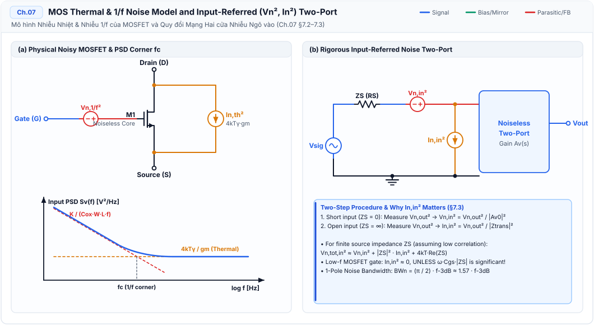

---
{
  "id": "skill-spectre-noise-dc-ac-tran-montecarlo",
  "kind": "skill",
  "domain": "eda-and-github-skills",
  "title_vi": "Kiểm toán Toàn diện Spectre: Góc Quy trình PVT, Nhiễu Đóng góp, Nhiễu Quá độ & Monte Carlo Pelgrom",
  "title_en": "Complete Spectre Verification Suite: PVT Corners, Noise Contributors, Transient Noise & Pelgrom Monte Carlo",
  "summary": "Quy trình thiết lập và kiểm toán bộ 5 phép phân tích nền tảng của Cadence Spectre 15.1 (dc, ac, noise, tran/tranNoise, montecarlo): xếp hạng linh kiện đóng góp nhiễu nhiệt vs 1/f để tối ưu đúng nút thắt, phân biệt góc quy trình toàn cục {TT/NN, FF, SS, FS, SF} với biến thiên cục bộ mismatch Pelgrom (LHS/low-discrepancy), và phòng chống các bẫy noiseruns=100, preset=lx/vx hay section mc rỗng.",
  "diagram": "../../diagrams/mos-noise-input-referred.svg",
  "razavi_refs": [
    {
      "chapter": 7,
      "section": "7.2-7.8",
      "pages": "228-264",
      "equations": ["7.52", "7.62", "7.118", "7.145"]
    },
    {
      "chapter": 14,
      "section": "14.2.1, 14.2.4",
      "pages": "593-598, 603-604",
      "equations": ["14.75", "14.96"]
    },
    {
      "chapter": 17,
      "section": "17.3.5-17.4, 17.Problems",
      "pages": "706-710",
      "equations": ["17.50", "17.53"]
    }
  ],
  "github_refs": [
    {
      "repo": "Arcadia-1/virtuoso-bridge-lite",
      "url": "https://github.com/Arcadia-1/virtuoso-bridge-lite",
      "use": "Các bẫy thực tế của Spectre (noiseruns=100, preset=lx/vx làm hỏng ENOB, strobeoutput=strobeonly, save=selected)"
    },
    {
      "repo": "KenKundert/psf_utils",
      "url": "https://github.com/KenKundert/psf_utils",
      "use": "Truy xuất phổ đóng góp nhiễu từng thành phần linh kiện (M1:id, M1:fn, R1:thermal) từ tệp noise.noise PSF ASCII"
    },
    {
      "repo": "efabless/cace",
      "url": "https://github.com/efabless/cace",
      "use": "Tổ chức ma trận kiểm chứng kết hợp góc quy trình PVT và phân bố thống kê Monte Carlo 3-sigma"
    }
  ],
  "glossary_codes": ["T052", "T392", "T527", "T655", "T788", "T1009", "T2153", "T2186"],
  "process_agnostic": true,
  "roles": {
    "dc_op_auditor": "Phân tích điểm làm việc tĩnh dcOp kiểm tra biên bão hòa VDS - Vdsat, mật độ dòng và độ lệch hệ thống trước mọi phép đo động",
    "noise_contributor_profiler": "Phân tích .noise trích xuất bảng xếp hạng % công suất nhiễu tích phân theo từng linh kiện và từng cơ chế vật lý (channel thermal id vs flicker fn vs gate rg)",
    "transient_noise_engine": "Tùy chọn tranNoise=yes tiêm nhiễu ngẫu nhiên băng rộng vào miền thời gian cho mạch phi tuyến mạnh không tuyến tính hóa được",
    "montecarlo_sampler": "Khối phân tích montecarlo (variations=mismatch / all, sampling=lhs) kiểm định định luật Pelgrom cho V_OS, lệch gương dòng và năng suất chế tạo 3-sigma"
  },
  "symptoms_addressed": [
    "blindly-widening-input-pair-fails-to-reduce-noise-dominated-by-bias-mirror",
    "montecarlo-simulation-produces-zero-spread-because-statistical-block-not-enabled",
    "transient-noise-run-hangs-100x-longer-due-to-inherited-noiseruns-100",
    "fast-cross-corners-fs-sf-break-cascode-bias-passed-at-tt-ff-ss"
  ],
  "limitations": [
    "small-signal-noise-analysis-ignores-noise-folding-in-switched-circuits",
    "gaussian-3sigma-extrapolation-from-small-n-30-has-wide-confidence-interval",
    "transient-noise-requires-careful-noisefmax-selection-to-avoid-aliasing-or-slowdown"
  ],
  "checklists": ["common-mos", "differential-pair", "current-mirror", "layout-and-matching"]
}
---

## 1. Kiến trúc Năm Trụ cột Kiểm chứng Mạch Tương tự trong Cadence Spectre 15.1

Một mạch khuếch đại, Bandgap hay LDO chạy đẹp ở một điểm danh định duy nhất (`TT`, $27\,^\circ\text{C}$, không nhiễu, hai nhánh đối xứng tuyệt đối $100\%$ trong toán học máy tính) **hoàn toàn chưa có giá trị chế tạo silicon**. Trên tấm wafer thực tế (Razavi Chương 7, Chương 14 §14.2 & Chương 17 §17.4), mạch chịu tác động đồng thời của ba lớp nhiễu loạn vật lý độc lập:
1. **Biến thiên quy trình toàn cục và môi trường (`PVT Corners`, `T2186`):** Làm toàn bộ NMOS và PMOS trên cùng một die dịch chuyển đồng loạt về $V_{TH}$, chiều dày oxit $t_{ox}$, độ linh động $\mu(T)$ và điện áp nguồn $V_{DD} \pm 10\%$.
2. **Sai lệch ngẫu nhiên cục bộ giữa hai linh kiện kề sát nhau (`Local Mismatch`, `T052` & Định luật Pelgrom `T2153`):** Phá vỡ tính đối xứng gương lý tưởng, sinh ra điện áp lệch quy về ngõ vào $V_{OS}$ (`T788`), sai số tỉ số gương dòng/điện trở/tụ điện và méo hài bậc chẵn $\text{HD}_2$!
3. **Nhiễu điện tử nội tại theo thời gian thực (`Electronic Noise`, `T527`):** Dao động nhiệt kênh dẫn $4kT\gamma g_m$ (`T1009`) và bẫy hạt dẫn bề mặt oxit $1/f$ (`T392`) đặt giới hạn sàn cho dải động tín hiệu nhỏ.



Thẻ kỹ năng này chuẩn hóa quy trình kết hợp chặt chẽ 5 phân tích cốt lõi của Spectre 15.1 (`dc`, `ac`, `noise`, `tran`/`tranNoise`, và `montecarlo`), giúp kỹ sư không chỉ biết mạch *đạt hay trượt* mà còn định vị chính xác **linh kiện số mấy và cơ chế vật lý nào** đang chiếm tỷ trọng lỗi lớn nhất!

---

## 2. Cơ sở Định lượng: Kiểm toán Bảng Đóng góp Nhiễu & Thống kê Số Mẫu Monte Carlo

### 2.1. Toán học Phân rã Bảng Đóng góp Nhiễu Tích phân (`Integrated Noise Contributors`)
Trong phân tích `.noise (vout_p vout_n) noise start=f1 stop=f2 iprobe=VIN_SRC`, Spectre tính hàm truyền từ mọi nguồn nhiễu vật lý độc lập thứ $k$ trong mạch ra ngõ ra để thu mật độ phổ công suất ngõ ra $S_{v,\text{out}}(f) = \sum_k S_{v,\text{out},k}(f)$ ($\text{V}^2/\text{Hz}$), đồng thời chia cho bình phương độ lợi truyền thẳng $|A_v(jf)|^2$ từ nguồn `iprobe` để suy ra nhiễu quy về ngõ vào (`Input-Referred Noise`):

$$
\overline{V_{n,\text{out,rms}}^2} = \int_{f_1}^{f_2} \sum_{k=1}^{M} \Big( \underbrace{S_{k,\text{id}}(f)}_{\text{Thermal }4kT\gamma g_m} + \underbrace{S_{k,\text{fn}}(f)}_{\text{Flicker }1/f} + \underbrace{S_{k,\text{rg}}(f)}_{\text{Gate }R_g} \Big)\,df, \qquad \%\,\text{Contrib}_k = \frac{\int_{f_1}^{f_2} S_{v,\text{out},k}(f)\,df}{\overline{V_{n,\text{out,rms}}^2}} \times 100\%
$$

**Quy tắc Vàng Đọc Bảng Đóng góp Nhiễu (Noise Audit Rule — Razavi §7.5–7.6):**
- Trong một OTA/Op-Amp thiết kế tốt, **cặp vi sai đầu vào $M_1, M_2$ phải chiếm $\ge 65\%\text{–}80\%$ tổng công suất nhiễu tích phân**!
- Nếu bạn thấy cặp gương dòng tải $M_3, M_4$, nguồn dòng gập $M_{\text{fold}}$, hoặc tệ nhất là **transistor diode tạo dòng phân cực chuẩn $M_{\text{bias,ref}}$** chiếm $> 25\%$ tổng nhiễu: bạn đã vi phạm quy tắc tỉ số hỗ dẫn ($g_{m,\text{load}} \ll g_{m1}$) hoặc nhân nhiễu của nhánh `Ibias` lên $(I_{\text{tail}}/I_{\text{ref}})^2$ lần mà quên lọc tụ bypass $C_{\text{bypass}}$ tại cổng gương phân cực! Trong trường hợp đó, việc tăng chiều rộng cặp đầu vào $M_{1,2}$ gần như vô tác dụng!

### 2.2. Định luật Pelgrom, Hậu kiểm $3\sigma$ & Khoảng Tin cậy Số Mẫu Monte Carlo $N$
Theo định luật Pelgrom (Razavi §14.2.1, Phương trình 14.75), độ lệch chuẩn giữa hai transistor đối xứng kề nhau có diện tích kênh tích cực $W \cdot L$ tuân theo:

$$
\sigma(\Delta V_{TH}) = \frac{A_{VTH}}{\sqrt{W L}}, \qquad \sigma\!\left(\frac{\Delta \beta}{\beta}\right) = \frac{A_{\beta}}{\sqrt{W L}}
$$

Khi chạy $N$ lần lấy mẫu ngẫu nhiên Monte Carlo để ước lượng giá trị trung bình mẫu $\hat{\mu}$ và độ lệch chuẩn mẫu $s$, chính $s$ cũng có sai số thống kê chuẩn $\text{SE}(s) \approx \dfrac{s}{\sqrt{2(N-1)}}$, dẫn tới sai số ước lượng biên thiết kế $\hat{\mu} \pm 3s$:

| Số lần chạy Monte Carlo $N$ | Độ bất định tương đối của $s$ ($\pm 95\%$ CI) | Phương pháp lấy mẫu khuyến nghị trong Spectre | Mục đích Sử dụng Chuẩn |
|---|---|---|---|
| $N = 30 \text{–} 50$ | $\pm 18\% \text{–} 25\%$ (rất thô) | `sampling=lhs` (Latin Hypercube) | Chạy nháp sàng lọc nhanh trong lúc đang định cỡ sơ bộ |
| **$N = 100 \text{–} 200$** | **$\pm 10\% \text{–} 14\%$** | **`sampling=lhs` hoặc `lds` (Low-Discrepancy)** | **Chuẩn Sign-off thông dụng** kiểm chứng $\mu \pm 3\sigma$ và hệ số $C_{pk} \ge 1{,}33$ |
| $N = 500 \text{–} 1000$ | $\pm 4{,}4\% \text{–} 6{,}2\%$ | `sampling=lds` | Khối nhạy cảm sống còn (Bandgap chưa trim, Comparator SAR 12-bit, Sense Amp SRAM) |

Sử dụng `sampling=lhs` (Latin Hypercube Sampling) hoặc `lds` (Sobol Low-Discrepancy Sequence) trong Spectre 15.1 hội tụ phương sai nhanh gấp $3\text{–}5$ lần so với lấy mẫu giả ngẫu nhiên `random` thuần túy!

---

## 3. Bất biến Thiết lập & 5 Bẫy Lỗi Nghiêm trọng Trong Spectre (Invariants & Traps)

- **[INV-MC-01] Không Đánh đồng Tên Section Góc Quy trình Giữa Các Bộ PDK (`NN` vs `tt`, và Bẫy `section=mc` Rỗng):**
  - Như kiểm định thực tế trên hệ thống GPDK: `gpdk090.scs` đặt tên góc điển hình là **`section=NN`** (kèm `FF, SS, FS, SF`), trong khi `gpdk045.scs` dùng chữ thường **`section=tt`** (kèm `ff, ss, fs, sf, mc`). Dùng chung một kịch bản gán cứng `section=tt` cho GPDK090 sẽ lỗi đọc model ngay lập tức!
  - Đặc biệt cảnh giác: ngay cả khi chạy với `section=mc`, nếu netlist thiếu khối điều khiển `montecarlo { ... }` hoặc PDK tắt cờ biến thiên thống kê mặc định, mọi lần lặp đều chạy y hệt điểm trung bình dẫn tới **`std_dev = 0.0` giả tạo**! Kiểm toán tự động bắt buộc phải khẳng định `std(V_OS) > 1e-6 V` trước khi báo đạt mismatch!
- **[INV-PVT-01] Bắt Buộc Quét Đủ Hai Góc Chéo `FS` (Fast-NMOS / Slow-PMOS) và `SF` (Slow-NMOS / Fast-PMOS):** Rất nhiều sinh viên chỉ chạy 3 góc đồng hướng `{TT, FF, SS}` (nơi cả NMOS lẫn PMOS cùng nhanh hoặc cùng chậm nên điện áp phân cực phân chia tự cân bằng). Thực tế trên silicon, hai góc chéo **`FS` và `SF` ở $-40\,^\circ\text{C}$ và $+125\,^\circ\text{C}$** mới là sát thủ đánh sập khoảng dự trữ áp của Folded-Cascode (`Ifold` lệch khỏi `Itail`), đẩy lệch ngưỡng đảo logic và làm trôi điểm cắt bù RHP zero!
- **[TRAP-SIM-01] Bẫy Chết Người Của Chế Độ Tăng Tốc `+preset=lx` / `+preset=vx` Làm Bay Mất 3–8 Bit ENOB:** Như tài liệu kiểm chứng thực nghiệm trong `Arcadia-1/virtuoso-bridge-lite` ghi nhận, chế độ `+preset=lx` nới lỏng `reltol` lên $\sim 10^{-3}$ còn `+preset=vx` tắt kiểm soát sai số cắt cụt cục bộ (LTE), làm hỏng hoàn toàn quyết định siêu bền cấp $\mu\text{V}$ của bộ so sánh và mạch lấy mẫu chính xác! Đối với mạch tương tự chính xác trong Spectre 15.1, luôn dùng chuẩn Spectre gốc hoặc `+aps` với `errpreset=conservative` (hoặc `moderate` khi quét sơ bộ kèm `reltol=1e-5`).
- **[TRAP-SIM-02] Bẫy Kế Thừa `noiseruns=100` Trong Transient Noise Làm Treo Máy Gấp 100 Lần:** Khi bật nhiễu miền thời gian `tranNoise=yes` từ giao diện ADE/Maestro, Spectre rất hay điền mặc định `noiseruns=100` (lặp lại 100 quỹ đạo thời gian độc lập). Nếu bạn đang chạy một chuỗi FFT 256 chu kỳ để đo SNDR của SAR ADC hay ΔΣ Modulator, một quỹ đạo dài vốn đã đủ tích hợp trung bình thống kê theo thời gian — quên đặt `noiseruns=1` sẽ khiến thời gian chạy phình từ $3\text{ phút}$ thành **$5\text{ giờ}$** vô ích!
- **[TRAP-SIM-03] Bẫy Đo Offset Hệ Thống Bằng Mạch Vòng Hở Thay Vì Hồi Tiếp Đơn Vị Đóng Kín:** Không bao giờ đo điện áp lệch $V_{OS}$ trong Monte Carlo bằng cách nối hai cổng `inp = inn = Vcm` ở vòng hở rồi lấy `(Vout - Vcm) / A0`! Chỉ cần $V_{OS} = 2\text{ mV}$ nhân với $A_0 = 10^4$ là ngõ ra kẹt cứng vào $V_{DD}$ hoặc $0\text{ V}$! Phải nối Op-Amp thành **bộ đệm độ lợi đơn vị đóng vòng âm** (hoặc dùng servo loop lý tưởng cho OTA vi sai) rồi đọc trực tiếp hiệu áp tĩnh `V(inp) - V(inn)` = $V_{OS}$ trong phân tích `dc` bên trong khối `montecarlo`!
- **[INV-DISK-01] Kỷ luật Dung lượng PSF ASCII (`save=selected` + `prune-runs` Tránh Tràn Đĩa Ảo VM):** Vì Spectre `-format psfascii` có thể sinh `50–100 MB` cho **mỗi một góc PVT** nếu giữ mặc định `save=all` (đặc biệt khi quét `tran` mịn hoặc lưới hàng chục điểm tải × 18 góc sẽ dễ làm đầy hàng chục GB ổ đĩa ảo), mọi deck chạy sóng bắt buộc khai báo **`saveOptions options save=selected`** và chỉ `save` các nút/dòng cần đo (`dcOpInfo` vẫn tự lưu điểm OP cho `psf_audit.py op-audit`). Khi đang dò thông số chỉ quét 4–6 góc biên xấu nhất và ghi đè một thư mục nháp bằng `--overwrite-run`; sau khi xuất bảng kết quả cuối cùng, dọn các `psf/` cũ bằng `cadence_exec.py prune-runs --project . --keep 2`.

---

## 4. Ma trận Lựa chọn Phép đo Nhiễu & Biến thiên Trong Spectre 15.1

| Câu hỏi Kỹ thuật Cần Trả lời | Phân tích Spectre Đúng Chuẩn | Chế độ `variations=` / Tùy chọn | Tuyệt đối Không Dùng Nhầm |
|---|---|---|---|
| Linh kiện nào gây nhiễu nhiệt / $1/f$ lớn nhất trong Op-Amp, LNA, BGR, LDO? | `noise (outp outn) noise ... iprobe=VIN` | Lưu `save=selected` hoặc đọc toàn bảng `noise.noise` | Không dùng `tranNoise` (quá chậm và không tách được đóng góp từng transistor!) |
| Nhiễu nền của mạch phi tuyến mạnh không tuần hoàn (ví dụ khởi động, khóa pha, ADC đơn chuỗi FFT)? | `tran ... tranNoise=yes noisefmax=5*Fbw noiseruns=1` | Đặt `noisefmax` cao gấp $3\text{–}5\times$ băng thông mạch để bao hàm gấp phổ | Không quên `noiseruns=1` cho FFT; không đặt `noisefmax` quá thấp dưới tần số cắt RC! |
| Độ lệch áp $V_{OS}$ của cặp vi sai / tỉ số chia Bandgap / lệch bậc CDAC do bất đối xứng cục bộ? | `montecarlo variations=mismatch sampling=lhs numruns=200` | Bọc quanh `dc` (cho $V_{OS}$, BGR) hoặc `ac`/`stb` | Không dùng `variations=process` để tính $V_{OS}$ (vì `process` dịch giống hệt nhau trên cả hai transistor nên $V_{OS}$ vẫn bằng 0!) |
| Tổng sai số giá trị tuyệt đối của dòng tham chiếu $I_{\text{ref}}$ hoặc tần số tự do Ring Oscillator trên lô sản xuất? | `montecarlo variations=all sampling=lhs numruns=200` | Kết hợp cả biến thiên lô/wafer (`process`) lẫn bất đối xứng nội (`mismatch`) | Không nhân đôi: nếu đã quét riêng 5 góc cực trị `{FF, SS, FS, SF}` thì chạy `variations=mismatch` tại từng góc để tránh tính trùng $2\times$ phương sai quy trình! |

---

## 5. Mẫu Netlist Spectre 15.1 Chuẩn (`DC + AC + Noise Audit + Pelgrom Monte Carlo`) & Script Xếp hạng Nhiễu

### 5.1. Mẫu Netlist Spectre 15.1 Chạy Kiểm toán Nhiễu & 200 Mẫu Monte Carlo Offset (`tb_ota_noise_mc.scs`)
```scs
// Spectre 15.1 Noise Contribution Audit & 200-Run LHS Pelgrom Mismatch Deck
simulator lang=spectre
global 0

// Sử dụng section có mô hình thống kê mismatch của PDK (ví dụ mc trên GPDK045 hoặc stat/mc trên GPDK090)
include "/path/to/gpdk045/models/spectre/gpdk045.scs" section=mc
include "two_stage_miller_ota.scs"

parameters vdd=1.1 vcm=0.55 cload=2p

VDD_SRC (vdd 0) vsource dc=vdd
VIN_POS (inp 0) vsource dc=vcm mag=1.0

// Mắc cấu hình hồi tiếp độ lợi đơn vị (Unity-Gain Follower): ngõ ra nối thẳng về chân đảo inn!
// Ở DC: V(inp) - V(out) chính là điện áp lệch ngõ vào V_OS = V(inp) - V(inn) (kèm sai số hữu hạn Vcm/A0)!
IPRB_LOOP (out inn) iprobe
CL0       (out 0)   capacitor c=cload
X_OTA     (inp inn out vdd 0) two_stage_miller_ota

simOpts options temp=27.0 reltol=1e-5 vabstol=1e-7 iabstol=1e-13
saveOptions options save=selected
save out inp inn vdd VDD_SRC:p

// 1. Phân tích danh định: DC OP, STB vòng kín và Phân tích Nhiễu (1 Hz -> 100 MHz)
dc_nom  dc write="spectre.dc"
stb_nom stb start=1 stop=5G dec=25 probe=IPRB_LOOP
ac_nom  ac  start=1 stop=5G dec=25
// iprobe=VIN_POS giúp Spectre tự tính sẵn cả phổ nhiễu ra 'out' lẫn nhiễu quy về ngõ vào 'in'!
nz_nom  (out 0) noise start=1 stop=100M dec=20 iprobe=VIN_POS

// 2. Phân tích Monte Carlo 200 lần lấy mẫu Latin Hypercube (chỉ biến thiên cục bộ Pelgrom mismatch)
mc_mismatch montecarlo numruns=200 seed=12345 variations=mismatch sampling=lhs \
    donominal=yes savefamilyplots=yes savedatainseparatedir=yes {
    dc_mc dc
    export vos_mv = 1e3 * (v(inp) - v(out))
}
```

### 5.2. Script Python Đọc Tệp `nz_nom.noise` PSF ASCII & Xếp hạng Top Linh kiện Đóng góp Nhiễu
Tương thích chuẩn cấu trúc PSF của `KenKundert/psf_utils` và `psf_ascii_reader.py`:

```python
# Tích phân hình thang phổ mật độ công suất nhiễu (V^2/Hz) và xếp hạng % đóng góp từng linh kiện
def rank_noise_contributors(psf_noise_dict, f_min_hz=10.0, f_max_hz=10e6, top_k=8):
    freqs = psf_noise_dict["freq"]
    idx_band = [i for i, f in enumerate(freqs) if f_min_hz <= f <= f_max_hz]
    assert len(idx_band) >= 2, "Frequency band outside simulated noise sweep!"

    def trapz_band(arr):
        acc = 0.0
        for a, b in zip(idx_band[:-1], idx_band[1:]):
            df = freqs[b] - freqs[a]
            acc += 0.5 * (float(arr[a]) + float(arr[b])) * df
        return acc

    # Trong Spectre PSF ASCII, 'out' có đơn vị V/sqrt(Hz) hoặc V^2/Hz tùy cờ; các khóa 'X_OTA.M1:id', 'X_OTA.M1:fn' là V^2/Hz
    contrib_powers = {}
    for sig_name, values in psf_noise_dict.items():
        if sig_name in ("freq", "out", "in") or ":" not in sig_name:
            continue
        if sig_name.endswith(":total"):
            continue
        pwr_v2 = trapz_band(values)
        if pwr_v2 > 0.0:
            contrib_powers[sig_name] = pwr_v2

    tot_v2 = sum(contrib_powers.values())
    ranked = sorted(contrib_powers.items(), key=lambda kv: -kv[1])[:top_k]
    return {
        "total_rms_uv": (tot_v2 ** 0.5) * 1e6,
        "top_contributors": [
            {"source": k, "rms_uv": round((v ** 0.5) * 1e6, 3), "share_pct": round(100.0 * v / tot_v2, 2)}
            for k, v in ranked
        ],
    }
```

### 5.3. Quy luật Dịch chuyển Theo Tiến trình (180nm $\to$ 90nm $\to$ 65nm $\to$ 45nm)
- **Hệ số Pelgrom $A_{VTH}$** giảm chậm khi oxit cổng mỏng dần ($A_{VTH} \propto t_{ox}$, từ $\sim 5\text{ mV}\cdot\mu\text{m}$ ở $180\text{ nm}$ xuống $\sim 2{,}2\text{–}3{,}0\text{ mV}\cdot\mu\text{m}$ ở $45\text{ nm}$), nhưng nếu thiết kế co nhỏ diện tích cổng theo $L_{\min}^2$ thì $\sigma(V_{OS}) = A_{VTH}/\sqrt{WL}$ lại **tăng vọt gấp $2\text{–}3$ lần** do dao động ngẫu nhiên hạt pha tạp (RDF)!
- Đồng thời hệ số nhiễu nhiệt kênh ngắn $\gamma$ tăng từ $2/3$ ở kênh dài lên $\sim 1{,}0\text{–}1{,}5$ ở $65\text{ nm}/45\text{ nm}$, khiến việc kiểm toán thực tế bằng `.noise` của Spectre là bắt buộc thay vì dùng công thức giấy $\gamma = 2/3$.

---

## 6. Đối chiếu Sách Razavi, Nguồn GitHub Đã Kiểm định & Thuật ngữ Chuẩn CLB

### 6.1. Đối chiếu Sách Gốc Razavi (2nd Edition) & Nguồn Mở GitHub
- **Razavi Chương 7 (§7.2–7.8, tr. 224–266):** Vật lý nhiễu nhiệt, nhiễu nhấp nháy $1/f$, quy đổi nhiễu ngõ vào cho các tầng khuếch đại/gương dòng và băng thông nhiễu tương đương $\frac{\pi}{2} f_{-3\text{dB}}$.
- **Razavi Chương 14 (§14.2.1 & §14.2.4, tr. 593–598, 603–604):** Sai lệch kích thước/ngưỡng Pelgrom, tính toán tổng phương sai $V_{OS}$ của cặp vi sai tải tích cực và quy tắc đối ngẫu định cỡ giảm lệch.
- **Razavi Chương 17 (§17.3.7–17.4, tr. 707–710):** Biến thiên nhiệt độ của độ linh động và điện áp ngưỡng, điểm ZTC và 5 góc quy trình CMOS.
- **Nguồn GitHub Đã Kiểm định:**
  - [`Arcadia-1/virtuoso-bridge-lite`](https://github.com/Arcadia-1/virtuoso-bridge-lite) (commit `1f186abfbb3d`, MIT): Tổng kết thực nghiệm các bẫy `noiseruns=100`, `+preset=lx/vx` và `save=selected`.
  - [`KenKundert/psf_utils`](https://github.com/KenKundert/psf_utils) (commit `67971463a7bf`): Cấu trúc phân tách nguồn nhiễu thành phần `:thermal`/`:id` và `:flicker`/`:fn` trong tệp PSF.
  - [`efabless/cace`](https://github.com/efabless/cace) (commit `d71c8da5f8d8`, Apache-2.0): Chuẩn hóa ma trận hồi quy đa góc PVT và thống kê Monte Carlo.

### 6.2. Bảng Thuật ngữ Chuẩn CLB Vi Mạch Sử dụng trong Thẻ
| Mã CLB | Thuật ngữ Tiếng Anh | Thuật ngữ Tiếng Việt Chuẩn | Vai trò trong Kiểm toán Spectre |
|---|---|---|---|
| `T527` / `T1009` | noise / thermal noise | Nhiễu / nhiễu nhiệt | Trường `:id` (MOS) và `:thermal`/`:rn` (điện trở) trong `noise.noise` |
| `T392` | Flicker noise | Nhiễu nhấp nháy | Trường `:fn` trong `noise.noise`, giảm tỷ lệ nghịch với tích diện tích $W \cdot L$ |
| `T052` / `T655` | mismatch / dimension and threshold voltage mismatches | Sai lệch linh kiện / sai lệch kích thước và điện áp ngưỡng | Mô phỏng bằng `montecarlo` với `variations=mismatch` |
| `T2153` | Pelgrom's law | định luật Pelgrom | Quy luật $\sigma \propto 1/\sqrt{WL}$ dùng để tính tỷ lệ phóng to diện tích khi trượt $3\sigma$ |
| `T788` | input-referred offset voltage | điện áp lệch quy về ngõ vào | Đo chính xác bằng `dc` trên mạch đóng vòng hồi tiếp đơn vị trong `montecarlo` |
| `T2186` | process corners (TT/NN, FF, SS, FS, SF) | các góc quy trình chế tạo (TT/NN, FF, SS, FS, SF) | Luôn kiểm tra cả hai góc chéo `FS` và `SF` ở hai biên nhiệt độ $-40\,^\circ\text{C}$ và $125\,^\circ\text{C}$ |
