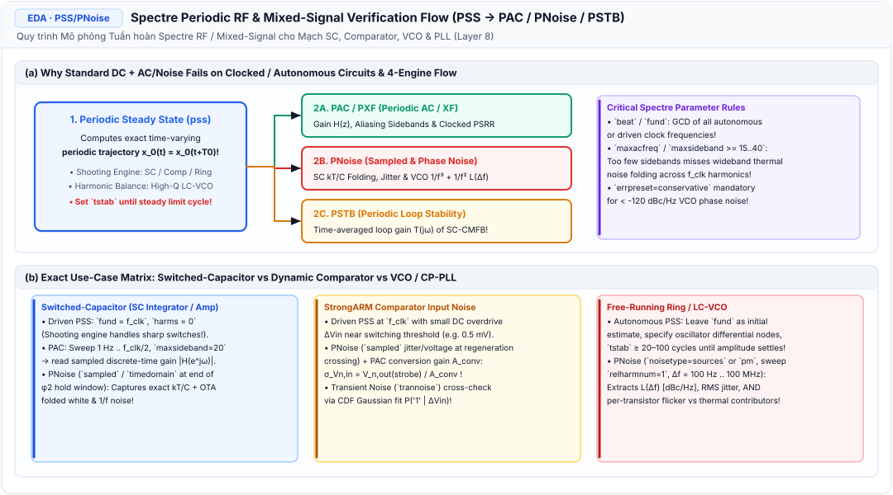

---
{
  "id": "skill-spectre-pss-pac-pnoise-pstb",
  "kind": "skill",
  "domain": "eda-and-github-skills",
  "title_vi": "Mô phỏng Trạng thái Xác lập Tuần hoàn SpectreRF (PSS, PAC, PNoise, PSTB) cho Mạch SC, VCO & PLL",
  "title_en": "Periodic Steady-State SpectreRF Workflow (pss, pac, pnoise, pstb) for Switched-Cap, VCO & CP-PLL",
  "summary": "Quy trình làm chủ bộ 4 công cụ tuyến tính hóa biến thiên tuần hoàn theo thời gian (LPTV) trong Cadence Spectre 15.1: hội tụ pss Shooting-Newton so với Harmonic Balance cho mạch xung nhịp cưỡng bức (SC/Comparator/CP) và mạch tự dao động (Ring/LC-VCO), đo hàm truyền PAC có gấp biên tần, phân tích nhiễu lấy mẫu / nhiễu pha PNoise và đo ổn định vòng tuần hoàn PSTB.",
  "diagram": "../../diagrams/spectre-pss-pnoise-flow.svg",
  "razavi_refs": [
    {
      "chapter": 13,
      "section": "13.2-13.5",
      "pages": "541-573",
      "equations": ["13.14", "13.61"]
    },
    {
      "chapter": 15,
      "section": "15.2-15.5",
      "pages": "609-649",
      "equations": ["15.55", "15.73", "15.84"]
    },
    {
      "chapter": 16,
      "section": "16.2-16.3",
      "pages": "666-683",
      "equations": ["16.37", "16.47"]
    }
  ],
  "github_refs": [
    {
      "repo": "KenKundert/flicker-noise",
      "url": "https://github.com/KenKundert/flicker-noise",
      "use": "Thiết lập chuẩn pss + pnoise kiểm chứng nhiễu gấp phổ BSIM4 và điều biến nhiễu 1/f của Ken Kundert"
    },
    {
      "repo": "Arcadia-1/sar-adc-skills",
      "url": "https://github.com/Arcadia-1/sar-adc-skills",
      "use": "Cấu hình pss + pnoise (noisetype=sampled / jitterevent) cho bộ so sánh động StrongArm"
    },
    {
      "repo": "Arcadia-1/virtuoso-bridge-lite",
      "url": "https://github.com/Arcadia-1/virtuoso-bridge-lite",
      "use": "Tối ưu tốc độ chạy Spectre, chế độ độ chính xác và trích xuất kết quả PSF ASCII tự động"
    }
  ],
  "glossary_codes": ["T016", "T047", "T087", "T392", "T1009", "T2148", "T2162", "T2169"],
  "process_agnostic": true,
  "roles": {
    "pss_engine": "Phân tích nền tảng giải nghiệm tuần hoàn lớn x_0(t) = x_0(t + T_0) bằng Shooting-Newton (miền thời gian cho chuyển mạch gắt) hoặc Harmonic Balance (miền tần số cho LC-VCO mượt)",
    "pac_analyzer": "Tuyến tính hóa mạch quanh quỹ đạo tuần hoàn x_0(t) để tính hàm truyền tín hiệu nhỏ có dịch tần qua các dải biên k*f_0 (Switched-Capacitor, Mixer, Sampler)",
    "pnoise_analyzer": "Tích hợp mọi cơ chế gấp phổ nhiễu nhiệt trắng (aliasing) và điều biến nhiễu nhấp nháy 1/f lên biên tần dao động hoặc thời điểm lấy mẫu",
    "pstb_analyzer": "Đo độ lợi vòng trung bình theo chu kỳ T_p(jw) cho mạch hồi tiếp gián đoạn theo xung nhịp như SC-CMFB hoặc bộ điều chỉnh chuyển mạch"
  },
  "symptoms_addressed": [
    "standard-ac-and-noise-completely-fail-on-clocked-switched-capacitor-circuits",
    "pss-fails-to-converge-on-autonomous-vco-or-divided-multi-clock-system",
    "underestimating-folded-kt-over-c-noise-by-ignoring-high-sideband-aliasing",
    "hidden-state-error-in-veriloga-blocks-spectre-pss-execution"
  ],
  "limitations": [
    "pss-fund-must-be-exact-greatest-common-divisor-of-all-autonomous-or-driven-tones",
    "large-divider-ratios-in-full-pll-make-full-loop-pss-prohibitively-slow",
    "insufficient-maxsideband-truncates-wideband-thermal-noise-folding"
  ],
  "checklists": ["common-mos", "switched-capacitor", "oscillator-and-pll", "feedback-and-stb"]
}
---

## 1. Giới hạn của `.ac`/`.noise` Tĩnh (LTI) & Kiến trúc Hệ Tuần hoàn Tuyến tính (LPTV) trong SpectreRF

Các phép phân tích `.ac`, `.noise` và `.stb` cổ điển đều tuyến tính hóa mạch quanh **một điểm phân cực DC đứng yên duy nhất** (hệ bất biến theo thời gian — LTI). Khi áp dụng lên mạch tụ chuyển mạch (`T087`, Razavi Chương 13), bộ so sánh chốt theo xung nhịp, bơm điện tích (`T016`, Chương 16) hay bộ dao động VCO (Chương 15), giả định LTI sụp đổ hoàn toàn: tại bất kỳ thời điểm DC cố định nào, một nửa số công tắc MOS đang hở mạch làm các nút tụ treo lơ lửng, còn VCO thì không hề có trạng thái tĩnh dao động ở DC!



Để giải quyết bản chất **Tuyến tính Biến thiên Tuần hoàn theo Thời gian (LPTV — Linear Periodically Time-Varying)** do chính Ken Kundert và nhóm SpectreRF đặt nền móng, Cadence Spectre 15.1 chia bài toán thành hai tầng nối tiếp bắt buộc:
1. **Tầng Tín hiệu Lớn — `pss` (Periodic Steady State):** Tìm trực tiếp quỹ đạo nghiệm tuần hoàn trạng thái xác lập $x_0(t) = x_0(t + T_0)$ mà không phải tích phân `.tran` hàng vạn chu kỳ chờ tụ lớn nạp xong, đồng thời lưu ma trận độ nhạy biến thiên theo pha $\mathbf{G}(t), \mathbf{C}(t)$ dọc trọn một chu kỳ $T_0 = 1/f_{\text{fund}}$.
2. **Tầng Tín hiệu Nhỏ Chu kỳ — `pac`, `pxf`, `pnoise`, `pstb`:** Tuyến tính hóa hệ phương trình vi phân đại số quanh chính quỹ đạo động $x_0(t)$ vừa tìm được để tính chính xác sự trộn tần, gấp phổ nhiễu nhiệt (`aliasing`) và dự trữ pha của các vòng lặp đóng/mở theo xung nhịp!

---

## 2. Cơ sở Toán học LPTV, Hài Gấp Phổ (`maxsideband`) & Chọn Bộ Giải `Shooting` vs `HB`

### 2.1. Điều kiện Tần số Cơ sở `fund` & Hàm Truyền Dịch Tần `PAC`
Trong mạch tuần hoàn cưỡng bức có $K$ nguồn xung nhịp/tín hiệu lớn độc lập $f_1, f_2, \dots, f_K$, tần số cơ sở khai báo cho `pss` **bắt buộc là ước chung lớn nhất** sao cho mọi nguồn kích thích đều là bội nguyên của `fund`:

$$
f_{\text{fund}} = \gcd(f_1, f_2, \dots, f_K), \qquad T_0 = \frac{1}{f_{\text{fund}}}, \qquad f_k = m_k \, f_{\text{fund}} \;\;(m_k \in \mathbb{Z}^+)
$$

Khi tiêm một tín hiệu thử nhỏ ở tần số $f_{\text{in}}$ trong phân tích `pac`, độ dẫn biến thiên tuần hoàn $g(t) = \sum_{n=-\infty}^{\infty} G_n e^{j 2\pi n f_{\text{fund}} t}$ trộn $f_{\text{in}}$ sang vô số dải biên $f_{\text{out},k} = f_{\text{in}} + k \cdot f_{\text{fund}}$ ($k \in [-K_{\text{sb}}, +K_{\text{sb}}]$):
- Với **mạch khuếch đại / tích phân Tụ chuyển mạch (SC)** đọc kết quả không dịch tần ở dải gốc (baseband): chọn hài xuất `sideband = 0` ($f_{\text{out}} = f_{\text{in}}$ cho $f_{\text{in}} \ll f_s/2$).
- Với **mạch trộn tần hạ áp (Downconversion Mixer):** chọn `sideband = -1` ($f_{\text{IF}} = f_{\text{RF}} - f_{\text{LO}}$).

### 2.2. Định lý Gấp Phổ Nhiễu Lấy mẫu & Số Dải Biên Tối thiểu `maxsideband`
Xét công tắc MOS có điện trở dẫn $R_{\text{on}}$ lấy mẫu vào tụ giữ $C_H$ ở tần số xung nhịp $f_s = 1/T_s$ (Razavi §13.2.2). Băng thông RC tương tự của mạch khi công tắc đóng là $f_{-3\text{dB}} = \dfrac{1}{2\pi R_{\text{on}} C_H} \gg f_s$ (thường gấp $5\text{–}30$ lần $f_s$ để xác lập chính xác quá $10\text{–}14$ bit!). Toàn bộ nhiễu nhiệt trắng nằm từ $0$ tới $\infty$ bị lấy mẫu gập chồng (`fold`) về vùng Nyquist $[0, f_s/2]$:

$$
S_{v,\text{folded}}(f) = \sum_{k=-\infty}^{+\infty} S_{v,\text{analog}}\!\left(\left|f - k f_s\right|\right) \implies \int_{0}^{f_s/2} S_{v,\text{folded}}(f)\,df = \frac{k_B T}{C_H}
$$

Từ tổng chuỗi trên suy ra **Quy tắc Chọn `maxsideband` (hoặc `harms` / `pnoisemethod=fullspectrum`) Sống còn trong Spectre `pnoise`**: nếu bạn để mặc định `maxsideband=5` trong khi băng thông công tắc $f_{-3\text{dB}} = 25\,f_s$, Spectre chỉ cộng nhiễu từ $5$ dải biên đầu tiên và **báo thiếu mất $70\%\text{–}85\%$ công suất nhiễu $kT/C$ thực tế**! Bắt buộc chọn:

$$
K_{\text{maxsideband}} \ge \left\lceil (3 \sim 5) \cdot \frac{f_{-3\text{dB,switch}}}{f_s} \right\rceil \quad \text{(thường } K_{\text{maxsideband}} \in [25, 80]\text{ cho mạch SC/SAR)}
$$

hoặc bật `pnoisemethod=fullspectrum` trong các bản Spectre hỗ trợ tích phân toàn phổ!

### 2.3. Đối chiếu Bộ Giải `Shooting-Newton` và `Harmonic Balance (hb)`
| Tiêu chí Kỹ thuật | `method=shooting` (Miền thời gian — Mặc định) | `method=hb` (Harmonic Balance — Miền tần số) |
|---|---|---|
| Cơ chế toán học | Bắn tia tích phân 1 chu kỳ $T_0$ và giải Newton $x(T_0) - x(0) = 0$ | Biểu diễn từng nút bằng chuỗi Fourier cụt $H$ hài và cân bằng dòng KCL |
| Mạch tối ưu nhất | Mạch chuyển mạch gắt vuông góc: **SC, Comparator StrongArm, PFD/CP, Ring VCO** | Mạch gần hình sin phẩm chất cao, có mô hình S-parameter: **LC-VCO, LNA/PA** |
| Tham số quyết định độ chính xác | `errpreset=conservative`, `maxacfreq` (ép bước thời gian đủ mịn cho PNoise/PAC!) | Số bậc hài `harms` (ví dụ `harms=15..31` cho LC-VCO) và `oversample` |

---

## 3. Bất biến Hội tụ & Các Bẫy Lỗi Kinh điển trong Spectre 15.1 (Invariants & Traps)

- **[INV-PSS-01] Bất biến `maxacfreq` Khi Ghép `Shooting PSS` Với `PAC` / `PNoise`:** Bộ giải Shooting tự chọn bước thời gian dựa trên độ cong của sóng lớn `pss`. Nếu xung nhịp phẳng lỳ trong nửa chu kỳ giữ mẫu, Spectre nới bước thời gian rất thưa, làm suy giảm nghiêm ngặt độ chính xác ma trận truyền ở các dải biên cao $K_{\text{sb}} \cdot f_s$! Bắt buộc khai báo tường minh trên dòng `pss`:
  $$\texttt{maxacfreq} = \max\!\left( 2 \cdot K_{\text{maxsideband}} \cdot f_{\text{fund}},\; 5 \cdot f_{-3\text{dB,internal}} \right)$$
- **[INV-PSS-02] Thiết lập Hai Nút Vi sai Cho Mạch Tự Dao động (`Autonomous PSS` cho VCO):** Khác với mạch SC có xung nhịp ngoài, bộ dao động Ring/LC-VCO tự quyết định tần số $f_{\text{osc}}$ chưa biết trước! Trong Spectre 15.1, bắt buộc: (1) truyền cặp nút dao động đối xứng `p` và `n` vào đầu câu lệnh `pss (vosc_p vosc_n) pss fund=f_est ...` để kích hoạt chế độ tự trị (autonomous oscillator mode), (2) cấp thời gian ổn định ban đầu `tstab` đủ dài ($20\text{–}100$ chu kỳ) kèm điều kiện đầu lệch nhẹ `ic` hoặc xung dòng mồi nhỏ để thoát điểm cân bằng siêu bền $V_p = V_n$, và (3) đặt `errpreset=conservative` (nếu để `moderate`, sai số pha số học sẽ tạo sàn nhiễu pha giả tạo ở độ lệch tần nhỏ $\Delta f < 10\text{ kHz}$!).
- **[TRAP-PSS-01] Lỗi Chí mạng `Hidden State` Trong Khối Verilog-A Chặn Đứng `pss`:** Nếu testbench chứa bất kỳ khối Verilog-A nào lưu trạng thái qua chu kỳ bằng biến thực/nguyên thông thường (ví dụ bộ chia tần đếm cạnh `count = count + 1`, chốt D-FF, hoặc VCO cộng dồn biến `phase`), Shooting-Newton không thể quan sát hay đạo hàm biến nội đó nên báo lỗi đỏ `SPECTRE-HIDDEN-STATE`! Cách xử lý chuẩn (`skill-veriloga-mixed-signal-behavioral-models`): dùng `idtmod()` cho pha VCO, chuyển chốt/bộ chia sang cổng transistor thực tế hoặc đặt cờ `(* instrument_module *)` chỉ cho khối đo thụ động không phản hồi ngược vào mạch!
- **[TRAP-PSS-02] Nhầm Chế độ Đo `noisetype` Trong `pnoise` Giữa Mạch SC, Comparator và VCO:**
  - *Cho VCO tự dao động:* Đo mật độ phổ nhiễu pha một biên $\mathcal{L}(\Delta f)$ ($\text{dBc/Hz}$) theo tần số lệch tương đối `sweeptype=relative` (`relharmnum=1`, quét từ $100\text{ Hz}$ đến $100\text{ MHz}$).
  - *Cho mạch SC giữ mẫu / Track-and-Hold:* Phải đo nhiễu lấy mẫu theo thời điểm cạnh sườn ngắt công tắc lấy mẫu (`noisetype=timedomain` / `sampledphase` hoặc `jitterevent` tùy tiểu bản MMSIM 15.1) — nếu đo `sources` trung bình cả chu kỳ sẽ trộn lẫn pha track và pha hold!
  - *Cho Comparator chốt động (`StrongArm`):* Đặt sự kiện kích ngưỡng `jitterevent` ngay trên **hai nút tái sinh nội (`LP`, `LM`)** thay vì sau bộ đệm đảo ngõ ra để trích xuất chính xác độ lệch chuẩn thời gian/điện áp quyết định!

---

## 4. Ma trận Chọn Tổ hợp Phân tích SpectreRF Theo Bài toán Thực tế

| Bài toán Thiết kế Tương tự / Hỗn hợp | Cấu hình `pss` Chuẩn | Phân tích Nhỏ Kèm Theo | Đại lượng Đầu ra Cần Kiểm toán & Node Liên kết |
|---|---|---|---|
| Bộ khuếch đại / Tích phân Tụ chuyển mạch (`SC Amp / Integrator`) | Driven `shooting`, `fund=Fs`, `tstab=10/Fs`, `maxacfreq=80*Fs` | `pac` (`sideband=0`) + `pnoise` (sampled tại cuối pha $\phi_2$) + `pstb` | Độ lợi DC/băng thông rời rạc $H(z)$, tổng nhiễu gập $\sqrt{\int S_{v}\,df}$ và PM của SC-CMFB (`skill-switched-capacitor-charge-injection-pac-tb`) |
| Vòng hồi tiếp Chế độ chung Tụ chuyển mạch (`SC-CMFB`) | Driven `shooting`, `fund=Fs`, `tstab=20/Fs` | `pstb` (`probe=IPRB_CM`, quét $1\text{ Hz} \to F_s/2$) | Dự trữ pha chu kỳ $\text{PM}_{\text{PSTB}} \ge 55^\circ$ và thời gian xác lập mức $V_{\text{out,CM}}$ (`skill-cmfb-continuous-and-sc-testbench`) |
| Bộ so sánh Động `StrongArm` / `Miyahara` | Driven `shooting`, `fund=Fclk`, `harms=10`, `errpreset=conservative` | `pnoise` (`noisetype=sampled` / `jitterevent` trên `LP/LM`, quét $0 \to F_{\text{clk}}/2$) | Nhiễu quy về ngõ vào $\sigma_{v,n}$ ($\mu\text{V}_{\text{rms}}$) và $\text{FoM} = E_{\text{cycle}}\cdot\sigma_{v,n}^2$ (`skill-comparator-kickback-offset-metastability-tb`) |
| Bộ dao động `Ring VCO` & `LC-VCO` | Autonomous `(vp vn)`, `shooting` (Ring) hoặc `hb` (LC), `errpreset=conservative` | `pnoise` (`sweeptype=relative`, `relharmnum=1`, $1\text{ kHz} \to 100\text{ MHz}$) | Tần số thực $f_0$, góc cắt $1/f^3$, nhiễu pha $\mathcal{L}(1\text{ MHz})$ và $\text{FoM}_{\text{VCO}}$ (`skill-vco-ring-lc-phase-noise-kvco-tb`) |
| Khối `PFD + Charge Pump` trong CP-PLL | Driven `shooting`, `fund=Fref`, khóa đầu ra CP vào nguồn áp `Vctrl` | `pnoise` ($10\text{ Hz} \to F_{\text{ref}}/2$) đo mật độ dòng nhiễu ra $S_{i,\text{CP}}(f)$ | Quy đổi nhiễu pha trong dải $\mathcal{L}_{\text{in-band}} = 10\log_{10}\!\left[\frac{S_{i,\text{CP}}}{2}\left(\frac{2\pi N}{I_P}\right)^2\right]$ (`skill-pll-cp-loop-filter-lock-jitter-tb`) |

---

## 5. Mẫu Netlist Spectre 15.1 Hoàn chỉnh Cho Cả Mạch SC (`PSS+PAC+PNoise+PSTB`) Lẫn VCO

### 5.1. Mẫu 1 — Đo Đồng thời Độ lợi `PAC`, Nhiễu Gấp Phổ `PNoise` & Ổn định `PSTB` Cho Mạch Khuếch đại SC (`tb_sc_pss_suite.scs`)
```scs
// Spectre 15.1 Complete Driven LPTV Suite for Switched-Capacitor Amplifier + SC-CMFB
simulator lang=spectre
global 0
include "/path/to/gpdk090/models/spectre/gpdk090.scs" section=NN
include "sc_diff_amp_with_cmfb.scs"

parameters fs=50M ts=1/fs vdd=1.2 vcm=0.6 t_nonov=400p trf=80p

VDD_SRC (vdd 0) vsource dc=vdd
VCM_SRC (vcm 0) vsource dc=vcm

// Nguồn kích thích vi sai mang biên độ PAC = 1 V (DC giữ đúng bằng 0 để không gây bão hòa PSS!)
VIN_P (inp vcm) vsource dc=0 pacmag=0.5
VIN_N (inn vcm) vsource dc=0 pacmag=-0.5

// Hai pha xung nhịp không chồng lấn phi1, phi2 ở tần số chuẩn fs = 50 MHz
VPHI1 (phi1 0) vsource type=pulse val0=0 val1=vdd period=ts delay=t_nonov rise=trf fall=trf width=(ts/2 - 2*t_nonov - trf)
VPHI2 (phi2 0) vsource type=pulse val0=0 val1=vdd period=ts delay=(ts/2 + t_nonov) rise=trf fall=trf width=(ts/2 - 2*t_nonov - trf)

X_SC (inp inn outp outn phi1 phi2 vcm vdd 0) sc_diff_amp_with_cmfb

simOpts options temp=27.0 reltol=1e-5 vabstol=1e-7 iabstol=1e-13

// 1. PSS Shooting: đặt maxacfreq = 60 * fs = 3 GHz để giữ lưới thời gian mịn cho 30 dải biên gấp nhiễu
pss_sc pss fund=fs harms=20 errpreset=moderate tstab=12*ts maxacfreq=60*fs annotate=status

// 2. PAC: quét tần số tín hiệu vào từ 1 kHz tới Nyquist (fs/2 = 25 MHz), lấy dải biên gốc sideband=[0]
pac_gain pac start=1k stop=0.49*fs dec=25 maxsideband=30 sideband=[0] annotate=status

// 3. PSTB: kiểm tra độ ổn định chu kỳ của vòng SC-CMFB qua đầu dò IPRB_SCCMFB nằm trên cổng tải OTA
pstb_cm pstb start=100 stop=0.49*fs dec=20 probe=X_SC.IPRB_SCCMFB annotate=status

// 4. PNoise: tích hợp nhiễu nhiệt & 1/f gấp từ +-40*fs vào dải Nyquist [100 Hz .. 25 MHz]
pnoise_sc pnoise (outp outn) start=100 stop=0.5*fs dec=20 maxsideband=40 noisetype=sources annotate=status
```

### 5.2. Mẫu 2 — Phân tích `Autonomous PSS + Phase Noise` Cho Bộ Dao động LC-VCO (`tb_lcvco_pnoise.scs`)
```scs
// Spectre 15.1 Autonomous Oscillator PSS + Relative Phase Noise Deck
simulator lang=spectre
global 0
include "/path/to/gpdk090/models/spectre/gpdk090.scs" section=NN
include "cross_coupled_lcvco_2g4.scs"

parameters vdd=1.2 vctrl=0.6 f_guess=2.4G

VDD_SRC  (vdd 0)   vsource dc=vdd
VCTRL_DC (vctrl 0) vsource dc=vctrl

// Xung dòng mồi cực ngắn (100 ps) lúc t=0 phá điểm cân bằng đối xứng rồi tắt hẳn về 0 A
IKICK (vosc_p vosc_n) isource type=pulse val0=0 val1=200u delay=10p rise=10p fall=10p width=80p

X_VCO (vosc_p vosc_n vctrl vdd 0) cross_coupled_lcvco_2g4

// Autonomous PSS bắt buộc dùng errpreset=conservative cho VCO để không sinh nhiễu pha số học!
pss_vco (vosc_p vosc_n) pss fund=f_guess harms=16 errpreset=conservative tstab=40n autotstab=yes annotate=status

// PNoise quét tần số lệch Delta_f từ 1 kHz tới 100 MHz quanh hài bậc 1 (relharmnum=1)
pnoise_vco (vosc_p vosc_n) pnoise sweeptype=relative relharmnum=1 start=1k stop=100M dec=10 maxsideband=16 noisetype=sources annotate=status
```

### 5.3. Thích ứng Đa Tiến trình (180nm / 90nm / 65nm / 45nm)
Ở tiến trình $65\text{ nm}$ và $45\text{ nm}$, tần số góc nhiễu nhấp nháy $f_{c,1/f}$ của MOSFET kênh ngắn vọt lên hàng chục MHz! Khi chạy `pnoise`, thành phần $1/f$ này bị tính phi tuyến của công tắc hoặc varactor điều biến thẳng lên thành vùng cận sóng mang $1/f^3$ trong VCO hoặc trôi nền trong mạch SC nếu không bật kỹ thuật CDS/Chopper — một hiệu ứng chỉ thấy chính xác qua `pss` + `pnoise` chứ không bao giờ hiện ra trên `.noise` tĩnh!

---

## 6. Đối chiếu Sách Razavi, Nguồn GitHub Đã Kiểm định & Thuật ngữ Chuẩn CLB

### 6.1. Đối chiếu Sách Gốc Razavi (2nd Edition) & Nguồn Mở GitHub
- **Razavi Chương 13 (§13.2–13.5, tr. 541–573):** Nhiễu $kT/C$ của công tắc lấy mẫu, mạch khuếch đại/tích phân tụ chuyển mạch và mạch SC-CMFB.
- **Razavi Chương 15 (§15.2–15.5, tr. 609–649):** Dao động vòng, dao động LC chéo/Colpitts và cơ chế chuyển đổi nhiễu nhiệt / nhiễu nhấp nháy thành nhiễu pha $\mathcal{L}(\Delta f)$ vùng $1/f^2$ và $1/f^3$.
- **Razavi Chương 16 (§16.2–16.3, tr. 666–683):** Động học chu kỳ của PFD/Charge Pump và đóng góp nhiễu trong vòng khóa pha Loại II.
- **Nguồn GitHub Đã Kiểm định:**
  - [`KenKundert/flicker-noise`](https://github.com/KenKundert/flicker-noise) (commit `b7da03b36dfe`): Các netlist chuẩn `pnoise.scs` và `pnbsim.scs` kiểm định nhiễu chu kỳ SpectreRF.
  - [`Arcadia-1/sar-adc-skills`](https://github.com/Arcadia-1/sar-adc-skills) (commit `27de09a34ea3`): Thiết lập `pss` + `pnoise` (`jitterevent`) cho bộ so sánh động StrongArm.
  - [`Arcadia-1/virtuoso-bridge-lite`](https://github.com/Arcadia-1/virtuoso-bridge-lite) (commit `1f186abfbb3d`, MIT): Quy chuẩn lưu trữ chọn lọc và đọc kết quả PSF ASCII.

### 6.2. Bảng Thuật ngữ Chuẩn CLB Vi Mạch Sử dụng trong Thẻ
| Mã CLB | Thuật ngữ Tiếng Anh | Thuật ngữ Tiếng Việt Chuẩn | Vai trò trong Chuỗi `PSS / PAC / PNoise / PSTB` |
|---|---|---|---|
| `T087` | switched-capacitor circuit | Mạch tụ chuyển mạch | Hệ LPTV cưỡng bức đòi hỏi `pss` + `pac` + `pnoise` thay cho `.ac` tĩnh |
| `T2148` | switched-capacitor common-mode feedback, SC-CMFB | hồi tiếp chế độ chung dùng tụ chuyển mạch | Kiểm tra ổn định vòng bằng `pss` + `pstb` |
| `T2162` | LC tank oscillator | bộ dao động cộng hưởng LC | Chạy `autonomous pss` với cặp nút vi sai và `errpreset=conservative` |
| `T2169` | phase noise | nhiễu pha | Đo phổ $\mathcal{L}(\Delta f)$ bằng `pnoise` ở chế độ `sweeptype=relative` |
| `T392` / `T1009` | Flicker noise / thermal noise | Nhiễu nhấp nháy / nhiễu nhiệt | Gấp phổ qua `maxsideband` dải biên và điều biến lên cận sóng mang $1/f^3$ |
| `T047` | jitter | jitter | Tích phân phổ nhiễu pha hoặc đo trực tiếp qua `jitterevent` tại ngưỡng cắt |
