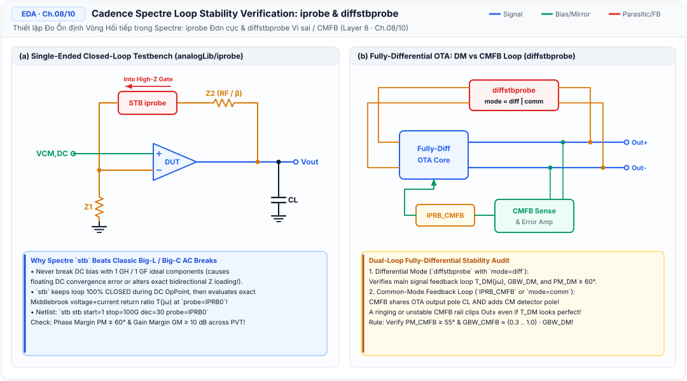

---
{
  "id": "skill-spectre-stb-diffstb-middlebrook",
  "kind": "skill",
  "domain": "eda-and-github-skills",
  "title_vi": "Đo Độ Ổn định Vòng kín Không Cắt Mạch bằng Spectre STB, diffstbprobe & Phương pháp Middlebrook",
  "title_en": "Closed-Loop Stability Verification via Spectre stb, iprobe, diffstbprobe & Middlebrook Injection",
  "summary": "Cẩm nang thiết lập phép phân tích độ ổn định vòng kín chính xác tuyệt đối trong Cadence Spectre 15.1 mà không phá vỡ điểm phân cực DC hay trở kháng tải hai chiều: cách đặt iprobe và diffstbprobe tách biệt vòng Vi sai (DM) với vòng Chế độ chung (CMFB), đối chiếu công thức tiêm kép Middlebrook/Tian, đọc dự trữ pha/độ lợi trên giản đồ Bode & Nyquist và tránh 5 bẫy đặt sai đầu dò.",
  "diagram": "../../diagrams/spectre-stb-probe-setup.svg",
  "razavi_refs": [
    {
      "chapter": 8,
      "section": "8.5-8.9",
      "pages": "303-339",
      "equations": ["8.82", "8.106", "8.121", "8.134", "8.141"]
    },
    {
      "chapter": 9,
      "section": "9.4.2-9.4.3, 9.7.3",
      "pages": "368-373, 381-385",
      "equations": ["9.34", "9.53"]
    },
    {
      "chapter": 10,
      "section": "10.1-10.3, 10.8",
      "pages": "410-420, 440-445",
      "equations": ["10.14", "10.18"]
    }
  ],
  "github_refs": [
    {
      "repo": "iic-jku/analog-circuit-design",
      "url": "https://github.com/iic-jku/analog-circuit-design",
      "use": "Chứng minh giải tích phương pháp tiêm kép áp/dòng của Middlebrook bảo toàn tải hai đầu vòng hồi tiếp"
    },
    {
      "repo": "Arcadia-1/virtuoso-bridge-lite",
      "url": "https://github.com/Arcadia-1/virtuoso-bridge-lite",
      "use": "Quy chuẩn chạy Spectre độc lập và truy xuất nghiêm ngặt phổ phức từ tệp stb.stb / stb.margin.stb"
    },
    {
      "repo": "KenKundert/psf_utils",
      "url": "https://github.com/KenKundert/psf_utils",
      "use": "Cấu trúc bản ghi số phức loopGain và tham số dự trữ pha/độ lợi trong PSF ASCII của phân tích STB"
    }
  ],
  "glossary_codes": ["T051", "T063", "T800", "T953", "T1215", "T1301", "T1592", "T1684"],
  "process_agnostic": true,
  "roles": {
    "single_ended_iprobe": "Phần tử dò dòng không sụt áp analogLib/iprobe nối tiếp trên nhánh đơn đầu để Spectre stb thực hiện phép tiêm hai chiều Tian tính chính xác loopGain T(jw)",
    "differential_stbprobe": "Khối dò 4 cửa analogLib/diffstbprobe chèn vào đường vi sai kép cho phép chọn mode=diff (đo vòng tín hiệu DM) hoặc mode=comm (đo vòng hồi tiếp chế độ chung CMFB)",
    "local_loop_probe": "Đầu dò phụ đặt riêng trên đường cực cổng cascode của OTA phụ trong Gain-Boosted Op-Amp hoặc nhánh bù nội của LDO đa vòng",
    "nyquist_auditor": "Kiểm tra số vòng bao điểm (-1, j0) của quỹ đạo -T(jw) (hoặc điểm (+1, j0) tùy quy ước dấu Spectre) cho hệ ổn định có điều kiện và đa vòng"
  },
  "symptoms_addressed": [
    "open-loop-ac-with-big-lc-gives-wrong-phase-margin-in-closed-loop",
    "breaking-feedback-loop-destroys-dc-operating-point-or-two-port-loading",
    "fully-differential-ota-oscillates-in-common-mode-despite-70deg-dm-pm",
    "stb-reports-zero-or-nonsense-loop-gain-due-to-parallel-ac-bypass-path"
  ],
  "limitations": [
    "linearized-around-single-dc-op-misses-large-signal-slewing-limit-cycles",
    "probe-placed-inside-split-parallel-feedback-measures-partial-branch-only",
    "clocked-switched-capacitor-loops-require-pss-plus-pstb-instead-of-dc-stb"
  ],
  "checklists": ["feedback-and-stb", "cmfb", "two-stage-miller", "ldo-regulator"]
}
---

## 1. Tại sao Cắt Vòng Thủ công Sai Lệch & Kiến trúc Đo Vòng Kín Bằng Spectre `stb`

Một trong những sai lầm đắt giá nhất khi mới chuyển từ bài tập giấy sang Cadence Virtuoso là đo độ lợi vòng (`T051`) bằng cách "cắt đứt" dây hồi tiếp hoặc chèn cuộn cảm khổng lồ $L_{\text{big}} = 1\text{ GH}$ cùng tụ ghép $C_{\text{big}} = 1\text{ GF}$ để chạy phân tích `.ac` vòng hở. Như Razavi chỉ rõ tại Chương 8 (§8.5–§8.9, tr. 301–334):
1. Với Op-Amp độ lợi cao $A_0 \sim 80\text{–}100\text{ dB}$, chỉ một điện áp lệch tĩnh vài chục $\mu\text{V}$ khi hở vòng đã ép ngõ ra chạm cứng nguồn $V_{DD}$ hoặc đất, làm toàn bộ transistor tầng ra sập vào vùng triode!
2. Ngay cả khi dùng mẹo $L_{\text{big}}\text{–}C_{\text{big}}$ giữ được DC, việc hở mạch AC làm **biến mất hoàn toàn trở kháng tải hai chiều** của mạng hồi tiếp (ví dụ điện dung cổng $C_{in}$ của cặp đầu vào Op-Amp nhìn thấy bởi cầu phân áp $R_1\text{–}R_2$, hoặc đường truyền thẳng qua tụ bù/điện trở hồi tiếp $R_F$ trong TIA), dẫn đến dự trữ pha (`T063`) đọc trên `.ac` lạc quan giả tạo hơn thực tế từ $10^\circ$ đến $30^\circ$!



Phân tích **`stb` (Stability Analysis)** tích hợp trong Cadence Spectre 15.1 giải quyết triệt để bài toán này dựa trên **phương pháp tiêm kép Middlebrook (`T1301`) mở rộng bởi Michael Tian (Cadence, 2001)**:
- Ở bước DC, mạch đóng kín vòng $100\%$ đúng như trạng thái vận hành thật trên silicon; đầu dò `analogLib/iprobe` chỉ là một nguồn áp $0\text{ V}$ lý tưởng hoàn toàn trong suốt.
- Ở bước tín hiệu nhỏ tại mỗi tần số $\omega$, trình giải Spectre tự động thực hiện hai thí nghiệm độc lập ngay tại vị trí đặt đầu dò — một lần tiêm nguồn áp nối tiếp và một lần tiêm nguồn dòng song song — để trích xuất đầy đủ ma trận truyền hai chiều (cả chiều thuận lẫn chiều truyền ngược!), giữ nguyên vẹn tuyệt đối trở kháng nhìn về cả hai phía và bất biến với hướng đặt mũi tên đầu dò trong thuật toán Tian!

---

## 2. Cơ sở Toán học Middlebrook – Tian & Quy ước Dấu Hàm Truyền trong Spectre 15.1

### 2.1. Công thức Tiêm Kép Middlebrook (1975) & Công thức Đối xứng Hai chiều Tian (2001)
Xét một mặt cắt bất kỳ chia vòng hồi tiếp đơn thành một đường dây duy nhất (Razavi §8.9 & phụ lục Middlebrook trong `iic-jku/analog-circuit-design`). Khi chèn nguồn áp thử $V_f$ nối tiếp (đo áp hai đầu $V_x, V_y$) và nguồn dòng thử $I_f$ song song xuống đất (đo dòng hai nhánh $I_x, I_y$), hai tỉ số hồi trả một chiều là:

$$
T_v(s) = -\frac{V_r}{V_f}, \qquad T_i(s) = -\frac{I_r}{I_f}
$$

Công thức kinh điển của R. D. Middlebrook ghép $T_v$ và $T_i$ để bao gồm cả tải hai đầu:

$$
T_{\text{Middlebrook}}(s) = \frac{T_v(s)\,T_i(s) - 1}{T_v(s) + T_i(s) + 2}
$$

Tuy nhiên, công thức Middlebrook giả thiết tín hiệu chỉ chạy theo một chiều thuận; nếu đặt đầu dò ngược chiều hoặc tại nút có truyền dẫn ngược mạnh quanh tần số cắt $|T(j\omega)| \approx 1$, kết quả bị méo. Do đó, phân tích `stb` của Spectre 15.1 sử dụng **công thức ma trận nạp dẫn 2x2 của Tian, Strppel, Hahn (IEEE CAD 2001)**, bao hàm cả truyền dẫn thuận lẫn truyền dẫn ngược và đảm bảo giá trị định thức đặc trưng $\Delta(s) = 1 + T_{\text{Tian}}(s)$ bất biến hoàn toàn dù bạn quay mũi tên `iprobe` xuôi hay ngược!

### 2.2. Quy ước Dấu `loopGain`, Dự trữ Pha (`phaseMargin`) & Dự trữ Độ lợi (`gainMargin`) trong Spectre
Hiểu sai quy ước dấu của Spectre là nguyên nhân gây nhầm lẫn nhiều nhất khi đọc kết quả PSF ASCII hoặc OCEAN:
- Spectre định nghĩa đại lượng lưu trong kết quả `stb.stb` tên là `loopGain` chính là tỉ số hồi trả vòng âm $T(j\omega) = \beta(j\omega) A(j\omega)$ (sao cho mẫu số hàm truyền vòng kín là $1 + T(j\omega)$, điểm tới hạn bất ổn định Nyquist ứng với $T(j\omega) = -1 + j0$, tức biên độ $0\text{ dB}$ và pha $-180^\circ$, hoặc $+180^\circ$ khi pha quấn quanh!).
- Ở tần số cực thấp (DC) của một vòng **hồi tiếp âm chuẩn xác**, `loopGain` có pha xấp xỉ **$0^\circ$** (tức số thực dương $\text{Re}\{T(0)\} > 0$!). Nếu tại DC bạn thấy `phase(loopGain) ≈ 180°` (hoặc `-180°`), bạn đã **đấu nhầm hai chân `+` và `-` của Op-Amp tạo thành hồi tiếp dương** (trừ khi chỉ đảo chiều `iprobe` trên một số trình xem sóng cũ — nhưng trong thuật toán Tian của Spectre 15.1, đảo `iprobe` giữ nguyên `loopGain`!).
- Từ $T(j\omega)$, Spectre tự động tính và ghi vào tệp `stb.margin.stb`:

$$
\text{PM} = 180^\circ + \angle T(j\omega_{u}) \quad \text{tại } \left|T(j\omega_{u})\right| = 1\text{ (}0\text{ dB)}, \qquad \text{GM}_{\text{dB}} = -20\log_{10}\left|T(j\omega_{-180^\circ})\right|
$$

| Ngưỡng Dự trữ Pha $\text{PM}$ | Tỉ số tắt dần tương đương $\zeta$ (Hệ bậc 2) | Vọt lố quá độ bậc thang $\text{OS}\%$ | Đánh giá Độ tin cậy Sign-Off Công nghiệp |
|---|---|---|---|
| $< 45^\circ$ | $< 0{,}42$ | $> 23\%$ (rung lắc mạnh) | **TRƯỢT (FAIL)** — cực kỳ dễ tự kích dao động khi thêm ký sinh PEX và góc SS/FF |
| $45^\circ \text{–} 55^\circ$ | $0{,}42 \text{–} 0{,}56$ | $12\% \text{–} 23\%$ | Chấp nhận tạm cho góc PVT cực đoan nhất nếu mạch không khắt khe thời gian xác lập |
| **$60^\circ \text{–} 70^\circ$** | **$0{,}61 \text{–} 0{,}76$** | **$2{,}5\% \text{–} 9\%$** | **VÙNG TỐI ƯU VÀNG** — thời gian xác lập ngắn nhất cho SC/ADC/LDO (`T1684`) |
| $> 80^\circ$ | $> 1{,}0$ (quá tắt dần) | $\approx 0\%$ (bò chậm) | An toàn nhưng lãng phí băng thông (tụ bù $C_c$ quá lớn làm giảm GBW và Slew Rate) |

---

## 3. Bất biến Đặt Đầu dò & 5 Bẫy Lỗi Chết người Trong Thực tế (Invariants & Traps)

- **[INV-STB-01] Bất biến Mặt Cắt Đơn (Single-Cut Topological Bottleneck Rule):** Đầu dò `iprobe` (cho vòng đơn đầu) hoặc cặp `diffstbprobe` (cho vòng vi sai) **bắt buộc phải đặt tại một cổ chai nơi 100% các đường tín hiệu của vòng hồi tiếp cần đo đều đi qua**. Nếu tồn tại một đường hồi tiếp song song đi vòng qua lưng đầu dò (ví dụ đặt `iprobe` ở chân ra tầng 1 nhưng lại có tụ bù Miller $C_c$ nối từ đầu vào tầng 2 vòng ngược về, hoặc có cả nhánh hồi tiếp áp lẫn nhánh cảm biến dòng), `stb` chỉ đo được vòng con cục bộ và bỏ sót hoàn toàn vòng ngoài!
  - *Vị trí chuẩn cho Op-Amp đơn đầu & LDO:* Đặt `iprobe` ngay nối tiếp với **cực cổng vào đảo (`Vin-`) của Error Amplifier** (nơi điện dung rất nhỏ, không có nhánh rẽ song song), hoặc ngay tại đỉnh cầu điện trở phân áp $R_{FB1}$ lấy từ nút `VOUT` trước khi chia xuống `VFB` (miễn là tụ bù $C_c$ nối vào nút `VOUT` nằm về phía Op-Amp trước đầu dò!).
- **[INV-STB-02] Tách Bạch Hoàn Toàn Vòng Vi Sai (`mode=diff`) và Vòng Chế Độ Chung (`mode=comm`) Bằng `diffstbprobe`:** Trong mọi OTA vi sai hoàn toàn (`topo-telescopic-cascode-opamp`, `topo-folded-cascode-ota`, Two-Stage Fully-Differential), tồn tại **hai vòng hồi tiếp độc lập đồng thời**: vòng tín hiệu vi sai bên ngoài và vòng CMFB (`T800`) bên trong. Sử dụng phần tử 4 chân `analogLib/diffstbprobe` chèn vào hai dây hồi tiếp đối xứng (`in1/out1` trên nhánh dương, `in2/out2` trên nhánh âm) hoặc đặt một `iprobe` riêng ngay trên dây xuất điện áp điều khiển đơn đầu `Vctrl_cmfb` của bộ khuếch đại lỗi CMFB!
- **[TRAP-STB-01] Quên Đo Độ Ổn Định Vòng CMFB Làm Mạch Dao Động Chế Độ Chung Ngầm:** Rất nhiều thiết kế đạt $\text{PM}_{\text{DM}} = 68^\circ$ đẹp mỹ mãn nhưng khi chạy `.tran` thì hai ngõ ra $V_{\text{out}+}$ và $V_{\text{out}-}$ cùng vỗ cánh lên xuống đồng pha ở hàng trăm MHz! Nguyên nhân: đường CMFB thường đi qua thêm một bộ cảm biến + một OTA lỗi phụ + gương dòng điều khiển đuôi, chứa tới **3 cực liên tiếp** nhưng không được bù Miller! Bắt buộc chạy hai lệnh `stb` riêng biệt (`stb_dm` và `stb_cm`) trên mọi góc PVT và đảm bảo $\text{PM}_{\text{CM}} \ge 55^\circ$.
- **[TRAP-STB-02] Bỏ Sót Vòng Cục Bộ Của OTA Phụ Trong Gain-Boosted Cascode (`topo-gain-boosted-cascode`):** Một Op-Amp Cascode tăng cường độ lợi vi sai toàn phần có tới **6 vòng lặp**: 1 vòng DM chính, 1 vòng CMFB chính, 2 vòng tăng cường độ lợi cục bộ phía NMOS và PMOS, cộng 2 vòng CMFB của chính các OTA phụ nếu OTA phụ là vi sai! Chỉ nhìn đường Bode vòng DM chính sẽ không thấy dao động nội tại $1\text{–}3\text{ GHz}$ quanh cổng transistor cascode. Phải đặt `iprobe` riêng ở cổng từng transistor cascode được điều tiết để kiểm tra từng vòng phụ!
- **[TRAP-STB-03] Tin Mù Quáng Vào Chỉ Số `phaseMargin` Vô Hướng Khi Đường Pha Cắt $-180^\circ$ Nhiều Lần (Conditional Stability):** Trong Op-Amp 3 tầng bù Nested Miller hoặc LDO có zero-cực phức, pha của $T(j\omega)$ có thể tụt xuống dưới $-180^\circ$ ở tần số trung gian (nơi $|T| > 0\text{ dB}$) rồi nhờ một LHP zero ngóc lên trên $-180^\circ$ ngay tại điểm cắt $0\text{ dB}$! Khi đó hàm `getData("phaseMargin")` báo $\text{PM} = +62^\circ$ nhưng mạch là **ổn định có điều kiện** — chỉ cần bão hòa slewing khi bật nguồn làm giảm độ lợi tức thời là mạch khóa cứng vào dao động tự duy trì (`tech-nyquist-stability-criterion`)! Luôn kiểm tra toàn bộ phổ pha từ DC đến $10\cdot\text{GBW}$ và quỹ đạo cực Nyquist!

---

## 4. Ma trận Chọn Cấu hình Đầu dò `stb` Theo Kiến trúc Mạch Thực chiến

| Kiến trúc Mạch Tương tự | Phần tử Dò & Tham số `probe=` | Vị trí Chèn Tối ưu (Bảo toàn Bất biến Mặt cắt) | Phân tích Phụ Bắt buộc Đi Kèm |
|---|---|---|---|
| Op-Amp đơn đầu hồi tiếp đảo / không đảo / đệm đơn vị | `iprobe` (`STB_DM`) | Nối tiếp ngay trước chân cổng `Vin-` của Op-Amp (sau điểm nút giao $R_1, R_2, C_f$) | Quét bậc thang lớn `.tran` kiểm tra vọt lố khớp $\text{PM}$ |
| Bộ ổn áp tuyến tính CMOS LDO (`topo-cmos-ldo-regulator`) | `iprobe` (`STB_LDO`) | Giữa nút `VOUT` (sau điểm chạm của tụ tải $C_L$ và tụ bù $C_c$) đi vào đỉnh điện trở $R_{FB,\text{top}}$ | Quét tham số $I_{\text{load}}$ từ $0\text{ A}$ đến $I_{\max}$ theo thang logarit! |
| OTA Vi sai Toàn phần + CMFB liên tục (dùng chung đường điều khiển đơn đầu) | Cặp `diffstbprobe` (ngoài) + `iprobe` (`Vcm_ctrl`) | `diffstbprobe` trên hai nhánh hồi tiếp vi sai (`stb_mode=1` cho DM); `iprobe` trên dây cổng nguồn dòng CMFB cho CM | Kiểm tra cả `diffstbprobe` với `stb_mode=2` (Common-Mode) |
| OTA Vi sai Toàn phần có CMFB rẽ nhánh đối xứng (không có nút đơn đầu chung) | `diffstbprobe` (`analogLib`) | Mắc xen vào cặp dây hồi tiếp vi sai nối về hai ngõ vào OTA; chạy `mode=diff` rồi `mode=comm` | Bước nhảy đồng pha trên $V_{\text{cm,ref}}$ trong `.tran` |
| Tham chiếu Bandgap có cả vòng hồi tiếp âm và dương (`topo-bandgap-reference-core`) | `iprobe` (`STB_BGR`) | Nối tiếp ngay tại cực cổng chung điều khiển mảng gương dòng PMOS đỉnh nuôi hai nhánh BJT | Xác nhận hệ số vòng ròng âm ($\text{Re}\{T(0)\} > 0$, $|T_{\text{neg}}| > |T_{\text{pos}}|$) |
| Mạch SC-CMFB / Bộ tích phân Tụ chuyển mạch chạy xung nhịp | `iprobe` / `diffstbprobe` + **`pss` + `pstb`** | Đặt trên nhánh điều khiển liên tục (ví dụ cổng tải CMFB sau tụ giữ mẫu) kết hợp `pstb` | Không dùng `dc` + `stb` thường vì công tắc mở làm đứt vòng DC! |

---

## 5. Mẫu Triển khai Thực tế trên Cadence IC617, Spectre 15.1 & OCEAN

### 5.1. Mẫu Netlist Spectre 15.1 Đo Đồng thời Cả Vòng DM lẫn Vòng CMFB (`tb_fd_ota_stb.scs`)
Trong Spectre 15.1, khối con `diffstbprobe` (hoặc cấu trúc tương đương từ `analogLib`) chứa phần tử nội phục vụ đổi chế độ vi sai/đồng pha, hoặc cách minh bạch và tương thích 100% mọi phiên bản MMSIM 15.1 không phụ thuộc CDF subcircuit là dùng `iprobe` cho từng vòng đơn lẻ và cấu trúc dò vi sai chuẩn:

```scs
// Spectre 15.1 Closed-Loop DM & CMFB Stability Testbench
simulator lang=spectre
global 0
include "/path/to/gpdk090/models/spectre/gpdk090.scs" section=NN
include "fd_folded_cascode_ota.scs"

parameters vdd=1.2 vcm=0.6 cload=2p rf=20k rg=20k

VDD_SRC (vdd 0) vsource dc=vdd
VCM_REF (vcm_ref 0) vsource dc=vcm
VIP_SRC (vip_src 0) vsource dc=vcm
VIN_SRC (vin_src 0) vsource dc=vcm

// Mạng hồi tiếp vi sai độ lợi bằng -1 (Sense V, Return I tại nút cộng cổng OTA)
RG_P (vip_src sum_p) resistor r=rg
RG_N (vin_src sum_n) resistor r=rg
RF_P (vout_n  sum_p) resistor r=rf
RF_N (vout_p  sum_n) resistor r=rf

// Chèn diffstbprobe chuẩn 4 cổng ngay trước hai chân cổng vi sai OTA (cổ chai 100% dòng/áp vòng)
// Lưu ý: Trong ADE IC617, đặt cell analogLib/diffstbprobe tên IPRB_DIFF; hoặc iprobe IPRB_CM trên dây vcmfb
IPRB_P (sum_p inp_ota) iprobe
IPRB_N (sum_n inn_ota) iprobe

// Tải điện dung ngõ ra
CL_P (vout_p 0) capacitor c=cload
CL_N (vout_n 0) capacitor c=cload

// Khối OTA vi sai toàn phần có đầu dò IPRB_CM nằm nối tiếp trên dây điều khiển CMFB nội X_OTA.IPRB_CM
X_OTA (inp_ota inn_ota vout_p vout_n vcm_ref vdd 0) fd_folded_cascode_ota

simOpts options temp=27.0 reltol=1e-5 vabstol=1e-7 iabstol=1e-13

// 1. Kiểm tra điểm phân cực DC kín vòng
dcOp dc write="spectre.dc" maxiters=150

// 2. Đo độ ổn định vòng CMFB qua đầu dò đơn đầu trên dây điều khiển chế độ chung
stb_cm stb start=1 stop=10G dec=30 probe=X_OTA.IPRB_CM annotate=status

// 3. Nếu dùng analogLib/diffstbprobe (ví dụ tên I_DIFFSTB), đo vòng DM (stb_mode=1) và CM (stb_mode=2):
// stb_dm stb start=1 stop=10G dec=30 probe=I_DIFFSTB.IPRB_DM localgnd=0 annotate=status
```

### 5.2. Hàm OCEAN & Python Kiểm toán Tự động Dự trữ Pha, Cắt Đa Điểm & Ổn định Có điều kiện
Trên RHEL 6.5 / IC617, kết hợp hàm SKILL/OCEAN (`saExportStbMargins` trong `ic617_oa_cdf.il`) với bộ kiểm toán phổ phức `stb.stb` để bắt gọn cả lỗi cắt đa điểm lẫn ổn định có điều kiện:

```python
# Kiểm toán nghiêm ngặt phổ phức loopGain từ tệp Spectre PSF ASCII (stb_dm.stb)
import cmath, math

def audit_stb_loopgain(freqs_hz, loop_gain_complex, min_pm_deg=60.0, min_gm_db=10.0):
    assert len(freqs_hz) == len(loop_gain_complex) and len(freqs_hz) > 10
    dc_val = loop_gain_complex[0]
    dc_gain_db = 20.0 * math.log10(max(abs(dc_val), 1e-30))
    dc_phase_deg = math.degrees(cmath.phase(dc_val))

    # 1. Xác nhận hồi tiếp âm thực sự tại tần số thấp (pha gần 0 độ, phần thực dương)
    if dc_val.real <= 0.0 or abs(dc_phase_deg) > 45.0:
        return {"ok": False, "reason": "Positive feedback or collapsed DC loop gain!", "dc_phase_deg": dc_phase_deg}

    # 2. Quét mọi điểm cắt 0 dB (|T| = 1) và kiểm tra bẫy ổn định có điều kiện
    crossings_0db = []
    min_phase_above_0db = 180.0
    unwrapped_deg = []
    prev_rad = cmath.phase(loop_gain_complex[0])
    offset_rad = 0.0
    for idx, val in enumerate(loop_gain_complex):
        raw_rad = cmath.phase(val)
        delta = raw_rad - prev_rad
        while delta > math.pi:
            offset_rad -= 2.0 * math.pi
            delta -= 2.0 * math.pi
        while delta < -math.pi:
            offset_rad += 2.0 * math.pi
            delta += 2.0 * math.pi
        prev_rad = raw_rad
        ph_deg = math.degrees(raw_rad + offset_rad)
        unwrapped_deg.append(ph_deg)
        mag_db = 20.0 * math.log10(max(abs(val), 1e-30))
        if mag_db > 0.0 and ph_deg < min_phase_above_0db:
            min_phase_above_0db = ph_deg
        if idx > 0:
            m0 = 20.0 * math.log10(max(abs(loop_gain_complex[idx - 1]), 1e-30))
            if (m0 >= 0.0 and mag_db < 0.0) or (m0 < 0.0 and mag_db >= 0.0):
                frac = (0.0 - m0) / (mag_db - m0) if mag_db != m0 else 0.0
                f_ugf = freqs_hz[idx - 1] * ((freqs_hz[idx] / freqs_hz[idx - 1]) ** frac)
                ph_ugf = unwrapped_deg[idx - 1] + frac * (ph_deg - unwrapped_deg[idx - 1])
                crossings_0db.append((f_ugf, 180.0 + ph_ugf))

    if not crossings_0db:
        return {"ok": False, "reason": "Loop gain never crosses 0 dB (A0 < 0 dB or wrong probe)!"}

    conditionally_stable = min_phase_above_0db <= -180.0
    worst_ugf_hz, worst_pm_deg = min(crossings_0db, key=lambda item: item[1])
    ok = (not conditionally_stable) and (len(crossings_0db) == 1) and (worst_pm_deg >= min_pm_deg)
    return {
        "ok": ok,
        "dc_loop_gain_db": round(dc_gain_db, 2),
        "ugf_hz": worst_ugf_hz,
        "phase_margin_deg": round(worst_pm_deg, 2),
        "zero_db_crossings": len(crossings_0db),
        "conditionally_stable": conditionally_stable,
    }
```

### 5.3. Đối chiếu Đa Tiến trình (180nm $\to$ 90nm $\to$ 45nm)
Khi thu nhỏ tiến trình từ $180\text{ nm}$ xuống $45\text{ nm}$, điện dung vào cổng $C_{gs} + C_{gd}$ của mạng khuếch đại giảm nhưng trở kháng ra $r_O$ giảm mạnh làm độ lợi vòng DC $T(0)$ thấp (đôi khi chỉ đạt $35\text{–}50\text{ dB}$ cho mạch 1 tầng). Ở $|T(0)|$ vừa phải hoặc quanh tần số cắt $|T(j\omega_u)| = 1$, phép xấp xỉ cắt vòng hở cổ điển sai lệch nặng nhất, trong khi thuật toán hai chiều của Spectre `stb` vẫn chính xác tuyệt đối ở mọi giá trị $|T|$!

---

## 6. Đối chiếu Sách Razavi, Nguồn GitHub Đã Kiểm định & Thuật ngữ Chuẩn CLB

### 6.1. Đối chiếu Sách Gốc Razavi (2nd Edition) & Nguồn Mở GitHub
- **Razavi Chương 8 (§8.5–8.9, tr. 301–334):** Phân tích hiệu ứng tải của mạng hồi tiếp hai cửa, định lý Blackman, phương pháp tỉ số hồi trả của Bode và phương pháp tiêm kép không cắt dây của Middlebrook (Phương trình 8.134–8.141).
- **Razavi Chương 9 (§9.4.2, tr. 368–371 & §9.7.3, tr. 381–385):** Tính ổn định của vòng khuếch đại phụ trong Gain-Boosted Cascode và tính ổn định đa cực của vòng hồi tiếp chế độ chung CMFB.
- **Razavi Chương 10 (§10.1–10.3, tr. 410–420 & §10.8, tr. 440–445):** Liên hệ dự trữ pha – vọt lố quá độ và tiêu chuẩn ổn định Nyquist cho hệ ổn định có điều kiện.
- **Nguồn GitHub Đã Kiểm định:**
  - [`iic-jku/analog-circuit-design`](https://github.com/iic-jku/analog-circuit-design) (commit `6075ea0ebcf0`, Apache-2.0): Phụ lục `_app_middlebrook_method.qmd` và cách đo OTA vi sai kép.
  - [`Arcadia-1/virtuoso-bridge-lite`](https://github.com/Arcadia-1/virtuoso-bridge-lite) (commit `1f186abfbb3d`, MIT) & [`KenKundert/psf_utils`](https://github.com/KenKundert/psf_utils) (commit `67971463a7bf`): Giải mã tệp phức `stb.stb` và kiểm tra hữu hạn không suy đoán ngầm.

### 6.2. Bảng Thuật ngữ Chuẩn CLB Vi Mạch Sử dụng trong Thẻ
| Mã CLB | Thuật ngữ Tiếng Anh | Thuật ngữ Tiếng Việt Chuẩn | Ghi chú Đo kiểm trong Spectre `stb` |
|---|---|---|---|
| `T051` | loop gain | Độ lợi vòng | Đại lượng phức `loopGain` $T(j\omega) = \beta A(j\omega)$ trong `stb.stb` |
| `T063` / `T1684` | phase margin / phase margin of 60° | Dự trữ pha / dự trữ pha 60° | $\text{PM} = 180^\circ + \angle T(j\omega_u)$; mục tiêu chuẩn $\ge 60^\circ$ |
| `T1301` | Middlebrook's Method | phương pháp Middlebrook | Nền tảng tiêm kép áp/dòng mở rộng sang thuật toán Tian trong Spectre |
| `T800` | common-mode feedback | hồi tiếp chế độ chung | Bắt buộc đo riêng bằng `diffstbprobe` (`mode=comm`) hoặc `iprobe` nội |
| `T953` / `T1215` | instability / stability | mất ổn định / độ ổn định | Phải kiểm tra cả quỹ đạo Nyquist chống bẫy ổn định có điều kiện |
