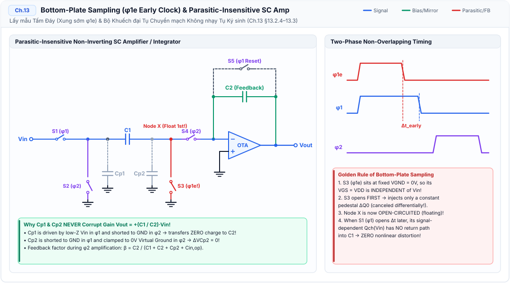

---
{
  "id": "skill-switched-capacitor-charge-injection-pac-tb",
  "kind": "skill",
  "domain": "eda-and-github-skills",
  "title_vi": "Testbench Mạch Tụ Chuyển mạch (SC): Xung Không Chồng Lấn φ1e, Phun Điện tích & Phân tích Spectre PSS/PAC/PNoise",
  "title_en": "Switched-Capacitor Testbench Playbook: Bottom-Plate Non-Overlapping Clocks, Charge Injection & Spectre PSS/PAC/PNoise",
  "summary": "Quy trình thực chiến thiết kế và kiểm chứng toàn diện mạch tụ chuyển mạch (SC Amplifier, Integrator, CDS, S/H) trên Cadence IC617 + Spectre 15.1: kiểm định khe hở xung nhịp không chồng lấn kèm sườn ngắt sớm tấm đáy φ1e, tách riêng sai số phun điện tích kênh dẫn phụ thuộc tín hiệu và xuyên nhiễu xung nhịp, kiểm tra độ phẳng Ron lẫn độ bền oxit công tắc Bootstrap, và đo hàm truyền miền rời rạc H(z) cùng nhiễu nhiệt gấp phổ 2kT/C bằng bộ ba PSS + PAC + Sampled PNoise.",
  "diagram": "../../diagrams/bottom-plate-sampling-sc.svg",
  "razavi_refs": [
    {
      "chapter": 13,
      "section": "13.1-13.4",
      "pages": "539-571",
      "equations": ["13.2", "13.6", "13.14", "13.25", "13.30", "13.34", "13.43", "13.54", "13.61", "13.64"]
    },
    {
      "chapter": 14,
      "section": "14.1.5, 14.2.2-14.2.3",
      "pages": "584-585, 598-603",
      "equations": ["14.49", "14.88", "14.94"]
    }
  ],
  "github_refs": [
    {
      "repo": "Arcadia-1/circuits-and-systems-classroom",
      "url": "https://github.com/Arcadia-1/circuits-and-systems-classroom",
      "use": "Phương pháp mô phỏng kiểm chứng lấy mẫu điện tích, Correlated Double Sampling (CDS) và phân tích nhiễu gấp phổ trong mạch có xung nhịp"
    },
    {
      "repo": "Arcadia-1/sar-adc-skills",
      "url": "https://github.com/Arcadia-1/sar-adc-skills",
      "use": "Quy chuẩn đánh giá độ phẳng Ron(Vin), méo hài THD và độ tin cậy áp cổng của công tắc tự nâng áp (bootstrapped switch)"
    },
    {
      "repo": "Arcadia-1/virtuoso-bridge-lite",
      "url": "https://github.com/Arcadia-1/virtuoso-bridge-lite",
      "use": "Kỷ luật lấy mẫu đúng thời điểm strobe (strobeperiod/strobeonly) và kiểm soát dung sai hội tụ miền thời gian trong Spectre"
    }
  ],
  "glossary_codes": [
    "T014",
    "T015",
    "T087",
    "T319",
    "T2135",
    "T2136",
    "T2137",
    "T2138",
    "T2139",
    "T2140",
    "T2141",
    "T2142",
    "T2145",
    "T2146",
    "T2147"
  ],
  "process_agnostic": true,
  "roles": {
    "nonoverlap_clock_gen": "Bộ tạo xung nhịp hai pha không chồng lấn (φ1, φ2) kèm các pha ngắt sớm tấm đáy (φ1e, φ2e) đảm bảo không bao giờ xả mất điện tích giữa các tụ và cô lập nút tổng trước khi công tắc phía tín hiệu ngắt",
    "sampling_switches": "Công tắc lấy mẫu NMOS/PMOS, cổng truyền dẫn CMOS hoặc công tắc tự nâng áp cổng (Bootstrapped Switch) quyết định băng thông theo dõi 1/(2*pi*Ron*Cs) và méo hài phi tuyến theo Vin",
    "sc_capacitor_network": "Cặp tụ lấy mẫu Cs và tụ hồi tiếp/tích phân Cf (ưu tiên MIM/MOM đối xứng vi sai) thiết lập hệ số khuếch đại chính xác theo tỉ số hình học Cs/Cf miễn nhiễm tụ ký sinh hai đầu",
    "spectre_periodic_engine": "Chuỗi phân tích tuần hoàn trạng thái xác lập PSS làm điểm tựa tuyến tính hóa theo thời gian (LPTV) để PAC đo đáp ứng tần số rời rạc và PNoise tích phân tổng nhiễu gấp phổ Nyquist"
  },
  "symptoms_addressed": [
    "running-regular-ac-or-noise-on-clocked-sc-circuit-yields-meaningless-open-switch-results",
    "signal-dependent-pedestal-offset-and-hd3-distortion-from-wrong-bottom-plate-turnoff-sequence",
    "charge-loss-and-gain-droop-due-to-overlapping-clock-edges-under-rc-skew-at-ff-or-ss",
    "excess-output-noise-from-ota-wideband-thermal-noise-aliasing-across-nyquist-zones",
    "gate-oxide-overstress-exceeding-vdd-inside-bootstrapped-sampling-switch"
  ],
  "limitations": [
    "pss-shooting-newton-struggles-if-clock-edges-are-unrealistically-steep-below-1ps-or-contain-hidden-states",
    "pac-measures-small-signal-lptv-transfer-around-periodic-orbit-and-must-be-paired-with-coherent-tran-fft-for-large-signal-slewing-distortion",
    "sampled-pnoise-requires-explicit-maxsideband-high-enough-to-cover-5x-to-10x-switch-or-ota-bandwidth"
  ],
  "checklists": [
    "common-mos",
    "switched-capacitor",
    "folded-cascode",
    "cmfb"
  ]
}
---

## 1. Kiến trúc Testbench Chuẩn Mực, Vai trò Các Khối & Sơ đồ Lấy mẫu Tấm Đáy

Sai lầm phổ biến nhất của người mới thiết kế **mạch tụ chuyển mạch (`T087`, switched-capacitor circuit)** trong Cadence Virtuoso là chạy trực tiếp phân tích `.ac` hoặc `.noise` truyền thống như đối với mạch thời gian liên tục. Vì phân tích `.ac` và `.noise` chuẩn chỉ tuyến tính hóa mạch quanh **một điểm phân cực tĩnh DC duy nhất** (tại $t = 0$, khi một nửa số công tắc đang đóng cứng và nửa còn lại đang hở hoàn toàn!), kết quả thu được hoàn toàn vô nghĩa: mạch tích phân SC biến thành mạch hở vòng DC lơ lửng, còn sự gấp phổ (aliasing) của hàng chục dải Nyquist vào vùng tần số cơ sở $[0, f_s/2]$ bị bỏ sót trắng!

Để kiểm chứng đúng bản chất hệ thống **tuyến tính biến thiên tuần hoàn theo thời gian (LPTV — Linear Periodically Time-Varying)** theo Razavi Chương 13 (§13.1–§13.4, tr. 539–571), một testbench SC công nghiệp trên Cadence IC617 + Spectre 15.1 bắt buộc kết hợp bốn trụ cột kiểm định: (1) kiểm tra định thời xung nhịp không chồng lấn & thứ tự ngắt sớm **lấy mẫu tấm đáy (`T2135`, bottom-plate sampling)** ở miền quá độ, (2) tách bạch sai số bậc thềm do **phun điện tích (`T014`, charge injection)** và **xuyên nhiễu xung nhịp (`T2136`, clock feedthrough)**, (3) đo hàm truyền miền rời rạc $H(e^{j\omega T_s})$ bằng `pss` + `pac`, và (4) kiểm toán tổng nhiễu lấy mẫu **kT/C (`T2142`)** cộng nhiễu OTA gấp phổ bằng `pss` + `pnoise` chế độ lấy mẫu đúng pha giữ!



Cấu trúc testbench chuẩn cho một **bộ khuếch đại tụ chuyển mạch không nhạy tụ ký sinh (`T2145`)** hoặc **bộ tích phân tụ chuyển mạch (`T2146`)** vi sai toàn phần gồm 4 phân vùng rõ rệt:
1. **Khối Sinh Xung Nhịp 4 Pha Có Kiểm Soát Sườn ($\phi_1, \phi_{1e}, \phi_2, \phi_{2e}$):** Thay vì dùng hai nguồn `vpulse` lý tưởng đảo pha dễ gây trùng dẫn tại điểm cắt $V_{DD}/2$, testbench phải dùng mạch chốt chéo NAND/NOR thực tế (hoặc khối tạo xung tham số hóa tường minh khoảng chết $t_{\text{nonov}}$ và độ sớm tấm đáy $\Delta t_{\text{early}}$) có sườn lên/xuống hữu hạn $t_r, t_f \in [20\text{ ps}, 100\text{ ps}]$.
2. **Mạng Công Tắc & Tụ Điện Vi Sai Đối Xứng:** Gồm công tắc phía nguồn tín hiệu $S_{\text{in}}$ (điều khiển bởi $\phi_1$, dùng cổng truyền dẫn CMOS `T2138` hoặc công tắc nâng áp cổng Bootstrap `T2139`), tụ lấy mẫu $C_S$ (tấm đáy có tụ ký sinh lớn $C_{bp}$ luôn quay về phía nguồn áp thấp trở kháng/ra OTA, tấm đỉnh ít ký sinh quay về phía nút tổng đất ảo!), và công tắc nối đất ảo tấm đỉnh $S_{\text{az}}$ điều khiển bởi xung ngắt sớm $\phi_{1e}$.
3. **Lõi OTA Kèm Vòng SC-CMFB (`T2148`):** Thường là Folded-Cascode hoặc Telescopic OTA 1 tầng tốc độ cao được giữ mức đồng pha ngõ ra bằng mạng tụ chuyển mạch làm tươi mỗi chu kỳ.
4. **Điểm Chốt Đo Đạc Đúng Cuối Pha Giữ (`Strobe Instant` $t_{\text{strobe}}$):** Mọi phép đo điện áp xác lập miền thời gian, lấy mẫu FFT hay lấy mẫu nhiễu `pnoise` đều phải đọc tại thời điểm sát trước sườn xuống của pha khuếch đại/giữ mẫu $\phi_2$ (`T2144`, ví dụ ở $90\%\text{–}95\%$ độ rộng xung $\phi_2$), tuyệt đối không đọc trong pha thu nhận/reset $\phi_1$ (`T2143`)!

---

## 2. Hệ Phương trình Cốt lõi, Giao thức Đo LPTV & Ngân sách Sai số Xác lập

### 2.1. Điều kiện Định thời Bất biến của Hệ Xung Nhịp $\phi_1, \phi_{1e}, \phi_2, \phi_{2e}$
Gọi $T_s = 1/f_s$ là chu kỳ lấy mẫu. Hai pha chính $\phi_1$ (thu nhận) và $\phi_2$ (truyền điện tích) phải tách nhau bởi khoảng chết không chồng lấn $t_{\text{nonov}}$ giữa thời điểm pha trước tụt xuống dưới $0{,}1\,V_{DD}$ và thời điểm pha sau vượt lên trên $0{,}1\,V_{DD}$, đồng thời pha tấm đáy $\phi_{1e}$ phải ngắt sớm hơn $\phi_1$ một khoảng $\Delta t_{\text{early}}$ (Razavi §13.2.4, tr. 553–555):

$$
T_{\text{high},\phi_2} = \frac{T_s}{2} - t_{\text{nonov}} - t_r - t_f, \qquad \Delta t_{\text{early}} = t_{\downarrow,\phi_1} - t_{\downarrow,\phi_{1e}} > 3\,\tau_{\text{off,az}}
$$

Khi $\phi_{1e}$ ngắt trước trong khi $S_{\text{in}}$ vẫn đóng, công tắc $S_{\text{az}}$ ở nút tổng đất ảo luôn nhìn thấy thế cực nguồn cố định $V_{CM}$, nên lượng điện tích kênh dẫn của nó bơm vào tấm đỉnh tụ $C_S$ là **hằng số độc lập với $V_{\text{in}}$** (Razavi Phương trình 13.34):

$$
\Delta Q_{\text{az}} = -\alpha W_{\text{az}} L_{\text{az}} C_{\text{ox}} \left(V_{DD} - V_{CM} - V_{TH,\text{az}}\right) = \text{const.}
$$

Trong cấu trúc vi sai đối xứng, thành phần không đổi $\Delta Q_{\text{az}}$ trên hai nhánh dương/âm biến thành sai lệch đồng pha nhỏ và bị triệt tiêu hoàn toàn ở ngõ ra vi sai ($\Delta V_{\text{out,diff,ped}} \to 0$)! Ngay sau đó khi $\phi_1$ tắt công tắc $S_{\text{in}}$ (vốn có $Q_{\text{ch}}$ phụ thuộc phi tuyến mạnh vào $V_{\text{in}}$), nút tấm đỉnh của $C_S$ đã hoàn toàn **hở mạch (floating)** — dòng điện tích phun ra từ $S_{\text{in}}$ không có đường khép kín qua $C_S$ nên không thể làm thay đổi hiệu điện thế đã khóa trên $C_S$!

### 2.2. Sai số Độ lợi Tĩnh, Hệ số Hồi tiếp Hiệu dụng $\beta$ & Ngân sách Xác lập Pha $\phi_2$
Trong pha truyền điện tích $\phi_2$ của mạch khuếch đại đặt lại tỉ số $C_1/C_2$ (Razavi §13.3.2, Phương trình 13.50–13.56), tụ ký sinh cổng vào của OTA $C_{\text{in}}$ (gồm $C_{GS1} + C_{GD1,\text{eff}}$ cộng tụ ký sinh tấm đỉnh) làm suy giảm hệ số hồi tiếp $\beta$ từ giá trị lý tưởng $\frac{C_2}{C_1 + C_2}$ xuống:

$$
\beta = \frac{C_2}{C_1 + C_2 + C_{\text{in}}}, \qquad A_{v,\text{closed}}(z\to 1) = \frac{C_1}{C_2} \cdot \frac{1}{1 + \dfrac{1}{\beta A_0}} \approx \frac{C_1}{C_2}\left(1 - \frac{C_1 + C_2 + C_{\text{in}}}{C_2 A_0}\right)
$$

Hằng số thời gian xác lập tuyến tính vòng kín trong pha $\phi_2$ với tải hiệu dụng $C_{L,\text{eff}} = C_L + (1 - \beta) C_2 = C_L + \frac{C_1 + C_{\text{in}}}{C_1 + C_2 + C_{\text{in}}} C_2$ (bỏ qua $R_{\text{on}}$ công tắc nối tiếp nếu $R_{\text{on}} \ll 1/g_m$) là:

$$
\tau_{\text{lin}} = \frac{C_{L,\text{eff}}}{\beta G_m}, \qquad \varepsilon_{\text{dyn}} = \exp\!\left(-\frac{T_{\text{high},\phi_2} - t_{\text{slew}}}{\tau_{\text{lin}}}\right)
$$

Để đạt độ chính xác $N\text{-bit}$ (sai số tổng tĩnh + động nhỏ hơn $\frac{1}{2}\text{ LSB} = 2^{-(N+1)}$), thiết kế bắt buộc thỏa mãn đồng thời hai bất đẳng thức:

$$
\beta A_0 \ge 2^{N+2} \quad (\text{nén sai số tĩnh } \le 0{,}25\text{ LSB}), \qquad \frac{T_{\text{high},\phi_2} - t_{\text{slew}}}{\tau_{\text{lin}}} \ge (N + 2)\ln 2 \approx 0{,}693(N + 2)
$$

### 2.3. Tổng Nhiễu Nhiệt Gấp Phổ Hai Pha ($\phi_1$ Thu nhận + $\phi_2$ Khuếch đại)
Khác với mạch giữ mẫu đơn giản chỉ chịu $\frac{kT}{C_S}$ (hoặc $\frac{2kT}{C_S}$ vi sai), trong pha $\phi_2$ nhiễu nhiệt của công tắc và của chính OTA (hệ số nhiễu dư $\gamma_{\text{eff}}$ phản ánh cả cặp vi sai lẫn tải nguồn dòng) tiếp tục được tích phân trên băng thông nhiễu vòng kín $\Delta f_n = \frac{1}{4\tau_{\text{lin}}} = \frac{\beta G_m}{4 C_{L,\text{eff}}}$ rồi bị lấy mẫu ở cuối pha $\phi_2$. Do băng thông vòng kín lớn gấp nhiều lần $f_s/2$, toàn bộ phổ nhiễu rộng này **gấp chồng (fold/alias)** trọn vẹn vào dải Nyquist thứ nhất $[0, f_s/2]$:

$$
\overline{V_{n,\text{out,diff}}^2} = \underbrace{\frac{2 k T}{C_S}\left(\frac{C_1}{C_2}\right)^{\!2}}_{\text{Nhiễu lấy mẫu pha }\phi_1\text{ truyền sang }\phi_2} + \underbrace{\frac{2 k T \gamma_{\text{eff}}}{\beta C_{L,\text{eff}}}}_{\text{Nhiễu rộng dải của OTA gấp phổ ở cuối }\phi_2}
$$

Trong Spectre 15.1, chỉ có phân tích **`pss` + `pnoise` (`noisetype=timedomain` / `sampled` chốt tại thời điểm strobe cuối $\phi_2$, với `maxsideband >= 15..30`)** mới tính chính xác đồng thời cả hai số hạng này cùng phần nhiễu $1/f$ chưa bị CDS khử hết!

---

## 3. Bất biến Kỹ thuật & Các Bẫy Lỗi Thực chiến (Invariants & Traps)

- **[INV-SC-01] Bất biến Trình tự Ngắt Sớm $\phi_{1e}$ Trước $\phi_1$ Qua Mọi Góc Quy trình và Tải Dây PEX:** Không chỉ đúng trên schematic danh định, sau khi trích xuất ký sinh layout RC (`PEX`), đường dây xung $\phi_{1e}$ tới cực cổng công tắc đất ảo $S_{\text{az}}$ bắt buộc vẫn phải rơi qua ngưỡng tắt $V_{TH}$ sớm hơn đường dây $\phi_1$ tới công tắc đầu vào $S_{\text{in}}$ ít nhất $\ge 50\text{–}150\text{ ps}$ trên cả 5 góc `{TT, FF, SS, FS, SF}`! Nếu dây $\phi_{1e}$ bị kéo dài hoặc gánh tải lớn hơn làm trễ sườn xuống muộn hơn $\phi_1$, toàn bộ cơ chế lấy mẫu tấm đáy sụp đổ ngay lập tức, làm méo hài bậc ba $\text{HD}_3$ tăng vọt $20\text{–}35\text{ dB}$!
- **[INV-SC-02] Bất biến Giới hạn Bền Oxit Cổng Trong Công tắc Bootstrap (`T2139`):** Công tắc tự nâng áp cổng dùng tụ bay $C_{\text{boot}} \ge (5\text{–}10) C_{gg,\text{sw}}$ để duy trì $V_{GS,\text{sw}} \approx V_{DD}$ độc lập với $V_{\text{in}} \in [0, V_{DD}]$, tức điện thế tuyệt đối tại cực cổng vọt lên tới **$2\,V_{DD}$** khi $V_{\text{in}} = V_{DD}$! Bắt buộc kiểm toán sóng quá độ đảm bảo hiệu điện thế tương đối giữa hai cực bất kỳ của **mọi transistor** trong khối bootstrap thỏa mãn nghiêm ngặt $|V_{GS}|, |V_{GD}|, |V_{GB}| \le 1{,}05\,V_{DD}$ (bằng cách thêm transistor chắn cascode cổng treo $V_{DD}$ và nối thân PMOS nạp tụ vào chính đỉnh tụ bay, Razavi §13.2.2 & Hình 13.17).
- **[TRAP-SC-01] Bẫy Đọc Sai `pac` Sideband `0` Khi Chưa Chốt Pha Hoặc Thiếu Suy giảm $\text{sinc}$:** Trong Spectre `pac`, dải biên `out_index = 0` (`sideband = 0`) cho đáp ứng tần số liên tục theo thời gian lấy trung bình trên cả chu kỳ $T_s$ (bao gồm cả pha reset $\phi_1$ mà ngõ ra bị kéo về $V_{CM}$ làm biên độ tụt mất $-6\text{ dB}$!), trừ khi mạch có tầng Sample-and-Hold giữ áp suốt $100\%$ chu kỳ hoặc dùng `pac` kiểu lấy mẫu rời rạc (`sampled` tại thời điểm cuối $\phi_2$)! Luôn kiểm chứng chéo độ lợi tần số thấp của `pac` với tỉ số $C_1/C_2$ đo trên bước nhảy DC trong `tran`!
- **[TRAP-SC-02] Bẫy Đặt `maxsideband` Quá Nhỏ Trong `pnoise` Làm Báo Thiếu Nhiễu $10\text{–}15\text{ dB}$:** Giả sử $f_s = 10\text{ MHz}$ nhưng băng thông đóng công tắc $1/(2\pi R_{\text{on}} C_S) = 200\text{ MHz}$ và băng thông nhiễu OTA là $80\text{ MHz}$. Nếu người thiết kế để mặc định `maxsideband = 5` (chỉ quét gấp phổ tới $5 \times 10\text{ MHz} = 50\text{ MHz}$), hơn $75\%$ năng lượng nhiễu nhiệt từ $50\text{ MHz}$ tới $500\text{ MHz}$ bị cắt bỏ nhân tạo — khiến Spectre báo nhiễu thấp giả tạo tốt hơn thực tế! Quy tắc bắt buộc: đặt `maxsideband >= ceil(10 * max(f_BW_switch, GBW_OTA) / f_s)`.
- **[TRAP-SC-03] Bẫy Xung Nhịp Lý tưởng Sườn `1 fs` Làm Treo Hội tụ Shooting-Newton `pss`:** Đặt `rise=0` hoặc `rise=1f` trên nguồn `vpulse` tạo bước nhảy đạo hàm vô cùng trên tụ chồng phủ $C_{GD}$ của công tắc, ép bộ giải Shooting-Newton của `pss` chia nhỏ bước thời gian đến giới hạn `minstep` rồi báo lỗi không hội tụ. Luôn đặt $t_r, t_f$ thực tế ($\ge 20\text{ ps}$ hoặc lấy qua cổng đệm inverter CMOS thật) và bật `errpreset=conservative`!

---

## 4. Ma trận Lựa chọn Cấu trúc Công tắc, Chẩn đoán Lỗi SC & Lộ trình Nâng cấp

| Triệu chứng thất bại trong mô phỏng SC | Nguyên nhân vật lý gốc rễ | Phép thử cô lập trong Spectre 15.1 | Giải pháp nâng cấp cấu trúc / tham số |
|---|---|---|---|
| Sai số tỉ số độ lợi tĩnh lệch $> 0{,}2\%$ dù $C_1/C_2$ khớp hoàn hảo | Độ lợi vòng hở $A_0$ của OTA hoặc $\beta = \frac{C_2}{C_1+C_2+C_{\text{in}}}$ quá thấp | Đọc `A0` tại điểm phân cực pha $\phi_2$ bằng `pstb` và đo $C_{gg1}$ từ `oppoint` | Nâng OTA từ Folded-Cascode thường lên `topo-gain-boosted-cascode` hoặc thu hẹp $W_1$ vừa đủ để giảm $C_{\text{in}}$ |
| Bậc thềm offset tĩnh lớn & méo $\text{HD}_2/\text{HD}_3$ tăng mạnh khi tăng biên độ $V_{\text{in}}$ | Sườn xuống $\phi_{1e}$ không ngắt đủ sớm trước $\phi_1$, hoặc $R_{\text{on}}(V_{\text{in}})$ của cổng CMOS phình to ở giữa dải nguồn thấp | Vẽ đồ thị hiệu pha $(V(\phi_1) - V(\phi_{1e}))$ tại mức $V_{TH}$ và quét $\text{THD}$ theo $V_{\text{in}}$ | Mở rộng $\Delta t_{\text{early}}$ thêm 2 cặp cổng trễ inverter; thay công tắc CMOS bằng `topo-bootstrapped-sampling-switch` khi $V_{DD} \le 1{,}2\text{ V}$ |
| Đáp ứng bộ tích phân SC bị suy hao biên độ (droop) ở tần số thấp | Xung $\phi_1$ và $\phi_2$ bị chồng lấn một phần tại sườn chuyển mức làm xả điện tích tụ tích phân $C_F$ | Phóng to giao điểm sườn lên/xuống của $\phi_1, \phi_2$ ở góc `FF/-40°C` và `SS/125°C` | Tăng số tầng cổng trễ chẵn trong vòng hồi tiếp chốt NAND tạo $t_{\text{nonov}} \ge 3\text{–}5\,t_{d,\text{inv}}$ |
| Vọt lố kéo dài hoặc không kịp xác lập trong nửa chu kỳ $T_s/2$ | Slewing do dòng đuôi $I_{SS}$ thiếu hụt, hoặc điện trở nối tiếp $R_{\text{on}}$ của công tắc tạo cực phụ kéo tụt dự trữ pha của OTA | Tách đường cong quá độ $V_{\text{out}}(t)$ trong pha $\phi_2$ thành đoạn dốc thẳng (slew) và đoạn hàm mũ ($\tau_{\text{lin}}$); chạy `pstb` | Tăng $I_{SS} \ge \frac{\Delta V_{\max} C_{L,\text{eff}}}{0{,}3\,T_{\text{high},\phi_2}}$, mở rộng $W_{\text{sw}}$ sao cho $R_{\text{on}} \le \frac{1}{5 G_m}$ (nhưng kiểm soát $C_{\text{sw}}$) |
| Tổng nhiễu RMS ngõ ra cao gấp $2\text{–}3\times$ giới hạn $\sqrt{2kT/C_S}$ | Tỉ số $G_m$ tải nguồn dòng trên $g_{m1}$ lớn làm $\gamma_{\text{eff}}$ cao, hoặc tụ tải $C_L$ quá nhỏ làm băng thông nhiễu OTA quá rộng | Xuất bảng `Noise Summary` của `pnoise` (sắp xếp theo % đóng góp tích phân trên $[0, f_s/2]$) | Giảm $g_{m,\text{fold}}/g_{m1}$ và $g_{m,\text{load}}/g_{m1}$, tăng tụ tải $C_L$ ở ngõ ra OTA để bó hẹp băng thông gấp phổ nhiễu nhiệt, hoặc bật kỹ thuật `tech-dynamic-offset-cancellation-az-cds` cho nhiễu $1/f$ |

---

## 5. Thích ứng Đa Tiến trình (180nm–45nm) & Mẫu Netlist Spectre 15.1 (`pss`/`pac`/`pnoise`/`pstb`)

### 5.1. Hướng dẫn Thích ứng Thiết kế Công tắc & Tụ SC Theo Nút Công nghệ
- **180nm ($V_{DD} = 1{,}8\text{ V}$, $V_{TH} \approx 0{,}45\text{ V}$):** Cổng truyền dẫn bổ sung CMOS (`T2138`, NMOS song song PMOS) có khoảng dư dẫn $V_{DD} - (V_{THN} + |V_{THP}|) \approx +0{,}9\text{ V} > 0$ rất dồi dào trên toàn dải tín hiệu, chỉ cần dùng công tắc CMOS kèm lấy mẫu tấm đáy là dễ dàng đạt $10\text{–}12\text{ bit}$.
- **90nm / 65nm / 45nm ($V_{DD} = 0{,}9\text{–}1{,}2\text{ V}$, $V_{TH,\text{SVT}} \approx 0{,}38\text{–}0{,}45\text{ V}$):** Khi $V_{\text{in}} \approx V_{DD}/2$, tổng $(V_{THN,\text{eff}} + |V_{THP,\text{eff}}|)$ có hiệu ứng thân ($V_{SB} > 0$) xấp xỉ hoặc vượt $V_{DD}$, tạo thành **"vùng chết điện trở cao" (dead-zone conductance)** ở giữa dải làm méo $\text{HD}_3$ trầm trọng! Bắt buộc chuyển công tắc phía đầu vào biên độ lớn sang **công tắc Bootstrap (`topo-bootstrapped-sampling-switch`)**, còn các công tắc phía nút đất ảo giữ áp cố định $V_{CM}$ chỉ cần dùng một NMOS (nếu $V_{CM} \le 0{,}45\,V_{DD}$) hoặc PMOS (nếu $V_{CM} \ge 0{,}55\,V_{DD}$) kích thước nhỏ gọn để giảm thiểu điện tích phun $\Delta Q_{\text{az}}$! Đồng thời ở 65nm/45nm phải kiểm tra dòng rò cổng $I_G$ và dòng rò dưới ngưỡng $I_{\text{off}}$ ở góc `FF / 125 °C` gây sụt áp tụ giữ mẫu khi $f_s$ thấp ($< 100\text{ kHz}$).

### 5.2. Mẫu Netlist Spectre 15.1 Chuẩn Xác Cho Bộ Khuếch đại / Tích phân SC (`tb_sc_pss_pac_pnoise.scs`)
```spice
// tb_sc_pss_pac_pnoise.scs — Spectre 15.1 Periodic Characterization for Fully-Diff SC Stage
simulator lang=spectre
global 0

parameters fs=20M Ts=1/fs t_nonov=600p t_early=250p trf=40p \
           vdd_val=1.2 vcm_val=0.6 Cs_val=1p Cf_val=0.5p Cl_val=2p

// 1. Nguon cap & muc dong pha chuan
VDD (vdd 0) vsource dc=vdd_val type=dc
VCM (vcm 0) vsource dc=vcm_val type=dc

// 2. He xung nhip 4 pha khong chong lan co suon phi1e ngat som hon phi1 dung t_early
// Pha thu nhan phi1: [t_nonov .. Ts/2 - t_nonov]; phi1e ngat som hon t_early
VPHI1  (phi1  0) vsource type=pulse val0=0 val1=vdd_val delay=t_nonov \
       rise=trf fall=trf width=(Ts/2 - 2*t_nonov - trf) period=Ts
VPHI1E (phi1e 0) vsource type=pulse val0=0 val1=vdd_val delay=t_nonov \
       rise=trf fall=trf width=(Ts/2 - 2*t_nonov - trf - t_early) period=Ts
// Pha truyen dien tich / giu mau phi2: [Ts/2 + t_nonov .. Ts - t_nonov]
VPHI2  (phi2  0) vsource type=pulse val0=0 val1=vdd_val delay=(Ts/2 + t_nonov) \
       rise=trf fall=trf width=(Ts/2 - 2*t_nonov - trf) period=Ts
VPHI2E (phi2e 0) vsource type=pulse val0=0 val1=vdd_val delay=(Ts/2 + t_nonov) \
       rise=trf fall=trf width=(Ts/2 - 2*t_nonov - trf - t_early) period=Ts

// 3. Nguon kich thich vi sai ho tro dong thoi PAC (pacmag) va Coherent Tran (ampl)
// Chon M=13, N=128 nguyen to cung nhau => fin = (13/128)*20MHz = 2.03125 MHz
VINP (vip vcm) vsource type=sine sinedc=0 ampl=0.25 freq=(13.0/128.0)*fs pacmag=0.5
VINN (vin vcm) vsource type=sine sinedc=0 ampl=-0.25 freq=(13.0/128.0)*fs pacmag=-0.5

// Khoi DUT: Mach khuech dai / tich phan SC vi sai toan phan kem SC-CMFB
// X_SC_DUT (vip vin vop von phi1 phi1e phi2 phi2e vcm vdd 0) sc_amp_diff Cs=Cs_val Cf=Cf_val
// Cload_p (vop 0) capacitor c=Cl_val
// Cload_n (von 0) capacitor c=Cl_val

save vop von phi1 phi1e phi2
saveOptions options save=selected

// [PHAN TICH 1] PSS Shooting-Newton tai chu ky xung nhip fs (tat nguồn sine khi chay PSS!)
// Luu y: De chay PSS sach tai dung tan so fs, dat ampl=0 tren VINP/VINN trong run PSS/PAC/PNoise
pss_sc pss fund=fs harms=20 errpreset=conservative tstab=10*Ts method=traponly

// [PHAN TICH 2] Sampled PAC do ham truyen mien roi rac H(e^{jwTs}) chot tai 92% pha phi2
pac_sc pac start=1k stop=fs/2 dec=50 maxsideband=20 \
       sampled=trap sampletime=(0.96*Ts - t_nonov) annotate=status

// [PHAN TICH 3] Sampled PNoise tich phan nhieu nhiet gap pho 2kT/C + OTA + 1/f tren [1Hz .. fs/2]
pnoise_sc pnoise (vop von) start=1 stop=fs/2 dec=30 maxsideband=25 \
          noisetype=timedomain timedomain=yes numberofpoints=1 \
          timepoint=(0.96*Ts - t_nonov) annotate=status

// [PHAN TICH 4] Periodic Stability (pstb) kiem tra du tru pha vong DM/CMFB ngay trong pha phi2
// pstb_dm pstb probe=X_SC_DUT.IPROBE_DM start=1k stop=2G dec=30
```

### 5.3. Bảng Kiểm Định 6 Chỉ Số Bắt Buộc Sau Khi Chạy Testbench SC
```text
[1] Khe không chồng lấn phi1/phi2:     t_nonov_min(FF, SS, PEX) >= 150 ps tại ngưỡng 0.1*VDD
[2] Độ sớm lấy mẫu tấm đáy phi1e:      t_fall(phi1, Vth) - t_fall(phi1e, Vth) >= 100 ps (mọi góc)
[3] An toàn oxit công tắc Bootstrap:   max_t(|Vgs|, |Vgd|, |Vgb|) <= 1.05 * VDD
[4] Sai số xác lập bước nhảy pha phi2: |Vout_diff(t_strobe) - (Cs/Cf)*Vin_diff| < 0.5 LSB
[5] Dự trữ pha chu kỳ (pstb pha phi2): PM_DM >= 60 deg  &  PM_CMFB >= 55 deg
[6] Hội tụ gấp phổ Sampled PNoise:     Chênh lệch Vn_rms giữa maxsideband=20 và 35 < 0.2 dB
```

---

## 6. Đối chiếu Sách Razavi, Nguồn GitHub Đã Kiểm định & Bảng Thuật ngữ Chuẩn CLB

### 6.1. Mốc Tọa độ Chính xác Trong Sách Razavi (2nd Edition) & Kho GitHub
- **Razavi Chương 13 (*Introduction to Switched-Capacitor Circuits*):** §13.1 *General Considerations* (tr. 539–541), §13.2 *Sampling Switches* — gồm công tắc MOS/CMOS, Bootstrap, $kT/C$, phun điện tích kênh dẫn $Q_{\text{ch}}$, xuyên nhiễu xung nhịp, công tắc giả $W_{\text{dummy}} = 0{,}5\,W$ và lấy mẫu tấm đáy (tr. 541–555, Phương trình 13.2, 13.6, 13.14, 13.25, 13.30, 13.34), §13.3 *Switched-Capacitor Amplifiers* (tr. 555–568, Phương trình 13.43, 13.54, Ví dụ 13.4–13.6), §13.4 *Switched-Capacitor Integrator* (tr. 568–571, Phương trình 13.61–13.64).
- **Razavi Chương 14 (*Nonlinearity and Mismatch*):** §14.1.5 *Nonlinearity of Sampling Circuits* (tr. 584–585, Phương trình 14.49), §14.2.2–§14.2.3 *Offset Cancellation & Reduction of $1/f$ Noise* (tr. 598–603, Phương trình 14.88–14.94 — giải thích hàm truyền thông cao $2|\sin(\omega T_s/2)|$ khử offset/flicker kèm hệ quả gấp đôi công suất sàn nhiễu nhiệt trắng).
- **Đối chiếu Nguồn Mở Đã Kiểm Định:**
  - `Arcadia-1/circuits-and-systems-classroom` (`f377bd965e8a`, MIT): Phân tích định lượng mạch lấy mẫu tích phân dòng, Correlated Double Sampling (CDS) và Correlated Level Shifting (CLS).
  - `Arcadia-1/sar-adc-skills` (`27de09a34ea3`): Quy chuẩn đánh giá $\text{THD} < -70\text{ dB}$ và độ phẳng $R_{\text{on}}(V_{\text{in}})$ dao động $< 10\%$ cho công tắc Bootstrap.
  - `Arcadia-1/virtuoso-bridge-lite` (`1f186abfbb3d`, MIT): Kỹ thuật lấy mẫu đúng nhịp `strobeperiod` và tránh suy giảm độ chính xác động do lạm dụng chế độ nới lỏng dung sai.

### 6.2. Bảng Thuật ngữ Chuẩn CLB Vi Mạch Sử dụng trong Thẻ
| Mã CLB | Thuật ngữ Tiếng Anh | Thuật ngữ Tiếng Việt Chuẩn | Ý nghĩa Kỹ thuật Cốt lõi |
|---|---|---|---|
| `T087` | switched-capacitor circuit | mạch tụ chuyển mạch | Thay thế điện trở thiếu chính xác bằng tỉ số tụ điện chuyển mạch chính xác $< 0{,}1\%$ |
| `T2135` | bottom-plate sampling | lấy mẫu tấm đáy | Ngắt công tắc nút đất ảo bằng xung $\phi_{1e}$ trước công tắc đầu vào để khử phun điện tích phụ thuộc $V_{\text{in}}$ |
| `T014` / `T2136` | charge injection / clock feedthrough | phun điện tích / xuyên nhiễu xung nhịp | Hai nguồn gây sai số bậc thềm (`T2141`, pedestal error) và méo hài khi tắt công tắc MOS |
| `T2139` | bootstrapped switch | công tắc nâng áp cực cổng (bootstrap) | Giữ $V_{GS} \approx V_{DD}$ không đổi theo $V_{\text{in}}$ để tuyến tính hóa $R_{\text{on}}$ ở nguồn cấp thấp |
| `T2142` | kT/C thermal sampling noise | nhiễu lấy mẫu nhiệt kT/C | Phương sai nhiễu nhiệt tích phân trên tụ giữ mẫu chỉ phụ thuộc $C$, độc lập với $R_{\text{on}}$ |
| `T2147` | non-overlapping two-phase clocks | xung nhịp hai pha không chồng lấp | Cặp xung $\phi_1, \phi_2$ có khoảng chết $t_{\text{nonov}} > 0$ ngăn đường rò điện tích trực tiếp giữa các tụ |
