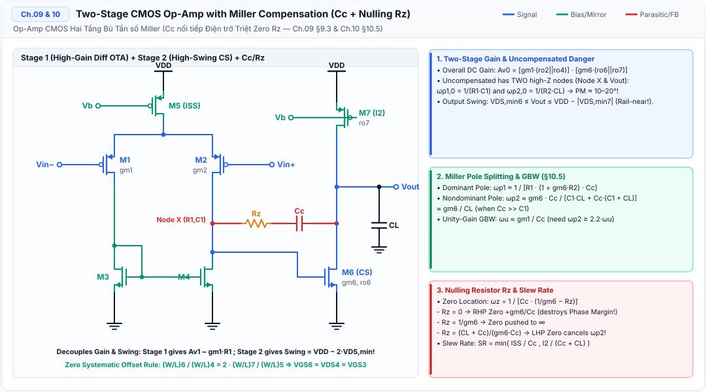

---
{
  "id": "skill-two-stage-miller-fault-tree",
  "kind": "skill",
  "domain": "eda-and-github-skills",
  "title_vi": "Cây Chẩn đoán Lỗi Hệ thống Op-Amp Hai Tầng Bù Miller (PM, RHP Zero, Slewing, Offset & PSRR)",
  "title_en": "Two-Stage Miller Op-Amp Root-Cause Fault Tree: PM Collapse, RHP Zero, Dual Slewing, Systematic Offset & PSRR",
  "summary": "Quy trình chẩn đoán gốc rễ và sửa lỗi định lượng cho Op-Amp CMOS hai tầng bù Miller (Cc + Rz): giải quyết sụp dự trữ pha do cực ngõ ra p2 / cực gương p3 / lệch Rz triệt RHP zero, nút thắt Slew Rate âm hai nhánh min(Itail/Cc, ID2/(Cc+CL)), điều kiện triệt tiêu tuyệt đối điện áp lệch hệ thống qua tỉ lệ mật độ dòng gương và bẫy xuyên thẳng nguồn cấp tần số cao qua tụ Cc (PSRR+ / PSRR-).",
  "diagram": "../../diagrams/two-stage-miller-opamp.svg",
  "razavi_refs": [
    {
      "chapter": 9,
      "section": "9.3-9.4.1, 9.9-9.12",
      "pages": "361-368, 390-405",
      "equations": ["9.18", "9.19", "9.81", "9.88"]
    },
    {
      "chapter": 10,
      "section": "10.4-10.7",
      "pages": "420-439",
      "equations": ["10.25", "10.29", "10.33", "10.36", "10.38", "10.46"]
    },
    {
      "chapter": 11,
      "section": "11.5.2",
      "pages": "487-495",
      "equations": []
    }
  ],
  "github_refs": [
    {
      "repo": "jiyuanduan001-oss/LLM_Amplifier_Sizing",
      "url": "https://github.com/jiyuanduan001-oss/LLM_Amplifier_Sizing",
      "use": "Cây lỗi TSM (Two-Stage Miller): thứ tự bão hòa, lệch hệ thống, hai nhánh SR+/SR- và giải tích hai đường PSRR-"
    },
    {
      "repo": "iic-jku/analog-circuit-design",
      "url": "https://github.com/iic-jku/analog-circuit-design",
      "use": "Thiết kế chi tiết Op-Amp hai tầng đơn đầu và vi sai toàn phần kèm mô hình tách cực Miller"
    },
    {
      "repo": "SrinivasNv0031/two-stage-cmos-opamp-gpdk090",
      "url": "https://github.com/SrinivasNv0031/two-stage-cmos-opamp-gpdk090",
      "use": "Ví dụ cơ sở GPDK090 cần nâng cấp từ AC vòng hở lên kiểm toán đầy đủ STB, PVT, Slew và PSRR"
    }
  ],
  "glossary_codes": ["T063", "T079", "T528", "T620", "T852", "T874", "T879", "T1592", "T1684"],
  "process_agnostic": true,
  "roles": {
    "stage1_ota": "Tầng 1 vi sai tải gương tích cực (M1-M2 đầu vào, M3-M4 gương tải, M5 nguồn đuôi) cung cấp độ lợi đầu, nén nhiễu/offset và bơm dòng nạp xả tụ Miller Cc",
    "stage2_cs_driver": "Tầng 2 nguồn chung (M6 khuếch đại công suất đối cực với tải M1-M2, M7 nguồn dòng tĩnh tải) mở rộng biên độ ngõ ra tới VDD - 2*VDS,min và quyết định cực tải wp2 = gm6/CL",
    "miller_rz_cc_network": "Mạng bù tách cực Cc nối tiếp điện trở triệt Rz: kéo cực tầng 1 xuống thấp làm cực trội, đẩy cực ngõ ra lên cao và dời RHP zero sang LHP để cứu dự trữ pha",
    "systematic_offset_lock": "Ràng buộc hình học mật độ dòng (W/L)_6 / (W/L)_4 = 2 * (W/L)_7 / (W/L)_5 khóa cứng V_DS4 = V_GS3 tránh lệch hệ thống và vào triode sớm"
  },
  "symptoms_addressed": [
    "phase-margin-collapses-when-load-capacitance-cl-increases",
    "positive-and-negative-slew-rates-differ-by-3x-with-slow-droop",
    "first-stage-output-drift-pushes-diff-pair-into-triode-due-to-systematic-offset",
    "psrr-drops-to-0db-above-gbw-due-to-miller-capacitor-diode-shorting-gate-to-drain"
  ],
  "limitations": [
    "stability-degrades-under-heavy-capacitive-loads-unlike-single-stage-cascode-ota",
    "triode-mos-nulling-resistor-rz-varies-nonlinearly-during-large-signal-transients",
    "requires-constant-gm-biasing-to-keep-rz-tracking-1-over-gm6-across-pvt"
  ],
  "checklists": ["common-mos", "two-stage-miller", "feedback-and-stb", "differential-pair"]
}
---

## 1. Cấu trúc Quy chiếu Của Op-Amp Hai Tầng Miller & Bản đồ 5 Điểm Nghẽn Điển hình

Khi điện áp nguồn hạ xuống $1{,}0\text{–}1{,}2\text{ V}$ ở công nghệ $90\text{ nm}/65\text{ nm}/45\text{ nm}$ hoặc mạch phải đạt đồng thời **độ lợi DC cao ($65\text{–}85\text{ dB}$)** lẫn **biên độ ngõ ra chạm gần hai đường nguồn ($V_{DD} - 2 V_{DS,\min}$)**, cấu trúc **Op-Amp CMOS Hai Tầng Bù Miller (`topo-two-stage-opamp`**, Razavi Chương 9 §9.3 & Chương 10 §10.4–10.7) trở thành lựa chọn kinh điển. Để thống nhất ký hiệu không nhầm lẫn trên toàn cây chẩn đoán (xét bản phổ biến nhất: Tầng 1 cặp đầu vào NMOS $M_1\text{–}M_2$, gương dòng tải PMOS $M_3\text{–}M_4$, nguồn đuôi NMOS $M_5$ sao chép từ $M_{\text{ref}}$; Tầng 2 transistor khuếch đại CS PMOS $M_6$ nối nguồn lên $V_{DD}$ với tải nguồn dòng NMOS $M_7$ chung cổng phân cực với $M_5$; mạng bù $R_z + C_c$ nối giữa ngõ ra tầng 1 $X$ và ngõ ra tầng 2 $V_{\text{out}}$; đối ngẫu hoàn toàn khi đảo cực tính sang PMOS-in + NMOS-$M_6$!).



Khác hẳn Op-Amp 1 tầng tự bù bằng $C_L$, Op-Amp hai tầng Miller ẩn chứa **5 cơ chế tương tác chéo rất dễ gài bẫy người thiết kế**:
1. Tăng tụ tải $C_L$ làm **GIẢM dự trữ pha** (ngược hoàn toàn với Folded-Cascode!).
2. Tụ bù $C_c$ tạo đường truyền thẳng tần số cao biến $M_6$ thành diode, sinh **zero nửa mặt phẳng phải (`RHP zero`)** hút sụt thêm pha đúng lúc biên độ cắt $0\text{ dB}$!
3. Tốc độ biến thiên dương và âm ($\text{SR}^+$ vs $\text{SR}^-$) bị chi phối bởi **hai nhánh nguồn dòng khác nhau** ($I_{D5}$ và $I_{D7}$).
4. Sai lệch tỉ lệ mật độ dòng giữa gương tải tầng 1 ($M_4$) và transistor tầng 2 ($M_6$) làm trôi áp nút nội $V_X$, gây **offset hệ thống lớn** và ép $M_2$ hoặc $M_4$ sập vào triode!
5. Ở tần số cao, chính tụ $C_c$ nối tắt cổng–máng của $M_6$ biến cực cổng $M_6$ đi theo biến thiên của đường nguồn, làm **PSRR của nhánh nguồn nuôi $M_6$ tụt thẳng về $0\text{ dB}$**!

---

## 2. Hệ Phương trình Cốt lõi Cho Bù Tần số, Khóa Offset Hệ thống, Slew Rate Kép & PSRR

### 2.1. Hệ Ba Cực + Một Zero Của Mạng Bù Miller `Cc + Rz` (Razavi §10.5, Phương trình 10.25–10.35)
Gọi $R_1 = r_{O2} \parallel r_{O4}$, $C_1$ là tổng điện dung ký sinh tại nút ra tầng 1, $R_2 = r_{O6} \parallel r_{O7}$ và $C_2 = C_L + C_{db6} + C_{db7}$. Khi gắn $C_c$ nối tiếp $R_z$:

$$
A_0 = \left(g_{m1} R_1\right)\left(g_{m6} R_2\right), \qquad \text{GBW} = \frac{\omega_u}{2\pi} \approx \frac{g_{m1}}{2\pi C_c}
$$

$$
\omega_{p1} \approx \frac{1}{g_{m6} R_2 R_1 C_c}, \qquad \omega_{p2} \approx \frac{g_{m6}}{C_1 + C_2 + \dfrac{C_1 C_2}{C_c}} \approx \frac{g_{m6}}{C_L \left(1 + \frac{C_1}{C_c}\right)}, \qquad \omega_{z} = \frac{1}{C_c \left(\dfrac{1}{g_{m6}} - R_z\right)}
$$

Đi kèm cực phụ bậc cao do $R_z$ tạo ra $\omega_{p4} \approx \dfrac{1}{R_z C_1}$ và cực nút gương tầng 1 $\omega_{p3} \approx \dfrac{g_{m3}}{C_E}$. Ba chế độ chọn $R_z$ chuẩn thực chiến:
- **$R_z = 0$ (Không có điện trở triệt):** $\omega_z = +g_{m6}/C_c$ nằm ở **nửa mặt phẳng phải (RHP)** — vừa kéo biên độ phẳng ra làm chậm cắt $0\text{ dB}$, vừa **trừ thêm pha $-\arctan(\omega_u / \omega_z)$**, đánh sập $\text{PM}$ xuống $20^\circ\text{–}35^\circ$!
- **$R_z = 1 / g_{m6}$ (Đẩy Zero ra $\infty$):** Xóa sạch RHP zero; muốn đạt $\text{PM} \ge 60^\circ$ (sau khi trừ $\sim 8^\circ\text{–}12^\circ$ hao hụt của $\omega_{p3}, \omega_{p4}$) cần chọn **$g_{m6} / C_L \ge (2{,}2 \sim 3{,}0) \cdot (g_{m1} / C_c)$**!
- **$R_z = \dfrac{1}{g_{m6}} \left(1 + \dfrac{C_1 + C_2}{C_c}\right) > \dfrac{1}{g_{m6}}$ (Đặt LHP Zero trùng khử Cực Ngõ ra $\omega_{p2}$):** Kéo zero sang nửa mặt phẳng trái đặt đúng $\left|\omega_z\right| = \omega_{p2}$ để triệt tiêu độ trễ pha của cực tải nặng! **Cảnh báo:** Đòi hỏi nguồn phân cực `Constant-Gm` (`tech-ptat-current-and-constant-gm`) dùng cùng loại điện trở tấm với $R_z$ để tích $g_{m6} R_z$ không trượt qua PVT gây cặp `doublet` làm chậm xác lập!

### 2.2. Bất biến Khóa Cân bằng Không Lệch Hệ thống (`Zero Systematic Offset Condition`)
Khi hai ngõ vào cân bằng ($V_{in+} = V_{in-}$), dòng qua hai nhánh tầng 1 bằng nhau $I_{D1} = I_{D2} = I_{D5}/2$, nên $I_{D3} = I_{D4} = I_{D5}/2$. Nút gương $M_3$ có $V_{SG3} = V_{DD} - V_E$. Để không sinh offset hệ thống, điện áp nút $X$ (cực cổng của PMOS tầng 2 $M_6$) **bắt buộc phải bằng đúng $V_E$**, nghĩa là $V_{SG6} = V_{SG3} = V_{SG4}$! Vì $M_3, M_4$ và $M_6$ nên dùng chung chiều dài kênh (hoặc cùng mật độ dòng chuẩn hóa $J_D$ trên bảng tra `gm/ID`!), điều kiện cân bằng tuyệt đối là:

$$
J_{D6} = J_{D4} = J_{D3} \quad \Longleftrightarrow \quad \frac{(W/L)_6}{(W/L)_4} = \frac{I_{D6}}{I_{D4}} = \frac{I_{D7}}{I_{D5}/2} = 2\,\frac{(W/L)_7}{(W/L)_5} \quad (\text{với } L_3 = L_4 = L_6 \text{ và } L_5 = L_7)
$$

### 2.3. Công thức Slew Rate Bất đối xứng Hai Nhánh ($\text{SR}^+$ vs $\text{SR}^-$, Razavi §10.6)
Với cấu trúc Tầng 2 dùng PMOS $M_6$ kéo lên $V_{DD}$ và nguồn dòng tĩnh NMOS $M_7$ kéo xuống đất:
- **Khi ngõ ra vọt lên ($\text{SR}^+$):** $M_6$ có thể mở cực mạnh cấp dòng không giới hạn nạp cho cả $C_L$ lẫn $C_c$, nên nút thắt duy nhất nằm ở dòng đuôi tầng 1 xả $C_c$: $\text{SR}^+ = \dfrac{I_{D5}}{C_c}$.
- **Khi ngõ ra tụt xuống ($\text{SR}^-$):** $M_6$ tắt hẳn, một mình nguồn dòng tĩnh $M_7$ vừa phải hút dòng xả từ $C_L$, vừa phải gánh thêm dòng $I_{D5}$ từ tầng 1 đổ qua $C_c$! Do đó:

$$
\text{SR}^+ = \frac{I_{D5}}{C_c}, \qquad \text{SR}^- = \min\!\left( \frac{I_{D5}}{C_c},\; \frac{I_{D7} - I_{D5}}{C_L} \text{ hoặc xấp xỉ } \frac{I_{D7}}{C_c + C_L} \right)
$$

Nếu bạn chọn $I_{D7} \le I_{D5}$ khi $C_L$ lớn, sườn xuống bị đói dòng nghiêm trọng làm $\text{SR}^-$ chậm gấp $4\text{–}10$ lần $\text{SR}^+$! (Với bản đảo cực tính PMOS-in + NMOS-$M_6$, vai trò $\text{SR}^+$ và $\text{SR}^-$ đổi chỗ cho nhau!).

---

## 3. Bất biến Chẩn đoán & Các Bẫy Lỗi Thực chiến Của Two-Stage Miller (Invariants & Traps)

- **[INV-TSM-01] Bất biến Cửa Sổ Tách Cực ($\text{GBW}_{\text{SPICE}} \approx g_{m1}/(2\pi C_c)$):** Nếu tần số cắt $0\text{ dB}$ đo từ Spectre `stb` lệch quá $\pm 20\%$ so với $g_{m1}/(2\pi C_c)$:
  - Nếu $\text{UGF}_{\text{sim}} \ll g_{m1}/(2\pi C_c)$: cực ngõ ra $\omega_{p2}$ hoặc cực gương $\omega_{p3}$ đã tụt xuống **thấp hơn cả $\text{GBW}$**, phá vỡ hoàn toàn giả thiết 1 cực trội (và chắc chắn $\text{PM} < 35^\circ$)!
  - Nếu $\text{UGF}_{\text{sim}} > g_{m1}/(2\pi C_c)$ kèm pha rơi thẳng đứng: RHP zero chưa được triệt đang nâng phẳng biên độ vượt qua điểm cắt dự kiến!
- **[TRAP-TSM-01] Bẫy Sụp Đổ `PSRR` Tần Số Cao Qua Tụ Bù Miller `Cc` (Razavi §9.11 & §10.7):** Trong bản Tầng 2 dùng PMOS $M_6$ nối nguồn vào $V_{DD}$, ở tần số cao gần $\text{GBW}$, tụ $C_c$ đóng vai trò ngắn mạch AC nối cực máng $V_{\text{out}}$ về cực cổng $M_6$, giữ $V_G(M_6)$ đứng yên so với đất (hoặc trong cấu hình kia giữ $V_{GS6} \approx \text{const}$ làm biến thiên $\Delta V_{DD}$ truyền thẳng $1:1$ sang $\Delta V_{\text{out}}$!). Hệ quả là `PSRR+` (với PMOS $M_6$) hoặc `PSRR-` (với NMOS $M_6$) rơi xuống sát **$0\text{ dB}$** ở tần số cao! Giải pháp triệt để khi làm LDO hay mạch nhạy nguồn: chuyển sang **Bù Miller qua Cascode (Bù Ahuja / Cascode Compensation, `tech-miller-rhp-zero-nulling-and-cascode-comp`)** cắt đứt đường truyền thẳng qua $C_c$!
- **[TRAP-TSM-02] Bẫy Dùng Transistor MOS Triode Làm Điện Trở `Rz` Không Kèm Phân Cực Bám Nhiệt:** Khi thay điện trở vật lý $R_z$ bằng một MOSFET $M_z$ làm việc ở vùng triode ($V_{DS,z} = 0$), nếu cổng $M_z$ nối vào điện áp cố định thay vì mạch bản sao tạo $V_{GS,z}$ bám theo $V_{GS6}$ và $V_{TH}$, ở góc `SS` $-40\,^\circ\text{C}$ transistor $M_z$ gần như tắt ngúm làm $R_{\text{on},z} \to \infty$ (mất sạch tác dụng của tụ bù $C_c$!), hoặc khi có bước nhảy lớn điện áp nút $X$ quét rộng làm $M_z$ kẹp dòng gây méo quá độ nặng!

---

## 4. Cây Quyết định Chẩn đoán Lỗi Toàn diện Cho Op-Amp Hai Tầng Miller

```text
[CỔNG 0: Điểm làm việc DC OP & Lệch Hệ thống]
 ├── M5 (Đuôi tầng 1) thiếu headroom (Vcm - VGS1 < Vdsat5 + 80mV) -> Tăng (gm/ID)_5,ref hoặc tăng (gm/ID)_1,2.
 ├── M6 (CS tầng 2) vào triode tại Vout_max (VDD - Vout_max < |Vdsat6|) -> Tăng W6 (nâng gm/ID_6) để giảm |Vdsat6|.
 ├── M7 (Tải tầng 2) vào triode tại Vout_min (Vout_min < Vdsat7) -> Tăng W7 & W_ref cùng tỉ lệ (nâng gm/ID_7).
 └── M2 hoặc M4 vào triode dù Vcm bình thường -> LỆCH HỆ THỐNG (V_X != V_E)!
      └── Sửa ngay tỉ số mật độ dòng: ép J_D6 == J_D4 hay (W/L)_6 / (W/L)_4 = 2 * (W/L)_7 / (W/L)_5!

[CỔNG 1: Dự trữ Pha Thấp (PM < 60 độ trong Spectre STB)]
 ├── Trường hợp 1A: RHP zero chưa triệt (pha rơi nhanh hơn -135 độ ngay tại UGF, chưa có Rz hoặc Rz sai):
 │    └── Đặt lại Rz = 1/gm6 (xóa zero) hoặc Rz = (1/gm6)*(1 + (C1+CL)/Cc) để bù pha cực p2.
 ├── Trường hợp 1B: Cực ngõ ra f_p2 = gm6 / (2*pi*CL) < 2.2 * UGF:
 │    ├── Cách 1 (Giữ nguyên GBW): Tăng gm6 bằng cách tăng ID7 (= ID6) và W6 (tốn thêm dòng tầng 2).
 │    └── Cách 2 (Không tăng dòng): Tăng tụ bù Cc (kéo UGF = gm1/(2*pi*Cc) lùi xa f_p2; đánh đổi giảm GBW & SR).
 ├── Trường hợp 1C: Cực nút gương tầng 1 f_p3 = gm3 / (2*pi*CE) < 3.5 * UGF:
 │    └── Thu ngắn L3,4 và giảm W3,4 (hạ gm/ID_3,4 xuống nghịch đảo mạnh hơn để giảm Cgs3,4).
 └── Trường hợp 1D: Tụ tải CL quá lớn (> 20..100 pF) ép ID7 khổng lồ:
      └── Nâng cấp mạng bù sang Cascode/Ahuja Compensation (`tech-miller-rhp-zero-nulling-and-cascode-comp`) đẩy f_p2 tăng ~(Cc/C1) lần!

[CỔNG 2: Slew Rate Thấp (Tách riêng SR+ và SR-!)]
 ├── Cả SR+ và SR- đều thấp (= Itail / Cc): -> Tăng Itail hoặc giảm Cc (nếu PM còn dư > 65 độ).
 └── Một bên (ví dụ SR-) chậm bất thường hơn bên kia (SR- << SR+):
      └── Tầng 2 bị đói dòng xả CL! Tăng dòng tĩnh tầng 2: đặt ID7 >= Itail * (1 + CL / Cc) (hoặc nâng cấp tầng 2 Class-AB!).

[CỔNG 3: Độ lợi DC A0 = Av1 * Av2 Thấp]
 ├── Tính Av1 = gm1/(gds2+gds4) và Av2 = gm6/(gds6+gds7) từ dcOp:
 ├── Nếu Av1 thấp -> Tăng L1,2 và/hoặc L3,4 (chú ý không làm cực gương f_p3 sập dưới 3.5*UGF!).
 └── Nếu Av2 thấp -> Tăng L6 và L7 (nếu tăng L6 làm Cgs6 tăng gây nặng nút X -> ưu tiên cascode tầng 1 thay vì kéo L6 quá dài!).

[CỔNG 4: PSRR+ hoặc PSRR- Thấp (Theo phân rã 2 đường của AnalogAgent & Razavi §9.11)]
 ├── PSRR ở DC thấp -> Kiểm tra headroom của M5 (gds5 tăng làm sập PSRR-/CMRR) và tăng L5, L7, L6.
 └── PSRR tụt thảm ở tần số trung/cao (100 kHz .. 10 MHz) -> Bẫy truyền thẳng qua Cc! Chuyển điểm nối Cc vào nguồn cascode (Ahuja)!
```

---

## 5. Thích ứng Đa Tiến trình (180nm / 90nm / 65nm / 45nm) & Script Chẩn đoán `TSM` Tự động

### 5.1. Thay đổi Chiến lược Thiết kế Hai Tầng Từ 180nm Xuống 45nm
- **Ở 180nm ($V_{DD} = 1{,}8\text{ V}$):** Mỗi tầng dễ đạt $35\text{–}45\text{ dB}$ $\implies$ tổng $A_0 \approx 75\text{–}88\text{ dB}$ không cần bất kỳ transistor cascode nào.
- **Ở 90nm (`GPDK090`, $V_{DD} = 1{,}2\text{ V}$):** $A_{v1} \approx 32\text{ dB}$, $A_{v2} \approx 28\text{ dB}$ $\implies$ tổng $A_0 \approx 60\text{ dB}$; bắt buộc chú ý điều kiện khớp mật độ dòng $J_{D6} = J_{D4}$ vì độ lợi tầng 2 thấp làm sai lệch $V_{GS6}$ phản chiếu mạnh về $V_X$.
- **Ở 65nm / 45nm (`GPDK045`, $V_{DD} = 1{,}0\text{ V}$):** Nếu cần $A_0 > 75\text{ dB}$ và biên độ ra rộng, thay vì dùng 5T-OTA đơn giản làm Tầng 1, hãy dùng **Folded-Cascode làm Tầng 1 ghép với Tầng 2 CS (`Cascode-Miller`)** — vừa đẩy $A_0$ lên $> 80\text{ dB}$, vừa có sẵn nút nguồn cascode trở kháng thấp để nối tụ bù Ahuja cứu cả $\text{PM}$ lẫn `PSRR`!

### 5.2. Hàm Kiểm toán Chẩn đoán Tự động Op-Amp Hai Tầng Từ `dcOp.dc` (`diagnose_tsm_opamp.py`)
```python
# Kiểm toán điểm làm việc, điều kiện không lệch hệ thống và cửa sổ tách cực Miller của TSM Op-Amp
import math

def diagnose_two_stage_miller(op, cc_f, rz_ohm, cl_f, pm_sim_deg=None):
    issues = []
    gm1, gm3, gm6 = op["M1:gm"], op["M3:gm"], op["M6:gm"]
    id4, id6 = abs(op["M4:ids"]), abs(op["M6:ids"])
    vds4, vgs3 = abs(op["M4:vds"]), abs(op["M3:vgs"])

    # 1. Kiểm tra lệch hệ thống tại nút ra tầng 1 (|VDS4 - VGS3| nên < 35 mV)
    if abs(vds4 - vgs3) > 0.040:
        issues.append("SYS_OFFSET_MISMATCH: |VDS4 - VGS3| = %.1f mV -> match J_D6 == J_D4!" % (abs(vds4 - vgs3) * 1e3))

    # 2. Phân rã độ lợi từng tầng
    av1 = gm1 / (op["M2:gds"] + op["M4:gds"])
    av2 = gm6 / (op["M6:gds"] + op["M7:gds"])
    a0_db = 20.0 * math.log10(max(av1 * av2, 1e-12))

    # 3. Kiểm tra vị trí các cực và Rz triệt RHP zero
    ugf_ideal = gm1 / (2.0 * math.pi * cc_f)
    fp2_hz = gm6 / (2.0 * math.pi * cl_f)
    rz_null_ohm = 1.0 / gm6
    if fp2_hz < 2.2 * ugf_ideal:
        issues.append("POLE2_TOO_LOW: fp2=%.1f MHz < 2.2*UGF (%.1f MHz) -> raise gm6 or Cc!" % (fp2_hz * 1e-6, ugf_ideal * 1e-6))
    if rz_ohm < 0.85 * rz_null_ohm:
        issues.append("RHP_ZERO_ACTIVE: Rz=%.0f Ohm < 1/gm6 (%.0f Ohm)!" % (rz_ohm, rz_null_ohm))

    # 4. Kiểm tra cân bằng Slew Rate hai nhánh
    itail = abs(op["M5:ids"])
    id7 = abs(op["M7:ids"])
    sr_pos = (itail / cc_f) * 1e-6
    sr_neg = min(itail / cc_f, id7 / (cc_f + cl_f)) * 1e-6
    if sr_neg < 0.6 * sr_pos:
        issues.append("SLEW_ASYMMETRY: SR-=%.1f V/us << SR+=%.1f V/us -> increase ID7!" % (sr_neg, sr_pos))

    return {
        "av1_db": round(20.0 * math.log10(av1), 2),
        "av2_db": round(20.0 * math.log10(av2), 2),
        "a0_total_db": round(a0_db, 2),
        "rz_ideal_null_ohm": round(rz_null_ohm, 1),
        "sr_pos_vus": round(sr_pos, 2),
        "sr_neg_vus": round(sr_neg, 2),
        "issues": issues,
    }
```

---

## 6. Đối chiếu Sách Razavi, Nguồn GitHub Đã Kiểm định & Thuật ngữ Chuẩn CLB

### 6.1. Đối chiếu Sách Gốc Razavi (2nd Edition) & Nguồn Mở GitHub
- **Razavi Chương 9 (§9.3, tr. 361–364 & §9.9–9.12, tr. 390–405):** Cấu trúc Op-Amp hai tầng, Slew Rate, PSRR và đóng góp nhiễu tầng 1 vs tầng 2.
- **Razavi Chương 10 (§10.4–10.7, tr. 420–439, Phương trình 10.25–10.50):** Tách cực Miller, nguyên lý triệt RHP zero bằng $R_z$ bám theo `Constant-Gm`, giới hạn Slew Rate hai nhánh và bù Cascode/Ahuja.
- **Razavi Chương 11 (§11.5.2, tr. 487–495):** Ví dụ thiết kế hoàn chỉnh Op-Amp hai tầng công nghệ nanomet.
- **Nguồn GitHub Đã Kiểm định:**
  - [`jiyuanduan001-oss/LLM_Amplifier_Sizing`](https://github.com/jiyuanduan001-oss/LLM_Amplifier_Sizing) (commit `2cbff780e74e`, MIT subtree): Cây chẩn đoán `TSM` với điều kiện triệt offset hệ thống và mô hình hai đường truyền `PSRR-`.
  - [`iic-jku/analog-circuit-design`](https://github.com/iic-jku/analog-circuit-design) (commit `6075ea0ebcf0`, Apache-2.0): Chương `ota_diff` và mô hình tín hiệu nhỏ bù Miller.

### 6.2. Bảng Thuật ngữ Chuẩn CLB Vi Mạch Sử dụng trong Thẻ
| Mã CLB | Thuật ngữ Tiếng Anh | Thuật ngữ Tiếng Việt Chuẩn | Vai trò trong Chẩn đoán Op-Amp Hai Tầng |
|---|---|---|---|
| `T852` / `T874` / `T879` | Miller's theorem / Miller effect / Miller multiplication | định lý Miller / hiệu ứng Miller / sự nhân điện dung Miller | Nhân $C_c$ lên $(1 + g_{m6} R_2)$ lần ở nút ra tầng 1 để tạo cực trội $\omega_{p1}$ |
| `T1592` / `T063` | Stability and Frequency Compensation / phase margin | tính ổn định và bù tần số / Dự trữ pha | Yêu cầu $\omega_{p2} \ge 2{,}2\,\omega_u$ và triệt RHP zero bằng $R_z \ge 1/g_{m6}$ |
| `T079` | slew rate | Tốc độ biến thiên điện áp cực đại | Bị giới hạn bởi giá trị nhỏ hơn giữa $I_{D5}/C_c$ và $I_{D7}/(C_c + C_L)$ |
| `T620` | offset | độ lệch (offset) | Khử thành phần hệ thống bằng ràng buộc $J_{D6} = J_{D4}$ |
| `T528` | supply noise | Nhiễu nguồn cấp | Cảnh giác đường truyền thẳng qua $C_c$ làm suy giảm PSRR ở tần số cao |
