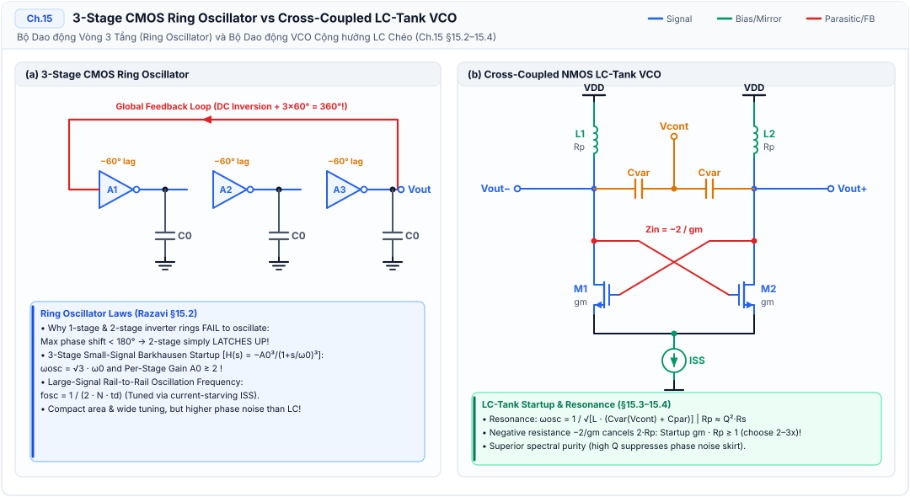

---
{
  "id": "skill-vco-ring-lc-phase-noise-kvco-tb",
  "kind": "skill",
  "domain": "eda-and-github-skills",
  "title_vi": "Testbench Bộ Dao động Vòng & LC-VCO: Điều kiện Khởi động, Tuyến tính Hóa KVCO & Trích xuất Nhiễu Pha SpectreRF",
  "title_en": "Ring & LC-VCO Testbench Playbook: Startup Margin, KVCO Tuning Matrix & SpectreRF PSS/PNoise Phase Noise Extraction",
  "summary": "Quy trình thực chiến đặc tính hóa bộ dao động vòng (Ring VCO) và bộ dao động cộng hưởng LC ghép chéo / Colpitts (LC-VCO) trên Cadence IC617 + Spectre 15.1: kiểm định hệ số an toàn điện trở âm khởi động qua góc SS/125 °C, quét ma trận đường cong điều chỉnh tần số thô–tinh (Switched-Cap Bank + MOS Varactor) trích xuất KVCO, hội tụ bài toán PSS tự trị (autonomous oscillator) và phân rã phổ nhiễu pha L(Δf) vùng 1/f^3, 1/f^2 cùng chỉ số phẩm chất FoM.",
  "diagram": "../../diagrams/ring-and-lc-oscillators.svg",
  "razavi_refs": [
    {
      "chapter": 15,
      "section": "15.1-15.5",
      "pages": "607-649",
      "equations": ["15.7", "15.15", "15.29", "15.46", "15.48", "15.55", "15.61", "15.72", "15.78", "15.85", "15.87"]
    }
  ],
  "github_refs": [
    {
      "repo": "iic-jku/radio-frequency-integrated-circuits",
      "url": "https://github.com/iic-jku/radio-frequency-integrated-circuits",
      "use": "Phương pháp thiết kế khung cộng hưởng LC, ngân hàng tụ chuyển mạch số + varactor, phân tích Leeson/ISF và đo kiểm VCO"
    },
    {
      "repo": "KenKundert/flicker-noise",
      "url": "https://github.com/KenKundert/flicker-noise",
      "use": "Cơ chế nâng tần nhiễu nhấp nháy 1/f thành sườn 1/f^3 trong mạch tuần hoàn phi tuyến và cách kiểm định chính xác bằng Spectre pss + pnoise"
    },
    {
      "repo": "KenKundert/psf_utils",
      "url": "https://github.com/KenKundert/psf_utils",
      "use": "Trích xuất phổ nhiễu pha và bảng phân rã nguồn nhiễu theo từng linh kiện từ tệp pnoise PSF ASCII"
    }
  ],
  "glossary_codes": [
    "T047",
    "T392",
    "T951",
    "T2160",
    "T2161",
    "T2162",
    "T2163",
    "T2164",
    "T2165",
    "T2166",
    "T2167",
    "T2168",
    "T2169"
  ],
  "process_agnostic": true,
  "roles": {
    "negative_gm_core": "Cặp transistor ghép chéo NMOS-only, PMOS-only hoặc bổ sung CMOS (NMOS+PMOS) sinh điện dẫn âm -Gm bù đắp tổn hao tương đương Rp của khung cộng hưởng LC hoặc vòng trễ nhiều tầng",
    "coarse_fine_tuning_tank": "Tổ hợp mảng tụ chuyển mạch số (Switched-Capacitor Bank) phủ dải tần số rộng theo các dải con chồng lấn và tụ biến dung MOS chế độ tích lũy (Accumulation-Mode Varactor) giữ KVCO nhỏ để giảm biến đổi AM-PM",
    "autonomous_pss_solver": "Bộ giải trạng thái xác lập tuần hoàn tự trị (Autonomous PSS — tần số cơ bản f0 là ẩn số cần tìm đồng thời với nghiệm sóng tuần hoàn!) làm nền tảng cho mọi phép đo nhiễu pha",
    "pnoise_phase_extractor": "Bộ phân tích nhiễu tuần hoàn SpectreRF PNoise tách thành phần nhiễu điều pha (PM) khỏi nhiễu biên độ (AM) để xuất mật độ phổ nhiễu pha đơn biên L(Δf) [dBc/Hz] và bảng đóng góp linh kiện"
  },
  "symptoms_addressed": [
    "autonomous-pss-converges-to-trivial-dc-operating-point-with-zero-oscillation-amplitude",
    "lc-vco-fails-to-start-up-at-ss-high-temperature-corner-due-to-inductor-and-switch-q-degradation",
    "excessive-kvco-causes-severe-varactor-am-to-pm-phase-noise-and-control-line-ripple-upconversion",
    "frequency-dead-zones-between-adjacent-digital-capacitor-bank-codes-across-pvt",
    "1-over-f3-flicker-phase-noise-dominated-by-tail-current-source-upconversion-and-waveform-asymmetry"
  ],
  "limitations": [
    "autonomous-pss-cannot-handle-veriloga-subblocks-containing-hidden-discrete-states",
    "harmonic-balance-pss-excels-on-sinusoidal-lc-vcos-whereas-shooting-newton-is-mandatory-for-sharp-edge-ring-vcos",
    "accurate-lc-tank-q-and-resonant-frequency-require-em-s-parameter-nport-and-post-layout-interconnect-extraction"
  ],
  "checklists": [
    "common-mos",
    "oscillator-and-pll",
    "layout-and-matching"
  ]
}
---

## 1. Bản chất Bài toán Đo Kiểm VCO Tự Trị, Kiến trúc Testbench & Hai Họ Dao động

Khác hoàn toàn với bộ khuếch đại hay mạch tụ chuyển mạch vốn được cưỡng bức bởi một xung nhịp ngoại lai có chu kỳ $T_s = 1/f_s$ biết trước, **bộ dao động điều khiển bằng điện áp (`T2166`, VCO)** là một **hệ động lực phi tuyến tự trị (autonomous nonlinear dynamical system)**: mạch tự sinh ra tín hiệu tuần hoàn từ nguồn cấp DC và chính tần số dao động xác lập $f_0(V_{\text{ctrl}})$ là một **ẩn số của hệ phương trình mạch**! Do đó trong Spectre 15.1, nếu bạn vô tình cấu hình `pss` như mạch bị kích thích (driven) hoặc quên mồi xung khởi tạo thoát điểm cân bằng không ổn định DC, bộ giải sẽ hội tụ thẳng về nghiệm tĩnh phẳng lặng ($\Delta V_{\text{tank}} = 0\text{ V}$) và báo lỗi phân kỳ khi sang bước `pnoise`!



Một testbench đặc tính hóa chuẩn công nghiệp cho cả **bộ dao động vòng (`T2161`, Ring VCO)** lẫn **bộ dao động cộng hưởng LC (`T2162`, LC-VCO ghép chéo `T2163` hoặc Colpitts `T2165`)** theo Razavi Chương 15 (§15.1–§15.5, tr. 607–649) phải được tổ chức thành 4 phép đo tuần tự chặt chẽ:
1. **Kiểm tra Biên độ Khởi động Tín hiệu Nhỏ (`AC Negative-Resistance / Loop-Gain Startup Margin`):** Đo trở kháng nhìn vào khung cộng hưởng $Z_{\text{tank}}(j\omega)$ và điện dẫn âm $-G_{m,\text{core}}(j\omega)$ (hoặc độ lợi vòng `stb` cho Ring VCO) ngay tại điểm phân cực cân bằng để bảo đảm **tiêu chuẩn Barkhausen (`T2160`)** có hệ số dự trữ khởi động $k_{\text{start}} \ge 2{,}5\text{–}3{,}5$ ở góc xấu nhất `SS / 125 °C / VDD_min`.
2. **Quét Đặc tuyến Điều chỉnh Tần số Thô–Tinh (`Coarse Cap-Bank + Fine Varactor Tuning Curve`):** Chạy `pss` quét tham số kép qua mã nhị phân/nhiệt kế `CODE<B-1:0>` của ngân hàng tụ chuyển mạch số kết hợp điện áp điều khiển liên tục $V_{\text{ctrl}} \in [0, V_{DD}]$ trên **varactor MOS chế độ tích lũy (`T2168`)** để xác nhận độ phủ chồng lấn không đứt quãng và trích xuất **độ nhạy điều chỉnh `KVCO` (`T2167`)**.
3. **Phân tích Nhiễu Pha Đơn biên $\mathcal{L}(\Delta f)$ & Bảng Đóng góp Linh kiện (`Autonomous PSS + Phase-Noise PNoise`):** Tách riêng nhiễu điều pha khỏi nhiễu biên độ, xác định góc gãy nhiễu nhấp nháy nâng tần $f_{c,1/f^3}$, vùng sườn nhiệt $-20\text{ dB/dec}$ ($1/\Delta f^2$), sàn nhiễu đệm ngõ ra và tính chỉ số phẩm chất chuẩn hóa $\text{FoM}$.
4. **Độ Nhạy Đẩy Nguồn (`Supply Pushing` $K_{VDD} = \partial f_0 / \partial V_{DD}$) & Kéo Tải (`Load Pulling`):** Đánh giá mức độ biến thiên tần số và biên tần giả khi nguồn LDO cấp cho VCO có gợn nhiễu.

---

## 2. Hệ Phương trình Cốt lõi, Điều kiện Khởi động & Định luật Nhiễu Pha

### 2.1. Điều kiện Khởi động Tín hiệu Nhỏ & Biên độ Dao động Xác lập (Chế độ Dòng vs Chế độ Áp)
Xét khung cộng hưởng LC song song tổng quát có cảm kháng $L$ (kèm điện trở nối tiếp cuộn dây $R_S$, hệ số phẩm chất $Q_L = \frac{\omega_0 L}{R_S}$) và tổng điện dung $C_{\text{tot}} = C_{\text{bank}} + C_{\text{var}}(V_{\text{ctrl}}) + C_{\text{par}}$ (hệ số phẩm chất tụ/công tắc $Q_C$). Điện trở tổn hao song song tương đương tại tần số cộng hưởng $\omega_0 = \frac{1}{\sqrt{L C_{\text{tot}}}}$ (Razavi §15.3.1–§15.3.2, Phương trình 15.29–15.48) là:

$$
R_p = R_{p,L} \parallel R_{p,C} \approx (Q_L \omega_0 L) \parallel \left(\frac{Q_C}{\omega_0 C_{\text{tot}}}\right) = Q_{\text{tank}} \omega_0 L
$$

- **Với cặp ghép chéo một cực tính (NMOS-only hoặc PMOS-only, Hình 15.32):** Trở kháng vi sai của cặp ghép chéo là $-2/g_m$. Điều kiện khởi động tin cậy qua PVT và biên độ vi sai đỉnh trong **chế độ giới hạn dòng (`Current-Limited Regime`)** với dòng đuôi $I_{SS}$ là:

$$
g_{m,\text{N}} R_p \ge 2\,k_{\text{start}} \quad (\text{với } k_{\text{start}} \ge 2{,}5\text{–}3{,}0 \implies g_{m,\text{N}} R_p \ge 5\text{–}6), \qquad V_{\text{diff,pk}} \approx \frac{2}{\pi} I_{SS} R_p \quad (\text{hoặc } \frac{4}{\pi} I_{SS} R_{p,\text{se}})
$$

*(Lưu ý quy ước ký hiệu: trong Razavi Phương trình 15.46–15.48, $R_p$ được định nghĩa là điện trở song song trên **mỗi nhánh đơn đầu** nên điều kiện viết là $g_{m1,2} R_{p,\text{se}} \ge 1$ lý thuyết hay $\ge 2{,}5\text{–}3$ thực tế, và biên độ vi sai đỉnh là $\frac{4}{\pi} I_{SS} R_{p,\text{se}}$; nếu định nghĩa $R_{p,\text{diff}} = 2 R_{p,\text{se}}$ giữa hai nút vi sai thì công thức tương đương hoàn toàn là $\frac{2}{\pi} I_{SS} R_{p,\text{diff}}$!)*
- **Với cặp ghép chéo bổ sung CMOS (NMOS + PMOS dùng chung dòng đuôi $I_{SS}$):** Cả hai cặp cùng bơm dòng hai chiều giúp nhân đôi hiệu suất chuyển đổi dòng sang áp ($V_{\text{diff,pk}} \approx \frac{4}{\pi} I_{SS} R_{p,\text{diff}}$ khi định nghĩa theo tổng trở vi sai, giảm một nửa dòng tiêu thụ cho cùng biên độ!) và cho phép chỉnh $W_P/W_N$ để đạt đối xứng nửa chu kỳ giảm nâng tần nhiễu $1/f$, nhưng bị giới hạn trần bởi **chế độ giới hạn áp (`Voltage-Limited Regime`)** khi $V_{\text{diff,pk}}$ chạm $V_{DD} - V_{DS,\text{tail}}$ làm transistor tiến vào vùng triode làm suy giảm $Q_{\text{tank}}$!
- **Với bộ dao động vòng $N$ tầng vi sai (Razavi §15.2, Phương trình 15.15):** Mỗi tầng trễ đóng góp góc pha $\pi/N$ tại $\omega_0$, đòi hỏi độ lợi DC mỗi tầng $A_{0,\text{stage}} \ge \sec(\pi/N)$ (ví dụ với $N = 3$ tầng: $\sec(60^\circ) = 2{,}0$ lý thuyết $\implies$ chọn $A_{0,\text{stage}} \ge 3{,}0\text{–}4{,}0$ thực tế!).

### 2.2. Độ Nhạy Điều chỉnh $K_{VCO}$, Điều kiện Chồng lấn Dải Con & Phổ Nhiễu Pha Leeson / Hajimiri–Lee
Để vừa đạt dải điều chỉnh rộng $\Delta f_{\text{tot}}$ ($15\%\text{–}30\%$) vừa tránh $K_{VCO}$ quá lớn (vốn biến mọi nhiễu nhiệt/gợn trên đường $V_{\text{ctrl}}$ và biến thiên biên độ AM trên varactor thành nhiễu pha PM dữ dội!), tổng dung lượng điều chỉnh được chia thành mảng $B\text{-bit}$ tụ chuyển mạch số cộng một varactor tinh nhỏ sao cho bước nhảy tần số giữa hai mã liền kề $\Delta f_{\text{step}}(k) = f_0(k, V_{\text{mid}}) - f_0(k+1, V_{\text{mid}})$ luôn nhỏ hơn nửa dải quét liên tục của varactor (hệ số chồng lấn an toàn $\ge 1{,}5\text{–}2{,}0\times$):

$$
K_{VCO}(V_{\text{ctrl}}) = \frac{\partial f_0}{\partial V_{\text{ctrl}}} = -\frac{f_0^3}{2} (2\pi)^2 L \frac{\partial C_{\text{var}}}{\partial V_{\text{ctrl}}} \quad [\text{Hz/V}], \qquad \Delta f_{\text{var,usable}} \ge 1{,}8 \cdot \max_k \Delta f_{\text{step}}(k)
$$

Mật độ phổ công suất nhiễu pha đơn biên $\mathcal{L}(\Delta f)$ tại tần số lệch $\Delta f$ khỏi sóng mang $f_0$ tuân theo công thức Leeson mở rộng và lý thuyết hàm nhạy xung **ISF (Impulse Sensitivity Function $\Gamma(\phi)$, Hajimiri & Lee / Razavi §15.5)**:

$$
\mathcal{L}(\Delta f) = 10\log_{10}\!\left[ \frac{F k T}{2 P_{\text{sig}}} \left(1 + \left(\frac{f_0}{2 Q_{\text{tank}} \Delta f}\right)^{\!2}\right)\!\left(1 + \frac{f_{c,1/f^3}}{\Delta f}\right) + \frac{1}{2}\left(\frac{K_{VCO} V_{n,\text{ctrl}}(\Delta f)}{\Delta f}\right)^{\!2} \right] \;\text{[dBc/Hz]}
$$

Để so sánh công bằng các thiết kế VCO ở tần số $f_0$, độ lệch $\Delta f$ và công suất tiêu thụ $P_{\text{DC}}$ (tính bằng $\text{mW}$) khác nhau, ngành thiết kế RFIC dùng **Chỉ số Phẩm chất Chuẩn hóa $\text{FoM}$** (càng âm hoặc trị tuyệt đối càng lớn — tùy quy ước dấu — càng tốt; theo quy ước chuẩn IEEE JSSC mang dấu âm, LC-VCO CMOS tốt đạt $-182$ đến $-192\text{ dBc/Hz}$, còn Ring VCO đạt $-155$ đến $-168\text{ dBc/Hz}$):

$$
\text{FoM}(\Delta f) = \mathcal{L}(\Delta f) - 20\log_{10}\!\left(\frac{f_0}{\Delta f}\right) + 10\log_{10}\!\left(\frac{P_{\text{DC}}}{1\text{ mW}}\right) \quad [\text{dBc/Hz}]
$$

---

## 3. Bất biến Kỹ thuật & Các Bẫy Lỗi Thực chiến Trong SpectreRF (`pss` & `pnoise`)

- **[INV-VCO-01] Bất biến Khai báo Cặp Nút Vi sai Tự Trị & Mồi Khởi động (`oscic` / `ic` / Xung Dòng Ngắn) Trong `pss`:** Khi chạy `pss` cho mạch dao động tự trị không có nguồn kích thích tuần hoàn ngoài, **bắt buộc** truyền cặp nút dao động dương–âm `pss (vosc_p vosc_n) pss fund=f_est ...` vào đầu câu lệnh `pss`! Việc có mặt cặp nút `(p n)` báo cho Spectre chuyển sang bộ giải **Autonomous PSS** (coi `fund` chỉ là giá trị dự đoán ban đầu để giải chính xác tần số thực $f_0$). Đồng thời luôn đặt `tstab` đủ dài ($\ge 30\text{–}80$ chu kỳ cho Ring VCO, $\ge 50\text{–}150$ chu kỳ tương đương $> 3 Q_{\text{tank}}/\pi f_0$ cho LC-VCO $Q$ cao!) kèm điều kiện đầu bất đối xứng `ic vosc_p=vdd_val vosc_n=0` (hoặc nguồn xung dòng mảnh `ipulse` tắt hẳn sau $1\text{ ns}$) để đẩy mạch thoát ngay khỏi điểm yên tĩnh siêu bền DC!
- **[INV-VCO-02] Bất biến Cân bằng Đánh đổi Đóng–Ngắt Công tắc Ngân hàng Tụ Số (`Ron` vs `Coff` Constant Product):** Trong ngân hàng tụ chuyển mạch vi sai (dùng cấu trúc công tắc trung tâm kẹp giữa hai tụ nối tiếp để giảm một nửa điện áp rơi và nhân đôi $Q$ ở trạng thái đóng!), tích $R_{\text{on}} \cdot C_{\text{off}} = \tau_{\text{tech}}$ gần như là hằng số của công nghệ. Khi công tắc đóng (`ON`), $Q_{\text{sw,on}} = \frac{1}{\omega_0 C_{\text{unit}} R_{\text{on}}}$ giới hạn nhiễu pha ở tần số thấp nhất $f_{\min}$; khi tắt (`OFF`), tỷ số mở/đóng $C_{\text{on}}/C_{\text{off}}$ quyết định dải điều chỉnh tần số $\text{TR}\%$, và các vùng nguồn/máng công tắc tắt phải được phân cực treo qua điện trở lớn $R_{\text{bias}} \sim 20\text{–}50\text{ k}\Omega$ về $V_{DD}$ (khi tắt) và $0\text{ V}$ (khi đóng) để ngăn diode tiếp giáp dẫn thuận lúc biên độ sóng LC vọt lớn!
- **[TRAP-VCO-01] Bẫy Chọn Sai Phương Pháp Giải `pss` Giữa `shooting` Và `hb` (Harmonic Balance):**
  - Đối với **LC-VCO** dạng sóng gần hình sin nhưng chứa mô hình cuộn cảm S-parameter (`nport` trích xuất từ EMX/HFSS/Momentum), phương pháp miền tần số **Harmonic Balance (`method=hb`, hoặc `flexbalance=yes` trong Spectre 15.1)** hội tụ nhanh, mượt và không bị hiện tượng phi nhân quả (non-causality) miền thời gian của bảng S-parameter làm nổ nghiệm như Shooting-Newton!
  - Ngược lại, đối với **Ring VCO** sườn vuông dốc đứng giàu hài bậc cao, Harmonic Balance cần hàng chục hài mới hội tụ và dễ sinh gợn Gibbs; bắt buộc dùng **Shooting-Newton (`method=gear2only` hoặc `traponly`, `harms=25..40`)**!
- **[TRAP-VCO-02] Bẫy Nguồn Dòng Đuôi Bơm Nhiễu $1/f$ Và Nhiệt Ở Hài Bậc Hai $2 f_0$ Làm Hỏng Nhiễu Pha:** Nhiều kỹ sư nghĩ nguồn dòng đuôi $M_{\text{tail}}$ mang dòng DC đồng pha nên nhiễu của nó bị cặp vi sai triệt tiêu. Trên thực tế (Razavi §15.5 & Ken Kundert `flicker-noise`), nút chung cực nguồn của cặp ghép chéo dao động ở tần số **$2 f_0$**! Nhiễu nhấp nháy $1/f$ tần số thấp của $M_{\text{tail}}$ điều biến biên độ bao hình dao động, rồi bị varactor phi tuyến chuyển đổi AM-sang-PM thành sườn nhiễu pha **$1/\Delta f^3$** dữ dội; đồng thời nhiễu nhiệt của $M_{\text{tail}}$ quanh tần số **$2 f_0$** bị trộn tần xuống thẳng $f_0 \pm \Delta f$ làm suy giảm $3\text{–}6\text{ dB}$ vùng $1/\Delta f^2$! Giải pháp kinh điển: định cỡ $M_{\text{tail}}$ có $L$ dài + $V_{OV}$ lớn, đặt tụ lọc lớn song song cổng phân cực gương dòng, và dùng **bộ lọc cộng hưởng đuôi $2 f_0$ (`Tail Noise Filter`: tụ $C_{\text{tail}}$ nối đất tại chân đuôi cộng cuộn cảm nhỏ $L_{\text{tail}}$ tạo trở kháng cao tại $2 f_0$)**!
- **[TRAP-VCO-03] Bẫy Đọc Tổng Nhiễu Điện Áp (AM + PM) Thay Vì Thành Phần Nhiễu Pha Thuần Túy (PM-only) Trong `pnoise`:** Trong Spectre 15.1, nếu chạy `pnoise` chế độ mặc định `noisetype=sources` trên nút ra của bộ dao động, đường cong tổng công suất biên tần chứa **cả nhiễu biên độ AM lẫn nhiễu pha PM** (ở tần số lệch xa $\Delta f > 10\text{ MHz}$, nhiễu AM từ đệm ngõ ra có thể lớn ngang nhiễu PM!). Để tách đúng định nghĩa IEEE $\mathcal{L}(\Delta f)$ của nhiễu pha đơn thuần (vốn là thành phần duy nhất đi qua bộ chia tần/limiter của PLL), phải bật chế độ phân rã điều pha (`noisetype=pm` / `modulated` trong MMSIM 15.1+ hoặc đọc trực tiếp hàm `phaseNoise(1 "pss-fd.pss" ?result "pnoise")` trong OCEAN)!

---

## 4. Cây Chẩn đoán Lỗi & Lộ trình Nâng cấp VCO Trên Bát giác Thiết kế

| Hiện tượng lỗi quan sát được | Chẩn đoán nguyên nhân gốc rễ | Giải pháp sửa mạch / thông số tối ưu | Cái giá đánh đổi trên Bát giác |
|---|---|---|---|
| `pss` hội tụ về đường thẳng phẳng ($V_{\text{out,pp}} < 1\text{ mV}$) hoặc dao động tắt dần trong `tran` | Thiếu độ lợi âm khởi động $g_m R_p < 2$, hoặc quên mồi bất đối xứng `ic` trên mạch đối xứng tuyệt đối | Đặt `ic` lệch $100\text{ mV}$ giữa hai nút tank; kiểm tra AC $\text{Re}\{Y_{\text{in}}\}$; tăng $I_{SS}$ hoặc $W/L$ cặp ghép chéo để đạt $k_{\text{start}} \ge 3$ tại `SS/125°C` | Tăng $W$ cặp ghép chéo cộng thêm $C_{GS} + 4 C_{GD}$ cố định làm hẹp nhẹ dải điều chỉnh tần số $\text{TR}\%$ |
| Vùng nhiễu pha gần sóng mang ($1\text{ kHz} \le \Delta f \le 100\text{ kHz}$) vọt cao, độ dốc $-30\text{ dB/dec}$ ($1/\Delta f^3$) | Nhiễu $1/f$ của nguồn đuôi bị trộn lên và dạng sóng hai bán kỳ thiếu đối xứng ($\Gamma_{\text{DC}} \neq 0$) | Tăng mạnh diện tích $W \times L$ nguồn dòng đuôi, lọc RC mắt lưới tại cực cổng phân cực đuôi, cân chỉnh tỉ số $(W/L)_P / (W/L)_N$ để điểm cắt không đối xứng chuẩn (`ISF` trung bình $\Gamma_0 \to 0$) | Tốn diện tích silicon cho transistor đuôi $L$ dài và tụ lọc cổng phân cực trên chip |
| Nhiễu pha vùng $1\text{ MHz}$ xấu đi $6\text{–}10\text{ dB}$ riêng tại điểm giữa dải điều chỉnh $V_{\text{ctrl}} \approx V_{DD}/2$ | Độ dốc $K_{VCO}(V_{\text{ctrl}})$ đạt đỉnh lớn nhất đúng tại $V_{\text{ctrl}} \approx V_{DD}/2$, gây chuyển đổi nhiễu AM-sang-PM cực đại trên varactor | Chia nhỏ kích thước varactor giảm $K_{VCO}$ xuống $30\text{–}80\text{ MHz/V}$, bù lại dải tần bằng cách tăng thêm $1\text{–}2\text{ bit}$ cho mảng tụ chuyển mạch số! | Tăng độ phức tạp bộ hiệu chuẩn chọn dải tần tự động (AFC — Automatic Frequency Calibration) trong PLL |
| Tăng dòng đuôi $I_{SS}$ nhưng nhiễu pha không những không giảm mà còn tăng ngược trở lại! | VCO đã vượt qua đỉnh biên độ tối ưu rơi vào **chế độ giới hạn áp (`Voltage-Limited`)**: cực máng sụt sâu dưới cực cổng làm transistor ghép chéo lún vào vùng triode và xả ngắn mạch khung LC | Dừng tăng $I_{SS}$ ngay tại ranh giới giáp ranh giữa chế độ dòng và chế độ áp ($V_{\text{diff,pk}} \approx 0{,}85\,V_{DD}$); hoặc chuyển sang Colpitts / Class-C LC-VCO định hình dòng bơm hẹp tại đỉnh sóng! | Cấu trúc Class-C đòi hỏi vòng phản hồi kiểm soát biên độ để đảm bảo khởi động an toàn lúc mới bật nguồn |

---

## 5. Thích ứng Đa Tiến trình (180nm–45nm) & Mẫu Testbench Spectre 15.1 + OCEAN

### 5.1. Đặc thù VCO Qua Các Thế hệ Công nghệ CMOS
- **180nm ($V_{DD} = 1{,}8\text{ V}$):** Dư địa áp rộng rãi cho cấu trúc ghép chéo bổ sung NMOS + PMOS chồng trên nguồn dòng đuôi (`VDD -> PMOS pair -> LC tank -> NMOS pair -> M_tail -> GND`), đạt biên độ vi sai tới $2{,}0\text{–}2{,}4\text{ V}_{\text{pp}}$; lớp kim loại trên cùng (Top Thick Metal) thường dày $2\text{–}3\text{ }\mu\text{m}$ cho $Q_L \approx 10\text{–}15$ ở $2.4\text{–}5\text{ GHz}$.
- **90nm / 65nm / 45nm ($V_{DD} = 0{,}9\text{–}1{,}2\text{ V}$):** Nguồn $1{,}0\text{ V}$ trở nên quá chật cho cột chồng 3 tầng (PMOS + NMOS + Tail): kỹ sư thường chuyển sang **NMOS-only (đỉnh cuộn cảm nối thẳng $V_{DD}$ qua LDO sạch)** hoặc **PMOS-only trong giếng N riêng (đáy cuộn cảm nối thẳng GND — giảm nhiễu $1/f$ tự nhiên!)**, hoặc dùng cuộn cảm biến áp ghép từ tại nguồn đuôi. Nhờ $L_{\min}$ ngắn, công tắc NMOS của ngân hàng tụ số ở 65nm/45nm đạt tích $R_{\text{on}} C_{\text{off}}$ nhỏ vượt trội giúp chế tạo mảng tụ $5\text{–}7\text{ bit}$ giữ $Q_C > 40$ tới tận $10\text{ GHz}$!

### 5.2. Mẫu Netlist Spectre 15.1 Tự Trị Đo $f_0$, $K_{VCO}$ & Nhiễu Pha (`tb_lcvco_pss_pnoise.scs`)
```spice
// tb_lcvco_pss_pnoise.scs — Autonomous LC-VCO PSS + Phase Noise + KVCO Sweep (Spectre 15.1)
simulator lang=spectre
global 0

parameters vdd_val=1.2 vctrl_val=0.6 ibias_val=1.5m f_est=2.4G \
           b2=0 b1=1 b0=0

VDD   (vdd   0) vsource dc=vdd_val type=dc
VCTRL (vctrl 0) vsource dc=vctrl_val type=dc
IBIAS (vdd ibias_in) isource dc=ibias_val type=dc
VB2   (cb2 0) vsource dc=b2*vdd_val type=dc
VB1   (cb1 0) vsource dc=b1*vdd_val type=dc
VB0   (cb0 0) vsource dc=b0*vdd_val type=dc

// Xung dong moi 100uA rong 200ps luc t=0 de kich khoi dao dong tu tri tuc thi
IKICK (vosc_p vosc_n) isource type=pulse val0=0 val1=100u delay=10p rise=10p fall=10p width=200p

// Khoi DUT: LC-VCO vi sai kem 3-bit Switched-Cap Bank + Accumulation-Mode MOS Varactor
// X_VCO (vosc_p vosc_n vctrl cb2 cb1 cb0 ibias_in vdd 0) lcvco_diff_core

// Dieu kien dau bo tro
ic vosc_p=vdd_val vosc_n=0.5*vdd_val

save vosc_p vosc_n VDD:p
saveOptions options save=selected

// [1] Autonomous PSS: truyen cap nut (vosc_p vosc_n) de Spectre giai tan so thuc f0!
pss_vco (vosc_p vosc_n) pss fund=f_est harms=20 errpreset=conservative \
        tstab=60n maxacfreq=50G annotate=status

// [2] Phase Noise PNoise: quet do lech tan so Delta_f tu 1 kHz den 40 MHz
pnoise_vco (vosc_p vosc_n) pnoise sweeptype=relative relharmnum=1 \
           start=1k stop=40M dec=15 maxsideband=20 noisetype=sources annotate=status
```

### 5.3. Đoạn Kịch bản OCEAN Trích xuất Tự động $f_0$, $V_{\text{diff,pk}}$, $\mathcal{L}(1\text{ MHz})$ & $\text{FoM}$
```lisp
;;; extract_vco_metrics.ocn — Run via: ocean -nograph -restore extract_vco_metrics.ocn
simulator('spectre)
openResults("./tb_lcvco_pss_pnoise.raw")

;; 1. Lay tan so dao dong xac lap f0 va cong suat tieu thu DC tu ket qua PSS
f0_hz   = harmonic(xval(v("vosc_p" ?result "pss-fd.pss")) 1)
vpk_v   = mag(harmonic(v("vosc_p" ?result "pss-fd.pss") - v("vosc_n" ?result "pss-fd.pss") 1))
idc_a   = -real(harmonic(i("VDD:p" ?result "pss-fd.pss") 0))
pdc_mw  = idc_a * 1.2 * 1e3

;; 2. Trich xuat nhieu pha don bien L(df) [dBc/Hz] tai df = 100 kHz va 1 MHz
pn_wave = phaseNoise(1 "pss-fd.pss" ?result "pnoise_vco-pnoise")
pn_100k = value(pn_wave 100e3)
pn_1m   = value(pn_wave 1e6)

;; 3. Tinh chi so pham chat chuan hoa FoM tai do lech 1 MHz
fom_1m  = pn_1m - 20.0*log10(f0_hz / 1e6) + 10.0*log10(pdc_mw)

printf("F0_GHZ %.6f | VPK_V %.4f | PDC_MW %.3f | PN_100K %.2f | PN_1M %.2f | FOM_1M %.2f\n"
       f0_hz/1e9 vpk_v pdc_mw pn_100k pn_1m fom_1m)
exit()
```

---

## 6. Đối chiếu Sách Razavi, Nguồn GitHub Đã Kiểm định & Bảng Thuật ngữ Chuẩn CLB

### 6.1. Mốc Tọa độ Chính xác Trong Sách Razavi (2nd Edition) & Kho GitHub
- **Razavi Chương 15 (*Oscillators*):** §15.1 *General Considerations* — hệ hồi tiếp dao động và tiêu chuẩn Barkhausen (tr. 607–609, Phương trình 15.7), §15.2 *Ring Oscillators* — vòng 3 tầng đơn đầu và $N$ tầng vi sai (tr. 609–618, Phương trình 15.15), §15.3 *LC Oscillators* — biến đổi trở kháng nối tiếp–song song, cặp ghép chéo, Colpitts và dao động một cửa (tr. 618–630, Phương trình 15.29, 15.46, 15.48, Ví dụ 15.5–15.8), §15.4 *Voltage-Controlled Oscillators* — điều chỉnh tần số Ring VCO, MOS varactor tích lũy và mô hình pha $\phi_{\text{out}}(t) = \omega_0 t + K_{VCO}\int V_{\text{cont}}\,dt$ (tr. 630–644, Phương trình 15.55, 15.61, 15.72), §15.5 *Phase Noise* — cơ chế chuyển đổi nhiễu thành phổ vạt áo (skirt) quanh $f_0$, nâng tần nhiễu đuôi và đánh đổi công suất–diện tích (tr. 644–649, Phương trình 15.78, 15.85, 15.87).
- **Đối chiếu Nguồn Mở Đã Kiểm Định:**
  - `iic-jku/radio-frequency-integrated-circuits` (`0799d7eaf993`, Apache-2.0): Quy trình phân bổ ngân sách $Q_{\text{tank}}$, thiết kế ngân hàng tụ chuyển mạch chồng dải không khe chết và đánh giá FoM.
  - `KenKundert/flicker-noise` (`b7da03b36dfe`) & `KenKundert/psf_utils` (`67971463a7bf`): Phân tích chuẩn mực về điều biến phi tuyến nhiễu nhấp nháy $1/f$ và truy xuất dữ liệu phổ nhiễu từ SpectreRF.

### 6.2. Bảng Thuật ngữ Chuẩn CLB Vi Mạch Sử dụng trong Thẻ
| Mã CLB | Thuật ngữ Tiếng Anh | Thuật ngữ Tiếng Việt Chuẩn | Ý nghĩa Kỹ thuật Cốt lõi |
|---|---|---|---|
| `T2160` | Barkhausen criteria | tiêu chuẩn dao động Barkhausen | Điều kiện cần về biên độ độ lợi vòng $\ge 1$ và tổng dịch pha bội nguyên $360^\circ$ (hoặc $180^\circ$ quanh hồi tiếp âm) |
| `T2161` / `T2162` | ring oscillator / LC tank oscillator | bộ dao động vòng / bộ dao động cộng hưởng LC | Hai họ dao động chính: Ring nhỏ gọn dải rộng nhưng nhiễu pha cao; LC chiếm diện tích cuộn cảm lớn nhưng $Q$ cao và nhiễu pha cực thấp |
| `T2167` | VCO gain (tuning sensitivity), KVCO | độ lợi VCO (độ nhạy điều chỉnh tần số KVCO) | Đạo hàm $\partial f_0 / \partial V_{\text{ctrl}}$ quyết định độ lợi vòng PLL và độ nhạy nhiễu trên đường điều khiển |
| `T2168` | MOS varactor (accumulation-mode varactor) | tụ biến dung MOS (varactor chế độ tích lũy) | Tụ biến thiên đơn điệu mượt theo $V_{BG}$ đặt trong giếng N tránh sinh hạt dẫn thiểu số chậm |
| `T2169` | phase noise | nhiễu pha | Mật độ công suất nhiễu điều pha $\mathcal{L}(\Delta f)$ chuẩn hóa theo công suất sóng mang ($\text{dBc/Hz}$) |
