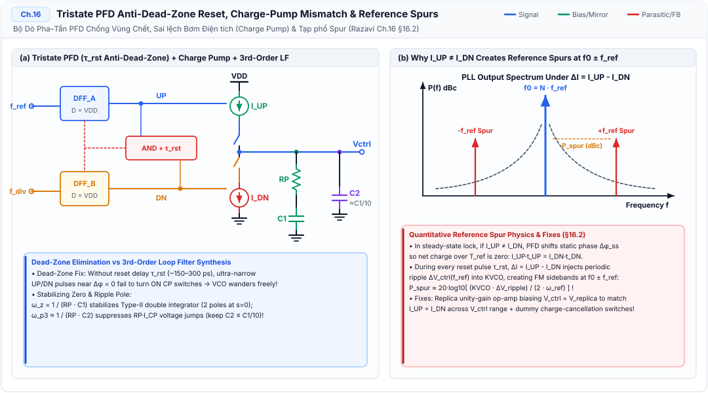

---
{
  "id": "skill-veriloga-mixed-signal-behavioral-models",
  "kind": "skill",
  "domain": "eda-and-github-skills",
  "title_vi": "Kỹ thuật Viết Mô hình Hành vi Verilog-A Chuẩn Hội tụ Cho Spectre: Chống Trạng thái Ẩn, Làm Mượt Sườn & Nhiễu Vật lý",
  "title_en": "Convergence-Safe Verilog-A Behavioral Modeling for Spectre: Hidden-State-Free VCO, Smooth Transitions & Physical Noise",
  "summary": "Quy chuẩn thực chiến viết và kiểm định mô hình hành vi Verilog-A (.va) chạy mượt trên trình biên dịch AHDL của Cadence IC617 + Spectre 15.1: giải thích bản chất toán học của lỗi trạng thái ẩn (hidden state) làm sập phân tích PSS và cách khắc phục triệt để bằng toán tử tích phân tuần hoàn idtmod(), kỷ luật dùng transition()/slew() và @(cross) có ràng buộc bước thời gian ttol, mô hình hóa nguồn nhiễu flicker/white điều biến theo phân cực chuẩn Ken Kundert, cùng quy tắc thực nghiệm quyết định khi nào thay khối Transistor bằng Verilog-A thực sự tăng tốc mô phỏng.",
  "diagram": "../../diagrams/pfd-charge-pump-spur.svg",
  "razavi_refs": [
    {
      "chapter": 13,
      "section": "13.1-13.2",
      "pages": "539-549",
      "equations": ["13.2"]
    },
    {
      "chapter": 15,
      "section": "15.4",
      "pages": "630-634",
      "equations": ["15.55", "15.58"]
    },
    {
      "chapter": 16,
      "section": "16.2.1-16.2.2",
      "pages": "666-671",
      "equations": []
    }
  ],
  "github_refs": [
    {
      "repo": "Arcadia-1/veriloga-skills",
      "url": "https://github.com/Arcadia-1/veriloga-skills",
      "use": "Quy chuẩn khai báo discipline, toán tử đóng góp liên tục <+, làm mượt bước nhảy và kiểm soát biến sự kiện trong Verilog-A"
    },
    {
      "repo": "KenKundert/flicker-noise",
      "url": "https://github.com/KenKundert/flicker-noise",
      "use": "Cách viết đúng công thức nguồn nhiễu flicker_noise() và white_noise() dưới kích thích tín hiệu lớn chu kỳ trong Verilog-A"
    },
    {
      "repo": "Arcadia-1/virtuoso-bridge-lite",
      "url": "https://github.com/Arcadia-1/virtuoso-bridge-lite",
      "use": "Số liệu thực nghiệm về chi phí hàng đợi sự kiện @(cross)/transition() trên nhiều instance nhỏ so với lợi ích tăng tốc trên khối lớn"
    },
    {
      "repo": "Arcadia-1/sar-adc-skills",
      "url": "https://github.com/Arcadia-1/sar-adc-skills",
      "use": "Chiến lược xác minh phân kỳ 4 giai đoạn dùng các khối Verilog-A chuẩn (CDAC, Comparator, Async Logic, Ideal DAC)"
    }
  ],
  "glossary_codes": [
    "T016",
    "T047",
    "T392",
    "T1009",
    "T2130",
    "T2166",
    "T2167",
    "T2171"
  ],
  "process_agnostic": true,
  "roles": {
    "dae_contribution_engine": "Khối phương trình đóng góp tương tự liên tục (V(p,n) <+ ... và I(p,n) <+ ...) cung cấp đồng thời giá trị dòng/áp và đạo hàm riêng giải tích cho ma trận Jacobian của bộ giải Newton-Raphson",
    "analog_event_scheduler": "Các bộ kích hoạt sự kiện miền tương tự @(initial_step), @(cross(expr, dir, ttol, vtol)) và @(timer(...)) ép bộ giải Spectre co bước thời gian chính xác vào thời điểm chuyển trạng thái",
    "periodic_phase_integrator": "Toán tử tích phân có gọt modulo nội tại idtmod(f_inst, 0.0, 1.0, -0.5) lưu giữ pha liên tục trên biến trạng thái giải tích của trình mô phỏng để tương thích 100% với Shooting-Newton PSS",
    "waveform_smoother": "Bộ lọc chuyển mức tuyến tính từng đoạn transition(target, td, tr, tf) và giới hạn đạo hàm slew() biến các bước nhảy rời rạc thành sườn khả vi có điện tích hữu hạn"
  },
  "symptoms_addressed": [
    "spectre-pss-aborts-with-fatal-hidden-state-detected-in-veriloga-module-error",
    "transient-simulation-fails-with-timestep-too-small-at-discontinuous-if-else-branch-switching",
    "artificial-timing-jitter-floor-in-pfd-or-comparator-caused-by-missing-ttol-on-cross-events",
    "replacing-small-digital-latches-with-veriloga-unexpectedly-makes-spectre-run-slower",
    "unphysical-flicker-noise-sidebands-under-large-signal-drive-from-wrong-noise-modulation-placement"
  ],
  "limitations": [
    "event-driven-real-or-integer-state-variables-updated-in-cross-blocks-remain-hidden-states-for-pss-unless-rf-ignore-hidden-state-is-validly-applicable",
    "concurrent-cross-and-transition-queues-across-dozens-of-small-veriloga-instances-degrade-spectre-solver-throughput",
    "ideal-voltage-output-ports-without-finite-rout-cause-singular-voltage-loop-errors-when-shorted-or-driving-pure-capacitors"
  ],
  "checklists": [
    "common-mos",
    "oscillator-and-pll",
    "switched-capacitor",
    "feedback-and-stb"
  ]
}
---

## 1. Triết lý Mô hình Hóa Hành vi Trong Thiết kế Tín hiệu Hỗn hợp & Quy tắc Kinh tế Tốc độ

Trong thiết kế các hệ thống lớn như **SAR ADC**, **Bộ tổng hợp tần số PLL (`T2174`)**, **Mạch khôi phục xung nhịp CDR** hay **Chuỗi thu phát Switched-Capacitor**, việc viết các mô hình hành vi **Verilog-A (`.va`)** phục vụ ba mục đích sống còn: (1) xác minh kiến trúc hệ thống (cực tính hồi tiếp, thứ tự trọng số bus, định thời xung nhịp) ngay từ Ngày 1 trước khi vẽ transistor đầu tiên, (2) đóng vai trò **thiết bị đo lý tưởng không gây méo** trong testbench (ví dụ một DAC tái tạo lý tưởng $16\text{-bit}$ đặt sau ADC cần đo để đưa thẳng sóng ra vào phân tích phổ FFT!), và (3) thay thế có chọn lọc các khối lớn làm chậm mô phỏng trong quy trình kiểm chứng lai (hybrid verification).



Tuy nhiên, một mô hình Verilog-A viết theo thói quen lập trình phần mềm hay RTL số (`Verilog-D`) sẽ lập tức phá hỏng bộ giải phương trình vi phân đại số (**DAE — Differential-Algebraic Equations**) của Cadence Spectre 15.1: gây treo hội tụ `Timestep too small`, bơm sai số thời gian ngẫu nhiên lớn gấp hàng trăm lần jitter thực của mạch, hoặc chặn đứng hoàn toàn phân tích tuần hoàn `pss`/`pac`/`pnoise` vì lỗi **trạng thái ẩn (`hidden state`)**!

Đặc biệt, số liệu đo thực nghiệm trên hệ thống ADC/Mixed-Signal (đối chiếu từ `Arcadia-1/virtuoso-bridge-lite`) chỉ ra một **quy luật phi đơn điệu cực kỳ quan trọng** về hiệu quả tăng tốc khi thay cell transistor bằng Verilog-A:
- **NÊN THAY THẾ bằng Verilog-A:** Các khối tương tự cỡ vừa và lớn ($\ge 40\text{–}50$ transistor BSIM4 phức tạp, ví dụ: OTA khuếch đại, bộ so sánh StrongARM + mảng trim, VCO tần số GHz trong testbench bắt khóa PLL, khối tham chiếu/LDO phụ trợ) xuất hiện **1 đến 2 lần** trong mạch $\implies$ giúp bỏ qua hàng trăm phương trình điện tích BSIM4 và rút ngắn thời gian chạy `tran` từ **$15\%$ đến $10\times$**!
- **KHÔNG NÊN THAY THẾ bằng Verilog-A:** Hàng chục ô logic nhỏ lặp lại ($\le 15\text{–}20$ transistor/ô, ví dụ $12$ ô chốt DFF hoặc thanh ghi dịch SAR đồng thời lắng nghe cùng một đường xung nhịp qua `@(cross(...))` và phát sườn qua `transition()`)! Mỗi lệnh `@(cross)` và `transition()` đăng ký sự kiện riêng vào hàng đợi toàn cục của Spectre, buộc bộ giải cắt nhỏ bước thời gian đồng loạt trên toàn ma trận — thực tế làm mô phỏng **chậm đi $10\%\text{–}20\%$** so với để nguyên transistor CMOS tiêu chuẩn!

---

## 2. Cơ sở Toán học Giải Hệ DAE, Trạng thái Ẩn PSS & Năm Quy tắc Cú pháp Bất khả Xâm phạm

### 2.1. Tại sao Biến Thủ tục Sinh Lỗi `Hidden State` Trong `pss` & Phép Cứu Nguy Bằng `idtmod()`
Ở mỗi bước thời gian $t_k$, Spectre giải hệ phương trình KCL/KVL phi tuyến $F\big(x(t_k), \dot{x}(t_k), u(t_k)\big) = 0$ bằng phép lặp Newton-Raphson dựa trên ma trận đạo hàm riêng Jacobian $J = \frac{\partial F}{\partial x} + \alpha \frac{\partial F}{\partial \dot{x}}$, trong đó vector trạng thái nhìn thấy được của bộ giải $x(t)$ chỉ bao gồm:
1. Điện thế các nút điện và dòng qua các nhánh nguồn áp;
2. Trạng thái bên trong của các toán tử vi–tích phân tương tự chính thống như `ddt(...)`, `idt(...)`, `idtmod(...)`, `laplace_nd(...)`.

Khi chạy phân tích xác lập tuần hoàn **Shooting-Newton `pss`**, Spectre bắn thử một chu kỳ từ $x(0)$ tới $x(T)$ rồi giải phương trình biên tuần hoàn $x(T) - x(0) = 0$ thông qua ma trận nhạy cảm $\frac{\partial x(T)}{\partial x(0)}$. Nếu bên trong khối `analog begin ... end` bạn khai báo một biến thực/nguyên `real phase_acc;` hoặc `integer count;` rồi cập nhật nó theo sự kiện (`phase_acc = phase_acc + ...`), biến `phase_acc` nằm trong vùng nhớ riêng của C-code AHDL mà **không nằm trong vector trạng thái $x(t)$ của bộ giải Spectre**! Spectre gọi đó là **Hidden State** và từ chối chạy `pss` vì nó không thể tính đạo hàm $\frac{\partial x(T)}{\partial \text{phase\_acc}(0)}$ hay ép chu kỳ cho biến ẩn đó!

**Giải pháp chuẩn mực cho VCO hành vi chạy được cả `tran`, `pss` lẫn `pnoise`:** Tuyệt đối không dùng biến cộng dồn thủ công hay `idt()` không giới hạn (vốn tăng tới vô cùng theo thời gian $t \to \infty$ nên $x(T) \neq x(0)$!). Thay vào đó, sử dụng toán tử **tích phân tuần hoàn có gọt modulo `idtmod(integrand, ic, modulus, offset)`** để tích phân tần số tức thời $f_{\text{inst}}(t) = f_0 + K_{VCO} V_{\text{ctrl}}(t)$ trên miền $[0, 1)$ (Razavi §15.4, Phương trình 15.55):

$$
\theta_{\text{norm}}(t) = \operatorname{idtmod}\!\big(f_0 + K_{VCO} \cdot V(\text{vctrl}, \text{gnd}),\; 0{,}0,\; 1{,}0,\; 0{,}0\big) \in [0, 1), \qquad V_{\text{out}}(t) = V_{\text{cm}} + A_{\text{pk}} \sin\!\big(2\pi\,\theta_{\text{norm}}(t)\big)
$$

Vì trạng thái của `idtmod` được đăng ký trực tiếp làm biến trạng thái tuần hoàn với bộ giải Spectre và tự cuộn tròn mượt mà từ $1{,}0 \to 0{,}0$ không hề tạo bước nhảy trên hàm $\sin(2\pi\theta_{\text{norm}})$, `pss` hội tụ chỉ sau $3\text{–}4$ vòng lặp!

### 2.2. Làm Mượt Đạo hàm Cho Ma trận Jacobian & Kiểm Soát Sai số Thời gian `@(cross)`
- **Cấm đóng/ngắt tức thời không liên tục bằng `if (V(in) > 0) V(out) <+ VDD; else V(out) <+ 0;`:** Biểu thức bậc thang Heaviside có đạo hàm bằng $0$ ở hai bên và bằng $+\infty$ tại điểm nhảy; nếu đầu ra nối với tụ điện $C_L$, dòng điện $I = C_L \frac{dV}{dt}$ bùng nổ vô hạn!
  - Với các tín hiệu chuyển trạng thái rời rạc (ngõ ra PFD, bộ so sánh, ADC/DAC, công tắc), luôn bọc biến đích bằng **`transition(expr, delay, trise, tfall)`** với $t_{\text{rise}}, t_{\text{fall}} > 0$ (`T2130`).
  - Với bộ khuếch đại/hỗ dẫn tương tự có bão hòa biên độ, dùng hàm khả vi trơn vô hạn $\tanh$:

$$
I_{\text{out}}(V_{\text{id}}) = I_{\text{max}} \tanh\!\left(\frac{G_m V_{\text{id}}}{I_{\text{max}}}\right) \implies \left.\frac{\partial I_{\text{out}}}{\partial V_{\text{id}}}\right|_{V_{\text{id}}=0} = G_m, \quad \lim_{V_{\text{id}}\to \pm\infty} I_{\text{out}} = \pm I_{\text{max}}
$$

- **Bắt buộc truyền dung sai thời gian `ttol` vào `@(cross(expr, dir, ttol, vtol))`:** Nếu chỉ viết `@(cross(V(clk) - vth, +1))` không có `ttol`, Spectre chỉ phát hiện sườn cắt với độ chụm mặc định thô theo bước giải hiện hành, gây nhiễu lượng tử hóa thời gian giả tạo hàng chục femto-giây đến pico-giây! Khi đo jitter PLL hay lấy mẫu ADC $12\text{–}14\text{-bit}$, luôn chỉ định tường minh `ttol` (ví dụ `10f` đến `100f`) và `vtol` (`10u` đến `100u`).

### 2.3. Mô hình Hóa Nhiễu Nhiệt & Nhiễu Nhấp nháy $1/f$ Đúng Vật lý Dưới Tín hiệu Lớn
Theo công trình chuẩn mực của Coram, McAndrew, Gullapalli & Ken Kundert (`KenKundert/flicker-noise`), khi mô hình hóa linh kiện chịu điều biến tín hiệu tuần hoàn lớn (như công tắc trộn tần, điện trở phi tuyến hay MOSFET trong VCO), vị trí nhân hệ số điều biến phân cực $g(V)$ bên ngoài hàm `white_noise(pwr, "name")` và `flicker_noise(pwr, exp, "name")` quyết định tính đúng đắn vật lý trong `pnoise`:
- Tham số thứ nhất `pwr` truyền vào `white_noise(pwr)` hoặc `flicker_noise(pwr, 1.0)` phải là **hằng số tĩnh (hoặc chỉ phụ thuộc tham số hình học/nhiệt độ)**, còn sự phụ thuộc tức thời vào dòng/áp điểm làm việc phải đặt làm **thừa số biên độ khả vi nhân ở bên ngoài** hàm nhiễu:

$$
I_n(t) = \sqrt{4 k T G_0} \cdot m\big(V(t)\big) \cdot \text{white\_noise}(1{,}0,\; \text{"thermal"}) + \sqrt{\frac{K_F}{W L C_{\text{ox}}}} \cdot I_D\big(V(t)\big)^{\alpha_f/2} \cdot \text{flicker\_noise}(1{,}0,\; 1{,}0,\; \text{"flicker"})
$$

Tuyệt đối không truyền một biểu thức biến thiên theo thời gian $V(t)$ vào thẳng đối số công suất bên trong `flicker_noise(expr(V(t)), 1.0)` vì trình biên dịch AHDL hoặc đánh giá tĩnh tại DC hoặc xử lý sai tương quan pha giữa các dải biên tuần hoàn!

---

## 3. Bất biến Kỹ thuật & Các Bẫy Lỗi Thực chiến Khi Biên dịch AHDL Trên IC617

- **[INV-VA-01] Bất biến Phân tách Phép Gán Biến (`=`) Và Phép Đóng góp Nhánh (`<+`) Cùng Điện trở Ra Hữu hạn:**
  - Mọi nhánh tương tự `V(p,n)` hoặc `I(p,n)` bắt buộc dùng toán tử đóng góp `<+` ở cấp ngoài cùng của `analog begin ... end` (tuyệt đối không đặt câu lệnh `V(out) <+ ...` nằm lọt bên trong khối sự kiện `@(cross(...))` — bên trong `@(cross)` chỉ cập nhật biến `real`/`integer`, rồi dùng `V(out) <+ transition(state_var, td, tr, tf);` ở dòng ngoài luôn thực thi mỗi bước thời gian!).
  - Tránh xuất nguồn áp lý tưởng thuần túy `V(out) <+ v_target;` khi tải phía sau có công tắc nối song song hoặc tụ lớn dễ gây vòng nguồn áp suy biến (`Rigid Voltage Loop`); thực hành tốt nhất là đóng góp qua dòng Norton kèm điện dẫn ra $G_{\text{out}} = 1/R_{\text{out}}$: `I(out, gnd) <+ (V(out, gnd) - v_target) / Rout;`!
- **[TRAP-VA-01] Bẫy Công tắc Lý tưởng Có `Roff = inf` Hoặc `Ron = 0` Làm Suy biến Ma trận MNA:** Đặt `Ron = 0` tạo nhánh ngắn mạch cứng làm tràn số `1/Ron`, còn đặt `Roff = 1e30` tạo nút lơ lửng (`floating node` vượt ngưỡng `gmin = 1e-12 S` của Spectre)! Luôn chọn cặp giá trị hợp lý theo trở kháng mạch: $R_{\text{on}} \in [1\text{ }\Omega, 50\text{ }\Omega]$ và $R_{\text{off}} \in [1\text{ G}\Omega, 100\text{ G}\Omega]$, chuyển mượt điện dẫn $G_{\text{sw}}(t) = \text{transition}(sw\_on ? 1/R_{\text{on}} : 1/R_{\text{off}}, 0, t_r, t_f)$ để ma trận dẫn nạp luôn xác định dương!
- **[TRAP-VA-02] Bẫy Đảo Ngược Thứ tự Bit Bus `[N-1:0]` Khi Ghép Khối Verilog-A Với Schematic Spectre:** Trong Spectre `.scs`, khai báo cổng vector `input [11:0] dout;` trong module Verilog-A được ánh xạ theo thứ tự **MSB đứng đầu đến LSB đứng cuối** (`dout[11], dout[10], ..., dout[0]`) trên dòng gọi subcircuit! Nếu testbench nối dây theo thứ tự tăng dần `0..11`, toàn bộ mã nhị phân bị lật gương đầu–đuôi khiến sóng sin tái tạo nát vụn dù cả ADC lẫn DAC đều chạy đúng!

---

## 4. Bảng Quy chiếu Mẫu Mô hình Hành vi Chuẩn Cho Từng Bài toán Kiểm chứng

| Khối chức năng cần mô hình hóa | Có cần chạy `pss` / `pnoise` không? | Cấu trúc toán tử Verilog-A bắt buộc | Lỗi nghiêm cấm tuyệt đối |
|---|---|---|---|
| **VCO Lý tưởng / Có Nhiễu Pha** (dùng khóa PLL & kiểm tra vòng) | **CÓ** (`pss` tự trị hoặc bị khóa) | Dùng `idtmod(f0 + kvco*V(vctrl), 0.0, 1.0, 0.0)` kết hợp `cos(2*M_PI*phase)`; thêm `white_noise` tại đầu vào tần số để mô phỏng sườn $-20\text{ dB/dec}$! | Cấm dùng `@(timer)` lật biến `clk = !clk` hoặc cộng dồn `phase = phase + dt*f` gây lỗi `hidden state` |
| **OTA Vi sai Tuyến tính / Có Bão hòa & Cực trội** | **CÓ** (`stb`, `ac`, `pss`, `pac`) | Dùng dòng Norton `I(outp, vcm) <+ -gm_tanh(...)`, đặt cực trội bằng `laplace_nd` hoặc mạng $R_{\text{out}} \parallel C_{\text{dom}}$ nội tại | Cấm kẹp cứng `if (V(out) > VDD) V(out) <+ VDD` gây gãy đạo hàm tại biên kẹp |
| **PFD Ba Trạng thái + Charge Pump** (kiểm tra khóa pha nhanh) | Chủ yếu `tran` (hoặc `pss` kèm cờ `rf_ignore_hidden_state` có kiểm soát) | Hai khối `@(cross(..., +1, 100f))` cho sườn lên `ref` và `fb`, tự xóa sau trễ `t_rst` qua `@(timer)`, xuất dòng qua `transition()` | Cấm bỏ trống `ttol` trong `@(cross)` làm mất độ phân giải sai số pha sub-picosecond |
| **DAC Tái tạo $N\text{-bit}$ Lý tưởng** (đặt sau SAR ADC để đo FFT) | Chủ yếu `tran` lấy mẫu mạch lạc | Đọc bus `[N-1:0]` tại sườn chốt `@(cross(V(clk_eoc)-vth, +1, 100f))`, tính tổng trọng số nhị phân, xuất qua `transition()` nối tiếp $R_{\text{out}} = 10\text{ }\Omega$ | Cấm đọc mức bit liên tục không chốt theo xung nhịp làm xuyên các gai chuyển mạch trung gian của SAR vào phổ |

---

## 5. Hai Mẫu Mã Nguồn Verilog-A Chuẩn Sản xuất Cho Cadence IC617 + Spectre 15.1

### 5.1. Mẫu 1: Bộ Dao động Vi sai VCO Không Trạng thái Ẩn, Tương thích 100% `pss` & `pnoise` (`vco_pss_clean.va`)
```verilog
// vco_pss_clean.va — Hidden-State-Free Differential VCO with Controlled Phase Noise Floor
`include "constants.vams"
`include "disciplines.vams"

module vco_pss_clean(vctrl, vout_p, vout_n, vcm_ref, gnd);
    input  vctrl, vcm_ref, gnd;
    output vout_p, vout_n;
    electrical vctrl, vout_p, vout_n, vcm_ref, gnd;

    parameter real f0_hz      = 2.4e9   from (0:inf);     // Center frequency at V(vctrl)=vctrl_mid
    parameter real kvco_hz_v  = 60.0e6  from (-inf:inf);  // Tuning gain [Hz/V]
    parameter real vctrl_mid  = 0.6;                      // Nominal control mid-voltage [V]
    parameter real amp_se     = 0.45    from (0:inf);     // Single-ended peak amplitude [V]
    parameter real rout_ohm   = 25.0    from (1e-3:inf);  // Finite output resistance [Ohm]
    parameter real pn_1mhz_dbc = -120.0;                  // Target phase noise L(1MHz) [dBc/Hz]

    real f_inst, fn_rms_density, phase_norm, v_sig;

    analog begin
        // Mật độ phổ nhiễu tần số S_df(f) tạo đúng sườn nhiễu pha L(df) = S_df / (2 * df^2)
        fn_rms_density = 2.0 * (1.0e6 * pow(10.0, pn_1mhz_dbc / 20.0));
        f_inst = f0_hz + kvco_hz_v * (V(vctrl, gnd) - vctrl_mid)
                 + white_noise(fn_rms_density * fn_rms_density, "vco_thermal_fm");

        // Bo gioi han an toan ngan tan so tuc thoi doi dau am khi V(vctrl) qua kich
        if (f_inst < 0.05 * f0_hz)
            f_inst = 0.05 * f0_hz;

        // Tich phan modulo [0, 1) KHONG TAO TRANG THAI AN — chay muot tren Spectre PSS!
        phase_norm = idtmod(f_inst, 0.0, 1.0, 0.0);
        v_sig      = amp_se * sin(2.0 * `M_PI * phase_norm);

        // Dong gop kieu Norton co dien tro ra huu han rout_ohm tranh loi vong nguon ap
        I(vout_p, vcm_ref) <+ (V(vout_p, vcm_ref) - v_sig) / rout_ohm;
        I(vout_n, vcm_ref) <+ (V(vout_n, vcm_ref) + v_sig) / rout_ohm;
    end
endmodule
```

### 5.2. Mẫu 2: DAC Tái tạo Vi sai $12\text{-bit}$ Chốt Xung Chuẩn Đo Phổ SAR ADC (`dac12b_strobed_tb.va`)
```verilog
// dac12b_strobed_tb.va — Precision Clocked 12-bit Reconstruction DAC for SAR ADC FFT Testing
`include "constants.vams"
`include "disciplines.vams"

module dac12b_strobed_tb(dout, clk_latch, aout_diff, gnd);
    input  [11:0] dout;
    input         clk_latch, gnd;
    output        aout_diff;
    electrical [11:0] dout;
    electrical        clk_latch, aout_diff, gnd;

    parameter real vdd_logic = 1.2  from (0.1:10.0);
    parameter real vfs_diff  = 2.0  from (0.01:20.0);  // Full-scale differential span [-Vref, +Vref]
    parameter real trf_sec   = 20p  from (1p:1u);
    parameter real rout_ohm  = 10.0 from (0.1:1e4);

    integer code_latched;
    genvar  k;
    real    v_reconstructed;
    integer bit_val[0:11];

    analog begin
        @(initial_step) begin
            code_latched = 2048; // Khoi tao giua thang do (0 V vi sai)
        end

        // Doc trang thai tung bit sang mang so nguyen phuc vu chot suon
        for (k = 0; k < 12; k = k + 1) begin
            bit_val[k] = (V(dout[k], gnd) > 0.5 * vdd_logic) ? 1 : 0;
        end

        // Chot ma tai suon len clk_latch voi do chinh xac thoi gian ttol = 50 fs!
        @(cross(V(clk_latch, gnd) - 0.5 * vdd_logic, +1, 50f, 100u)) begin
            code_latched = 0;
            for (k = 0; k < 12; k = k + 1) begin
                code_latched = code_latched + (bit_val[k] << k);
            end
        end

        v_reconstructed = vfs_diff * ((code_latched / 4096.0) - 0.5);
        I(aout_diff, gnd) <+ (V(aout_diff, gnd) - transition(v_reconstructed, 0.0, trf_sec, trf_sec)) / rout_ohm;
    end
endmodule
```

### 5.3. Bảng Kiểm Soát 5 Điểm Trước Khi Đưa Module `.va` Vào Netlist Spectre 15.1
```text
[1] Đủ header chuẩn:             Luôn khai báo `include "constants.vams" và `include "disciplines.vams"
[2] Không đặt <+ trong @(cross): Mọi câu lệnh đóng góp nhánh V()/I() <+ luôn thực thi ở mọi bước giải
[3] Tương thích PSS:             Chạy thử `spectre +aps` với phân tích `pss` (0 lỗi AHDL-hidden-state)
[4] Sườn chuyển mức khả vi:      Mọi biến rời rạc đi ra chân điện đều bọc qua `transition(..., tr, tf)`
[5] Thứ tự chân bus `[N-1:0]`:   Kiểm tra mã nhị phân `000...001` tạo đúng +1 LSB (không bị nhảy nửa thang MSB!)
```

---

## 6. Đối chiếu Sách Razavi, Nguồn GitHub Đã Kiểm định & Bảng Thuật ngữ Chuẩn CLB

### 6.1. Mốc Tọa độ Chính xác Trong Sách Razavi (2nd Edition) & Kho GitHub
- **Razavi Chương 13, 15 & 16:** §13.1–§13.2 (tr. 539–549 — mô hình hóa hệ lấy mẫu–giữ mẫu lý tưởng so với công tắc thực), §15.4 (tr. 630–634, Phương trình 15.55, 15.58 — mô hình toán học pha liên tục của VCO làm cơ sở trực tiếp cho công thức `idtmod`), §16.2.1–§16.2.2 (tr. 666–671 — máy trạng thái ba mức của bộ tách pha–tần số PFD).
- **Đối chiếu Nguồn Mở Đã Kiểm Định:**
  - `Arcadia-1/veriloga-skills` (`7c5d3f03a162`): Quy chuẩn cú pháp Accellera Verilog-A về discipline, đóng góp nhánh, biến sự kiện và làm mượt bước nhảy.
  - `KenKundert/flicker-noise` (`b7da03b36dfe`): Nguyên lý đặt hệ số điều biến phân cực bên ngoài nguồn nhiễu `flicker_noise()` / `white_noise()` trong compact/behavioral modeling.
  - `Arcadia-1/virtuoso-bridge-lite` (`1f186abfbb3d`, MIT) & `Arcadia-1/sar-adc-skills` (`27de09a34ea3`): Chiến lược mô phỏng lai phân kỳ và quy tắc kinh tế chi phí hàng đợi sự kiện `@(cross)`.

### 6.2. Bảng Thuật ngữ Chuẩn CLB Vi Mạch Sử dụng trong Thẻ
| Mã CLB | Thuật ngữ Tiếng Anh | Thuật ngữ Tiếng Việt Chuẩn | Ý nghĩa Kỹ thuật Cốt lõi |
|---|---|---|---|
| `T2130` | transition | sự chuyển mức | Hàm `transition()` trong Verilog-A biến đổi bước nhảy tức thời thành sườn nghiêng tuyến tính có thời gian tăng/giảm xác định |
| `T2166` / `T2167` | VCO / VCO gain KVCO | bộ dao động điều khiển bằng điện áp / độ nhạy KVCO | Mô hình hóa sạch không trạng thái ẩn bằng toán tử tích phân modulo `idtmod()` |
| `T2171` | phase/frequency detector, PFD | bộ tách pha–tần số | Khối sự kiện sườn lên đòi hỏi chỉ định chặt dung sai cắt ngưỡng `ttol` trong `@(cross)` |
| `T392` / `T1009` | flicker noise / thermal noise | nhiễu nhấp nháy / nhiễu nhiệt | Tương ứng hai hàm nội tại `flicker_noise()` và `white_noise()` trong chuẩn Verilog-A |
