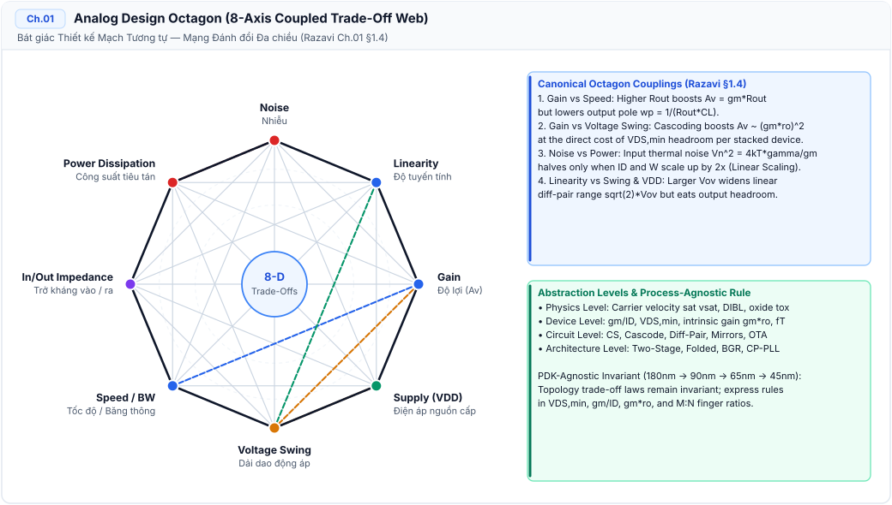

---
{
  "id": "concept-analog-design-octagon",
  "kind": "concept",
  "domain": "foundations",
  "title_vi": "Bát giác thiết kế mạch tương tự và các mức trừu tượng hóa (Analog Design Octagon & Levels of Abstraction)",
  "title_en": "Analog Design Octagon and Levels of Abstraction",
  "summary": "Hệ khung tư duy tối ưu đa chiều gồm 8 chỉ tiêu đánh đổi tuần hoàn của Razavi (Gain, Speed, Power, Supply Voltage, Voltage Swings, Noise, Linearity, I/O Impedance) kết hợp 4 mức trừu tượng hóa từ vật lý linh kiện đến hệ thống.",
  "diagram": "../../diagrams/analog-design-octagon.svg",
  "razavi_refs": [
    {
      "chapter": 1,
      "section": "1.1-1.5",
      "pages": "1-6",
      "equations": []
    },
    {
      "chapter": 3,
      "section": "3.1-3.2",
      "pages": "45-47",
      "equations": ["3.1", "3.2"]
    }
  ],
  "glossary_codes": ["T003", "T004", "T009", "T018", "T019", "T024", "T030", "T031", "T049", "T057", "T066", "T069", "T073", "T086", "T089", "T090", "T094", "T095", "T533"],
  "process_agnostic": true,
  "roles": {
    "sensing_and_equalization_front_end": "Giao diện thu nhận tín hiệu (sensing interface) và bộ cân bằng (equalizer) xử lý tín hiệu yếu/méo trước khi số hóa",
    "octagon_tradeoff_manifold": "Mạng lưới 8 đỉnh chỉ tiêu ràng buộc chéo định hướng mọi quyết định nâng cấp cấu trúc mạch",
    "abstraction_hierarchy": "Bốn tầng tư duy (vật lý linh kiện, mức mạch/transistor, kiến trúc, hệ thống) cho phép khoanh vùng nguyên nhân gốc mà không lạc trong chi tiết thứ cấp"
  },
  "symptoms_addressed": [
    "conflicting-analog-specifications",
    "blind-parameter-tweaking-in-spice",
    "supply-voltage-headroom-collapse",
    "pvt-performance-drift"
  ],
  "limitations": [
    "qualitative-manifold-requires-topology-specific-equations",
    "cannot-optimize-all-eight-axes-simultaneously"
  ],
  "checklists": ["common-mos", "single-stage"]
}
---

## 1. Bản chất Nguyên lý, Sơ đồ Mạch & Vai trò Từng Nhánh Cấu trúc

Trong kỷ nguyên vi mạch tích hợp (integrated circuit, IC) tỷ transistor, xử lý số thống trị phần tính toán phức tạp nhưng **mạch tương tự (analog circuit)** vẫn giữ vai trò không thể thay thế ở hai mặt trận cốt lõi mà Razavi phân tích tại Chương 1 (§1.1–1.3):
1. **Giao diện thu nhận tín hiệu (sensing interface) và phát xạ vật lý:** Mọi tín hiệu tự nhiên — từ sóng tần số vô tuyến (radio-frequency, RF) mức microvolt trên anten đến điện thế hoạt động (action potential) vài millivolt của tế bào thần kinh — đều quá nhỏ và đi kèm nhiễu/can nhiễu (interferers) lớn đến mức việc đặt thẳng một bộ chuyển đổi tương tự-số (analog-to-digital converter, ADC) ngay tại đầu thu sẽ tiêu tốn công suất tiêu thụ (power consumption) khổng lồ và bất khả thi về dải động.
2. **Khi tín hiệu số trở thành tương tự ở tốc độ siêu cao:** Khi luồng bit 1 / bit 0 truyền hàng chục Gb/s qua cáp hoặc đường mạch in có băng thông hữu hạn (finite bandwidth), xung bị suy hao cao tần và méo dạng nghiêm trọng; một bộ cân bằng (equalizer) tương tự phải khôi phục biên độ/pha trước khi cổng logic số (digital gate) có thể phân định mức logic.

Công nghệ **MOS bổ sung (complementary MOS, CMOS)** chiến thắng tuyệt đối nhờ khả năng tích hợp cả miền tương tự (analog domain) và miền số (digital domain) trên cùng một đế bán dẫn (substrate) với chi phí thấp, công suất tĩnh cổng số gần bằng không, và đặc biệt là động lực **thu nhỏ kích thước linh kiện (device scaling)** giúp tốc độ nội tại (intrinsic speed) $f_T$ của MOSFET vượt qua cả transistor lưỡng cực (bipolar transistor) đồng thời vận hành ở điện áp nguồn cấp (supply voltage) thấp quanh $1\,\text{V}$ hoặc nhỏ hơn. Tuy nhiên, việc thu nhỏ công nghệ kéo theo hai hệ quả khắc nghiệt cho người thiết kế tương tự: độ lợi nội tại $g_m r_o$ của từng transistor sụt giảm mạnh, và khoảng dự trữ điện áp (voltage headroom) dưới nguồn $V_{DD}$ thấp bị bóp nghẹt trước các **biến thiên PVT (process, voltage, temperature variations)**.



Để kiểm soát bài toán tối ưu đa chiều đó mà không rơi vào cảnh "vặn mò thông số trong SPICE", Razavi đúc kết hai trụ cột phương pháp luận xuyên suốt 19 chương:

- **Bát giác thiết kế mạch tương tự (Analog Design Octagon — Hình 3.3, §3.2):** Tám chỉ tiêu hiệu năng chủ chốt tạo thành một mạng lưới đánh đổi (trade-off) khép kín gồm:
  1. **Độ lợi (Gain):** Độ lợi điện áp tín hiệu nhỏ $A_v$, độ lợi hỗ dẫn $G_m$, hoặc độ lợi vòng $\beta A_0$ quyết định độ chính xác tĩnh.
  2. **Tốc độ (Speed):** Băng thông $-3\,\text{dB}$, tần số độ lợi đơn vị $f_u$ ($\text{GBW}$), và tốc độ biến thiên điện áp cực đại (slew rate, SR) quyết định thời gian xác lập $t_s$.
  3. **Công suất tiêu tán (Power Dissipation):** Tích $V_{DD} \sum I_{\text{bias}}$ giới hạn thời lượng pin và tản nhiệt gói chip.
  4. **Điện áp nguồn cấp (Supply Voltage — $V_{DD}$):** Trần điện áp do độ bền điện môi cổng $t_{ox}$ và kiến trúc hệ thống áp đặt.
  5. **Dải dao động điện áp (Voltage Swings):** Biên độ đỉnh–đỉnh cực đại $V_{\text{out,max}} - V_{\text{out,min}}$ mà các transistor vẫn giữ đúng vùng bão hòa (saturation region).
  6. **Nhiễu (Noise):** Nhiễu nhiệt $4kT\gamma g_m$ và nhiễu nhấp nháy $1/f$ xác lập sàn tín hiệu nhỏ nhất thu nhận được.
  7. **Độ tuyến tính (Linearity):** Mức độ triệt méo hài bậc hai/ba ($HD_2, HD_3$) và xuyên điều chế khi biên độ tín hiệu lớn làm xê dịch điểm phân cực.
  8. **Trở kháng vào/ra (Input/Output Impedance — $Z_{\text{in}}, Z_{\text{out}}$):** Khả năng ghép tầng không gây suy hao tải hoặc phản xạ đường truyền.

- **Bốn mức trừu tượng hóa (Levels of Abstraction — Hình 1.5, §1.5):**
  1. **Mức linh kiện (Device level):** Điện trường dọc/ngang, vận chuyển điện tích (charge transport), vùng nghèo, kênh nghịch đảo.
  2. **Mức mạch / mức transistor (Circuit / Transistor level):** Tương tác dòng–áp giữa nhóm MOSFET, gương dòng, cặp vi sai, tầng cascode.
  3. **Mức kiến trúc (Architecture level):** Phối ghép các khối chức năng như Op-Amp hai tầng bù Miller, vòng khóa pha (PLL), bộ tham chiếu vùng cấm.
  4. **Mức hệ thống (System level):** Phân bổ chỉ tiêu giữa LNA, bộ trộn tần, bộ lọc, AGC, equalizer và ADC để tối ưu công suất toàn chip.

---

## 2. Hệ Phương trình Cốt lõi & Tư duy "Nhìn Mạch Đọc Nhanh" (Analysis by Inspection)

Tại §3.2 (tr. 45–46), một khối khuếch đại thực tế xếp chồng tín hiệu lên điểm làm việc tĩnh $\alpha_0$ và bị uốn cong đặc tuyến truyền đạt khi biên độ lớn. Khai triển chuỗi đa thức quanh điểm phân cực cho ta mô hình chuẩn hóa:

$$y(t) = \alpha_0 + \alpha_1 x(t) + \alpha_2 x^2(t) + \alpha_3 x^3(t) + \cdots + \alpha_n x^n(t)$$

Trong đó $\alpha_0$ là mức phân cực DC ngõ ra, $\alpha_1$ là **độ lợi tín hiệu nhỏ (small-signal gain)** mà ta mong muốn giữ hằng định, còn các hệ số bậc cao $\alpha_2, \alpha_3, \dots$ định lượng **tính phi tuyến (nonlinearity)** khi quỹ đạo tín hiệu làm thay đổi $g_m(V_{GS})$ và $r_o(V_{DS})$.

Để định lượng nhanh các cạnh nối bên trong **Bát giác thiết kế mạch tương tự** trên một tầng khuếch đại CMOS tổng quát mang dòng tĩnh $I_D$, điện áp vượt ngưỡng hữu hiệu $V_{DS,\min} \approx V_{OV}$, tải tụ $C_L$ và điện trở ra $R_{\text{out}}$, kỹ sư dùng ngay 5 phương trình rường cột:

1. **Phương trình Độ lợi – Dải dao động – Công suất:**
   $$|A_v| = G_m R_{\text{out}}, \qquad \text{GBW} = \frac{G_m}{2\pi C_L}, \qquad P_{\text{DC}} = V_{DD} I_{\text{tot}}$$
2. **Định luật Bảo toàn Tích Độ lợi – Băng thông và Đánh đổi $V_{OV}$:** Với MOSFET bão hòa kênh dài chuẩn hóa ($g_m = 2I_D / V_{OV}$) và tải điện trở $R_D$ có sụt áp DC $V_{RD} = I_D R_D$:
   $$|A_v| = g_m R_D = \frac{2 I_D}{V_{OV}} \cdot \frac{V_{RD}}{I_D} = \frac{2 V_{RD}}{V_{OV}}$$
   Công thức cực gọn này phơi bày trực tiếp ba cạnh của Bát giác: muốn tăng $|A_v|$ thì hoặc phải tăng sụt áp $V_{RD}$ (làm **thu hẹp dải dao động ngõ ra** $V_{\text{swing}} \le V_{DD} - V_{RD} - V_{OV}$), hoặc phải giảm $V_{OV}$ (đòi hỏi tăng $W/L$ làm **tăng tụ ký sinh $\rightarrow$ giảm Tốc độ**, đồng thời **thu hẹp dải tuyến tính đầu vào** vốn tỷ lệ với $V_{OV}$!).
3. **Phương trình Nhiễu nhiệt – Công suất – Dải động (Dynamic Range, DR):** Mật độ phổ công suất nhiễu nhiệt quy đổi ngõ vào tỷ lệ nghịch với $g_m$:
   $$\overline{V_{n,\text{in}}^2} = \frac{4 k T \gamma}{g_m} \quad \Longrightarrow \quad \text{DR} = \frac{V_{\text{swing,rms}}^2}{\int \overline{V_{n,\text{in}}^2}\,df} \propto \frac{(V_{DD} - N_{\text{stack}} V_{DS,\min})^2}{k T / C_L}$$
   Muốn giảm điện áp nhiễu hiệu dụng đi $2\times$ ($-6\,\text{dB}$) mà giữ nguyên cấu trúc và mật độ dòng, ta bắt buộc phải tăng $g_m$, $W$, $C_L$ và dòng phân cực $I_D$ lên **$4\times$**!
4. **Quy tắc "Nhìn Mạch Đọc Nhanh" 3 Nón Tư duy của Razavi (§1.4):**
   - *Nón Kỹ sư (Engineer's hat):* Bỏ qua các hiệu ứng bậc hai nhỏ để đọc ngay đường truyền tín hiệu, cực chủ đạo $\omega_p \approx 1/(R_{\text{node}} C_{\text{node}})$ và nút thắt khoảng dự trữ điện áp.
   - *Nón Nhà toán học (Mathematician's hat):* Lập phương trình chính xác ở những chỗ trực giác dễ lừa (như RHP zero truyền thẳng qua $C_{GD}$, chuyển đổi đồng pha sang vi sai do lệch tải $\Delta R_D$, hay trở kháng vào tầng cổng chung khi tải là nguồn dòng).
   - *Nón Nghệ sĩ (Artist's hat):* Khi hai đỉnh của Bát giác khóa cứng nhau trong một cấu trúc cũ, không cố ép kích thước $W/L$ vô ích mà **đổi cấu trúc mạch (circuit topology)** để bẻ gãy phương trình ràng buộc!

### 2.3. Ma trận Định lượng Liên kết Chéo Giữa 8 Đỉnh Bát giác
Bảng tra cứu nhanh dưới đây tóm tắt hệ quả trực tiếp khi kỹ sư tác động lên một biến thiết kế đơn lẻ trong một cấu trúc tầng khuếch đại cố định:

| Thao tác biến thiết kế | Đỉnh được cải thiện (+) | Các đỉnh bị suy thoái (−) | Phương trình vật lý chi phối |
|---|---|---|---|
| Tăng dòng tĩnh $I_D$ (giữ $W/L$ cố định) | **Speed** ($\uparrow g_m$), **Noise** ($\downarrow 4kT\gamma/g_m$), **Linearity** ($\uparrow V_{OV}$) | **Power** ($\uparrow V_{DD}I_D$), **Voltage Swing** ($\uparrow V_{DS,\min}$), **Gain** ($\downarrow g_m r_o \propto 1/\sqrt{I_D}$) | $V_{OV} \propto \sqrt{I_D},\; g_m \propto \sqrt{I_D},\; r_o \propto 1/I_D$ |
| Tăng bề rộng $W$ (giữ $I_D$ và $L$ cố định) | **Gain** ($\uparrow g_m$), **Noise** nhiệt & $1/f$ ($\downarrow$), **Voltage Swing** ($\downarrow V_{DS,\min}$) | **Speed** tại nút vào/ra ($\uparrow C_{GS}, C_{GD}, C_{DB}$), **Linearity** vi sai ($\downarrow \sqrt{2}V_{OV}$) | $g_m/I_D \uparrow \to 1/(\zeta V_T),\; C_{GG} \propto W L$ |
| Tăng đồng thời $W$ và $L$ theo tỷ lệ $k$ (giữ $I_D$) | **Gain** ($\uparrow r_o \propto L$), **Noise $1/f$** ($\downarrow 1/(WL)$), **Matching** ($\downarrow 1/\sqrt{WL}$) | **Speed** sụt mạnh ($\downarrow f_T \propto 1/L^2,\; \uparrow C_{GG} \propto k^2$) | $V_{OV} = \text{const},\; g_m r_o \propto k,\; C_{GG} \propto k^2$ |
| Xếp chồng thêm transistor Cascode | **Gain** ($\uparrow g_m r_o$ lần), **Speed** đầu vào (triệt tụ Miller), **$Z_{\text{out}}$** ($\uparrow$) | **Voltage Swing** mất $V_{DS,\min}$ mỗi tầng, **Supply Voltage** tối thiểu tăng | $R_{\text{out}} \approx g_{m2} r_{o2} r_{o1},\; V_{\text{swing}} \le V_{DD} - N V_{DS,\min}$ |

### 2.4. Ví dụ Định lượng Từ Nghiên cứu Thực tế Razavi (Chương 1 §1.1.1 & Chương 3 §3.3.1)
Xét bài toán thu nhận tín hiệu điện thế hoạt động thần kinh (Hình 1.2, tr. 2) hoặc đầu thu cảm biến biên độ $V_{\text{sig}} = 1\,\text{mV}_{\text{rms}}$ trên băng tần $B = 10\,\text{kHz}$ dưới nguồn $V_{DD} = 1.0\,\text{V}$:
- Nếu yêu cầu tỷ số tín hiệu trên nhiễu $\text{SNR} \ge 40\,\text{dB}$ ($100\times$ về biên độ), nhiễu quy đổi ngõ vào tổng phải nhỏ hơn $V_{n,\text{max}} = 10\,\mu\text{V}_{\text{rms}}$, tức mật độ phổ trung bình $\sqrt{\overline{V_{n,\text{in}}^2}} \le 100\,\text{nV}/\sqrt{\text{Hz}}$.
- Muốn tầng khuếch đại đầu đạt độ lợi $|A_v| = 20$ bằng tải điện trở đơn giản, từ $|A_v| = 2 V_{RD}/V_{OV} = 20$ với $V_{OV} = 100\,\text{mV}$ suy ra $V_{RD} = 1.0\,\text{V} = V_{DD}$ — **mất sạch 100% dải dao động ngõ ra**! Phép tính 2 dòng trên Bát giác lập tức chứng minh: bắt buộc phải bỏ tải điện trở để nâng cấp sang **tải nguồn dòng chủ động (`topo-cs-current-source-and-active-load` / `topo-five-transistor-ota`)** và dùng transistor PMOS diện tích $WL$ lớn ở vùng nghịch đảo vừa/yếu để nén đồng thời nhiễu $1/f$ lẫn công suất pin!

---

## 3. Bất biến Cấu trúc & Các Bẫy Lỗi Kinh điển (Structural Invariants & Traps)

- **[INV-OCT-01] Bất biến không có "bữa trưa miễn phí" trên Bát giác Thiết kế:** Mọi thay đổi tham số đơn lẻ ($I_D$, $W$, $L$, $R_D$, $V_{\text{bias}}$) cải thiện một đỉnh của Bát giác đều làm xấu đi ít nhất một đỉnh khác. Chỉ khi **thay đổi cấu trúc mạch (topology upgrade)** hoặc **dịch chuyển mức trừu tượng hóa** (ví dụ chuyển sang vi sai, thêm cascode che chắn, tách hai tầng Gain + Swing, hoặc xử lý lệch số ở hậu kỳ) ta mới nới rộng được biên Pareto.
- **[INV-OCT-02] Bất biến Bảo toàn Dải động dưới Nguồn cấp Thấp:** Khi điện áp nguồn cấp $V_{DD}$ giảm đi hệ số $\alpha$ (ví dụ từ $1.8\,\text{V}$ ở 180nm xuống $1.0\,\text{V}$ ở 45nm), dải dao động tối đa giảm ít nhất $\alpha$ lần; để giữ nguyên tỷ số tín hiệu trên nhiễu (SNR), nhiễu nhiệt quy đổi ngõ vào cũng phải giảm $\alpha$ lần, kéo theo $g_m$ và điện dung lấy mẫu $C$ phải tăng lên $\alpha^2$ lần — nghĩa là công suất mạch tương tự có xu hướng **tăng hoặc giữ nguyên** chứ không tự động giảm như mạch logic số (Ch.17 §17.1).
- **[INV-OCT-03] Bất biến Bền vững PVT (PVT Robustness Contract):** Một mạch tương tự chỉ được coi là hợp lệ khi thỏa mãn đồng thời mọi chỉ tiêu trên toàn bộ không gian tích Đề-các của góc công nghệ (`TT, FF, SS, FS, SF`), dải điện áp nguồn (thường $V_{DD} \pm 5\%$ đến $\pm 10\%$) và dải nhiệt độ làm việc (ví dụ $-40^\circ\text{C} \dots 125^\circ\text{C}$).

- **[TRAP-OCT-01] Bẫy "Tối ưu mù bằng trình tối ưu tự động trong SPICE":** Razavi nhấn mạnh ở cuối Chương 11 (§11.7, tr. 507): dùng công cụ tối ưu tự động hoặc quét ngẫu nhiên hàng chục biến $W, L$ khi chưa hiểu nguyên nhân vật lý gốc rễ sẽ đẩy transistor vào vùng rìa bão hòa ở góc danh định (`TT, 27°C`), khiến mạch sập hoàn toàn độ lợi hoặc dao động mất ổn định ngay khi sang góc `SS` hoặc `FF`.
- **[TRAP-OCT-02] Bẫy Đồng nhất Băng thông Tín hiệu Nhỏ với Tốc độ Tín hiệu Lớn:** Đạt $\text{GBW}$ hàng GHz trên phân tích `ac` không hề đảm bảo mạch đáp ứng kịp xung biên độ lớn $1\,\text{V}_{pp}$ nếu dòng đuôi $I_{SS}$ không đủ nạp tụ bù/tụ tải ($SR = I_{SS}/C_c$), hoặc nếu nhánh gập bị cạn dòng gây trễ phục hồi quá kích (overdrive recovery).
- **[TRAP-OCT-03] Bẫy Bỏ quên Tương tác Trở kháng Giữa các Tầng ($Z_{\text{in}}, Z_{\text{out}}$):** Thiết kế một tầng có độ lợi hở mạch rất cao ($R_{\text{out}}$ hàng trăm $\text{k}\Omega$) nhưng đặt ngay sau nó một tải điện trở nhỏ hoặc công tắc lấy mẫu đóng mở nhanh mà không có tầng đệm hoặc hồi tiếp giảm trở kháng ra sẽ làm sập toàn bộ độ lợi thực tế.

---

## 4. Lộ trình Nâng cấp Cấu trúc & Bát giác Đánh đổi (Upgrade Paths & Design Octagon)

Bát giác Thiết kế chính là "la bàn định tuyến" nối toàn bộ các thẻ cấu trúc trong Bộ não Tri thức Razavi:

| Khi mạch hiện tại chạm trần ở đỉnh... | Hướng nâng cấp cấu trúc chuẩn Razavi (Canonical Upgrade Path) | Đỉnh Bát giác phải trả giá (Cost) |
|---|---|---|
| Thiếu **Gain** và bị tụ Miller $C_{GD}$ hạn chế **Speed** ở tầng đơn | `topo-cs-current-source-and-active-load` $\rightarrow$ `topo-cascode-stage` $\rightarrow$ `topo-telescopic-cascode-opamp` | Mất thêm $2 V_{DS,\min}$ **Voltage Swing**; bó hẹp ICMR và khó nối tắt vào–ra |
| Cần giữ Gain/Speed một tầng nhưng mở rộng ICMR & nối hồi tiếp đơn vị | `topo-telescopic-cascode-opamp` $\rightarrow$ `topo-folded-cascode-ota` | Tăng ~2× **Power Dissipation**; tăng **Noise** từ cặp nguồn dòng gập; thêm cực phụ nút gập |
| Cần cả **Gain** lớn ($\ge 60\,\text{dB}$) lẫn **Voltage Swing** sát nguồn ($V_{DD} - 2V_{DS,\min}$) | `topo-folded-cascode-ota` $\rightarrow$ `topo-two-stage-opamp` + `tech-miller-pole-splitting` + `tech-miller-rhp-zero-nulling-and-cascode-comp` | Xuất hiện 2 cực trở kháng cao dễ mất ổn định pha; xuất hiện RHP zero $+g_{m2}/C_c$ |
| Cần **Gain** cỡ hai tầng nhưng giữ **Speed** một tầng với tải tụ thuần | `topo-folded-cascode-ota` $\rightarrow$ `topo-gain-boosted-cascode` | Tốn thêm diện tích/công suất cho Op-Amp phụ; nguy cơ cặp cực-zero doublet làm chậm xác lập |
| Bị nhiễu nguồn/đế và méo hài bậc chẵn ($HD_2$) ở mạch đơn cực | Mạch đơn cực $\rightarrow$ `topo-basic-differential-pair` $\rightarrow$ `topo-five-transistor-ota` | Tăng gấp đôi số nhánh linh kiện; nếu vi sai toàn phần bắt buộc phải có `tech-common-mode-feedback-cmfb` |
| Cần tăng **Linearity** cho cặp đầu vào khi biên độ vi sai lớn | `topo-basic-differential-pair` $\rightarrow$ `topo-degenerated-diffpair-and-gilbert` hoặc đóng vòng `concept-feedback-four-topologies` | Suy biến nguồn làm giảm $G_m$, giảm **Gain** và cộng thêm nhiễu nhiệt điện trở $4kTR_S$ |
| Định cỡ rời rạc sai lệch ở tiến trình 90nm/65nm/45nm | Luật bình phương `concept-mos-operating-regions` $\rightarrow$ `tech-nanometer-vdsmin-gmid-sizing` + `tech-channel-length-and-opamp-scaling` | Phải trích xuất đường cong tham chiếu $g_m/I_D$, $I_D/W$, $g_m r_o$ từ mô hình BSIM thực tế |

---

## 5. Thích ứng Đa Tiến trình (90nm / 65nm / 45nm) & Cách Kiểm chứng trong Cadence / Spectre

Khi dịch chuyển cùng một bài toán thiết kế qua các nút công nghệ **90nm** ($V_{DD} \approx 1.2\,\text{V}$), **65nm** ($V_{DD} \approx 1.0\text{–}1.2\,\text{V}$) và **45nm / 40nm** ($V_{DD} \approx 0.9\text{–}1.0\,\text{V}$), hình dạng Bát giác biến dạng mạnh theo hai trục: **Supply Voltage / Voltage Swing** co hẹp và **Intrinsic Gain ($g_m r_o$)** tụt từ $\sim 25\text{–}40$ ở công nghệ cũ xuống chỉ còn $\sim 7\text{–}15$ cho $L_{\min}$ (như Razavi minh họa trực tiếp ở Chương 11 §11.5.1 với 40nm CMOS, $V_{DD} = 1\,\text{V}$).

**Quy trình 4 bước kiểm soát Bát giác trong Cadence Virtuoso IC617 & Spectre:**
1. **Lập bảng Ngân sách Khoảng dự trữ Điện áp (Headroom Budget) & Công suất trước khi vẽ Schematic:**
   - Ấn định dải dao động yêu cầu $V_{\text{swing,se}}$, lấy phần dư $V_{DD} - V_{\text{swing,se}}$ chia cho số tầng transistor xếp chồng $N_{\text{stack}}$ để ra trần $V_{DS,\min,k}$ cho từng transistor (thường $100\text{–}200\,\text{mV}$ ở 90nm/65nm/45nm). Nếu $V_{DS,\min,k} < 100\,\text{mV}$, cảnh báo ngay: ngăn xếp quá cao (như Telescopic 5 tầng dưới nguồn $0.9\text{–}1.0\,\text{V}$), phải chuyển sang hai tầng (`topo-two-stage-opamp`).
2. **Kiểm tra Điểm làm việc Tĩnh (`dcOp` / `dcOpInfo`) trên mọi Transistor:**
   - Trong ADE L / ADE Explorer, bật lưu ` save *:oppoint ` hoặc đọc từ `dcOpInfo.info` (PSF ASCII): kiểm tra toàn bộ transistor khuếch đại/nguồn dòng đạt `region = 2` (bão hòa) và biên dự trữ bão hòa thực tế:
     $$\Delta V_{\text{sat}} = |V_{DS}| - |V_{\text{dsat}}| \ge 50\text{–}80\,\text{mV}$$
3. **Đo đầy đủ 8 Đỉnh Bát giác bằng Bộ Phép thử Chuẩn hóa (Multi-Analysis Suite):**
   - `dc` (quét $V_{\text{in,diff}}$ và $V_{\text{in,cm}}$): vẽ đạo hàm $\partial V_{\text{out}}/\partial V_{\text{in}}$ theo $V_{\text{out}}$ (như Hình 11.40c của Razavi!) để xác nhận độ lợi **không bị sập ở hai biên dải dao động** chứ không chỉ đo tại $V_{\text{out}} = V_{CM}$.
   - `ac` / `xf` / `stb`: đo Gain $A_0$, băng thông $\text{GBW}$, dự trữ pha $\text{PM}$ (qua `iprobe`/`diffstbprobe`), trở kháng $Z_{\text{in}}, Z_{\text{out}}$ và PSRR từ `xf`.
   - `noise`: tích phân mật độ phổ nhiễu quy đổi ngõ vào `onoise_spectrum / gain` trên băng tần quan tâm.
   - `tran` (xung bậc thang nhỏ & xung biên độ lớn tối đa): tách bạch ổn định tuyến tính (ringing/overshoot) với giới hạn Slew Rate và méo hài (`dft` / `pss` + `pac` cho $HD_2, HD_3$).
4. **Quét Ma trận Góc PVT (`Corners` trong ADE XL / Assembler):** Chạy tối thiểu `{TT, FF, SS, FS, SF} × {VDD_min, VDD_nom, VDD_max} × {T_min, 27°C, T_max}` trước khi chốt thiết kế; kiểm tra nhất quán tham số chia ngón `fingers` (`nf`) và hệ số nhân `m` thông qua CDF callback (`PasCdfFormInit`) để diện tích/chu vi tiếp giáp `ad, as, pd, ps` cập nhật đúng tụ ký sinh.

**Mẫu Công thức ADE Calculator / OCEAN Đo Nhanh 8 Trục Bát Giác Trên Spectre:**
```ocean
; 1. DC Gain & Linear Output Swing Window (nơi |Av(Vout)| >= 0.8 * Av_mid)
Av_dc_curve = deriv(v("/Vout" ?result "dc"))
Av_mid      = value(Av_dc_curve 0.0)

; 2. Small-Signal Speed & Stability (từ ac / stb)
GBW_Hz      = gainBwProd(VF("/Vout"))
UGF_Hz      = cross(db20(VF("/Vout")) 0 1 "falling")
PM_deg      = phaseMargin(getData("loopGain" ?result "stb"))

; 3. Power Dissipation & Integrated Input-Referred Noise
P_DC_W      = abs(IDC("/V0/PLUS")) * VAR("VDD")
Vn_in_rms   = sqrt(integ((getData("in" ?result "noise"))**2 f_low f_high))

; 4. Large-Signal Slew Rate & THD Linearity
SR_rise     = slewRate(VT("/Vout") V_10pct t V_90pct t "rising")
THD_pct     = thd(VT("/Vout") t_start t_stop 64 f_fund)
```

*Nguyên tắc quyết định nâng cấp:* Khi bất kỳ cặp biểu thức nào trong 8 biểu thức trên vi phạm chỉ tiêu ngược chiều nhau dù đã quét hết không gian $(W, L, I_D)$, hãy tra ngay các cạnh `upgrades_to` từ nút hiện tại trên đồ thị tri thức thay vì lặp vô tận trên cùng một sơ đồ mạch!

---

## 6. Mốc Đối chiếu Sách Razavi & Thuật ngữ Chuẩn CLB

- **Sách gốc Razavi (2nd Ed.):**
  - Chương 1: *Introduction to Analog Design*, §1.1 *Why Analog?* (tr. 1–4, Hình 1.1–1.4), §1.2 *Why Integrated?* (tr. 4), §1.3 *Why CMOS?* (tr. 5), §1.4 *Why This Book?* (tr. 5), §1.5 *Levels of Abstraction* (tr. 5–6, Hình 1.5).
  - Chương 3: *Single-Stage Amplifiers*, §3.1 *Applications* (tr. 45), §3.2 *General Considerations* (tr. 45–47, Phương trình 3.1–3.2, **Hình 3.3: Analog design octagon**, Bảng 3.1).
  - Chương 11: §11.7 *Summary* (tr. 507 — ba bước tư duy thiết kế chuẩn mực, không lạm dụng tối ưu tự động mù quáng).
- **Thuật ngữ chuẩn CLB Vi Mạch (`THUẬT NGỮ CHUẨN.md`):**
  - `T533`: *analog design octagon* $\rightarrow$ **Bát giác thiết kế mạch tương tự**.
  - `T049`: *level of abstraction* $\rightarrow$ **Mức trừu tượng hóa** (`T030` mức linh kiện, `T018` mức mạch, `T093` mức transistor, `T009` mức kiến trúc, `T089` mức hệ thống).
  - `T090`: *trade-off* $\rightarrow$ **Đánh đổi**; `T069` / `T073`: *PVT variations* $\rightarrow$ **Biến thiên PVT** (quy trình chế tạo, điện áp nguồn và nhiệt độ).
  - `T094`: *voltage gain* $\rightarrow$ **Độ lợi điện áp** (không gọi là hệ số khuếch đại); `T095`: *voltage swing* $\rightarrow$ **Dải dao động điện áp** ($V_{\text{out,max}} - V_{\text{out,min}}$); `T066`: *power dissipation* $\rightarrow$ **Công suất tiêu tán**.
